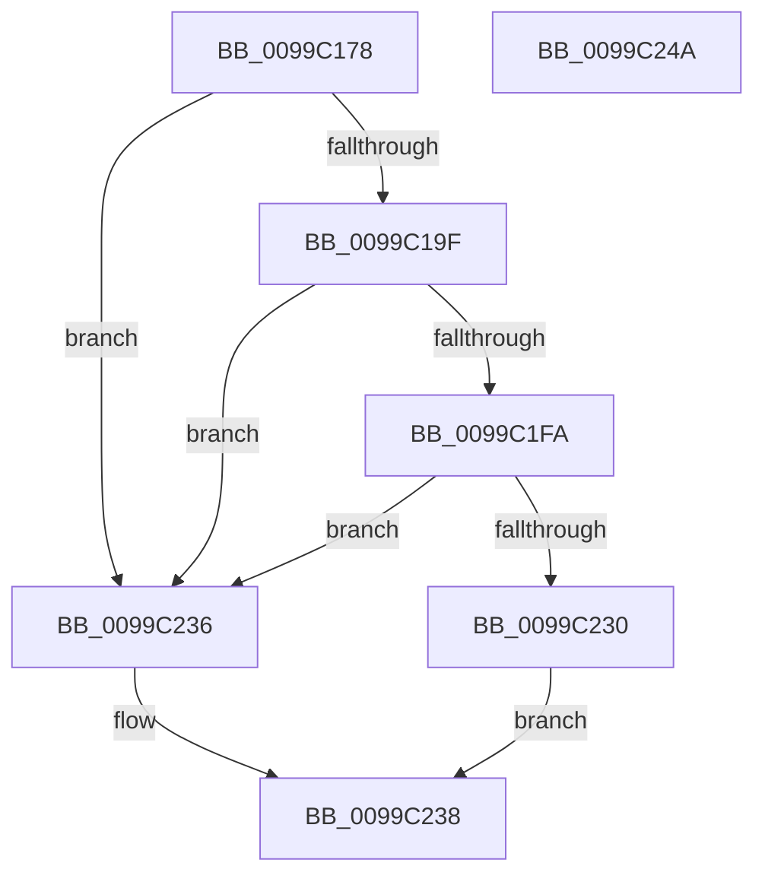

# IopReferenceDriverObjectByName

- RVA: `0x0099C178`–`0x0099C24B` (길이 `211` bytes)
- VA: `0x000000014099C178`
- 실행 섹션: `PAGE`
- PDB 이름 있음: `예`; PDB Function 태그: `아니요`
- unwind 정보 RVA: `0x00099740`
- 디코드: `55`개 명령, `211/211` bytes 표시
- 미해석 바이트: `0` (있으면 어셈블리에 `.byte`로 보존)

> 이 문서는 커널 이미지의 기계어와 PDB 기호를 분석해 생성했습니다. 4번과 5번은 함수 원형과 자료형을 바이너리 사용 방식에서 추정한 C 해석이며 원본 소스 복구 결과는 아닙니다.

## 1. Dependencies

- 직접 호출 지점: **4**; 고유 호출 대상: **4**
- 직접 호출자로 확인된 함수: **3**
- RIP 상대 이미지 참조: **1**

### Outgoing calls
- `0x0099C1C4` → [PsGetCurrentSilo](../../text/40/PsGetCurrentSilo_function_004094A0.md) (function, `0x004094A0`)
- `0x0099C1F1` → [ObOpenObjectByNameEx](../89/ObOpenObjectByNameEx_function_0089A8A0.md) (function, `0x0089A8A0`)
- `0x0099C21C` → [ObReferenceObjectByHandle](../86/ObReferenceObjectByHandle_function_00868DB0.md) (function, `0x00868DB0`)
- `0x0099C227` → [ZwClose](../../text/6A/ZwClose_function_006AD2B0.md) (function, `0x006AD2B0`)

### Direct callers
- [PipCallDriverAddDeviceQueryRoutine](PipCallDriverAddDeviceQueryRoutine_function_00996604.md) at `0x0099669B`
- [PipCallDriverAddDeviceQueryRoutine](PipCallDriverAddDeviceQueryRoutine_function_00996604.md) at `0x009968CE`
- [PiGetDefaultMessageString](PiGetDefaultMessageString_function_0099A87C.md) at `0x0099A8E5`
- [IopInitializeSystemDrivers](../../init/C7/IopInitializeSystemDrivers_function_00C73590.md) at `0x00C7361F`

### Static image references
- `0x0099C19F` → RVA `0x00FC6C78` (`ALMOSTRO`; read)

## 2. Other-region calls and transfers

- 다른 실행 섹션으로 향하는 call: **2**
  - `0x0099C1C4` → [PsGetCurrentSilo](../../text/40/PsGetCurrentSilo_function_004094A0.md) (`PAGE` → `.text`)
  - `0x0099C227` → [ZwClose](../../text/6A/ZwClose_function_006AD2B0.md) (`PAGE` → `.text`)
- 별도 외부 분기/꼬리 이동을 확인하지 못했습니다.

## 3. Assembly (complete function range)

```asm
0099C178  48 89 5C 24 18                  mov qword ptr [rsp + 0x18], rbx
0099C17D  48 89 7C 24 20                  mov qword ptr [rsp + 0x20], rdi
0099C182  55                              push rbp
0099C183  48 8B EC                        mov rbp, rsp
0099C186  48 83 EC 70                     sub rsp, 0x70
0099C18A  33 FF                           xor edi, edi
0099C18C  89 7D D4                        mov dword ptr [rbp - 0x2c], edi
0099C18F  89 7D EC                        mov dword ptr [rbp - 0x14], edi
0099C192  48 89 7D 10                     mov qword ptr [rbp + 0x10], rdi
0099C196  66 39 39                        cmp word ptr [rcx], di
0099C199  0F 84 97 00 00 00               je 0x14099c236
0099C19F  48 8B 1D D2 AA 62 00            mov rbx, qword ptr [rip + 0x62aad2]
0099C1A6  0F 57 C0                        xorps xmm0, xmm0
0099C1A9  F3 0F 7F 45 F0                  movdqu xmmword ptr [rbp - 0x10], xmm0
0099C1AE  C7 45 D0 30 00 00 00            mov dword ptr [rbp - 0x30], 0x30
0099C1B5  48 89 7D D8                     mov qword ptr [rbp - 0x28], rdi
0099C1B9  C7 45 E8 40 02 00 00            mov dword ptr [rbp - 0x18], 0x240
0099C1C0  48 89 4D E0                     mov qword ptr [rbp - 0x20], rcx
0099C1C4  E8 D7 D2 A6 FF                  call 0x1404094a0
0099C1C9  48 8D 4D 10                     lea rcx, [rbp + 0x10]
0099C1CD  45 33 C9                        xor r9d, r9d
0099C1D0  48 89 4C 24 38                  mov qword ptr [rsp + 0x38], rcx
0099C1D5  45 33 C0                        xor r8d, r8d
0099C1D8  48 89 44 24 30                  mov qword ptr [rsp + 0x30], rax
0099C1DD  48 8D 4D D0                     lea rcx, [rbp - 0x30]
0099C1E1  48 89 7C 24 28                  mov qword ptr [rsp + 0x28], rdi
0099C1E6  48 8B D3                        mov rdx, rbx
0099C1E9  C7 44 24 20 80 00 00 00         mov dword ptr [rsp + 0x20], 0x80
0099C1F1  E8 AA E6 EF FF                  call 0x14089a8a0
0099C1F6  85 C0                           test eax, eax
0099C1F8  78 3C                           js 0x14099c236
0099C1FA  4C 8B 05 77 AA 62 00            mov r8, qword ptr [rip + 0x62aa77]
0099C201  48 8D 45 18                     lea rax, [rbp + 0x18]
0099C205  48 8B 4D 10                     mov rcx, qword ptr [rbp + 0x10]
0099C209  45 33 C9                        xor r9d, r9d
0099C20C  48 89 7C 24 28                  mov qword ptr [rsp + 0x28], rdi
0099C211  33 D2                           xor edx, edx
0099C213  48 89 44 24 20                  mov qword ptr [rsp + 0x20], rax
0099C218  48 89 7D 18                     mov qword ptr [rbp + 0x18], rdi
0099C21C  E8 8F CB EC FF                  call 0x140868db0
0099C221  48 8B 4D 10                     mov rcx, qword ptr [rbp + 0x10]
0099C225  8B D8                           mov ebx, eax
0099C227  E8 84 10 D1 FF                  call 0x1406ad2b0
0099C22C  85 DB                           test ebx, ebx
0099C22E  78 06                           js 0x14099c236
0099C230  48 8B 45 18                     mov rax, qword ptr [rbp + 0x18]
0099C234  EB 02                           jmp 0x14099c238
0099C236  33 C0                           xor eax, eax
0099C238  4C 8D 5C 24 70                  lea r11, [rsp + 0x70]
0099C23D  49 8B 5B 20                     mov rbx, qword ptr [r11 + 0x20]
0099C241  49 8B 7B 28                     mov rdi, qword ptr [r11 + 0x28]
0099C245  49 8B E3                        mov rsp, r11
0099C248  5D                              pop rbp
0099C249  C3                              ret
0099C24A  CC                              int3
```

## 4. C-style interpretation (structured pseudocode)

```c
__int64 __fastcall IopReferenceDriverObjectByName(__int64 a1, __int64 a2, int a3, int a4)
{
    __int64 result;
    __int64 v_rdi;
    __int64 v_rsp;
    unsigned __int64 v_stack_m18;
    unsigned int v_stack_m1C;
    unsigned int v_stack_m20;
    unsigned __int64 v_stack_m28;
    unsigned __int64 v_stack_m30;
    unsigned int v_stack_m34;
    unsigned int v_stack_m38;
    unsigned __int64 v_stack_m40;
    unsigned __int64 v_stack_m48;
    unsigned __int64 v_stack_m50;
    unsigned int v_stack_m58;
    unsigned __int64 v_stack_m8;
    unsigned __int64 v_stack_p10;
    unsigned __int64 v_stack_p18;
    unsigned __int64 v_stack_p20;
    unsigned __int64 v_stack_p8;

    v_stack_p18 = v_rbx;
    v_stack_p20 = v_rdi;
    v_rsp = (v_rsp) - (112);
    v_rdi = 0;
    v_stack_m34 = 0;
    v_stack_m1C = 0;
    v_stack_p8 = 0;
    if ((*(unsigned __int16 *)(a1)) == 0) goto loc_0099C236;
    v_stack_m18 = v_xmm0;
    v_stack_m38 = 48;
    v_stack_m30 = 0;
    v_stack_m20 = 576;
    v_stack_m28 = a1;
    result = PsGetCurrentSilo(a1, a2, a3, a4);
    a4 = 0;
    v_stack_m40 = v_stack_p8;
    a3 = 0;
    v_stack_m48 = result;
    v_stack_m50 = 0;
    v_stack_m58 = 128;
    result = ObOpenObjectByNameEx(v_stack_m38, *(unsigned __int64 *)(v_rip + 6466258), a3, a4);
    if (sign_flag) goto loc_0099C236;
    a4 = 0;
    v_stack_m50 = 0;
    a2 = 0;
    v_stack_m58 = v_stack_p10;
    v_stack_p10 = 0;
    result = ObReferenceObjectByHandle(v_stack_p8, a2, *(unsigned __int64 *)(v_rip + 6466167), a4);
    result = ZwClose(v_stack_p8, a2, *(unsigned __int64 *)(v_rip + 6466167), a4);
    if (sign_flag) goto loc_0099C236;
    goto loc_0099C238;
loc_0099C236:
    result = 0;
loc_0099C238:
    return result;
}
```

## 5. (Beta) C Style

```c
int64_t IopReferenceDriverObjectByName(void *Arg1, int64_t Arg2, int32_t Arg3, int32_t Arg4)
{
    uint8_t *arg1 = (uint8_t *)Arg1;

    int64_t result;
    int64_t local_rdi;
    int64_t local_rsp;
    uint64_t v_stack_m18;
    uint32_t v_stack_m1C;
    uint32_t v_stack_m20;
    uint64_t v_stack_m28;
    uint64_t v_stack_m30;
    uint32_t v_stack_m34;
    uint32_t v_stack_m38;
    uint64_t v_stack_m40;
    uint64_t v_stack_m48;
    uint64_t v_stack_m50;
    uint32_t v_stack_m58;
    uint64_t v_stack_m8;
    uint64_t v_stack_p10;
    uint64_t v_stack_p18;
    uint64_t v_stack_p20;
    uint64_t v_stack_p8;

    v_stack_p18 = local_rbx;
    v_stack_p20 = local_rdi;
    local_rsp = (local_rsp) - (112);
    local_rdi = 0;
    v_stack_m34 = 0;
    v_stack_m1C = 0;
    v_stack_p8 = 0;
    if ((*(uint16_t *)(arg1)) == 0) goto loc_0099C236;
    v_stack_m18 = v_xmm0;
    v_stack_m38 = 48;
    v_stack_m30 = 0;
    v_stack_m20 = 576;
    v_stack_m28 = Arg1;
    result = PsGetCurrentSilo(Arg1, Arg2, Arg3, Arg4);
    Arg4 = 0;
    v_stack_m40 = v_stack_p8;
    Arg3 = 0;
    v_stack_m48 = result;
    v_stack_m50 = 0;
    v_stack_m58 = 128;
    result = ObOpenObjectByNameEx(v_stack_m38, *(uint64_t *)(v_rip + 0x62AAD2), Arg3, Arg4);
    if (sign_flag) goto loc_0099C236;
    Arg4 = 0;
    v_stack_m50 = 0;
    Arg2 = 0;
    v_stack_m58 = v_stack_p10;
    v_stack_p10 = 0;
    result = ObReferenceObjectByHandle(v_stack_p8, Arg2, *(uint64_t *)(v_rip + 0x62AA77), Arg4);
    result = ZwClose(v_stack_p8, Arg2, *(uint64_t *)(v_rip + 0x62AA77), Arg4);
    if (sign_flag) goto loc_0099C236;
    goto loc_0099C238;
loc_0099C236:
    result = 0;
loc_0099C238:
    return result;
}
```

### 관측된 메모리 오프셋

구조체 형식이 확인되지 않은 접근은 인자 기준의 오프셋으로만 기록했습니다.

| 기준 인자 | 오프셋 표현 | 폭 (bit) | 접근 |
|---|---:|---:|---|
| `Arg1` | `+ 0x0` | `16` | `R` |

## 6. Execution-region graph

[열기: 2D/3D 그래프와 함수 탐색 컨트롤 패널](../../../control-panel.html?section=page&rva=0x0099C178&view=graph)

- 2D 그래프는 위에서 아래로 흐르고, 3D 그래프는 빈 공간을 드래그해 회전합니다. Shift+드래그는 이동, 휠은 확대·축소, 함수 노드 선택은 대상 보고서 이동입니다.

### Static fallback


