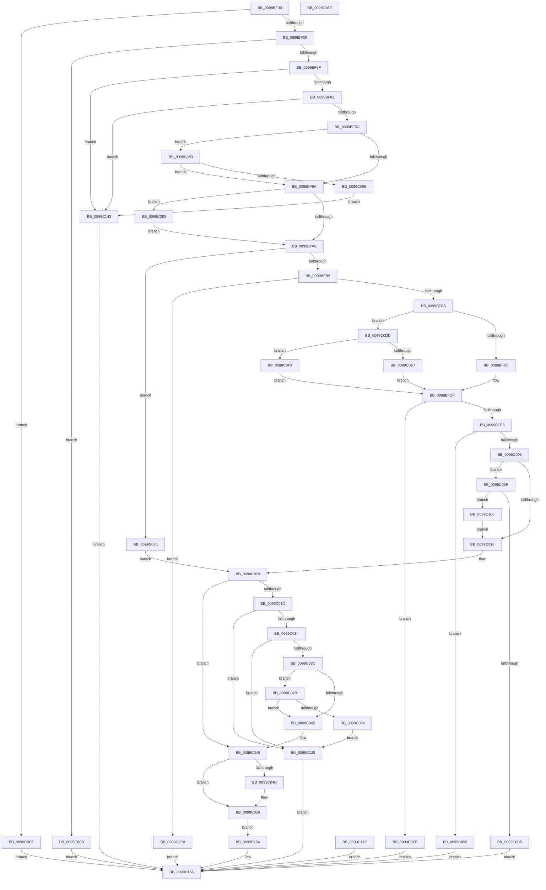

# LdrpAccessResourceDataNoMultipleLanguage

- RVA: `0x0099BF00`–`0x0099C16F` (길이 `623` bytes)
- VA: `0x000000014099BF00`
- 실행 섹션: `PAGE`
- PDB 이름 있음: `예`; PDB Function 태그: `아니요`
- unwind 정보 RVA: `0x0009970C`
- 디코드: `165`개 명령, `623/623` bytes 표시
- 미해석 바이트: `0` (있으면 어셈블리에 `.byte`로 보존)

> 이 문서는 커널 이미지의 기계어와 PDB 기호를 분석해 생성했습니다. 4번과 5번은 함수 원형과 자료형을 바이너리 사용 방식에서 추정한 C 해석이며 원본 소스 복구 결과는 아닙니다.

## 1. Dependencies

- 직접 호출 지점: **6**; 고유 호출 대상: **5**
- 직접 호출자로 확인된 함수: **4**
- RIP 상대 이미지 참조: **0**

### Outgoing calls
- `0x0099BF3D` → [RtlImageDirectoryEntryToData](../../text/43/RtlImageDirectoryEntryToData_function_004328D0.md) (function, `0x004328D0`)
- `0x0099BF5E` → [LdrpGetImageSize](../../text/45/LdrpGetImageSize_function_004562F0.md) (function, `0x004562F0`)
- `0x0099BFB5` → [RtlImageNtHeader](../../text/44/RtlImageNtHeader_function_00443B60.md) (function, `0x00443B60`)
- `0x0099BFF9` → [RtlSectionTableFromVirtualAddress](../../text/43/RtlSectionTableFromVirtualAddress_function_00432CF0.md) (function, `0x00432CF0`)
- `0x0099C0A8` → [RtlSectionTableFromVirtualAddress](../../text/43/RtlSectionTableFromVirtualAddress_function_00432CF0.md) (function, `0x00432CF0`)
- `0x0099C110` → [RtlAddressInSectionTable](../../text/43/RtlAddressInSectionTable_function_00432C90.md) (function, `0x00432C90`)

### Direct callers
- [LdrpGetRcConfig](../../text/45/LdrpGetRcConfig_function_0045555C.md) at `0x00455642`
- [LdrpLoadResourceFromAlternativeModule](../../text/45/LdrpLoadResourceFromAlternativeModule_function_00455698.md) at `0x0045574E`
- [LdrpFindMessageInAlternateModule](../../text/47/LdrpFindMessageInAlternateModule_function_0047CB1C.md) at `0x0047CB4B`
- [LdrpAccessResourceData](LdrpAccessResourceData_function_0099BE1C.md) at `0x0099BEA1`

### Static image references
- 디코드된 RIP-relative 메모리 참조가 없습니다.

## 2. Other-region calls and transfers

- 다른 실행 섹션으로 향하는 call: **6**
  - `0x0099BF3D` → [RtlImageDirectoryEntryToData](../../text/43/RtlImageDirectoryEntryToData_function_004328D0.md) (`PAGE` → `.text`)
  - `0x0099BF5E` → [LdrpGetImageSize](../../text/45/LdrpGetImageSize_function_004562F0.md) (`PAGE` → `.text`)
  - `0x0099BFB5` → [RtlImageNtHeader](../../text/44/RtlImageNtHeader_function_00443B60.md) (`PAGE` → `.text`)
  - `0x0099BFF9` → [RtlSectionTableFromVirtualAddress](../../text/43/RtlSectionTableFromVirtualAddress_function_00432CF0.md) (`PAGE` → `.text`)
  - `0x0099C0A8` → [RtlSectionTableFromVirtualAddress](../../text/43/RtlSectionTableFromVirtualAddress_function_00432CF0.md) (`PAGE` → `.text`)
  - `0x0099C110` → [RtlAddressInSectionTable](../../text/43/RtlAddressInSectionTable_function_00432C90.md) (`PAGE` → `.text`)
- 별도 외부 분기/꼬리 이동을 확인하지 못했습니다.

## 3. Assembly (complete function range)

```asm
0099BF00  48 8B C4                        mov rax, rsp
0099BF03  48 89 58 08                     mov qword ptr [rax + 8], rbx
0099BF07  48 89 70 10                     mov qword ptr [rax + 0x10], rsi
0099BF0B  4C 89 48 20                     mov qword ptr [rax + 0x20], r9
0099BF0F  4C 89 40 18                     mov qword ptr [rax + 0x18], r8
0099BF13  57                              push rdi
0099BF14  41 54                           push r12
0099BF16  41 55                           push r13
0099BF18  41 56                           push r14
0099BF1A  41 57                           push r15
0099BF1C  48 83 EC 40                     sub rsp, 0x40
0099BF20  49 8B F9                        mov rdi, r9
0099BF23  4D 8B E8                        mov r13, r8
0099BF26  48 8B F2                        mov rsi, rdx
0099BF29  48 8B D9                        mov rbx, rcx
0099BF2C  41 B8 02 00 00 00               mov r8d, 2
0099BF32  4C 8D 48 C0                     lea r9, [rax - 0x40]
0099BF36  45 8D 78 FF                     lea r15d, [r8 - 1]
0099BF3A  41 8A D7                        mov dl, r15b
0099BF3D  E8 8E 69 A9 FF                  call 0x1404328d0
0099BF42  48 89 44 24 30                  mov qword ptr [rsp + 0x30], rax
0099BF47  48 85 C0                        test rax, rax
0099BF4A  0F 84 86 01 00 00               je 0x14099c0d6
0099BF50  48 83 64 24 28 00               and qword ptr [rsp + 0x28], 0
0099BF56  48 8D 54 24 28                  lea rdx, [rsp + 0x28]
0099BF5B  48 8B CB                        mov rcx, rbx
0099BF5E  E8 8D A3 AB FF                  call 0x1404562f0
0099BF63  89 44 24 20                     mov dword ptr [rsp + 0x20], eax
0099BF67  85 C0                           test eax, eax
0099BF69  0F 88 54 01 00 00               js 0x14099c0c3
0099BF6F  4C 8B F3                        mov r14, rbx
0099BF72  49 83 E6 FC                     and r14, 0xfffffffffffffffc
0099BF76  48 8D 4E 10                     lea rcx, [rsi + 0x10]
0099BF7A  49 3B F6                        cmp rsi, r14
0099BF7D  0F 82 C0 01 00 00               jb 0x14099c143
0099BF83  48 3B CE                        cmp rcx, rsi
0099BF86  0F 82 B7 01 00 00               jb 0x14099c143
0099BF8C  4C 8B 64 24 28                  mov r12, qword ptr [rsp + 0x28]
0099BF91  4D 85 E4                        test r12, r12
0099BF94  0F 85 EF 00 00 00               jne 0x14099c089
0099BF9A  33 C0                           xor eax, eax
0099BF9C  89 44 24 24                     mov dword ptr [rsp + 0x24], eax
0099BFA0  F6 C3 03                        test bl, 3
0099BFA3  0F 85 BA 00 00 00               jne 0x14099c063
0099BFA9  41 3B C7                        cmp eax, r15d
0099BFAC  0F 85 C4 00 00 00               jne 0x14099c076
0099BFB2  48 8B CB                        mov rcx, rbx
0099BFB5  E8 A6 7B AA FF                  call 0x140443b60
0099BFBA  48 8B F8                        mov rdi, rax
0099BFBD  48 85 C0                        test rax, rax
0099BFC0  0F 84 02 01 00 00               je 0x14099c0c8
0099BFC6  0F B7 40 18                     movzx eax, word ptr [rax + 0x18]
0099BFCA  B9 0B 01 00 00                  mov ecx, 0x10b
0099BFCF  66 3B C1                        cmp ax, cx
0099BFD2  0F 85 05 01 00 00               jne 0x14099c0dd
0099BFD8  44 8B 87 88 00 00 00            mov r8d, dword ptr [rdi + 0x88]
0099BFDF  45 85 C0                        test r8d, r8d
0099BFE2  0F 84 13 01 00 00               je 0x14099c0fb
0099BFE8  45 8B F8                        mov r15d, r8d
0099BFEB  4C 2B 7C 24 30                  sub r15, qword ptr [rsp + 0x30]
0099BFF0  4C 03 FB                        add r15, rbx
0099BFF3  48 8B D3                        mov rdx, rbx
0099BFF6  48 8B CF                        mov rcx, rdi
0099BFF9  E8 F2 6C A9 FF                  call 0x140432cf0
0099BFFE  48 85 C0                        test rax, rax
0099C001  74 52                           je 0x14099c055
0099C003  44 8B 06                        mov r8d, dword ptr [rsi]
0099C006  44 3B 40 08                     cmp r8d, dword ptr [rax + 8]
0099C00A  0F 87 8B 00 00 00               ja 0x14099c09b
0099C010  48 8B BC 24 88 00 00 00         mov rdi, qword ptr [rsp + 0x88]
0099C018  4D 85 ED                        test r13, r13
0099C01B  74 29                           je 0x14099c046
0099C01D  8B 0E                           mov ecx, dword ptr [rsi]
0099C01F  49 2B CF                        sub rcx, r15
0099C022  48 03 CB                        add rcx, rbx
0099C025  8B 56 04                        mov edx, dword ptr [rsi + 4]
0099C028  48 03 D1                        add rdx, rcx
0099C02B  49 3B CE                        cmp rcx, r14
0099C02E  0F 82 04 01 00 00               jb 0x14099c138
0099C034  48 3B D1                        cmp rdx, rcx
0099C037  0F 82 FB 00 00 00               jb 0x14099c138
0099C03D  4D 85 E4                        test r12, r12
0099C040  75 39                           jne 0x14099c07b
0099C042  49 89 4D 00                     mov qword ptr [r13], rcx
0099C046  48 85 FF                        test rdi, rdi
0099C049  74 05                           je 0x14099c050
0099C04B  8B 46 04                        mov eax, dword ptr [rsi + 4]
0099C04E  89 07                           mov dword ptr [rdi], eax
0099C050  E9 FF 00 00 00                  jmp 0x14099c154
0099C055  B8 89 00 00 C0                  mov eax, 0xc0000089
0099C05A  89 44 24 20                     mov dword ptr [rsp + 0x20], eax
0099C05E  E9 F3 00 00 00                  jmp 0x14099c156
0099C063  41 84 DF                        test r15b, bl
0099C066  41 0F 45 C7                     cmovne eax, r15d
0099C06A  89 44 24 24                     mov dword ptr [rsp + 0x24], eax
0099C06E  49 8B DE                        mov rbx, r14
0099C071  E9 33 FF FF FF                  jmp 0x14099bfa9
0099C076  45 33 FF                        xor r15d, r15d
0099C079  EB 9D                           jmp 0x14099c018
0099C07B  4B 8D 04 26                     lea rax, [r14 + r12]
0099C07F  48 3B D0                        cmp rdx, rax
0099C082  76 BE                           jbe 0x14099c042
0099C084  E9 AF 00 00 00                  jmp 0x14099c138
0099C089  4B 8D 04 26                     lea rax, [r14 + r12]
0099C08D  48 3B C8                        cmp rcx, rax
0099C090  0F 86 04 FF FF FF               jbe 0x14099bf9a
0099C096  E9 A8 00 00 00                  jmp 0x14099c143
0099C09B  8B 40 0C                        mov eax, dword ptr [rax + 0xc]
0099C09E  89 44 24 28                     mov dword ptr [rsp + 0x28], eax
0099C0A2  48 8B D3                        mov rdx, rbx
0099C0A5  48 8B CF                        mov rcx, rdi
0099C0A8  E8 43 6C A9 FF                  call 0x140432cf0
0099C0AD  4C 8B E8                        mov r13, rax
0099C0B0  48 85 C0                        test rax, rax
0099C0B3  75 51                           jne 0x14099c106
0099C0B5  B8 89 00 00 C0                  mov eax, 0xc0000089
0099C0BA  89 44 24 20                     mov dword ptr [rsp + 0x20], eax
0099C0BE  E9 93 00 00 00                  jmp 0x14099c156
0099C0C3  E9 8E 00 00 00                  jmp 0x14099c156
0099C0C8  B8 89 00 00 C0                  mov eax, 0xc0000089
0099C0CD  89 44 24 20                     mov dword ptr [rsp + 0x20], eax
0099C0D1  E9 80 00 00 00                  jmp 0x14099c156
0099C0D6  B8 89 00 00 C0                  mov eax, 0xc0000089
0099C0DB  EB 79                           jmp 0x14099c156
0099C0DD  B9 0B 02 00 00                  mov ecx, 0x20b
0099C0E2  66 3B C1                        cmp ax, cx
0099C0E5  75 0C                           jne 0x14099c0f3
0099C0E7  44 8B 87 98 00 00 00            mov r8d, dword ptr [rdi + 0x98]
0099C0EE  E9 EC FE FF FF                  jmp 0x14099bfdf
0099C0F3  45 33 C0                        xor r8d, r8d
0099C0F6  E9 E4 FE FF FF                  jmp 0x14099bfdf
0099C0FB  B8 89 00 00 C0                  mov eax, 0xc0000089
0099C100  89 44 24 20                     mov dword ptr [rsp + 0x20], eax
0099C104  EB 50                           jmp 0x14099c156
0099C106  44 8B 40 0C                     mov r8d, dword ptr [rax + 0xc]
0099C10A  48 8B D3                        mov rdx, rbx
0099C10D  48 8B CF                        mov rcx, rdi
0099C110  E8 7B 6B A9 FF                  call 0x140432c90
0099C115  41 8B 55 0C                     mov edx, dword ptr [r13 + 0xc]
0099C119  8B 4C 24 28                     mov ecx, dword ptr [rsp + 0x28]
0099C11D  48 2B D1                        sub rdx, rcx
0099C120  48 03 54 24 30                  add rdx, qword ptr [rsp + 0x30]
0099C125  48 2B D0                        sub rdx, rax
0099C128  4C 03 FA                        add r15, rdx
0099C12B  4C 8B AC 24 80 00 00 00         mov r13, qword ptr [rsp + 0x80]
0099C133  E9 D8 FE FF FF                  jmp 0x14099c010
0099C138  B8 7B 00 00 C0                  mov eax, 0xc000007b
0099C13D  89 44 24 20                     mov dword ptr [rsp + 0x20], eax
0099C141  EB 13                           jmp 0x14099c156
0099C143  B8 7B 00 00 C0                  mov eax, 0xc000007b
0099C148  89 44 24 20                     mov dword ptr [rsp + 0x20], eax
0099C14C  EB 08                           jmp 0x14099c156
0099C14E  89 44 24 20                     mov dword ptr [rsp + 0x20], eax
0099C152  EB 02                           jmp 0x14099c156
0099C154  33 C0                           xor eax, eax
0099C156  48 8B 5C 24 70                  mov rbx, qword ptr [rsp + 0x70]
0099C15B  48 8B 74 24 78                  mov rsi, qword ptr [rsp + 0x78]
0099C160  48 83 C4 40                     add rsp, 0x40
0099C164  41 5F                           pop r15
0099C166  41 5E                           pop r14
0099C168  41 5D                           pop r13
0099C16A  41 5C                           pop r12
0099C16C  5F                              pop rdi
0099C16D  C3                              ret
0099C16E  CC                              int3
```

## 4. C-style interpretation (structured pseudocode)

```c
__int64 __fastcall LdrpAccessResourceDataNoMultipleLanguage(__int64 a1, __int64 a2, __int64 a3, __int64 a4)
{
    __int64 result;
    __int64 v_r14;
    __int64 v_r15;
    __int64 v_rsp;
    unsigned __int64 v_stack_m38;
    unsigned __int64 v_stack_m40;
    unsigned int v_stack_m44;
    unsigned int v_stack_m48;
    unsigned __int64 v_stack_p10;
    unsigned __int64 v_stack_p18;
    unsigned __int64 v_stack_p20;
    unsigned __int64 v_stack_p8;

    *(unsigned __int64 *)(v_rsp + 8) = v_rbx;
    *(unsigned __int64 *)(v_rsp + 16) = v_rsi;
    *(unsigned __int64 *)(v_rsp + 32) = a4;
    *(unsigned __int64 *)(v_rsp + 24) = a3;
    v_rsp = (v_rsp) - (64);
    result = RtlImageDirectoryEntryToData(a1, (unsigned __int8)(2 - 1), 2, v_rsp - 64);
    v_stack_m38 = result;
    if (result == 0) goto loc_0099C0D6;
    result = LdrpGetImageSize(a1, v_stack_m40, 2, v_rsp - 64);
    v_stack_m48 = (unsigned int)(result);
    if (sign_flag) goto loc_0099C0C3;
    v_r14 = (a1) & (-4);
    if (a2 < v_r14) goto loc_0099C143;
    if ((a2 + 16) < a2) goto loc_0099C143;
    if (v_stack_m40 != 0) goto loc_0099C089;
loc_0099BF9A:
    result = 0;
    v_stack_m44 = 0;
    if ((((unsigned __int8)(a1)) & (3)) != 0) goto loc_0099C063;
loc_0099BFA9:
    if (0 != ((unsigned int)(2 - 1))) goto loc_0099C076;
    result = RtlImageNtHeader(a1, v_stack_m40, 2, v_rsp - 64);
    if (result == 0) goto loc_0099C0C8;
    if (((unsigned __int16)(*(unsigned __int16 *)(result + 24))) != 267) goto loc_0099C0DD;
loc_0099BFDF:
    if ((unsigned int)((unsigned int)(*(unsigned int *)(result + 136))) == 0) goto loc_0099C0FB;
    v_r15 = ((unsigned int)((unsigned int)((unsigned int)(*(unsigned int *)(result + 136))))) - (v_stack_m38);
    v_r15 = (v_r15) + (a1);
    result = RtlSectionTableFromVirtualAddress(result, a1, (unsigned int)(*(unsigned int *)(result + 136)), v_rsp - 64);
    if (result == 0) goto loc_0099C055;
    if (((unsigned int)((unsigned int)(*(unsigned int *)(a2)))) > (*(unsigned int *)(result + 8))) goto loc_0099C09B;
loc_0099C010:
loc_0099C018:
    if (a3 == 0) goto loc_0099C046;
    a1 = ((unsigned int)(*(unsigned int *)(a2))) - (v_r15);
    a1 = (a1) + (a1);
    a2 = ((unsigned int)(*(unsigned int *)(a2 + 4))) + (a1);
    if (a1 < v_r14) goto loc_0099C138;
    if (a2 < a1) goto loc_0099C138;
    if (v_stack_m40 != 0) goto loc_0099C07B;
loc_0099C042:
    *(unsigned __int64 *)(a3) = a1;
loc_0099C046:
    if (v_stack_p20 != 0) {
        result = *(unsigned int *)(a2 + 4);
        *(unsigned int *)(v_stack_p20) = (unsigned int)(result);
    }
    goto loc_0099C154;
loc_0099C055:
    v_stack_m48 = (unsigned int)((unsigned int)(0xC0000089ULL));
    goto loc_0099C156;
loc_0099C063:
    result = (unsigned int)(0xC0000089ULL);
    if ((((unsigned __int8)(v_r15)) & ((unsigned __int8)(a1))) != 0) { result = (unsigned int)(v_r15); }
    v_stack_m44 = (unsigned int)(result);
    goto loc_0099BFA9;
loc_0099C076:
    v_r15 = 0;
    goto loc_0099C018;
loc_0099C07B:
    if (a2 <= (v_r14 + v_stack_m40 * 1)) goto loc_0099C042;
    goto loc_0099C138;
loc_0099C089:
    if (a1 <= (v_r14 + v_stack_m40 * 1)) goto loc_0099BF9A;
    goto loc_0099C143;
loc_0099C09B:
    v_stack_m40 = (unsigned int)((unsigned int)(*(unsigned int *)(v_r14 + v_stack_m40 * 1 + 12)));
    result = RtlSectionTableFromVirtualAddress(v_stack_p20, v_r14, (unsigned int)(*(unsigned int *)(a2)), v_rsp - 64);
    if (result != 0) goto loc_0099C106;
    v_stack_m48 = (unsigned int)((unsigned int)(0xC0000089ULL));
    goto loc_0099C156;
loc_0099C0C3:
    goto loc_0099C156;
loc_0099C0C8:
    v_stack_m48 = (unsigned int)((unsigned int)(0xC0000089ULL));
    goto loc_0099C156;
loc_0099C0D6:
    goto loc_0099C156;
loc_0099C0DD:
    if (((unsigned __int16)((unsigned int)(0xC0000089ULL))) != 523) goto loc_0099C0F3;
    goto loc_0099BFDF;
loc_0099C0F3:
    a3 = 0;
    goto loc_0099BFDF;
loc_0099C0FB:
    v_stack_m48 = (unsigned int)((unsigned int)(0xC0000089ULL));
    goto loc_0099C156;
loc_0099C106:
    result = RtlAddressInSectionTable(v_stack_p20, v_r14, (unsigned int)(*(unsigned int *)((unsigned int)(0xC0000089ULL) + 12)), v_rsp - 64);
    a2 = ((unsigned int)(*(unsigned int *)(result + 12))) - ((unsigned int)(v_stack_m40));
    a2 = (a2) + (v_stack_m38);
    a2 = (a2) - (result);
    v_r15 = (v_r15) + (a2);
    goto loc_0099C010;
loc_0099C138:
    v_stack_m48 = (unsigned int)((unsigned int)(0xC000007BULL));
    goto loc_0099C156;
loc_0099C143:
    v_stack_m48 = (unsigned int)((unsigned int)(0xC000007BULL));
    goto loc_0099C156;
loc_0099C154:
    result = 0;
loc_0099C156:
    v_rsp = (v_rsp) + (64);
    return result;
}
```

## 5. (Beta) C Style

```c
int64_t LdrpAccessResourceDataNoMultipleLanguage(void *Arg1, void *Arg2, int64_t Arg3, int64_t Arg4)
{
    uint8_t *arg1 = (uint8_t *)Arg1;
    uint8_t *arg2 = (uint8_t *)Arg2;

    int64_t result;
    int64_t local_r14;
    int64_t local_r15;
    int64_t local_rsp;
    uint64_t v_stack_m38;
    uint64_t v_stack_m40;
    uint32_t v_stack_m44;
    uint32_t v_stack_m48;
    uint64_t v_stack_p10;
    uint64_t v_stack_p18;
    uint64_t v_stack_p20;
    uint64_t v_stack_p8;

    *(uint64_t *)(local_rsp + 0x8) = local_rbx;
    *(uint64_t *)(local_rsp + 0x10) = local_rsi;
    *(uint64_t *)(local_rsp + 0x20) = Arg4;
    *(uint64_t *)(local_rsp + 0x18) = Arg3;
    local_rsp = (local_rsp) - (64);
    result = RtlImageDirectoryEntryToData(Arg1, (uint8_t)(2 - 1), 2, local_rsp - 64);
    v_stack_m38 = result;
    if (result == 0) goto loc_0099C0D6;
    result = LdrpGetImageSize(Arg1, v_stack_m40, 2, local_rsp - 64);
    v_stack_m48 = (uint32_t)(result);
    if (sign_flag) goto loc_0099C0C3;
    local_r14 = (Arg1) & (-4);
    if (Arg2 < local_r14) goto loc_0099C143;
    if ((Arg2 + 16) < Arg2) goto loc_0099C143;
    if (v_stack_m40 != 0) goto loc_0099C089;
loc_0099BF9A:
    result = 0;
    v_stack_m44 = 0;
    if ((((uint8_t)(Arg1)) & (3)) != 0) goto loc_0099C063;
loc_0099BFA9:
    if (0 != ((uint32_t)(2 - 1))) goto loc_0099C076;
    result = RtlImageNtHeader(Arg1, v_stack_m40, 2, local_rsp - 64);
    if (result == 0) goto loc_0099C0C8;
    if (((uint16_t)(*(uint16_t *)(result + 0x18))) != 267) goto loc_0099C0DD;
loc_0099BFDF:
    if ((uint32_t)((uint32_t)(*(uint32_t *)(result + 0x88))) == 0) goto loc_0099C0FB;
    local_r15 = ((uint32_t)((uint32_t)((uint32_t)(*(uint32_t *)(result + 0x88))))) - (v_stack_m38);
    local_r15 = (local_r15) + (Arg1);
    result = RtlSectionTableFromVirtualAddress(result, Arg1, (uint32_t)(*(uint32_t *)(result + 0x88)), local_rsp - 64);
    if (result == 0) goto loc_0099C055;
    if (((uint32_t)((uint32_t)(*(uint32_t *)(arg2)))) > (*(uint32_t *)(result + 0x8))) goto loc_0099C09B;
loc_0099C010:
loc_0099C018:
    if (Arg3 == 0) goto loc_0099C046;
    Arg1 = ((uint32_t)(*(uint32_t *)(arg2))) - (local_r15);
    Arg1 = (Arg1) + (Arg1);
    Arg2 = ((uint32_t)(*(uint32_t *)(arg2 + 0x4))) + (Arg1);
    if (Arg1 < local_r14) goto loc_0099C138;
    if (Arg2 < Arg1) goto loc_0099C138;
    if (v_stack_m40 != 0) goto loc_0099C07B;
loc_0099C042:
    *(void **)(Arg3) = Arg1;
loc_0099C046:
    if (v_stack_p20 != 0) {
        result = *(uint32_t *)(arg2 + 0x4);
        *(uint32_t *)(v_stack_p20) = (uint32_t)(result);
    }
    goto loc_0099C154;
loc_0099C055:
    v_stack_m48 = (uint32_t)((uint32_t)(0xC0000089ULL));
    goto loc_0099C156;
loc_0099C063:
    result = (uint32_t)(0xC0000089ULL);
    if ((((uint8_t)(local_r15)) & ((uint8_t)(Arg1))) != 0) { result = (uint32_t)(local_r15); }
    v_stack_m44 = (uint32_t)(result);
    goto loc_0099BFA9;
loc_0099C076:
    local_r15 = 0;
    goto loc_0099C018;
loc_0099C07B:
    if (Arg2 <= (local_r14 + v_stack_m40 * 1)) goto loc_0099C042;
    goto loc_0099C138;
loc_0099C089:
    if (Arg1 <= (local_r14 + v_stack_m40 * 1)) goto loc_0099BF9A;
    goto loc_0099C143;
loc_0099C09B:
    v_stack_m40 = (uint32_t)((uint32_t)(*(uint32_t *)(local_r14 + v_stack_m40 * 1 + 0xC)));
    result = RtlSectionTableFromVirtualAddress(v_stack_p20, local_r14, (uint32_t)(*(uint32_t *)(arg2)), local_rsp - 64);
    if (result != 0) goto loc_0099C106;
    v_stack_m48 = (uint32_t)((uint32_t)(0xC0000089ULL));
    goto loc_0099C156;
loc_0099C0C3:
    goto loc_0099C156;
loc_0099C0C8:
    v_stack_m48 = (uint32_t)((uint32_t)(0xC0000089ULL));
    goto loc_0099C156;
loc_0099C0D6:
    goto loc_0099C156;
loc_0099C0DD:
    if (((uint16_t)((uint32_t)(0xC0000089ULL))) != 523) goto loc_0099C0F3;
    goto loc_0099BFDF;
loc_0099C0F3:
    Arg3 = 0;
    goto loc_0099BFDF;
loc_0099C0FB:
    v_stack_m48 = (uint32_t)((uint32_t)(0xC0000089ULL));
    goto loc_0099C156;
loc_0099C106:
    result = RtlAddressInSectionTable(v_stack_p20, local_r14, (uint32_t)(*(uint32_t *)((uint32_t)(0xC0000089ULL) + 0xC)), local_rsp - 64);
    Arg2 = ((uint32_t)(*(uint32_t *)(result + 0xC))) - ((uint32_t)(v_stack_m40));
    Arg2 = (Arg2) + (v_stack_m38);
    Arg2 = (Arg2) - (result);
    local_r15 = (local_r15) + (Arg2);
    goto loc_0099C010;
loc_0099C138:
    v_stack_m48 = (uint32_t)((uint32_t)(0xC000007BULL));
    goto loc_0099C156;
loc_0099C143:
    v_stack_m48 = (uint32_t)((uint32_t)(0xC000007BULL));
    goto loc_0099C156;
loc_0099C154:
    result = 0;
loc_0099C156:
    local_rsp = (local_rsp) + (64);
    return result;
}
```

### 관측된 메모리 오프셋

구조체 형식이 확인되지 않은 접근은 인자 기준의 오프셋으로만 기록했습니다.

| 기준 인자 | 오프셋 표현 | 폭 (bit) | 접근 |
|---|---:|---:|---|
| `Arg1` | `+ 0x0 + r12*1` | `64` | `R` |
| `Arg2` | `+ 0x10` | `64` | `R` |

## 6. Execution-region graph

[열기: 2D/3D 그래프와 함수 탐색 컨트롤 패널](../../../control-panel.html?section=page&rva=0x0099BF00&view=graph)

- 2D 그래프는 위에서 아래로 흐르고, 3D 그래프는 빈 공간을 드래그해 회전합니다. Shift+드래그는 이동, 휠은 확대·축소, 함수 노드 선택은 대상 보고서 이동입니다.

### Static fallback


