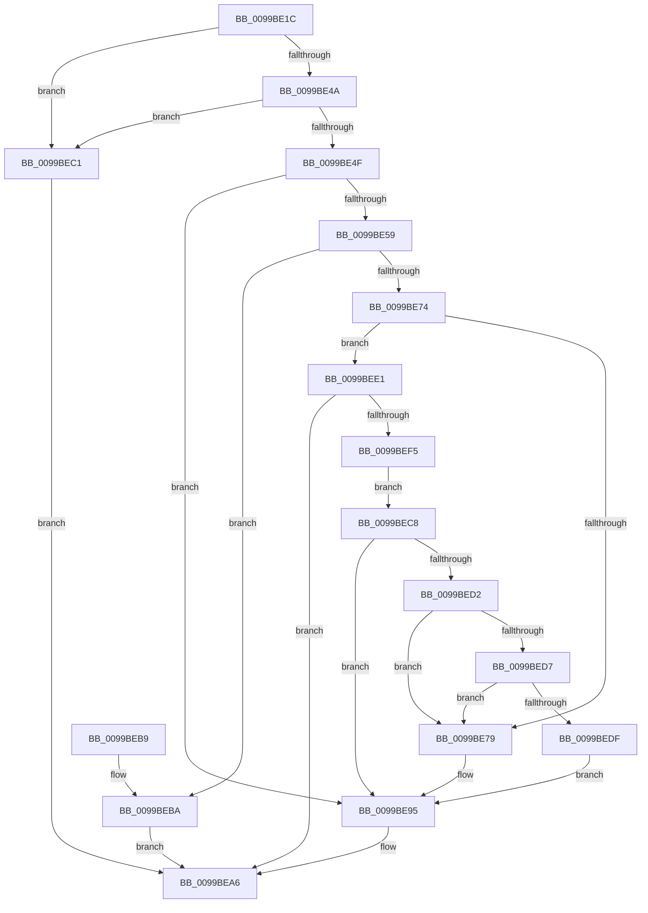

# LdrpAccessResourceData

- RVA: `0x0099BE1C`–`0x0099BEF7` (길이 `219` bytes)
- VA: `0x000000014099BE1C`
- 실행 섹션: `PAGE`
- PDB 이름 있음: `예`; PDB Function 태그: `아니요`
- unwind 정보 RVA: `0x000996F4`
- 디코드: `68`개 명령, `219/219` bytes 표시
- 미해석 바이트: `0` (있으면 어셈블리에 `.byte`로 보존)

> 이 문서는 커널 이미지의 기계어와 PDB 기호를 분석해 생성했습니다. 4번과 5번은 함수 원형과 자료형을 바이너리 사용 방식에서 추정한 C 해석이며 원본 소스 복구 결과는 아닙니다.

## 1. Dependencies

- 직접 호출 지점: **4**; 고유 호출 대상: **4**
- 직접 호출자로 확인된 함수: **3**
- RIP 상대 이미지 참조: **1**

### Outgoing calls
- `0x0099BE6A` → [RtlImageDirectoryEntryToData](../../text/43/RtlImageDirectoryEntryToData_function_004328D0.md) (function, `0x004328D0`)
- `0x0099BE84` → [LdrpGetAlternateResourceModuleHandleEx](../../text/45/LdrpGetAlternateResourceModuleHandleEx_function_00455334.md) (function, `0x00455334`)
- `0x0099BEA1` → [LdrpAccessResourceDataNoMultipleLanguage](LdrpAccessResourceDataNoMultipleLanguage_function_0099BF00.md) (function, `0x0099BF00`)
- `0x0099BEE9` → [LdrpGetImageSize](../../text/45/LdrpGetImageSize_function_004562F0.md) (function, `0x004562F0`)

### Direct callers
- [LdrAccessResource](../78/LdrAccessResource_function_0078B9E0.md) at `0x0078B9E4`
- [RtlLoadString](../78/RtlLoadString_function_0078C570.md) at `0x0078C70D`
- [RtlFindMessage](RtlFindMessage_function_0099B220.md) at `0x0099B29D`

### Static image references
- `0x0099BE51` → RVA `0x00F8C5FA` (`.data`; read)

## 2. Other-region calls and transfers

- 다른 실행 섹션으로 향하는 call: **3**
  - `0x0099BE6A` → [RtlImageDirectoryEntryToData](../../text/43/RtlImageDirectoryEntryToData_function_004328D0.md) (`PAGE` → `.text`)
  - `0x0099BE84` → [LdrpGetAlternateResourceModuleHandleEx](../../text/45/LdrpGetAlternateResourceModuleHandleEx_function_00455334.md) (`PAGE` → `.text`)
  - `0x0099BEE9` → [LdrpGetImageSize](../../text/45/LdrpGetImageSize_function_004562F0.md) (`PAGE` → `.text`)
- 별도 외부 분기/꼬리 이동을 확인하지 못했습니다.

## 3. Assembly (complete function range)

```asm
0099BE1C  48 8B C4                        mov rax, rsp
0099BE1F  48 89 58 10                     mov qword ptr [rax + 0x10], rbx
0099BE23  48 89 68 18                     mov qword ptr [rax + 0x18], rbp
0099BE27  56                              push rsi
0099BE28  57                              push rdi
0099BE29  41 56                           push r14
0099BE2B  48 83 EC 30                     sub rsp, 0x30
0099BE2F  48 83 60 E0 00                  and qword ptr [rax - 0x20], 0
0099BE34  49 8B E9                        mov rbp, r9
0099BE37  48 83 60 D8 00                  and qword ptr [rax - 0x28], 0
0099BE3C  4D 8B F0                        mov r14, r8
0099BE3F  48 8B DA                        mov rbx, rdx
0099BE42  48 8B F9                        mov rdi, rcx
0099BE45  48 85 C9                        test rcx, rcx
0099BE48  74 77                           je 0x14099bec1
0099BE4A  48 85 D2                        test rdx, rdx
0099BE4D  74 72                           je 0x14099bec1
0099BE4F  B2 01                           mov dl, 1
0099BE51  38 15 A3 07 5F 00               cmp byte ptr [rip + 0x5f07a3], dl
0099BE57  75 3C                           jne 0x14099be95
0099BE59  48 8B F1                        mov rsi, rcx
0099BE5C  4C 8D 48 08                     lea r9, [rax + 8]
0099BE60  41 B8 02 00 00 00               mov r8d, 2
0099BE66  48 83 E6 FC                     and rsi, 0xfffffffffffffffc
0099BE6A  E8 61 6A A9 FF                  call 0x1404328d0
0099BE6F  48 85 C0                        test rax, rax
0099BE72  74 46                           je 0x14099beba
0099BE74  48 3B D8                        cmp rbx, rax
0099BE77  73 68                           jae 0x14099bee1
0099BE79  4C 8D 4C 24 28                  lea r9, [rsp + 0x28]
0099BE7E  4C 8B C3                        mov r8, rbx
0099BE81  48 8B CF                        mov rcx, rdi
0099BE84  E8 AB 94 AB FF                  call 0x140455334
0099BE89  48 8D 50 FF                     lea rdx, [rax - 1]
0099BE8D  48 83 FA FD                     cmp rdx, -3
0099BE91  48 0F 46 F8                     cmovbe rdi, rax
0099BE95  4C 8B CD                        mov r9, rbp
0099BE98  4D 8B C6                        mov r8, r14
0099BE9B  48 8B D3                        mov rdx, rbx
0099BE9E  48 8B CF                        mov rcx, rdi
0099BEA1  E8 5A 00 00 00                  call 0x14099bf00
0099BEA6  48 8B 5C 24 58                  mov rbx, qword ptr [rsp + 0x58]
0099BEAB  48 8B 6C 24 60                  mov rbp, qword ptr [rsp + 0x60]
0099BEB0  48 83 C4 30                     add rsp, 0x30
0099BEB4  41 5E                           pop r14
0099BEB6  5F                              pop rdi
0099BEB7  5E                              pop rsi
0099BEB8  C3                              ret
0099BEB9  CC                              int3
0099BEBA  B8 89 00 00 C0                  mov eax, 0xc0000089
0099BEBF  EB E5                           jmp 0x14099bea6
0099BEC1  B8 0D 00 00 C0                  mov eax, 0xc000000d
0099BEC6  EB DE                           jmp 0x14099bea6
0099BEC8  48 8B 44 24 20                  mov rax, qword ptr [rsp + 0x20]
0099BECD  48 85 C0                        test rax, rax
0099BED0  74 C3                           je 0x14099be95
0099BED2  48 3B DE                        cmp rbx, rsi
0099BED5  72 A2                           jb 0x14099be79
0099BED7  48 03 C6                        add rax, rsi
0099BEDA  48 3B D8                        cmp rbx, rax
0099BEDD  73 9A                           jae 0x14099be79
0099BEDF  EB B4                           jmp 0x14099be95
0099BEE1  48 8D 54 24 20                  lea rdx, [rsp + 0x20]
0099BEE6  48 8B CF                        mov rcx, rdi
0099BEE9  E8 02 A4 AB FF                  call 0x1404562f0
0099BEEE  3D 7B 00 00 C0                  cmp eax, 0xc000007b
0099BEF3  74 B1                           je 0x14099bea6
0099BEF5  EB D1                           jmp 0x14099bec8
```

## 4. C-style interpretation (structured pseudocode)

```c
__int64 __fastcall LdrpAccessResourceData(__int64 a1, __int64 a2, __int64 a3, __int64 a4)
{
    __int64 result;
    __int64 v_rsi;
    __int64 v_rsp;
    unsigned __int64 v_stack_m20;
    unsigned __int64 v_stack_p10;
    unsigned __int64 v_stack_p18;
    unsigned __int64 v_stack_p20;

    *(unsigned __int64 *)(v_rsp + 16) = v_rbx;
    *(unsigned __int64 *)(v_rsp + 24) = v_rbp;
    v_rsp = (v_rsp) - (48);
    if (a1 == 0) goto loc_0099BEC1;
    if (a2 == 0) goto loc_0099BEC1;
    if ((*(unsigned __int8 *)(v_rip + 6227875)) != 1) goto loc_0099BE95;
    v_rsi = (a1) & (-4);
    result = RtlImageDirectoryEntryToData(a1, 1, 2, v_rsp + 8);
    if (result == 0) goto loc_0099BEBA;
    if (a2 >= result) goto loc_0099BEE1;
loc_0099BE79:
    result = LdrpGetAlternateResourceModuleHandleEx(a1, 1, a2, v_stack_m20);
    if ((result - 1) <= -3) { a1 = result; }
loc_0099BE95:
    result = LdrpAccessResourceDataNoMultipleLanguage(a1, a2, a3, a4);
loc_0099BEA6:
    v_rsp = (v_rsp) + (48);
    return result;
loc_0099BEBA:
    goto loc_0099BEA6;
loc_0099BEC1:
    goto loc_0099BEA6;
loc_0099BEC8:
    if (v_stack_p20 == 0) goto loc_0099BE95;
    if (v_stack_p10 < v_rsi) goto loc_0099BE79;
    result = (v_stack_p20) + (v_rsi);
    if (v_stack_p10 >= result) goto loc_0099BE79;
    goto loc_0099BE95;
loc_0099BEE1:
    result = LdrpGetImageSize(a1, v_stack_p20, a3, a4);
    if (((unsigned int)(result)) == 0xC000007BULL) goto loc_0099BEA6;
    goto loc_0099BEC8;
}
```

## 5. (Beta) C Style

```c
int64_t LdrpAccessResourceData(int64_t Arg1, int64_t Arg2, int64_t Arg3, int64_t Arg4)
{
    int64_t result;
    int64_t local_rsi;
    int64_t local_rsp;
    uint64_t v_stack_m20;
    uint64_t v_stack_p10;
    uint64_t v_stack_p18;
    uint64_t v_stack_p20;

    *(uint64_t *)(local_rsp + 0x10) = local_rbx;
    *(uint64_t *)(local_rsp + 0x18) = local_rbp;
    local_rsp = (local_rsp) - (48);
    if (Arg1 == 0) goto loc_0099BEC1;
    if (Arg2 == 0) goto loc_0099BEC1;
    if ((*(uint8_t *)(v_rip + 0x5F07A3)) != 1) goto loc_0099BE95;
    local_rsi = (Arg1) & (-4);
    result = RtlImageDirectoryEntryToData(Arg1, 1, 2, local_rsp + 8);
    if (result == 0) goto loc_0099BEBA;
    if (Arg2 >= result) goto loc_0099BEE1;
loc_0099BE79:
    result = LdrpGetAlternateResourceModuleHandleEx(Arg1, 1, Arg2, v_stack_m20);
    if ((result - 1) <= -3) { Arg1 = result; }
loc_0099BE95:
    result = LdrpAccessResourceDataNoMultipleLanguage(Arg1, Arg2, Arg3, Arg4);
loc_0099BEA6:
    local_rsp = (local_rsp) + (48);
    return result;
loc_0099BEBA:
    goto loc_0099BEA6;
loc_0099BEC1:
    goto loc_0099BEA6;
loc_0099BEC8:
    if (v_stack_p20 == 0) goto loc_0099BE95;
    if (v_stack_p10 < local_rsi) goto loc_0099BE79;
    result = (v_stack_p20) + (local_rsi);
    if (v_stack_p10 >= result) goto loc_0099BE79;
    goto loc_0099BE95;
loc_0099BEE1:
    result = LdrpGetImageSize(Arg1, v_stack_p20, Arg3, Arg4);
    if (((uint32_t)(result)) == 0xC000007BULL) goto loc_0099BEA6;
    goto loc_0099BEC8;
}
```

## 6. Execution-region graph

[열기: 2D/3D 그래프와 함수 탐색 컨트롤 패널](../../../control-panel.html?section=page&rva=0x0099BE1C&view=graph)

- 2D 그래프는 위에서 아래로 흐르고, 3D 그래프는 빈 공간을 드래그해 회전합니다. Shift+드래그는 이동, 휠은 확대·축소, 함수 노드 선택은 대상 보고서 이동입니다.

### Static fallback


