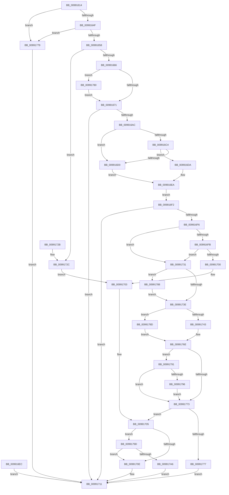

# LdrpResGetMappingSize

- RVA: `0x00991614`–`0x009917B0` (길이 `412` bytes)
- VA: `0x0000000140991614`
- 실행 섹션: `PAGE`
- PDB 이름 있음: `예`; PDB Function 태그: `아니요`
- unwind 정보 RVA: `0x00098CFC`
- 디코드: `121`개 명령, `412/412` bytes 표시
- 미해석 바이트: `0` (있으면 어셈블리에 `.byte`로 보존)

> 이 문서는 커널 이미지의 기계어와 PDB 기호를 분석해 생성했습니다. 4번과 5번은 함수 원형과 자료형을 바이너리 사용 방식에서 추정한 C 해석이며 원본 소스 복구 결과는 아닙니다.

## 1. Dependencies

- 직접 호출 지점: **3**; 고유 호출 대상: **3**
- 직접 호출자로 확인된 함수: **4**
- RIP 상대 이미지 참조: **0**

### Outgoing calls
- `0x009916A3` → [RtlImageNtHeaderEx](../../text/41/RtlImageNtHeaderEx_function_0041EAA0.md) (function, `0x0041EAA0`)
- `0x00991734` → [LdrpKrnGetDataTableEntry](../../text/45/LdrpKrnGetDataTableEntry_function_004563B4.md) (function, `0x004563B4`)
- `0x00991761` → [ZwQueryVirtualMemory](../../text/6A/ZwQueryVirtualMemory_function_006AD530.md) (function, `0x006AD530`)

### Direct callers
- [LdrpResSearchResourceMappedFile](../../text/45/LdrpResSearchResourceMappedFile_function_00454C98.md) at `0x004552BB`
- [LdrResSearchResource](../98/LdrResSearchResource_function_0098F7A0.md) at `0x0098F954`
- [LdrResGetRCConfig](../A8/LdrResGetRCConfig_function_00A8035C.md) at `0x00A80459`
- [sub_00B2B9CE](../B2/Unknown_function_00B2B9CE.md) at `0x00B2BA0E`

### Static image references
- 디코드된 RIP-relative 메모리 참조가 없습니다.

## 2. Other-region calls and transfers

- 다른 실행 섹션으로 향하는 call: **3**
  - `0x009916A3` → [RtlImageNtHeaderEx](../../text/41/RtlImageNtHeaderEx_function_0041EAA0.md) (`PAGE` → `.text`)
  - `0x00991734` → [LdrpKrnGetDataTableEntry](../../text/45/LdrpKrnGetDataTableEntry_function_004563B4.md) (`PAGE` → `.text`)
  - `0x00991761` → [ZwQueryVirtualMemory](../../text/6A/ZwQueryVirtualMemory_function_006AD530.md) (`PAGE` → `.text`)
- 별도 외부 분기/꼬리 이동을 확인하지 못했습니다.

## 3. Assembly (complete function range)

```asm
00991614  48 8B C4                        mov rax, rsp
00991617  48 89 58 10                     mov qword ptr [rax + 0x10], rbx
0099161B  48 89 70 18                     mov qword ptr [rax + 0x18], rsi
0099161F  57                              push rdi
00991620  41 54                           push r12
00991622  41 55                           push r13
00991624  41 56                           push r14
00991626  41 57                           push r15
00991628  48 83 EC 70                     sub rsp, 0x70
0099162C  48 8B F2                        mov rsi, rdx
0099162F  4C 8B F9                        mov r15, rcx
00991632  48 83 60 08 00                  and qword ptr [rax + 8], 0
00991637  0F 57 C0                        xorps xmm0, xmm0
0099163A  0F 11 40 A8                     movups xmmword ptr [rax - 0x58], xmm0
0099163E  0F 11 40 B8                     movups xmmword ptr [rax - 0x48], xmm0
00991642  0F 11 40 C8                     movups xmmword ptr [rax - 0x38], xmm0
00991646  48 85 C9                        test rcx, rcx
00991649  0F 84 2A 01 00 00               je 0x140991779
0099164F  48 85 D2                        test rdx, rdx
00991652  0F 84 21 01 00 00               je 0x140991779
00991658  45 33 F6                        xor r14d, r14d
0099165B  41 0F BA E0 13                  bt r8d, 0x13
00991660  0F 82 C6 00 00 00               jb 0x14099172c
00991666  41 0F BA E0 11                  bt r8d, 0x11
0099166B  0F 82 0F 01 00 00               jb 0x140991780
00991671  48 83 22 00                     and qword ptr [rdx], 0
00991675  33 DB                           xor ebx, ebx
00991677  33 FF                           xor edi, edi
00991679  8D 4B 01                        lea ecx, [rbx + 1]
0099167C  44 84 F9                        test cl, r15b
0099167F  41 0F 94 C4                     sete r12b
00991683  41 0F BA E0 08                  bt r8d, 8
00991688  0F 92 C0                        setb al
0099168B  44 22 E0                        and r12b, al
0099168E  4D 8B EF                        mov r13, r15
00991691  49 83 E5 FC                     and r13, 0xfffffffffffffffc
00991695  4C 8D 8C 24 A0 00 00 00         lea r9, [rsp + 0xa0]
0099169D  45 33 C0                        xor r8d, r8d
009916A0  49 8B D5                        mov rdx, r13
009916A3  E8 F8 D3 A8 FF                  call 0x14041eaa0
009916A8  85 C0                           test eax, eax
009916AA  78 65                           js 0x140991711
009916AC  48 8B 8C 24 A0 00 00 00         mov rcx, qword ptr [rsp + 0xa0]
009916B4  0F B7 51 18                     movzx edx, word ptr [rcx + 0x18]
009916B8  41 B8 0B 01 00 00               mov r8d, 0x10b
009916BE  66 41 3B D0                     cmp dx, r8w
009916C2  74 0C                           je 0x1409916d0
009916C4  41 B8 0B 02 00 00               mov r8d, 0x20b
009916CA  66 41 3B D0                     cmp dx, r8w
009916CE  75 0A                           jne 0x1409916da
009916D0  8B 79 50                        mov edi, dword ptr [rcx + 0x50]
009916D3  48 89 7C 24 38                  mov qword ptr [rsp + 0x38], rdi
009916D8  EB 10                           jmp 0x1409916ea
009916DA  33 FF                           xor edi, edi
009916DC  48 89 7C 24 38                  mov qword ptr [rsp + 0x38], rdi
009916E1  B8 7B 00 00 C0                  mov eax, 0xc000007b
009916E6  89 44 24 30                     mov dword ptr [rsp + 0x30], eax
009916EA  EB 06                           jmp 0x1409916f2
009916EC  89 44 24 30                     mov dword ptr [rsp + 0x30], eax
009916F0  EB 1F                           jmp 0x140991711
009916F2  85 C0                           test eax, eax
009916F4  78 1B                           js 0x140991711
009916F6  45 84 E4                        test r12b, r12b
009916F9  74 36                           je 0x140991731
009916FB  48 85 FF                        test rdi, rdi
009916FE  74 31                           je 0x140991731
00991700  48 8B DF                        mov rbx, rdi
00991703  33 C0                           xor eax, eax
00991705  4D 85 F6                        test r14, r14
00991708  0F 85 8F 00 00 00               jne 0x14099179d
0099170E  48 89 1E                        mov qword ptr [rsi], rbx
00991711  4C 8D 5C 24 70                  lea r11, [rsp + 0x70]
00991716  49 8B 5B 38                     mov rbx, qword ptr [r11 + 0x38]
0099171A  49 8B 73 40                     mov rsi, qword ptr [r11 + 0x40]
0099171E  49 8B E3                        mov rsp, r11
00991721  41 5F                           pop r15
00991723  41 5E                           pop r14
00991725  41 5D                           pop r13
00991727  41 5C                           pop r12
00991729  5F                              pop rdi
0099172A  C3                              ret
0099172B  CC                              int3
0099172C  48 8B 1A                        mov rbx, qword ptr [rdx]
0099172F  EB D2                           jmp 0x140991703
00991731  49 8B CF                        mov rcx, r15
00991734  E8 7B 4C AC FF                  call 0x1404563b4
00991739  48 85 C0                        test rax, rax
0099173C  75 4A                           jne 0x140991788
0099173E  48 85 DB                        test rbx, rbx
00991741  75 4A                           jne 0x14099178d
00991743  48 21 5C 24 28                  and qword ptr [rsp + 0x28], rbx
00991748  48 C7 44 24 20 30 00 00 00      mov qword ptr [rsp + 0x20], 0x30
00991751  4C 8D 4C 24 40                  lea r9, [rsp + 0x40]
00991756  44 8D 43 03                     lea r8d, [rbx + 3]
0099175A  49 8B D5                        mov rdx, r13
0099175D  48 83 C9 FF                     or rcx, 0xffffffffffffffff
00991761  E8 CA BD D1 FF                  call 0x1406ad530
00991766  85 C0                           test eax, eax
00991768  48 0F 49 5C 24 50               cmovns rbx, qword ptr [rsp + 0x50]
0099176E  48 85 DB                        test rbx, rbx
00991771  74 1E                           je 0x140991791
00991773  85 C0                           test eax, eax
00991775  79 8E                           jns 0x140991705
00991777  EB 98                           jmp 0x140991711
00991779  B8 0D 00 00 C0                  mov eax, 0xc000000d
0099177E  EB 91                           jmp 0x140991711
00991780  4C 8B 32                        mov r14, qword ptr [rdx]
00991783  E9 E9 FE FF FF                  jmp 0x140991671
00991788  8B 58 40                        mov ebx, dword ptr [rax + 0x40]
0099178B  EB B1                           jmp 0x14099173e
0099178D  33 C0                           xor eax, eax
0099178F  EB DD                           jmp 0x14099176e
00991791  48 85 FF                        test rdi, rdi
00991794  74 DD                           je 0x140991773
00991796  48 8B DF                        mov rbx, rdi
00991799  33 C0                           xor eax, eax
0099179B  EB D6                           jmp 0x140991773
0099179D  4C 3B F3                        cmp r14, rbx
009917A0  0F 83 68 FF FF FF               jae 0x14099170e
009917A6  B8 1F 00 00 C0                  mov eax, 0xc000001f
009917AB  E9 61 FF FF FF                  jmp 0x140991711
```

## 4. C-style interpretation (structured pseudocode)

```c
__int64 __fastcall LdrpResGetMappingSize(__int64 a1, __int64 a2, int a3)
{
    __int64 result;
    __int64 v_r12;
    __int64 v_r13;
    __int64 v_r14;
    __int64 v_rbx;
    __int64 v_rdi;
    __int64 v_rsp;
    unsigned __int64 v_stack_m20;
    unsigned __int64 v_stack_m28;
    unsigned __int64 v_stack_m30;
    unsigned __int64 v_stack_m48;
    unsigned __int64 v_stack_m50;
    unsigned __int64 v_stack_m60;
    unsigned int v_stack_m68;
    unsigned __int64 v_stack_p8;

    *(unsigned __int64 *)(v_rsp + 16) = v_rbx;
    *(unsigned __int64 *)(v_rsp + 24) = v_rsi;
    v_rsp = (v_rsp) - (112);
    *(unsigned __int64 *)(v_rsp - 88) = v_xmm0;
    *(unsigned __int64 *)(v_rsp - 72) = v_xmm0;
    *(unsigned __int64 *)(v_rsp - 56) = v_xmm0;
    if (a1 == 0) goto loc_00991779;
    if (a2 == 0) goto loc_00991779;
    v_r14 = 0;
    if (condition_is_below) goto loc_0099172C;
    if (condition_is_below) goto loc_00991780;
loc_00991671:
    v_rbx = 0;
    v_rdi = 0;
    v_r12 = ((((unsigned __int8)(v_rbx + 1)) & ((unsigned __int8)(a1))) == 0) ? 1 : 0;
    result = (condition_is_below) ? 1 : 0;
    v_r12 = (unsigned __int8)((v_r12) & ((unsigned __int8)(result)));
    v_r13 = (a1) & (-4);
    a3 = 0;
    result = RtlImageNtHeaderEx(v_rbx + 1, v_r13, a3, v_stack_p8);
    if (sign_flag) goto loc_00991711;
    if (((unsigned __int16)(*(unsigned __int16 *)(v_stack_p8 + 24))) == 267) goto loc_009916D0;
    if (((unsigned __int16)(*(unsigned __int16 *)(v_stack_p8 + 24))) != 523) goto loc_009916DA;
loc_009916D0:
    v_stack_m60 = (unsigned int)(*(unsigned int *)(v_stack_p8 + 80));
    goto loc_009916EA;
loc_009916DA:
    v_rdi = 0;
    v_stack_m60 = 0;
    v_stack_m68 = (unsigned int)((unsigned int)(0xC000007BULL));
loc_009916EA:
    goto loc_009916F2;
loc_009916F2:
    if (sign_flag) goto loc_00991711;
    if ((unsigned __int8)(v_r12) == 0) goto loc_00991731;
    if (0 == 0) goto loc_00991731;
loc_00991703:
    result = 0;
loc_00991705:
    if (0 != 0) goto loc_0099179D;
loc_0099170E:
    *(unsigned __int64 *)(a2) = 0;
loc_00991711:
    return result;
loc_0099172C:
    goto loc_00991703;
loc_00991731:
    result = LdrpKrnGetDataTableEntry(a1, *(unsigned __int16 *)(v_stack_p8 + 24), 523, v_stack_p8);
    if (result != 0) goto loc_00991788;
loc_0099173E:
    if (*(unsigned __int64 *)(*(unsigned __int16 *)(v_stack_p8 + 24)) != 0) goto loc_0099178D;
    v_stack_m50 = 48;
    a1 = (a1) | (-1);
    result = ZwQueryVirtualMemory(a1, v_r13, *(unsigned __int64 *)(*(unsigned __int16 *)(v_stack_p8 + 24)) + 3, v_stack_m30);
    v_rbx = *(unsigned __int64 *)(*(unsigned __int16 *)(v_stack_p8 + 24));
    if (!sign_flag) { v_rbx = v_stack_m20; }
loc_0099176E:
    if (v_rbx == 0) goto loc_00991791;
loc_00991773:
    if (!sign_flag) goto loc_00991705;
    goto loc_00991711;
loc_00991779:
    goto loc_00991711;
loc_00991780:
    goto loc_00991671;
loc_00991788:
    goto loc_0099173E;
loc_0099178D:
    result = 0;
    goto loc_0099176E;
loc_00991791:
    if (0 == 0) goto loc_00991773;
    result = 0;
    goto loc_00991773;
loc_0099179D:
    if ((*(unsigned __int64 *)(v_r13)) >= 0) goto loc_0099170E;
    goto loc_00991711;
}
```

## 5. (Beta) C Style

```c
int64_t LdrpResGetMappingSize(int64_t Arg1, void *Arg2, int32_t Arg3)
{
    uint8_t *arg2 = (uint8_t *)Arg2;

    int64_t result;
    int64_t local_r12;
    int64_t local_r13;
    int64_t local_r14;
    int64_t local_rbx;
    int64_t local_rdi;
    int64_t local_rsp;
    uint64_t v_stack_m20;
    uint64_t v_stack_m28;
    uint64_t v_stack_m30;
    uint64_t v_stack_m48;
    uint64_t v_stack_m50;
    uint64_t v_stack_m60;
    uint32_t v_stack_m68;
    uint64_t v_stack_p8;

    *(uint64_t *)(local_rsp + 0x10) = local_rbx;
    *(uint64_t *)(local_rsp + 0x18) = local_rsi;
    local_rsp = (local_rsp) - (112);
    *(uint64_t *)(local_rsp - 0x58) = v_xmm0;
    *(uint64_t *)(local_rsp - 0x48) = v_xmm0;
    *(uint64_t *)(local_rsp - 0x38) = v_xmm0;
    if (Arg1 == 0) goto loc_00991779;
    if (Arg2 == NULL) goto loc_00991779;
    local_r14 = 0;
    if (condition_is_below) goto loc_0099172C;
    if (condition_is_below) goto loc_00991780;
loc_00991671:
    local_rbx = 0;
    local_rdi = 0;
    local_r12 = ((((uint8_t)(local_rbx + 1)) & ((uint8_t)(Arg1))) == 0) ? 1 : 0;
    result = (condition_is_below) ? 1 : 0;
    local_r12 = (uint8_t)((local_r12) & ((uint8_t)(result)));
    local_r13 = (Arg1) & (-4);
    Arg3 = 0;
    result = RtlImageNtHeaderEx(local_rbx + 1, local_r13, Arg3, v_stack_p8);
    if (sign_flag) goto loc_00991711;
    if (((uint16_t)(*(uint16_t *)(v_stack_p8 + 0x18))) == 267) goto loc_009916D0;
    if (((uint16_t)(*(uint16_t *)(v_stack_p8 + 0x18))) != 523) goto loc_009916DA;
loc_009916D0:
    v_stack_m60 = (uint32_t)(*(uint32_t *)(v_stack_p8 + 0x50));
    goto loc_009916EA;
loc_009916DA:
    local_rdi = 0;
    v_stack_m60 = 0;
    v_stack_m68 = (uint32_t)((uint32_t)(0xC000007BULL));
loc_009916EA:
    goto loc_009916F2;
loc_009916F2:
    if (sign_flag) goto loc_00991711;
    if ((uint8_t)(local_r12) == 0) goto loc_00991731;
    if (0 == 0) goto loc_00991731;
loc_00991703:
    result = 0;
loc_00991705:
    if (0 != 0) goto loc_0099179D;
loc_0099170E:
    *(uint64_t *)(arg2) = 0;
loc_00991711:
    return result;
loc_0099172C:
    goto loc_00991703;
loc_00991731:
    result = LdrpKrnGetDataTableEntry(Arg1, *(uint16_t *)(v_stack_p8 + 0x18), 523, v_stack_p8);
    if (result != 0) goto loc_00991788;
loc_0099173E:
    if (*(uint64_t *)(*(uint16_t *)(v_stack_p8 + 0x18)) != 0) goto loc_0099178D;
    v_stack_m50 = 48;
    Arg1 = (Arg1) | (-1);
    result = ZwQueryVirtualMemory(Arg1, local_r13, *(uint64_t *)(*(uint16_t *)(v_stack_p8 + 0x18)) + 3, v_stack_m30);
    local_rbx = *(uint64_t *)(*(uint16_t *)(v_stack_p8 + 0x18));
    if (!sign_flag) { local_rbx = v_stack_m20; }
loc_0099176E:
    if (local_rbx == 0) goto loc_00991791;
loc_00991773:
    if (!sign_flag) goto loc_00991705;
    goto loc_00991711;
loc_00991779:
    goto loc_00991711;
loc_00991780:
    goto loc_00991671;
loc_00991788:
    goto loc_0099173E;
loc_0099178D:
    result = 0;
    goto loc_0099176E;
loc_00991791:
    if (0 == 0) goto loc_00991773;
    result = 0;
    goto loc_00991773;
loc_0099179D:
    if ((*(uint64_t *)(local_r13)) >= 0) goto loc_0099170E;
    goto loc_00991711;
}
```

### 관측된 메모리 오프셋

구조체 형식이 확인되지 않은 접근은 인자 기준의 오프셋으로만 기록했습니다.

| 기준 인자 | 오프셋 표현 | 폭 (bit) | 접근 |
|---|---:|---:|---|
| `Arg2` | `+ 0x0` | `64` | `W` |

## 6. Execution-region graph

[열기: 2D/3D 그래프와 함수 탐색 컨트롤 패널](../../../control-panel.html?section=page&rva=0x00991614&view=graph)

- 2D 그래프는 위에서 아래로 흐르고, 3D 그래프는 빈 공간을 드래그해 회전합니다. Shift+드래그는 이동, 휠은 확대·축소, 함수 노드 선택은 대상 보고서 이동입니다.

### Static fallback


