# NtQueryDirectoryObject

- RVA: `0x0099EA20`–`0x0099EF18` (길이 `1,272` bytes)
- VA: `0x000000014099EA20`
- 실행 섹션: `PAGE`
- PDB 이름 있음: `예`; PDB Function 태그: `아니요`
- unwind 정보 RVA: `0x0009AF4C`
- 디코드: `313`개 명령, `1,272/1,272` bytes 표시
- 미해석 바이트: `0` (있으면 어셈블리에 `.byte`로 보존)

> 이 문서는 커널 이미지의 기계어와 PDB 기호를 분석해 생성했습니다. 4번과 5번은 함수 원형과 자료형을 바이너리 사용 방식에서 추정한 C 해석이며 원본 소스 복구 결과는 아닙니다.

## 1. Dependencies

- 직접 호출 지점: **11**; 고유 호출 대상: **9**
- 직접 호출자로 확인된 함수: **0**
- RIP 상대 이미지 참조: **3**

### Outgoing calls
- `0x0099EA87` → [ProbeForWrite](../8E/ProbeForWrite_function_008E91C0.md) (function, `0x008E91C0`)
- `0x0099EB02` → [ExAllocatePool2](../../poolcode/B8/ExAllocatePool2_function_00B820F0.md) (function, `0x00B820F0`)
- `0x0099EB3E` → [ObReferenceObjectByHandle](../86/ObReferenceObjectByHandle_function_00868DB0.md) (function, `0x00868DB0`)
- `0x0099EB78` → [ObpLockDirectoryShared](ObpLockDirectoryShared_function_0099EF20.md) (function, `0x0099EF20`)
- `0x0099ED60` → [ObpUnlockDirectory](ObpUnlockDirectory_function_0099F8A0.md) (function, `0x0099F8A0`)
- `0x0099ED7B` → [memcpy](../../text/6C/memcpy_function_006C6840.md) (function, `0x006C6840`)
- `0x0099EDAF` → [ObfDereferenceObject](../../text/2F/ObfDereferenceObject_function_002F9350.md) (function, `0x002F9350`)
- `0x0099EDB9` → [ExFreePoolWithTag](../../poolcode/B8/ExFreePoolWithTag_function_00B82870.md) (function, `0x00B82870`)
- `0x0099EE2E` → [memcpy](../../text/6C/memcpy_function_006C6840.md) (function, `0x006C6840`)
- `0x0099EE5B` → [memcpy](../../text/6C/memcpy_function_006C6840.md) (function, `0x006C6840`)
- `0x0099EEF0` → [RtlInitUnicodeString](../../text/42/RtlInitUnicodeString_function_0042A780.md) (function, `0x0042A780`)

### Direct callers
- 이 함수 시작 RVA로 연결되는 직접 call은 확인되지 않았습니다. 간접 호출은 완전히 역산할 수 없습니다.

### Static image references
- `0x0099EB18` → RVA `0x00F0F650` (`.data`; read)
- `0x0099EB85` → RVA `0x00000000` (`image boundary/outside`; read)
- `0x0099EBFE` → RVA `0x00FC6E4C` (`ALMOSTRO`; read)

## 2. Other-region calls and transfers

- 다른 실행 섹션으로 향하는 call: **7**
  - `0x0099EB02` → [ExAllocatePool2](../../poolcode/B8/ExAllocatePool2_function_00B820F0.md) (`PAGE` → `POOLCODE`)
  - `0x0099ED7B` → [memcpy](../../text/6C/memcpy_function_006C6840.md) (`PAGE` → `.text`)
  - `0x0099EDAF` → [ObfDereferenceObject](../../text/2F/ObfDereferenceObject_function_002F9350.md) (`PAGE` → `.text`)
  - `0x0099EDB9` → [ExFreePoolWithTag](../../poolcode/B8/ExFreePoolWithTag_function_00B82870.md) (`PAGE` → `POOLCODE`)
  - `0x0099EE2E` → [memcpy](../../text/6C/memcpy_function_006C6840.md) (`PAGE` → `.text`)
  - `0x0099EE5B` → [memcpy](../../text/6C/memcpy_function_006C6840.md) (`PAGE` → `.text`)
  - `0x0099EEF0` → [RtlInitUnicodeString](../../text/42/RtlInitUnicodeString_function_0042A780.md) (`PAGE` → `.text`)
- 별도 외부 분기/꼬리 이동을 확인하지 못했습니다.

## 3. Assembly (complete function range)

```asm
0099EA20  4C 8B DC                        mov r11, rsp
0099EA23  45 88 4B 20                     mov byte ptr [r11 + 0x20], r9b
0099EA27  45 89 43 18                     mov dword ptr [r11 + 0x18], r8d
0099EA2B  49 89 53 10                     mov qword ptr [r11 + 0x10], rdx
0099EA2F  53                              push rbx
0099EA30  56                              push rsi
0099EA31  57                              push rdi
0099EA32  41 54                           push r12
0099EA34  41 55                           push r13
0099EA36  41 56                           push r14
0099EA38  41 57                           push r15
0099EA3A  48 81 EC A0 00 00 00            sub rsp, 0xa0
0099EA41  45 8B F0                        mov r14d, r8d
0099EA44  4C 8B CA                        mov r9, rdx
0099EA47  4C 8B E1                        mov r12, rcx
0099EA4A  0F 57 C0                        xorps xmm0, xmm0
0099EA4D  0F 11 44 24 68                  movups xmmword ptr [rsp + 0x68], xmm0
0099EA52  0F 57 C9                        xorps xmm1, xmm1
0099EA55  33 C0                           xor eax, eax
0099EA57  41 0F 11 4B A8                  movups xmmword ptr [r11 - 0x58], xmm1
0099EA5C  49 89 43 B8                     mov qword ptr [r11 - 0x48], rax
0099EA60  65 48 8B 04 25 88 01 00 00      mov rax, qword ptr gs:[0x188]
0099EA69  8A 98 32 02 00 00               mov bl, byte ptr [rax + 0x232]
0099EA6F  45 33 ED                        xor r13d, r13d
0099EA72  84 DB                           test bl, bl
0099EA74  0F 84 5A 03 00 00               je 0x14099edd4
0099EA7A  41 8B D6                        mov edx, r14d
0099EA7D  45 8D 7D 02                     lea r15d, [r13 + 2]
0099EA81  45 8B C7                        mov r8d, r15d
0099EA84  49 8B C9                        mov rcx, r9
0099EA87  E8 34 A7 F4 FF                  call 0x1408e91c0
0099EA8C  48 BA 00 00 FF FF FF 7F 00 00   movabs rdx, 0x7fffffff0000
0099EA96  48 8B CA                        mov rcx, rdx
0099EA99  4C 8B 84 24 08 01 00 00         mov r8, qword ptr [rsp + 0x108]
0099EAA1  4C 3B C2                        cmp r8, rdx
0099EAA4  49 0F 42 C8                     cmovb rcx, r8
0099EAA8  8B 01                           mov eax, dword ptr [rcx]
0099EAAA  89 01                           mov dword ptr [rcx], eax
0099EAAC  48 8B 84 24 10 01 00 00         mov rax, qword ptr [rsp + 0x110]
0099EAB4  48 85 C0                        test rax, rax
0099EAB7  74 0B                           je 0x14099eac4
0099EAB9  48 3B C2                        cmp rax, rdx
0099EABC  48 0F 42 D0                     cmovb rdx, rax
0099EAC0  8B 02                           mov eax, dword ptr [rdx]
0099EAC2  89 02                           mov dword ptr [rdx], eax
0099EAC4  44 38 AC 24 00 01 00 00         cmp byte ptr [rsp + 0x100], r13b
0099EACC  74 0A                           je 0x14099ead8
0099EACE  41 8B FD                        mov edi, r13d
0099EAD1  44 89 6C 24 58                  mov dword ptr [rsp + 0x58], r13d
0099EAD6  EB 07                           jmp 0x14099eadf
0099EAD8  41 8B 38                        mov edi, dword ptr [r8]
0099EADB  89 7C 24 58                     mov dword ptr [rsp + 0x58], edi
0099EADF  EB 05                           jmp 0x14099eae6
0099EAE1  E9 DA 02 00 00                  jmp 0x14099edc0
0099EAE6  41 8D 46 20                     lea eax, [r14 + 0x20]
0099EAEA  44 3B F0                        cmp r14d, eax
0099EAED  0F 87 A7 03 00 00               ja 0x14099ee9a
0099EAF3  49 8D 56 20                     lea rdx, [r14 + 0x20]
0099EAF7  B9 01 01 00 00                  mov ecx, 0x101
0099EAFC  41 B8 4F 62 4E 6D               mov r8d, 0x6d4e624f
0099EB02  E8 E9 35 1E 00                  call 0x140b820f0
0099EB07  48 8B F0                        mov rsi, rax
0099EB0A  48 89 44 24 78                  mov qword ptr [rsp + 0x78], rax
0099EB0F  48 85 C0                        test rax, rax
0099EB12  0F 84 C7 03 00 00               je 0x14099eedf
0099EB18  4C 8B 05 31 0B 57 00            mov r8, qword ptr [rip + 0x570b31]
0099EB1F  4C 89 6C 24 48                  mov qword ptr [rsp + 0x48], r13
0099EB24  4C 89 6C 24 28                  mov qword ptr [rsp + 0x28], r13
0099EB29  48 8D 44 24 48                  lea rax, [rsp + 0x48]
0099EB2E  48 89 44 24 20                  mov qword ptr [rsp + 0x20], rax
0099EB33  44 8A CB                        mov r9b, bl
0099EB36  BA 01 00 00 00                  mov edx, 1
0099EB3B  49 8B CC                        mov rcx, r12
0099EB3E  E8 6D A2 EC FF                  call 0x140868db0
0099EB43  8B D8                           mov ebx, eax
0099EB45  85 C0                           test eax, eax
0099EB47  0F 88 67 02 00 00               js 0x14099edb4
0099EB4D  48 89 74 24 40                  mov qword ptr [rsp + 0x40], rsi
0099EB52  41 BC 20 00 00 00               mov r12d, 0x20
0099EB58  44 89 64 24 38                  mov dword ptr [rsp + 0x38], r12d
0099EB5D  83 64 24 30 00                  and dword ptr [rsp + 0x30], 0
0099EB62  BB 1A 00 00 80                  mov ebx, 0x8000001a
0099EB67  89 5C 24 34                     mov dword ptr [rsp + 0x34], ebx
0099EB6B  48 8B 54 24 48                  mov rdx, qword ptr [rsp + 0x48]
0099EB70  48 8D 8C 24 80 00 00 00         lea rcx, [rsp + 0x80]
0099EB78  E8 A3 03 00 00                  call 0x14099ef20
0099EB7D  33 D2                           xor edx, edx
0099EB7F  8B CA                           mov ecx, edx
0099EB81  89 54 24 3C                     mov dword ptr [rsp + 0x3c], edx
0099EB85  4C 8D 0D 74 14 66 FF            lea r9, [rip - 0x99eb8c]
0099EB8C  83 F9 25                        cmp ecx, 0x25
0099EB8F  0F 83 79 03 00 00               jae 0x14099ef0e
0099EB95  8B C1                           mov eax, ecx
0099EB97  48 8B 4C 24 48                  mov rcx, qword ptr [rsp + 0x48]
0099EB9C  4C 8B 04 C1                     mov r8, qword ptr [rcx + rax*8]
0099EBA0  4C 89 44 24 50                  mov qword ptr [rsp + 0x50], r8
0099EBA5  45 8B DC                        mov r11d, r12d
0099EBA8  45 8B D5                        mov r10d, r13d
0099EBAB  44 89 6C 24 5C                  mov dword ptr [rsp + 0x5c], r13d
0099EBB0  4D 85 C0                        test r8, r8
0099EBB3  0F 84 78 01 00 00               je 0x14099ed31
0099EBB9  41 8B C5                        mov eax, r13d
0099EBBC  41 FF C5                        inc r13d
0099EBBF  3B F8                           cmp edi, eax
0099EBC1  0F 85 4A 01 00 00               jne 0x14099ed11
0099EBC7  49 8B 58 08                     mov rbx, qword ptr [r8 + 8]
0099EBCB  0F B6 43 EA                     movzx eax, byte ptr [rbx - 0x16]
0099EBCF  41 84 C7                        test r15b, al
0099EBD2  0F 85 41 01 00 00               jne 0x14099ed19
0099EBD8  48 8B CA                        mov rcx, rdx
0099EBDB  48 85 C9                        test rcx, rcx
0099EBDE  0F 84 05 03 00 00               je 0x14099eee9
0099EBE4  0F 10 41 08                     movups xmm0, xmmword ptr [rcx + 8]
0099EBE8  F3 0F 7F 44 24 68               movdqu xmmword ptr [rsp + 0x68], xmm0
0099EBEE  48 8D 43 D0                     lea rax, [rbx - 0x30]
0099EBF2  48 C1 E8 08                     shr rax, 8
0099EBF6  0F B6 D0                        movzx edx, al
0099EBF9  48 89 54 24 60                  mov qword ptr [rsp + 0x60], rdx
0099EBFE  0F B6 05 47 82 62 00            movzx eax, byte ptr [rip + 0x628247]
0099EC05  48 89 44 24 50                  mov qword ptr [rsp + 0x50], rax
0099EC0A  8B C8                           mov ecx, eax
0099EC0C  48 33 CA                        xor rcx, rdx
0099EC0F  0F B6 43 E8                     movzx eax, byte ptr [rbx - 0x18]
0099EC13  48 33 C8                        xor rcx, rax
0099EC16  49 8B 84 C9 00 78 FC 00         mov rax, qword ptr [r9 + rcx*8 + 0xfc7800]
0099EC1E  44 0F B7 48 10                  movzx r9d, word ptr [rax + 0x10]
0099EC23  0F B7 44 24 68                  movzx eax, word ptr [rsp + 0x68]
0099EC28  66 89 44 24 34                  mov word ptr [rsp + 0x34], ax
0099EC2D  45 03 CB                        add r9d, r11d
0099EC30  8D 48 24                        lea ecx, [rax + 0x24]
0099EC33  44 03 C9                        add r9d, ecx
0099EC36  48 8B 54 24 40                  mov rdx, qword ptr [rsp + 0x40]
0099EC3B  45 3B E1                        cmp r12d, r9d
0099EC3E  0F 87 FC 00 00 00               ja 0x14099ed40
0099EC44  45 3B CE                        cmp r9d, r14d
0099EC47  0F 87 57 02 00 00               ja 0x14099eea4
0099EC4D  66 89 02                        mov word ptr [rdx], ax
0099EC50  66 41 03 C7                     add ax, r15w
0099EC54  66 89 42 02                     mov word ptr [rdx + 2], ax
0099EC58  48 8B 44 24 70                  mov rax, qword ptr [rsp + 0x70]
0099EC5D  48 89 42 08                     mov qword ptr [rdx + 8], rax
0099EC61  0F B6 4B E8                     movzx ecx, byte ptr [rbx - 0x18]
0099EC65  4C 8B 54 24 50                  mov r10, qword ptr [rsp + 0x50]
0099EC6A  41 0F B6 C2                     movzx eax, r10b
0099EC6E  48 33 C8                        xor rcx, rax
0099EC71  4C 8B 5C 24 60                  mov r11, qword ptr [rsp + 0x60]
0099EC76  41 0F B6 C3                     movzx eax, r11b
0099EC7A  48 33 C8                        xor rcx, rax
0099EC7D  4C 8D 25 7C 13 66 FF            lea r12, [rip - 0x99ec84]
0099EC84  49 8B 84 CC 00 78 FC 00         mov rax, qword ptr [r12 + rcx*8 + 0xfc7800]
0099EC8C  0F B7 48 10                     movzx ecx, word ptr [rax + 0x10]
0099EC90  66 89 4A 10                     mov word ptr [rdx + 0x10], cx
0099EC94  0F B6 4B E8                     movzx ecx, byte ptr [rbx - 0x18]
0099EC98  41 0F B6 C2                     movzx eax, r10b
0099EC9C  48 33 C8                        xor rcx, rax
0099EC9F  41 0F B6 C3                     movzx eax, r11b
0099ECA3  48 33 C8                        xor rcx, rax
0099ECA6  49 8B 84 CC 00 78 FC 00         mov rax, qword ptr [r12 + rcx*8 + 0xfc7800]
0099ECAE  0F B7 48 10                     movzx ecx, word ptr [rax + 0x10]
0099ECB2  66 41 03 CF                     add cx, r15w
0099ECB6  66 89 4A 12                     mov word ptr [rdx + 0x12], cx
0099ECBA  0F B6 4B E8                     movzx ecx, byte ptr [rbx - 0x18]
0099ECBE  41 0F B6 C2                     movzx eax, r10b
0099ECC2  48 33 C8                        xor rcx, rax
0099ECC5  41 0F B6 C3                     movzx eax, r11b
0099ECC9  48 33 C8                        xor rcx, rax
0099ECCC  49 8B 84 CC 00 78 FC 00         mov rax, qword ptr [r12 + rcx*8 + 0xfc7800]
0099ECD4  48 8B 48 18                     mov rcx, qword ptr [rax + 0x18]
0099ECD8  48 89 4A 18                     mov qword ptr [rdx + 0x18], rcx
0099ECDC  33 DB                           xor ebx, ebx
0099ECDE  89 5C 24 34                     mov dword ptr [rsp + 0x34], ebx
0099ECE2  45 8B E1                        mov r12d, r9d
0099ECE5  44 89 4C 24 38                  mov dword ptr [rsp + 0x38], r9d
0099ECEA  48 83 C2 20                     add rdx, 0x20
0099ECEE  48 89 54 24 40                  mov qword ptr [rsp + 0x40], rdx
0099ECF3  8B 44 24 30                     mov eax, dword ptr [rsp + 0x30]
0099ECF7  FF C0                           inc eax
0099ECF9  89 44 24 30                     mov dword ptr [rsp + 0x30], eax
0099ECFD  38 9C 24 F8 00 00 00            cmp byte ptr [rsp + 0xf8], bl
0099ED04  75 4A                           jne 0x14099ed50
0099ED06  FF C7                           inc edi
0099ED08  33 D2                           xor edx, edx
0099ED0A  4C 8D 0D EF 12 66 FF            lea r9, [rip - 0x99ed11]
0099ED11  4D 8B 00                        mov r8, qword ptr [r8]
0099ED14  E9 87 FE FF FF                  jmp 0x14099eba0
0099ED19  83 E0 03                        and eax, 3
0099ED1C  42 0F B6 84 08 80 FF F0 00      movzx eax, byte ptr [rax + r9 + 0xf0ff80]
0099ED25  48 8D 4B D0                     lea rcx, [rbx - 0x30]
0099ED29  48 2B C8                        sub rcx, rax
0099ED2C  E9 AA FE FF FF                  jmp 0x14099ebdb
0099ED31  8B 4C 24 3C                     mov ecx, dword ptr [rsp + 0x3c]
0099ED35  FF C1                           inc ecx
0099ED37  89 4C 24 3C                     mov dword ptr [rsp + 0x3c], ecx
0099ED3B  E9 4C FE FF FF                  jmp 0x14099eb8c
0099ED40  BB 05 01 00 00                  mov ebx, 0x105
0099ED45  89 5C 24 34                     mov dword ptr [rsp + 0x34], ebx
0099ED49  45 8B EA                        mov r13d, r10d
0099ED4C  8B 44 24 30                     mov eax, dword ptr [rsp + 0x30]
0099ED50  85 DB                           test ebx, ebx
0099ED52  0F 89 9F 00 00 00               jns 0x14099edf7
0099ED58  48 8D 8C 24 80 00 00 00         lea rcx, [rsp + 0x80]
0099ED60  E8 3B 0B 00 00                  call 0x14099f8a0
0099ED65  90                              nop
0099ED66  45 3B E6                        cmp r12d, r14d
0099ED69  45 0F 46 F4                     cmovbe r14d, r12d
0099ED6D  45 8B C6                        mov r8d, r14d
0099ED70  48 8B D6                        mov rdx, rsi
0099ED73  48 8B 8C 24 E8 00 00 00         mov rcx, qword ptr [rsp + 0xe8]
0099ED7B  E8 C0 7A D2 FF                  call 0x1406c6840
0099ED80  48 8B 84 24 10 01 00 00         mov rax, qword ptr [rsp + 0x110]
0099ED88  48 85 C0                        test rax, rax
0099ED8B  74 03                           je 0x14099ed90
0099ED8D  44 89 20                        mov dword ptr [rax], r12d
0099ED90  85 DB                           test ebx, ebx
0099ED92  78 0B                           js 0x14099ed9f
0099ED94  48 8B 84 24 08 01 00 00         mov rax, qword ptr [rsp + 0x108]
0099ED9C  44 89 28                        mov dword ptr [rax], r13d
0099ED9F  EB 09                           jmp 0x14099edaa
0099EDA1  8B 5C 24 34                     mov ebx, dword ptr [rsp + 0x34]
0099EDA5  48 8B 74 24 78                  mov rsi, qword ptr [rsp + 0x78]
0099EDAA  48 8B 4C 24 48                  mov rcx, qword ptr [rsp + 0x48]
0099EDAF  E8 9C A5 95 FF                  call 0x1402f9350
0099EDB4  33 D2                           xor edx, edx
0099EDB6  48 8B CE                        mov rcx, rsi
0099EDB9  E8 B2 3A 1E 00                  call 0x140b82870
0099EDBE  8B C3                           mov eax, ebx
0099EDC0  48 81 C4 A0 00 00 00            add rsp, 0xa0
0099EDC7  41 5F                           pop r15
0099EDC9  41 5E                           pop r14
0099EDCB  41 5D                           pop r13
0099EDCD  41 5C                           pop r12
0099EDCF  5F                              pop rdi
0099EDD0  5E                              pop rsi
0099EDD1  5B                              pop rbx
0099EDD2  C3                              ret
0099EDD3  CC                              int3
0099EDD4  41 BF 02 00 00 00               mov r15d, 2
0099EDDA  44 38 AC 24 00 01 00 00         cmp byte ptr [rsp + 0x100], r13b
0099EDE2  0F 85 EF 00 00 00               jne 0x14099eed7
0099EDE8  48 8B BC 24 08 01 00 00         mov rdi, qword ptr [rsp + 0x108]
0099EDF0  8B 3F                           mov edi, dword ptr [rdi]
0099EDF2  E9 EF FC FF FF                  jmp 0x14099eae6
0099EDF7  0F 57 C0                        xorps xmm0, xmm0
0099EDFA  0F 11 02                        movups xmmword ptr [rdx], xmm0
0099EDFD  0F 11 42 10                     movups xmmword ptr [rdx + 0x10], xmm0
0099EE01  48 8D 7A 20                     lea rdi, [rdx + 0x20]
0099EE05  85 C0                           test eax, eax
0099EE07  0F 84 4B FF FF FF               je 0x14099ed58
0099EE0D  4C 8D 7E 18                     lea r15, [rsi + 0x18]
0099EE11  4C 8B B4 24 E8 00 00 00         mov r14, qword ptr [rsp + 0xe8]
0099EE19  45 33 E4                        xor r12d, r12d
0099EE1C  FF C8                           dec eax
0099EE1E  89 44 24 30                     mov dword ptr [rsp + 0x30], eax
0099EE22  45 0F B7 47 E8                  movzx r8d, word ptr [r15 - 0x18]
0099EE27  49 8B 57 F0                     mov rdx, qword ptr [r15 - 0x10]
0099EE2B  48 8B CF                        mov rcx, rdi
0099EE2E  E8 0D 7A D2 FF                  call 0x1406c6840
0099EE33  48 8B C7                        mov rax, rdi
0099EE36  48 2B C6                        sub rax, rsi
0099EE39  49 03 C6                        add rax, r14
0099EE3C  49 89 47 F0                     mov qword ptr [r15 - 0x10], rax
0099EE40  41 0F B7 47 E8                  movzx eax, word ptr [r15 - 0x18]
0099EE45  48 03 F8                        add rdi, rax
0099EE48  66 44 89 27                     mov word ptr [rdi], r12w
0099EE4C  48 83 C7 02                     add rdi, 2
0099EE50  45 0F B7 47 F8                  movzx r8d, word ptr [r15 - 8]
0099EE55  49 8B 17                        mov rdx, qword ptr [r15]
0099EE58  48 8B CF                        mov rcx, rdi
0099EE5B  E8 E0 79 D2 FF                  call 0x1406c6840
0099EE60  48 8B C7                        mov rax, rdi
0099EE63  48 2B C6                        sub rax, rsi
0099EE66  49 03 C6                        add rax, r14
0099EE69  49 89 07                        mov qword ptr [r15], rax
0099EE6C  41 0F B7 47 F8                  movzx eax, word ptr [r15 - 8]
0099EE71  48 03 F8                        add rdi, rax
0099EE74  66 44 89 27                     mov word ptr [rdi], r12w
0099EE78  48 83 C7 02                     add rdi, 2
0099EE7C  4D 8D 7F 20                     lea r15, [r15 + 0x20]
0099EE80  8B 44 24 30                     mov eax, dword ptr [rsp + 0x30]
0099EE84  85 C0                           test eax, eax
0099EE86  75 94                           jne 0x14099ee1c
0099EE88  44 8B B4 24 F0 00 00 00         mov r14d, dword ptr [rsp + 0xf0]
0099EE90  44 8B 64 24 38                  mov r12d, dword ptr [rsp + 0x38]
0099EE95  E9 BE FE FF FF                  jmp 0x14099ed58
0099EE9A  B8 0D 00 00 C0                  mov eax, 0xc000000d
0099EE9F  E9 1C FF FF FF                  jmp 0x14099edc0
0099EEA4  45 8B EA                        mov r13d, r10d
0099EEA7  8A 8C 24 F8 00 00 00            mov cl, byte ptr [rsp + 0xf8]
0099EEAE  8A C1                           mov al, cl
0099EEB0  F6 D8                           neg al
0099EEB2  1B DB                           sbb ebx, ebx
0099EEB4  81 E3 1E FF FF BF               and ebx, 0xbfffff1e
0099EEBA  81 C3 05 01 00 00               add ebx, 0x105
0099EEC0  89 5C 24 34                     mov dword ptr [rsp + 0x34], ebx
0099EEC4  45 8B E1                        mov r12d, r9d
0099EEC7  84 C9                           test cl, cl
0099EEC9  45 0F 44 E3                     cmove r12d, r11d
0099EECD  44 89 64 24 38                  mov dword ptr [rsp + 0x38], r12d
0099EED2  E9 75 FE FF FF                  jmp 0x14099ed4c
0099EED7  41 8B FD                        mov edi, r13d
0099EEDA  E9 07 FC FF FF                  jmp 0x14099eae6
0099EEDF  B8 9A 00 00 C0                  mov eax, 0xc000009a
0099EEE4  E9 D7 FE FF FF                  jmp 0x14099edc0
0099EEE9  33 D2                           xor edx, edx
0099EEEB  48 8D 4C 24 68                  lea rcx, [rsp + 0x68]
0099EEF0  E8 8B B8 A8 FF                  call 0x14042a780
0099EEF5  4C 8B 44 24 50                  mov r8, qword ptr [rsp + 0x50]
0099EEFA  44 8B 54 24 5C                  mov r10d, dword ptr [rsp + 0x5c]
0099EEFF  45 8B DC                        mov r11d, r12d
0099EF02  4C 8D 0D F7 10 66 FF            lea r9, [rip - 0x99ef09]
0099EF09  E9 E0 FC FF FF                  jmp 0x14099ebee
0099EF0E  48 8B 54 24 40                  mov rdx, qword ptr [rsp + 0x40]
0099EF13  E9 34 FE FF FF                  jmp 0x14099ed4c
```

## 4. C-style interpretation (structured pseudocode)

```c
__int64 __fastcall NtQueryDirectoryObject(__int64 a1, __int64 a2, int a3, unsigned __int8 a4, unsigned __int8 a5, __int64 a6, __int64 a7)
{
    __int64 result;
    __int64 v_r12;
    __int64 v_r13;
    __int64 v_r14;
    __int64 v_rbx;
    __int64 v_rdi;
    __int64 v_rsp;
    unsigned __int64 v_stack_m58;
    unsigned __int64 v_stack_m60;
    unsigned __int64 v_stack_m68;
    unsigned __int64 v_stack_m70;
    unsigned __int64 v_stack_m78;
    unsigned int v_stack_m7C;
    unsigned int v_stack_m80;
    unsigned __int64 v_stack_m88;
    unsigned __int64 v_stack_m90;
    unsigned __int64 v_stack_m98;
    unsigned int v_stack_m9C;
    unsigned int v_stack_mA0;
    unsigned int v_stack_mA4;
    unsigned int v_stack_mA8;
    unsigned __int64 v_stack_mB0;
    unsigned __int64 v_stack_mB8;
    unsigned __int64 v_stack_p10;
    unsigned __int8 v_stack_p20;
    unsigned int v_stack_p30;
    unsigned int v_stack_p34;
    unsigned int v_stack_p38;
    unsigned __int64 v_stack_p40;
    unsigned __int64 v_stack_p50;
    unsigned int v_stack_p5C;
    unsigned __int64 v_stack_p68;
    unsigned __int64 v_stack_pE8;
    unsigned int v_stack_pF0;
    unsigned __int8 v_stack_pF8;

    *(unsigned __int8 *)(v_rsp + 32) = a4;
    *(unsigned int *)(v_rsp + 24) = a3;
    *(unsigned __int64 *)(v_rsp + 16) = a2;
    v_rsp = (v_rsp) - (160);
    v_stack_m70 = v_xmm0;
    result = 0;
    *(unsigned __int64 *)(v_rsp - 88) = v_xmm1;
    *(unsigned __int64 *)(v_rsp - 72) = 0;
    v_r13 = 0;
    if ((unsigned __int8)(*(unsigned __int8 *)(*(unsigned __int64 *)(gs_base + (0 + 392)) + 562)) == 0) goto loc_0099EDD4;
    result = ProbeForWrite(a2, (unsigned int)((unsigned int)((unsigned int)(a3))), (unsigned int)((unsigned int)(v_r13 + 2)), a2);
    a1 = (unsigned int)((unsigned int)((unsigned int)(a3)));
    if (a6 < ((unsigned int)((unsigned int)((unsigned int)(a3))))) { a1 = a6; }
    *(unsigned int *)(a1) = (unsigned int)((unsigned int)(*(unsigned int *)(a1)));
    result = a7;
    if (a7 != 0) {
        a2 = (unsigned int)((unsigned int)((unsigned int)(a3)));
        if (a7 < ((unsigned int)((unsigned int)((unsigned int)(a3))))) { a2 = a7; }
        result = *(unsigned int *)(a2);
        *(unsigned int *)(a2) = (unsigned int)(result);
    }
    if (a5 == 0) goto loc_0099EAD8;
    v_stack_m80 = 0;
    goto loc_0099EADF;
loc_0099EAD8:
    v_stack_m80 = (unsigned int)((unsigned int)(*(unsigned int *)(a6)));
loc_0099EADF:
    goto loc_0099EAE6;
loc_0099EAE6:
    if (((unsigned int)((unsigned int)(a3))) > ((unsigned int)((unsigned int)(a3) + 32))) goto loc_0099EE9A;
    result = ExAllocatePool2(257, (unsigned int)(a3) + 32, (unsigned int)(0x6D4E624FULL), a2);
    v_stack_m60 = result;
    if (result == 0) goto loc_0099EEDF;
    v_stack_m90 = 0;
    v_stack_mB0 = 0;
    v_stack_mB8 = v_stack_m90;
    result = ObReferenceObjectByHandle(a1, 1, *(unsigned __int64 *)(v_rip + 5704497), (unsigned __int8)(*(unsigned __int8 *)(*(unsigned __int64 *)(gs_base + (0 + 392)) + 562)));
    if (sign_flag) goto loc_0099EDB4;
    v_stack_m98 = result;
    v_stack_mA0 = 32;
    v_stack_mA4 = (unsigned int)((unsigned int)(0x8000001AULL));
    result = ObpLockDirectoryShared(v_stack_m58, v_stack_m90, *(unsigned __int64 *)(v_rip + 5704497), (unsigned __int8)(*(unsigned __int8 *)(*(unsigned __int64 *)(gs_base + (0 + 392)) + 562)));
    a2 = 0;
    v_stack_m9C = 0;
loc_0099EB8C:
    if (0 >= 37) goto loc_0099EF0E;
loc_0099EBA0:
    v_stack_m88 = *(unsigned __int64 *)(v_stack_m90 + 0 * 8);
    v_stack_m7C = 0;
    if (*(unsigned __int64 *)(v_stack_m90 + 0 * 8) == 0) goto loc_0099ED31;
    v_r13 = (unsigned int)((v_r13) + 1);
    if (((unsigned int)((unsigned int)(*(unsigned int *)(a6)))) != 0) goto loc_0099ED11;
    if ((((unsigned __int8)(v_r13 + 2)) & ((unsigned __int8)(*(unsigned __int8 *)(*(unsigned __int64 *)(*(unsigned __int64 *)(v_stack_m90 + 0 * 8) + 8) - 22)))) != 0) goto loc_0099ED19;
loc_0099EBDB:
    if (0 == 0) goto loc_0099EEE9;
    v_stack_m70 = v_xmm0;
loc_0099EBEE:
    result = (*(unsigned __int64 *)(*(unsigned __int64 *)(v_stack_m90 + 0 * 8) + 8) - 48) >> (8);
    v_stack_m78 = (unsigned __int8)(result);
    v_stack_m88 = *(unsigned __int8 *)(v_rip + 6455879);
    a1 = ((unsigned int)((unsigned int)(*(unsigned __int8 *)(v_rip + 6455879)))) ^ ((unsigned __int8)(result));
    a1 = (a1) ^ (*(unsigned __int8 *)(*(unsigned __int64 *)(*(unsigned __int64 *)(v_stack_m90 + 0 * 8) + 8) - 24));
    v_stack_mA4 = (unsigned __int16)(v_stack_m70);
    a4 = (unsigned int)((*(unsigned __int16 *)(*(unsigned __int64 *)(v_rip - 10087308 + a1 * 8 + 16545792) + 16)) + (32));
    a4 = (unsigned int)((a4) + ((unsigned int)(v_stack_m70 + 36)));
    if (32 > a4) goto loc_0099ED40;
    if (a4 > ((unsigned int)((unsigned int)(a3)))) goto loc_0099EEA4;
    *(unsigned __int16 *)(v_stack_m98) = (unsigned __int16)(v_stack_m70);
    result = (unsigned __int16)((v_stack_m70) + ((unsigned __int16)(v_r13 + 2)));
    *(unsigned __int16 *)(v_stack_m98 + 2) = (unsigned __int16)(result);
    *(unsigned __int64 *)(v_stack_m98 + 8) = v_stack_m68;
    a1 = (*(unsigned __int8 *)(*(unsigned __int64 *)(*(unsigned __int64 *)(v_stack_m90 + 0 * 8) + 8) - 24)) ^ ((unsigned __int8)(v_stack_m88));
    a1 = (a1) ^ ((unsigned __int8)(v_stack_m78));
    *(unsigned __int16 *)(v_stack_m98 + 16) = (unsigned __int16)(*(unsigned __int16 *)(*(unsigned __int64 *)(v_rip - 10087556 + a1 * 8 + 16545792) + 16));
    a1 = (*(unsigned __int8 *)(*(unsigned __int64 *)(*(unsigned __int64 *)(v_stack_m90 + 0 * 8) + 8) - 24)) ^ ((unsigned __int8)(v_stack_m88));
    a1 = (a1) ^ ((unsigned __int8)(v_stack_m78));
    a1 = (unsigned __int16)((*(unsigned __int16 *)(*(unsigned __int64 *)(v_rip - 10087556 + a1 * 8 + 16545792) + 16)) + ((unsigned __int16)(v_r13 + 2)));
    *(unsigned __int16 *)(v_stack_m98 + 18) = (unsigned __int16)(a1);
    a1 = (*(unsigned __int8 *)(*(unsigned __int64 *)(*(unsigned __int64 *)(v_stack_m90 + 0 * 8) + 8) - 24)) ^ ((unsigned __int8)(v_stack_m88));
    a1 = (a1) ^ ((unsigned __int8)(v_stack_m78));
    *(unsigned __int64 *)(v_stack_m98 + 24) = *(unsigned __int64 *)(*(unsigned __int64 *)(v_rip - 10087556 + a1 * 8 + 16545792) + 24);
    v_rbx = 0;
    v_stack_mA4 = 0;
    v_stack_mA0 = a4;
    a2 = (v_stack_m98) + (32);
    v_stack_m98 = a2;
    result = (unsigned int)(((unsigned int)(v_stack_mA8)) + 1);
    v_stack_mA8 = (unsigned int)(result);
    if (v_stack_p20 != 0) goto loc_0099ED50;
    v_rdi = (unsigned int)(((unsigned int)(*(unsigned int *)(a6))) + 1);
    a2 = 0;
loc_0099ED11:
    goto loc_0099EBA0;
loc_0099ED19:
    result = (unsigned int)((result) & (3));
    a1 = (v_rbx - 48) - (*(unsigned __int8 *)(result + v_rip - 10087697 * 1 + 15794048));
    goto loc_0099EBDB;
loc_0099ED31:
    a1 = (unsigned int)(((unsigned int)(v_stack_m9C)) + 1);
    v_stack_m9C = (unsigned int)(a1);
    goto loc_0099EB8C;
loc_0099ED40:
    v_stack_mA4 = 261;
loc_0099ED4C:
loc_0099ED50:
    if (!sign_flag) goto loc_0099EDF7;
loc_0099ED58:
    result = ObpUnlockDirectory(v_stack_m58, a2, *(unsigned __int64 *)(*(unsigned __int64 *)(v_stack_m90 + 0 * 8)), v_rip - 10087697);
    v_r14 = (unsigned int)(a3);
    if (((unsigned int)((unsigned int)(a4))) <= ((unsigned int)((unsigned int)(a3)))) { v_r14 = (unsigned int)((unsigned int)(a4)); }
    result = memcpy(v_stack_p10, result, (unsigned int)((unsigned int)(v_r14)), v_rip - 10087697);
    if (a7 != 0) {
        *(unsigned int *)(a7) = (unsigned int)((unsigned int)(a4));
    }
    result = a7;
    if (!(sign_flag)) {
        result = a6;
        *(unsigned int *)(result) = (unsigned int)((unsigned int)((unsigned int)(v_stack_m88)));
    }
    goto loc_0099EDAA;
loc_0099EDAA:
    result = ObfDereferenceObject(v_stack_m90, result, (unsigned int)((unsigned int)(v_r14)), v_rip - 10087697);
loc_0099EDB4:
    a2 = 0;
    result = ExFreePoolWithTag(result, a2, (unsigned int)((unsigned int)(v_r14)), v_rip - 10087697);
loc_0099EDC0:
    v_rsp = (v_rsp) + (160);
    return 261;
loc_0099EDD4:
    if (a5 != ((unsigned __int8)((unsigned int)((unsigned int)(v_stack_m88))))) goto loc_0099EED7;
    goto loc_0099EAE6;
loc_0099EDF7:
    *(unsigned __int64 *)(a2) = v_xmm0;
    *(unsigned __int64 *)(a2 + 16) = v_xmm0;
    if (261 == 0) goto loc_0099ED58;
    v_r12 = 0;
loc_0099EE1C:
    result = (unsigned int)((261) - 1);
    v_stack_p30 = (unsigned int)(result);
    result = memcpy(a2 + 32, *(unsigned __int64 *)(result + 24 - 16), *(unsigned __int16 *)(result + 24 - 24), v_rip - 10087697);
    result = (a2 + 32) - (result);
    result = (result) + (v_stack_pE8);
    *(unsigned __int64 *)(result + 24 - 16) = result;
    v_rdi = (a2 + 32) + (*(unsigned __int16 *)(result + 24 - 24));
    *(unsigned __int16 *)(v_rdi) = 0;
    v_rdi = (v_rdi) + (2);
    result = memcpy(v_rdi, *(unsigned __int64 *)(result + 24), *(unsigned __int16 *)(result + 24 - 8), v_rip - 10087697);
    result = (v_rdi) - (result);
    result = (result) + (v_stack_pE8);
    *(unsigned __int64 *)(result + 24) = result;
    v_rdi = (v_rdi) + (*(unsigned __int16 *)(result + 24 - 8));
    *(unsigned __int16 *)(v_rdi) = 0;
    v_rdi = (v_rdi) + (2);
    if ((unsigned int)((unsigned int)(v_stack_p30)) != 0) goto loc_0099EE1C;
    goto loc_0099ED58;
loc_0099EE9A:
    goto loc_0099EDC0;
loc_0099EEA4:
    result = (unsigned __int8)(-((unsigned __int8)(v_stack_pF8)));
    v_rbx = (unsigned int)((261) & (0xBFFFFF1EULL));
    v_rbx = (unsigned int)((v_rbx) + (261));
    v_stack_p34 = (unsigned int)(v_rbx);
    v_r12 = (unsigned int)((unsigned int)(v_rip - 10087697));
    if ((unsigned __int8)(v_stack_pF8) == 0) { v_r12 = (unsigned int)(v_stack_m78); }
    v_stack_p38 = (unsigned int)(v_r12);
    goto loc_0099ED4C;
loc_0099EED7:
    goto loc_0099EAE6;
loc_0099EEDF:
    goto loc_0099EDC0;
loc_0099EEE9:
    a2 = 0;
    result = RtlInitUnicodeString(v_stack_p68, a2, *(unsigned __int16 *)(result + 24 - 8), v_rip - 10087697);
    goto loc_0099EBEE;
loc_0099EF0E:
    goto loc_0099ED4C;
}
```

## 5. (Beta) C Style

```c
int64_t NtQueryDirectoryObject(int64_t Arg1, int64_t Arg2, void *Arg3, uint8_t Arg4, uint8_t Arg5, void *Arg6, int64_t Arg7)
{
    uint8_t *arg3 = (uint8_t *)Arg3;
    uint8_t *arg6 = (uint8_t *)Arg6;

    int64_t result;
    int64_t local_r12;
    int64_t local_r13;
    int64_t local_r14;
    int64_t local_rbx;
    int64_t local_rdi;
    int64_t local_rsp;
    uint64_t v_stack_m58;
    uint64_t v_stack_m60;
    uint64_t v_stack_m68;
    uint64_t v_stack_m70;
    uint64_t v_stack_m78;
    uint32_t v_stack_m7C;
    uint32_t v_stack_m80;
    uint64_t v_stack_m88;
    uint64_t v_stack_m90;
    uint64_t v_stack_m98;
    uint32_t v_stack_m9C;
    uint32_t v_stack_mA0;
    uint32_t v_stack_mA4;
    uint32_t v_stack_mA8;
    uint64_t v_stack_mB0;
    uint64_t v_stack_mB8;
    uint64_t v_stack_p10;
    uint8_t v_stack_p20;
    uint32_t v_stack_p30;
    uint32_t v_stack_p34;
    uint32_t v_stack_p38;
    uint64_t v_stack_p40;
    uint64_t v_stack_p50;
    uint32_t v_stack_p5C;
    uint64_t v_stack_p68;
    uint64_t v_stack_pE8;
    uint32_t v_stack_pF0;
    uint8_t v_stack_pF8;

    *(uint8_t *)(local_rsp + 0x20) = Arg4;
    *(uint32_t *)(local_rsp + 0x18) = Arg3;
    *(uint64_t *)(local_rsp + 0x10) = Arg2;
    local_rsp = (local_rsp) - (160);
    v_stack_m70 = v_xmm0;
    result = 0;
    *(uint64_t *)(local_rsp - 0x58) = v_xmm1;
    *(uint64_t *)(local_rsp - 0x48) = 0;
    local_r13 = 0;
    if ((uint8_t)(*(uint8_t *)(*(uint64_t *)(gs_base + (0 + 0x188)) + 0x232)) == 0) goto loc_0099EDD4;
    result = ProbeForWrite(Arg2, (uint32_t)((uint32_t)((uint32_t)(Arg3))), (uint32_t)((uint32_t)(local_r13 + 2)), Arg2);
    Arg1 = (uint32_t)((uint32_t)((uint32_t)(Arg3)));
    if (Arg6 < ((uint32_t)((uint32_t)((uint32_t)(Arg3))))) { Arg1 = Arg6; }
    *(uint32_t *)(Arg1) = (uint32_t)((uint32_t)(*(uint32_t *)(Arg1)));
    result = Arg7;
    if (Arg7 != 0) {
        Arg2 = (uint32_t)((uint32_t)((uint32_t)(Arg3)));
        if (Arg7 < ((uint32_t)((uint32_t)((uint32_t)(Arg3))))) { Arg2 = Arg7; }
        result = *(uint32_t *)(Arg2);
        *(uint32_t *)(Arg2) = (uint32_t)(result);
    }
    if (Arg5 == 0) goto loc_0099EAD8;
    v_stack_m80 = 0;
    goto loc_0099EADF;
loc_0099EAD8:
    v_stack_m80 = (uint32_t)((uint32_t)(*(uint32_t *)(arg6)));
loc_0099EADF:
    goto loc_0099EAE6;
loc_0099EAE6:
    if (((uint32_t)((uint32_t)(Arg3))) > ((uint32_t)((uint32_t)(Arg3) + 32))) goto loc_0099EE9A;
    result = ExAllocatePool2(257, (uint32_t)(Arg3) + 32, (uint32_t)(0x6D4E624FULL), Arg2);
    v_stack_m60 = result;
    if (result == 0) goto loc_0099EEDF;
    v_stack_m90 = 0;
    v_stack_mB0 = 0;
    v_stack_mB8 = v_stack_m90;
    result = ObReferenceObjectByHandle(Arg1, 1, *(uint64_t *)(v_rip + 0x570B31), (uint8_t)(*(uint8_t *)(*(uint64_t *)(gs_base + (0 + 0x188)) + 0x232)));
    if (sign_flag) goto loc_0099EDB4;
    v_stack_m98 = result;
    v_stack_mA0 = 32;
    v_stack_mA4 = (uint32_t)((uint32_t)(0x8000001AULL));
    result = ObpLockDirectoryShared(v_stack_m58, v_stack_m90, *(uint64_t *)(v_rip + 0x570B31), (uint8_t)(*(uint8_t *)(*(uint64_t *)(gs_base + (0 + 0x188)) + 0x232)));
    Arg2 = 0;
    v_stack_m9C = 0;
loc_0099EB8C:
    if (0 >= 37) goto loc_0099EF0E;
loc_0099EBA0:
    v_stack_m88 = *(uint64_t *)(v_stack_m90 + 0x0 * 8);
    v_stack_m7C = 0;
    if (*(uint64_t *)(v_stack_m90 + 0x0 * 8) == 0) goto loc_0099ED31;
    local_r13 = (uint32_t)((local_r13) + 1);
    if (((uint32_t)((uint32_t)(*(uint32_t *)(arg6)))) != 0) goto loc_0099ED11;
    if ((((uint8_t)(local_r13 + 2)) & ((uint8_t)(*(uint8_t *)(*(uint64_t *)(*(uint64_t *)(v_stack_m90 + 0x0 * 8) + 0x8) - 0x16)))) != 0) goto loc_0099ED19;
loc_0099EBDB:
    if (0 == 0) goto loc_0099EEE9;
    v_stack_m70 = v_xmm0;
loc_0099EBEE:
    result = (*(uint64_t *)(*(uint64_t *)(v_stack_m90 + 0x0 * 8) + 0x8) - 48) >> (8);
    v_stack_m78 = (uint8_t)(result);
    v_stack_m88 = *(uint8_t *)(v_rip + 0x628247);
    Arg1 = ((uint32_t)((uint32_t)(*(uint8_t *)(v_rip + 0x628247)))) ^ ((uint8_t)(result));
    Arg1 = (Arg1) ^ (*(uint8_t *)(*(uint64_t *)(*(uint64_t *)(v_stack_m90 + 0x0 * 8) + 0x8) - 0x18));
    v_stack_mA4 = (uint16_t)(v_stack_m70);
    Arg4 = (uint32_t)((*(uint16_t *)(*(uint64_t *)(v_rip - 0x99EB8C + Arg1 * 8 + 0xFC7800) + 0x10)) + (32));
    Arg4 = (uint32_t)((Arg4) + ((uint32_t)(v_stack_m70 + 36)));
    if (32 > Arg4) goto loc_0099ED40;
    if (Arg4 > ((uint32_t)((uint32_t)(Arg3)))) goto loc_0099EEA4;
    *(uint16_t *)(v_stack_m98) = (uint16_t)(v_stack_m70);
    result = (uint16_t)((v_stack_m70) + ((uint16_t)(local_r13 + 2)));
    *(uint16_t *)(v_stack_m98 + 0x2) = (uint16_t)(result);
    *(uint64_t *)(v_stack_m98 + 0x8) = v_stack_m68;
    Arg1 = (*(uint8_t *)(*(uint64_t *)(*(uint64_t *)(v_stack_m90 + 0x0 * 8) + 0x8) - 0x18)) ^ ((uint8_t)(v_stack_m88));
    Arg1 = (Arg1) ^ ((uint8_t)(v_stack_m78));
    *(uint16_t *)(v_stack_m98 + 0x10) = (uint16_t)(*(uint16_t *)(*(uint64_t *)(v_rip - 0x99EC84 + Arg1 * 8 + 0xFC7800) + 0x10));
    Arg1 = (*(uint8_t *)(*(uint64_t *)(*(uint64_t *)(v_stack_m90 + 0x0 * 8) + 0x8) - 0x18)) ^ ((uint8_t)(v_stack_m88));
    Arg1 = (Arg1) ^ ((uint8_t)(v_stack_m78));
    Arg1 = (uint16_t)((*(uint16_t *)(*(uint64_t *)(v_rip - 0x99EC84 + Arg1 * 8 + 0xFC7800) + 0x10)) + ((uint16_t)(local_r13 + 2)));
    *(uint16_t *)(v_stack_m98 + 0x12) = (uint16_t)(Arg1);
    Arg1 = (*(uint8_t *)(*(uint64_t *)(*(uint64_t *)(v_stack_m90 + 0x0 * 8) + 0x8) - 0x18)) ^ ((uint8_t)(v_stack_m88));
    Arg1 = (Arg1) ^ ((uint8_t)(v_stack_m78));
    *(uint64_t *)(v_stack_m98 + 0x18) = *(uint64_t *)(*(uint64_t *)(v_rip - 0x99EC84 + Arg1 * 8 + 0xFC7800) + 0x18);
    local_rbx = 0;
    v_stack_mA4 = 0;
    v_stack_mA0 = Arg4;
    Arg2 = (v_stack_m98) + (32);
    v_stack_m98 = Arg2;
    result = (uint32_t)(((uint32_t)(v_stack_mA8)) + 1);
    v_stack_mA8 = (uint32_t)(result);
    if (v_stack_p20 != 0) goto loc_0099ED50;
    local_rdi = (uint32_t)(((uint32_t)(*(uint32_t *)(arg6))) + 1);
    Arg2 = 0;
loc_0099ED11:
    goto loc_0099EBA0;
loc_0099ED19:
    result = (uint32_t)((result) & (3));
    Arg1 = (local_rbx - 48) - (*(uint8_t *)(result + v_rip - 0x99ED11 * 1 + 0xF0FF80));
    goto loc_0099EBDB;
loc_0099ED31:
    Arg1 = (uint32_t)(((uint32_t)(v_stack_m9C)) + 1);
    v_stack_m9C = (uint32_t)(Arg1);
    goto loc_0099EB8C;
loc_0099ED40:
    v_stack_mA4 = 261;
loc_0099ED4C:
loc_0099ED50:
    if (!sign_flag) goto loc_0099EDF7;
loc_0099ED58:
    result = ObpUnlockDirectory(v_stack_m58, Arg2, *(uint64_t *)(*(uint64_t *)(v_stack_m90 + 0x0 * 8)), v_rip - 10087697);
    local_r14 = (uint32_t)(Arg3);
    if (((uint32_t)((uint32_t)(Arg4))) <= ((uint32_t)((uint32_t)(Arg3)))) { local_r14 = (uint32_t)((uint32_t)(Arg4)); }
    result = memcpy(v_stack_p10, result, (uint32_t)((uint32_t)(local_r14)), v_rip - 10087697);
    if (Arg7 != 0) {
        *(uint32_t *)(Arg7) = (uint32_t)((uint32_t)(Arg4));
    }
    result = Arg7;
    if (!(sign_flag)) {
        result = Arg6;
        *(uint32_t *)(result) = (uint32_t)((uint32_t)((uint32_t)(v_stack_m88)));
    }
    goto loc_0099EDAA;
loc_0099EDAA:
    result = ObfDereferenceObject(v_stack_m90, result, (uint32_t)((uint32_t)(local_r14)), v_rip - 10087697);
loc_0099EDB4:
    Arg2 = 0;
    result = ExFreePoolWithTag(result, Arg2, (uint32_t)((uint32_t)(local_r14)), v_rip - 10087697);
loc_0099EDC0:
    local_rsp = (local_rsp) + (160);
    return 261;
loc_0099EDD4:
    if (Arg5 != ((uint8_t)((uint32_t)((uint32_t)(v_stack_m88))))) goto loc_0099EED7;
    goto loc_0099EAE6;
loc_0099EDF7:
    *(uint64_t *)(Arg2) = v_xmm0;
    *(uint64_t *)(Arg2 + 0x10) = v_xmm0;
    if (261 == 0) goto loc_0099ED58;
    local_r12 = 0;
loc_0099EE1C:
    result = (uint32_t)((261) - 1);
    v_stack_p30 = (uint32_t)(result);
    result = memcpy(Arg2 + 32, *(uint64_t *)(result + 0x18 - 0x10), *(uint16_t *)(result + 0x18 - 0x18), v_rip - 10087697);
    result = (Arg2 + 32) - (result);
    result = (result) + (v_stack_pE8);
    *(uint64_t *)(result + 0x18 - 0x10) = result;
    local_rdi = (Arg2 + 32) + (*(uint16_t *)(result + 0x18 - 0x18));
    *(uint16_t *)(local_rdi) = 0;
    local_rdi = (local_rdi) + (2);
    result = memcpy(local_rdi, *(uint64_t *)(result + 0x18), *(uint16_t *)(result + 0x18 - 0x8), v_rip - 10087697);
    result = (local_rdi) - (result);
    result = (result) + (v_stack_pE8);
    *(uint64_t *)(result + 0x18) = result;
    local_rdi = (local_rdi) + (*(uint16_t *)(result + 0x18 - 0x8));
    *(uint16_t *)(local_rdi) = 0;
    local_rdi = (local_rdi) + (2);
    if ((uint32_t)((uint32_t)(v_stack_p30)) != 0) goto loc_0099EE1C;
    goto loc_0099ED58;
loc_0099EE9A:
    goto loc_0099EDC0;
loc_0099EEA4:
    result = (uint8_t)(-((uint8_t)(v_stack_pF8)));
    local_rbx = (uint32_t)((261) & (0xBFFFFF1EULL));
    local_rbx = (uint32_t)((local_rbx) + (261));
    v_stack_p34 = (uint32_t)(local_rbx);
    local_r12 = (uint32_t)((uint32_t)(v_rip - 10087697));
    if ((uint8_t)(v_stack_pF8) == 0) { local_r12 = (uint32_t)(v_stack_m78); }
    v_stack_p38 = (uint32_t)(local_r12);
    goto loc_0099ED4C;
loc_0099EED7:
    goto loc_0099EAE6;
loc_0099EEDF:
    goto loc_0099EDC0;
loc_0099EEE9:
    Arg2 = 0;
    result = RtlInitUnicodeString(v_stack_p68, Arg2, *(uint16_t *)(result + 0x18 - 0x8), v_rip - 10087697);
    goto loc_0099EBEE;
loc_0099EF0E:
    goto loc_0099ED4C;
}
```

### 관측된 메모리 오프셋

구조체 형식이 확인되지 않은 접근은 인자 기준의 오프셋으로만 기록했습니다.

| 기준 인자 | 오프셋 표현 | 폭 (bit) | 접근 |
|---|---:|---:|---|
| `Arg3` | `+ 0x20` | `32` | `R` |
| `Arg6` | `+ 0x0` | `32` | `R` |
| `Arg6` | `+ 0x0` | `32` | `W` |

## 6. Execution-region graph

[열기: 2D/3D 그래프와 함수 탐색 컨트롤 패널](../../../control-panel.html?section=page&rva=0x0099EA20&view=graph)

- 2D 그래프는 위에서 아래로 흐르고, 3D 그래프는 빈 공간을 드래그해 회전합니다. Shift+드래그는 이동, 휠은 확대·축소, 함수 노드 선택은 대상 보고서 이동입니다.

### Static fallback

```mermaid
flowchart TD
  bb_0099EA20[BB_0099EA20]
  bb_0099EA7A[BB_0099EA7A]
  bb_0099EAB9[BB_0099EAB9]
  bb_0099EAC4[BB_0099EAC4]
  bb_0099EACE[BB_0099EACE]
  bb_0099EAD8[BB_0099EAD8]
  bb_0099EADF[BB_0099EADF]
  bb_0099EAE1[BB_0099EAE1]
  bb_0099EAE6[BB_0099EAE6]
  bb_0099EAF3[BB_0099EAF3]
  bb_0099EB18[BB_0099EB18]
  bb_0099EB4D[BB_0099EB4D]
  bb_0099EB8C[BB_0099EB8C]
  bb_0099EB95[BB_0099EB95]
  bb_0099EBA0[BB_0099EBA0]
  bb_0099EBB9[BB_0099EBB9]
  bb_0099EBC7[BB_0099EBC7]
  bb_0099EBD8[BB_0099EBD8]
  bb_0099EBDB[BB_0099EBDB]
  bb_0099EBE4[BB_0099EBE4]
  bb_0099EBEE[BB_0099EBEE]
  bb_0099EC44[BB_0099EC44]
  bb_0099EC4D[BB_0099EC4D]
  bb_0099ED06[BB_0099ED06]
  bb_0099ED11[BB_0099ED11]
  bb_0099ED19[BB_0099ED19]
  bb_0099ED31[BB_0099ED31]
  bb_0099ED40[BB_0099ED40]
  bb_0099ED4C[BB_0099ED4C]
  bb_0099ED50[BB_0099ED50]
  bb_0099ED58[BB_0099ED58]
  bb_0099ED8D[BB_0099ED8D]
  bb_0099ED90[BB_0099ED90]
  bb_0099ED94[BB_0099ED94]
  bb_0099ED9F[BB_0099ED9F]
  bb_0099EDA1[BB_0099EDA1]
  bb_0099EDAA[BB_0099EDAA]
  bb_0099EDB4[BB_0099EDB4]
  bb_0099EDC0[BB_0099EDC0]
  bb_0099EDD3[BB_0099EDD3]
  bb_0099EDD4[BB_0099EDD4]
  bb_0099EDE8[BB_0099EDE8]
  bb_0099EDF7[BB_0099EDF7]
  bb_0099EE0D[BB_0099EE0D]
  bb_0099EE1C[BB_0099EE1C]
  bb_0099EE88[BB_0099EE88]
  bb_0099EE9A[BB_0099EE9A]
  bb_0099EEA4[BB_0099EEA4]
  bb_0099EED7[BB_0099EED7]
  bb_0099EEDF[BB_0099EEDF]
  bb_0099EEE9[BB_0099EEE9]
  bb_0099EF0E[BB_0099EF0E]
  bb_0099EA20 -->|branch| bb_0099EDD4
  bb_0099EA20 -->|fallthrough| bb_0099EA7A
  bb_0099EA7A -->|branch| bb_0099EAC4
  bb_0099EA7A -->|fallthrough| bb_0099EAB9
  bb_0099EAB9 -->|flow| bb_0099EAC4
  bb_0099EAC4 -->|branch| bb_0099EAD8
  bb_0099EAC4 -->|fallthrough| bb_0099EACE
  bb_0099EACE -->|branch| bb_0099EADF
  bb_0099EAD8 -->|flow| bb_0099EADF
  bb_0099EADF -->|branch| bb_0099EAE6
  bb_0099EAE1 -->|branch| bb_0099EDC0
  bb_0099EAE6 -->|branch| bb_0099EE9A
  bb_0099EAE6 -->|fallthrough| bb_0099EAF3
  bb_0099EAF3 -->|branch| bb_0099EEDF
  bb_0099EAF3 -->|fallthrough| bb_0099EB18
  bb_0099EB18 -->|branch| bb_0099EDB4
  bb_0099EB18 -->|fallthrough| bb_0099EB4D
  bb_0099EB4D -->|flow| bb_0099EB8C
  bb_0099EB8C -->|branch| bb_0099EF0E
  bb_0099EB8C -->|fallthrough| bb_0099EB95
  bb_0099EB95 -->|flow| bb_0099EBA0
  bb_0099EBA0 -->|branch| bb_0099ED31
  bb_0099EBA0 -->|fallthrough| bb_0099EBB9
  bb_0099EBB9 -->|branch| bb_0099ED11
  bb_0099EBB9 -->|fallthrough| bb_0099EBC7
  bb_0099EBC7 -->|branch| bb_0099ED19
  bb_0099EBC7 -->|fallthrough| bb_0099EBD8
  bb_0099EBD8 -->|flow| bb_0099EBDB
  bb_0099EBDB -->|branch| bb_0099EEE9
  bb_0099EBDB -->|fallthrough| bb_0099EBE4
  bb_0099EBE4 -->|flow| bb_0099EBEE
  bb_0099EBEE -->|branch| bb_0099ED40
  bb_0099EBEE -->|fallthrough| bb_0099EC44
  bb_0099EC44 -->|branch| bb_0099EEA4
  bb_0099EC44 -->|fallthrough| bb_0099EC4D
  bb_0099EC4D -->|branch| bb_0099ED50
  bb_0099EC4D -->|fallthrough| bb_0099ED06
  bb_0099ED06 -->|flow| bb_0099ED11
  bb_0099ED11 -->|branch| bb_0099EBA0
  bb_0099ED19 -->|branch| bb_0099EBDB
  bb_0099ED31 -->|branch| bb_0099EB8C
  bb_0099ED40 -->|flow| bb_0099ED4C
  bb_0099ED4C -->|flow| bb_0099ED50
  bb_0099ED50 -->|branch| bb_0099EDF7
  bb_0099ED50 -->|fallthrough| bb_0099ED58
  bb_0099ED58 -->|branch| bb_0099ED90
  bb_0099ED58 -->|fallthrough| bb_0099ED8D
  bb_0099ED8D -->|flow| bb_0099ED90
  bb_0099ED90 -->|branch| bb_0099ED9F
  bb_0099ED90 -->|fallthrough| bb_0099ED94
  bb_0099ED94 -->|flow| bb_0099ED9F
  bb_0099ED9F -->|branch| bb_0099EDAA
  bb_0099EDA1 -->|flow| bb_0099EDAA
  bb_0099EDAA -->|flow| bb_0099EDB4
  bb_0099EDB4 -->|flow| bb_0099EDC0
  bb_0099EDD3 -->|flow| bb_0099EDD4
  bb_0099EDD4 -->|branch| bb_0099EED7
  bb_0099EDD4 -->|fallthrough| bb_0099EDE8
  bb_0099EDE8 -->|branch| bb_0099EAE6
  bb_0099EDF7 -->|branch| bb_0099ED58
  bb_0099EDF7 -->|fallthrough| bb_0099EE0D
  bb_0099EE0D -->|flow| bb_0099EE1C
  bb_0099EE1C -->|branch| bb_0099EE1C
  bb_0099EE1C -->|fallthrough| bb_0099EE88
  bb_0099EE88 -->|branch| bb_0099ED58
  bb_0099EE9A -->|branch| bb_0099EDC0
  bb_0099EEA4 -->|branch| bb_0099ED4C
  bb_0099EED7 -->|branch| bb_0099EAE6
  bb_0099EEDF -->|branch| bb_0099EDC0
  bb_0099EEE9 -->|branch| bb_0099EBEE
  bb_0099EF0E -->|branch| bb_0099ED4C
```


