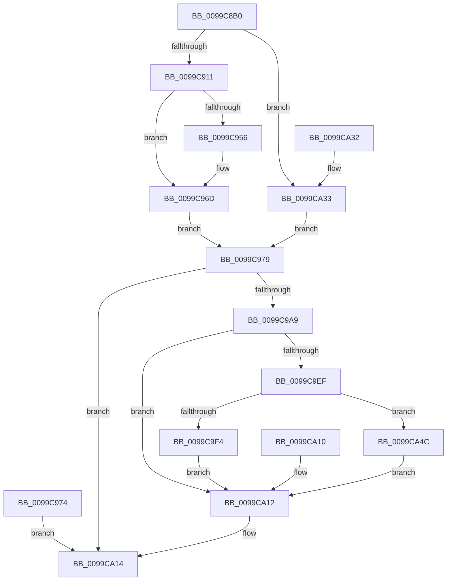

# NtRemoveIoCompletion

- RVA: `0x0099C8B0`–`0x0099CA68` (길이 `440` bytes)
- VA: `0x000000014099C8B0`
- 실행 섹션: `PAGE`
- PDB 이름 있음: `예`; PDB Function 태그: `아니요`
- unwind 정보 RVA: `0x00099A78`
- 디코드: `112`개 명령, `440/440` bytes 표시
- 미해석 바이트: `0` (있으면 어셈블리에 `.byte`로 보존)

> 이 문서는 커널 이미지의 기계어와 PDB 기호를 분석해 생성했습니다. 4번과 5번은 함수 원형과 자료형을 바이너리 사용 방식에서 추정한 C 해석이며 원본 소스 복구 결과는 아닙니다.

## 1. Dependencies

- 직접 호출 지점: **3**; 고유 호출 대상: **3**
- 직접 호출자로 확인된 함수: **0**
- RIP 상대 이미지 참조: **1**

### Outgoing calls
- `0x0099C9A0` → [ObReferenceObjectByHandle](../86/ObReferenceObjectByHandle_function_00868DB0.md) (function, `0x00868DB0`)
- `0x0099C9DA` → [IoRemoveIoCompletion](../../text/20/IoRemoveIoCompletion_function_0020B580.md) (function, `0x0020B580`)
- `0x0099C9E6` → [ObfDereferenceObject](../../text/2F/ObfDereferenceObject_function_002F9350.md) (function, `0x002F9350`)

### Direct callers
- 이 함수 시작 RVA로 연결되는 직접 call은 확인되지 않았습니다. 간접 호출은 완전히 역산할 수 없습니다.

### Static image references
- `0x0099C979` → RVA `0x00FC6CC0` (`ALMOSTRO`; read)

## 2. Other-region calls and transfers

- 다른 실행 섹션으로 향하는 call: **2**
  - `0x0099C9DA` → [IoRemoveIoCompletion](../../text/20/IoRemoveIoCompletion_function_0020B580.md) (`PAGE` → `.text`)
  - `0x0099C9E6` → [ObfDereferenceObject](../../text/2F/ObfDereferenceObject_function_002F9350.md) (`PAGE` → `.text`)
- 별도 외부 분기/꼬리 이동을 확인하지 못했습니다.

## 3. Assembly (complete function range)

```asm
0099C8B0  4C 8B DC                        mov r11, rsp
0099C8B3  49 89 5B 08                     mov qword ptr [r11 + 8], rbx
0099C8B7  49 89 73 10                     mov qword ptr [r11 + 0x10], rsi
0099C8BB  49 89 7B 18                     mov qword ptr [r11 + 0x18], rdi
0099C8BF  41 54                           push r12
0099C8C1  41 56                           push r14
0099C8C3  41 57                           push r15
0099C8C5  48 81 EC 90 00 00 00            sub rsp, 0x90
0099C8CC  4D 8B F1                        mov r14, r9
0099C8CF  4D 8B F8                        mov r15, r8
0099C8D2  4C 8B E2                        mov r12, rdx
0099C8D5  4C 8B D1                        mov r10, rcx
0099C8D8  45 33 C9                        xor r9d, r9d
0099C8DB  4D 89 4B E0                     mov qword ptr [r11 - 0x20], r9
0099C8DF  0F 57 C0                        xorps xmm0, xmm0
0099C8E2  0F 11 44 24 60                  movups xmmword ptr [rsp + 0x60], xmm0
0099C8E7  0F 11 44 24 70                  movups xmmword ptr [rsp + 0x70], xmm0
0099C8EC  45 89 4B 9C                     mov dword ptr [r11 - 0x64], r9d
0099C8F0  4D 89 4B A8                     mov qword ptr [r11 - 0x58], r9
0099C8F4  4D 89 4B A0                     mov qword ptr [r11 - 0x60], r9
0099C8F8  65 48 8B 04 25 88 01 00 00      mov rax, qword ptr gs:[0x188]
0099C901  0F B6 B8 32 02 00 00            movzx edi, byte ptr [rax + 0x232]
0099C908  40 84 FF                        test dil, dil
0099C90B  0F 84 22 01 00 00               je 0x14099ca33
0099C911  48 B8 00 00 FF FF FF 7F 00 00   movabs rax, 0x7fffffff0000
0099C91B  48 8B D0                        mov rdx, rax
0099C91E  4C 3B C0                        cmp r8, rax
0099C921  49 0F 42 D0                     cmovb rdx, r8
0099C925  48 8B 0A                        mov rcx, qword ptr [rdx]
0099C928  48 89 0A                        mov qword ptr [rdx], rcx
0099C92B  48 8B D0                        mov rdx, rax
0099C92E  4C 3B E0                        cmp r12, rax
0099C931  49 0F 42 D4                     cmovb rdx, r12
0099C935  48 8B 0A                        mov rcx, qword ptr [rdx]
0099C938  48 89 0A                        mov qword ptr [rdx], rcx
0099C93B  48 8B D0                        mov rdx, rax
0099C93E  4C 3B F0                        cmp r14, rax
0099C941  49 0F 42 D6                     cmovb rdx, r14
0099C945  8B 0A                           mov ecx, dword ptr [rdx]
0099C947  89 0A                           mov dword ptr [rdx], ecx
0099C949  48 8B 8C 24 D0 00 00 00         mov rcx, qword ptr [rsp + 0xd0]
0099C951  48 85 C9                        test rcx, rcx
0099C954  74 17                           je 0x14099c96d
0099C956  49 8D 53 A8                     lea rdx, [r11 - 0x58]
0099C95A  49 89 53 A0                     mov qword ptr [r11 - 0x60], rdx
0099C95E  48 3B C8                        cmp rcx, rax
0099C961  48 0F 42 C1                     cmovb rax, rcx
0099C965  90                              nop
0099C966  48 8B 00                        mov rax, qword ptr [rax]
0099C969  49 89 43 A8                     mov qword ptr [r11 - 0x58], rax
0099C96D  48 8B 5C 24 48                  mov rbx, qword ptr [rsp + 0x48]
0099C972  EB 05                           jmp 0x14099c979
0099C974  E9 9B 00 00 00                  jmp 0x14099ca14
0099C979  4C 8B 05 40 A3 62 00            mov r8, qword ptr [rip + 0x62a340]
0099C980  4C 89 4C 24 58                  mov qword ptr [rsp + 0x58], r9
0099C985  4C 89 4C 24 28                  mov qword ptr [rsp + 0x28], r9
0099C98A  48 8D 44 24 58                  lea rax, [rsp + 0x58]
0099C98F  48 89 44 24 20                  mov qword ptr [rsp + 0x20], rax
0099C994  44 0F B6 CF                     movzx r9d, dil
0099C998  BA 02 00 00 00                  mov edx, 2
0099C99D  49 8B CA                        mov rcx, r10
0099C9A0  E8 0B C4 EC FF                  call 0x140868db0
0099C9A5  85 C0                           test eax, eax
0099C9A7  78 6B                           js 0x14099ca14
0099C9A9  C6 44 24 38 00                  mov byte ptr [rsp + 0x38], 0
0099C9AE  48 89 5C 24 30                  mov qword ptr [rsp + 0x30], rbx
0099C9B3  40 88 7C 24 28                  mov byte ptr [rsp + 0x28], dil
0099C9B8  48 8D 44 24 44                  lea rax, [rsp + 0x44]
0099C9BD  48 89 44 24 20                  mov qword ptr [rsp + 0x20], rax
0099C9C2  41 B9 01 00 00 00               mov r9d, 1
0099C9C8  4C 8D 84 24 88 00 00 00         lea r8, [rsp + 0x88]
0099C9D0  48 8D 54 24 60                  lea rdx, [rsp + 0x60]
0099C9D5  48 8B 4C 24 58                  mov rcx, qword ptr [rsp + 0x58]
0099C9DA  E8 A1 EB 86 FF                  call 0x14020b580
0099C9DF  8B F0                           mov esi, eax
0099C9E1  48 8B 4C 24 58                  mov rcx, qword ptr [rsp + 0x58]
0099C9E6  E8 65 C9 95 FF                  call 0x1402f9350
0099C9EB  85 F6                           test esi, esi
0099C9ED  75 23                           jne 0x14099ca12
0099C9EF  40 84 FF                        test dil, dil
0099C9F2  74 58                           je 0x14099ca4c
0099C9F4  48 8B 4C 24 60                  mov rcx, qword ptr [rsp + 0x60]
0099C9F9  49 89 0C 24                     mov qword ptr [r12], rcx
0099C9FD  48 8B 44 24 68                  mov rax, qword ptr [rsp + 0x68]
0099CA02  49 89 07                        mov qword ptr [r15], rax
0099CA05  0F 10 44 24 70                  movups xmm0, xmmword ptr [rsp + 0x70]
0099CA0A  41 0F 11 06                     movups xmmword ptr [r14], xmm0
0099CA0E  EB 02                           jmp 0x14099ca12
0099CA10  8B F0                           mov esi, eax
0099CA12  8B C6                           mov eax, esi
0099CA14  4C 8D 9C 24 90 00 00 00         lea r11, [rsp + 0x90]
0099CA1C  49 8B 5B 20                     mov rbx, qword ptr [r11 + 0x20]
0099CA20  49 8B 73 28                     mov rsi, qword ptr [r11 + 0x28]
0099CA24  49 8B 7B 30                     mov rdi, qword ptr [r11 + 0x30]
0099CA28  49 8B E3                        mov rsp, r11
0099CA2B  41 5F                           pop r15
0099CA2D  41 5E                           pop r14
0099CA2F  41 5C                           pop r12
0099CA31  C3                              ret
0099CA32  CC                              int3
0099CA33  48 8B 5C 24 48                  mov rbx, qword ptr [rsp + 0x48]
0099CA38  48 8B 84 24 D0 00 00 00         mov rax, qword ptr [rsp + 0xd0]
0099CA40  48 85 C0                        test rax, rax
0099CA43  48 0F 45 D8                     cmovne rbx, rax
0099CA47  E9 2D FF FF FF                  jmp 0x14099c979
0099CA4C  48 8B 44 24 60                  mov rax, qword ptr [rsp + 0x60]
0099CA51  49 89 04 24                     mov qword ptr [r12], rax
0099CA55  48 8B 44 24 68                  mov rax, qword ptr [rsp + 0x68]
0099CA5A  49 89 07                        mov qword ptr [r15], rax
0099CA5D  0F 10 44 24 70                  movups xmm0, xmmword ptr [rsp + 0x70]
0099CA62  41 0F 11 06                     movups xmmword ptr [r14], xmm0
0099CA66  EB AA                           jmp 0x14099ca12
```

## 4. C-style interpretation (structured pseudocode)

```c
__int64 __fastcall NtRemoveIoCompletion(__int64 a1, __int64 a2, __int64 a3, __int64 a4, __int64 a5)
{
    __int64 result;
    __int64 v_rbx;
    __int64 v_rsp;
    unsigned __int64 v_stack_m18;
    unsigned __int64 v_stack_m20;
    unsigned __int64 v_stack_m28;
    unsigned __int64 v_stack_m30;
    unsigned __int64 v_stack_m38;
    unsigned __int64 v_stack_m40;
    unsigned __int64 v_stack_m48;
    unsigned __int64 v_stack_m50;
    unsigned __int64 v_stack_m60;
    unsigned __int64 v_stack_m64;
    unsigned __int8 v_stack_m70;
    unsigned __int64 v_stack_m78;
    unsigned __int64 v_stack_m80;
    unsigned __int64 v_stack_m88;

    *(unsigned __int64 *)(v_rsp + 8) = v_rbx;
    *(unsigned __int64 *)(v_rsp + 16) = v_rsi;
    *(unsigned __int64 *)(v_rsp + 24) = v_rdi;
    v_rsp = (v_rsp) - (144);
    a4 = 0;
    *(unsigned __int64 *)(v_rsp - 32) = 0;
    v_stack_m48 = v_xmm0;
    v_stack_m38 = v_xmm0;
    *(unsigned int *)(v_rsp - 100) = 0;
    *(unsigned __int64 *)(v_rsp - 88) = 0;
    *(unsigned __int64 *)(v_rsp - 96) = 0;
    if ((unsigned __int8)(*(unsigned __int8 *)(*(unsigned __int64 *)(gs_base + (0 + 392)) + 562)) == 0) goto loc_0099CA33;
    a2 = *(unsigned __int64 *)(gs_base + (0 + 392));
    if (a3 < (*(unsigned __int64 *)(gs_base + (0 + 392)))) { a2 = a3; }
    *(unsigned __int64 *)(a2) = *(unsigned __int64 *)(a2);
    a2 = *(unsigned __int64 *)(gs_base + (0 + 392));
    if (a2 < (*(unsigned __int64 *)(gs_base + (0 + 392)))) { a2 = a2; }
    *(unsigned __int64 *)(a2) = *(unsigned __int64 *)(a2);
    a2 = *(unsigned __int64 *)(gs_base + (0 + 392));
    if (0 < (*(unsigned __int64 *)(gs_base + (0 + 392)))) { a2 = 0; }
    *(unsigned int *)(a2) = (unsigned int)((unsigned int)(*(unsigned int *)(a2)));
    result = *(unsigned __int64 *)(gs_base + (0 + 392));
    if (a5 != 0) {
        a2 = v_rsp - 88;
        *(unsigned __int64 *)(v_rsp - 96) = a2;
        result = *(unsigned __int64 *)(gs_base + (0 + 392));
        if (a5 < (*(unsigned __int64 *)(gs_base + (0 + 392)))) { result = a5; }
        result = *(unsigned __int64 *)(result);
        *(unsigned __int64 *)(v_rsp - 88) = result;
    }
    goto loc_0099C979;
loc_0099C979:
    v_stack_m50 = 0;
    v_stack_m80 = 0;
    v_stack_m88 = v_stack_m50;
    result = ObReferenceObjectByHandle(a1, 2, *(unsigned __int64 *)(v_rip + 6464320), (unsigned __int8)(*(unsigned __int8 *)(*(unsigned __int64 *)(gs_base + (0 + 392)) + 562)));
    if (sign_flag) goto loc_0099CA14;
    v_stack_m70 = 0;
    v_stack_m78 = v_stack_m60;
    v_stack_m80 = (unsigned __int8)(*(unsigned __int8 *)(*(unsigned __int64 *)(gs_base + (0 + 392)) + 562));
    v_stack_m88 = v_stack_m64;
    result = IoRemoveIoCompletion(v_stack_m50, v_stack_m48, v_stack_m20, 1);
    result = ObfDereferenceObject(v_stack_m50, v_stack_m48, v_stack_m20, 1);
    if ((unsigned int)((unsigned int)((unsigned int)(result))) != 0) goto loc_0099CA12;
    if ((unsigned __int8)(*(unsigned __int8 *)(*(unsigned __int64 *)(gs_base + (0 + 392)) + 562)) == 0) goto loc_0099CA4C;
    *(unsigned __int64 *)(a2) = v_stack_m48;
    *(unsigned __int64 *)(a3) = v_stack_m40;
    *(unsigned __int64 *)(a4) = v_xmm0;
    goto loc_0099CA12;
loc_0099CA12:
loc_0099CA14:
    return (unsigned int)((unsigned int)((unsigned int)((unsigned int)(result))));
loc_0099CA33:
    v_rbx = v_stack_m48;
    if (a5 != 0) { v_rbx = a5; }
    goto loc_0099C979;
loc_0099CA4C:
    *(unsigned __int64 *)(a2) = v_stack_m30;
    *(unsigned __int64 *)(a3) = v_stack_m28;
    *(unsigned __int64 *)(a4) = v_xmm0;
    goto loc_0099CA12;
}
```

## 5. (Beta) C Style

```c
int64_t NtRemoveIoCompletion(int64_t Arg1, int64_t Arg2, void *Arg3, int64_t Arg4, int64_t Arg5)
{
    uint8_t *arg3 = (uint8_t *)Arg3;

    int64_t result;
    int64_t local_rbx;
    int64_t local_rsp;
    uint64_t v_stack_m18;
    uint64_t v_stack_m20;
    uint64_t v_stack_m28;
    uint64_t v_stack_m30;
    uint64_t v_stack_m38;
    uint64_t v_stack_m40;
    uint64_t v_stack_m48;
    uint64_t v_stack_m50;
    uint64_t v_stack_m60;
    uint64_t v_stack_m64;
    uint8_t v_stack_m70;
    uint64_t v_stack_m78;
    uint64_t v_stack_m80;
    uint64_t v_stack_m88;

    *(uint64_t *)(local_rsp + 0x8) = local_rbx;
    *(uint64_t *)(local_rsp + 0x10) = local_rsi;
    *(uint64_t *)(local_rsp + 0x18) = local_rdi;
    local_rsp = (local_rsp) - (144);
    Arg4 = 0;
    *(uint64_t *)(local_rsp - 0x20) = 0;
    v_stack_m48 = v_xmm0;
    v_stack_m38 = v_xmm0;
    *(uint32_t *)(local_rsp - 0x64) = 0;
    *(uint64_t *)(local_rsp - 0x58) = 0;
    *(uint64_t *)(local_rsp - 0x60) = 0;
    if ((uint8_t)(*(uint8_t *)(*(uint64_t *)(gs_base + (0 + 0x188)) + 0x232)) == 0) goto loc_0099CA33;
    Arg2 = *(uint64_t *)(gs_base + (0 + 0x188));
    if (Arg3 < (*(uint64_t *)(gs_base + (0 + 0x188)))) { Arg2 = Arg3; }
    *(uint64_t *)(Arg2) = *(uint64_t *)(Arg2);
    Arg2 = *(uint64_t *)(gs_base + (0 + 0x188));
    if (Arg2 < (*(uint64_t *)(gs_base + (0 + 0x188)))) { Arg2 = Arg2; }
    *(uint64_t *)(Arg2) = *(uint64_t *)(Arg2);
    Arg2 = *(uint64_t *)(gs_base + (0 + 0x188));
    if (0 < (*(uint64_t *)(gs_base + (0 + 0x188)))) { Arg2 = 0; }
    *(uint32_t *)(Arg2) = (uint32_t)((uint32_t)(*(uint32_t *)(Arg2)));
    result = *(uint64_t *)(gs_base + (0 + 0x188));
    if (Arg5 != 0) {
        Arg2 = local_rsp - 88;
        *(uint64_t *)(local_rsp - 0x60) = Arg2;
        result = *(uint64_t *)(gs_base + (0 + 0x188));
        if (Arg5 < (*(uint64_t *)(gs_base + (0 + 0x188)))) { result = Arg5; }
        result = *(uint64_t *)(result);
        *(uint64_t *)(local_rsp - 0x58) = result;
    }
    goto loc_0099C979;
loc_0099C979:
    v_stack_m50 = 0;
    v_stack_m80 = 0;
    v_stack_m88 = v_stack_m50;
    result = ObReferenceObjectByHandle(Arg1, 2, *(uint64_t *)(v_rip + 0x62A340), (uint8_t)(*(uint8_t *)(*(uint64_t *)(gs_base + (0 + 0x188)) + 0x232)));
    if (sign_flag) goto loc_0099CA14;
    v_stack_m70 = 0;
    v_stack_m78 = v_stack_m60;
    v_stack_m80 = (uint8_t)(*(uint8_t *)(*(uint64_t *)(gs_base + (0 + 0x188)) + 0x232));
    v_stack_m88 = v_stack_m64;
    result = IoRemoveIoCompletion(v_stack_m50, v_stack_m48, v_stack_m20, 1);
    result = ObfDereferenceObject(v_stack_m50, v_stack_m48, v_stack_m20, 1);
    if ((uint32_t)((uint32_t)((uint32_t)(result))) != 0) goto loc_0099CA12;
    if ((uint8_t)(*(uint8_t *)(*(uint64_t *)(gs_base + (0 + 0x188)) + 0x232)) == 0) goto loc_0099CA4C;
    *(uint64_t *)(Arg2) = v_stack_m48;
    *(uint64_t *)(arg3) = v_stack_m40;
    *(uint64_t *)(Arg4) = v_xmm0;
    goto loc_0099CA12;
loc_0099CA12:
loc_0099CA14:
    return (uint32_t)((uint32_t)((uint32_t)((uint32_t)(result))));
loc_0099CA33:
    local_rbx = v_stack_m48;
    if (Arg5 != 0) { local_rbx = Arg5; }
    goto loc_0099C979;
loc_0099CA4C:
    *(uint64_t *)(Arg2) = v_stack_m30;
    *(uint64_t *)(arg3) = v_stack_m28;
    *(uint64_t *)(Arg4) = v_xmm0;
    goto loc_0099CA12;
}
```

### 관측된 메모리 오프셋

구조체 형식이 확인되지 않은 접근은 인자 기준의 오프셋으로만 기록했습니다.

| 기준 인자 | 오프셋 표현 | 폭 (bit) | 접근 |
|---|---:|---:|---|
| `Arg3` | `+ 0x0` | `64` | `W` |

## 6. Execution-region graph

[열기: 2D/3D 그래프와 함수 탐색 컨트롤 패널](../../../control-panel.html?section=page&rva=0x0099C8B0&view=graph)

- 2D 그래프는 위에서 아래로 흐르고, 3D 그래프는 빈 공간을 드래그해 회전합니다. Shift+드래그는 이동, 휠은 확대·축소, 함수 노드 선택은 대상 보고서 이동입니다.

### Static fallback


