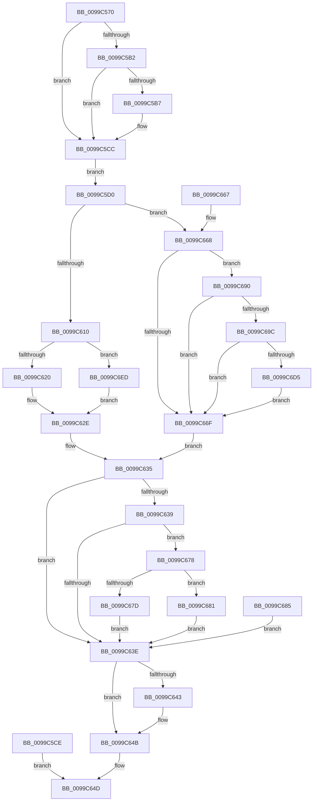

# NtSetEventEx

- RVA: `0x0099C570`–`0x0099C72A` (길이 `442` bytes)
- VA: `0x000000014099C570`
- 실행 섹션: `PAGE`
- PDB 이름 있음: `예`; PDB Function 태그: `아니요`
- unwind 정보 RVA: `0x0009978C`
- 디코드: `119`개 명령, `442/442` bytes 표시
- 미해석 바이트: `0` (있으면 어셈블리에 `.byte`로 보존)

> 이 문서는 커널 이미지의 기계어와 PDB 기호를 분석해 생성했습니다. 4번과 5번은 함수 원형과 자료형을 바이너리 사용 방식에서 추정한 C 해석이며 원본 소스 복구 결과는 아닙니다.

## 1. Dependencies

- 직접 호출 지점: **7**; 고유 호출 대상: **6**
- 직접 호출자로 확인된 함수: **1**
- RIP 상대 이미지 참조: **2**

### Outgoing calls
- `0x0099C5F7` → [ObReferenceObjectByHandle](../86/ObReferenceObjectByHandle_function_00868DB0.md) (function, `0x00868DB0`)
- `0x0099C613` → [KeAbIsValidUserModeLockAddress](../../text/43/KeAbIsValidUserModeLockAddress_function_004333F0.md) (function, `0x004333F0`)
- `0x0099C629` → [KeSetEvent](../../text/33/KeSetEvent_function_0033F310.md) (function, `0x0033F310`)
- `0x0099C646` → [ObfDereferenceObject](../../text/2F/ObfDereferenceObject_function_002F9350.md) (function, `0x002F9350`)
- `0x0099C6BC` → [ObReferenceObjectByHandle](../86/ObReferenceObjectByHandle_function_00868DB0.md) (function, `0x00868DB0`)
- `0x0099C6E0` → [ExpSetCrossVmEvent](ExpSetCrossVmEvent_function_0099C730.md) (function, `0x0099C730`)
- `0x0099C720` → [KeSetEventBoostPriorityEx](../../text/35/KeSetEventBoostPriorityEx_function_00350148.md) (function, `0x00350148`)

### Direct callers
- [NtSetEvent](NtSetEvent_function_0099C550.md) at `0x0099C557`

### Static image references
- `0x0099C5D0` → RVA `0x00FC6B80` (`ALMOSTRO`; read)
- `0x0099C690` → RVA `0x00EFA110` (`.data`; read)

## 2. Other-region calls and transfers

- 다른 실행 섹션으로 향하는 call: **4**
  - `0x0099C613` → [KeAbIsValidUserModeLockAddress](../../text/43/KeAbIsValidUserModeLockAddress_function_004333F0.md) (`PAGE` → `.text`)
  - `0x0099C629` → [KeSetEvent](../../text/33/KeSetEvent_function_0033F310.md) (`PAGE` → `.text`)
  - `0x0099C646` → [ObfDereferenceObject](../../text/2F/ObfDereferenceObject_function_002F9350.md) (`PAGE` → `.text`)
  - `0x0099C720` → [KeSetEventBoostPriorityEx](../../text/35/KeSetEventBoostPriorityEx_function_00350148.md) (`PAGE` → `.text`)
- 별도 외부 분기/꼬리 이동을 확인하지 못했습니다.

## 3. Assembly (complete function range)

```asm
0099C570  48 8B C4                        mov rax, rsp
0099C573  48 89 58 08                     mov qword ptr [rax + 8], rbx
0099C577  48 89 70 10                     mov qword ptr [rax + 0x10], rsi
0099C57B  57                              push rdi
0099C57C  41 54                           push r12
0099C57E  41 55                           push r13
0099C580  41 56                           push r14
0099C582  41 57                           push r15
0099C584  48 83 EC 50                     sub rsp, 0x50
0099C588  4D 8B E0                        mov r12, r8
0099C58B  48 8B F2                        mov rsi, rdx
0099C58E  4C 8B F1                        mov r14, rcx
0099C591  45 33 ED                        xor r13d, r13d
0099C594  4C 89 68 D0                     mov qword ptr [rax - 0x30], r13
0099C598  44 89 68 20                     mov dword ptr [rax + 0x20], r13d
0099C59C  65 48 8B 04 25 88 01 00 00      mov rax, qword ptr gs:[0x188]
0099C5A5  44 0F B6 B8 32 02 00 00         movzx r15d, byte ptr [rax + 0x232]
0099C5AD  48 85 D2                        test rdx, rdx
0099C5B0  74 1A                           je 0x14099c5cc
0099C5B2  45 84 FF                        test r15b, r15b
0099C5B5  74 15                           je 0x14099c5cc
0099C5B7  48 B9 00 00 FF FF FF 7F 00 00   movabs rcx, 0x7fffffff0000
0099C5C1  48 3B D1                        cmp rdx, rcx
0099C5C4  48 0F 42 CA                     cmovb rcx, rdx
0099C5C8  8B 01                           mov eax, dword ptr [rcx]
0099C5CA  89 01                           mov dword ptr [rcx], eax
0099C5CC  EB 02                           jmp 0x14099c5d0
0099C5CE  EB 7D                           jmp 0x14099c64d
0099C5D0  4C 8B 05 A9 A5 62 00            mov r8, qword ptr [rip + 0x62a5a9]
0099C5D7  4C 89 6C 24 38                  mov qword ptr [rsp + 0x38], r13
0099C5DC  4C 89 6C 24 28                  mov qword ptr [rsp + 0x28], r13
0099C5E1  48 8D 44 24 38                  lea rax, [rsp + 0x38]
0099C5E6  48 89 44 24 20                  mov qword ptr [rsp + 0x20], rax
0099C5EB  45 0F B6 CF                     movzx r9d, r15b
0099C5EF  BA 02 00 00 00                  mov edx, 2
0099C5F4  49 8B CE                        mov rcx, r14
0099C5F7  E8 B4 C7 EC FF                  call 0x140868db0
0099C5FC  8B D8                           mov ebx, eax
0099C5FE  48 8B 7C 24 38                  mov rdi, qword ptr [rsp + 0x38]
0099C603  48 89 7C 24 40                  mov qword ptr [rsp + 0x40], rdi
0099C608  89 44 24 30                     mov dword ptr [rsp + 0x30], eax
0099C60C  85 C0                           test eax, eax
0099C60E  78 58                           js 0x14099c668
0099C610  49 8B CC                        mov rcx, r12
0099C613  E8 D8 6D A9 FF                  call 0x1404333f0
0099C618  85 C0                           test eax, eax
0099C61A  0F 85 CD 00 00 00               jne 0x14099c6ed
0099C620  45 33 C0                        xor r8d, r8d
0099C623  8D 50 01                        lea edx, [rax + 1]
0099C626  48 8B CF                        mov rcx, rdi
0099C629  E8 E2 2C 9A FF                  call 0x14033f310
0099C62E  89 84 24 98 00 00 00            mov dword ptr [rsp + 0x98], eax
0099C635  85 DB                           test ebx, ebx
0099C637  78 05                           js 0x14099c63e
0099C639  48 85 F6                        test rsi, rsi
0099C63C  75 3A                           jne 0x14099c678
0099C63E  48 85 FF                        test rdi, rdi
0099C641  74 08                           je 0x14099c64b
0099C643  48 8B CF                        mov rcx, rdi
0099C646  E8 05 CD 95 FF                  call 0x1402f9350
0099C64B  8B C3                           mov eax, ebx
0099C64D  4C 8D 5C 24 50                  lea r11, [rsp + 0x50]
0099C652  49 8B 5B 30                     mov rbx, qword ptr [r11 + 0x30]
0099C656  49 8B 73 38                     mov rsi, qword ptr [r11 + 0x38]
0099C65A  49 8B E3                        mov rsp, r11
0099C65D  41 5F                           pop r15
0099C65F  41 5E                           pop r14
0099C661  41 5D                           pop r13
0099C663  41 5C                           pop r12
0099C665  5F                              pop rdi
0099C666  C3                              ret
0099C667  CC                              int3
0099C668  3D 24 00 00 C0                  cmp eax, 0xc0000024
0099C66D  74 21                           je 0x14099c690
0099C66F  8B 84 24 98 00 00 00            mov eax, dword ptr [rsp + 0x98]
0099C676  EB BD                           jmp 0x14099c635
0099C678  45 84 FF                        test r15b, r15b
0099C67B  75 04                           jne 0x14099c681
0099C67D  89 06                           mov dword ptr [rsi], eax
0099C67F  EB BD                           jmp 0x14099c63e
0099C681  89 06                           mov dword ptr [rsi], eax
0099C683  EB B9                           jmp 0x14099c63e
0099C685  48 8B 7C 24 40                  mov rdi, qword ptr [rsp + 0x40]
0099C68A  8B 5C 24 30                     mov ebx, dword ptr [rsp + 0x30]
0099C68E  EB AE                           jmp 0x14099c63e
0099C690  4C 8B 05 79 DA 55 00            mov r8, qword ptr [rip + 0x55da79]
0099C697  4D 85 C0                        test r8, r8
0099C69A  74 D3                           je 0x14099c66f
0099C69C  4C 89 6C 24 38                  mov qword ptr [rsp + 0x38], r13
0099C6A1  4C 89 6C 24 28                  mov qword ptr [rsp + 0x28], r13
0099C6A6  48 8D 44 24 38                  lea rax, [rsp + 0x38]
0099C6AB  48 89 44 24 20                  mov qword ptr [rsp + 0x20], rax
0099C6B0  45 0F B6 CF                     movzx r9d, r15b
0099C6B4  BA 02 00 00 00                  mov edx, 2
0099C6B9  49 8B CE                        mov rcx, r14
0099C6BC  E8 EF C6 EC FF                  call 0x140868db0
0099C6C1  8B D8                           mov ebx, eax
0099C6C3  48 8B 7C 24 38                  mov rdi, qword ptr [rsp + 0x38]
0099C6C8  48 89 7C 24 40                  mov qword ptr [rsp + 0x40], rdi
0099C6CD  89 44 24 30                     mov dword ptr [rsp + 0x30], eax
0099C6D1  85 C0                           test eax, eax
0099C6D3  78 9A                           js 0x14099c66f
0099C6D5  48 8D 94 24 98 00 00 00         lea rdx, [rsp + 0x98]
0099C6DD  48 8B CF                        mov rcx, rdi
0099C6E0  E8 4B 00 00 00                  call 0x14099c730
0099C6E5  8B D8                           mov ebx, eax
0099C6E7  89 44 24 30                     mov dword ptr [rsp + 0x30], eax
0099C6EB  EB 82                           jmp 0x14099c66f
0099C6ED  65 48 8B 04 25 88 01 00 00      mov rax, qword ptr gs:[0x188]
0099C6F6  0F BE 88 C3 00 00 00            movsx ecx, byte ptr [rax + 0xc3]
0099C6FD  89 4C 24 34                     mov dword ptr [rsp + 0x34], ecx
0099C701  C7 44 24 28 01 00 00 00         mov dword ptr [rsp + 0x28], 1
0099C709  C6 44 24 20 00                  mov byte ptr [rsp + 0x20], 0
0099C70E  4D 8B CC                        mov r9, r12
0099C711  4C 8D 44 24 34                  lea r8, [rsp + 0x34]
0099C716  48 8D 54 24 48                  lea rdx, [rsp + 0x48]
0099C71B  48 8B 4C 24 38                  mov rcx, qword ptr [rsp + 0x38]
0099C720  E8 23 3A 9B FF                  call 0x140350148
0099C725  E9 04 FF FF FF                  jmp 0x14099c62e
```

## 4. C-style interpretation (structured pseudocode)

```c
__int64 __fastcall NtSetEventEx(__int64 a1, __int64 a2, __int64 a3)
{
    __int64 result;
    __int64 v_r13;
    __int64 v_rsp;
    unsigned __int64 v_stack_m10;
    unsigned __int64 v_stack_m18;
    unsigned int v_stack_m1C;
    unsigned int v_stack_m20;
    unsigned __int64 v_stack_m28;
    unsigned __int64 v_stack_m30;
    unsigned __int64 v_stack_m38;
    unsigned __int64 v_stack_m40;
    unsigned int v_stack_m48;
    unsigned __int64 v_stack_m50;
    unsigned __int64 v_stack_m58;
    unsigned __int64 v_stack_m8;
    unsigned int v_stack_p20;
    unsigned int v_stack_p48;

    *(unsigned __int64 *)(v_rsp + 8) = v_rbx;
    *(unsigned __int64 *)(v_rsp + 16) = v_rsi;
    v_rsp = (v_rsp) - (80);
    v_r13 = 0;
    *(unsigned __int64 *)(v_rsp - 48) = 0;
    *(unsigned int *)(v_rsp + 32) = 0;
    if (a2 == 0) goto loc_0099C5CC;
    result = *(unsigned __int64 *)(gs_base + (0 + 392));
    if ((unsigned __int8)(*(unsigned __int8 *)(*(unsigned __int64 *)(gs_base + (0 + 392)) + 562)) != 0) {
        if (a2 < a1) { a1 = a2; }
        result = *(unsigned int *)(a1);
        *(unsigned int *)(a1) = (unsigned int)(result);
    }
    goto loc_0099C5D0;
loc_0099C5D0:
    v_stack_m40 = 0;
    v_stack_m50 = 0;
    v_stack_m58 = v_stack_m40;
    result = ObReferenceObjectByHandle(a1, 2, *(unsigned __int64 *)(v_rip + 6464937), (unsigned __int8)(*(unsigned __int8 *)(*(unsigned __int64 *)(gs_base + (0 + 392)) + 562)));
    v_stack_m38 = v_stack_m40;
    v_stack_m48 = (unsigned int)(result);
    if (sign_flag) goto loc_0099C668;
    result = KeAbIsValidUserModeLockAddress(a3, 2, *(unsigned __int64 *)(v_rip + 6464937), (unsigned __int8)(*(unsigned __int8 *)(*(unsigned __int64 *)(gs_base + (0 + 392)) + 562)));
    if ((unsigned int)(result) != 0) goto loc_0099C6ED;
    a3 = 0;
    result = KeSetEvent(v_stack_m40, result + 1, a3, (unsigned __int8)(*(unsigned __int8 *)(*(unsigned __int64 *)(gs_base + (0 + 392)) + 562)));
loc_0099C62E:
    v_stack_p20 = (unsigned int)(result);
loc_0099C635:
    if (sign_flag) goto loc_0099C63E;
    if (a2 != 0) goto loc_0099C678;
loc_0099C63E:
    if (v_stack_m40 != 0) {
        a1 = v_stack_m40;
        result = ObfDereferenceObject(a1, result + 1, a3, (unsigned __int8)(*(unsigned __int8 *)(*(unsigned __int64 *)(gs_base + (0 + 392)) + 562)));
    }
loc_0099C64D:
    return (unsigned int)((unsigned int)((unsigned int)((unsigned int)(result))));
loc_0099C668:
    if (((unsigned int)((unsigned int)((unsigned int)((unsigned int)((unsigned int)(result)))))) == 0xC0000024ULL) goto loc_0099C690;
loc_0099C66F:
    goto loc_0099C635;
loc_0099C678:
    if ((unsigned __int8)(*(unsigned __int8 *)(*(unsigned __int64 *)(gs_base + (0 + 392)) + 562)) != 0) goto loc_0099C681;
    *(unsigned int *)(*(unsigned __int64 *)(v_stack_m28 + 56)) = (unsigned int)((unsigned int)(v_stack_p48));
    goto loc_0099C63E;
loc_0099C681:
    *(unsigned int *)(*(unsigned __int64 *)(v_stack_m28 + 56)) = (unsigned int)((unsigned int)(v_stack_p48));
    goto loc_0099C63E;
loc_0099C690:
    if (*(unsigned __int64 *)(v_rip + 5626489) == 0) goto loc_0099C66F;
    v_stack_m18 = 0;
    v_stack_m28 = 0;
    v_stack_m30 = v_stack_m18;
    result = ObReferenceObjectByHandle(a1, 2, *(unsigned __int64 *)(v_rip + 5626489), (unsigned __int8)(*(unsigned __int8 *)(*(unsigned __int64 *)(gs_base + (0 + 392)) + 562)));
    v_stack_m10 = v_stack_m18;
    v_stack_m20 = (unsigned int)(result);
    if (sign_flag) goto loc_0099C66F;
    result = ExpSetCrossVmEvent(v_stack_m18, v_stack_p48, *(unsigned __int64 *)(v_rip + 5626489), (unsigned __int8)(*(unsigned __int8 *)(*(unsigned __int64 *)(gs_base + (0 + 392)) + 562)));
    v_stack_m20 = (unsigned int)(result);
    goto loc_0099C66F;
loc_0099C6ED:
    v_stack_m1C = (unsigned int)((__int8)(*(unsigned __int8 *)(*(unsigned __int64 *)(gs_base + (0 + 392)) + 195)));
    v_stack_m28 = 1;
    v_stack_m30 = 0;
    result = KeSetEventBoostPriorityEx(v_stack_m18, v_stack_m8, v_stack_m1C, 0);
    goto loc_0099C62E;
}
```

## 5. (Beta) C Style

```c
int64_t NtSetEventEx(int64_t Arg1, int64_t Arg2, int64_t Arg3)
{
    int64_t result;
    int64_t local_r13;
    int64_t local_rsp;
    uint64_t v_stack_m10;
    uint64_t v_stack_m18;
    uint32_t v_stack_m1C;
    uint32_t v_stack_m20;
    uint64_t v_stack_m28;
    uint64_t v_stack_m30;
    uint64_t v_stack_m38;
    uint64_t v_stack_m40;
    uint32_t v_stack_m48;
    uint64_t v_stack_m50;
    uint64_t v_stack_m58;
    uint64_t v_stack_m8;
    uint32_t v_stack_p20;
    uint32_t v_stack_p48;

    *(uint64_t *)(local_rsp + 0x8) = local_rbx;
    *(uint64_t *)(local_rsp + 0x10) = local_rsi;
    local_rsp = (local_rsp) - (80);
    local_r13 = 0;
    *(uint64_t *)(local_rsp - 0x30) = 0;
    *(uint32_t *)(local_rsp + 0x20) = 0;
    if (Arg2 == 0) goto loc_0099C5CC;
    result = *(uint64_t *)(gs_base + (0 + 0x188));
    if ((uint8_t)(*(uint8_t *)(*(uint64_t *)(gs_base + (0 + 0x188)) + 0x232)) != 0) {
        if (Arg2 < Arg1) { Arg1 = Arg2; }
        result = *(uint32_t *)(Arg1);
        *(uint32_t *)(Arg1) = (uint32_t)(result);
    }
    goto loc_0099C5D0;
loc_0099C5D0:
    v_stack_m40 = 0;
    v_stack_m50 = 0;
    v_stack_m58 = v_stack_m40;
    result = ObReferenceObjectByHandle(Arg1, 2, *(uint64_t *)(v_rip + 0x62A5A9), (uint8_t)(*(uint8_t *)(*(uint64_t *)(gs_base + (0 + 0x188)) + 0x232)));
    v_stack_m38 = v_stack_m40;
    v_stack_m48 = (uint32_t)(result);
    if (sign_flag) goto loc_0099C668;
    result = KeAbIsValidUserModeLockAddress(Arg3, 2, *(uint64_t *)(v_rip + 0x62A5A9), (uint8_t)(*(uint8_t *)(*(uint64_t *)(gs_base + (0 + 0x188)) + 0x232)));
    if ((uint32_t)(result) != 0) goto loc_0099C6ED;
    Arg3 = 0;
    result = KeSetEvent(v_stack_m40, result + 1, Arg3, (uint8_t)(*(uint8_t *)(*(uint64_t *)(gs_base + (0 + 0x188)) + 0x232)));
loc_0099C62E:
    v_stack_p20 = (uint32_t)(result);
loc_0099C635:
    if (sign_flag) goto loc_0099C63E;
    if (Arg2 != 0) goto loc_0099C678;
loc_0099C63E:
    if (v_stack_m40 != 0) {
        Arg1 = v_stack_m40;
        result = ObfDereferenceObject(Arg1, result + 1, Arg3, (uint8_t)(*(uint8_t *)(*(uint64_t *)(gs_base + (0 + 0x188)) + 0x232)));
    }
loc_0099C64D:
    return (uint32_t)((uint32_t)((uint32_t)((uint32_t)(result))));
loc_0099C668:
    if (((uint32_t)((uint32_t)((uint32_t)((uint32_t)((uint32_t)(result)))))) == 0xC0000024ULL) goto loc_0099C690;
loc_0099C66F:
    goto loc_0099C635;
loc_0099C678:
    if ((uint8_t)(*(uint8_t *)(*(uint64_t *)(gs_base + (0 + 0x188)) + 0x232)) != 0) goto loc_0099C681;
    *(uint32_t *)(*(uint64_t *)(v_stack_m28 + 0x38)) = (uint32_t)((uint32_t)(v_stack_p48));
    goto loc_0099C63E;
loc_0099C681:
    *(uint32_t *)(*(uint64_t *)(v_stack_m28 + 0x38)) = (uint32_t)((uint32_t)(v_stack_p48));
    goto loc_0099C63E;
loc_0099C690:
    if (*(uint64_t *)(v_rip + 0x55DA79) == 0) goto loc_0099C66F;
    v_stack_m18 = 0;
    v_stack_m28 = 0;
    v_stack_m30 = v_stack_m18;
    result = ObReferenceObjectByHandle(Arg1, 2, *(uint64_t *)(v_rip + 0x55DA79), (uint8_t)(*(uint8_t *)(*(uint64_t *)(gs_base + (0 + 0x188)) + 0x232)));
    v_stack_m10 = v_stack_m18;
    v_stack_m20 = (uint32_t)(result);
    if (sign_flag) goto loc_0099C66F;
    result = ExpSetCrossVmEvent(v_stack_m18, v_stack_p48, *(uint64_t *)(v_rip + 0x55DA79), (uint8_t)(*(uint8_t *)(*(uint64_t *)(gs_base + (0 + 0x188)) + 0x232)));
    v_stack_m20 = (uint32_t)(result);
    goto loc_0099C66F;
loc_0099C6ED:
    v_stack_m1C = (uint32_t)((int8_t)(*(uint8_t *)(*(uint64_t *)(gs_base + (0 + 0x188)) + 0xC3)));
    v_stack_m28 = 1;
    v_stack_m30 = 0;
    result = KeSetEventBoostPriorityEx(v_stack_m18, v_stack_m8, v_stack_m1C, 0);
    goto loc_0099C62E;
}
```

## 6. Execution-region graph

[열기: 2D/3D 그래프와 함수 탐색 컨트롤 패널](../../../control-panel.html?section=page&rva=0x0099C570&view=graph)

- 2D 그래프는 위에서 아래로 흐르고, 3D 그래프는 빈 공간을 드래그해 회전합니다. Shift+드래그는 이동, 휠은 확대·축소, 함수 노드 선택은 대상 보고서 이동입니다.

### Static fallback


