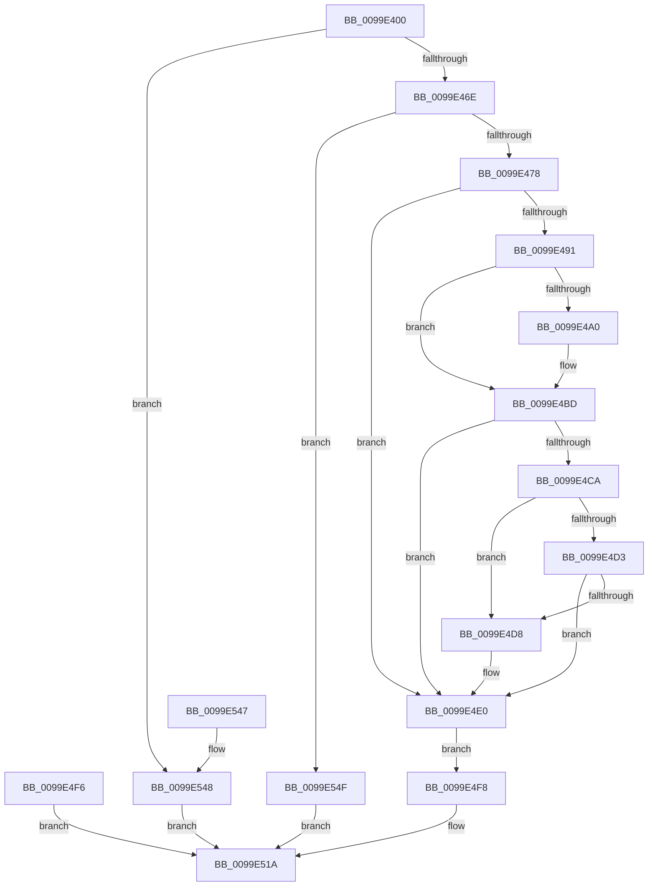

# NtWaitForMultipleObjects

- RVA: `0x0099E400`–`0x0099E556` (길이 `342` bytes)
- VA: `0x000000014099E400`
- 실행 섹션: `PAGE`
- PDB 이름 있음: `예`; PDB Function 태그: `아니요`
- unwind 정보 RVA: `0x0009A554`
- 디코드: `86`개 명령, `342/342` bytes 표시
- 미해석 바이트: `0` (있으면 어셈블리에 `.byte`로 보존)

> 이 문서는 커널 이미지의 기계어와 PDB 기호를 분석해 생성했습니다. 4번과 5번은 함수 원형과 자료형을 바이너리 사용 방식에서 추정한 C 해석이며 원본 소스 복구 결과는 아닙니다.

## 1. Dependencies

- 직접 호출 지점: **4**; 고유 호출 대상: **4**
- 직접 호출자로 확인된 함수: **0**
- RIP 상대 이미지 참조: **1**

### Outgoing calls
- `0x0099E453` → [memset](../../text/6C/memset_function_006C6C40.md) (function, `0x006C6C40`)
- `0x0099E4EF` → [memcpy](../../text/6C/memcpy_function_006C6840.md) (function, `0x006C6840`)
- `0x0099E515` → [ObWaitForMultipleObjects](../86/ObWaitForMultipleObjects_function_00868DF0.md) (function, `0x00868DF0`)
- `0x0099E525` → [_security_check_cookie](../../text/6A/_security_check_cookie_function_006AC640.md) (function, `0x006AC640`)

### Direct callers
- 이 함수 시작 RVA로 연결되는 직접 call은 확인되지 않았습니다. 간접 호출은 완전히 역산할 수 없습니다.

### Static image references
- `0x0099E41A` → RVA `0x00E0A740` (`.data`; read)

## 2. Other-region calls and transfers

- 다른 실행 섹션으로 향하는 call: **3**
  - `0x0099E453` → [memset](../../text/6C/memset_function_006C6C40.md) (`PAGE` → `.text`)
  - `0x0099E4EF` → [memcpy](../../text/6C/memcpy_function_006C6840.md) (`PAGE` → `.text`)
  - `0x0099E525` → [_security_check_cookie](../../text/6A/_security_check_cookie_function_006AC640.md) (`PAGE` → `.text`)
- 별도 외부 분기/꼬리 이동을 확인하지 못했습니다.

## 3. Assembly (complete function range)

```asm
0099E400  48 89 5C 24 18                  mov qword ptr [rsp + 0x18], rbx
0099E405  48 89 74 24 20                  mov qword ptr [rsp + 0x20], rsi
0099E40A  57                              push rdi
0099E40B  41 54                           push r12
0099E40D  41 55                           push r13
0099E40F  41 56                           push r14
0099E411  41 57                           push r15
0099E413  48 81 EC 60 02 00 00            sub rsp, 0x260
0099E41A  48 8B 05 1F C3 46 00            mov rax, qword ptr [rip + 0x46c31f]
0099E421  48 33 C4                        xor rax, rsp
0099E424  48 89 84 24 50 02 00 00         mov qword ptr [rsp + 0x250], rax
0099E42C  45 0F B6 E9                     movzx r13d, r9b
0099E430  45 8B F8                        mov r15d, r8d
0099E433  48 8B F2                        mov rsi, rdx
0099E436  44 8B F1                        mov r14d, ecx
0099E439  4C 8B A4 24 B0 02 00 00         mov r12, qword ptr [rsp + 0x2b0]
0099E441  4C 89 64 24 40                  mov qword ptr [rsp + 0x40], r12
0099E446  33 D2                           xor edx, edx
0099E448  41 B8 00 02 00 00               mov r8d, 0x200
0099E44E  48 8D 4C 24 50                  lea rcx, [rsp + 0x50]
0099E453  E8 E8 87 D2 FF                  call 0x1406c6c40
0099E458  48 C7 44 24 48 00 00 00 00      mov qword ptr [rsp + 0x48], 0
0099E461  41 8D 46 FF                     lea eax, [r14 - 1]
0099E465  83 F8 3F                        cmp eax, 0x3f
0099E468  0F 87 DA 00 00 00               ja 0x14099e548
0099E46E  41 83 FF 01                     cmp r15d, 1
0099E472  0F 87 D7 00 00 00               ja 0x14099e54f
0099E478  65 48 8B 1C 25 88 01 00 00      mov rbx, qword ptr gs:[0x188]
0099E481  0F B6 9B 32 02 00 00            movzx ebx, byte ptr [rbx + 0x232]
0099E488  48 8B 7C 24 40                  mov rdi, qword ptr [rsp + 0x40]
0099E48D  84 DB                           test bl, bl
0099E48F  74 4F                           je 0x14099e4e0
0099E491  48 BA 00 00 FF FF FF 7F 00 00   movabs rdx, 0x7fffffff0000
0099E49B  48 85 FF                        test rdi, rdi
0099E49E  74 1D                           je 0x14099e4bd
0099E4A0  48 8B C2                        mov rax, rdx
0099E4A3  48 3B FA                        cmp rdi, rdx
0099E4A6  49 0F 42 C4                     cmovb rax, r12
0099E4AA  90                              nop
0099E4AB  48 8B 00                        mov rax, qword ptr [rax]
0099E4AE  48 89 44 24 48                  mov qword ptr [rsp + 0x48], rax
0099E4B3  48 8D 7C 24 48                  lea rdi, [rsp + 0x48]
0099E4B8  48 89 7C 24 40                  mov qword ptr [rsp + 0x40], rdi
0099E4BD  4A 8D 04 F5 00 00 00 00         lea rax, [r14*8]
0099E4C5  48 85 C0                        test rax, rax
0099E4C8  74 16                           je 0x14099e4e0
0099E4CA  48 8D 0C 30                     lea rcx, [rax + rsi]
0099E4CE  48 3B CE                        cmp rcx, rsi
0099E4D1  72 05                           jb 0x14099e4d8
0099E4D3  48 3B CA                        cmp rcx, rdx
0099E4D6  76 08                           jbe 0x14099e4e0
0099E4D8  0F B6 02                        movzx eax, byte ptr [rdx]
0099E4DB  48 8B 7C 24 40                  mov rdi, qword ptr [rsp + 0x40]
0099E4E0  4D 8B C6                        mov r8, r14
0099E4E3  49 C1 E0 03                     shl r8, 3
0099E4E7  48 8B D6                        mov rdx, rsi
0099E4EA  48 8D 4C 24 50                  lea rcx, [rsp + 0x50]
0099E4EF  E8 4C 83 D2 FF                  call 0x1406c6840
0099E4F4  EB 02                           jmp 0x14099e4f8
0099E4F6  EB 22                           jmp 0x14099e51a
0099E4F8  48 89 7C 24 30                  mov qword ptr [rsp + 0x30], rdi
0099E4FD  44 88 6C 24 28                  mov byte ptr [rsp + 0x28], r13b
0099E502  88 5C 24 20                     mov byte ptr [rsp + 0x20], bl
0099E506  45 8B CF                        mov r9d, r15d
0099E509  44 0F B6 C3                     movzx r8d, bl
0099E50D  48 8D 54 24 50                  lea rdx, [rsp + 0x50]
0099E512  41 8B CE                        mov ecx, r14d
0099E515  E8 D6 A8 EC FF                  call 0x140868df0
0099E51A  48 8B 8C 24 50 02 00 00         mov rcx, qword ptr [rsp + 0x250]
0099E522  48 33 CC                        xor rcx, rsp
0099E525  E8 16 E1 D0 FF                  call 0x1406ac640
0099E52A  4C 8D 9C 24 60 02 00 00         lea r11, [rsp + 0x260]
0099E532  49 8B 5B 40                     mov rbx, qword ptr [r11 + 0x40]
0099E536  49 8B 73 48                     mov rsi, qword ptr [r11 + 0x48]
0099E53A  49 8B E3                        mov rsp, r11
0099E53D  41 5F                           pop r15
0099E53F  41 5E                           pop r14
0099E541  41 5D                           pop r13
0099E543  41 5C                           pop r12
0099E545  5F                              pop rdi
0099E546  C3                              ret
0099E547  CC                              int3
0099E548  B8 EF 00 00 C0                  mov eax, 0xc00000ef
0099E54D  EB CB                           jmp 0x14099e51a
0099E54F  B8 F1 00 00 C0                  mov eax, 0xc00000f1
0099E554  EB C4                           jmp 0x14099e51a
```

## 4. C-style interpretation (structured pseudocode)

```c
__int64 __fastcall NtWaitForMultipleObjects(int a1, __int64 a2, int a3, unsigned __int8 a4, __int64 a5)
{
    __int64 result;
    __int64 v_rdi;
    __int64 v_rsp;
    unsigned __int64 v_stack_m238;
    unsigned __int64 v_stack_m240;
    unsigned __int64 v_stack_m248;
    unsigned __int64 v_stack_m258;
    unsigned __int8 v_stack_m260;
    unsigned __int8 v_stack_m268;
    unsigned __int64 v_stack_m28;
    unsigned __int64 v_stack_m38;
    unsigned __int64 v_stack_p18;
    unsigned __int64 v_stack_p20;

    v_stack_p18 = v_rbx;
    v_stack_p20 = v_rsi;
    v_rsp = (v_rsp) - (608);
    result = (*(unsigned __int64 *)(v_rip + 4637471)) ^ (v_rsp);
    v_stack_m38 = result;
    v_stack_m248 = a5;
    a2 = 0;
    result = memset(v_stack_m238, a2, 512, a4);
    v_stack_m240 = 0;
    if (((unsigned int)((unsigned int)(a1) - 1)) > 63) goto loc_0099E548;
    if (((unsigned int)((unsigned int)(a3))) > 1) goto loc_0099E54F;
    if ((unsigned __int8)(*(unsigned __int8 *)(*(unsigned __int64 *)(gs_base + (0 + 392)) + 562)) == 0) goto loc_0099E4E0;
    result = (unsigned int)(a1) - 1;
    v_rdi = v_stack_m248;
    if (v_stack_m248 != 0) {
        result = 0;
        if (v_stack_m248 < 0) { result = a5; }
        result = *(unsigned __int64 *)(result);
        v_stack_m240 = result;
        v_rdi = v_stack_m240;
        v_stack_m248 = v_rdi;
    }
    if ((unsigned int)(a1) * 8 == 0) goto loc_0099E4E0;
    if (((unsigned int)(a1) * 8 + a2 * 1) < 0) goto loc_0099E4D8;
    result = (unsigned int)(a1) * 8;
    if (((unsigned int)(a1) * 8 + a2 * 1) >= = 0) {
        result = *(unsigned __int8 *)(a2);
        v_rdi = v_stack_m248;
    }
    a3 = ((unsigned int)(a1)) << (3);
    result = memcpy(v_stack_m238, 0, a3, a4);
    goto loc_0099E4F8;
loc_0099E4F8:
    v_stack_m258 = v_rdi;
    v_stack_m260 = a4;
    v_stack_m268 = (unsigned __int8)(*(unsigned __int8 *)(*(unsigned __int64 *)(gs_base + (0 + 392)) + 562));
    result = ObWaitForMultipleObjects((unsigned int)((unsigned int)((unsigned int)(a1))), v_stack_m238, (unsigned __int8)(*(unsigned __int8 *)(*(unsigned __int64 *)(gs_base + (0 + 392)) + 562)), (unsigned int)((unsigned int)((unsigned int)(a3))));
loc_0099E51A:
    a1 = (v_stack_m38) ^ (v_rsp);
    result = _security_check_cookie(a1, v_stack_m238, (unsigned __int8)(*(unsigned __int8 *)(*(unsigned __int64 *)(gs_base + (0 + 392)) + 562)), (unsigned int)((unsigned int)((unsigned int)(a3))));
    return result;
loc_0099E548:
    goto loc_0099E51A;
loc_0099E54F:
    goto loc_0099E51A;
}
```

## 5. (Beta) C Style

```c
int64_t NtWaitForMultipleObjects(void *Arg1, int64_t Arg2, int32_t Arg3, uint8_t Arg4, int64_t Arg5)
{
    uint8_t *arg1 = (uint8_t *)Arg1;

    int64_t result;
    int64_t local_rdi;
    int64_t local_rsp;
    uint64_t v_stack_m238;
    uint64_t v_stack_m240;
    uint64_t v_stack_m248;
    uint64_t v_stack_m258;
    uint8_t v_stack_m260;
    uint8_t v_stack_m268;
    uint64_t v_stack_m28;
    uint64_t v_stack_m38;
    uint64_t v_stack_p18;
    uint64_t v_stack_p20;

    v_stack_p18 = local_rbx;
    v_stack_p20 = local_rsi;
    local_rsp = (local_rsp) - (608);
    result = (*(uint64_t *)(v_rip + 0x46C31F)) ^ (local_rsp);
    v_stack_m38 = result;
    v_stack_m248 = Arg5;
    Arg2 = 0;
    result = memset(v_stack_m238, Arg2, 512, Arg4);
    v_stack_m240 = 0;
    if (((uint32_t)((uint32_t)(Arg1) - 1)) > 63) goto loc_0099E548;
    if (((uint32_t)((uint32_t)(Arg3))) > 1) goto loc_0099E54F;
    if ((uint8_t)(*(uint8_t *)(*(uint64_t *)(gs_base + (0 + 0x188)) + 0x232)) == 0) goto loc_0099E4E0;
    result = (uint32_t)(Arg1) - 1;
    local_rdi = v_stack_m248;
    if (v_stack_m248 != 0) {
        result = 0;
        if (v_stack_m248 < 0) { result = Arg5; }
        result = *(uint64_t *)(result);
        v_stack_m240 = result;
        local_rdi = v_stack_m240;
        v_stack_m248 = local_rdi;
    }
    if ((uint32_t)(Arg1) * 8 == 0) goto loc_0099E4E0;
    if (((uint32_t)(Arg1) * 8 + Arg2 * 1) < 0) goto loc_0099E4D8;
    result = (uint32_t)(Arg1) * 8;
    if (((uint32_t)(Arg1) * 8 + Arg2 * 1) >= = 0) {
        result = *(uint8_t *)(Arg2);
        local_rdi = v_stack_m248;
    }
    Arg3 = ((uint32_t)(Arg1)) << (3);
    result = memcpy(v_stack_m238, 0, Arg3, Arg4);
    goto loc_0099E4F8;
loc_0099E4F8:
    v_stack_m258 = local_rdi;
    v_stack_m260 = Arg4;
    v_stack_m268 = (uint8_t)(*(uint8_t *)(*(uint64_t *)(gs_base + (0 + 0x188)) + 0x232));
    result = ObWaitForMultipleObjects((uint32_t)((uint32_t)((uint32_t)(Arg1))), v_stack_m238, (uint8_t)(*(uint8_t *)(*(uint64_t *)(gs_base + (0 + 0x188)) + 0x232)), (uint32_t)((uint32_t)((uint32_t)(Arg3))));
loc_0099E51A:
    Arg1 = (v_stack_m38) ^ (local_rsp);
    result = _security_check_cookie(Arg1, v_stack_m238, (uint8_t)(*(uint8_t *)(*(uint64_t *)(gs_base + (0 + 0x188)) + 0x232)), (uint32_t)((uint32_t)((uint32_t)(Arg3))));
    return result;
loc_0099E548:
    goto loc_0099E51A;
loc_0099E54F:
    goto loc_0099E51A;
}
```

### 관측된 메모리 오프셋

구조체 형식이 확인되지 않은 접근은 인자 기준의 오프셋으로만 기록했습니다.

| 기준 인자 | 오프셋 표현 | 폭 (bit) | 접근 |
|---|---:|---:|---|
| `Arg1` | `- 0x1` | `32` | `R` |

## 6. Execution-region graph

[열기: 2D/3D 그래프와 함수 탐색 컨트롤 패널](../../../control-panel.html?section=page&rva=0x0099E400&view=graph)

- 2D 그래프는 위에서 아래로 흐르고, 3D 그래프는 빈 공간을 드래그해 회전합니다. Shift+드래그는 이동, 휠은 확대·축소, 함수 노드 선택은 대상 보고서 이동입니다.

### Static fallback


