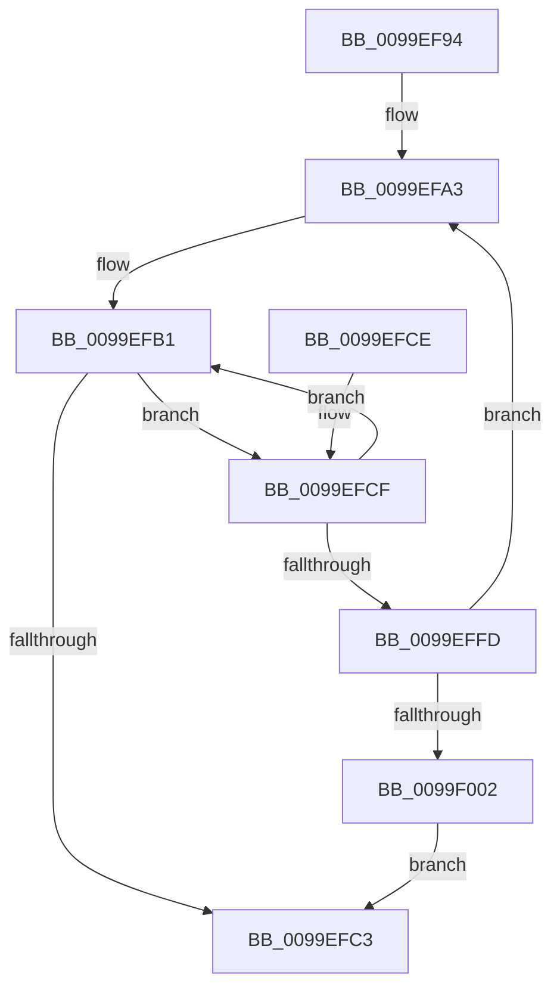

# ObpDeleteDirectoryName

- RVA: `0x0099EF94`–`0x0099F004` (길이 `112` bytes)
- VA: `0x000000014099EF94`
- 실행 섹션: `PAGE`
- PDB 이름 있음: `예`; PDB Function 태그: `아니요`
- unwind 정보 RVA: `0x0009AF90`
- 디코드: `34`개 명령, `112/112` bytes 표시
- 미해석 바이트: `0` (있으면 어셈블리에 `.byte`로 보존)

> 이 문서는 커널 이미지의 기계어와 PDB 기호를 분석해 생성했습니다. 4번과 5번은 함수 원형과 자료형을 바이너리 사용 방식에서 추정한 C 해석이며 원본 소스 복구 결과는 아닙니다.

## 1. Dependencies

- 직접 호출 지점: **3**; 고유 호출 대상: **3**
- 직접 호출자로 확인된 함수: **4**
- RIP 상대 이미지 참조: **2**

### Outgoing calls
- `0x0099EFA9` → [ObpMarkDirectoryObjectsTemporary](ObpMarkDirectoryObjectsTemporary_function_0099F00C.md) (function, `0x0099F00C`)
- `0x0099EFB9` → [ObfDereferenceObjectWithTag](../../text/2F/ObfDereferenceObjectWithTag_function_002F78E0.md) (function, `0x002F78E0`)
- `0x0099EFDB` → [ExFreePoolWithTag](../../poolcode/B8/ExFreePoolWithTag_function_00B82870.md) (function, `0x00B82870`)

### Direct callers
- [ObpDecrementHandleCount](../86/ObpDecrementHandleCount_function_008632E0.md) at `0x00863AA9`
- [ObCloseHandleTableEntry](../86/ObCloseHandleTableEntry_function_00869E20.md) at `0x0086AA16`
- [sub_0089A511](../89/Unknown_function_0089A511.md) at `0x0089A870`
- [ObpInsertOrLocateNamedObject](ObpInsertOrLocateNamedObject_function_0099F2C0.md) at `0x0099F819`

### Static image references
- `0x0099EFE0` → RVA `0x00F0F650` (`.data`; read)
- `0x0099EFF2` → RVA `0x00FC6E4C` (`ALMOSTRO`; read)

## 2. Other-region calls and transfers

- 다른 실행 섹션으로 향하는 call: **2**
  - `0x0099EFB9` → [ObfDereferenceObjectWithTag](../../text/2F/ObfDereferenceObjectWithTag_function_002F78E0.md) (`PAGE` → `.text`)
  - `0x0099EFDB` → [ExFreePoolWithTag](../../poolcode/B8/ExFreePoolWithTag_function_00B82870.md) (`PAGE` → `POOLCODE`)
- 별도 외부 분기/꼬리 이동을 확인하지 못했습니다.

## 3. Assembly (complete function range)

```asm
0099EF94  48 89 5C 24 08                  mov qword ptr [rsp + 8], rbx
0099EF99  57                              push rdi
0099EF9A  48 83 EC 20                     sub rsp, 0x20
0099EF9E  48 8B D9                        mov rbx, rcx
0099EFA1  33 FF                           xor edi, edi
0099EFA3  48 8B D7                        mov rdx, rdi
0099EFA6  48 8B CB                        mov rcx, rbx
0099EFA9  E8 5E 00 00 00                  call 0x14099f00c
0099EFAE  48 8B F8                        mov rdi, rax
0099EFB1  BA 4F 62 44 69                  mov edx, 0x6944624f
0099EFB6  48 8B CB                        mov rcx, rbx
0099EFB9  E8 22 89 95 FF                  call 0x1402f78e0
0099EFBE  48 85 FF                        test rdi, rdi
0099EFC1  75 0C                           jne 0x14099efcf
0099EFC3  48 8B 5C 24 30                  mov rbx, qword ptr [rsp + 0x30]
0099EFC8  48 83 C4 20                     add rsp, 0x20
0099EFCC  5F                              pop rdi
0099EFCD  C3                              ret
0099EFCE  CC                              int3
0099EFCF  48 8B 5F 08                     mov rbx, qword ptr [rdi + 8]
0099EFD3  48 8B CF                        mov rcx, rdi
0099EFD6  48 8B 3F                        mov rdi, qword ptr [rdi]
0099EFD9  33 D2                           xor edx, edx
0099EFDB  E8 90 38 1E 00                  call 0x140b82870
0099EFE0  48 8B 05 69 06 57 00            mov rax, qword ptr [rip + 0x570669]
0099EFE7  48 8D 4B D0                     lea rcx, [rbx - 0x30]
0099EFEB  48 C1 E9 08                     shr rcx, 8
0099EFEF  32 4B E8                        xor cl, byte ptr [rbx - 0x18]
0099EFF2  32 0D 54 7E 62 00               xor cl, byte ptr [rip + 0x627e54]
0099EFF8  3A 48 28                        cmp cl, byte ptr [rax + 0x28]
0099EFFB  75 B4                           jne 0x14099efb1
0099EFFD  48 85 DB                        test rbx, rbx
0099F000  75 A1                           jne 0x14099efa3
0099F002  EB BF                           jmp 0x14099efc3
```

## 4. C-style interpretation (structured pseudocode)

```c
__int64 __fastcall ObpDeleteDirectoryName(__int64 a1)
{
    __int64 result;
    __int64 v_rdi;
    __int64 v_rsp;
    unsigned __int64 v_stack_p8;

    v_stack_p8 = v_rbx;
    v_rsp = (v_rsp) - (32);
    v_rdi = 0;
loc_0099EFA3:
    result = ObpMarkDirectoryObjectsTemporary(a1, 0, a3, a4);
loc_0099EFB1:
    result = ObfDereferenceObjectWithTag(a1, (unsigned int)(0x6944624FULL), a3, a4);
    if (result != 0) goto loc_0099EFCF;
loc_0099EFC3:
    v_rsp = (v_rsp) + (32);
    return result;
loc_0099EFCF:
    a2 = 0;
    result = ExFreePoolWithTag(result, a2, a3, a4);
    a1 = (*(unsigned __int64 *)(result + 8) - 48) >> (8);
    a1 = (unsigned __int8)((a1) ^ (*(unsigned __int8 *)(*(unsigned __int64 *)(result + 8) - 24)));
    a1 = (unsigned __int8)((a1) ^ (*(unsigned __int8 *)(v_rip + 6454868)));
    if (((unsigned __int8)(a1)) != (*(unsigned __int8 *)(*(unsigned __int64 *)(v_rip + 5703273) + 40))) goto loc_0099EFB1;
    if (*(unsigned __int64 *)(result + 8) != 0) goto loc_0099EFA3;
    goto loc_0099EFC3;
}
```

## 5. (Beta) C Style

```c
int64_t ObpDeleteDirectoryName(int64_t Arg1)
{
    int64_t result;
    int64_t local_rdi;
    int64_t local_rsp;
    uint64_t v_stack_p8;

    v_stack_p8 = local_rbx;
    local_rsp = (local_rsp) - (32);
    local_rdi = 0;
loc_0099EFA3:
    result = ObpMarkDirectoryObjectsTemporary(Arg1, 0, a3, a4);
loc_0099EFB1:
    result = ObfDereferenceObjectWithTag(Arg1, (uint32_t)(0x6944624FULL), a3, a4);
    if (result != 0) goto loc_0099EFCF;
loc_0099EFC3:
    local_rsp = (local_rsp) + (32);
    return result;
loc_0099EFCF:
    a2 = 0;
    result = ExFreePoolWithTag(result, a2, a3, a4);
    Arg1 = (*(uint64_t *)(result + 0x8) - 48) >> (8);
    Arg1 = (uint8_t)((Arg1) ^ (*(uint8_t *)(*(uint64_t *)(result + 0x8) - 0x18)));
    Arg1 = (uint8_t)((Arg1) ^ (*(uint8_t *)(v_rip + 0x627E54)));
    if (((uint8_t)(Arg1)) != (*(uint8_t *)(*(uint64_t *)(v_rip + 0x570669) + 0x28))) goto loc_0099EFB1;
    if (*(uint64_t *)(result + 0x8) != 0) goto loc_0099EFA3;
    goto loc_0099EFC3;
}
```

## 6. Execution-region graph

[열기: 2D/3D 그래프와 함수 탐색 컨트롤 패널](../../../control-panel.html?section=page&rva=0x0099EF94&view=graph)

- 2D 그래프는 위에서 아래로 흐르고, 3D 그래프는 빈 공간을 드래그해 회전합니다. Shift+드래그는 이동, 휠은 확대·축소, 함수 노드 선택은 대상 보고서 이동입니다.

### Static fallback


