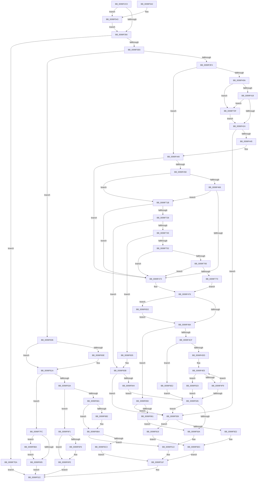

# ObpInsertOrLocateNamedObject

- RVA: `0x0099F2C0`–`0x0099F897` (길이 `1,495` bytes)
- VA: `0x000000014099F2C0`
- 실행 섹션: `PAGE`
- PDB 이름 있음: `예`; PDB Function 태그: `아니요`
- unwind 정보 RVA: `0x0009AFBC`
- 디코드: `351`개 명령, `1,495/1,495` bytes 표시
- 미해석 바이트: `0` (있으면 어셈블리에 `.byte`로 보존)

> 이 문서는 커널 이미지의 기계어와 PDB 기호를 분석해 생성했습니다. 4번과 5번은 함수 원형과 자료형을 바이너리 사용 방식에서 추정한 C 해석이며 원본 소스 복구 결과는 아닙니다.

## 1. Dependencies

- 직접 호출 지점: **31**; 고유 호출 대상: **21**
- 직접 호출자로 확인된 함수: **1**
- RIP 상대 이미지 참조: **5**

### Outgoing calls
- `0x0099F333` → [memset](../../text/6C/memset_function_006C6C40.md) (function, `0x006C6C40`)
- `0x0099F35A` → [PsGetCurrentSilo](../../text/40/PsGetCurrentSilo_function_004094A0.md) (function, `0x004094A0`)
- `0x0099F3D7` → [ObpLookupObjectName](../89/ObpLookupObjectName_function_0089BE90.md) (function, `0x0089BE90`)
- `0x0099F435` → [ObpGetObjectSecurity](../87/ObpGetObjectSecurity_function_008717E0.md) (function, `0x008717E0`)
- `0x0099F4BE` → [ObpAssignSecurity](../8B/ObpAssignSecurity_function_008BA0A0.md) (function, `0x008BA0A0`)
- `0x0099F50E` → [ObpReleaseLookupContext](../../text/26/ObpReleaseLookupContext_function_00263D30.md) (function, `0x00263D30`)
- `0x0099F529` → [_security_check_cookie](../../text/6A/_security_check_cookie_function_006AC640.md) (function, `0x006AC640`)
- `0x0099F5A1` → [ObpUnlockDirectory](ObpUnlockDirectory_function_0099F8A0.md) (function, `0x0099F8A0`)
- `0x0099F5AB` → [ExFreePoolWithTag](../../poolcode/B8/ExFreePoolWithTag_function_00B82870.md) (function, `0x00B82870`)
- `0x0099F5B8` → [ObfDereferenceObjectWithTag](../../text/2F/ObfDereferenceObjectWithTag_function_002F78E0.md) (function, `0x002F78E0`)
- `0x0099F5E7` → [ObfDereferenceObjectWithTag](../../text/2F/ObfDereferenceObjectWithTag_function_002F78E0.md) (function, `0x002F78E0`)
- `0x0099F5F0` → [ObpReleaseLookupContext](../../text/26/ObpReleaseLookupContext_function_00263D30.md) (function, `0x00263D30`)
- `0x0099F5FC` → [ObpDecrementHandleCount](../86/ObpDecrementHandleCount_function_008632E0.md) (function, `0x008632E0`)
- `0x0099F615` → [ObpReferenceNamedObject](../../text/45/ObpReferenceNamedObject_function_0045FEBC.md) (function, `0x0045FEBC`)
- `0x0099F61E` → [ObpReleaseLookupContext](../../text/26/ObpReleaseLookupContext_function_00263D30.md) (function, `0x00263D30`)
- `0x0099F629` → [ObpDecrementHandleCount](../86/ObpDecrementHandleCount_function_008632E0.md) (function, `0x008632E0`)
- `0x0099F676` → [ObpGrantAccess](../86/ObpGrantAccess_function_0086F250.md) (function, `0x0086F250`)
- `0x0099F6A5` → [ObpIncrementHandleCountEx](../86/ObpIncrementHandleCountEx_function_0086DA10.md) (function, `0x0086DA10`)
- `0x0099F6B5` → [ObpDereferenceNamedObject](../../text/3A/ObpDereferenceNamedObject_function_003A0310.md) (function, `0x003A0310`)
- `0x0099F6C8` → [ObfDereferenceObject](../../text/2F/ObfDereferenceObject_function_002F9350.md) (function, `0x002F9350`)
- `0x0099F6E7` → [ExFreePoolWithTag](../../poolcode/B8/ExFreePoolWithTag_function_00B82870.md) (function, `0x00B82870`)
- `0x0099F6F9` → [ObpDereferenceNamedObject](../../text/3A/ObpDereferenceNamedObject_function_003A0310.md) (function, `0x003A0310`)
- `0x0099F703` → [ObfDereferenceObject](../../text/2F/ObfDereferenceObject_function_002F9350.md) (function, `0x002F9350`)
- `0x0099F735` → [RtlGetDaclSecurityDescriptor](../../text/45/RtlGetDaclSecurityDescriptor_function_00459570.md) (function, `0x00459570`)
- `0x0099F7F0` → [ObpDecrementHandleCount](../86/ObpDecrementHandleCount_function_008632E0.md) (function, `0x008632E0`)
- `0x0099F80A` → [ObfDereferenceObject](../../text/2F/ObfDereferenceObject_function_002F9350.md) (function, `0x002F9350`)
- `0x0099F819` → [ObpDeleteDirectoryName](ObpDeleteDirectoryName_function_0099EF94.md) (function, `0x0099EF94`)
- `0x0099F82B` → [ObDereferenceSecurityDescriptor](../87/ObDereferenceSecurityDescriptor_function_008740A0.md) (function, `0x008740A0`)
- `0x0099F84F` → [ObReleaseObjectSecurityEx](../8C/ObReleaseObjectSecurityEx_function_008C6E30.md) (function, `0x008C6E30`)
- `0x0099F86F` → [SeReleaseSecurityDescriptor](../97/SeReleaseSecurityDescriptor_function_00975190.md) (function, `0x00975190`)
- `0x0099F88D` → [ObpDereferenceNamedObject](../../text/3A/ObpDereferenceNamedObject_function_003A0310.md) (function, `0x003A0310`)

### Direct callers
- [ObpCreateHandle](../86/ObpCreateHandle_function_0086B950.md) at `0x0086CD0D`

### Static image references
- `0x0099F2DC` → RVA `0x00E0A740` (`.data`; read)
- `0x0099F343` → RVA `0x00000000` (`image boundary/outside`; read)
- `0x0099F37A` → RVA `0x00FC6E4C` (`ALMOSTRO`; read)
- `0x0099F418` → RVA `0x00E66E18` (`.data`; read)
- `0x0099F5BD` → RVA `0x00F0F650` (`.data`; read)

## 2. Other-region calls and transfers

- 다른 실행 섹션으로 향하는 call: **18**
  - `0x0099F333` → [memset](../../text/6C/memset_function_006C6C40.md) (`PAGE` → `.text`)
  - `0x0099F35A` → [PsGetCurrentSilo](../../text/40/PsGetCurrentSilo_function_004094A0.md) (`PAGE` → `.text`)
  - `0x0099F50E` → [ObpReleaseLookupContext](../../text/26/ObpReleaseLookupContext_function_00263D30.md) (`PAGE` → `.text`)
  - `0x0099F529` → [_security_check_cookie](../../text/6A/_security_check_cookie_function_006AC640.md) (`PAGE` → `.text`)
  - `0x0099F5AB` → [ExFreePoolWithTag](../../poolcode/B8/ExFreePoolWithTag_function_00B82870.md) (`PAGE` → `POOLCODE`)
  - `0x0099F5B8` → [ObfDereferenceObjectWithTag](../../text/2F/ObfDereferenceObjectWithTag_function_002F78E0.md) (`PAGE` → `.text`)
  - `0x0099F5E7` → [ObfDereferenceObjectWithTag](../../text/2F/ObfDereferenceObjectWithTag_function_002F78E0.md) (`PAGE` → `.text`)
  - `0x0099F5F0` → [ObpReleaseLookupContext](../../text/26/ObpReleaseLookupContext_function_00263D30.md) (`PAGE` → `.text`)
  - `0x0099F615` → [ObpReferenceNamedObject](../../text/45/ObpReferenceNamedObject_function_0045FEBC.md) (`PAGE` → `.text`)
  - `0x0099F61E` → [ObpReleaseLookupContext](../../text/26/ObpReleaseLookupContext_function_00263D30.md) (`PAGE` → `.text`)
  - `0x0099F6B5` → [ObpDereferenceNamedObject](../../text/3A/ObpDereferenceNamedObject_function_003A0310.md) (`PAGE` → `.text`)
  - `0x0099F6C8` → [ObfDereferenceObject](../../text/2F/ObfDereferenceObject_function_002F9350.md) (`PAGE` → `.text`)
  - `0x0099F6E7` → [ExFreePoolWithTag](../../poolcode/B8/ExFreePoolWithTag_function_00B82870.md) (`PAGE` → `POOLCODE`)
  - `0x0099F6F9` → [ObpDereferenceNamedObject](../../text/3A/ObpDereferenceNamedObject_function_003A0310.md) (`PAGE` → `.text`)
  - `0x0099F703` → [ObfDereferenceObject](../../text/2F/ObfDereferenceObject_function_002F9350.md) (`PAGE` → `.text`)
  - `0x0099F735` → [RtlGetDaclSecurityDescriptor](../../text/45/RtlGetDaclSecurityDescriptor_function_00459570.md) (`PAGE` → `.text`)
  - `0x0099F80A` → [ObfDereferenceObject](../../text/2F/ObfDereferenceObject_function_002F9350.md) (`PAGE` → `.text`)
  - `0x0099F88D` → [ObpDereferenceNamedObject](../../text/3A/ObpDereferenceNamedObject_function_003A0310.md) (`PAGE` → `.text`)
- 별도 외부 분기/꼬리 이동을 확인하지 못했습니다.

## 3. Assembly (complete function range)

```asm
0099F2C0  40 55                           push rbp
0099F2C2  53                              push rbx
0099F2C3  56                              push rsi
0099F2C4  57                              push rdi
0099F2C5  41 54                           push r12
0099F2C7  41 55                           push r13
0099F2C9  41 56                           push r14
0099F2CB  41 57                           push r15
0099F2CD  48 8D AC 24 78 FF FF FF         lea rbp, [rsp - 0x88]
0099F2D5  48 81 EC 88 01 00 00            sub rsp, 0x188
0099F2DC  48 8B 05 5D B4 46 00            mov rax, qword ptr [rip + 0x46b45d]
0099F2E3  48 33 C4                        xor rax, rsp
0099F2E6  48 89 45 70                     mov qword ptr [rbp + 0x70], rax
0099F2EA  48 8B BD 00 01 00 00            mov rdi, qword ptr [rbp + 0x100]
0099F2F1  48 8B DA                        mov rbx, rdx
0099F2F4  4C 8B A5 F8 00 00 00            mov r12, qword ptr [rbp + 0xf8]
0099F2FB  4C 8B F9                        mov r15, rcx
0099F2FE  4C 89 45 90                     mov qword ptr [rbp - 0x70], r8
0099F302  0F 57 C0                        xorps xmm0, xmm0
0099F305  48 89 4D B8                     mov qword ptr [rbp - 0x48], rcx
0099F309  33 C0                           xor eax, eax
0099F30B  45 33 F6                        xor r14d, r14d
0099F30E  48 89 7D C0                     mov qword ptr [rbp - 0x40], rdi
0099F312  33 D2                           xor edx, edx
0099F314  4C 89 74 24 78                  mov qword ptr [rsp + 0x78], r14
0099F319  41 B8 A0 00 00 00               mov r8d, 0xa0
0099F31F  48 89 45 A8                     mov qword ptr [rbp - 0x58], rax
0099F323  48 8D 4D D0                     lea rcx, [rbp - 0x30]
0099F327  C6 44 24 71 00                  mov byte ptr [rsp + 0x71], 0
0099F32C  0F 11 45 98                     movups xmmword ptr [rbp - 0x68], xmm0
0099F330  4D 8B E9                        mov r13, r9
0099F333  E8 08 79 D2 FF                  call 0x1406c6c40
0099F338  48 8D 73 D0                     lea rsi, [rbx - 0x30]
0099F33C  4C 89 37                        mov qword ptr [rdi], r14
0099F33F  0F B6 46 1A                     movzx eax, byte ptr [rsi + 0x1a]
0099F343  48 8D 0D B6 0C 66 FF            lea rcx, [rip - 0x99f34a]
0099F34A  4C 89 75 B0                     mov qword ptr [rbp - 0x50], r14
0099F34E  A8 02                           test al, 2
0099F350  0F 85 ED 01 00 00               jne 0x14099f543
0099F356  0F B6 7E 1B                     movzx edi, byte ptr [rsi + 0x1b]
0099F35A  E8 41 A1 A6 FF                  call 0x1404094a0
0099F35F  45 33 C0                        xor r8d, r8d
0099F362  40 D0 EF                        shr dil, 1
0099F365  48 8B CE                        mov rcx, rsi
0099F368  49 8D 56 08                     lea rdx, [r14 + 8]
0099F36C  48 C1 E9 08                     shr rcx, 8
0099F370  40 F6 D7                        not dil
0099F373  32 4E 18                        xor cl, byte ptr [rsi + 0x18]
0099F376  40 80 E7 01                     and dil, 1
0099F37A  32 0D CC 7A 62 00               xor cl, byte ptr [rip + 0x627acc]
0099F380  44 0F B6 C9                     movzx r9d, cl
0099F384  48 8D 4C 24 78                  lea rcx, [rsp + 0x78]
0099F389  48 89 4C 24 60                  mov qword ptr [rsp + 0x60], rcx
0099F38E  48 8D 4D 98                     lea rcx, [rbp - 0x68]
0099F392  4C 89 44 24 58                  mov qword ptr [rsp + 0x58], r8
0099F397  48 89 4C 24 50                  mov qword ptr [rsp + 0x50], rcx
0099F39C  49 8B 4C 24 08                  mov rcx, qword ptr [r12 + 8]
0099F3A1  4C 89 6C 24 48                  mov qword ptr [rsp + 0x48], r13
0099F3A6  48 89 44 24 40                  mov qword ptr [rsp + 0x40], rax
0099F3AB  49 8B 44 24 28                  mov rax, qword ptr [r12 + 0x28]
0099F3B0  48 89 5C 24 38                  mov qword ptr [rsp + 0x38], rbx
0099F3B5  48 89 44 24 30                  mov qword ptr [rsp + 0x30], rax
0099F3BA  48 8D 05 3F 0C 66 FF            lea rax, [rip - 0x99f3c1]
0099F3C1  4E 8B 8C C8 00 78 FC 00         mov r9, qword ptr [rax + r9*8 + 0xfc7800]
0099F3C9  4C 89 44 24 28                  mov qword ptr [rsp + 0x28], r8
0099F3CE  45 8B 04 24                     mov r8d, dword ptr [r12]
0099F3D2  40 88 7C 24 20                  mov byte ptr [rsp + 0x20], dil
0099F3D7  E8 B4 CA EF FF                  call 0x14089be90
0099F3DC  8B F8                           mov edi, eax
0099F3DE  85 C0                           test eax, eax
0099F3E0  0F 88 04 04 00 00               js 0x14099f7ea
0099F3E6  48 8B 44 24 78                  mov rax, qword ptr [rsp + 0x78]
0099F3EB  48 3B C3                        cmp rax, rbx
0099F3EE  0F 85 12 02 00 00               jne 0x14099f606
0099F3F4  49 8B 0E                        mov rcx, qword ptr [r14]
0099F3F7  33 FF                           xor edi, edi
0099F3F9  48 89 7D 90                     mov qword ptr [rbp - 0x70], rdi
0099F3FD  40 88 7C 24 70                  mov byte ptr [rsp + 0x70], dil
0099F402  89 7D 88                        mov dword ptr [rbp - 0x78], edi
0099F405  48 85 C9                        test rcx, rcx
0099F408  74 3F                           je 0x14099f449
0099F40A  8B 81 50 01 00 00               mov eax, dword ptr [rcx + 0x150]
0099F410  A8 08                           test al, 8
0099F412  0F 85 F7 02 00 00               jne 0x14099f70f
0099F418  39 3D FA 79 4C 00               cmp dword ptr [rip + 0x4c79fa], edi
0099F41E  0F 85 EB 02 00 00               jne 0x14099f70f
0099F424  44 0F B6 8D F0 00 00 00         movzx r9d, byte ptr [rbp + 0xf0]
0099F42C  4C 8D 44 24 70                  lea r8, [rsp + 0x70]
0099F431  48 8D 55 90                     lea rdx, [rbp - 0x70]
0099F435  E8 A6 23 ED FF                  call 0x1408717e0
0099F43A  44 8B F8                        mov r15d, eax
0099F43D  85 C0                           test eax, eax
0099F43F  0F 88 14 01 00 00               js 0x14099f559
0099F445  48 8B 7D 90                     mov rdi, qword ptr [rbp - 0x70]
0099F449  49 8B 06                        mov rax, qword ptr [r14]
0099F44C  45 32 C0                        xor r8b, r8b
0099F44F  44 89 45 84                     mov dword ptr [rbp - 0x7c], r8d
0099F453  48 85 C0                        test rax, rax
0099F456  74 1B                           je 0x14099f473
0099F458  8B 80 50 01 00 00               mov eax, dword ptr [rax + 0x150]
0099F45E  A8 08                           test al, 8
0099F460  0F 85 B5 02 00 00               jne 0x14099f71b
0099F466  83 3D AB 79 4C 00 00            cmp dword ptr [rip + 0x4c79ab], 0
0099F46D  0F 85 A8 02 00 00               jne 0x14099f71b
0099F473  49 8B CD                        mov rcx, r13
0099F476  48 83 79 40 00                  cmp qword ptr [rcx + 0x40], 0
0099F47B  B8 01 00 00 00                  mov eax, 1
0099F480  44 8B 55 88                     mov r10d, dword ptr [rbp - 0x78]
0099F484  0F 84 48 02 00 00               je 0x14099f6d2
0099F48A  44 88 44 24 28                  mov byte ptr [rsp + 0x28], r8b
0099F48F  48 8D 05 6A 0B 66 FF            lea rax, [rip - 0x99f496]
0099F496  48 8D 53 D0                     lea rdx, [rbx - 0x30]
0099F49A  44 89 54 24 20                  mov dword ptr [rsp + 0x20], r10d
0099F49F  48 C1 EA 08                     shr rdx, 8
0099F4A3  4C 8B C3                        mov r8, rbx
0099F4A6  32 53 E8                        xor dl, byte ptr [rbx - 0x18]
0099F4A9  32 15 9D 79 62 00               xor dl, byte ptr [rip + 0x62799d]
0099F4AF  44 0F B6 CA                     movzx r9d, dl
0099F4B3  48 8B D7                        mov rdx, rdi
0099F4B6  4E 8B 8C C8 00 78 FC 00         mov r9, qword ptr [rax + r9*8 + 0xfc7800]
0099F4BE  E8 DD AB F1 FF                  call 0x1408ba0a0
0099F4C3  44 8B F8                        mov r15d, eax
0099F4C6  48 85 FF                        test rdi, rdi
0099F4C9  0F 84 8A 03 00 00               je 0x14099f859
0099F4CF  80 7C 24 70 00                  cmp byte ptr [rsp + 0x70], 0
0099F4D4  49 8B 16                        mov rdx, qword ptr [r14]
0099F4D7  0F 85 05 02 00 00               jne 0x14099f6e2
0099F4DD  0F 0D 4A F8                     prefetchw byte ptr [rdx - 8]
0099F4E1  48 8B 42 F8                     mov rax, qword ptr [rdx - 8]
0099F4E5  4C 8B 45 90                     mov r8, qword ptr [rbp - 0x70]
0099F4E9  48 8B C8                        mov rcx, rax
0099F4EC  49 33 C8                        xor rcx, r8
0099F4EF  48 83 F9 0F                     cmp rcx, 0xf
0099F4F3  0F 83 2A 03 00 00               jae 0x14099f823
0099F4F9  48 8D 48 01                     lea rcx, [rax + 1]
0099F4FD  F0 48 0F B1 4A F8               lock cmpxchg qword ptr [rdx - 8], rcx
0099F503  75 E0                           jne 0x14099f4e5
0099F505  45 85 FF                        test r15d, r15d
0099F508  78 4F                           js 0x14099f559
0099F50A  48 8D 4D 98                     lea rcx, [rbp - 0x68]
0099F50E  E8 1D 48 8C FF                  call 0x140263d30
0099F513  48 8B 4D C0                     mov rcx, qword ptr [rbp - 0x40]
0099F517  48 8B 44 24 78                  mov rax, qword ptr [rsp + 0x78]
0099F51C  48 89 01                        mov qword ptr [rcx], rax
0099F51F  41 8B C7                        mov eax, r15d
0099F522  48 8B 4D 70                     mov rcx, qword ptr [rbp + 0x70]
0099F526  48 33 CC                        xor rcx, rsp
0099F529  E8 12 D1 D0 FF                  call 0x1406ac640
0099F52E  48 81 C4 88 01 00 00            add rsp, 0x188
0099F535  41 5F                           pop r15
0099F537  41 5E                           pop r14
0099F539  41 5D                           pop r13
0099F53B  41 5C                           pop r12
0099F53D  5F                              pop rdi
0099F53E  5E                              pop rsi
0099F53F  5B                              pop rbx
0099F540  5D                              pop rbp
0099F541  C3                              ret
0099F542  CC                              int3
0099F543  83 E0 03                        and eax, 3
0099F546  4C 8B F6                        mov r14, rsi
0099F549  0F B6 84 08 80 FF F0 00         movzx eax, byte ptr [rax + rcx + 0xf0ff80]
0099F551  4C 2B F0                        sub r14, rax
0099F554  E9 FD FD FF FF                  jmp 0x14099f356
0099F559  4C 8B 45 A0                     mov r8, qword ptr [rbp - 0x60]
0099F55D  48 8D 0D 9C 0A 66 FF            lea rcx, [rip - 0x99f564]
0099F564  49 8B 38                        mov rdi, qword ptr [r8]
0099F567  48 8B 57 08                     mov rdx, qword ptr [rdi + 8]
0099F56B  48 83 EA 30                     sub rdx, 0x30
0099F56F  0F B6 42 1A                     movzx eax, byte ptr [rdx + 0x1a]
0099F573  83 E0 03                        and eax, 3
0099F576  0F B6 84 08 80 FF F0 00         movzx eax, byte ptr [rax + rcx + 0xf0ff80]
0099F57E  48 8D 4D 98                     lea rcx, [rbp - 0x68]
0099F582  48 2B D0                        sub rdx, rax
0099F585  48 C7 02 00 00 00 00            mov qword ptr [rdx], 0
0099F58C  48 8B 07                        mov rax, qword ptr [rdi]
0099F58F  49 89 00                        mov qword ptr [r8], rax
0099F592  4C 8B 77 08                     mov r14, qword ptr [rdi + 8]
0099F596  48 C7 07 00 00 00 00            mov qword ptr [rdi], 0
0099F59D  48 8B 5D 98                     mov rbx, qword ptr [rbp - 0x68]
0099F5A1  E8 FA 02 00 00                  call 0x14099f8a0
0099F5A6  33 D2                           xor edx, edx
0099F5A8  48 8B CF                        mov rcx, rdi
0099F5AB  E8 C0 32 1E 00                  call 0x140b82870
0099F5B0  BA 4F 62 44 69                  mov edx, 0x6944624f
0099F5B5  48 8B CB                        mov rcx, rbx
0099F5B8  E8 23 83 95 FF                  call 0x1402f78e0
0099F5BD  48 8B 05 8C 00 57 00            mov rax, qword ptr [rip + 0x57008c]
0099F5C4  49 8D 56 D0                     lea rdx, [r14 - 0x30]
0099F5C8  48 C1 EA 08                     shr rdx, 8
0099F5CC  49 8B CE                        mov rcx, r14
0099F5CF  41 32 56 E8                     xor dl, byte ptr [r14 - 0x18]
0099F5D3  32 15 73 78 62 00               xor dl, byte ptr [rip + 0x627873]
0099F5D9  3A 50 28                        cmp dl, byte ptr [rax + 0x28]
0099F5DC  0F 84 37 02 00 00               je 0x14099f819
0099F5E2  BA 4F 62 44 69                  mov edx, 0x6944624f
0099F5E7  E8 F4 82 95 FF                  call 0x1402f78e0
0099F5EC  48 8D 4D 98                     lea rcx, [rbp - 0x68]
0099F5F0  E8 3B 47 8C FF                  call 0x140263d30
0099F5F5  48 8B 4D B8                     mov rcx, qword ptr [rbp - 0x48]
0099F5F9  48 8B D6                        mov rdx, rsi
0099F5FC  E8 DF 3C EC FF                  call 0x1408632e0
0099F601  E9 19 FF FF FF                  jmp 0x14099f51f
0099F606  33 DB                           xor ebx, ebx
0099F608  48 39 5D 98                     cmp qword ptr [rbp - 0x68], rbx
0099F60C  74 0C                           je 0x14099f61a
0099F60E  48 8D 58 D0                     lea rbx, [rax - 0x30]
0099F612  48 8B CB                        mov rcx, rbx
0099F615  E8 A2 08 AC FF                  call 0x14045febc
0099F61A  48 8D 4D 98                     lea rcx, [rbp - 0x68]
0099F61E  E8 0D 47 8C FF                  call 0x140263d30
0099F623  48 8B D6                        mov rdx, rsi
0099F626  49 8B CF                        mov rcx, r15
0099F629  E8 B2 3C EC FF                  call 0x1408632e0
0099F62E  41 8B 04 24                     mov eax, dword ptr [r12]
0099F632  84 C0                           test al, al
0099F634  0F 89 C2 01 00 00               jns 0x14099f7fc
0099F63A  41 8B 45 18                     mov eax, dword ptr [r13 + 0x18]
0099F63E  BF 01 00 00 00                  mov edi, 1
0099F643  44 0F B6 B5 F0 00 00 00         movzx r14d, byte ptr [rbp + 0xf0]
0099F64B  4D 8B C5                        mov r8, r13
0099F64E  48 8B 54 24 78                  mov rdx, qword ptr [rsp + 0x78]
0099F653  45 0F B6 CE                     movzx r9d, r14b
0099F657  41 89 45 10                     mov dword ptr [r13 + 0x10], eax
0099F65B  8B CF                           mov ecx, edi
0099F65D  48 8B 45 90                     mov rax, qword ptr [rbp - 0x70]
0099F661  48 89 44 24 28                  mov qword ptr [rsp + 0x28], rax
0099F666  41 C7 45 14 00 00 00 00         mov dword ptr [r13 + 0x14], 0
0099F66E  41 8B 04 24                     mov eax, dword ptr [r12]
0099F672  89 44 24 20                     mov dword ptr [rsp + 0x20], eax
0099F676  E8 D5 FB EC FF                  call 0x14086f250
0099F67B  8B F0                           mov esi, eax
0099F67D  85 C0                           test eax, eax
0099F67F  78 70                           js 0x14099f6f1
0099F681  41 8B 04 24                     mov eax, dword ptr [r12]
0099F685  4D 8B C7                        mov r8, r15
0099F688  4C 8B 4C 24 78                  mov r9, qword ptr [rsp + 0x78]
0099F68D  8B CF                           mov ecx, edi
0099F68F  48 8B 55 90                     mov rdx, qword ptr [rbp - 0x70]
0099F693  48 C7 44 24 30 00 00 00 00      mov qword ptr [rsp + 0x30], 0
0099F69C  89 44 24 28                     mov dword ptr [rsp + 0x28], eax
0099F6A0  44 88 74 24 20                  mov byte ptr [rsp + 0x20], r14b
0099F6A5  E8 66 E3 EC FF                  call 0x14086da10
0099F6AA  44 8B F8                        mov r15d, eax
0099F6AD  48 85 DB                        test rbx, rbx
0099F6B0  74 08                           je 0x14099f6ba
0099F6B2  48 8B CB                        mov rcx, rbx
0099F6B5  E8 56 0C A0 FF                  call 0x1403a0310
0099F6BA  45 85 FF                        test r15d, r15d
0099F6BD  0F 89 50 FE FF FF               jns 0x14099f513
0099F6C3  48 8B 4C 24 78                  mov rcx, qword ptr [rsp + 0x78]
0099F6C8  E8 83 9C 95 FF                  call 0x1402f9350
0099F6CD  E9 4D FE FF FF                  jmp 0x14099f51f
0099F6D2  45 85 D2                        test r10d, r10d
0099F6D5  45 0F B6 C0                     movzx r8d, r8b
0099F6D9  44 0F 45 C0                     cmovne r8d, eax
0099F6DD  E9 A8 FD FF FF                  jmp 0x14099f48a
0099F6E2  33 D2                           xor edx, edx
0099F6E4  48 8B CF                        mov rcx, rdi
0099F6E7  E8 84 31 1E 00                  call 0x140b82870
0099F6EC  E9 14 FE FF FF                  jmp 0x14099f505
0099F6F1  48 85 DB                        test rbx, rbx
0099F6F4  74 08                           je 0x14099f6fe
0099F6F6  48 8B CB                        mov rcx, rbx
0099F6F9  E8 12 0C A0 FF                  call 0x1403a0310
0099F6FE  48 8B 4C 24 78                  mov rcx, qword ptr [rsp + 0x78]
0099F703  E8 48 9C 95 FF                  call 0x1402f9350
0099F708  8B C6                           mov eax, esi
0099F70A  E9 13 FE FF FF                  jmp 0x14099f522
0099F70F  C7 45 88 03 00 00 00            mov dword ptr [rbp - 0x78], 3
0099F716  E9 09 FD FF FF                  jmp 0x14099f424
0099F71B  49 8B 4D 40                     mov rcx, qword ptr [r13 + 0x40]
0099F71F  48 85 C9                        test rcx, rcx
0099F722  0F 84 4B FD FF FF               je 0x14099f473
0099F728  4C 8D 4D 80                     lea r9, [rbp - 0x80]
0099F72C  4C 8D 45 B0                     lea r8, [rbp - 0x50]
0099F730  48 8D 54 24 71                  lea rdx, [rsp + 0x71]
0099F735  E8 36 9E AB FF                  call 0x140459570
0099F73A  44 8B F8                        mov r15d, eax
0099F73D  85 C0                           test eax, eax
0099F73F  0F 88 F6 00 00 00               js 0x14099f83b
0099F745  49 8B 45 40                     mov rax, qword ptr [r13 + 0x40]
0099F749  80 38 01                        cmp byte ptr [rax], 1
0099F74C  0F 85 E3 00 00 00               jne 0x14099f835
0099F752  48 83 7D B0 00                  cmp qword ptr [rbp - 0x50], 0
0099F757  0F B7 48 02                     movzx ecx, word ptr [rax + 2]
0099F75B  44 8B 45 84                     mov r8d, dword ptr [rbp - 0x7c]
0099F75F  0F 85 0E FD FF FF               jne 0x14099f473
0099F765  66 0F BA E1 0C                  bt cx, 0xc
0099F76A  0F 82 03 FD FF FF               jb 0x14099f473
0099F770  41 0F 10 45 00                  movups xmm0, xmmword ptr [r13]
0099F775  48 8D 4D D0                     lea rcx, [rbp - 0x30]
0099F779  41 0F 10 4D 10                  movups xmm1, xmmword ptr [r13 + 0x10]
0099F77E  0F 11 01                        movups xmmword ptr [rcx], xmm0
0099F781  41 0F 10 45 20                  movups xmm0, xmmword ptr [r13 + 0x20]
0099F786  0F 11 49 10                     movups xmmword ptr [rcx + 0x10], xmm1
0099F78A  41 0F 10 4D 30                  movups xmm1, xmmword ptr [r13 + 0x30]
0099F78F  0F 11 41 20                     movups xmmword ptr [rcx + 0x20], xmm0
0099F793  41 0F 10 45 40                  movups xmm0, xmmword ptr [r13 + 0x40]
0099F798  0F 11 49 30                     movups xmmword ptr [rcx + 0x30], xmm1
0099F79C  41 0F 10 4D 50                  movups xmm1, xmmword ptr [r13 + 0x50]
0099F7A1  0F 11 41 40                     movups xmmword ptr [rcx + 0x40], xmm0
0099F7A5  41 0F 10 45 60                  movups xmm0, xmmword ptr [r13 + 0x60]
0099F7AA  0F 11 49 50                     movups xmmword ptr [rcx + 0x50], xmm1
0099F7AE  41 0F 10 8D 80 00 00 00         movups xmm1, xmmword ptr [r13 + 0x80]
0099F7B6  0F 11 41 60                     movups xmmword ptr [rcx + 0x60], xmm0
0099F7BA  41 0F 10 45 70                  movups xmm0, xmmword ptr [r13 + 0x70]
0099F7BF  0F 11 41 70                     movups xmmword ptr [rcx + 0x70], xmm0
0099F7C3  41 0F 10 85 90 00 00 00         movups xmm0, xmmword ptr [r13 + 0x90]
0099F7CB  0F 11 89 80 00 00 00            movups xmmword ptr [rcx + 0x80], xmm1
0099F7D2  0F 11 81 90 00 00 00            movups xmmword ptr [rcx + 0x90], xmm0
0099F7D9  48 C7 45 10 00 00 00 00         mov qword ptr [rbp + 0x10], 0
0099F7E1  48 8D 4D D0                     lea rcx, [rbp - 0x30]
0099F7E5  E9 8C FC FF FF                  jmp 0x14099f476
0099F7EA  48 8B D6                        mov rdx, rsi
0099F7ED  49 8B CF                        mov rcx, r15
0099F7F0  E8 EB 3A EC FF                  call 0x1408632e0
0099F7F5  8B C7                           mov eax, edi
0099F7F7  E9 26 FD FF FF                  jmp 0x14099f522
0099F7FC  48 85 DB                        test rbx, rbx
0099F7FF  0F 85 85 00 00 00               jne 0x14099f88a
0099F805  48 8B 4C 24 78                  mov rcx, qword ptr [rsp + 0x78]
0099F80A  E8 41 9B 95 FF                  call 0x1402f9350
0099F80F  B8 35 00 00 C0                  mov eax, 0xc0000035
0099F814  E9 09 FD FF FF                  jmp 0x14099f522
0099F819  E8 76 F7 FF FF                  call 0x14099ef94
0099F81E  E9 C9 FD FF FF                  jmp 0x14099f5ec
0099F823  BA 01 00 00 00                  mov edx, 1
0099F828  49 8B C8                        mov rcx, r8
0099F82B  E8 70 48 ED FF                  call 0x1408740a0
0099F830  E9 D0 FC FF FF                  jmp 0x14099f505
0099F835  41 BF 58 00 00 C0               mov r15d, 0xc0000058
0099F83B  48 85 FF                        test rdi, rdi
0099F83E  0F 84 15 FD FF FF               je 0x14099f559
0099F844  4D 8B 06                        mov r8, qword ptr [r14]
0099F847  48 8B CF                        mov rcx, rdi
0099F84A  0F B6 54 24 70                  movzx edx, byte ptr [rsp + 0x70]
0099F84F  E8 DC 75 F2 FF                  call 0x1408c6e30
0099F854  E9 AC FC FF FF                  jmp 0x14099f505
0099F859  85 C0                           test eax, eax
0099F85B  0F 88 F8 FC FF FF               js 0x14099f559
0099F861  41 0F B6 54 24 10               movzx edx, byte ptr [r12 + 0x10]
0099F867  41 B0 01                        mov r8b, 1
0099F86A  49 8B 4C 24 20                  mov rcx, qword ptr [r12 + 0x20]
0099F86F  E8 1C 59 FD FF                  call 0x140975190
0099F874  49 C7 44 24 20 00 00 00 00      mov qword ptr [r12 + 0x20], 0
0099F87D  49 C7 45 40 00 00 00 00         mov qword ptr [r13 + 0x40], 0
0099F885  E9 80 FC FF FF                  jmp 0x14099f50a
0099F88A  48 8B CB                        mov rcx, rbx
0099F88D  E8 7E 0A A0 FF                  call 0x1403a0310
0099F892  E9 6E FF FF FF                  jmp 0x14099f805
```

## 4. C-style interpretation (structured pseudocode)

```c
__int64 __fastcall ObpInsertOrLocateNamedObject(__int64 a1, __int64 a2, __int64 a3, __int64 a4, unsigned __int8 a5, __int64 a6, __int64 a7)
{
    __int64 result;
    __int64 v_r14;
    __int64 v_rbx;
    __int64 v_rdi;
    __int64 v_rsp;
    unsigned __int64 v_stack_m108;
    unsigned __int64 v_stack_m110;
    unsigned __int64 v_stack_m118;
    unsigned __int64 v_stack_m120;
    unsigned __int64 v_stack_m128;
    unsigned __int64 v_stack_m130;
    unsigned __int64 v_stack_m138;
    unsigned int v_stack_m140;
    unsigned int v_stack_m144;
    unsigned __int64 v_stack_m148;
    unsigned __int64 v_stack_m150;
    unsigned __int8 v_stack_m157;
    unsigned __int8 v_stack_m158;
    unsigned __int64 v_stack_m168;
    unsigned __int64 v_stack_m170;
    unsigned __int64 v_stack_m178;
    unsigned __int64 v_stack_m180;
    unsigned __int64 v_stack_m188;
    unsigned __int64 v_stack_m190;
    unsigned __int64 v_stack_m198;
    unsigned __int64 v_stack_m1A0;
    unsigned __int8 v_stack_m1A8;
    unsigned __int64 v_stack_m58;
    unsigned __int64 v_stack_mB8;
    unsigned __int64 v_stack_mC8;
    unsigned __int64 v_stack_mF8;
    unsigned int v_stack_p20;
    unsigned __int64 v_stack_p28;
    unsigned __int64 v_stack_p30;
    unsigned __int8 v_stack_p70;
    unsigned __int64 v_stack_p71;
    unsigned __int64 v_stack_p78;

    v_rsp = (v_rsp) - (392);
    result = (*(unsigned __int64 *)(v_rip + 4633693)) ^ (v_rsp);
    v_stack_m58 = result;
    v_stack_m138 = a3;
    v_stack_m110 = a1;
    result = 0;
    v_r14 = 0;
    v_stack_m108 = a7;
    a2 = 0;
    v_stack_m150 = 0;
    v_stack_m120 = 0;
    v_stack_m157 = 0;
    v_stack_m130 = v_xmm0;
    result = memset(v_stack_mF8, a2, 160, a4);
    *(unsigned __int64 *)(a7) = 0;
    v_stack_m118 = 0;
    if ((((unsigned __int8)(*(unsigned __int8 *)(a2 - 48 + 26))) & (2)) != 0) goto loc_0099F543;
loc_0099F356:
    result = PsGetCurrentSilo(v_rip - 10089290, a2, 160, a4);
    a3 = 0;
    v_rdi = (unsigned __int8)((*(unsigned __int8 *)(a2 - 48 + 27)) >> (1));
    a1 = (a2 - 48) >> (8);
    v_rdi = (unsigned __int8)(~(v_rdi));
    a1 = (unsigned __int8)((a1) ^ (*(unsigned __int8 *)(a2 - 48 + 24)));
    v_rdi = (unsigned __int8)((v_rdi) & (1));
    a1 = (unsigned __int8)((a1) ^ (*(unsigned __int8 *)(v_rip + 6453964)));
    v_stack_m168 = v_stack_m150;
    v_stack_m170 = 0;
    v_stack_m178 = v_stack_m130;
    v_stack_m180 = a4;
    v_stack_m188 = result;
    v_stack_m190 = 0;
    v_stack_m198 = *(unsigned __int64 *)(a6 + 40);
    v_stack_m1A0 = 0;
    v_stack_m1A8 = (unsigned __int8)(v_rdi);
    result = ObpLookupObjectName(*(unsigned __int64 *)(a6 + 8), v_r14 + 8, (unsigned int)(*(unsigned int *)(a6)), *(unsigned __int64 *)(v_rip - 10089409 + (unsigned __int8)(a1) * 8 + 16545792));
    if (sign_flag) goto loc_0099F7EA;
    if (v_stack_m150 != 0) goto loc_0099F606;
    v_rdi = 0;
    v_stack_m138 = 0;
    v_stack_m158 = 0;
    v_stack_m140 = 0;
    if (*(unsigned __int64 *)(v_r14) == 0) goto loc_0099F449;
    if ((((unsigned __int8)((unsigned int)(*(unsigned int *)(*(unsigned __int64 *)(v_r14) + 336)))) & (8)) != 0) goto loc_0099F70F;
    if ((*(unsigned int *)(v_rip + 5011962)) != 0) goto loc_0099F70F;
loc_0099F424:
    result = ObpGetObjectSecurity(*(unsigned __int64 *)(v_r14), v_stack_m138, v_stack_m158, a5);
    if (sign_flag) goto loc_0099F559;
loc_0099F449:
    a3 = 0;
    v_stack_m144 = 0;
    if (*(unsigned __int64 *)(v_r14) == 0) goto loc_0099F473;
    if ((((unsigned __int8)((unsigned int)(*(unsigned int *)(*(unsigned __int64 *)(v_r14) + 336)))) & (8)) != 0) goto loc_0099F71B;
    if ((*(unsigned int *)(v_rip + 5011883)) != 0) goto loc_0099F71B;
loc_0099F473:
loc_0099F476:
    if ((*(unsigned __int64 *)(a4 + 64)) == 0) goto loc_0099F6D2;
loc_0099F48A:
    v_stack_m1A0 = 0;
    v_stack_m1A8 = (unsigned int)((unsigned int)(v_stack_m140));
    a2 = (a2 - 48) >> (8);
    a2 = (unsigned __int8)((a2) ^ (*(unsigned __int8 *)(a2 - 24)));
    a2 = (unsigned __int8)((a2) ^ (*(unsigned __int8 *)(v_rip + 6453661)));
    result = ObpAssignSecurity(a4, v_stack_m138, a2, *(unsigned __int64 *)(v_rip - 10089622 + (unsigned __int8)(a2) * 8 + 16545792));
    if (v_stack_m138 == 0) goto loc_0099F859;
    if (v_stack_m158 != 0) goto loc_0099F6E2;
loc_0099F4E5:
    a1 = (*(unsigned __int64 *)(*(unsigned __int64 *)(v_r14) - 8)) ^ (v_stack_m138);
    if (a1 >= 15) goto loc_0099F823;
    if (a1 != 15) goto loc_0099F4E5;
loc_0099F505:
    if (sign_flag) goto loc_0099F559;
loc_0099F50A:
    result = ObpReleaseLookupContext(v_stack_m130, *(unsigned __int64 *)(v_r14), v_stack_m138, *(unsigned __int64 *)(v_rip - 10089622 + (unsigned __int8)(a2) * 8 + 16545792));
loc_0099F513:
    *(unsigned __int64 *)(v_stack_m108) = v_stack_m150;
loc_0099F51F:
loc_0099F522:
    a1 = (v_stack_m58) ^ (v_rsp);
    result = _security_check_cookie(a1, *(unsigned __int64 *)(v_r14), v_stack_m138, *(unsigned __int64 *)(v_rip - 10089622 + (unsigned __int8)(a2) * 8 + 16545792));
    v_rsp = (v_rsp) + (392);
    return result;
loc_0099F543:
    result = (unsigned int)((result) & (3));
    v_r14 = (a2 - 48) - (*(unsigned __int8 *)(result + a1 * 1 + 15794048));
    goto loc_0099F356;
loc_0099F559:
    a2 = (*(unsigned __int64 *)(*(unsigned __int64 *)(v_stack_m128) + 8)) - (48);
    result = (unsigned int)((*(unsigned __int8 *)(a2 + 26)) & (3));
    a2 = (a2) - (*(unsigned __int8 *)(result + v_rip - 10089828 * 1 + 15794048));
    *(unsigned __int64 *)(a2) = 0;
    *(unsigned __int64 *)(v_stack_m128) = *(unsigned __int64 *)(*(unsigned __int64 *)(v_stack_m128));
    *(unsigned __int64 *)(*(unsigned __int64 *)(v_stack_m128)) = 0;
    result = ObpUnlockDirectory(v_stack_m130, a2, v_stack_m128, *(unsigned __int64 *)(v_rip - 10089622 + (unsigned __int8)(a2) * 8 + 16545792));
    a2 = 0;
    result = ExFreePoolWithTag(*(unsigned __int64 *)(v_stack_m128), a2, v_stack_m128, *(unsigned __int64 *)(v_rip - 10089622 + (unsigned __int8)(a2) * 8 + 16545792));
    result = ObfDereferenceObjectWithTag(v_stack_m130, (unsigned int)(0x6944624FULL), v_stack_m128, *(unsigned __int64 *)(v_rip - 10089622 + (unsigned __int8)(a2) * 8 + 16545792));
    a2 = (*(unsigned __int64 *)(*(unsigned __int64 *)(v_stack_m128) + 8) - 48) >> (8);
    a2 = (unsigned __int8)((a2) ^ (*(unsigned __int8 *)(*(unsigned __int64 *)(*(unsigned __int64 *)(v_stack_m128) + 8) - 24)));
    a2 = (unsigned __int8)((a2) ^ (*(unsigned __int8 *)(v_rip + 6453363)));
    if (((unsigned __int8)(a2)) == (*(unsigned __int8 *)(*(unsigned __int64 *)(v_rip + 5701772) + 40))) goto loc_0099F819;
    result = ObfDereferenceObjectWithTag(*(unsigned __int64 *)(*(unsigned __int64 *)(v_stack_m128) + 8), (unsigned int)(0x6944624FULL), v_stack_m128, *(unsigned __int64 *)(v_rip - 10089622 + (unsigned __int8)(a2) * 8 + 16545792));
loc_0099F5EC:
    result = ObpReleaseLookupContext(v_stack_m130, (unsigned int)(0x6944624FULL), v_stack_m128, *(unsigned __int64 *)(v_rip - 10089622 + (unsigned __int8)(a2) * 8 + 16545792));
    result = ObpDecrementHandleCount(v_stack_m110, a2 - 48, v_stack_m128, *(unsigned __int64 *)(v_rip - 10089622 + (unsigned __int8)(a2) * 8 + 16545792));
    goto loc_0099F51F;
loc_0099F606:
    v_rbx = 0;
    if (v_stack_m130 != 0) {
        v_rbx = result - 48;
        a1 = v_rbx;
        result = ObpReferenceNamedObject(a1, a2 - 48, v_stack_m128, *(unsigned __int64 *)(v_rip - 10089622 + (unsigned __int8)(a2) * 8 + 16545792));
    }
    result = ObpReleaseLookupContext(v_stack_m130, a2 - 48, v_stack_m128, *(unsigned __int64 *)(v_rip - 10089622 + (unsigned __int8)(a2) * 8 + 16545792));
    result = ObpDecrementHandleCount((unsigned int)((unsigned int)(result)), a2 - 48, v_stack_m128, *(unsigned __int64 *)(v_rip - 10089622 + (unsigned __int8)(a2) * 8 + 16545792));
    if (!sign_flag) goto loc_0099F7FC;
    *(unsigned int *)(a4 + 16) = (unsigned int)((unsigned int)(*(unsigned int *)(a4 + 24)));
    v_stack_p28 = v_stack_m138;
    *(unsigned int *)(a4 + 20) = 0;
    v_stack_p20 = (unsigned int)((unsigned int)(*(unsigned int *)(a6)));
    result = ObpGrantAccess(1, v_stack_p78, a4, a5);
    if (sign_flag) goto loc_0099F6F1;
    v_stack_p30 = 0;
    v_stack_p28 = (unsigned int)((unsigned int)(*(unsigned int *)(a6)));
    v_stack_p20 = a5;
    result = ObpIncrementHandleCountEx(1, v_stack_m138, (unsigned int)((unsigned int)(result)), v_stack_p78);
    if (v_rbx != 0) {
        a1 = v_rbx;
        result = ObpDereferenceNamedObject(a1, v_stack_m138, (unsigned int)((unsigned int)(result)), v_stack_p78);
    }
    if (!sign_flag) goto loc_0099F513;
    result = ObfDereferenceObject(v_stack_p78, v_stack_m138, (unsigned int)((unsigned int)(result)), v_stack_p78);
    goto loc_0099F51F;
loc_0099F6D2:
    a3 = (unsigned __int8)((unsigned int)((unsigned int)(result)));
    if ((unsigned int)((unsigned int)(v_stack_m140)) != 0) { a3 = (unsigned int)(result); }
    goto loc_0099F48A;
loc_0099F6E2:
    a2 = 0;
    result = ExFreePoolWithTag(1, a2, a3, v_stack_p78);
    goto loc_0099F505;
loc_0099F6F1:
    if (v_rbx != 0) {
        a1 = v_rbx;
        result = ObpDereferenceNamedObject(a1, a2, a3, v_stack_p78);
    }
    result = ObfDereferenceObject(v_stack_p78, a2, a3, v_stack_p78);
    goto loc_0099F522;
loc_0099F70F:
    v_stack_m140 = 3;
    goto loc_0099F424;
loc_0099F71B:
    if (*(unsigned __int64 *)(a4 + 64) == 0) goto loc_0099F473;
    result = RtlGetDaclSecurityDescriptor(*(unsigned __int64 *)(a4 + 64), v_stack_p71, v_stack_m118, v_stack_m148);
    if (sign_flag) goto loc_0099F83B;
    if ((*(unsigned __int8 *)(*(unsigned __int64 *)(a4 + 64))) != 1) goto loc_0099F835;
    if (v_stack_m118 != 0) goto loc_0099F473;
    if (v_stack_m118 < 0) goto loc_0099F473;
    *(unsigned __int64 *)(v_stack_mF8) = v_xmm0;
    *(unsigned __int64 *)(v_stack_mF8 + 16) = v_xmm1;
    *(unsigned __int64 *)(v_stack_mF8 + 32) = v_xmm0;
    *(unsigned __int64 *)(v_stack_mF8 + 48) = v_xmm1;
    *(unsigned __int64 *)(v_stack_mF8 + 64) = v_xmm0;
    *(unsigned __int64 *)(v_stack_mF8 + 80) = v_xmm1;
    *(unsigned __int64 *)(v_stack_mF8 + 96) = v_xmm0;
    *(unsigned __int64 *)(v_stack_mF8 + 112) = v_xmm0;
    *(unsigned __int64 *)(v_stack_mF8 + 128) = v_xmm1;
    *(unsigned __int64 *)(v_stack_mF8 + 144) = v_xmm0;
    v_stack_mB8 = 0;
    goto loc_0099F476;
loc_0099F7EA:
    result = ObpDecrementHandleCount((unsigned int)((unsigned int)(result)), (unsigned int)((unsigned int)(result)), (unsigned int)(v_stack_m144), v_stack_m148);
    goto loc_0099F522;
loc_0099F7FC:
    if (v_rbx != 0) goto loc_0099F88A;
loc_0099F805:
    result = ObfDereferenceObject(v_stack_p78, (unsigned int)((unsigned int)(result)), (unsigned int)(v_stack_m144), v_stack_m148);
    goto loc_0099F522;
loc_0099F819:
    result = ObpDeleteDirectoryName(v_stack_p78, (unsigned int)((unsigned int)(result)), (unsigned int)(v_stack_m144), v_stack_m148);
    goto loc_0099F5EC;
loc_0099F823:
    result = ObDereferenceSecurityDescriptor((unsigned int)(v_stack_m144), 1, (unsigned int)(v_stack_m144), v_stack_m148);
    goto loc_0099F505;
loc_0099F835:
loc_0099F83B:
    if (1 == 0) goto loc_0099F559;
    result = ObReleaseObjectSecurityEx(1, v_stack_p70, *(unsigned __int64 *)(a5), v_stack_m148);
    goto loc_0099F505;
loc_0099F859:
    if (sign_flag) goto loc_0099F559;
    result = SeReleaseSecurityDescriptor(*(unsigned __int64 *)(a6 + 32), *(unsigned __int8 *)(a6 + 16), 1, v_stack_m148);
    *(unsigned __int64 *)(a6 + 32) = 0;
    *(unsigned __int64 *)(a4 + 64) = 0;
    goto loc_0099F50A;
loc_0099F88A:
    result = ObpDereferenceNamedObject(v_rbx, *(unsigned __int8 *)(a6 + 16), 1, v_stack_m148);
    goto loc_0099F805;
}
```

## 5. (Beta) C Style

```c
int64_t ObpInsertOrLocateNamedObject(int64_t Arg1, void *Arg2, int64_t Arg3, void *Arg4, uint8_t Arg5, void *Arg6, void *Arg7)
{
    uint8_t *arg2 = (uint8_t *)Arg2;
    uint8_t *arg4 = (uint8_t *)Arg4;
    uint8_t *arg6 = (uint8_t *)Arg6;
    uint8_t *arg7 = (uint8_t *)Arg7;

    int64_t result;
    int64_t local_r14;
    int64_t local_rbx;
    int64_t local_rdi;
    int64_t local_rsp;
    uint64_t v_stack_m108;
    uint64_t v_stack_m110;
    uint64_t v_stack_m118;
    uint64_t v_stack_m120;
    uint64_t v_stack_m128;
    uint64_t v_stack_m130;
    uint64_t v_stack_m138;
    uint32_t v_stack_m140;
    uint32_t v_stack_m144;
    uint64_t v_stack_m148;
    uint64_t v_stack_m150;
    uint8_t v_stack_m157;
    uint8_t v_stack_m158;
    uint64_t v_stack_m168;
    uint64_t v_stack_m170;
    uint64_t v_stack_m178;
    uint64_t v_stack_m180;
    uint64_t v_stack_m188;
    uint64_t v_stack_m190;
    uint64_t v_stack_m198;
    uint64_t v_stack_m1A0;
    uint8_t v_stack_m1A8;
    uint64_t v_stack_m58;
    uint64_t v_stack_mB8;
    uint64_t v_stack_mC8;
    uint64_t v_stack_mF8;
    uint32_t v_stack_p20;
    uint64_t v_stack_p28;
    uint64_t v_stack_p30;
    uint8_t v_stack_p70;
    uint64_t v_stack_p71;
    uint64_t v_stack_p78;

    local_rsp = (local_rsp) - (392);
    result = (*(uint64_t *)(v_rip + 0x46B45D)) ^ (local_rsp);
    v_stack_m58 = result;
    v_stack_m138 = Arg3;
    v_stack_m110 = Arg1;
    result = 0;
    local_r14 = 0;
    v_stack_m108 = Arg7;
    Arg2 = 0;
    v_stack_m150 = 0;
    v_stack_m120 = 0;
    v_stack_m157 = 0;
    v_stack_m130 = v_xmm0;
    result = memset(v_stack_mF8, Arg2, 160, Arg4);
    *(uint64_t *)(arg7) = 0;
    v_stack_m118 = 0;
    if ((((uint8_t)(*(uint8_t *)(arg2 - 0x30 + 0x1A))) & (2)) != 0) goto loc_0099F543;
loc_0099F356:
    result = PsGetCurrentSilo(v_rip - 10089290, Arg2, 160, Arg4);
    Arg3 = 0;
    local_rdi = (uint8_t)((*(uint8_t *)(arg2 - 0x30 + 0x1B)) >> (1));
    Arg1 = (Arg2 - 48) >> (8);
    local_rdi = (uint8_t)(~(local_rdi));
    Arg1 = (uint8_t)((Arg1) ^ (*(uint8_t *)(arg2 - 0x30 + 0x18)));
    local_rdi = (uint8_t)((local_rdi) & (1));
    Arg1 = (uint8_t)((Arg1) ^ (*(uint8_t *)(v_rip + 0x627ACC)));
    v_stack_m168 = v_stack_m150;
    v_stack_m170 = 0;
    v_stack_m178 = v_stack_m130;
    v_stack_m180 = Arg4;
    v_stack_m188 = result;
    v_stack_m190 = 0;
    v_stack_m198 = *(uint64_t *)(arg6 + 0x28);
    v_stack_m1A0 = 0;
    v_stack_m1A8 = (uint8_t)(local_rdi);
    result = ObpLookupObjectName(*(uint64_t *)(arg6 + 0x8), local_r14 + 8, (uint32_t)(*(uint32_t *)(arg6)), *(uint64_t *)(v_rip - 0x99F3C1 + (uint8_t)(Arg1) * 8 + 0xFC7800));
    if (sign_flag) goto loc_0099F7EA;
    if (v_stack_m150 != 0) goto loc_0099F606;
    local_rdi = 0;
    v_stack_m138 = 0;
    v_stack_m158 = 0;
    v_stack_m140 = 0;
    if (*(uint64_t *)(local_r14) == 0) goto loc_0099F449;
    if ((((uint8_t)((uint32_t)(*(uint32_t *)(*(uint64_t *)(local_r14) + 0x150)))) & (8)) != 0) goto loc_0099F70F;
    if ((*(uint32_t *)(v_rip + 0x4C79FA)) != 0) goto loc_0099F70F;
loc_0099F424:
    result = ObpGetObjectSecurity(*(uint64_t *)(local_r14), v_stack_m138, v_stack_m158, Arg5);
    if (sign_flag) goto loc_0099F559;
loc_0099F449:
    Arg3 = 0;
    v_stack_m144 = 0;
    if (*(uint64_t *)(local_r14) == 0) goto loc_0099F473;
    if ((((uint8_t)((uint32_t)(*(uint32_t *)(*(uint64_t *)(local_r14) + 0x150)))) & (8)) != 0) goto loc_0099F71B;
    if ((*(uint32_t *)(v_rip + 0x4C79AB)) != 0) goto loc_0099F71B;
loc_0099F473:
loc_0099F476:
    if ((*(uint64_t *)(arg4 + 0x40)) == 0) goto loc_0099F6D2;
loc_0099F48A:
    v_stack_m1A0 = 0;
    v_stack_m1A8 = (uint32_t)((uint32_t)(v_stack_m140));
    Arg2 = (Arg2 - 48) >> (8);
    Arg2 = (uint8_t)((Arg2) ^ (*(uint8_t *)(arg2 - 0x18)));
    Arg2 = (uint8_t)((Arg2) ^ (*(uint8_t *)(v_rip + 0x62799D)));
    result = ObpAssignSecurity(Arg4, v_stack_m138, Arg2, *(uint64_t *)(v_rip - 0x99F496 + (uint8_t)(arg2) * 8 + 0xFC7800));
    if (v_stack_m138 == 0) goto loc_0099F859;
    if (v_stack_m158 != 0) goto loc_0099F6E2;
loc_0099F4E5:
    Arg1 = (*(uint64_t *)(*(uint64_t *)(local_r14) - 0x8)) ^ (v_stack_m138);
    if (Arg1 >= 15) goto loc_0099F823;
    if (Arg1 != 15) goto loc_0099F4E5;
loc_0099F505:
    if (sign_flag) goto loc_0099F559;
loc_0099F50A:
    result = ObpReleaseLookupContext(v_stack_m130, *(uint64_t *)(local_r14), v_stack_m138, *(uint64_t *)(v_rip - 0x99F496 + (uint8_t)(arg2) * 8 + 0xFC7800));
loc_0099F513:
    *(uint64_t *)(v_stack_m108) = v_stack_m150;
loc_0099F51F:
loc_0099F522:
    Arg1 = (v_stack_m58) ^ (local_rsp);
    result = _security_check_cookie(Arg1, *(uint64_t *)(local_r14), v_stack_m138, *(uint64_t *)(v_rip - 0x99F496 + (uint8_t)(arg2) * 8 + 0xFC7800));
    local_rsp = (local_rsp) + (392);
    return result;
loc_0099F543:
    result = (uint32_t)((result) & (3));
    local_r14 = (Arg2 - 48) - (*(uint8_t *)(result + Arg1 * 1 + 0xF0FF80));
    goto loc_0099F356;
loc_0099F559:
    Arg2 = (*(uint64_t *)(*(uint64_t *)(v_stack_m128) + 0x8)) - (48);
    result = (uint32_t)((*(uint8_t *)(arg2 + 0x1A)) & (3));
    Arg2 = (Arg2) - (*(uint8_t *)(result + v_rip - 0x99F564 * 1 + 0xF0FF80));
    *(uint64_t *)(arg2) = 0;
    *(uint64_t *)(v_stack_m128) = *(uint64_t *)(*(uint64_t *)(v_stack_m128));
    *(uint64_t *)(*(uint64_t *)(v_stack_m128)) = 0;
    result = ObpUnlockDirectory(v_stack_m130, Arg2, v_stack_m128, *(uint64_t *)(v_rip - 0x99F496 + (uint8_t)(arg2) * 8 + 0xFC7800));
    Arg2 = 0;
    result = ExFreePoolWithTag(*(uint64_t *)(v_stack_m128), Arg2, v_stack_m128, *(uint64_t *)(v_rip - 0x99F496 + (uint8_t)(arg2) * 8 + 0xFC7800));
    result = ObfDereferenceObjectWithTag(v_stack_m130, (uint32_t)(0x6944624FULL), v_stack_m128, *(uint64_t *)(v_rip - 0x99F496 + (uint8_t)(arg2) * 8 + 0xFC7800));
    Arg2 = (*(uint64_t *)(*(uint64_t *)(v_stack_m128) + 0x8) - 48) >> (8);
    Arg2 = (uint8_t)((Arg2) ^ (*(uint8_t *)(*(uint64_t *)(*(uint64_t *)(v_stack_m128) + 0x8) - 0x18)));
    Arg2 = (uint8_t)((Arg2) ^ (*(uint8_t *)(v_rip + 0x627873)));
    if (((uint8_t)(Arg2)) == (*(uint8_t *)(*(uint64_t *)(v_rip + 0x57008C) + 0x28))) goto loc_0099F819;
    result = ObfDereferenceObjectWithTag(*(uint64_t *)(*(uint64_t *)(v_stack_m128) + 0x8), (uint32_t)(0x6944624FULL), v_stack_m128, *(uint64_t *)(v_rip - 0x99F496 + (uint8_t)(arg2) * 8 + 0xFC7800));
loc_0099F5EC:
    result = ObpReleaseLookupContext(v_stack_m130, (uint32_t)(0x6944624FULL), v_stack_m128, *(uint64_t *)(v_rip - 0x99F496 + (uint8_t)(arg2) * 8 + 0xFC7800));
    result = ObpDecrementHandleCount(v_stack_m110, Arg2 - 48, v_stack_m128, *(uint64_t *)(v_rip - 0x99F496 + (uint8_t)(arg2) * 8 + 0xFC7800));
    goto loc_0099F51F;
loc_0099F606:
    local_rbx = 0;
    if (v_stack_m130 != 0) {
        local_rbx = result - 48;
        Arg1 = local_rbx;
        result = ObpReferenceNamedObject(Arg1, Arg2 - 48, v_stack_m128, *(uint64_t *)(v_rip - 0x99F496 + (uint8_t)(arg2) * 8 + 0xFC7800));
    }
    result = ObpReleaseLookupContext(v_stack_m130, Arg2 - 48, v_stack_m128, *(uint64_t *)(v_rip - 0x99F496 + (uint8_t)(arg2) * 8 + 0xFC7800));
    result = ObpDecrementHandleCount((uint32_t)((uint32_t)(result)), Arg2 - 48, v_stack_m128, *(uint64_t *)(v_rip - 0x99F496 + (uint8_t)(arg2) * 8 + 0xFC7800));
    if (!sign_flag) goto loc_0099F7FC;
    *(uint32_t *)(arg4 + 0x10) = (uint32_t)((uint32_t)(*(uint32_t *)(arg4 + 0x18)));
    v_stack_p28 = v_stack_m138;
    *(uint32_t *)(arg4 + 0x14) = 0;
    v_stack_p20 = (uint32_t)((uint32_t)(*(uint32_t *)(arg6)));
    result = ObpGrantAccess(1, v_stack_p78, Arg4, Arg5);
    if (sign_flag) goto loc_0099F6F1;
    v_stack_p30 = 0;
    v_stack_p28 = (uint32_t)((uint32_t)(*(uint32_t *)(arg6)));
    v_stack_p20 = Arg5;
    result = ObpIncrementHandleCountEx(1, v_stack_m138, (uint32_t)((uint32_t)(result)), v_stack_p78);
    if (local_rbx != 0) {
        Arg1 = local_rbx;
        result = ObpDereferenceNamedObject(Arg1, v_stack_m138, (uint32_t)((uint32_t)(result)), v_stack_p78);
    }
    if (!sign_flag) goto loc_0099F513;
    result = ObfDereferenceObject(v_stack_p78, v_stack_m138, (uint32_t)((uint32_t)(result)), v_stack_p78);
    goto loc_0099F51F;
loc_0099F6D2:
    Arg3 = (uint8_t)((uint32_t)((uint32_t)(result)));
    if ((uint32_t)((uint32_t)(v_stack_m140)) != 0) { Arg3 = (uint32_t)(result); }
    goto loc_0099F48A;
loc_0099F6E2:
    Arg2 = 0;
    result = ExFreePoolWithTag(1, Arg2, Arg3, v_stack_p78);
    goto loc_0099F505;
loc_0099F6F1:
    if (local_rbx != 0) {
        Arg1 = local_rbx;
        result = ObpDereferenceNamedObject(Arg1, Arg2, Arg3, v_stack_p78);
    }
    result = ObfDereferenceObject(v_stack_p78, Arg2, Arg3, v_stack_p78);
    goto loc_0099F522;
loc_0099F70F:
    v_stack_m140 = 3;
    goto loc_0099F424;
loc_0099F71B:
    if (*(uint64_t *)(arg4 + 0x40) == 0) goto loc_0099F473;
    result = RtlGetDaclSecurityDescriptor(*(uint64_t *)(arg4 + 0x40), v_stack_p71, v_stack_m118, v_stack_m148);
    if (sign_flag) goto loc_0099F83B;
    if ((*(uint8_t *)(*(uint64_t *)(arg4 + 0x40))) != 1) goto loc_0099F835;
    if (v_stack_m118 != 0) goto loc_0099F473;
    if (v_stack_m118 < 0) goto loc_0099F473;
    *(uint64_t *)(v_stack_mF8) = v_xmm0;
    *(uint64_t *)(v_stack_mF8 + 0x10) = v_xmm1;
    *(uint64_t *)(v_stack_mF8 + 0x20) = v_xmm0;
    *(uint64_t *)(v_stack_mF8 + 0x30) = v_xmm1;
    *(uint64_t *)(v_stack_mF8 + 0x40) = v_xmm0;
    *(uint64_t *)(v_stack_mF8 + 0x50) = v_xmm1;
    *(uint64_t *)(v_stack_mF8 + 0x60) = v_xmm0;
    *(uint64_t *)(v_stack_mF8 + 0x70) = v_xmm0;
    *(uint64_t *)(v_stack_mF8 + 0x80) = v_xmm1;
    *(uint64_t *)(v_stack_mF8 + 0x90) = v_xmm0;
    v_stack_mB8 = 0;
    goto loc_0099F476;
loc_0099F7EA:
    result = ObpDecrementHandleCount((uint32_t)((uint32_t)(result)), (uint32_t)((uint32_t)(result)), (uint32_t)(v_stack_m144), v_stack_m148);
    goto loc_0099F522;
loc_0099F7FC:
    if (local_rbx != 0) goto loc_0099F88A;
loc_0099F805:
    result = ObfDereferenceObject(v_stack_p78, (uint32_t)((uint32_t)(result)), (uint32_t)(v_stack_m144), v_stack_m148);
    goto loc_0099F522;
loc_0099F819:
    result = ObpDeleteDirectoryName(v_stack_p78, (uint32_t)((uint32_t)(result)), (uint32_t)(v_stack_m144), v_stack_m148);
    goto loc_0099F5EC;
loc_0099F823:
    result = ObDereferenceSecurityDescriptor((uint32_t)(v_stack_m144), 1, (uint32_t)(v_stack_m144), v_stack_m148);
    goto loc_0099F505;
loc_0099F835:
loc_0099F83B:
    if (1 == 0) goto loc_0099F559;
    result = ObReleaseObjectSecurityEx(1, v_stack_p70, *(uint64_t *)(Arg5), v_stack_m148);
    goto loc_0099F505;
loc_0099F859:
    if (sign_flag) goto loc_0099F559;
    result = SeReleaseSecurityDescriptor(*(uint64_t *)(arg6 + 0x20), *(uint8_t *)(arg6 + 0x10), 1, v_stack_m148);
    *(uint64_t *)(arg6 + 0x20) = 0;
    *(uint64_t *)(arg4 + 0x40) = 0;
    goto loc_0099F50A;
loc_0099F88A:
    result = ObpDereferenceNamedObject(local_rbx, *(uint8_t *)(arg6 + 0x10), 1, v_stack_m148);
    goto loc_0099F805;
}
```

### 관측된 메모리 오프셋

구조체 형식이 확인되지 않은 접근은 인자 기준의 오프셋으로만 기록했습니다.

| 기준 인자 | 오프셋 표현 | 폭 (bit) | 접근 |
|---|---:|---:|---|
| `Arg2` | `- 0x30` | `64` | `R` |
| `Arg2` | `- 0x18` | `8` | `R` |
| `Arg2` | `+ 0x18` | `8` | `R` |
| `Arg2` | `+ 0x1A` | `8` | `R` |
| `Arg2` | `+ 0x1B` | `8` | `R` |
| `Arg4` | `+ 0x0` | `128` | `R` |
| `Arg4` | `+ 0x10` | `32` | `W` |
| `Arg4` | `+ 0x10` | `128` | `R` |
| `Arg4` | `+ 0x14` | `32` | `W` |
| `Arg4` | `+ 0x18` | `32` | `R` |
| `Arg4` | `+ 0x20` | `128` | `R` |
| `Arg4` | `+ 0x30` | `128` | `R` |
| `Arg4` | `+ 0x40` | `64` | `R` |
| `Arg4` | `+ 0x40` | `64` | `W` |
| `Arg4` | `+ 0x40` | `128` | `R` |
| `Arg4` | `+ 0x50` | `128` | `R` |
| `Arg4` | `+ 0x60` | `128` | `R` |
| `Arg4` | `+ 0x70` | `128` | `R` |
| `Arg4` | `+ 0x80` | `128` | `R` |
| `Arg4` | `+ 0x90` | `128` | `R` |
| `Arg6` | `+ 0x0` | `32` | `R` |
| `Arg6` | `+ 0x8` | `64` | `R` |
| `Arg6` | `+ 0x10` | `8` | `R` |
| `Arg6` | `+ 0x20` | `64` | `R` |
| `Arg6` | `+ 0x20` | `64` | `W` |
| `Arg6` | `+ 0x28` | `64` | `R` |
| `Arg7` | `+ 0x0` | `64` | `W` |

## 6. Execution-region graph

[열기: 2D/3D 그래프와 함수 탐색 컨트롤 패널](../../../control-panel.html?section=page&rva=0x0099F2C0&view=graph)

- 2D 그래프는 위에서 아래로 흐르고, 3D 그래프는 빈 공간을 드래그해 회전합니다. Shift+드래그는 이동, 휠은 확대·축소, 함수 노드 선택은 대상 보고서 이동입니다.

### Static fallback


