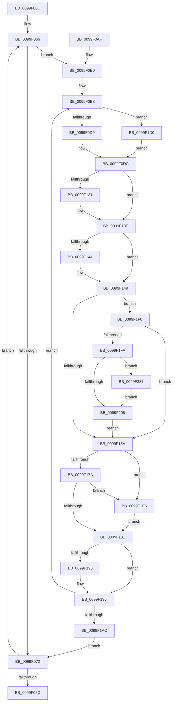

# ObpMarkDirectoryObjectsTemporary

- RVA: `0x0099F00C`–`0x0099F243` (길이 `567` bytes)
- VA: `0x000000014099F00C`
- 실행 섹션: `PAGE`
- PDB 이름 있음: `예`; PDB Function 태그: `아니요`
- unwind 정보 RVA: `0x0009AFA0`
- 디코드: `145`개 명령, `567/567` bytes 표시
- 미해석 바이트: `0` (있으면 어셈블리에 `.byte`로 보존)

> 이 문서는 커널 이미지의 기계어와 PDB 기호를 분석해 생성했습니다. 4번과 5번은 함수 원형과 자료형을 바이너리 사용 방식에서 추정한 C 해석이며 원본 소스 복구 결과는 아닙니다.

## 1. Dependencies

- 직접 호출 지점: **9**; 고유 호출 대상: **9**
- 직접 호출자로 확인된 함수: **1**
- RIP 상대 이미지 참조: **3**

### Outgoing calls
- `0x0099F03F` → [ObpLockDirectoryExclusive](ObpLockDirectoryExclusive_function_0099F24C.md) (function, `0x0099F24C`)
- `0x0099F091` → [ObpUnlockDirectory](ObpUnlockDirectory_function_0099F8A0.md) (function, `0x0099F8A0`)
- `0x0099F121` → [KeAbPreAcquire](../../text/21/KeAbPreAcquire_function_00210230.md) (function, `0x00210230`)
- `0x0099F13A` → [ExfAcquirePushLockExclusiveEx](../../text/20/ExfAcquirePushLockExclusiveEx_function_0020FC90.md) (function, `0x0020FC90`)
- `0x0099F184` → [KeAbPostRelease](../../text/2E/KeAbPostRelease_function_002E1600.md) (function, `0x002E1600`)
- `0x0099F189` → [KeLeaveCriticalRegion](../../text/25/KeLeaveCriticalRegion_function_0025D8B0.md) (function, `0x0025D8B0`)
- `0x0099F1E9` → [ExfReleasePushLock](../../text/26/ExfReleasePushLock_function_002638D0.md) (function, `0x002638D0`)
- `0x0099F22A` → [ObfDereferenceObjectWithTag](../../text/2F/ObfDereferenceObjectWithTag_function_002F78E0.md) (function, `0x002F78E0`)
- `0x0099F23C` → [ObpDeleteSymbolicLinkName](../A7/ObpDeleteSymbolicLinkName_function_00A7BC80.md) (function, `0x00A7BC80`)

### Direct callers
- [ObpDeleteDirectoryName](ObpDeleteDirectoryName_function_0099EF94.md) at `0x0099EFA9`

### Static image references
- `0x0099F059` → RVA `0x00000000` (`image boundary/outside`; read)
- `0x0099F0F4` → RVA `0x00FC6E4C` (`ALMOSTRO`; read)
- `0x0099F1FF` → RVA `0x00F0F658` (`.data`; read)

## 2. Other-region calls and transfers

- 다른 실행 섹션으로 향하는 call: **6**
  - `0x0099F121` → [KeAbPreAcquire](../../text/21/KeAbPreAcquire_function_00210230.md) (`PAGE` → `.text`)
  - `0x0099F13A` → [ExfAcquirePushLockExclusiveEx](../../text/20/ExfAcquirePushLockExclusiveEx_function_0020FC90.md) (`PAGE` → `.text`)
  - `0x0099F184` → [KeAbPostRelease](../../text/2E/KeAbPostRelease_function_002E1600.md) (`PAGE` → `.text`)
  - `0x0099F189` → [KeLeaveCriticalRegion](../../text/25/KeLeaveCriticalRegion_function_0025D8B0.md) (`PAGE` → `.text`)
  - `0x0099F1E9` → [ExfReleasePushLock](../../text/26/ExfReleasePushLock_function_002638D0.md) (`PAGE` → `.text`)
  - `0x0099F22A` → [ObfDereferenceObjectWithTag](../../text/2F/ObfDereferenceObjectWithTag_function_002F78E0.md) (`PAGE` → `.text`)
- 별도 외부 분기/꼬리 이동을 확인하지 못했습니다.

## 3. Assembly (complete function range)

```asm
0099F00C  4C 8B DC                        mov r11, rsp
0099F00F  49 89 53 10                     mov qword ptr [r11 + 0x10], rdx
0099F013  49 89 4B 08                     mov qword ptr [r11 + 8], rcx
0099F017  53                              push rbx
0099F018  55                              push rbp
0099F019  56                              push rsi
0099F01A  57                              push rdi
0099F01B  41 54                           push r12
0099F01D  41 55                           push r13
0099F01F  41 56                           push r14
0099F021  41 57                           push r15
0099F023  48 83 EC 58                     sub rsp, 0x58
0099F027  0F 57 C0                        xorps xmm0, xmm0
0099F02A  48 8B D9                        mov rbx, rcx
0099F02D  33 C0                           xor eax, eax
0099F02F  48 8B D1                        mov rdx, rcx
0099F032  0F 11 44 24 38                  movups xmmword ptr [rsp + 0x38], xmm0
0099F037  49 8D 4B A0                     lea rcx, [r11 - 0x60]
0099F03B  49 89 43 B0                     mov qword ptr [r11 - 0x50], rax
0099F03F  E8 08 02 00 00                  call 0x14099f24c
0099F044  B8 25 00 00 00                  mov eax, 0x25
0099F049  48 89 9C 24 B0 00 00 00         mov qword ptr [rsp + 0xb0], rbx
0099F051  48 89 84 24 B8 00 00 00         mov qword ptr [rsp + 0xb8], rax
0099F059  48 8D 15 A0 0F 66 FF            lea rdx, [rip - 0x99f060]
0099F060  48 8B EB                        mov rbp, rbx
0099F063  45 33 ED                        xor r13d, r13d
0099F066  48 8B 5D 00                     mov rbx, qword ptr [rbp]
0099F06A  4C 8B FD                        mov r15, rbp
0099F06D  48 85 DB                        test rbx, rbx
0099F070  75 3E                           jne 0x14099f0b0
0099F072  48 83 C5 08                     add rbp, 8
0099F076  48 83 E8 01                     sub rax, 1
0099F07A  48 89 AC 24 B0 00 00 00         mov qword ptr [rsp + 0xb0], rbp
0099F082  48 89 84 24 B8 00 00 00         mov qword ptr [rsp + 0xb8], rax
0099F08A  75 DA                           jne 0x14099f066
0099F08C  48 8D 4C 24 38                  lea rcx, [rsp + 0x38]
0099F091  E8 0A 08 00 00                  call 0x14099f8a0
0099F096  48 8B 84 24 A8 00 00 00         mov rax, qword ptr [rsp + 0xa8]
0099F09E  48 83 C4 58                     add rsp, 0x58
0099F0A2  41 5F                           pop r15
0099F0A4  41 5E                           pop r14
0099F0A6  41 5D                           pop r13
0099F0A8  41 5C                           pop r12
0099F0AA  5F                              pop rdi
0099F0AB  5E                              pop rsi
0099F0AC  5D                              pop rbp
0099F0AD  5B                              pop rbx
0099F0AE  C3                              ret
0099F0AF  CC                              int3
0099F0B0  48 8B AC 24 A8 00 00 00         mov rbp, qword ptr [rsp + 0xa8]
0099F0B8  48 8B 43 08                     mov rax, qword ptr [rbx + 8]
0099F0BC  45 8A E5                        mov r12b, r13b
0099F0BF  48 89 44 24 28                  mov qword ptr [rsp + 0x28], rax
0099F0C4  4C 89 7C 24 30                  mov qword ptr [rsp + 0x30], r15
0099F0C9  48 8D 70 D0                     lea rsi, [rax - 0x30]
0099F0CD  0F B6 46 1A                     movzx eax, byte ptr [rsi + 0x1a]
0099F0D1  A8 02                           test al, 2
0099F0D3  0F 85 F7 00 00 00               jne 0x14099f1d0
0099F0D9  4D 8B F5                        mov r14, r13
0099F0DC  48 8B C6                        mov rax, rsi
0099F0DF  48 8D 7E 10                     lea rdi, [rsi + 0x10]
0099F0E3  48 C1 E8 08                     shr rax, 8
0099F0E7  45 33 C0                        xor r8d, r8d
0099F0EA  0F B6 C8                        movzx ecx, al
0099F0ED  0F B6 46 18                     movzx eax, byte ptr [rsi + 0x18]
0099F0F1  48 33 C8                        xor rcx, rax
0099F0F4  0F B6 05 51 7D 62 00            movzx eax, byte ptr [rip + 0x627d51]
0099F0FB  48 33 C8                        xor rcx, rax
0099F0FE  48 8B 84 CA 00 78 FC 00         mov rax, qword ptr [rdx + rcx*8 + 0xfc7800]
0099F106  33 D2                           xor edx, edx
0099F108  48 89 44 24 20                  mov qword ptr [rsp + 0x20], rax
0099F10D  48 8B CF                        mov rcx, rdi
0099F110  65 48 8B 04 25 88 01 00 00      mov rax, qword ptr gs:[0x188]
0099F119  66 FF 88 E4 01 00 00            dec word ptr [rax + 0x1e4]
0099F120  90                              nop
0099F121  E8 0A 11 87 FF                  call 0x140210230
0099F126  F0 48 0F BA 2F 00               lock bts qword ptr [rdi], 0
0099F12C  4C 8B E8                        mov r13, rax
0099F12F  73 0E                           jae 0x14099f13f
0099F131  4C 8B C7                        mov r8, rdi
0099F134  48 8B D0                        mov rdx, rax
0099F137  48 8B CF                        mov rcx, rdi
0099F13A  E8 51 0B 87 FF                  call 0x14020fc90
0099F13F  4D 85 ED                        test r13, r13
0099F142  74 05                           je 0x14099f149
0099F144  41 C6 45 0A 01                  mov byte ptr [r13 + 0xa], 1
0099F149  80 66 1B EF                     and byte ptr [rsi + 0x1b], 0xef
0099F14D  45 33 ED                        xor r13d, r13d
0099F150  4C 39 6E 08                     cmp qword ptr [rsi + 8], r13
0099F154  0F 84 96 00 00 00               je 0x14099f1f0
0099F15A  4C 8B FB                        mov r15, rbx
0099F15D  0F 0D 0F                        prefetchw byte ptr [rdi]
0099F160  48 8B 07                        mov rax, qword ptr [rdi]
0099F163  48 8B C8                        mov rcx, rax
0099F166  48 83 E1 F0                     and rcx, 0xfffffffffffffff0
0099F16A  48 83 F9 10                     cmp rcx, 0x10
0099F16E  48 8D 50 F0                     lea rdx, [rax - 0x10]
0099F172  49 0F 46 D5                     cmovbe rdx, r13
0099F176  A8 02                           test al, 2
0099F178  75 6C                           jne 0x14099f1e6
0099F17A  F0 48 0F B1 17                  lock cmpxchg qword ptr [rdi], rdx
0099F17F  75 65                           jne 0x14099f1e6
0099F181  48 8B CF                        mov rcx, rdi
0099F184  E8 77 24 94 FF                  call 0x1402e1600
0099F189  E8 22 E7 8B FF                  call 0x14025d8b0
0099F18E  45 84 E4                        test r12b, r12b
0099F191  75 03                           jne 0x14099f196
0099F193  48 8B 1B                        mov rbx, qword ptr [rbx]
0099F196  4C 0F 45 7C 24 30               cmovne r15, qword ptr [rsp + 0x30]
0099F19C  48 8D 15 5D 0E 66 FF            lea rdx, [rip - 0x99f1a3]
0099F1A3  48 85 DB                        test rbx, rbx
0099F1A6  0F 85 0C FF FF FF               jne 0x14099f0b8
0099F1AC  48 8B 84 24 B8 00 00 00         mov rax, qword ptr [rsp + 0xb8]
0099F1B4  48 8D 15 45 0E 66 FF            lea rdx, [rip - 0x99f1bb]
0099F1BB  48 89 AC 24 A8 00 00 00         mov qword ptr [rsp + 0xa8], rbp
0099F1C3  48 8B AC 24 B0 00 00 00         mov rbp, qword ptr [rsp + 0xb0]
0099F1CB  E9 A2 FE FF FF                  jmp 0x14099f072
0099F1D0  83 E0 03                        and eax, 3
0099F1D3  4C 8B F6                        mov r14, rsi
0099F1D6  0F B6 84 10 80 FF F0 00         movzx eax, byte ptr [rax + rdx + 0xf0ff80]
0099F1DE  4C 2B F0                        sub r14, rax
0099F1E1  E9 F6 FE FF FF                  jmp 0x14099f0dc
0099F1E6  48 8B CF                        mov rcx, rdi
0099F1E9  E8 E2 46 8C FF                  call 0x1402638d0
0099F1EE  EB 91                           jmp 0x14099f181
0099F1F0  45 39 6E 18                     cmp dword ptr [r14 + 0x18], r13d
0099F1F4  0F 85 60 FF FF FF               jne 0x14099f15a
0099F1FA  48 8B 44 24 20                  mov rax, qword ptr [rsp + 0x20]
0099F1FF  48 3B 05 52 04 57 00            cmp rax, qword ptr [rip + 0x570452]
0099F206  74 2F                           je 0x14099f237
0099F208  48 8B 03                        mov rax, qword ptr [rbx]
0099F20B  48 8B CB                        mov rcx, rbx
0099F20E  49 89 07                        mov qword ptr [r15], rax
0099F211  BA 4F 62 44 69                  mov edx, 0x6944624f
0099F216  48 8B 1B                        mov rbx, qword ptr [rbx]
0099F219  4D 89 2E                        mov qword ptr [r14], r13
0099F21C  48 89 29                        mov qword ptr [rcx], rbp
0099F21F  48 8B E9                        mov rbp, rcx
0099F222  48 8B 8C 24 A0 00 00 00         mov rcx, qword ptr [rsp + 0xa0]
0099F22A  E8 B1 86 95 FF                  call 0x1402f78e0
0099F22F  41 B4 01                        mov r12b, 1
0099F232  E9 23 FF FF FF                  jmp 0x14099f15a
0099F237  48 8B 4C 24 28                  mov rcx, qword ptr [rsp + 0x28]
0099F23C  E8 3F CA 0D 00                  call 0x140a7bc80
0099F241  EB C5                           jmp 0x14099f208
```

## 4. C-style interpretation (structured pseudocode)

```c
__int64 __fastcall ObpMarkDirectoryObjectsTemporary(__int64 a1, __int64 a2, int a3)
{
    __int64 result;
    __int64 v_r13;
    __int64 v_r14;
    __int64 v_r15;
    __int64 v_rbp;
    __int64 v_rbx;
    __int64 v_rsp;
    unsigned __int64 v_stack_m60;
    unsigned __int64 v_stack_p10;
    unsigned __int64 v_stack_p18;
    unsigned __int64 v_stack_p20;
    unsigned __int64 v_stack_p28;
    unsigned __int64 v_stack_p30;
    unsigned __int64 v_stack_pA0;
    unsigned __int64 v_stack_pA8;
    unsigned __int64 v_stack_pB0;
    unsigned __int64 v_stack_pB8;

    *(unsigned __int64 *)(v_rsp + 16) = a2;
    *(unsigned __int64 *)(v_rsp + 8) = a1;
    v_rsp = (v_rsp) - (88);
    result = 0;
    v_stack_m60 = v_xmm0;
    *(unsigned __int64 *)(v_rsp - 80) = 0;
    result = ObpLockDirectoryExclusive(v_rsp - 96, a1, a3, a4);
    v_stack_p18 = a1;
    v_stack_p20 = 37;
    v_r13 = 0;
loc_0099F066:
    if (*(unsigned __int64 *)(a1) != 0) goto loc_0099F0B0;
loc_0099F072:
    v_rbp = (a1) + (8);
    result = (37) - (1);
    v_stack_p18 = v_rbp;
    v_stack_p20 = result;
    if (condition_is_not_equal) goto loc_0099F066;
    result = ObpUnlockDirectory(v_stack_m60, v_rip - 10088544, a3, a4);
    v_rsp = (v_rsp) + (88);
    return v_stack_p10;
loc_0099F0B0:
loc_0099F0B8:
    v_stack_p28 = *(unsigned __int64 *)(*(unsigned __int64 *)(a1) + 8);
    v_stack_p30 = a1;
    if ((((unsigned __int8)(*(unsigned __int8 *)(*(unsigned __int64 *)(*(unsigned __int64 *)(a1) + 8) - 48 + 26))) & (2)) != 0) goto loc_0099F1D0;
loc_0099F0DC:
    result = (*(unsigned __int64 *)(*(unsigned __int64 *)(a1) + 8) - 48) >> (8);
    a3 = 0;
    a1 = ((unsigned __int8)(result)) ^ (*(unsigned __int8 *)(*(unsigned __int64 *)(*(unsigned __int64 *)(a1) + 8) - 48 + 24));
    a1 = (a1) ^ (*(unsigned __int8 *)(v_rip + 6454609));
    a2 = 0;
    v_stack_p20 = *(unsigned __int64 *)(v_rip - 10088544 + a1 * 8 + 16545792);
    result = KeAbPreAcquire(*(unsigned __int64 *)(*(unsigned __int64 *)(a1) + 8) - 48 + 16, a2, a3, a4);
    if (!(condition_is_above_or_equal)) {
        a3 = *(unsigned __int64 *)(*(unsigned __int64 *)(a1) + 8) - 48 + 16;
        a2 = result;
        a1 = *(unsigned __int64 *)(*(unsigned __int64 *)(a1) + 8) - 48 + 16;
        result = ExfAcquirePushLockExclusiveEx(a1, a2, a3, a4);
    }
    if (result != 0) {
        *(unsigned __int8 *)(result + 10) = 1;
    }
    v_r13 = 0;
    if ((*(unsigned __int64 *)(*(unsigned __int64 *)(*(unsigned __int64 *)(a1) + 8) - 48 + 8)) == 0) goto loc_0099F1F0;
loc_0099F15A:
    a1 = (*(unsigned __int64 *)(*(unsigned __int64 *)(*(unsigned __int64 *)(a1) + 8) - 48 + 16)) & (-16);
    a2 = *(unsigned __int64 *)(*(unsigned __int64 *)(*(unsigned __int64 *)(a1) + 8) - 48 + 16) - 16;
    if (a1 <= 16) { a2 = 0; }
    if ((((unsigned __int8)(*(unsigned __int64 *)(*(unsigned __int64 *)(*(unsigned __int64 *)(a1) + 8) - 48 + 16))) & (2)) != 0) goto loc_0099F1E6;
    if ((((unsigned __int8)(*(unsigned __int64 *)(*(unsigned __int64 *)(*(unsigned __int64 *)(a1) + 8) - 48 + 16))) & (2)) != 0) goto loc_0099F1E6;
loc_0099F181:
    result = KeAbPostRelease(*(unsigned __int64 *)(*(unsigned __int64 *)(a1) + 8) - 48 + 16, a2, a3, a4);
    result = KeLeaveCriticalRegion(*(unsigned __int64 *)(*(unsigned __int64 *)(a1) + 8) - 48 + 16, a2, a3, a4);
    v_rbx = *(unsigned __int64 *)(a1);
    if (0 == 0) {
        v_rbx = *(unsigned __int64 *)(*(unsigned __int64 *)(a1));
    }
    v_r15 = *(unsigned __int64 *)(a1);
    if (0 != 0) { v_r15 = v_stack_p30; }
    if (v_rbx != 0) goto loc_0099F0B8;
    v_stack_pA8 = v_stack_pA8;
    goto loc_0099F072;
loc_0099F1D0:
    result = (unsigned int)((v_stack_pB8) & (3));
    v_r14 = (*(unsigned __int64 *)(*(unsigned __int64 *)(a1) + 8) - 48) - (*(unsigned __int8 *)(result + v_rip - 10088891 * 1 + 15794048));
    goto loc_0099F0DC;
loc_0099F1E6:
    result = ExfReleasePushLock(*(unsigned __int64 *)(*(unsigned __int64 *)(a1) + 8) - 48 + 16, v_rip - 10088891, a3, a4);
    goto loc_0099F181;
loc_0099F1F0:
    if ((*(unsigned int *)(v_r14 + 24)) != 0) goto loc_0099F15A;
    if (v_stack_p20 == (*(unsigned __int64 *)(v_rip + 5702738))) goto loc_0099F237;
loc_0099F208:
    *(unsigned __int64 *)(v_r15) = *(unsigned __int64 *)(v_rbx);
    *(unsigned __int64 *)(v_r14) = 0;
    *(unsigned __int64 *)(v_rbx) = v_stack_pB0;
    result = ObfDereferenceObjectWithTag(v_stack_pA0, (unsigned int)(0x6944624FULL), a3, a4);
    goto loc_0099F15A;
loc_0099F237:
    result = ObpDeleteSymbolicLinkName(v_stack_p28, (unsigned int)(0x6944624FULL), a3, a4);
    goto loc_0099F208;
}
```

## 5. (Beta) C Style

```c
int64_t ObpMarkDirectoryObjectsTemporary(int64_t Arg1, int64_t Arg2, int32_t Arg3)
{
    int64_t result;
    int64_t local_r13;
    int64_t local_r14;
    int64_t local_r15;
    int64_t local_rbp;
    int64_t local_rbx;
    int64_t local_rsp;
    uint64_t v_stack_m60;
    uint64_t v_stack_p10;
    uint64_t v_stack_p18;
    uint64_t v_stack_p20;
    uint64_t v_stack_p28;
    uint64_t v_stack_p30;
    uint64_t v_stack_pA0;
    uint64_t v_stack_pA8;
    uint64_t v_stack_pB0;
    uint64_t v_stack_pB8;

    *(uint64_t *)(local_rsp + 0x10) = Arg2;
    *(uint64_t *)(local_rsp + 0x8) = Arg1;
    local_rsp = (local_rsp) - (88);
    result = 0;
    v_stack_m60 = v_xmm0;
    *(uint64_t *)(local_rsp - 0x50) = 0;
    result = ObpLockDirectoryExclusive(local_rsp - 96, Arg1, Arg3, a4);
    v_stack_p18 = Arg1;
    v_stack_p20 = 37;
    local_r13 = 0;
loc_0099F066:
    if (*(uint64_t *)(Arg1) != 0) goto loc_0099F0B0;
loc_0099F072:
    local_rbp = (Arg1) + (8);
    result = (37) - (1);
    v_stack_p18 = local_rbp;
    v_stack_p20 = result;
    if (condition_is_not_equal) goto loc_0099F066;
    result = ObpUnlockDirectory(v_stack_m60, v_rip - 10088544, Arg3, a4);
    local_rsp = (local_rsp) + (88);
    return v_stack_p10;
loc_0099F0B0:
loc_0099F0B8:
    v_stack_p28 = *(uint64_t *)(*(uint64_t *)(Arg1) + 0x8);
    v_stack_p30 = Arg1;
    if ((((uint8_t)(*(uint8_t *)(*(uint64_t *)(*(uint64_t *)(Arg1) + 0x8) - 0x30 + 0x1A))) & (2)) != 0) goto loc_0099F1D0;
loc_0099F0DC:
    result = (*(uint64_t *)(*(uint64_t *)(Arg1) + 0x8) - 48) >> (8);
    Arg3 = 0;
    Arg1 = ((uint8_t)(result)) ^ (*(uint8_t *)(*(uint64_t *)(*(uint64_t *)(Arg1) + 0x8) - 0x30 + 0x18));
    Arg1 = (Arg1) ^ (*(uint8_t *)(v_rip + 0x627D51));
    Arg2 = 0;
    v_stack_p20 = *(uint64_t *)(v_rip - 0x99F060 + Arg1 * 8 + 0xFC7800);
    result = KeAbPreAcquire(*(uint64_t *)(*(uint64_t *)(Arg1) + 0x8) - 48 + 16, Arg2, Arg3, a4);
    if (!(condition_is_above_or_equal)) {
        Arg3 = *(uint64_t *)(*(uint64_t *)(Arg1) + 0x8) - 48 + 16;
        Arg2 = result;
        Arg1 = *(uint64_t *)(*(uint64_t *)(Arg1) + 0x8) - 48 + 16;
        result = ExfAcquirePushLockExclusiveEx(Arg1, Arg2, Arg3, a4);
    }
    if (result != 0) {
        *(uint8_t *)(result + 0xA) = 1;
    }
    local_r13 = 0;
    if ((*(uint64_t *)(*(uint64_t *)(*(uint64_t *)(Arg1) + 0x8) - 0x30 + 0x8)) == 0) goto loc_0099F1F0;
loc_0099F15A:
    Arg1 = (*(uint64_t *)(*(uint64_t *)(*(uint64_t *)(Arg1) + 0x8) - 0x30 + 0x10)) & (-16);
    Arg2 = *(uint64_t *)(*(uint64_t *)(*(uint64_t *)(Arg1) + 0x8) - 0x30 + 0x10) - 16;
    if (Arg1 <= 16) { Arg2 = 0; }
    if ((((uint8_t)(*(uint64_t *)(*(uint64_t *)(*(uint64_t *)(Arg1) + 0x8) - 0x30 + 0x10))) & (2)) != 0) goto loc_0099F1E6;
    if ((((uint8_t)(*(uint64_t *)(*(uint64_t *)(*(uint64_t *)(Arg1) + 0x8) - 0x30 + 0x10))) & (2)) != 0) goto loc_0099F1E6;
loc_0099F181:
    result = KeAbPostRelease(*(uint64_t *)(*(uint64_t *)(Arg1) + 0x8) - 48 + 16, Arg2, Arg3, a4);
    result = KeLeaveCriticalRegion(*(uint64_t *)(*(uint64_t *)(Arg1) + 0x8) - 48 + 16, Arg2, Arg3, a4);
    local_rbx = *(uint64_t *)(Arg1);
    if (0 == 0) {
        local_rbx = *(uint64_t *)(*(uint64_t *)(Arg1));
    }
    local_r15 = *(uint64_t *)(Arg1);
    if (0 != 0) { local_r15 = v_stack_p30; }
    if (local_rbx != 0) goto loc_0099F0B8;
    v_stack_pA8 = v_stack_pA8;
    goto loc_0099F072;
loc_0099F1D0:
    result = (uint32_t)((v_stack_pB8) & (3));
    local_r14 = (*(uint64_t *)(*(uint64_t *)(Arg1) + 0x8) - 48) - (*(uint8_t *)(result + v_rip - 0x99F1BB * 1 + 0xF0FF80));
    goto loc_0099F0DC;
loc_0099F1E6:
    result = ExfReleasePushLock(*(uint64_t *)(*(uint64_t *)(Arg1) + 0x8) - 48 + 16, v_rip - 10088891, Arg3, a4);
    goto loc_0099F181;
loc_0099F1F0:
    if ((*(uint32_t *)(local_r14 + 0x18)) != 0) goto loc_0099F15A;
    if (v_stack_p20 == (*(uint64_t *)(v_rip + 0x570452))) goto loc_0099F237;
loc_0099F208:
    *(uint64_t *)(local_r15) = *(uint64_t *)(local_rbx);
    *(uint64_t *)(local_r14) = 0;
    *(uint64_t *)(local_rbx) = v_stack_pB0;
    result = ObfDereferenceObjectWithTag(v_stack_pA0, (uint32_t)(0x6944624FULL), Arg3, a4);
    goto loc_0099F15A;
loc_0099F237:
    result = ObpDeleteSymbolicLinkName(v_stack_p28, (uint32_t)(0x6944624FULL), Arg3, a4);
    goto loc_0099F208;
}
```

## 6. Execution-region graph

[열기: 2D/3D 그래프와 함수 탐색 컨트롤 패널](../../../control-panel.html?section=page&rva=0x0099F00C&view=graph)

- 2D 그래프는 위에서 아래로 흐르고, 3D 그래프는 빈 공간을 드래그해 회전합니다. Shift+드래그는 이동, 휠은 확대·축소, 함수 노드 선택은 대상 보고서 이동입니다.

### Static fallback


