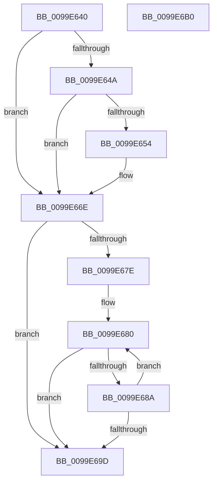

# ObpParseComponentName

- RVA: `0x0099E640`–`0x0099E6B1` (길이 `113` bytes)
- VA: `0x000000014099E640`
- 실행 섹션: `PAGE`
- PDB 이름 있음: `예`; PDB Function 태그: `아니요`
- unwind 정보 RVA: `0x000DB714`
- 디코드: `33`개 명령, `113/113` bytes 표시
- 미해석 바이트: `0` (있으면 어셈블리에 `.byte`로 보존)

> 이 문서는 커널 이미지의 기계어와 PDB 기호를 분석해 생성했습니다. 4번과 5번은 함수 원형과 자료형을 바이너리 사용 방식에서 추정한 C 해석이며 원본 소스 복구 결과는 아닙니다.

## 1. Dependencies

- 직접 호출 지점: **0**; 고유 호출 대상: **0**
- 직접 호출자로 확인된 함수: **1**
- RIP 상대 이미지 참조: **0**

### Outgoing calls
- 직접 디코드된 call 명령이 없습니다.

### Direct callers
- [ObpCreateSymbolicLinkName](../74/ObpCreateSymbolicLinkName_function_0074EB80.md) at `0x0074ECBB`

### Static image references
- 디코드된 RIP-relative 메모리 참조가 없습니다.

## 2. Other-region calls and transfers

- 다른 실행 섹션으로 향하는 call: **0**
- 별도 외부 분기/꼬리 이동을 확인하지 못했습니다.

## 3. Assembly (complete function range)

```asm
0099E640  44 0F B7 01                     movzx r8d, word ptr [rcx]
0099E644  66 45 85 C0                     test r8w, r8w
0099E648  74 24                           je 0x14099e66e
0099E64A  48 8B 41 08                     mov rax, qword ptr [rcx + 8]
0099E64E  66 83 38 5C                     cmp word ptr [rax], 0x5c
0099E652  75 1A                           jne 0x14099e66e
0099E654  48 83 C0 02                     add rax, 2
0099E658  66 41 83 E8 02                  sub r8w, 2
0099E65D  48 89 41 08                     mov qword ptr [rcx + 8], rax
0099E661  B8 FE FF 00 00                  mov eax, 0xfffe
0099E666  66 01 41 02                     add word ptr [rcx + 2], ax
0099E66A  66 44 89 01                     mov word ptr [rcx], r8w
0099E66E  0F 10 01                        movups xmm0, xmmword ptr [rcx]
0099E671  0F 11 02                        movups xmmword ptr [rdx], xmm0
0099E674  44 0F B7 01                     movzx r8d, word ptr [rcx]
0099E678  66 45 85 C0                     test r8w, r8w
0099E67C  74 1F                           je 0x14099e69d
0099E67E  66 90                           nop
0099E680  48 8B 41 08                     mov rax, qword ptr [rcx + 8]
0099E684  66 83 38 5C                     cmp word ptr [rax], 0x5c
0099E688  74 13                           je 0x14099e69d
0099E68A  48 83 C0 02                     add rax, 2
0099E68E  66 41 83 E8 02                  sub r8w, 2
0099E693  48 89 41 08                     mov qword ptr [rcx + 8], rax
0099E697  66 44 89 01                     mov word ptr [rcx], r8w
0099E69B  75 E3                           jne 0x14099e680
0099E69D  66 44 29 02                     sub word ptr [rdx], r8w
0099E6A1  0F B7 02                        movzx eax, word ptr [rdx]
0099E6A4  66 29 41 02                     sub word ptr [rcx + 2], ax
0099E6A8  66 83 3A 00                     cmp word ptr [rdx], 0
0099E6AC  0F 97 C0                        seta al
0099E6AF  C3                              ret
0099E6B0  CC                              int3
```

## 4. C-style interpretation (structured pseudocode)

```c
__int64 __fastcall ObpParseComponentName(__int64 a1, __int64 a2)
{
    __int64 result;

    if ((unsigned __int16)(*(unsigned __int16 *)(a1)) == 0) goto loc_0099E66E;
    result = *(unsigned __int64 *)(a1 + 8);
    if ((*(unsigned __int16 *)(*(unsigned __int64 *)(a1 + 8))) == 92) {
        result = (*(unsigned __int64 *)(a1 + 8)) + (2);
        a3 = (unsigned __int16)((*(unsigned __int16 *)(a1)) - (2));
        *(unsigned __int64 *)(a1 + 8) = result;
        result = 0xFFFEULL;
        *(unsigned __int16 *)(a1) = (unsigned __int16)(a3);
    }
    *(unsigned __int64 *)(a2) = v_xmm0;
    if ((unsigned __int16)(*(unsigned __int16 *)(a1)) == 0) goto loc_0099E69D;
loc_0099E680:
    if ((*(unsigned __int16 *)(*(unsigned __int64 *)(a1 + 8))) == 92) goto loc_0099E69D;
    result = (*(unsigned __int64 *)(a1 + 8)) + (2);
    a3 = (unsigned __int16)((*(unsigned __int16 *)(a1)) - (2));
    *(unsigned __int64 *)(a1 + 8) = result;
    *(unsigned __int16 *)(a1) = (unsigned __int16)(a3);
    if (condition_is_not_equal) goto loc_0099E680;
loc_0099E69D:
    result = ((*(unsigned __int16 *)(a2)) > 0) ? 1 : 0;
    return result;
}
```

## 5. (Beta) C Style

```c
int64_t ObpParseComponentName(void *Arg1, void *Arg2)
{
    uint8_t *arg1 = (uint8_t *)Arg1;
    uint8_t *arg2 = (uint8_t *)Arg2;

    int64_t result;

    if ((uint16_t)(*(uint16_t *)(arg1)) == 0) goto loc_0099E66E;
    result = *(uint64_t *)(arg1 + 0x8);
    if ((*(uint16_t *)(*(uint64_t *)(arg1 + 0x8))) == 92) {
        result = (*(uint64_t *)(arg1 + 0x8)) + (2);
        a3 = (uint16_t)((*(uint16_t *)(arg1)) - (2));
        *(uint64_t *)(arg1 + 0x8) = result;
        result = 0xFFFEULL;
        *(uint16_t *)(arg1) = (uint16_t)(a3);
    }
    *(uint64_t *)(arg2) = v_xmm0;
    if ((uint16_t)(*(uint16_t *)(arg1)) == 0) goto loc_0099E69D;
loc_0099E680:
    if ((*(uint16_t *)(*(uint64_t *)(arg1 + 0x8))) == 92) goto loc_0099E69D;
    result = (*(uint64_t *)(arg1 + 0x8)) + (2);
    a3 = (uint16_t)((*(uint16_t *)(arg1)) - (2));
    *(uint64_t *)(arg1 + 0x8) = result;
    *(uint16_t *)(arg1) = (uint16_t)(a3);
    if (condition_is_not_equal) goto loc_0099E680;
loc_0099E69D:
    result = ((*(uint16_t *)(arg2)) > 0) ? 1 : 0;
    return result;
}
```

### 관측된 메모리 오프셋

구조체 형식이 확인되지 않은 접근은 인자 기준의 오프셋으로만 기록했습니다.

| 기준 인자 | 오프셋 표현 | 폭 (bit) | 접근 |
|---|---:|---:|---|
| `Arg1` | `+ 0x0` | `16` | `R` |
| `Arg1` | `+ 0x0` | `16` | `W` |
| `Arg1` | `+ 0x0` | `128` | `R` |
| `Arg1` | `+ 0x2` | `16` | `R/W` |
| `Arg1` | `+ 0x8` | `64` | `R` |
| `Arg1` | `+ 0x8` | `64` | `W` |
| `Arg2` | `+ 0x0` | `16` | `R` |
| `Arg2` | `+ 0x0` | `16` | `R/W` |
| `Arg2` | `+ 0x0` | `128` | `R` |

## 6. Execution-region graph

[열기: 2D/3D 그래프와 함수 탐색 컨트롤 패널](../../../control-panel.html?section=page&rva=0x0099E640&view=graph)

- 2D 그래프는 위에서 아래로 흐르고, 3D 그래프는 빈 공간을 드래그해 회전합니다. Shift+드래그는 이동, 휠은 확대·축소, 함수 노드 선택은 대상 보고서 이동입니다.

### Static fallback


