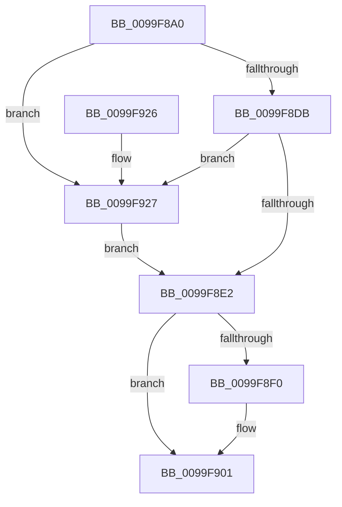

# ObpUnlockDirectory

- RVA: `0x0099F8A0`–`0x0099F931` (길이 `145` bytes)
- VA: `0x000000014099F8A0`
- 실행 섹션: `PAGE`
- PDB 이름 있음: `예`; PDB Function 태그: `아니요`
- unwind 정보 RVA: `0x0005C748`
- 디코드: `40`개 명령, `145/145` bytes 표시
- 미해석 바이트: `0` (있으면 어셈블리에 `.byte`로 보존)

> 이 문서는 커널 이미지의 기계어와 PDB 기호를 분석해 생성했습니다. 4번과 5번은 함수 원형과 자료형을 바이너리 사용 방식에서 추정한 C 해석이며 원본 소스 복구 결과는 아닙니다.

## 1. Dependencies

- 직접 호출 지점: **4**; 고유 호출 대상: **4**
- 직접 호출자로 확인된 함수: **8**
- RIP 상대 이미지 참조: **0**

### Outgoing calls
- `0x0099F8E5` → [KeAbPostRelease](../../text/2E/KeAbPostRelease_function_002E1600.md) (function, `0x002E1600`)
- `0x0099F8F8` → [ObDereferenceObjectDeferDeleteWithTag](../../text/26/ObDereferenceObjectDeferDeleteWithTag_function_00263EA0.md) (function, `0x00263EA0`)
- `0x0099F911` → [KeLeaveCriticalRegionThread](../../text/25/KeLeaveCriticalRegionThread_function_0025EFF0.md) (function, `0x0025EFF0`)
- `0x0099F92A` → [ExfReleasePushLock](../../text/26/ExfReleasePushLock_function_002638D0.md) (function, `0x002638D0`)

### Direct callers
- [ObpCreateSymbolicLinkName](../74/ObpCreateSymbolicLinkName_function_0074EB80.md) at `0x0074ED4B`
- [ObpCreateSymbolicLinkName](../74/ObpCreateSymbolicLinkName_function_0074EB80.md) at `0x0074ED5E`
- [ObpDecrementHandleCount](../86/ObpDecrementHandleCount_function_008632E0.md) at `0x008638A8`
- [ObCloseHandleTableEntry](../86/ObCloseHandleTableEntry_function_00869E20.md) at `0x0086A814`
- [sub_0089A511](../89/Unknown_function_0089A511.md) at `0x0089A66F`
- [NtQueryDirectoryObject](NtQueryDirectoryObject_function_0099EA20.md) at `0x0099ED60`
- [ObpMarkDirectoryObjectsTemporary](ObpMarkDirectoryObjectsTemporary_function_0099F00C.md) at `0x0099F091`
- [ObpInsertOrLocateNamedObject](ObpInsertOrLocateNamedObject_function_0099F2C0.md) at `0x0099F5A1`
- [sub_00B334D2](../B3/Unknown_function_00B334D2.md) at `0x00B33631`

### Static image references
- 디코드된 RIP-relative 메모리 참조가 없습니다.

## 2. Other-region calls and transfers

- 다른 실행 섹션으로 향하는 call: **4**
  - `0x0099F8E5` → [KeAbPostRelease](../../text/2E/KeAbPostRelease_function_002E1600.md) (`PAGE` → `.text`)
  - `0x0099F8F8` → [ObDereferenceObjectDeferDeleteWithTag](../../text/26/ObDereferenceObjectDeferDeleteWithTag_function_00263EA0.md) (`PAGE` → `.text`)
  - `0x0099F911` → [KeLeaveCriticalRegionThread](../../text/25/KeLeaveCriticalRegionThread_function_0025EFF0.md) (`PAGE` → `.text`)
  - `0x0099F92A` → [ExfReleasePushLock](../../text/26/ExfReleasePushLock_function_002638D0.md) (`PAGE` → `.text`)
- 별도 외부 분기/꼬리 이동을 확인하지 못했습니다.

## 3. Assembly (complete function range)

```asm
0099F8A0  48 89 5C 24 08                  mov qword ptr [rsp + 8], rbx
0099F8A5  48 89 74 24 10                  mov qword ptr [rsp + 0x10], rsi
0099F8AA  57                              push rdi
0099F8AB  48 83 EC 20                     sub rsp, 0x20
0099F8AF  48 8B 39                        mov rdi, qword ptr [rcx]
0099F8B2  48 8B D9                        mov rbx, rcx
0099F8B5  48 81 C7 28 01 00 00            add rdi, 0x128
0099F8BC  0F 0D 0F                        prefetchw byte ptr [rdi]
0099F8BF  48 8B 07                        mov rax, qword ptr [rdi]
0099F8C2  33 F6                           xor esi, esi
0099F8C4  48 8B C8                        mov rcx, rax
0099F8C7  48 83 E1 F0                     and rcx, 0xfffffffffffffff0
0099F8CB  48 83 F9 10                     cmp rcx, 0x10
0099F8CF  48 8D 50 F0                     lea rdx, [rax - 0x10]
0099F8D3  48 0F 46 D6                     cmovbe rdx, rsi
0099F8D7  A8 02                           test al, 2
0099F8D9  75 4C                           jne 0x14099f927
0099F8DB  F0 48 0F B1 17                  lock cmpxchg qword ptr [rdi], rdx
0099F8E0  75 45                           jne 0x14099f927
0099F8E2  48 8B CF                        mov rcx, rdi
0099F8E5  E8 16 1D 94 FF                  call 0x1402e1600
0099F8EA  40 38 73 16                     cmp byte ptr [rbx + 0x16], sil
0099F8EE  74 11                           je 0x14099f901
0099F8F0  48 8B 0B                        mov rcx, qword ptr [rbx]
0099F8F3  BA 4F 62 4C 55                  mov edx, 0x554c624f
0099F8F8  E8 A3 45 8C FF                  call 0x140263ea0
0099F8FD  40 88 73 16                     mov byte ptr [rbx + 0x16], sil
0099F901  48 89 33                        mov qword ptr [rbx], rsi
0099F904  40 88 73 15                     mov byte ptr [rbx + 0x15], sil
0099F908  65 48 8B 0C 25 88 01 00 00      mov rcx, qword ptr gs:[0x188]
0099F911  E8 DA F6 8B FF                  call 0x14025eff0
0099F916  48 8B 5C 24 30                  mov rbx, qword ptr [rsp + 0x30]
0099F91B  48 8B 74 24 38                  mov rsi, qword ptr [rsp + 0x38]
0099F920  48 83 C4 20                     add rsp, 0x20
0099F924  5F                              pop rdi
0099F925  C3                              ret
0099F926  CC                              int3
0099F927  48 8B CF                        mov rcx, rdi
0099F92A  E8 A1 3F 8C FF                  call 0x1402638d0
0099F92F  EB B1                           jmp 0x14099f8e2
```

## 4. C-style interpretation (structured pseudocode)

```c
__int64 __fastcall ObpUnlockDirectory(__int64 a1)
{
    __int64 result;
    __int64 v_rdi;
    __int64 v_rsi;
    __int64 v_rsp;
    unsigned __int64 v_stack_p10;
    unsigned __int64 v_stack_p8;

    v_stack_p8 = v_rbx;
    v_stack_p10 = v_rsi;
    v_rsp = (v_rsp) - (32);
    v_rdi = (*(unsigned __int64 *)(a1)) + (296);
    v_rsi = 0;
    a1 = (*(unsigned __int64 *)(v_rdi)) & (-16);
    a2 = *(unsigned __int64 *)(v_rdi) - 16;
    if (a1 <= 16) { a2 = 0; }
    if ((((unsigned __int8)(*(unsigned __int64 *)(v_rdi))) & (2)) != 0) goto loc_0099F927;
    if ((((unsigned __int8)(*(unsigned __int64 *)(v_rdi))) & (2)) != 0) goto loc_0099F927;
loc_0099F8E2:
    result = KeAbPostRelease(v_rdi, a2, a3, a4);
    if ((*(unsigned __int8 *)(a1 + 22)) != 0) {
        a1 = *(unsigned __int64 *)(a1);
        a2 = 0x554C624FULL;
        result = ObDereferenceObjectDeferDeleteWithTag(a1, a2, a3, a4);
        *(unsigned __int8 *)(a1 + 22) = 0;
    }
    *(unsigned __int64 *)(a1) = 0;
    *(unsigned __int8 *)(a1 + 21) = 0;
    result = KeLeaveCriticalRegionThread(*(unsigned __int64 *)(gs_base + (0 + 392)), a2, a3, a4);
    v_rsp = (v_rsp) + (32);
    return result;
loc_0099F927:
    result = ExfReleasePushLock(v_rdi, a2, a3, a4);
    goto loc_0099F8E2;
}
```

## 5. (Beta) C Style

```c
int64_t ObpUnlockDirectory(void *Arg1)
{
    uint8_t *arg1 = (uint8_t *)Arg1;

    int64_t result;
    int64_t local_rdi;
    int64_t local_rsi;
    int64_t local_rsp;
    uint64_t v_stack_p10;
    uint64_t v_stack_p8;

    v_stack_p8 = local_rbx;
    v_stack_p10 = local_rsi;
    local_rsp = (local_rsp) - (32);
    local_rdi = (*(uint64_t *)(arg1)) + (296);
    local_rsi = 0;
    Arg1 = (*(uint64_t *)(local_rdi)) & (-16);
    a2 = *(uint64_t *)(local_rdi) - 16;
    if (Arg1 <= 16) { a2 = 0; }
    if ((((uint8_t)(*(uint64_t *)(local_rdi))) & (2)) != 0) goto loc_0099F927;
    if ((((uint8_t)(*(uint64_t *)(local_rdi))) & (2)) != 0) goto loc_0099F927;
loc_0099F8E2:
    result = KeAbPostRelease(local_rdi, a2, a3, a4);
    if ((*(uint8_t *)(arg1 + 0x16)) != 0) {
        Arg1 = *(uint64_t *)(arg1);
        a2 = 0x554C624FULL;
        result = ObDereferenceObjectDeferDeleteWithTag(Arg1, a2, a3, a4);
        *(uint8_t *)(arg1 + 0x16) = 0;
    }
    *(uint64_t *)(arg1) = 0;
    *(uint8_t *)(arg1 + 0x15) = 0;
    result = KeLeaveCriticalRegionThread(*(uint64_t *)(gs_base + (0 + 0x188)), a2, a3, a4);
    local_rsp = (local_rsp) + (32);
    return result;
loc_0099F927:
    result = ExfReleasePushLock(local_rdi, a2, a3, a4);
    goto loc_0099F8E2;
}
```

### 관측된 메모리 오프셋

구조체 형식이 확인되지 않은 접근은 인자 기준의 오프셋으로만 기록했습니다.

| 기준 인자 | 오프셋 표현 | 폭 (bit) | 접근 |
|---|---:|---:|---|
| `Arg1` | `+ 0x0` | `64` | `R` |
| `Arg1` | `+ 0x0` | `64` | `W` |
| `Arg1` | `+ 0x15` | `8` | `W` |
| `Arg1` | `+ 0x16` | `8` | `R` |
| `Arg1` | `+ 0x16` | `8` | `W` |

## 6. Execution-region graph

[열기: 2D/3D 그래프와 함수 탐색 컨트롤 패널](../../../control-panel.html?section=page&rva=0x0099F8A0&view=graph)

- 2D 그래프는 위에서 아래로 흐르고, 3D 그래프는 빈 공간을 드래그해 회전합니다. Shift+드래그는 이동, 휠은 확대·축소, 함수 노드 선택은 대상 보고서 이동입니다.

### Static fallback


