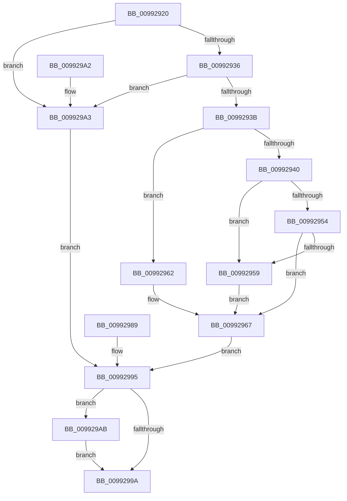

# PiCMCaptureEnumerateInputData

- RVA: `0x00992920`–`0x009929BA` (길이 `154` bytes)
- VA: `0x0000000140992920`
- 실행 섹션: `PAGE`
- PDB 이름 있음: `예`; PDB Function 태그: `아니요`
- unwind 정보 RVA: `0x00098E20`
- 디코드: `46`개 명령, `154/154` bytes 표시
- 미해석 바이트: `0` (있으면 어셈블리에 `.byte`로 보존)

> 이 문서는 커널 이미지의 기계어와 PDB 기호를 분석해 생성했습니다. 4번과 5번은 함수 원형과 자료형을 바이너리 사용 방식에서 추정한 C 해석이며 원본 소스 복구 결과는 아닙니다.

## 1. Dependencies

- 직접 호출 지점: **1**; 고유 호출 대상: **1**
- 직접 호출자로 확인된 함수: **1**
- RIP 상대 이미지 참조: **0**

### Outgoing calls
- `0x00992962` → [ExRaiseDatatypeMisalignment](../89/ExRaiseDatatypeMisalignment_function_00899FD0.md) (function, `0x00899FD0`)

### Direct callers
- [PiCMEnumerateSubKeys](PiCMEnumerateSubKeys_function_009926E8.md) at `0x00992730`

### Static image references
- 디코드된 RIP-relative 메모리 참조가 없습니다.

## 2. Other-region calls and transfers

- 다른 실행 섹션으로 향하는 call: **0**
- 별도 외부 분기/꼬리 이동을 확인하지 못했습니다.

## 3. Assembly (complete function range)

```asm
00992920  4C 89 4C 24 20                  mov qword ptr [rsp + 0x20], r9
00992925  48 83 EC 38                     sub rsp, 0x38
00992929  45 33 C0                        xor r8d, r8d
0099292C  44 89 44 24 20                  mov dword ptr [rsp + 0x20], r8d
00992931  48 85 C9                        test rcx, rcx
00992934  74 6D                           je 0x1409929a3
00992936  83 FA 14                        cmp edx, 0x14
00992939  72 68                           jb 0x1409929a3
0099293B  F6 C1 03                        test cl, 3
0099293E  75 22                           jne 0x140992962
00992940  8B D2                           mov edx, edx
00992942  48 03 D1                        add rdx, rcx
00992945  48 B8 00 00 FF FF FF 7F 00 00   movabs rax, 0x7fffffff0000
0099294F  48 3B D0                        cmp rdx, rax
00992952  77 05                           ja 0x140992959
00992954  48 3B D1                        cmp rdx, rcx
00992957  73 0E                           jae 0x140992967
00992959  8A 00                           mov al, byte ptr [rax]
0099295B  44 8B 44 24 20                  mov r8d, dword ptr [rsp + 0x20]
00992960  EB 05                           jmp 0x140992967
00992962  E8 69 76 F0 FF                  call 0x140899fd0
00992967  0F 10 01                        movups xmm0, xmmword ptr [rcx]
0099296A  41 0F 11 01                     movups xmmword ptr [r9], xmm0
0099296E  8B 41 10                        mov eax, dword ptr [rcx + 0x10]
00992971  41 89 41 10                     mov dword ptr [r9 + 0x10], eax
00992975  B8 0D 00 00 C0                  mov eax, 0xc000000d
0099297A  41 83 39 14                     cmp dword ptr [r9], 0x14
0099297E  44 0F 45 C0                     cmovne r8d, eax
00992982  44 89 44 24 20                  mov dword ptr [rsp + 0x20], r8d
00992987  EB 0C                           jmp 0x140992995
00992989  44 8B C0                        mov r8d, eax
0099298C  89 44 24 20                     mov dword ptr [rsp + 0x20], eax
00992990  4C 8B 4C 24 58                  mov r9, qword ptr [rsp + 0x58]
00992995  45 85 C0                        test r8d, r8d
00992998  78 11                           js 0x1409929ab
0099299A  41 8B C0                        mov eax, r8d
0099299D  48 83 C4 38                     add rsp, 0x38
009929A1  C3                              ret
009929A2  CC                              int3
009929A3  41 B8 0D 00 00 C0               mov r8d, 0xc000000d
009929A9  EB EA                           jmp 0x140992995
009929AB  0F 57 C0                        xorps xmm0, xmm0
009929AE  33 C0                           xor eax, eax
009929B0  41 0F 11 01                     movups xmmword ptr [r9], xmm0
009929B4  41 89 41 10                     mov dword ptr [r9 + 0x10], eax
009929B8  EB E0                           jmp 0x14099299a
```

## 4. C-style interpretation (structured pseudocode)

```c
__int64 __fastcall PiCMCaptureEnumerateInputData(__int64 a1, int a2, int a3, __int64 a4)
{
    __int64 result;
    __int64 v_rsp;
    unsigned int v_stack_m18;
    unsigned __int64 v_stack_p20;

    v_stack_p20 = a4;
    v_rsp = (v_rsp) - (56);
    a3 = 0;
    v_stack_m18 = 0;
    if (a1 == 0) goto loc_009929A3;
    if (a2 < 20) goto loc_009929A3;
    if ((((unsigned __int8)(a1)) & (3)) != 0) goto loc_00992962;
    a2 = ((unsigned int)(a2)) + (a1);
    if (a2 > result) goto loc_00992959;
    if (a2 >= a1) goto loc_00992967;
loc_00992959:
    goto loc_00992967;
loc_00992962:
    result = ExRaiseDatatypeMisalignment(a1, a2, (unsigned int)(v_stack_m18), a4);
loc_00992967:
    *(unsigned __int64 *)(a4) = v_xmm0;
    *(unsigned int *)(a4 + 16) = (unsigned int)((unsigned int)(*(unsigned int *)(a1 + 16)));
    a3 = (unsigned int)(v_stack_m18);
    if ((*(unsigned int *)(a4)) != 20) { a3 = (unsigned int)((unsigned int)(0xC000000DULL)); }
    v_stack_m18 = a3;
    goto loc_00992995;
loc_00992995:
    if (sign_flag) goto loc_009929AB;
loc_0099299A:
    v_rsp = (v_rsp) + (56);
    return (unsigned int)(a3);
loc_009929A3:
    goto loc_00992995;
loc_009929AB:
    result = 0;
    *(unsigned __int64 *)(a4) = v_xmm0;
    *(unsigned int *)(a4 + 16) = 0;
    goto loc_0099299A;
}
```

## 5. (Beta) C Style

```c
int64_t PiCMCaptureEnumerateInputData(int64_t Arg1, int32_t Arg2, int32_t Arg3, int64_t Arg4)
{
    int64_t result;
    int64_t local_rsp;
    uint32_t v_stack_m18;
    uint64_t v_stack_p20;

    v_stack_p20 = Arg4;
    local_rsp = (local_rsp) - (56);
    Arg3 = 0;
    v_stack_m18 = 0;
    if (Arg1 == 0) goto loc_009929A3;
    if (Arg2 < 20) goto loc_009929A3;
    if ((((uint8_t)(Arg1)) & (3)) != 0) goto loc_00992962;
    Arg2 = ((uint32_t)(Arg2)) + (Arg1);
    if (Arg2 > result) goto loc_00992959;
    if (Arg2 >= Arg1) goto loc_00992967;
loc_00992959:
    goto loc_00992967;
loc_00992962:
    result = ExRaiseDatatypeMisalignment(Arg1, Arg2, (uint32_t)(v_stack_m18), Arg4);
loc_00992967:
    *(uint64_t *)(Arg4) = v_xmm0;
    *(uint32_t *)(Arg4 + 0x10) = (uint32_t)((uint32_t)(*(uint32_t *)(Arg1 + 0x10)));
    Arg3 = (uint32_t)(v_stack_m18);
    if ((*(uint32_t *)(Arg4)) != 20) { Arg3 = (uint32_t)((uint32_t)(0xC000000DULL)); }
    v_stack_m18 = Arg3;
    goto loc_00992995;
loc_00992995:
    if (sign_flag) goto loc_009929AB;
loc_0099299A:
    local_rsp = (local_rsp) + (56);
    return (uint32_t)(Arg3);
loc_009929A3:
    goto loc_00992995;
loc_009929AB:
    result = 0;
    *(uint64_t *)(Arg4) = v_xmm0;
    *(uint32_t *)(Arg4 + 0x10) = 0;
    goto loc_0099299A;
}
```

## 6. Execution-region graph

[열기: 2D/3D 그래프와 함수 탐색 컨트롤 패널](../../../control-panel.html?section=page&rva=0x00992920&view=graph)

- 2D 그래프는 위에서 아래로 흐르고, 3D 그래프는 빈 공간을 드래그해 회전합니다. Shift+드래그는 이동, 휠은 확대·축소, 함수 노드 선택은 대상 보고서 이동입니다.

### Static fallback


