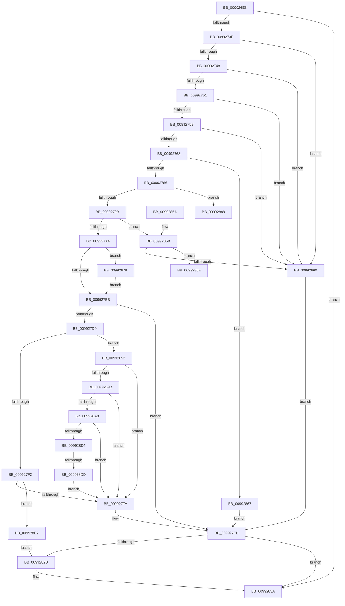

# PiCMEnumerateSubKeys

- RVA: `0x009926E8`–`0x00992919` (길이 `561` bytes)
- VA: `0x00000001409926E8`
- 실행 섹션: `PAGE`
- PDB 이름 있음: `예`; PDB Function 태그: `예`
- unwind 정보 RVA: `0x00098DF0`
- 디코드: `147`개 명령, `561/561` bytes 표시
- 미해석 바이트: `0` (있으면 어셈블리에 `.byte`로 보존)

> 이 문서는 커널 이미지의 기계어와 PDB 기호를 분석해 생성했습니다. 4번과 5번은 함수 원형과 자료형을 바이너리 사용 방식에서 추정한 C 해석이며 원본 소스 복구 결과는 아닙니다.

## 1. Dependencies

- 직접 호출 지점: **9**; 고유 호출 대상: **8**
- 직접 호출자로 확인된 함수: **1**
- RIP 상대 이미지 참조: **1**

### Outgoing calls
- `0x00992730` → [PiCMCaptureEnumerateInputData](PiCMCaptureEnumerateInputData_function_00992920.md) (function, `0x00992920`)
- `0x00992775` → [ExAllocatePool2](../../poolcode/B8/ExAllocatePool2_function_00B820F0.md) (function, `0x00B820F0`)
- `0x009927C5` → [_PnpCtxGetCachedNodeBaseKey](../8E/_PnpCtxGetCachedNodeBaseKey_function_008EF9C0.md) (function, `0x008EF9C0`)
- `0x009927E0` → [RegRtlEnumKey](RegRtlEnumKey_function_00992C00.md) (function, `0x00992C00`)
- `0x00992821` → [PiCMReturnBufferResultData](../8E/PiCMReturnBufferResultData_function_008ED6D0.md) (function, `0x008ED6D0`)
- `0x00992835` → [ExFreePoolWithTag](../../poolcode/B8/ExFreePoolWithTag_function_00B82870.md) (function, `0x00B82870`)
- `0x0099289B` → [CmIsStateSeparationEnabled](../../text/4A/CmIsStateSeparationEnabled_function_004A4754.md) (function, `0x004A4754`)
- `0x009928C5` → [PnpCtxRegQueryInfoKey](PnpCtxRegQueryInfoKey_function_009945FC.md) (function, `0x009945FC`)
- `0x0099290D` → [PiCMReturnBufferResultData](../8E/PiCMReturnBufferResultData_function_008ED6D0.md) (function, `0x008ED6D0`)

### Direct callers
- [PiCMHandleIoctl](../8E/PiCMHandleIoctl_function_008EB880.md) at `0x008EBFA6`

### Static image references
- `0x009927A4` → RVA `0x00E66398` (`.data`; read)

## 2. Other-region calls and transfers

- 다른 실행 섹션으로 향하는 call: **3**
  - `0x00992775` → [ExAllocatePool2](../../poolcode/B8/ExAllocatePool2_function_00B820F0.md) (`PAGE` → `POOLCODE`)
  - `0x00992835` → [ExFreePoolWithTag](../../poolcode/B8/ExFreePoolWithTag_function_00B82870.md) (`PAGE` → `POOLCODE`)
  - `0x0099289B` → [CmIsStateSeparationEnabled](../../text/4A/CmIsStateSeparationEnabled_function_004A4754.md) (`PAGE` → `.text`)
- call이 아닌 외부 분기/꼬리 이동: **3**
  - `0x00992873` → [sub_00B2BF4C](../B2/Unknown_function_00B2BF4C.md) (`tail-transfer`)
  - `0x0099288D` → [sub_00B2BF4C](../B2/Unknown_function_00B2BF4C.md) (`tail-transfer`)
  - `0x009928D7` → [sub_00B2BF4C + 0x16](../B2/Unknown_function_00B2BF4C.md) (`tail-transfer`)

## 3. Assembly (complete function range)

```asm
009926E8  48 8B C4                        mov rax, rsp
009926EB  48 89 58 08                     mov qword ptr [rax + 8], rbx
009926EF  48 89 70 10                     mov qword ptr [rax + 0x10], rsi
009926F3  48 89 78 18                     mov qword ptr [rax + 0x18], rdi
009926F7  4C 89 60 20                     mov qword ptr [rax + 0x20], r12
009926FB  55                              push rbp
009926FC  41 56                           push r14
009926FE  41 57                           push r15
00992700  48 8B EC                        mov rbp, rsp
00992703  48 83 EC 70                     sub rsp, 0x70
00992707  4C 8B 65 48                     mov r12, qword ptr [rbp + 0x48]
0099270B  33 C0                           xor eax, eax
0099270D  48 21 45 E0                     and qword ptr [rbp - 0x20], rax
00992711  45 8B F1                        mov r14d, r9d
00992714  21 45 48                        and dword ptr [rbp + 0x48], eax
00992717  4C 8D 4D E8                     lea r9, [rbp - 0x18]
0099271B  0F 57 C0                        xorps xmm0, xmm0
0099271E  89 45 F8                        mov dword ptr [rbp - 8], eax
00992721  41 21 04 24                     and dword ptr [r12], eax
00992725  4D 8B F8                        mov r15, r8
00992728  0F 11 45 E8                     movups xmmword ptr [rbp - 0x18], xmm0
0099272C  33 DB                           xor ebx, ebx
0099272E  33 FF                           xor edi, edi
00992730  E8 EB 01 00 00                  call 0x140992920
00992735  8B F0                           mov esi, eax
00992737  85 C0                           test eax, eax
00992739  0F 88 FB 00 00 00               js 0x14099283a
0099273F  39 5D EC                        cmp dword ptr [rbp - 0x14], ebx
00992742  0F 85 18 01 00 00               jne 0x140992860
00992748  4D 85 FF                        test r15, r15
0099274B  0F 84 0F 01 00 00               je 0x140992860
00992751  41 83 FE 14                     cmp r14d, 0x14
00992755  0F 82 05 01 00 00               jb 0x140992860
0099275B  41 8D 76 EC                     lea esi, [r14 - 0x14]
0099275F  83 FE 02                        cmp esi, 2
00992762  0F 82 F8 00 00 00               jb 0x140992860
00992768  8B D6                           mov edx, esi
0099276A  B9 00 01 00 00                  mov ecx, 0x100
0099276F  41 B8 50 6E 70 34               mov r8d, 0x34706e50
00992775  E8 76 F9 1E 00                  call 0x140b820f0
0099277A  48 8B F8                        mov rdi, rax
0099277D  48 85 C0                        test rax, rax
00992780  0F 84 E1 00 00 00               je 0x140992867
00992786  8B DE                           mov ebx, esi
00992788  8B 75 F0                        mov esi, dword ptr [rbp - 0x10]
0099278B  D1 EB                           shr ebx, 1
0099278D  8B CE                           mov ecx, esi
0099278F  89 5D 40                        mov dword ptr [rbp + 0x40], ebx
00992792  83 E9 01                        sub ecx, 1
00992795  0F 84 ED 00 00 00               je 0x140992888
0099279B  83 E9 01                        sub ecx, 1
0099279E  0F 85 B7 00 00 00               jne 0x14099285b
009927A4  48 8B 0D ED 3B 4D 00            mov rcx, qword ptr [rip + 0x4d3bed]
009927AB  48 8B 91 98 00 00 00            mov rdx, qword ptr [rcx + 0x98]
009927B2  48 85 D2                        test rdx, rdx
009927B5  0F 84 BD 00 00 00               je 0x140992878
009927BB  4C 8D 4D E0                     lea r9, [rbp - 0x20]
009927BF  41 B8 07 00 00 00               mov r8d, 7
009927C5  E8 F6 D1 F5 FF                  call 0x1408ef9c0
009927CA  8B C8                           mov ecx, eax
009927CC  85 C0                           test eax, eax
009927CE  78 2D                           js 0x1409927fd
009927D0  8B 5D F4                        mov ebx, dword ptr [rbp - 0xc]
009927D3  4C 8D 4D 40                     lea r9, [rbp + 0x40]
009927D7  48 8B 4D E0                     mov rcx, qword ptr [rbp - 0x20]
009927DB  8B D3                           mov edx, ebx
009927DD  4C 8B C7                        mov r8, rdi
009927E0  E8 1B 04 00 00                  call 0x140992c00
009927E5  8B C8                           mov ecx, eax
009927E7  3D 1A 00 00 80                  cmp eax, 0x8000001a
009927EC  0F 84 A0 00 00 00               je 0x140992892
009927F2  85 C9                           test ecx, ecx
009927F4  0F 89 ED 00 00 00               jns 0x1409928e7
009927FA  8B 5D 40                        mov ebx, dword ptr [rbp + 0x40]
009927FD  8B 45 F8                        mov eax, dword ptr [rbp - 8]
00992800  8D 14 1B                        lea edx, [rbx + rbx]
00992803  4C 89 64 24 40                  mov qword ptr [rsp + 0x40], r12
00992808  45 33 C9                        xor r9d, r9d
0099280B  44 89 74 24 38                  mov dword ptr [rsp + 0x38], r14d
00992810  45 33 C0                        xor r8d, r8d
00992813  4C 89 7C 24 30                  mov qword ptr [rsp + 0x30], r15
00992818  89 44 24 28                     mov dword ptr [rsp + 0x28], eax
0099281C  83 64 24 20 00                  and dword ptr [rsp + 0x20], 0
00992821  E8 AA AE F5 FF                  call 0x1408ed6d0
00992826  8B F0                           mov esi, eax
00992828  48 85 FF                        test rdi, rdi
0099282B  74 0D                           je 0x14099283a
0099282D  BA 50 6E 70 34                  mov edx, 0x34706e50
00992832  48 8B CF                        mov rcx, rdi
00992835  E8 36 00 1F 00                  call 0x140b82870
0099283A  4C 8D 5C 24 70                  lea r11, [rsp + 0x70]
0099283F  8B C6                           mov eax, esi
00992841  49 8B 5B 20                     mov rbx, qword ptr [r11 + 0x20]
00992845  49 8B 73 28                     mov rsi, qword ptr [r11 + 0x28]
00992849  49 8B 7B 30                     mov rdi, qword ptr [r11 + 0x30]
0099284D  4D 8B 63 38                     mov r12, qword ptr [r11 + 0x38]
00992851  49 8B E3                        mov rsp, r11
00992854  41 5F                           pop r15
00992856  41 5E                           pop r14
00992858  5D                              pop rbp
00992859  C3                              ret
0099285A  CC                              int3
0099285B  83 F9 01                        cmp ecx, 1
0099285E  74 0E                           je 0x14099286e
00992860  B9 0D 00 00 C0                  mov ecx, 0xc000000d
00992865  EB 96                           jmp 0x1409927fd
00992867  B9 9A 00 00 C0                  mov ecx, 0xc000009a
0099286C  EB 8F                           jmp 0x1409927fd
0099286E  BA 08 00 00 00                  mov edx, 8
00992873  E9 D4 96 19 00                  jmp 0x140b2bf4c
00992878  48 8B 51 58                     mov rdx, qword ptr [rcx + 0x58]
0099287C  48 89 91 98 00 00 00            mov qword ptr [rcx + 0x98], rdx
00992883  E9 33 FF FF FF                  jmp 0x1409927bb
00992888  BA 05 00 00 00                  mov edx, 5
0099288D  E9 BA 96 19 00                  jmp 0x140b2bf4c
00992892  83 FE 03                        cmp esi, 3
00992895  0F 85 5F FF FF FF               jne 0x1409927fa
0099289B  E8 B4 1E B1 FF                  call 0x1404a4754
009928A0  84 C0                           test al, al
009928A2  0F 84 52 FF FF FF               je 0x1409927fa
009928A8  48 83 64 24 30 00               and qword ptr [rsp + 0x30], 0
009928AE  4C 8D 45 48                     lea r8, [rbp + 0x48]
009928B2  48 83 64 24 28 00               and qword ptr [rsp + 0x28], 0
009928B8  45 33 C9                        xor r9d, r9d
009928BB  48 8B 55 E0                     mov rdx, qword ptr [rbp - 0x20]
009928BF  48 83 64 24 20 00               and qword ptr [rsp + 0x20], 0
009928C5  E8 32 1D 00 00                  call 0x1409945fc
009928CA  8B C8                           mov ecx, eax
009928CC  85 C0                           test eax, eax
009928CE  0F 88 26 FF FF FF               js 0x1409927fa
009928D4  3B 5D 48                        cmp ebx, dword ptr [rbp + 0x48]
009928D7  0F 83 85 96 19 00               jae 0x140b2bf62
009928DD  B9 E5 00 00 C0                  mov ecx, 0xc00000e5
009928E2  E9 13 FF FF FF                  jmp 0x1409927fa
009928E7  8B 45 40                        mov eax, dword ptr [rbp + 0x40]
009928EA  4C 8B CF                        mov r9, rdi
009928ED  4C 89 64 24 40                  mov qword ptr [rsp + 0x40], r12
009928F2  45 33 C0                        xor r8d, r8d
009928F5  44 89 74 24 38                  mov dword ptr [rsp + 0x38], r14d
009928FA  4C 89 7C 24 30                  mov qword ptr [rsp + 0x30], r15
009928FF  8D 14 00                        lea edx, [rax + rax]
00992902  8B 45 F8                        mov eax, dword ptr [rbp - 8]
00992905  89 44 24 28                     mov dword ptr [rsp + 0x28], eax
00992909  89 54 24 20                     mov dword ptr [rsp + 0x20], edx
0099290D  E8 BE AD F5 FF                  call 0x1408ed6d0
00992912  8B F0                           mov esi, eax
00992914  E9 14 FF FF FF                  jmp 0x14099282d
```

## 4. C-style interpretation (structured pseudocode)

```c
__int64 __fastcall PiCMEnumerateSubKeys(__int64 a1, __int64 a2, __int64 a3, int a4, unsigned int a5, unsigned int a6)
{
    __int64 result;
    __int64 v_rbx;
    __int64 v_rdi;
    __int64 v_rsp;
    unsigned __int64 v_stack_m18;
    unsigned int v_stack_m20;
    unsigned int v_stack_m24;
    unsigned int v_stack_m28;
    unsigned int v_stack_m2C;
    unsigned __int64 v_stack_m30;
    unsigned __int64 v_stack_m38;
    unsigned __int64 v_stack_m40;
    unsigned __int64 v_stack_m48;
    unsigned int v_stack_m50;
    unsigned __int64 v_stack_m58;
    unsigned int v_stack_m60;
    unsigned int v_stack_m68;
    unsigned int v_stack_p28;

    *(unsigned __int64 *)(v_rsp + 8) = v_rbx;
    *(unsigned __int64 *)(v_rsp + 16) = v_rsi;
    *(unsigned __int64 *)(v_rsp + 24) = v_rdi;
    *(unsigned __int64 *)(v_rsp + 32) = v_r12;
    v_rsp = (v_rsp) - (112);
    result = 0;
    v_stack_m20 = 0;
    v_stack_m30 = v_xmm0;
    v_rbx = 0;
    v_rdi = 0;
    result = PiCMCaptureEnumerateInputData(a1, a2, a3, v_stack_m30);
    if (sign_flag) goto loc_0099283A;
    if (v_stack_m2C != 0) goto loc_00992860;
    if (a3 == 0) goto loc_00992860;
    if (((unsigned int)((unsigned int)(a4))) < 20) goto loc_00992860;
    if (((unsigned int)((unsigned int)(a4) - 20)) < 2) goto loc_00992860;
    result = ExAllocatePool2(256, (unsigned int)((unsigned int)((unsigned int)(a4) - 20)), (unsigned int)(0x34706E50ULL), v_stack_m30);
    if (result == 0) goto loc_00992867;
    v_rbx = (unsigned int)(((unsigned int)((unsigned int)((unsigned int)(a4) - 20))) >> (1));
    v_stack_p28 = (unsigned int)(v_rbx);
    a1 = (unsigned int)(((unsigned int)((unsigned int)((unsigned int)(v_stack_m28)))) - (1));
    if (condition_is_equal) goto loc_00992888;
    a1 = (unsigned int)((a1) - (1));
    if (condition_is_not_equal) goto loc_0099285B;
    if (*(unsigned __int64 *)(*(unsigned __int64 *)(v_rip + 5061613) + 152) == 0) goto loc_00992878;
loc_009927BB:
    result = _PnpCtxGetCachedNodeBaseKey(*(unsigned __int64 *)(v_rip + 5061613), *(unsigned __int64 *)(*(unsigned __int64 *)(v_rip + 5061613) + 152), 7, v_stack_m38);
    if (sign_flag) goto loc_009927FD;
    result = RegRtlEnumKey(v_stack_m38, (unsigned int)((unsigned int)((unsigned int)(v_stack_m24))), result, a5);
    if (((unsigned int)(result)) == 0x8000001AULL) goto loc_00992892;
    if (!sign_flag) goto loc_009928E7;
loc_009927FA:
loc_009927FD:
    v_stack_m48 = a6;
    a4 = 0;
    v_stack_m50 = (unsigned int)((unsigned int)(a4));
    a3 = 0;
    v_stack_m58 = 0;
    v_stack_m60 = (unsigned int)((unsigned int)(v_stack_m20));
    result = PiCMReturnBufferResultData((unsigned int)((unsigned int)(result)), (unsigned int)(a5) + (unsigned int)(a5) * 1, a3, a4);
    if (result != 0) {
        a2 = 0x34706E50ULL;
        a1 = result;
        result = ExFreePoolWithTag(a1, a2, a3, a4);
    }
    return (unsigned int)((unsigned int)((unsigned int)((unsigned int)(result))));
loc_0099285B:
    if (((unsigned int)(a1)) == 1) goto loc_0099286E;
loc_00992860:
    goto loc_009927FD;
loc_00992867:
    goto loc_009927FD;
loc_0099286E:
loc_00992878:
    *(unsigned __int64 *)((unsigned int)(0xC000009AULL) + 152) = *(unsigned __int64 *)((unsigned int)(0xC000009AULL) + 88);
    goto loc_009927BB;
loc_00992888:
loc_00992892:
    if (((unsigned int)(*(unsigned __int64 *)(v_stack_m18 + 40))) != 3) goto loc_009927FA;
    result = CmIsStateSeparationEnabled((unsigned int)(0xC000009AULL), 5, a3, a4);
    if ((unsigned __int8)(result) == 0) goto loc_009927FA;
    a4 = 0;
    result = PnpCtxRegQueryInfoKey((unsigned int)(0xC000009AULL), v_stack_m38, a6, a4);
    if (sign_flag) goto loc_009927FA;
    goto loc_009927FA;
loc_009928E7:
    v_stack_m30 = *(unsigned __int64 *)(v_stack_m18 + 56);
    a3 = 0;
    v_stack_m38 = (unsigned int)((unsigned int)(a4));
    v_stack_m40 = 0;
    v_stack_m48 = (unsigned int)((unsigned int)(v_stack_m20));
    v_stack_m50 = (unsigned int)((unsigned int)(a5) + (unsigned int)(a5) * 1);
    result = PiCMReturnBufferResultData((unsigned int)(0xC00000E5ULL), (unsigned int)(a5) + (unsigned int)(a5) * 1, a3, *(unsigned __int64 *)(v_stack_m18 + 48));
    goto loc_0099282D;
}
```

## 5. (Beta) C Style

```c
int64_t PiCMEnumerateSubKeys(int64_t Arg1, int64_t Arg2, int64_t Arg3, int32_t Arg4, void *Arg5, void *Arg6)
{
    uint8_t *arg5 = (uint8_t *)Arg5;
    uint8_t *arg6 = (uint8_t *)Arg6;

    int64_t result;
    int64_t local_rbx;
    int64_t local_rdi;
    int64_t local_rsp;
    uint64_t v_stack_m18;
    uint32_t v_stack_m20;
    uint32_t v_stack_m24;
    uint32_t v_stack_m28;
    uint32_t v_stack_m2C;
    uint64_t v_stack_m30;
    uint64_t v_stack_m38;
    uint64_t v_stack_m40;
    uint64_t v_stack_m48;
    uint32_t v_stack_m50;
    uint64_t v_stack_m58;
    uint32_t v_stack_m60;
    uint32_t v_stack_m68;
    uint32_t v_stack_p28;

    *(uint64_t *)(local_rsp + 0x8) = local_rbx;
    *(uint64_t *)(local_rsp + 0x10) = local_rsi;
    *(uint64_t *)(local_rsp + 0x18) = local_rdi;
    *(uint64_t *)(local_rsp + 0x20) = local_r12;
    local_rsp = (local_rsp) - (112);
    result = 0;
    v_stack_m20 = 0;
    v_stack_m30 = v_xmm0;
    local_rbx = 0;
    local_rdi = 0;
    result = PiCMCaptureEnumerateInputData(Arg1, Arg2, Arg3, v_stack_m30);
    if (sign_flag) goto loc_0099283A;
    if (v_stack_m2C != 0) goto loc_00992860;
    if (Arg3 == 0) goto loc_00992860;
    if (((uint32_t)((uint32_t)(Arg4))) < 20) goto loc_00992860;
    if (((uint32_t)((uint32_t)(Arg4) - 20)) < 2) goto loc_00992860;
    result = ExAllocatePool2(256, (uint32_t)((uint32_t)((uint32_t)(Arg4) - 20)), (uint32_t)(0x34706E50ULL), v_stack_m30);
    if (result == 0) goto loc_00992867;
    local_rbx = (uint32_t)(((uint32_t)((uint32_t)((uint32_t)(Arg4) - 20))) >> (1));
    v_stack_p28 = (uint32_t)(local_rbx);
    Arg1 = (uint32_t)(((uint32_t)((uint32_t)((uint32_t)(v_stack_m28)))) - (1));
    if (condition_is_equal) goto loc_00992888;
    Arg1 = (uint32_t)((Arg1) - (1));
    if (condition_is_not_equal) goto loc_0099285B;
    if (*(uint64_t *)(*(uint64_t *)(v_rip + 0x4D3BED) + 0x98) == 0) goto loc_00992878;
loc_009927BB:
    result = _PnpCtxGetCachedNodeBaseKey(*(uint64_t *)(v_rip + 0x4D3BED), *(uint64_t *)(*(uint64_t *)(v_rip + 0x4D3BED) + 0x98), 7, v_stack_m38);
    if (sign_flag) goto loc_009927FD;
    result = RegRtlEnumKey(v_stack_m38, (uint32_t)((uint32_t)((uint32_t)(v_stack_m24))), result, Arg5);
    if (((uint32_t)(result)) == 0x8000001AULL) goto loc_00992892;
    if (!sign_flag) goto loc_009928E7;
loc_009927FA:
loc_009927FD:
    v_stack_m48 = Arg6;
    Arg4 = 0;
    v_stack_m50 = (uint32_t)((uint32_t)(Arg4));
    Arg3 = 0;
    v_stack_m58 = 0;
    v_stack_m60 = (uint32_t)((uint32_t)(v_stack_m20));
    result = PiCMReturnBufferResultData((uint32_t)((uint32_t)(result)), (uint32_t)(Arg5) + (uint32_t)(Arg5) * 1, Arg3, Arg4);
    if (result != 0) {
        Arg2 = 0x34706E50ULL;
        Arg1 = result;
        result = ExFreePoolWithTag(Arg1, Arg2, Arg3, Arg4);
    }
    return (uint32_t)((uint32_t)((uint32_t)((uint32_t)(result))));
loc_0099285B:
    if (((uint32_t)(Arg1)) == 1) goto loc_0099286E;
loc_00992860:
    goto loc_009927FD;
loc_00992867:
    goto loc_009927FD;
loc_0099286E:
loc_00992878:
    *(uint64_t *)((uint32_t)(0xC000009AULL) + 0x98) = *(uint64_t *)((uint32_t)(0xC000009AULL) + 0x58);
    goto loc_009927BB;
loc_00992888:
loc_00992892:
    if (((uint32_t)(*(uint64_t *)(v_stack_m18 + 0x28))) != 3) goto loc_009927FA;
    result = CmIsStateSeparationEnabled((uint32_t)(0xC000009AULL), 5, Arg3, Arg4);
    if ((uint8_t)(result) == 0) goto loc_009927FA;
    Arg4 = 0;
    result = PnpCtxRegQueryInfoKey((uint32_t)(0xC000009AULL), v_stack_m38, Arg6, Arg4);
    if (sign_flag) goto loc_009927FA;
    goto loc_009927FA;
loc_009928E7:
    v_stack_m30 = *(uint64_t *)(v_stack_m18 + 0x38);
    Arg3 = 0;
    v_stack_m38 = (uint32_t)((uint32_t)(Arg4));
    v_stack_m40 = 0;
    v_stack_m48 = (uint32_t)((uint32_t)(v_stack_m20));
    v_stack_m50 = (uint32_t)((uint32_t)(Arg5) + (uint32_t)(Arg5) * 1);
    result = PiCMReturnBufferResultData((uint32_t)(0xC00000E5ULL), (uint32_t)(Arg5) + (uint32_t)(Arg5) * 1, Arg3, *(uint64_t *)(v_stack_m18 + 0x30));
    goto loc_0099282D;
}
```

### 관측된 메모리 오프셋

구조체 형식이 확인되지 않은 접근은 인자 기준의 오프셋으로만 기록했습니다.

| 기준 인자 | 오프셋 표현 | 폭 (bit) | 접근 |
|---|---:|---:|---|
| `Arg5` | `+ 0x0 + rax*1` | `32` | `R` |
| `Arg6` | `+ 0x0` | `32` | `R/W` |

## 6. Execution-region graph

[열기: 2D/3D 그래프와 함수 탐색 컨트롤 패널](../../../control-panel.html?section=page&rva=0x009926E8&view=graph)

- 2D 그래프는 위에서 아래로 흐르고, 3D 그래프는 빈 공간을 드래그해 회전합니다. Shift+드래그는 이동, 휠은 확대·축소, 함수 노드 선택은 대상 보고서 이동입니다.

### Static fallback


