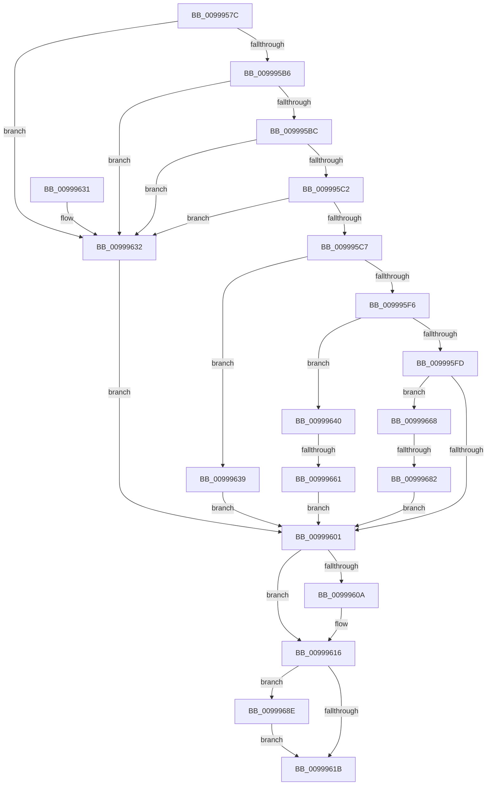

# PiCreateDriverRedirectedStateKey

- RVA: `0x0099957C`–`0x00999698` (길이 `284` bytes)
- VA: `0x000000014099957C`
- 실행 섹션: `PAGE`
- PDB 이름 있음: `예`; PDB Function 태그: `예`
- unwind 정보 RVA: `0x000994C8`
- 디코드: `88`개 명령, `284/284` bytes 표시
- 미해석 바이트: `0` (있으면 어셈블리에 `.byte`로 보존)

> 이 문서는 커널 이미지의 기계어와 PDB 기호를 분석해 생성했습니다. 4번과 5번은 함수 원형과 자료형을 바이너리 사용 방식에서 추정한 C 해석이며 원본 소스 복구 결과는 아닙니다.

## 1. Dependencies

- 직접 호출 지점: **6**; 고유 호출 대상: **6**
- 직접 호출자로 확인된 함수: **2**
- RIP 상대 이미지 참조: **1**

### Outgoing calls
- `0x009995AC` → [RtlInitUnicodeString](../../text/42/RtlInitUnicodeString_function_0042A780.md) (function, `0x0042A780`)
- `0x009995EB` → [RtlGetPersistedStateLocation](../8C/RtlGetPersistedStateLocation_function_008C8DE0.md) (function, `0x008C8DE0`)
- `0x0099960A` → [ExFreePool](../../poolcode/B8/ExFreePool_function_00B82850.md) (function, `0x00B82850`)
- `0x00999650` → [ExAllocatePool2](../../poolcode/B8/ExAllocatePool2_function_00B820F0.md) (function, `0x00B820F0`)
- `0x00999673` → [PiCreateServiceKeyUnderPath](../72/PiCreateServiceKeyUnderPath_function_00728DEC.md) (function, `0x00728DEC`)
- `0x00999691` → [ZwClose](../../text/6A/ZwClose_function_006AD2B0.md) (function, `0x006AD2B0`)

### Direct callers
- [PiCreateServiceStateKey](PiCreateServiceStateKey_function_009993E0.md) at `0x00999435`
- [IopInitializeBootDrivers](../../init/C2/IopInitializeBootDrivers_function_00C2E6F4.md) at `0x00C2F144`

### Static image references
- `0x009995D3` → RVA `0x00AFD690` (` ?? ::NNGAKEGL::`string'`; read)

## 2. Other-region calls and transfers

- 다른 실행 섹션으로 향하는 call: **4**
  - `0x009995AC` → [RtlInitUnicodeString](../../text/42/RtlInitUnicodeString_function_0042A780.md) (`PAGE` → `.text`)
  - `0x0099960A` → [ExFreePool](../../poolcode/B8/ExFreePool_function_00B82850.md) (`PAGE` → `POOLCODE`)
  - `0x00999650` → [ExAllocatePool2](../../poolcode/B8/ExAllocatePool2_function_00B820F0.md) (`PAGE` → `POOLCODE`)
  - `0x00999691` → [ZwClose](../../text/6A/ZwClose_function_006AD2B0.md) (`PAGE` → `.text`)
- call이 아닌 외부 분기/꼬리 이동: **2**
  - `0x0099965B` → [sub_00B2CD8C](../B2/Unknown_function_00B2CD8C.md) (`tail-transfer`)
  - `0x0099967C` → [sub_00B2CD8C + 0x60](../B2/Unknown_function_00B2CD8C.md) (`tail-transfer`)

## 3. Assembly (complete function range)

```asm
0099957C  48 89 5C 24 18                  mov qword ptr [rsp + 0x18], rbx
00999581  89 54 24 10                     mov dword ptr [rsp + 0x10], edx
00999585  55                              push rbp
00999586  56                              push rsi
00999587  57                              push rdi
00999588  41 56                           push r14
0099958A  41 57                           push r15
0099958C  48 8B EC                        mov rbp, rsp
0099958F  48 83 EC 50                     sub rsp, 0x50
00999593  48 8B F1                        mov rsi, rcx
00999596  0F 57 C0                        xorps xmm0, xmm0
00999599  33 FF                           xor edi, edi
0099959B  48 8D 4D F0                     lea rcx, [rbp - 0x10]
0099959F  33 D2                           xor edx, edx
009995A1  48 89 7D 30                     mov qword ptr [rbp + 0x30], rdi
009995A5  0F 11 45 F0                     movups xmmword ptr [rbp - 0x10], xmm0
009995A9  4D 8B F8                        mov r15, r8
009995AC  E8 CF 11 A9 FF                  call 0x14042a780
009995B1  48 85 F6                        test rsi, rsi
009995B4  74 7C                           je 0x140999632
009995B6  48 39 7E 08                     cmp qword ptr [rsi + 8], rdi
009995BA  74 76                           je 0x140999632
009995BC  66 83 3E 02                     cmp word ptr [rsi], 2
009995C0  72 70                           jb 0x140999632
009995C2  4D 85 FF                        test r15, r15
009995C5  74 6B                           je 0x140999632
009995C7  21 7D 38                        and dword ptr [rbp + 0x38], edi
009995CA  48 8D 45 38                     lea rax, [rbp + 0x38]
009995CE  48 89 44 24 30                  mov qword ptr [rsp + 0x30], rax
009995D3  48 8D 0D B6 40 16 00            lea rcx, [rip + 0x1640b6]
009995DA  21 7C 24 28                     and dword ptr [rsp + 0x28], edi
009995DE  45 33 C9                        xor r9d, r9d
009995E1  48 21 7C 24 20                  and qword ptr [rsp + 0x20], rdi
009995E6  45 33 C0                        xor r8d, r8d
009995E9  33 D2                           xor edx, edx
009995EB  E8 F0 F7 F2 FF                  call 0x1408c8de0
009995F0  8B D8                           mov ebx, eax
009995F2  85 C0                           test eax, eax
009995F4  79 43                           jns 0x140999639
009995F6  3D 05 00 00 80                  cmp eax, 0x80000005
009995FB  74 43                           je 0x140999640
009995FD  85 DB                           test ebx, ebx
009995FF  79 67                           jns 0x140999668
00999601  48 8B 4D F8                     mov rcx, qword ptr [rbp - 8]
00999605  48 85 C9                        test rcx, rcx
00999608  74 0C                           je 0x140999616
0099960A  E8 41 92 1E 00                  call 0x140b82850
0099960F  0F 57 C0                        xorps xmm0, xmm0
00999612  0F 11 45 F0                     movups xmmword ptr [rbp - 0x10], xmm0
00999616  48 85 FF                        test rdi, rdi
00999619  75 73                           jne 0x14099968e
0099961B  8B C3                           mov eax, ebx
0099961D  48 8B 9C 24 90 00 00 00         mov rbx, qword ptr [rsp + 0x90]
00999625  48 83 C4 50                     add rsp, 0x50
00999629  41 5F                           pop r15
0099962B  41 5E                           pop r14
0099962D  5F                              pop rdi
0099962E  5E                              pop rsi
0099962F  5D                              pop rbp
00999630  C3                              ret
00999631  CC                              int3
00999632  BB 0D 00 00 C0                  mov ebx, 0xc000000d
00999637  EB C8                           jmp 0x140999601
00999639  BB 01 00 00 C0                  mov ebx, 0xc0000001
0099963E  EB C1                           jmp 0x140999601
00999640  8B 5D 38                        mov ebx, dword ptr [rbp + 0x38]
00999643  B9 00 01 00 00                  mov ecx, 0x100
00999648  8B D3                           mov edx, ebx
0099964A  41 B8 50 70 69 6F               mov r8d, 0x6f697050
00999650  E8 9B 8A 1E 00                  call 0x140b820f0
00999655  4C 8B F0                        mov r14, rax
00999658  48 85 C0                        test rax, rax
0099965B  0F 85 2B 37 19 00               jne 0x140b2cd8c
00999661  BB 9A 00 00 C0                  mov ebx, 0xc000009a
00999666  EB 99                           jmp 0x140999601
00999668  4C 8D 4D 30                     lea r9, [rbp + 0x30]
0099966C  48 8B CE                        mov rcx, rsi
0099966F  48 8D 55 F0                     lea rdx, [rbp - 0x10]
00999673  E8 74 F7 D8 FF                  call 0x140728dec
00999678  8B D8                           mov ebx, eax
0099967A  85 C0                           test eax, eax
0099967C  0F 88 6A 37 19 00               js 0x140b2cdec
00999682  48 8B 4D 30                     mov rcx, qword ptr [rbp + 0x30]
00999686  49 89 0F                        mov qword ptr [r15], rcx
00999689  E9 73 FF FF FF                  jmp 0x140999601
0099968E  48 8B CF                        mov rcx, rdi
00999691  E8 1A 3C D1 FF                  call 0x1406ad2b0
00999696  EB 83                           jmp 0x14099961b
```

## 4. C-style interpretation (structured pseudocode)

```c
__int64 __fastcall PiCreateDriverRedirectedStateKey(__int64 a1, int a2, __int64 a3, int a4)
{
    __int64 result;
    __int64 v_rdi;
    __int64 v_rsp;
    unsigned __int64 v_stack_m30;
    unsigned __int64 v_stack_m38;
    unsigned __int64 v_stack_m48;
    unsigned int v_stack_m50;
    unsigned __int64 v_stack_m58;
    unsigned int v_stack_p10;
    unsigned __int64 v_stack_p18;
    unsigned __int64 v_stack_p8;

    v_stack_p18 = v_rbx;
    v_stack_p10 = a2;
    v_rsp = (v_rsp) - (80);
    v_rdi = 0;
    a2 = 0;
    v_stack_p8 = 0;
    v_stack_m38 = v_xmm0;
    result = RtlInitUnicodeString(v_stack_m38, a2, a3, a4);
    if (a1 == 0) goto loc_00999632;
    if ((*(unsigned __int64 *)(a1 + 8)) == 0) goto loc_00999632;
    if ((*(unsigned __int16 *)(a1)) < 2) goto loc_00999632;
    if (a3 == 0) goto loc_00999632;
    v_stack_m48 = v_stack_p10;
    a4 = 0;
    a3 = 0;
    a2 = 0;
    result = RtlGetPersistedStateLocation(v_rip + 1458358, a2, a3, a4);
    if (!sign_flag) goto loc_00999639;
    if (((unsigned int)(result)) == 0x80000005ULL) goto loc_00999640;
    if (!sign_flag) goto loc_00999668;
loc_00999601:
    if (v_stack_m30 != 0) {
        result = ExFreePool(v_stack_m30, a2, a3, a4);
        v_stack_m38 = v_xmm0;
    }
    if (0 != 0) goto loc_0099968E;
loc_0099961B:
    v_rsp = (v_rsp) + (80);
    return (unsigned int)((unsigned int)((unsigned int)((unsigned int)(result))));
loc_00999632:
    goto loc_00999601;
loc_00999639:
    goto loc_00999601;
loc_00999640:
    result = ExAllocatePool2(256, (unsigned int)((unsigned int)((unsigned int)(v_stack_p10))), (unsigned int)(0x6F697050ULL), a4);
    goto loc_00999601;
loc_00999668:
    result = PiCreateServiceKeyUnderPath(a1, v_stack_m38, (unsigned int)(0x6F697050ULL), v_stack_p8);
    *(unsigned __int64 *)(a3) = v_stack_p8;
    goto loc_00999601;
loc_0099968E:
    result = ZwClose(0, v_stack_m38, (unsigned int)(0x6F697050ULL), v_stack_p8);
    goto loc_0099961B;
}
```

## 5. (Beta) C Style

```c
int64_t PiCreateDriverRedirectedStateKey(int64_t Arg1, int32_t Arg2, int64_t Arg3, int32_t Arg4)
{
    int64_t result;
    int64_t local_rdi;
    int64_t local_rsp;
    uint64_t v_stack_m30;
    uint64_t v_stack_m38;
    uint64_t v_stack_m48;
    uint32_t v_stack_m50;
    uint64_t v_stack_m58;
    uint32_t v_stack_p10;
    uint64_t v_stack_p18;
    uint64_t v_stack_p8;

    v_stack_p18 = local_rbx;
    v_stack_p10 = Arg2;
    local_rsp = (local_rsp) - (80);
    local_rdi = 0;
    Arg2 = 0;
    v_stack_p8 = 0;
    v_stack_m38 = v_xmm0;
    result = RtlInitUnicodeString(v_stack_m38, Arg2, Arg3, Arg4);
    if (Arg1 == 0) goto loc_00999632;
    if ((*(uint64_t *)(Arg1 + 0x8)) == 0) goto loc_00999632;
    if ((*(uint16_t *)(Arg1)) < 2) goto loc_00999632;
    if (Arg3 == 0) goto loc_00999632;
    v_stack_m48 = v_stack_p10;
    Arg4 = 0;
    Arg3 = 0;
    Arg2 = 0;
    result = RtlGetPersistedStateLocation(v_rip + 1458358, Arg2, Arg3, Arg4);
    if (!sign_flag) goto loc_00999639;
    if (((uint32_t)(result)) == 0x80000005ULL) goto loc_00999640;
    if (!sign_flag) goto loc_00999668;
loc_00999601:
    if (v_stack_m30 != 0) {
        result = ExFreePool(v_stack_m30, Arg2, Arg3, Arg4);
        v_stack_m38 = v_xmm0;
    }
    if (0 != 0) goto loc_0099968E;
loc_0099961B:
    local_rsp = (local_rsp) + (80);
    return (uint32_t)((uint32_t)((uint32_t)((uint32_t)(result))));
loc_00999632:
    goto loc_00999601;
loc_00999639:
    goto loc_00999601;
loc_00999640:
    result = ExAllocatePool2(256, (uint32_t)((uint32_t)((uint32_t)(v_stack_p10))), (uint32_t)(0x6F697050ULL), Arg4);
    goto loc_00999601;
loc_00999668:
    result = PiCreateServiceKeyUnderPath(Arg1, v_stack_m38, (uint32_t)(0x6F697050ULL), v_stack_p8);
    *(uint64_t *)(Arg3) = v_stack_p8;
    goto loc_00999601;
loc_0099968E:
    result = ZwClose(0, v_stack_m38, (uint32_t)(0x6F697050ULL), v_stack_p8);
    goto loc_0099961B;
}
```

## 6. Execution-region graph

[열기: 2D/3D 그래프와 함수 탐색 컨트롤 패널](../../../control-panel.html?section=page&rva=0x0099957C&view=graph)

- 2D 그래프는 위에서 아래로 흐르고, 3D 그래프는 빈 공간을 드래그해 회전합니다. Shift+드래그는 이동, 휠은 확대·축소, 함수 노드 선택은 대상 보고서 이동입니다.

### Static fallback


