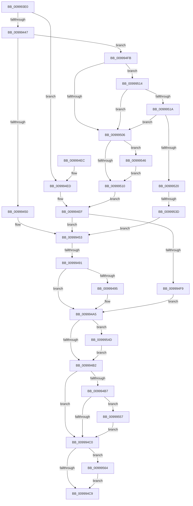

# PiCreateServiceStateKey

- RVA: `0x009993E0`–`0x00999573` (길이 `403` bytes)
- VA: `0x00000001409993E0`
- 실행 섹션: `PAGE`
- PDB 이름 있음: `예`; PDB Function 태그: `예`
- unwind 정보 RVA: `0x00099494`
- 디코드: `110`개 명령, `403/403` bytes 표시
- 미해석 바이트: `0` (있으면 어셈블리에 `.byte`로 보존)

> 이 문서는 커널 이미지의 기계어와 PDB 기호를 분석해 생성했습니다. 4번과 5번은 함수 원형과 자료형을 바이너리 사용 방식에서 추정한 C 해석이며 원본 소스 복구 결과는 아닙니다.

## 1. Dependencies

- 직접 호출 지점: **7**; 고유 호출 대상: **5**
- 직접 호출자로 확인된 함수: **1**
- RIP 상대 이미지 참조: **1**

### Outgoing calls
- `0x00999435` → [PiCreateDriverRedirectedStateKey](PiCreateDriverRedirectedStateKey_function_0099957C.md) (function, `0x0099957C`)
- `0x0099947F` → [ZwOpenKey](../../text/6A/ZwOpenKey_function_006AD310.md) (function, `0x006AD310`)
- `0x0099952E` → [PiCreateServiceKeyUnderPath](../72/PiCreateServiceKeyUnderPath_function_00728DEC.md) (function, `0x00728DEC`)
- `0x00999546` → [ZwClose](../../text/6A/ZwClose_function_006AD2B0.md) (function, `0x006AD2B0`)
- `0x0099954D` → [ZwClose](../../text/6A/ZwClose_function_006AD2B0.md) (function, `0x006AD2B0`)
- `0x0099955A` → [ZwClose](../../text/6A/ZwClose_function_006AD2B0.md) (function, `0x006AD2B0`)
- `0x00999569` → [ExFreePoolWithTag](../../poolcode/B8/ExFreePoolWithTag_function_00B82870.md) (function, `0x00B82870`)

### Direct callers
- [IoOpenDriverRegistryKey](IoOpenDriverRegistryKey_function_00998BB0.md) at `0x00998DF5`

### Static image references
- `0x00999527` → RVA `0x00009FB0` (`.rdata`; read)

## 2. Other-region calls and transfers

- 다른 실행 섹션으로 향하는 call: **5**
  - `0x0099947F` → [ZwOpenKey](../../text/6A/ZwOpenKey_function_006AD310.md) (`PAGE` → `.text`)
  - `0x00999546` → [ZwClose](../../text/6A/ZwClose_function_006AD2B0.md) (`PAGE` → `.text`)
  - `0x0099954D` → [ZwClose](../../text/6A/ZwClose_function_006AD2B0.md) (`PAGE` → `.text`)
  - `0x0099955A` → [ZwClose](../../text/6A/ZwClose_function_006AD2B0.md) (`PAGE` → `.text`)
  - `0x00999569` → [ExFreePoolWithTag](../../poolcode/B8/ExFreePoolWithTag_function_00B82870.md) (`PAGE` → `POOLCODE`)
- call이 아닌 외부 분기/꼬리 이동: **2**
  - `0x0099948B` → [sub_00B2CD22 + 0x9](../B2/Unknown_function_00B2CD22.md) (`tail-transfer`)
  - `0x00999537` → [sub_00B2CD22](../B2/Unknown_function_00B2CD22.md) (`tail-transfer`)

## 3. Assembly (complete function range)

```asm
009993E0  48 8B C4                        mov rax, rsp
009993E3  48 89 58 08                     mov qword ptr [rax + 8], rbx
009993E7  48 89 70 10                     mov qword ptr [rax + 0x10], rsi
009993EB  48 89 78 18                     mov qword ptr [rax + 0x18], rdi
009993EF  4C 89 60 20                     mov qword ptr [rax + 0x20], r12
009993F3  55                              push rbp
009993F4  41 56                           push r14
009993F6  41 57                           push r15
009993F8  48 8D 68 B9                     lea rbp, [rax - 0x47]
009993FC  48 81 EC 90 00 00 00            sub rsp, 0x90
00999403  33 C0                           xor eax, eax
00999405  0F 57 C0                        xorps xmm0, xmm0
00999408  48 21 45 DF                     and qword ptr [rbp - 0x21], rax
0099940C  4D 8B F8                        mov r15, r8
0099940F  48 21 45 E7                     and qword ptr [rbp - 0x19], rax
00999413  4C 8D 45 E7                     lea r8, [rbp - 0x19]
00999417  33 F6                           xor esi, esi
00999419  48 89 45 1F                     mov qword ptr [rbp + 0x1f], rax
0099941D  0F 11 45 FF                     movups xmmword ptr [rbp - 1], xmm0
00999421  89 45 27                        mov dword ptr [rbp + 0x27], eax
00999424  4D 8B E1                        mov r12, r9
00999427  0F 11 45 0F                     movups xmmword ptr [rbp + 0xf], xmm0
0099942B  48 89 75 F7                     mov qword ptr [rbp - 9], rsi
0099942F  44 8A F2                        mov r14b, dl
00999432  48 8B F9                        mov rdi, rcx
00999435  E8 42 01 00 00                  call 0x14099957c
0099943A  8B D8                           mov ebx, eax
0099943C  3D 34 00 00 C0                  cmp eax, 0xc0000034
00999441  0F 85 A6 00 00 00               jne 0x1409994ed
00999447  45 84 F6                        test r14b, r14b
0099944A  0F 85 AB 00 00 00               jne 0x1409994fb
00999450  49 8B FF                        mov rdi, r15
00999453  8B 55 6F                        mov edx, dword ptr [rbp + 0x6f]
00999456  4C 8D 45 FF                     lea r8, [rbp - 1]
0099945A  0F 57 C0                        xorps xmm0, xmm0
0099945D  48 89 7D 07                     mov qword ptr [rbp + 7], rdi
00999461  41 BE 30 00 00 00               mov r14d, 0x30
00999467  C7 45 17 40 02 00 00            mov dword ptr [rbp + 0x17], 0x240
0099946E  48 8D 4D DF                     lea rcx, [rbp - 0x21]
00999472  44 89 75 FF                     mov dword ptr [rbp - 1], r14d
00999476  F3 0F 7F 45 1F                  movdqu xmmword ptr [rbp + 0x1f], xmm0
0099947B  4C 89 65 0F                     mov qword ptr [rbp + 0xf], r12
0099947F  E8 8C 3E D1 FF                  call 0x1406ad310
00999484  8B D8                           mov ebx, eax
00999486  3D 34 00 00 C0                  cmp eax, 0xc0000034
0099948B  0F 84 9A 38 19 00               je 0x140b2cd2b
00999491  85 C0                           test eax, eax
00999493  78 10                           js 0x1409994a5
00999495  48 8B 45 DF                     mov rax, qword ptr [rbp - 0x21]
00999499  48 8B 4D 7F                     mov rcx, qword ptr [rbp + 0x7f]
0099949D  48 83 65 DF 00                  and qword ptr [rbp - 0x21], 0
009994A2  48 89 01                        mov qword ptr [rcx], rax
009994A5  48 8B 4D DF                     mov rcx, qword ptr [rbp - 0x21]
009994A9  48 85 C9                        test rcx, rcx
009994AC  0F 85 9B 00 00 00               jne 0x14099954d
009994B2  48 85 FF                        test rdi, rdi
009994B5  74 09                           je 0x1409994c0
009994B7  49 3B FF                        cmp rdi, r15
009994BA  0F 85 97 00 00 00               jne 0x140999557
009994C0  48 85 F6                        test rsi, rsi
009994C3  0F 85 9B 00 00 00               jne 0x140999564
009994C9  4C 8D 9C 24 90 00 00 00         lea r11, [rsp + 0x90]
009994D1  8B C3                           mov eax, ebx
009994D3  49 8B 5B 20                     mov rbx, qword ptr [r11 + 0x20]
009994D7  49 8B 73 28                     mov rsi, qword ptr [r11 + 0x28]
009994DB  49 8B 7B 30                     mov rdi, qword ptr [r11 + 0x30]
009994DF  4D 8B 63 38                     mov r12, qword ptr [r11 + 0x38]
009994E3  49 8B E3                        mov rsp, r11
009994E6  41 5F                           pop r15
009994E8  41 5E                           pop r14
009994EA  5D                              pop rbp
009994EB  C3                              ret
009994EC  CC                              int3
009994ED  85 C0                           test eax, eax
009994EF  48 8B 7D E7                     mov rdi, qword ptr [rbp - 0x19]
009994F3  0F 89 5A FF FF FF               jns 0x140999453
009994F9  EB AA                           jmp 0x1409994a5
009994FB  33 C9                           xor ecx, ecx
009994FD  48 89 4D EF                     mov qword ptr [rbp - 0x11], rcx
00999501  48 85 FF                        test rdi, rdi
00999504  75 0E                           jne 0x140999514
00999506  BB 0D 00 00 C0                  mov ebx, 0xc000000d
0099950B  48 85 C9                        test rcx, rcx
0099950E  75 36                           jne 0x140999546
00999510  85 DB                           test ebx, ebx
00999512  EB DB                           jmp 0x1409994ef
00999514  48 39 4F 08                     cmp qword ptr [rdi + 8], rcx
00999518  74 EC                           je 0x140999506
0099951A  66 83 3F 02                     cmp word ptr [rdi], 2
0099951E  72 E6                           jb 0x140999506
00999520  4C 8D 4D EF                     lea r9, [rbp - 0x11]
00999524  48 8B CF                        mov rcx, rdi
00999527  48 8D 15 82 0A 67 FF            lea rdx, [rip - 0x98f57e]
0099952E  E8 B9 F8 D8 FF                  call 0x140728dec
00999533  8B D8                           mov ebx, eax
00999535  85 C0                           test eax, eax
00999537  0F 88 E5 37 19 00               js 0x140b2cd22
0099953D  48 8B 7D EF                     mov rdi, qword ptr [rbp - 0x11]
00999541  E9 0D FF FF FF                  jmp 0x140999453
00999546  E8 65 3D D1 FF                  call 0x1406ad2b0
0099954B  EB C3                           jmp 0x140999510
0099954D  E8 5E 3D D1 FF                  call 0x1406ad2b0
00999552  E9 5B FF FF FF                  jmp 0x1409994b2
00999557  48 8B CF                        mov rcx, rdi
0099955A  E8 51 3D D1 FF                  call 0x1406ad2b0
0099955F  E9 5C FF FF FF                  jmp 0x1409994c0
00999564  33 D2                           xor edx, edx
00999566  48 8B CE                        mov rcx, rsi
00999569  E8 02 93 1E 00                  call 0x140b82870
0099956E  E9 56 FF FF FF                  jmp 0x1409994c9
```

## 4. C-style interpretation (structured pseudocode)

```c
__int64 __fastcall PiCreateServiceStateKey(__int64 a1, unsigned __int8 a2, __int64 a3, __int64 a4)
{
    __int64 result;
    __int64 v_rsi;
    __int64 v_rsp;
    unsigned __int64 v_stack_m18;

    *(unsigned __int64 *)(v_rsp + 8) = v_rbx;
    *(unsigned __int64 *)(v_rsp + 16) = v_rsi;
    *(unsigned __int64 *)(v_rsp + 24) = v_rdi;
    *(unsigned __int64 *)(v_rsp + 32) = v_r12;
    v_rsp = (v_rsp) - (144);
    result = 0;
    v_rsi = 0;
    *(unsigned __int64 *)(v_rsp - 71 + 31) = 0;
    *(unsigned __int64 *)(v_rsp - 71 - 1) = v_xmm0;
    *(unsigned int *)(v_rsp - 71 + 39) = 0;
    *(unsigned __int64 *)(v_rsp - 71 + 15) = v_xmm0;
    *(unsigned __int64 *)(v_rsp - 71 - 9) = 0;
    result = PiCreateDriverRedirectedStateKey(a1, a2, v_rsp - 71 - 25, a4);
    if (((unsigned int)(result)) != 0xC0000034ULL) goto loc_009994ED;
    if (a2 != 0) goto loc_009994FB;
loc_00999453:
    *(unsigned __int64 *)(v_rsp - 71 + 7) = a3;
    *(unsigned int *)(v_rsp - 71 + 23) = 576;
    *(unsigned int *)(v_rsp - 71 - 1) = 48;
    *(unsigned __int64 *)(v_rsp - 71 + 31) = v_xmm0;
    *(unsigned __int64 *)(v_rsp - 71 + 15) = a4;
    result = ZwOpenKey(v_rsp - 71 - 33, (unsigned int)(*(unsigned int *)(v_rsp - 71 + 111)), v_rsp - 71 - 1, a4);
    if (!(sign_flag)) {
        result = *(unsigned __int64 *)(v_rsp - 71 - 33);
        a1 = *(unsigned __int64 *)(v_rsp - 71 + 127);
        *(unsigned __int64 *)(a1) = result;
    }
    if (*(unsigned __int64 *)(v_rsp - 71 - 33) != 0) goto loc_0099954D;
loc_009994B2:
    if (a3 == 0) goto loc_009994C0;
    if (a3 != a3) goto loc_00999557;
loc_009994C0:
    if (0 != 0) goto loc_00999564;
loc_009994C9:
    return (unsigned int)((unsigned int)((unsigned int)((unsigned int)(result))));
loc_009994ED:
loc_009994EF:
    if (!sign_flag) goto loc_00999453;
    goto loc_009994A5;
loc_009994FB:
    a1 = 0;
    *(unsigned __int64 *)(v_rsp - 71 - 17) = 0;
    if (*(unsigned __int64 *)(v_rsp - 71 - 25) != 0) goto loc_00999514;
loc_00999506:
    if (0 != 0) goto loc_00999546;
loc_00999510:
    goto loc_009994EF;
loc_00999514:
    if ((*(unsigned __int64 *)(*(unsigned __int64 *)(v_rsp - 71 - 25) + 8)) == 0) goto loc_00999506;
    if ((*(unsigned __int16 *)(*(unsigned __int64 *)(v_rsp - 71 - 25))) < 2) goto loc_00999506;
    result = PiCreateServiceKeyUnderPath(*(unsigned __int64 *)(v_rsp - 71 - 25), v_rip - 10024318, v_rsp - 71 - 1, v_rsp - 71 - 17);
    goto loc_00999453;
loc_00999546:
    result = ZwClose(*(unsigned __int64 *)(v_rsp - 71 - 25), v_rip - 10024318, v_rsp - 71 - 1, v_rsp - 71 - 17);
    goto loc_00999510;
loc_0099954D:
    result = ZwClose(*(unsigned __int64 *)(v_rsp - 71 - 25), v_rip - 10024318, v_rsp - 71 - 1, v_rsp - 71 - 17);
    goto loc_009994B2;
loc_00999557:
    result = ZwClose(*(unsigned __int64 *)(v_rsp - 71 - 17), v_rip - 10024318, v_rsp - 71 - 1, v_rsp - 71 - 17);
    goto loc_009994C0;
loc_00999564:
    a2 = 0;
    result = ExFreePoolWithTag(*(unsigned __int64 *)(v_stack_m18 + 40), a2, v_rsp - 71 - 1, v_rsp - 71 - 17);
    goto loc_009994C9;
}
```

## 5. (Beta) C Style

```c
int64_t PiCreateServiceStateKey(int64_t Arg1, uint8_t Arg2, int64_t Arg3, int64_t Arg4)
{
    int64_t result;
    int64_t local_rsi;
    int64_t local_rsp;
    uint64_t v_stack_m18;

    *(uint64_t *)(local_rsp + 0x8) = local_rbx;
    *(uint64_t *)(local_rsp + 0x10) = local_rsi;
    *(uint64_t *)(local_rsp + 0x18) = local_rdi;
    *(uint64_t *)(local_rsp + 0x20) = local_r12;
    local_rsp = (local_rsp) - (144);
    result = 0;
    local_rsi = 0;
    *(uint64_t *)(local_rsp - 0x47 + 0x1F) = 0;
    *(uint64_t *)(local_rsp - 0x47 - 0x1) = v_xmm0;
    *(uint32_t *)(local_rsp - 0x47 + 0x27) = 0;
    *(uint64_t *)(local_rsp - 0x47 + 0xF) = v_xmm0;
    *(uint64_t *)(local_rsp - 0x47 - 0x9) = 0;
    result = PiCreateDriverRedirectedStateKey(Arg1, Arg2, local_rsp - 71 - 25, Arg4);
    if (((uint32_t)(result)) != 0xC0000034ULL) goto loc_009994ED;
    if (Arg2 != 0) goto loc_009994FB;
loc_00999453:
    *(uint64_t *)(local_rsp - 0x47 + 0x7) = Arg3;
    *(uint32_t *)(local_rsp - 0x47 + 0x17) = 576;
    *(uint32_t *)(local_rsp - 0x47 - 0x1) = 48;
    *(uint64_t *)(local_rsp - 0x47 + 0x1F) = v_xmm0;
    *(uint64_t *)(local_rsp - 0x47 + 0xF) = Arg4;
    result = ZwOpenKey(local_rsp - 71 - 33, (uint32_t)(*(uint32_t *)(local_rsp - 0x47 + 0x6F)), local_rsp - 71 - 1, Arg4);
    if (!(sign_flag)) {
        result = *(uint64_t *)(local_rsp - 0x47 - 0x21);
        Arg1 = *(uint64_t *)(local_rsp - 0x47 + 0x7F);
        *(uint64_t *)(Arg1) = result;
    }
    if (*(uint64_t *)(local_rsp - 0x47 - 0x21) != 0) goto loc_0099954D;
loc_009994B2:
    if (Arg3 == 0) goto loc_009994C0;
    if (Arg3 != Arg3) goto loc_00999557;
loc_009994C0:
    if (0 != 0) goto loc_00999564;
loc_009994C9:
    return (uint32_t)((uint32_t)((uint32_t)((uint32_t)(result))));
loc_009994ED:
loc_009994EF:
    if (!sign_flag) goto loc_00999453;
    goto loc_009994A5;
loc_009994FB:
    Arg1 = 0;
    *(uint64_t *)(local_rsp - 0x47 - 0x11) = 0;
    if (*(uint64_t *)(local_rsp - 0x47 - 0x19) != 0) goto loc_00999514;
loc_00999506:
    if (0 != 0) goto loc_00999546;
loc_00999510:
    goto loc_009994EF;
loc_00999514:
    if ((*(uint64_t *)(*(uint64_t *)(local_rsp - 0x47 - 0x19) + 0x8)) == 0) goto loc_00999506;
    if ((*(uint16_t *)(*(uint64_t *)(local_rsp - 0x47 - 0x19))) < 2) goto loc_00999506;
    result = PiCreateServiceKeyUnderPath(*(uint64_t *)(local_rsp - 0x47 - 0x19), v_rip - 10024318, local_rsp - 71 - 1, local_rsp - 71 - 17);
    goto loc_00999453;
loc_00999546:
    result = ZwClose(*(uint64_t *)(local_rsp - 0x47 - 0x19), v_rip - 10024318, local_rsp - 71 - 1, local_rsp - 71 - 17);
    goto loc_00999510;
loc_0099954D:
    result = ZwClose(*(uint64_t *)(local_rsp - 0x47 - 0x19), v_rip - 10024318, local_rsp - 71 - 1, local_rsp - 71 - 17);
    goto loc_009994B2;
loc_00999557:
    result = ZwClose(*(uint64_t *)(local_rsp - 0x47 - 0x11), v_rip - 10024318, local_rsp - 71 - 1, local_rsp - 71 - 17);
    goto loc_009994C0;
loc_00999564:
    Arg2 = 0;
    result = ExFreePoolWithTag(*(uint64_t *)(v_stack_m18 + 0x28), Arg2, local_rsp - 71 - 1, local_rsp - 71 - 17);
    goto loc_009994C9;
}
```

## 6. Execution-region graph

[열기: 2D/3D 그래프와 함수 탐색 컨트롤 패널](../../../control-panel.html?section=page&rva=0x009993E0&view=graph)

- 2D 그래프는 위에서 아래로 흐르고, 3D 그래프는 빈 공간을 드래그해 회전합니다. Shift+드래그는 이동, 휠은 확대·축소, 함수 노드 선택은 대상 보고서 이동입니다.

### Static fallback


