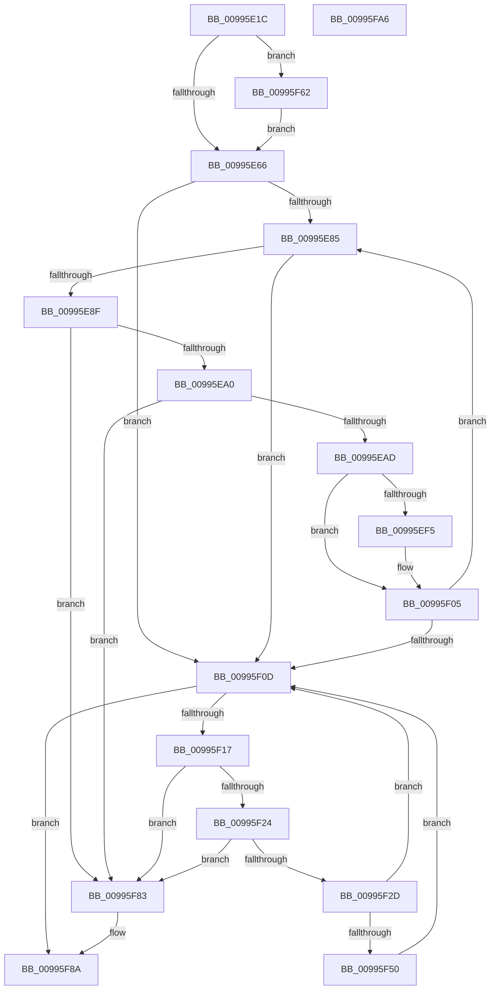

# PiDevCfgCopyDeviceKeys

- RVA: `0x00995E1C`–`0x00995FA7` (길이 `395` bytes)
- VA: `0x0000000140995E1C`
- 실행 섹션: `PAGE`
- PDB 이름 있음: `예`; PDB Function 태그: `아니요`
- unwind 정보 RVA: `0x000991EC`
- 디코드: `110`개 명령, `395/395` bytes 표시
- 미해석 바이트: `0` (있으면 어셈블리에 `.byte`로 보존)

> 이 문서는 커널 이미지의 기계어와 PDB 기호를 분석해 생성했습니다. 4번과 5번은 함수 원형과 자료형을 바이너리 사용 방식에서 추정한 C 해석이며 원본 소스 복구 결과는 아닙니다.

## 1. Dependencies

- 직접 호출 지점: **11**; 고유 호출 대상: **6**
- 직접 호출자로 확인된 함수: **5**
- RIP 상대 이미지 참조: **0**

### Outgoing calls
- `0x00995E59` → [PiDevCfgGetKeySecurityDescriptor](PiDevCfgGetKeySecurityDescriptor_function_00996240.md) (function, `0x00996240`)
- `0x00995E76` → [PiDevCfgPushCopyKeyEntry](../../text/4A/PiDevCfgPushCopyKeyEntry_function_004AFBA4.md) (function, `0x004AFBA4`)
- `0x00995EC5` → [ExFreePoolWithTag](../../poolcode/B8/ExFreePoolWithTag_function_00B82870.md) (function, `0x00B82870`)
- `0x00995EE8` → [PiDevCfgCopyDeviceKey](PiDevCfgCopyDeviceKey_function_00997374.md) (function, `0x00997374`)
- `0x00995EF8` → [ZwClose](../../text/6A/ZwClose_function_006AD2B0.md) (function, `0x006AD2B0`)
- `0x00995F00` → [ZwClose](../../text/6A/ZwClose_function_006AD2B0.md) (function, `0x006AD2B0`)
- `0x00995F45` → [ExFreePoolWithTag](../../poolcode/B8/ExFreePoolWithTag_function_00B82870.md) (function, `0x00B82870`)
- `0x00995F53` → [ZwClose](../../text/6A/ZwClose_function_006AD2B0.md) (function, `0x006AD2B0`)
- `0x00995F5B` → [ZwClose](../../text/6A/ZwClose_function_006AD2B0.md) (function, `0x006AD2B0`)
- `0x00995F6E` → [ZwSetSecurityObject](../../text/6B/ZwSetSecurityObject_function_006B0810.md) (function, `0x006B0810`)
- `0x00995F79` → [ExFreePoolWithTag](../../poolcode/B8/ExFreePoolWithTag_function_00B82870.md) (function, `0x00B82870`)

### Direct callers
- [PiDevCfgResetDeviceKeyCallback](../73/PiDevCfgResetDeviceKeyCallback_function_007358C0.md) at `0x0073590F`
- [PiDevCfgConfigureDeviceInterface](../96/PiDevCfgConfigureDeviceInterface_function_00963C18.md) at `0x00963DEB`
- [PiDevCfgConfigureDeviceKeyCallback](../A9/PiDevCfgConfigureDeviceKeyCallback_function_00A99890.md) at `0x00A99949`
- [PipCommitPendingOsExtensionResource](../../init/C3/PipCommitPendingOsExtensionResource_function_00C35960.md) at `0x00C35AB7`
- [PipCommitPendingService](../../init/C3/PipCommitPendingService_function_00C35B70.md) at `0x00C35D7E`
- [PipCommitPendingService](../../init/C3/PipCommitPendingService_function_00C35B70.md) at `0x00C35D97`

### Static image references
- 디코드된 RIP-relative 메모리 참조가 없습니다.

## 2. Other-region calls and transfers

- 다른 실행 섹션으로 향하는 call: **9**
  - `0x00995E76` → [PiDevCfgPushCopyKeyEntry](../../text/4A/PiDevCfgPushCopyKeyEntry_function_004AFBA4.md) (`PAGE` → `.text`)
  - `0x00995EC5` → [ExFreePoolWithTag](../../poolcode/B8/ExFreePoolWithTag_function_00B82870.md) (`PAGE` → `POOLCODE`)
  - `0x00995EF8` → [ZwClose](../../text/6A/ZwClose_function_006AD2B0.md) (`PAGE` → `.text`)
  - `0x00995F00` → [ZwClose](../../text/6A/ZwClose_function_006AD2B0.md) (`PAGE` → `.text`)
  - `0x00995F45` → [ExFreePoolWithTag](../../poolcode/B8/ExFreePoolWithTag_function_00B82870.md) (`PAGE` → `POOLCODE`)
  - `0x00995F53` → [ZwClose](../../text/6A/ZwClose_function_006AD2B0.md) (`PAGE` → `.text`)
  - `0x00995F5B` → [ZwClose](../../text/6A/ZwClose_function_006AD2B0.md) (`PAGE` → `.text`)
  - `0x00995F6E` → [ZwSetSecurityObject](../../text/6B/ZwSetSecurityObject_function_006B0810.md) (`PAGE` → `.text`)
  - `0x00995F79` → [ExFreePoolWithTag](../../poolcode/B8/ExFreePoolWithTag_function_00B82870.md) (`PAGE` → `POOLCODE`)
- 별도 외부 분기/꼬리 이동을 확인하지 못했습니다.

## 3. Assembly (complete function range)

```asm
00995E1C  48 89 5C 24 08                  mov qword ptr [rsp + 8], rbx
00995E21  48 89 74 24 10                  mov qword ptr [rsp + 0x10], rsi
00995E26  48 89 7C 24 18                  mov qword ptr [rsp + 0x18], rdi
00995E2B  55                              push rbp
00995E2C  41 56                           push r14
00995E2E  41 57                           push r15
00995E30  48 8B EC                        mov rbp, rsp
00995E33  48 83 EC 60                     sub rsp, 0x60
00995E37  48 83 65 E0 00                  and qword ptr [rbp - 0x20], 0
00995E3C  48 8D 45 E8                     lea rax, [rbp - 0x18]
00995E40  48 89 45 F0                     mov qword ptr [rbp - 0x10], rax
00995E44  48 8B DA                        mov rbx, rdx
00995E47  48 8D 45 E8                     lea rax, [rbp - 0x18]
00995E4B  4D 8B F9                        mov r15, r9
00995E4E  48 8D 55 E0                     lea rdx, [rbp - 0x20]
00995E52  48 89 45 E8                     mov qword ptr [rbp - 0x18], rax
00995E56  48 8B F9                        mov rdi, rcx
00995E59  E8 E2 03 00 00                  call 0x140996240
00995E5E  85 C0                           test eax, eax
00995E60  0F 89 FC 00 00 00               jns 0x140995f62
00995E66  41 B9 01 00 00 00               mov r9d, 1
00995E6C  48 8D 4D E8                     lea rcx, [rbp - 0x18]
00995E70  4C 8B C3                        mov r8, rbx
00995E73  48 8B D7                        mov rdx, rdi
00995E76  E8 29 9D B1 FF                  call 0x1404afba4
00995E7B  8B F8                           mov edi, eax
00995E7D  85 C0                           test eax, eax
00995E7F  0F 88 88 00 00 00               js 0x140995f0d
00995E85  48 8D 45 E8                     lea rax, [rbp - 0x18]
00995E89  48 39 45 E8                     cmp qword ptr [rbp - 0x18], rax
00995E8D  74 7E                           je 0x140995f0d
00995E8F  48 8B 4D F0                     mov rcx, qword ptr [rbp - 0x10]
00995E93  48 8D 45 E8                     lea rax, [rbp - 0x18]
00995E97  48 39 01                        cmp qword ptr [rcx], rax
00995E9A  0F 85 E3 00 00 00               jne 0x140995f83
00995EA0  48 8B 41 08                     mov rax, qword ptr [rcx + 8]
00995EA4  48 39 08                        cmp qword ptr [rax], rcx
00995EA7  0F 85 D6 00 00 00               jne 0x140995f83
00995EAD  48 89 45 F0                     mov qword ptr [rbp - 0x10], rax
00995EB1  48 8D 55 E8                     lea rdx, [rbp - 0x18]
00995EB5  48 89 10                        mov qword ptr [rax], rdx
00995EB8  33 D2                           xor edx, edx
00995EBA  48 8B 71 10                     mov rsi, qword ptr [rcx + 0x10]
00995EBE  4C 8B 71 18                     mov r14, qword ptr [rcx + 0x18]
00995EC2  8B 59 20                        mov ebx, dword ptr [rcx + 0x20]
00995EC5  E8 A6 C9 1E 00                  call 0x140b82870
00995ECA  48 8D 45 E8                     lea rax, [rbp - 0x18]
00995ECE  4C 89 7C 24 30                  mov qword ptr [rsp + 0x30], r15
00995ED3  48 89 44 24 28                  mov qword ptr [rsp + 0x28], rax
00995ED8  45 33 C9                        xor r9d, r9d
00995EDB  45 33 C0                        xor r8d, r8d
00995EDE  89 5C 24 20                     mov dword ptr [rsp + 0x20], ebx
00995EE2  49 8B D6                        mov rdx, r14
00995EE5  48 8B CE                        mov rcx, rsi
00995EE8  E8 87 14 00 00                  call 0x140997374
00995EED  8B F8                           mov edi, eax
00995EEF  0F BA E3 1E                     bt ebx, 0x1e
00995EF3  73 10                           jae 0x140995f05
00995EF5  48 8B CE                        mov rcx, rsi
00995EF8  E8 B3 73 D1 FF                  call 0x1406ad2b0
00995EFD  49 8B CE                        mov rcx, r14
00995F00  E8 AB 73 D1 FF                  call 0x1406ad2b0
00995F05  85 FF                           test edi, edi
00995F07  0F 89 78 FF FF FF               jns 0x140995e85
00995F0D  48 8D 45 E8                     lea rax, [rbp - 0x18]
00995F11  48 39 45 E8                     cmp qword ptr [rbp - 0x18], rax
00995F15  74 73                           je 0x140995f8a
00995F17  48 8B 4D F0                     mov rcx, qword ptr [rbp - 0x10]
00995F1B  48 8D 45 E8                     lea rax, [rbp - 0x18]
00995F1F  48 39 01                        cmp qword ptr [rcx], rax
00995F22  75 5F                           jne 0x140995f83
00995F24  48 8B 41 08                     mov rax, qword ptr [rcx + 8]
00995F28  48 39 08                        cmp qword ptr [rax], rcx
00995F2B  75 56                           jne 0x140995f83
00995F2D  48 89 45 F0                     mov qword ptr [rbp - 0x10], rax
00995F31  48 8D 55 E8                     lea rdx, [rbp - 0x18]
00995F35  48 89 10                        mov qword ptr [rax], rdx
00995F38  33 D2                           xor edx, edx
00995F3A  48 8B 71 10                     mov rsi, qword ptr [rcx + 0x10]
00995F3E  4C 8B 71 18                     mov r14, qword ptr [rcx + 0x18]
00995F42  8B 59 20                        mov ebx, dword ptr [rcx + 0x20]
00995F45  E8 26 C9 1E 00                  call 0x140b82870
00995F4A  0F BA E3 1E                     bt ebx, 0x1e
00995F4E  73 BD                           jae 0x140995f0d
00995F50  48 8B CE                        mov rcx, rsi
00995F53  E8 58 73 D1 FF                  call 0x1406ad2b0
00995F58  49 8B CE                        mov rcx, r14
00995F5B  E8 50 73 D1 FF                  call 0x1406ad2b0
00995F60  EB AB                           jmp 0x140995f0d
00995F62  4C 8B 45 E0                     mov r8, qword ptr [rbp - 0x20]
00995F66  BA 04 00 00 00                  mov edx, 4
00995F6B  48 8B CB                        mov rcx, rbx
00995F6E  E8 9D A8 D1 FF                  call 0x1406b0810
00995F73  48 8B 4D E0                     mov rcx, qword ptr [rbp - 0x20]
00995F77  33 D2                           xor edx, edx
00995F79  E8 F2 C8 1E 00                  call 0x140b82870
00995F7E  E9 E3 FE FF FF                  jmp 0x140995e66
00995F83  B9 03 00 00 00                  mov ecx, 3
00995F88  CD 29                           int 0x29
00995F8A  4C 8D 5C 24 60                  lea r11, [rsp + 0x60]
00995F8F  8B C7                           mov eax, edi
00995F91  49 8B 5B 20                     mov rbx, qword ptr [r11 + 0x20]
00995F95  49 8B 73 28                     mov rsi, qword ptr [r11 + 0x28]
00995F99  49 8B 7B 30                     mov rdi, qword ptr [r11 + 0x30]
00995F9D  49 8B E3                        mov rsp, r11
00995FA0  41 5F                           pop r15
00995FA2  41 5E                           pop r14
00995FA4  5D                              pop rbp
00995FA5  C3                              ret
00995FA6  CC                              int3
```

## 4. C-style interpretation (structured pseudocode)

```c
__int64 __fastcall PiDevCfgCopyDeviceKeys(__int64 a1, __int64 a2, __int64 a3, __int64 a4)
{
    __int64 result;
    __int64 v_rsp;
    unsigned __int64 v_stack_m18;
    unsigned __int64 v_stack_m28;
    unsigned __int64 v_stack_m30;
    unsigned __int64 v_stack_m38;
    unsigned __int64 v_stack_m48;
    unsigned __int64 v_stack_m50;
    unsigned int v_stack_m58;
    unsigned __int64 v_stack_p10;
    unsigned __int64 v_stack_p18;
    unsigned __int64 v_stack_p8;

    v_stack_p8 = v_rbx;
    v_stack_p10 = v_rsi;
    v_stack_p18 = v_rdi;
    v_rsp = (v_rsp) - (96);
    v_stack_m28 = v_stack_m30;
    v_stack_m30 = v_stack_m30;
    result = PiDevCfgGetKeySecurityDescriptor(a1, v_stack_m38, a3, a4);
    if (!sign_flag) goto loc_00995F62;
loc_00995E66:
    result = PiDevCfgPushCopyKeyEntry(v_stack_m30, a1, a2, 1);
    if (sign_flag) goto loc_00995F0D;
loc_00995E85:
    if (v_stack_m30 == v_stack_m30) goto loc_00995F0D;
    if ((*(unsigned __int64 *)(v_stack_m28)) != v_stack_m30) goto loc_00995F83;
    if ((*(unsigned __int64 *)(*(unsigned __int64 *)(v_stack_m28 + 8))) != v_stack_m28) goto loc_00995F83;
    v_stack_m28 = *(unsigned __int64 *)(v_stack_m28 + 8);
    *(unsigned __int64 *)(*(unsigned __int64 *)(v_stack_m28 + 8)) = v_stack_m30;
    a2 = 0;
    result = ExFreePoolWithTag(v_stack_m28, a2, a2, 1);
    v_stack_m48 = a4;
    v_stack_m50 = v_stack_m30;
    a4 = 0;
    a3 = 0;
    v_stack_m58 = (unsigned int)((unsigned int)(*(unsigned int *)(v_stack_m28 + 32)));
    result = PiDevCfgCopyDeviceKey(*(unsigned __int64 *)(v_stack_m28 + 16), *(unsigned __int64 *)(v_stack_m28 + 24), a3, a4);
    if (!(condition_is_above_or_equal)) {
        a1 = *(unsigned __int64 *)(v_stack_m28 + 16);
        result = ZwClose(a1, *(unsigned __int64 *)(v_stack_m28 + 24), a3, a4);
        a1 = *(unsigned __int64 *)(v_stack_m28 + 24);
        result = ZwClose(a1, *(unsigned __int64 *)(v_stack_m28 + 24), a3, a4);
    }
    if (!sign_flag) goto loc_00995E85;
loc_00995F0D:
    if (v_stack_m30 == v_stack_m30) goto loc_00995F8A;
    if ((*(unsigned __int64 *)(v_stack_m28)) != v_stack_m30) goto loc_00995F83;
    if ((*(unsigned __int64 *)(*(unsigned __int64 *)(v_stack_m28 + 8))) != v_stack_m28) goto loc_00995F83;
    v_stack_m28 = *(unsigned __int64 *)(v_stack_m28 + 8);
    *(unsigned __int64 *)(*(unsigned __int64 *)(v_stack_m28 + 8)) = v_stack_m30;
    a2 = 0;
    result = ExFreePoolWithTag(v_stack_m28, a2, a3, a4);
    if (condition_is_above_or_equal) goto loc_00995F0D;
    result = ZwClose(*(unsigned __int64 *)(v_stack_m28 + 16), a2, a3, a4);
    result = ZwClose(*(unsigned __int64 *)(v_stack_m28 + 24), a2, a3, a4);
    goto loc_00995F0D;
loc_00995F62:
    result = ZwSetSecurityObject((unsigned int)(*(unsigned int *)(v_stack_m28 + 32)), 4, v_stack_m38, a4);
    a2 = 0;
    result = ExFreePoolWithTag(v_stack_m38, a2, v_stack_m38, a4);
    goto loc_00995E66;
loc_00995F83:
loc_00995F8A:
    return (unsigned int)((unsigned int)((unsigned int)((unsigned int)(result))));
}
```

## 5. (Beta) C Style

```c
int64_t PiDevCfgCopyDeviceKeys(int64_t Arg1, int64_t Arg2, int64_t Arg3, int64_t Arg4)
{
    int64_t result;
    int64_t local_rsp;
    uint64_t v_stack_m18;
    uint64_t v_stack_m28;
    uint64_t v_stack_m30;
    uint64_t v_stack_m38;
    uint64_t v_stack_m48;
    uint64_t v_stack_m50;
    uint32_t v_stack_m58;
    uint64_t v_stack_p10;
    uint64_t v_stack_p18;
    uint64_t v_stack_p8;

    v_stack_p8 = local_rbx;
    v_stack_p10 = local_rsi;
    v_stack_p18 = local_rdi;
    local_rsp = (local_rsp) - (96);
    v_stack_m28 = v_stack_m30;
    v_stack_m30 = v_stack_m30;
    result = PiDevCfgGetKeySecurityDescriptor(Arg1, v_stack_m38, Arg3, Arg4);
    if (!sign_flag) goto loc_00995F62;
loc_00995E66:
    result = PiDevCfgPushCopyKeyEntry(v_stack_m30, Arg1, Arg2, 1);
    if (sign_flag) goto loc_00995F0D;
loc_00995E85:
    if (v_stack_m30 == v_stack_m30) goto loc_00995F0D;
    if ((*(uint64_t *)(v_stack_m28)) != v_stack_m30) goto loc_00995F83;
    if ((*(uint64_t *)(*(uint64_t *)(v_stack_m28 + 0x8))) != v_stack_m28) goto loc_00995F83;
    v_stack_m28 = *(uint64_t *)(v_stack_m28 + 0x8);
    *(uint64_t *)(*(uint64_t *)(v_stack_m28 + 0x8)) = v_stack_m30;
    Arg2 = 0;
    result = ExFreePoolWithTag(v_stack_m28, Arg2, Arg2, 1);
    v_stack_m48 = Arg4;
    v_stack_m50 = v_stack_m30;
    Arg4 = 0;
    Arg3 = 0;
    v_stack_m58 = (uint32_t)((uint32_t)(*(uint32_t *)(v_stack_m28 + 0x20)));
    result = PiDevCfgCopyDeviceKey(*(uint64_t *)(v_stack_m28 + 0x10), *(uint64_t *)(v_stack_m28 + 0x18), Arg3, Arg4);
    if (!(condition_is_above_or_equal)) {
        Arg1 = *(uint64_t *)(v_stack_m28 + 0x10);
        result = ZwClose(Arg1, *(uint64_t *)(v_stack_m28 + 0x18), Arg3, Arg4);
        Arg1 = *(uint64_t *)(v_stack_m28 + 0x18);
        result = ZwClose(Arg1, *(uint64_t *)(v_stack_m28 + 0x18), Arg3, Arg4);
    }
    if (!sign_flag) goto loc_00995E85;
loc_00995F0D:
    if (v_stack_m30 == v_stack_m30) goto loc_00995F8A;
    if ((*(uint64_t *)(v_stack_m28)) != v_stack_m30) goto loc_00995F83;
    if ((*(uint64_t *)(*(uint64_t *)(v_stack_m28 + 0x8))) != v_stack_m28) goto loc_00995F83;
    v_stack_m28 = *(uint64_t *)(v_stack_m28 + 0x8);
    *(uint64_t *)(*(uint64_t *)(v_stack_m28 + 0x8)) = v_stack_m30;
    Arg2 = 0;
    result = ExFreePoolWithTag(v_stack_m28, Arg2, Arg3, Arg4);
    if (condition_is_above_or_equal) goto loc_00995F0D;
    result = ZwClose(*(uint64_t *)(v_stack_m28 + 0x10), Arg2, Arg3, Arg4);
    result = ZwClose(*(uint64_t *)(v_stack_m28 + 0x18), Arg2, Arg3, Arg4);
    goto loc_00995F0D;
loc_00995F62:
    result = ZwSetSecurityObject((uint32_t)(*(uint32_t *)(v_stack_m28 + 0x20)), 4, v_stack_m38, Arg4);
    Arg2 = 0;
    result = ExFreePoolWithTag(v_stack_m38, Arg2, v_stack_m38, Arg4);
    goto loc_00995E66;
loc_00995F83:
loc_00995F8A:
    return (uint32_t)((uint32_t)((uint32_t)((uint32_t)(result))));
}
```

## 6. Execution-region graph

[열기: 2D/3D 그래프와 함수 탐색 컨트롤 패널](../../../control-panel.html?section=page&rva=0x00995E1C&view=graph)

- 2D 그래프는 위에서 아래로 흐르고, 3D 그래프는 빈 공간을 드래그해 회전합니다. Shift+드래그는 이동, 휠은 확대·축소, 함수 노드 선택은 대상 보고서 이동입니다.

### Static fallback


