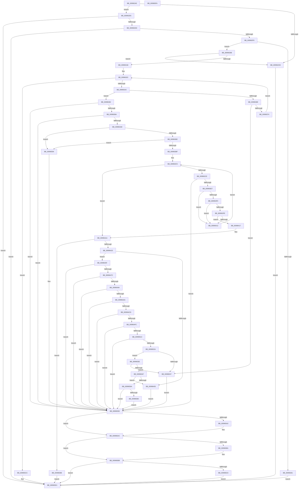

# PiDevCfgGetKeySecurityDescriptor

- RVA: `0x00996240`–`0x009965FB` (길이 `955` bytes)
- VA: `0x0000000140996240`
- 실행 섹션: `PAGE`
- PDB 이름 있음: `예`; PDB Function 태그: `아니요`
- unwind 정보 RVA: `0x00099234`
- 디코드: `271`개 명령, `955/955` bytes 표시
- 미해석 바이트: `0` (있으면 어셈블리에 `.byte`로 보존)

> 이 문서는 커널 이미지의 기계어와 PDB 기호를 분석해 생성했습니다. 4번과 5번은 함수 원형과 자료형을 바이너리 사용 방식에서 추정한 C 해석이며 원본 소스 복구 결과는 아닙니다.

## 1. Dependencies

- 직접 호출 지점: **26**; 고유 호출 대상: **18**
- 직접 호출자로 확인된 함수: **2**
- RIP 상대 이미지 참조: **3**

### Outgoing calls
- `0x009962BD` → [ZwQuerySecurityObject](../../text/6A/ZwQuerySecurityObject_function_006AFDF0.md) (function, `0x006AFDF0`)
- `0x009962E9` → [RtlGetGroupSecurityDescriptor](../A9/RtlGetGroupSecurityDescriptor_function_00A90020.md) (function, `0x00A90020`)
- `0x00996312` → [RtlEqualSid](../../text/40/RtlEqualSid_function_00400AD0.md) (function, `0x00400AD0`)
- `0x00996332` → [ExAllocatePool2](../../poolcode/B8/ExAllocatePool2_function_00B820F0.md) (function, `0x00B820F0`)
- `0x0099635A` → [ZwQuerySecurityObject](../../text/6A/ZwQuerySecurityObject_function_006AFDF0.md) (function, `0x006AFDF0`)
- `0x0099637B` → [ExFreePoolWithTag](../../poolcode/B8/ExFreePoolWithTag_function_00B82870.md) (function, `0x00B82870`)
- `0x00996399` → [RtlGetDaclSecurityDescriptor](../../text/45/RtlGetDaclSecurityDescriptor_function_00459570.md) (function, `0x00459570`)
- `0x009963D8` → [RtlGetAce](../../text/40/RtlGetAce_function_0040FAF0.md) (function, `0x0040FAF0`)
- `0x00996409` → [RtlEqualSid](../../text/40/RtlEqualSid_function_00400AD0.md) (function, `0x00400AD0`)
- `0x0099642A` → [RtlLengthSid](../../text/45/RtlLengthSid_function_0045D270.md) (function, `0x0045D270`)
- `0x00996448` → [ExAllocatePool2](../../poolcode/B8/ExAllocatePool2_function_00B820F0.md) (function, `0x00B820F0`)
- `0x0099646D` → [RtlCreateAcl](../91/RtlCreateAcl_function_00916F00.md) (function, `0x00916F00`)
- `0x00996485` → [RtlGetAce](../../text/40/RtlGetAce_function_0040FAF0.md) (function, `0x0040FAF0`)
- `0x0099649B` → [RtlGetAcesBufferSize](../78/RtlGetAcesBufferSize_function_0078DB70.md) (function, `0x0078DB70`)
- `0x009964BE` → [RtlAddAce](../92/RtlAddAce_function_00929D70.md) (function, `0x00929D70`)
- `0x009964ED` → [RtlpAddKnownAce](../92/RtlpAddKnownAce_function_00929A20.md) (function, `0x00929A20`)
- `0x00996504` → [RtlCreateSecurityDescriptor](../9F/RtlCreateSecurityDescriptor_function_009F1DF0.md) (function, `0x009F1DF0`)
- `0x0099651F` → [RtlSetDaclSecurityDescriptor](../9E/RtlSetDaclSecurityDescriptor_function_009EC210.md) (function, `0x009EC210`)
- `0x0099652E` → [RtlValidSecurityDescriptor](../8B/RtlValidSecurityDescriptor_function_008BD3F0.md) (function, `0x008BD3F0`)
- `0x00996542` → [RtlLengthSecurityDescriptor](../8B/RtlLengthSecurityDescriptor_function_008BC870.md) (function, `0x008BC870`)
- `0x00996559` → [ExAllocatePool2](../../poolcode/B8/ExAllocatePool2_function_00B820F0.md) (function, `0x00B820F0`)
- `0x00996575` → [RtlAbsoluteToSelfRelativeSD](../A1/RtlAbsoluteToSelfRelativeSD_function_00A119B0.md) (function, `0x00A119B0`)
- `0x009965A7` → [ExFreePoolWithTag](../../poolcode/B8/ExFreePoolWithTag_function_00B82870.md) (function, `0x00B82870`)
- `0x009965B6` → [ExFreePoolWithTag](../../poolcode/B8/ExFreePoolWithTag_function_00B82870.md) (function, `0x00B82870`)
- `0x009965C5` → [ExFreePoolWithTag](../../poolcode/B8/ExFreePoolWithTag_function_00B82870.md) (function, `0x00B82870`)
- `0x009965DA` → [_security_check_cookie](../../text/6A/_security_check_cookie_function_006AC640.md) (function, `0x006AC640`)

### Direct callers
- [PiDevCfgCopyDeviceKeys](PiDevCfgCopyDeviceKeys_function_00995E1C.md) at `0x00995E59`
- [PiDevCfgCopyDeviceKey](PiDevCfgCopyDeviceKey_function_00997374.md) at `0x009978BD`

### Static image references
- `0x0099625C` → RVA `0x00E0A740` (`.data`; read)
- `0x0099630B` → RVA `0x00B4B9A0` (`PiDevCfgNullSid`; read)
- `0x009963FE` → RVA `0x00E67D58` (`.data`; read)

## 2. Other-region calls and transfers

- 다른 실행 섹션으로 향하는 call: **16**
  - `0x009962BD` → [ZwQuerySecurityObject](../../text/6A/ZwQuerySecurityObject_function_006AFDF0.md) (`PAGE` → `.text`)
  - `0x00996312` → [RtlEqualSid](../../text/40/RtlEqualSid_function_00400AD0.md) (`PAGE` → `.text`)
  - `0x00996332` → [ExAllocatePool2](../../poolcode/B8/ExAllocatePool2_function_00B820F0.md) (`PAGE` → `POOLCODE`)
  - `0x0099635A` → [ZwQuerySecurityObject](../../text/6A/ZwQuerySecurityObject_function_006AFDF0.md) (`PAGE` → `.text`)
  - `0x0099637B` → [ExFreePoolWithTag](../../poolcode/B8/ExFreePoolWithTag_function_00B82870.md) (`PAGE` → `POOLCODE`)
  - `0x00996399` → [RtlGetDaclSecurityDescriptor](../../text/45/RtlGetDaclSecurityDescriptor_function_00459570.md) (`PAGE` → `.text`)
  - `0x009963D8` → [RtlGetAce](../../text/40/RtlGetAce_function_0040FAF0.md) (`PAGE` → `.text`)
  - `0x00996409` → [RtlEqualSid](../../text/40/RtlEqualSid_function_00400AD0.md) (`PAGE` → `.text`)
  - `0x0099642A` → [RtlLengthSid](../../text/45/RtlLengthSid_function_0045D270.md) (`PAGE` → `.text`)
  - `0x00996448` → [ExAllocatePool2](../../poolcode/B8/ExAllocatePool2_function_00B820F0.md) (`PAGE` → `POOLCODE`)
  - `0x00996485` → [RtlGetAce](../../text/40/RtlGetAce_function_0040FAF0.md) (`PAGE` → `.text`)
  - `0x00996559` → [ExAllocatePool2](../../poolcode/B8/ExAllocatePool2_function_00B820F0.md) (`PAGE` → `POOLCODE`)
  - `0x009965A7` → [ExFreePoolWithTag](../../poolcode/B8/ExFreePoolWithTag_function_00B82870.md) (`PAGE` → `POOLCODE`)
  - `0x009965B6` → [ExFreePoolWithTag](../../poolcode/B8/ExFreePoolWithTag_function_00B82870.md) (`PAGE` → `POOLCODE`)
  - `0x009965C5` → [ExFreePoolWithTag](../../poolcode/B8/ExFreePoolWithTag_function_00B82870.md) (`PAGE` → `POOLCODE`)
  - `0x009965DA` → [_security_check_cookie](../../text/6A/_security_check_cookie_function_006AC640.md) (`PAGE` → `.text`)
- 별도 외부 분기/꼬리 이동을 확인하지 못했습니다.

## 3. Assembly (complete function range)

```asm
00996240  48 89 5C 24 18                  mov qword ptr [rsp + 0x18], rbx
00996245  55                              push rbp
00996246  56                              push rsi
00996247  57                              push rdi
00996248  41 54                           push r12
0099624A  41 55                           push r13
0099624C  41 56                           push r14
0099624E  41 57                           push r15
00996250  48 8D 6C 24 D9                  lea rbp, [rsp - 0x27]
00996255  48 81 EC D0 00 00 00            sub rsp, 0xd0
0099625C  48 8B 05 DD 44 47 00            mov rax, qword ptr [rip + 0x4744dd]
00996263  48 33 C4                        xor rax, rsp
00996266  48 89 45 1F                     mov qword ptr [rbp + 0x1f], rax
0099626A  33 F6                           xor esi, esi
0099626C  48 89 55 B7                     mov qword ptr [rbp - 0x49], rdx
00996270  4C 8B E9                        mov r13, rcx
00996273  48 89 32                        mov qword ptr [rdx], rsi
00996276  33 C9                           xor ecx, ecx
00996278  89 75 8F                        mov dword ptr [rbp - 0x71], esi
0099627B  0F 57 C0                        xorps xmm0, xmm0
0099627E  48 89 4D DF                     mov qword ptr [rbp - 0x21], rcx
00996282  48 8D 45 8F                     lea rax, [rbp - 0x71]
00996286  48 89 75 97                     mov qword ptr [rbp - 0x69], rsi
0099628A  44 8D 4E 34                     lea r9d, [rsi + 0x34]
0099628E  40 88 75 87                     mov byte ptr [rbp - 0x79], sil
00996292  8D 56 02                        lea edx, [rsi + 2]
00996295  48 89 75 9F                     mov qword ptr [rbp - 0x61], rsi
00996299  4C 8D 45 E7                     lea r8, [rbp - 0x19]
0099629D  48 89 75 A7                     mov qword ptr [rbp - 0x59], rsi
009962A1  49 8B CD                        mov rcx, r13
009962A4  48 89 75 AF                     mov qword ptr [rbp - 0x51], rsi
009962A8  44 8B E6                        mov r12d, esi
009962AB  89 75 8B                        mov dword ptr [rbp - 0x75], esi
009962AE  0F 11 45 BF                     movups xmmword ptr [rbp - 0x41], xmm0
009962B2  8B FE                           mov edi, esi
009962B4  48 89 44 24 20                  mov qword ptr [rsp + 0x20], rax
009962B9  0F 11 45 CF                     movups xmmword ptr [rbp - 0x31], xmm0
009962BD  E8 2E 9B D1 FF                  call 0x1406afdf0
009962C2  8B D8                           mov ebx, eax
009962C4  3D 23 00 00 C0                  cmp eax, 0xc0000023
009962C9  75 0A                           jne 0x1409962d5
009962CB  BB 68 00 00 C0                  mov ebx, 0xc0000068
009962D0  E9 FC 02 00 00                  jmp 0x1409965d1
009962D5  85 C0                           test eax, eax
009962D7  0F 88 F4 02 00 00               js 0x1409965d1
009962DD  4C 8D 45 88                     lea r8, [rbp - 0x78]
009962E1  48 8D 55 97                     lea rdx, [rbp - 0x69]
009962E5  48 8D 4D E7                     lea rcx, [rbp - 0x19]
009962E9  E8 32 9D 0F 00                  call 0x140a90020
009962EE  8B D8                           mov ebx, eax
009962F0  85 C0                           test eax, eax
009962F2  0F 88 D9 02 00 00               js 0x1409965d1
009962F8  48 8B 4D 97                     mov rcx, qword ptr [rbp - 0x69]
009962FC  48 85 C9                        test rcx, rcx
009962FF  75 0A                           jne 0x14099630b
00996301  BB 66 00 00 C0                  mov ebx, 0xc0000066
00996306  E9 C6 02 00 00                  jmp 0x1409965d1
0099630B  48 8D 15 8E 56 1B 00            lea rdx, [rip + 0x1b568e]
00996312  E8 B9 A7 A6 FF                  call 0x140400ad0
00996317  84 C0                           test al, al
00996319  74 B0                           je 0x1409962cb
0099631B  BB F0 00 00 00                  mov ebx, 0xf0
00996320  8B F3                           mov esi, ebx
00996322  8B D6                           mov edx, esi
00996324  B9 00 01 00 00                  mov ecx, 0x100
00996329  41 B8 50 70 64 63               mov r8d, 0x63647050
0099632F  44 8B FB                        mov r15d, ebx
00996332  E8 B9 BD 1E 00                  call 0x140b820f0
00996337  4C 8B F0                        mov r14, rax
0099633A  48 85 C0                        test rax, rax
0099633D  0F 84 89 02 00 00               je 0x1409965cc
00996343  48 8D 45 8F                     lea rax, [rbp - 0x71]
00996347  44 8B CB                        mov r9d, ebx
0099634A  4D 8B C6                        mov r8, r14
0099634D  48 89 44 24 20                  mov qword ptr [rsp + 0x20], rax
00996352  BA 04 00 00 00                  mov edx, 4
00996357  49 8B CD                        mov rcx, r13
0099635A  E8 91 9A D1 FF                  call 0x1406afdf0
0099635F  8B D8                           mov ebx, eax
00996361  3D 23 00 00 C0                  cmp eax, 0xc0000023
00996366  75 1A                           jne 0x140996382
00996368  8B 5D 8F                        mov ebx, dword ptr [rbp - 0x71]
0099636B  41 3B DF                        cmp ebx, r15d
0099636E  0F 86 C3 01 00 00               jbe 0x140996537
00996374  33 D2                           xor edx, edx
00996376  49 8B CE                        mov rcx, r14
00996379  8B F3                           mov esi, ebx
0099637B  E8 F0 C4 1E 00                  call 0x140b82870
00996380  EB A0                           jmp 0x140996322
00996382  85 C0                           test eax, eax
00996384  0F 88 0F 02 00 00               js 0x140996599
0099638A  4C 8D 4D 88                     lea r9, [rbp - 0x78]
0099638E  49 8B CE                        mov rcx, r14
00996391  4C 8D 45 9F                     lea r8, [rbp - 0x61]
00996395  48 8D 55 87                     lea rdx, [rbp - 0x79]
00996399  E8 D2 31 AC FF                  call 0x140459570
0099639E  8B D8                           mov ebx, eax
009963A0  85 C0                           test eax, eax
009963A2  0F 88 F1 01 00 00               js 0x140996599
009963A8  40 38 7D 87                     cmp byte ptr [rbp - 0x79], dil
009963AC  0F 84 E2 01 00 00               je 0x140996594
009963B2  48 8B 75 9F                     mov rsi, qword ptr [rbp - 0x61]
009963B6  48 85 F6                        test rsi, rsi
009963B9  0F 84 D5 01 00 00               je 0x140996594
009963BF  45 32 ED                        xor r13b, r13b
009963C2  45 33 FF                        xor r15d, r15d
009963C5  0F B7 46 04                     movzx eax, word ptr [rsi + 4]
009963C9  44 3B F8                        cmp r15d, eax
009963CC  73 4C                           jae 0x14099641a
009963CE  4C 8D 45 A7                     lea r8, [rbp - 0x59]
009963D2  41 8B D7                        mov edx, r15d
009963D5  48 8B CE                        mov rcx, rsi
009963D8  E8 13 97 A7 FF                  call 0x14040faf0
009963DD  8B D8                           mov ebx, eax
009963DF  85 C0                           test eax, eax
009963E1  0F 88 B2 01 00 00               js 0x140996599
009963E7  48 8B 4D A7                     mov rcx, qword ptr [rbp - 0x59]
009963EB  40 38 39                        cmp byte ptr [rcx], dil
009963EE  75 22                           jne 0x140996412
009963F0  8B 41 04                        mov eax, dword ptr [rcx + 4]
009963F3  BA 3F 00 0F 00                  mov edx, 0xf003f
009963F8  23 C2                           and eax, edx
009963FA  3B C2                           cmp eax, edx
009963FC  75 14                           jne 0x140996412
009963FE  48 8B 15 53 19 4D 00            mov rdx, qword ptr [rip + 0x4d1953]
00996405  48 83 C1 08                     add rcx, 8
00996409  E8 C2 A6 A6 FF                  call 0x140400ad0
0099640E  84 C0                           test al, al
00996410  75 05                           jne 0x140996417
00996412  41 FF C7                        inc r15d
00996415  EB AE                           jmp 0x1409963c5
00996417  41 B5 01                        mov r13b, 1
0099641A  45 84 ED                        test r13b, r13b
0099641D  0F 85 68 01 00 00               jne 0x14099658b
00996423  48 8B 0D 2E 19 4D 00            mov rcx, qword ptr [rip + 0x4d192e]
0099642A  E8 41 6E AC FF                  call 0x14045d270
0099642F  0F B7 5E 02                     movzx ebx, word ptr [rsi + 2]
00996433  41 BD 50 70 64 63               mov r13d, 0x63647050
00996439  83 C3 08                        add ebx, 8
0099643C  45 8B C5                        mov r8d, r13d
0099643F  03 D8                           add ebx, eax
00996441  B9 00 01 00 00                  mov ecx, 0x100
00996446  8B D3                           mov edx, ebx
00996448  E8 A3 BC 1E 00                  call 0x140b820f0
0099644D  4C 8B E0                        mov r12, rax
00996450  48 85 C0                        test rax, rax
00996453  75 0A                           jne 0x14099645f
00996455  BB 9A 00 00 C0                  mov ebx, 0xc000009a
0099645A  E9 3A 01 00 00                  jmp 0x140996599
0099645F  41 BF 02 00 00 00               mov r15d, 2
00996465  8B D3                           mov edx, ebx
00996467  45 8B C7                        mov r8d, r15d
0099646A  49 8B CC                        mov rcx, r12
0099646D  E8 8E 0A F8 FF                  call 0x140916f00
00996472  8B D8                           mov ebx, eax
00996474  85 C0                           test eax, eax
00996476  0F 88 1D 01 00 00               js 0x140996599
0099647C  4C 8D 45 AF                     lea r8, [rbp - 0x51]
00996480  33 D2                           xor edx, edx
00996482  48 8B CE                        mov rcx, rsi
00996485  E8 66 96 A7 FF                  call 0x14040faf0
0099648A  8B D8                           mov ebx, eax
0099648C  85 C0                           test eax, eax
0099648E  0F 88 05 01 00 00               js 0x140996599
00996494  48 8D 55 8B                     lea rdx, [rbp - 0x75]
00996498  48 8B CE                        mov rcx, rsi
0099649B  E8 D0 76 DF FF                  call 0x14078db70
009964A0  8B D8                           mov ebx, eax
009964A2  85 C0                           test eax, eax
009964A4  0F 88 EF 00 00 00               js 0x140996599
009964AA  8B 45 8B                        mov eax, dword ptr [rbp - 0x75]
009964AD  45 33 C0                        xor r8d, r8d
009964B0  4C 8B 4D AF                     mov r9, qword ptr [rbp - 0x51]
009964B4  41 8B D7                        mov edx, r15d
009964B7  49 8B CC                        mov rcx, r12
009964BA  89 44 24 20                     mov dword ptr [rsp + 0x20], eax
009964BE  E8 AD 38 F9 FF                  call 0x140929d70
009964C3  8B D8                           mov ebx, eax
009964C5  85 C0                           test eax, eax
009964C7  0F 88 CC 00 00 00               js 0x140996599
009964CD  48 8B 05 84 18 4D 00            mov rax, qword ptr [rip + 0x4d1884]
009964D4  41 B9 3F 00 0F 00               mov r9d, 0xf003f
009964DA  40 88 7C 24 28                  mov byte ptr [rsp + 0x28], dil
009964DF  45 8B C7                        mov r8d, r15d
009964E2  41 8B D7                        mov edx, r15d
009964E5  48 89 44 24 20                  mov qword ptr [rsp + 0x20], rax
009964EA  49 8B CC                        mov rcx, r12
009964ED  E8 2E 35 F9 FF                  call 0x140929a20
009964F2  8B D8                           mov ebx, eax
009964F4  85 C0                           test eax, eax
009964F6  0F 88 9D 00 00 00               js 0x140996599
009964FC  41 8D 57 FF                     lea edx, [r15 - 1]
00996500  48 8D 4D BF                     lea rcx, [rbp - 0x41]
00996504  E8 E7 B8 05 00                  call 0x1409f1df0
00996509  8B D8                           mov ebx, eax
0099650B  85 C0                           test eax, eax
0099650D  0F 88 86 00 00 00               js 0x140996599
00996513  45 33 C9                        xor r9d, r9d
00996516  48 8D 4D BF                     lea rcx, [rbp - 0x41]
0099651A  4D 8B C4                        mov r8, r12
0099651D  B2 01                           mov dl, 1
0099651F  E8 EC 5C 05 00                  call 0x1409ec210
00996524  8B D8                           mov ebx, eax
00996526  85 C0                           test eax, eax
00996528  78 6F                           js 0x140996599
0099652A  48 8D 4D BF                     lea rcx, [rbp - 0x41]
0099652E  E8 BD 6E F2 FF                  call 0x1408bd3f0
00996533  84 C0                           test al, al
00996535  75 07                           jne 0x14099653e
00996537  BB E5 00 00 C0                  mov ebx, 0xc00000e5
0099653C  EB 5B                           jmp 0x140996599
0099653E  48 8D 4D BF                     lea rcx, [rbp - 0x41]
00996542  E8 29 63 F2 FF                  call 0x1408bc870
00996547  89 45 8B                        mov dword ptr [rbp - 0x75], eax
0099654A  83 F8 28                        cmp eax, 0x28
0099654D  72 E8                           jb 0x140996537
0099654F  8B D0                           mov edx, eax
00996551  45 8B C5                        mov r8d, r13d
00996554  B9 00 01 00 00                  mov ecx, 0x100
00996559  E8 92 BB 1E 00                  call 0x140b820f0
0099655E  48 8B F8                        mov rdi, rax
00996561  48 85 C0                        test rax, rax
00996564  0F 84 EB FE FF FF               je 0x140996455
0099656A  4C 8D 45 8B                     lea r8, [rbp - 0x75]
0099656E  48 8B D0                        mov rdx, rax
00996571  48 8D 4D BF                     lea rcx, [rbp - 0x41]
00996575  E8 36 B4 07 00                  call 0x140a119b0
0099657A  8B D8                           mov ebx, eax
0099657C  85 C0                           test eax, eax
0099657E  78 19                           js 0x140996599
00996580  48 8B 45 B7                     mov rax, qword ptr [rbp - 0x49]
00996584  48 89 38                        mov qword ptr [rax], rdi
00996587  33 FF                           xor edi, edi
00996589  EB 0E                           jmp 0x140996599
0099658B  48 8B 45 B7                     mov rax, qword ptr [rbp - 0x49]
0099658F  4C 89 30                        mov qword ptr [rax], r14
00996592  EB 3D                           jmp 0x1409965d1
00996594  BB 25 02 00 C0                  mov ebx, 0xc0000225
00996599  48 8D 45 E7                     lea rax, [rbp - 0x19]
0099659D  4C 3B F0                        cmp r14, rax
009965A0  74 0A                           je 0x1409965ac
009965A2  33 D2                           xor edx, edx
009965A4  49 8B CE                        mov rcx, r14
009965A7  E8 C4 C2 1E 00                  call 0x140b82870
009965AC  48 85 FF                        test rdi, rdi
009965AF  74 0A                           je 0x1409965bb
009965B1  33 D2                           xor edx, edx
009965B3  48 8B CF                        mov rcx, rdi
009965B6  E8 B5 C2 1E 00                  call 0x140b82870
009965BB  4D 85 E4                        test r12, r12
009965BE  74 11                           je 0x1409965d1
009965C0  33 D2                           xor edx, edx
009965C2  49 8B CC                        mov rcx, r12
009965C5  E8 A6 C2 1E 00                  call 0x140b82870
009965CA  EB 05                           jmp 0x1409965d1
009965CC  BB 9A 00 00 C0                  mov ebx, 0xc000009a
009965D1  8B C3                           mov eax, ebx
009965D3  48 8B 4D 1F                     mov rcx, qword ptr [rbp + 0x1f]
009965D7  48 33 CC                        xor rcx, rsp
009965DA  E8 61 60 D1 FF                  call 0x1406ac640
009965DF  48 8B 9C 24 20 01 00 00         mov rbx, qword ptr [rsp + 0x120]
009965E7  48 81 C4 D0 00 00 00            add rsp, 0xd0
009965EE  41 5F                           pop r15
009965F0  41 5E                           pop r14
009965F2  41 5D                           pop r13
009965F4  41 5C                           pop r12
009965F6  5F                              pop rdi
009965F7  5E                              pop rsi
009965F8  5D                              pop rbp
009965F9  C3                              ret
009965FA  CC                              int3
```

## 4. C-style interpretation (structured pseudocode)

```c
__int64 __fastcall PiDevCfgGetKeySecurityDescriptor(__int64 a1, __int64 a2)
{
    __int64 result;
    __int64 v_r13;
    __int64 v_r15;
    __int64 v_rbx;
    __int64 v_rdi;
    __int64 v_rsi;
    __int64 v_rsp;
    unsigned __int64 v_stack_m40;
    unsigned __int64 v_stack_m5F;
    unsigned __int64 v_stack_m78;
    unsigned __int64 v_stack_m80;
    unsigned __int64 v_stack_m90;
    unsigned __int64 v_stack_mA0;
    unsigned __int64 v_stack_mA8;
    unsigned __int64 v_stack_mB0;
    unsigned __int64 v_stack_mB8;
    unsigned __int64 v_stack_mC0;
    unsigned __int64 v_stack_mC8;
    unsigned int v_stack_mD0;
    unsigned int v_stack_mD4;
    unsigned __int64 v_stack_mD7;
    unsigned __int8 v_stack_mD8;
    unsigned __int8 v_stack_mE0;
    unsigned __int64 v_stack_mE8;
    unsigned __int64 v_stack_p18;

    v_stack_p18 = v_rbx;
    v_rsp = (v_rsp) - (208);
    result = (*(unsigned __int64 *)(v_rip + 4670685)) ^ (v_rsp);
    v_stack_m40 = result;
    v_rsi = 0;
    v_stack_mA8 = a2;
    *(unsigned __int64 *)(a2) = 0;
    a1 = 0;
    v_stack_mD0 = 0;
    v_stack_m80 = 0;
    v_stack_mC8 = 0;
    v_stack_mD8 = 0;
    v_stack_mC0 = 0;
    v_stack_mB8 = 0;
    v_stack_mB0 = 0;
    v_stack_mD4 = 0;
    v_stack_mA0 = v_xmm0;
    v_stack_mE8 = v_stack_mD0;
    v_stack_m90 = v_xmm0;
    result = ZwQuerySecurityObject(0, v_rsi + 2, v_stack_m78, v_rsi + 52);
    if (((unsigned int)(result)) != 0xC0000023ULL) goto loc_009962D5;
loc_009962CB:
    goto loc_009965D1;
loc_009962D5:
    if (sign_flag) goto loc_009965D1;
    result = RtlGetGroupSecurityDescriptor(v_stack_m78, v_stack_mC8, v_stack_mD7, v_rsi + 52);
    if (sign_flag) goto loc_009965D1;
    if (v_stack_mC8 != 0) goto loc_0099630B;
    goto loc_009965D1;
loc_0099630B:
    result = RtlEqualSid(v_stack_mC8, v_rip + 1791630, v_stack_mD7, v_rsi + 52);
    if ((unsigned __int8)(result) == 0) goto loc_009962CB;
loc_00996322:
    result = ExAllocatePool2(256, 240, (unsigned int)(0x63647050ULL), v_rsi + 52);
    if (result == 0) goto loc_009965CC;
    v_stack_mE8 = v_stack_mD0;
    result = ZwQuerySecurityObject(0, 4, result, 240);
    if (((unsigned int)(result)) != 0xC0000023ULL) goto loc_00996382;
    if (((unsigned int)((unsigned int)(v_stack_mD0))) <= 240) goto loc_00996537;
    a2 = 0;
    result = ExFreePoolWithTag(result, a2, result, 240);
    goto loc_00996322;
loc_00996382:
    if (sign_flag) goto loc_00996599;
    result = RtlGetDaclSecurityDescriptor(result, v_stack_mD8, v_stack_mC0, v_stack_mD7);
    if (sign_flag) goto loc_00996599;
    if (v_stack_mD8 == 0) goto loc_00996594;
    if (v_stack_mC0 == 0) goto loc_00996594;
    v_r13 = 0;
    v_r15 = 0;
loc_009963C5:
    if (0 >= ((unsigned int)(*(unsigned __int16 *)(v_stack_mC0 + 4)))) goto loc_0099641A;
    result = RtlGetAce(v_stack_mC0, 0, v_stack_mB8, v_stack_mD7);
    if (sign_flag) goto loc_00996599;
    if ((*(unsigned __int8 *)(v_stack_mB8)) != 0) goto loc_00996412;
    result = (unsigned int)(((unsigned int)(*(unsigned int *)(v_stack_mB8 + 4))) & ((unsigned int)((unsigned int)(0xF003FULL))));
    if (((unsigned int)(result)) != ((unsigned int)((unsigned int)(0xF003FULL)))) goto loc_00996412;
    a1 = (v_stack_mB8) + (8);
    result = RtlEqualSid(a1, *(unsigned __int64 *)(v_rip + 5052755), v_stack_mB8, v_stack_mD7);
    if ((unsigned __int8)(result) != 0) goto loc_00996417;
loc_00996412:
    v_r15 = (unsigned int)((v_r15) + 1);
    goto loc_009963C5;
loc_00996417:
loc_0099641A:
    if (1 != 0) goto loc_0099658B;
    result = RtlLengthSid(*(unsigned __int64 *)(v_rip + 5052718), *(unsigned __int64 *)(v_rip + 5052755), v_stack_mB8, v_stack_mD7);
    v_rbx = (unsigned int)((*(unsigned __int16 *)(v_stack_mC0 + 2)) + (8));
    v_rbx = (unsigned int)((v_rbx) + ((unsigned int)(result)));
    result = ExAllocatePool2(256, (unsigned int)((unsigned int)(v_rbx)), (unsigned int)((unsigned int)((unsigned int)(0x63647050ULL))), v_stack_mD7);
    if (result != 0) goto loc_0099645F;
loc_00996455:
    goto loc_00996599;
loc_0099645F:
    result = RtlCreateAcl(result, (unsigned int)((unsigned int)((unsigned int)(0xC000009AULL))), 2, v_stack_mD7);
    if (sign_flag) goto loc_00996599;
    a2 = 0;
    result = RtlGetAce(v_stack_mC0, a2, v_stack_mB0, v_stack_mD7);
    if (sign_flag) goto loc_00996599;
    result = RtlGetAcesBufferSize(v_stack_mC0, v_stack_mD4, v_stack_mB0, v_stack_mD7);
    if (sign_flag) goto loc_00996599;
    a3 = 0;
    v_stack_mE8 = (unsigned int)((unsigned int)(v_stack_mD4));
    result = RtlAddAce(result, 2, a3, v_stack_mB0);
    if (sign_flag) goto loc_00996599;
    v_stack_mE0 = 0;
    v_stack_mE8 = *(unsigned __int64 *)(v_rip + 5052548);
    result = RtlpAddKnownAce(result, 2, 2, (unsigned int)(0xF003FULL));
    if (sign_flag) goto loc_00996599;
    result = RtlCreateSecurityDescriptor(v_stack_mA0, 2 - 1, 2, (unsigned int)(0xF003FULL));
    if (sign_flag) goto loc_00996599;
    a4 = 0;
    result = RtlSetDaclSecurityDescriptor(v_stack_mA0, 1, result, a4);
    if (sign_flag) goto loc_00996599;
    result = RtlValidSecurityDescriptor(v_stack_mA0, 1, result, a4);
    if ((unsigned __int8)(result) != 0) goto loc_0099653E;
loc_00996537:
    goto loc_00996599;
loc_0099653E:
    result = RtlLengthSecurityDescriptor(v_stack_mA0, 1, result, a4);
    v_stack_mD4 = (unsigned int)(result);
    if (((unsigned int)(result)) < 40) goto loc_00996537;
    result = ExAllocatePool2(256, (unsigned int)((unsigned int)(result)), (unsigned int)((unsigned int)((unsigned int)(0x63647050ULL))), a4);
    if (result == 0) goto loc_00996455;
    result = RtlAbsoluteToSelfRelativeSD(v_stack_mA0, result, v_stack_mD4, a4);
    if (sign_flag) goto loc_00996599;
    *(unsigned __int64 *)(v_stack_mA8) = result;
    v_rdi = 0;
    goto loc_00996599;
loc_0099658B:
    *(unsigned __int64 *)(v_stack_mA8) = result;
    goto loc_009965D1;
loc_00996594:
loc_00996599:
    result = v_stack_m78;
    if (result != v_stack_m78) {
        a2 = 0;
        a1 = result;
        result = ExFreePoolWithTag(a1, a2, v_stack_mD4, a4);
    }
    if (0 != 0) {
        a2 = 0;
        a1 = 0;
        result = ExFreePoolWithTag(a1, a2, v_stack_mD4, a4);
    }
    if (result == 0) goto loc_009965D1;
    a2 = 0;
    result = ExFreePoolWithTag(result, a2, v_stack_mD4, a4);
    goto loc_009965D1;
loc_009965CC:
loc_009965D1:
    a1 = (v_stack_m40) ^ (v_rsp);
    result = _security_check_cookie(a1, a2, v_stack_mD4, a4);
    v_rsp = (v_rsp) + (208);
    return result;
}
```

## 5. (Beta) C Style

```c
int64_t PiDevCfgGetKeySecurityDescriptor(int64_t Arg1, void *Arg2)
{
    uint8_t *arg2 = (uint8_t *)Arg2;

    int64_t result;
    int64_t local_r13;
    int64_t local_r15;
    int64_t local_rbx;
    int64_t local_rdi;
    int64_t local_rsi;
    int64_t local_rsp;
    uint64_t v_stack_m40;
    uint64_t v_stack_m5F;
    uint64_t v_stack_m78;
    uint64_t v_stack_m80;
    uint64_t v_stack_m90;
    uint64_t v_stack_mA0;
    uint64_t v_stack_mA8;
    uint64_t v_stack_mB0;
    uint64_t v_stack_mB8;
    uint64_t v_stack_mC0;
    uint64_t v_stack_mC8;
    uint32_t v_stack_mD0;
    uint32_t v_stack_mD4;
    uint64_t v_stack_mD7;
    uint8_t v_stack_mD8;
    uint8_t v_stack_mE0;
    uint64_t v_stack_mE8;
    uint64_t v_stack_p18;

    v_stack_p18 = local_rbx;
    local_rsp = (local_rsp) - (208);
    result = (*(uint64_t *)(v_rip + 0x4744DD)) ^ (local_rsp);
    v_stack_m40 = result;
    local_rsi = 0;
    v_stack_mA8 = Arg2;
    *(uint64_t *)(arg2) = 0;
    Arg1 = 0;
    v_stack_mD0 = 0;
    v_stack_m80 = 0;
    v_stack_mC8 = 0;
    v_stack_mD8 = 0;
    v_stack_mC0 = 0;
    v_stack_mB8 = 0;
    v_stack_mB0 = 0;
    v_stack_mD4 = 0;
    v_stack_mA0 = v_xmm0;
    v_stack_mE8 = v_stack_mD0;
    v_stack_m90 = v_xmm0;
    result = ZwQuerySecurityObject(0, local_rsi + 2, v_stack_m78, local_rsi + 52);
    if (((uint32_t)(result)) != 0xC0000023ULL) goto loc_009962D5;
loc_009962CB:
    goto loc_009965D1;
loc_009962D5:
    if (sign_flag) goto loc_009965D1;
    result = RtlGetGroupSecurityDescriptor(v_stack_m78, v_stack_mC8, v_stack_mD7, local_rsi + 52);
    if (sign_flag) goto loc_009965D1;
    if (v_stack_mC8 != 0) goto loc_0099630B;
    goto loc_009965D1;
loc_0099630B:
    result = RtlEqualSid(v_stack_mC8, v_rip + 1791630, v_stack_mD7, local_rsi + 52);
    if ((uint8_t)(result) == 0) goto loc_009962CB;
loc_00996322:
    result = ExAllocatePool2(256, 240, (uint32_t)(0x63647050ULL), local_rsi + 52);
    if (result == 0) goto loc_009965CC;
    v_stack_mE8 = v_stack_mD0;
    result = ZwQuerySecurityObject(0, 4, result, 240);
    if (((uint32_t)(result)) != 0xC0000023ULL) goto loc_00996382;
    if (((uint32_t)((uint32_t)(v_stack_mD0))) <= 240) goto loc_00996537;
    Arg2 = 0;
    result = ExFreePoolWithTag(result, Arg2, result, 240);
    goto loc_00996322;
loc_00996382:
    if (sign_flag) goto loc_00996599;
    result = RtlGetDaclSecurityDescriptor(result, v_stack_mD8, v_stack_mC0, v_stack_mD7);
    if (sign_flag) goto loc_00996599;
    if (v_stack_mD8 == 0) goto loc_00996594;
    if (v_stack_mC0 == 0) goto loc_00996594;
    local_r13 = 0;
    local_r15 = 0;
loc_009963C5:
    if (0 >= ((uint32_t)(*(uint16_t *)(v_stack_mC0 + 0x4)))) goto loc_0099641A;
    result = RtlGetAce(v_stack_mC0, 0, v_stack_mB8, v_stack_mD7);
    if (sign_flag) goto loc_00996599;
    if ((*(uint8_t *)(v_stack_mB8)) != 0) goto loc_00996412;
    result = (uint32_t)(((uint32_t)(*(uint32_t *)(v_stack_mB8 + 0x4))) & ((uint32_t)((uint32_t)(0xF003FULL))));
    if (((uint32_t)(result)) != ((uint32_t)((uint32_t)(0xF003FULL)))) goto loc_00996412;
    Arg1 = (v_stack_mB8) + (8);
    result = RtlEqualSid(Arg1, *(uint64_t *)(v_rip + 0x4D1953), v_stack_mB8, v_stack_mD7);
    if ((uint8_t)(result) != 0) goto loc_00996417;
loc_00996412:
    local_r15 = (uint32_t)((local_r15) + 1);
    goto loc_009963C5;
loc_00996417:
loc_0099641A:
    if (1 != 0) goto loc_0099658B;
    result = RtlLengthSid(*(uint64_t *)(v_rip + 0x4D192E), *(uint64_t *)(v_rip + 0x4D1953), v_stack_mB8, v_stack_mD7);
    local_rbx = (uint32_t)((*(uint16_t *)(v_stack_mC0 + 0x2)) + (8));
    local_rbx = (uint32_t)((local_rbx) + ((uint32_t)(result)));
    result = ExAllocatePool2(256, (uint32_t)((uint32_t)(local_rbx)), (uint32_t)((uint32_t)((uint32_t)(0x63647050ULL))), v_stack_mD7);
    if (result != 0) goto loc_0099645F;
loc_00996455:
    goto loc_00996599;
loc_0099645F:
    result = RtlCreateAcl(result, (uint32_t)((uint32_t)((uint32_t)(0xC000009AULL))), 2, v_stack_mD7);
    if (sign_flag) goto loc_00996599;
    Arg2 = 0;
    result = RtlGetAce(v_stack_mC0, Arg2, v_stack_mB0, v_stack_mD7);
    if (sign_flag) goto loc_00996599;
    result = RtlGetAcesBufferSize(v_stack_mC0, v_stack_mD4, v_stack_mB0, v_stack_mD7);
    if (sign_flag) goto loc_00996599;
    a3 = 0;
    v_stack_mE8 = (uint32_t)((uint32_t)(v_stack_mD4));
    result = RtlAddAce(result, 2, a3, v_stack_mB0);
    if (sign_flag) goto loc_00996599;
    v_stack_mE0 = 0;
    v_stack_mE8 = *(uint64_t *)(v_rip + 0x4D1884);
    result = RtlpAddKnownAce(result, 2, 2, (uint32_t)(0xF003FULL));
    if (sign_flag) goto loc_00996599;
    result = RtlCreateSecurityDescriptor(v_stack_mA0, 2 - 1, 2, (uint32_t)(0xF003FULL));
    if (sign_flag) goto loc_00996599;
    a4 = 0;
    result = RtlSetDaclSecurityDescriptor(v_stack_mA0, 1, result, a4);
    if (sign_flag) goto loc_00996599;
    result = RtlValidSecurityDescriptor(v_stack_mA0, 1, result, a4);
    if ((uint8_t)(result) != 0) goto loc_0099653E;
loc_00996537:
    goto loc_00996599;
loc_0099653E:
    result = RtlLengthSecurityDescriptor(v_stack_mA0, 1, result, a4);
    v_stack_mD4 = (uint32_t)(result);
    if (((uint32_t)(result)) < 40) goto loc_00996537;
    result = ExAllocatePool2(256, (uint32_t)((uint32_t)(result)), (uint32_t)((uint32_t)((uint32_t)(0x63647050ULL))), a4);
    if (result == 0) goto loc_00996455;
    result = RtlAbsoluteToSelfRelativeSD(v_stack_mA0, result, v_stack_mD4, a4);
    if (sign_flag) goto loc_00996599;
    *(uint64_t *)(v_stack_mA8) = result;
    local_rdi = 0;
    goto loc_00996599;
loc_0099658B:
    *(uint64_t *)(v_stack_mA8) = result;
    goto loc_009965D1;
loc_00996594:
loc_00996599:
    result = v_stack_m78;
    if (result != v_stack_m78) {
        Arg2 = 0;
        Arg1 = result;
        result = ExFreePoolWithTag(Arg1, Arg2, v_stack_mD4, a4);
    }
    if (0 != 0) {
        Arg2 = 0;
        Arg1 = 0;
        result = ExFreePoolWithTag(Arg1, Arg2, v_stack_mD4, a4);
    }
    if (result == 0) goto loc_009965D1;
    Arg2 = 0;
    result = ExFreePoolWithTag(result, Arg2, v_stack_mD4, a4);
    goto loc_009965D1;
loc_009965CC:
loc_009965D1:
    Arg1 = (v_stack_m40) ^ (local_rsp);
    result = _security_check_cookie(Arg1, Arg2, v_stack_mD4, a4);
    local_rsp = (local_rsp) + (208);
    return result;
}
```

### 관측된 메모리 오프셋

구조체 형식이 확인되지 않은 접근은 인자 기준의 오프셋으로만 기록했습니다.

| 기준 인자 | 오프셋 표현 | 폭 (bit) | 접근 |
|---|---:|---:|---|
| `Arg2` | `+ 0x0` | `64` | `W` |

## 6. Execution-region graph

[열기: 2D/3D 그래프와 함수 탐색 컨트롤 패널](../../../control-panel.html?section=page&rva=0x00996240&view=graph)

- 2D 그래프는 위에서 아래로 흐르고, 3D 그래프는 빈 공간을 드래그해 회전합니다. Shift+드래그는 이동, 휠은 확대·축소, 함수 노드 선택은 대상 보고서 이동입니다.

### Static fallback


