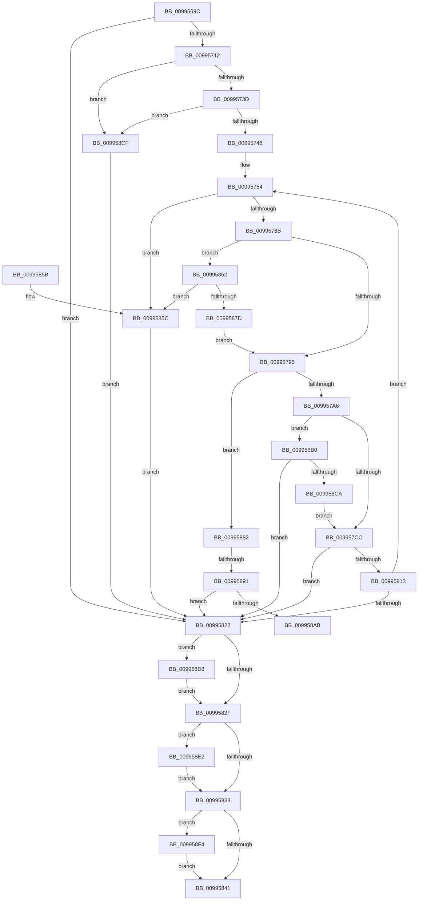

# PiDqActionDataGetAllPropertiesInAllLanguages

- RVA: `0x0099569C`–`0x00995906` (길이 `618` bytes)
- VA: `0x000000014099569C`
- 실행 섹션: `PAGE`
- PDB 이름 있음: `예`; PDB Function 태그: `예`
- unwind 정보 RVA: `0x00099150`
- 디코드: `172`개 명령, `618/618` bytes 표시
- 미해석 바이트: `0` (있으면 어셈블리에 `.byte`로 보존)

> 이 문서는 커널 이미지의 기계어와 PDB 기호를 분석해 생성했습니다. 4번과 5번은 함수 원형과 자료형을 바이너리 사용 방식에서 추정한 C 해석이며 원본 소스 복구 결과는 아닙니다.

## 1. Dependencies

- 직접 호출 지점: **11**; 고유 호출 대상: **7**
- 직접 호출자로 확인된 함수: **1**
- RIP 상대 이미지 참조: **0**

### Outgoing calls
- `0x00995703` → [PiDqOpenObjectRegKey](../98/PiDqOpenObjectRegKey_function_0098FF30.md) (function, `0x0098FF30`)
- `0x0099572E` → [PiDqPnPGetObjectPropertyKeys](PiDqPnPGetObjectPropertyKeys_function_009917B8.md) (function, `0x009917B8`)
- `0x0099577A` → [PiDqPnPGetObjectPropertyLocales](PiDqPnPGetObjectPropertyLocales_function_0099590C.md) (function, `0x0099590C`)
- `0x009957AE` → [ExFreePoolWithTag](../../poolcode/B8/ExFreePoolWithTag_function_00B82870.md) (function, `0x00B82870`)
- `0x00995808` → [PiDqPnPGetObjectProperty](../8D/PiDqPnPGetObjectProperty_function_008DFD90.md) (function, `0x008DFD90`)
- `0x00995870` → [PiDqGrowPropertyArray](PiDqGrowPropertyArray_function_00991920.md) (function, `0x00991920`)
- `0x0099589C` → [PiDqGrowPropertyArray](PiDqGrowPropertyArray_function_00991920.md) (function, `0x00991920`)
- `0x009958BB` → [PiDqGrowPropertyArray](PiDqGrowPropertyArray_function_00991920.md) (function, `0x00991920`)
- `0x009958D8` → [ZwClose](../../text/6A/ZwClose_function_006AD2B0.md) (function, `0x006AD2B0`)
- `0x009958EA` → [ExFreePoolWithTag](../../poolcode/B8/ExFreePoolWithTag_function_00B82870.md) (function, `0x00B82870`)
- `0x009958FC` → [ExFreePoolWithTag](../../poolcode/B8/ExFreePoolWithTag_function_00B82870.md) (function, `0x00B82870`)

### Direct callers
- [PiDqActionDataCreate](../8D/PiDqActionDataCreate_function_008DE1F0.md) at `0x008DE458`
- [PiDqActionDataCreate](../8D/PiDqActionDataCreate_function_008DE1F0.md) at `0x008DE487`

### Static image references
- 디코드된 RIP-relative 메모리 참조가 없습니다.

## 2. Other-region calls and transfers

- 다른 실행 섹션으로 향하는 call: **4**
  - `0x009957AE` → [ExFreePoolWithTag](../../poolcode/B8/ExFreePoolWithTag_function_00B82870.md) (`PAGE` → `POOLCODE`)
  - `0x009958D8` → [ZwClose](../../text/6A/ZwClose_function_006AD2B0.md) (`PAGE` → `.text`)
  - `0x009958EA` → [ExFreePoolWithTag](../../poolcode/B8/ExFreePoolWithTag_function_00B82870.md) (`PAGE` → `POOLCODE`)
  - `0x009958FC` → [ExFreePoolWithTag](../../poolcode/B8/ExFreePoolWithTag_function_00B82870.md) (`PAGE` → `POOLCODE`)
- call이 아닌 외부 분기/꼬리 이동: **2**
  - `0x0099588B` → [sub_00B2C164](../B2/Unknown_function_00B2C164.md) (`tail-transfer`)
  - `0x009958AB` → [sub_00B2C164](../B2/Unknown_function_00B2C164.md) (`tail-transfer`)

## 3. Assembly (complete function range)

```asm
0099569C  4C 8B DC                        mov r11, rsp
0099569F  49 89 5B 08                     mov qword ptr [r11 + 8], rbx
009956A3  4D 89 4B 20                     mov qword ptr [r11 + 0x20], r9
009956A7  89 54 24 10                     mov dword ptr [rsp + 0x10], edx
009956AB  55                              push rbp
009956AC  56                              push rsi
009956AD  57                              push rdi
009956AE  41 54                           push r12
009956B0  41 55                           push r13
009956B2  41 56                           push r14
009956B4  41 57                           push r15
009956B6  48 8B EC                        mov rbp, rsp
009956B9  48 83 EC 70                     sub rsp, 0x70
009956BD  45 33 ED                        xor r13d, r13d
009956C0  8B C2                           mov eax, edx
009956C2  83 FA 01                        cmp edx, 1
009956C5  4C 89 6D E8                     mov qword ptr [rbp - 0x18], r13
009956C9  49 8B F1                        mov rsi, r9
009956CC  4C 89 6D F8                     mov qword ptr [rbp - 8], r13
009956D0  48 8D 55 E8                     lea rdx, [rbp - 0x18]
009956D4  4C 89 6D F0                     mov qword ptr [rbp - 0x10], r13
009956D8  49 89 53 88                     mov qword ptr [r11 - 0x78], rdx
009956DC  45 8D 4D 01                     lea r9d, [r13 + 1]
009956E0  49 89 4B 80                     mov qword ptr [r11 - 0x80], rcx
009956E4  45 8B FD                        mov r15d, r13d
009956E7  45 0F 45 F8                     cmovne r15d, r8d
009956EB  44 89 6D 50                     mov dword ptr [rbp + 0x50], r13d
009956EF  8B C8                           mov ecx, eax
009956F1  44 89 7D E0                     mov dword ptr [rbp - 0x20], r15d
009956F5  48 8B D6                        mov rdx, rsi
009956F8  44 88 6C 24 20                  mov byte ptr [rsp + 0x20], r13b
009956FD  45 8B F5                        mov r14d, r13d
00995700  41 8B FD                        mov edi, r13d
00995703  E8 28 A8 FF FF                  call 0x14098ff30
00995708  8B D8                           mov ebx, eax
0099570A  85 C0                           test eax, eax
0099570C  0F 88 10 01 00 00               js 0x140995822
00995712  4C 8B 45 E8                     mov r8, qword ptr [rbp - 0x18]
00995716  48 8D 45 50                     lea rax, [rbp + 0x50]
0099571A  48 89 44 24 28                  mov qword ptr [rsp + 0x28], rax
0099571F  41 8B D7                        mov edx, r15d
00995722  48 8D 45 F8                     lea rax, [rbp - 8]
00995726  48 8B CE                        mov rcx, rsi
00995729  48 89 44 24 20                  mov qword ptr [rsp + 0x20], rax
0099572E  E8 85 C0 FF FF                  call 0x1409917b8
00995733  8B D8                           mov ebx, eax
00995735  85 C0                           test eax, eax
00995737  0F 88 92 01 00 00               js 0x1409958cf
0099573D  33 C0                           xor eax, eax
0099573F  39 45 50                        cmp dword ptr [rbp + 0x50], eax
00995742  0F 86 87 01 00 00               jbe 0x1409958cf
00995748  4C 8B 65 70                     mov r12, qword ptr [rbp + 0x70]
0099574C  48 8B 75 68                     mov rsi, qword ptr [rbp + 0x68]
00995750  4C 8B 75 F8                     mov r14, qword ptr [rbp - 8]
00995754  4C 8B 45 E8                     mov r8, qword ptr [rbp - 0x18]
00995758  41 8B D7                        mov edx, r15d
0099575B  41 8B C5                        mov eax, r13d
0099575E  48 8D 0C 80                     lea rcx, [rax + rax*4]
00995762  49 8D 04 8E                     lea rax, [r14 + rcx*4]
00995766  48 8D 4D F0                     lea rcx, [rbp - 0x10]
0099576A  48 89 45 F8                     mov qword ptr [rbp - 8], rax
0099576E  48 89 4C 24 20                  mov qword ptr [rsp + 0x20], rcx
00995773  4C 8B C8                        mov r9, rax
00995776  48 8B 4D 58                     mov rcx, qword ptr [rbp + 0x58]
0099577A  E8 8D 01 00 00                  call 0x14099590c
0099577F  33 C9                           xor ecx, ecx
00995781  8B D8                           mov ebx, eax
00995783  85 C0                           test eax, eax
00995785  0F 88 D1 00 00 00               js 0x14099585c
0099578B  41 39 0C 24                     cmp dword ptr [r12], ecx
0099578F  0F 84 CD 00 00 00               je 0x140995862
00995795  48 8B 7D F0                     mov rdi, qword ptr [rbp - 0x10]
00995799  4C 8B FF                        mov r15, rdi
0099579C  66 41 39 0F                     cmp word ptr [r15], cx
009957A0  0F 85 DC 00 00 00               jne 0x140995882
009957A6  BA 50 6E 70 58                  mov edx, 0x58706e50
009957AB  48 8B CF                        mov rcx, rdi
009957AE  E8 BD D0 1E 00                  call 0x140b82870
009957B3  8B 16                           mov edx, dword ptr [rsi]
009957B5  45 33 FF                        xor r15d, r15d
009957B8  45 8B 04 24                     mov r8d, dword ptr [r12]
009957BC  41 8B FF                        mov edi, r15d
009957BF  4C 89 7D F0                     mov qword ptr [rbp - 0x10], r15
009957C3  41 3B D0                        cmp edx, r8d
009957C6  0F 84 E4 00 00 00               je 0x1409958b0
009957CC  8B 06                           mov eax, dword ptr [rsi]
009957CE  4C 8B 45 E8                     mov r8, qword ptr [rbp - 0x18]
009957D2  48 8D 14 40                     lea rdx, [rax + rax*2]
009957D6  48 8B 45 60                     mov rax, qword ptr [rbp + 0x60]
009957DA  48 C1 E2 04                     shl rdx, 4
009957DE  48 03 10                        add rdx, qword ptr [rax]
009957E1  48 89 54 24 30                  mov qword ptr [rsp + 0x30], rdx
009957E6  41 8B C5                        mov eax, r13d
009957E9  4C 89 7C 24 28                  mov qword ptr [rsp + 0x28], r15
009957EE  44 8B 7D E0                     mov r15d, dword ptr [rbp - 0x20]
009957F2  41 8B D7                        mov edx, r15d
009957F5  48 8D 0C 80                     lea rcx, [rax + rax*4]
009957F9  8B 45 48                        mov eax, dword ptr [rbp + 0x48]
009957FC  4D 8D 0C 8E                     lea r9, [r14 + rcx*4]
00995800  89 44 24 20                     mov dword ptr [rsp + 0x20], eax
00995804  48 8B 4D 58                     mov rcx, qword ptr [rbp + 0x58]
00995808  E8 83 A5 F4 FF                  call 0x1408dfd90
0099580D  8B D8                           mov ebx, eax
0099580F  85 C0                           test eax, eax
00995811  78 0F                           js 0x140995822
00995813  FF 06                           inc dword ptr [rsi]
00995815  41 FF C5                        inc r13d
00995818  44 3B 6D 50                     cmp r13d, dword ptr [rbp + 0x50]
0099581C  0F 82 32 FF FF FF               jb 0x140995754
00995822  48 8B 4D E8                     mov rcx, qword ptr [rbp - 0x18]
00995826  48 85 C9                        test rcx, rcx
00995829  0F 85 A9 00 00 00               jne 0x1409958d8
0099582F  4D 85 F6                        test r14, r14
00995832  0F 85 AA 00 00 00               jne 0x1409958e2
00995838  48 85 FF                        test rdi, rdi
0099583B  0F 85 B3 00 00 00               jne 0x1409958f4
00995841  8B C3                           mov eax, ebx
00995843  48 8B 9C 24 B0 00 00 00         mov rbx, qword ptr [rsp + 0xb0]
0099584B  48 83 C4 70                     add rsp, 0x70
0099584F  41 5F                           pop r15
00995851  41 5E                           pop r14
00995853  41 5D                           pop r13
00995855  41 5C                           pop r12
00995857  5F                              pop rdi
00995858  5E                              pop rsi
00995859  5D                              pop rbp
0099585A  C3                              ret
0099585B  CC                              int3
0099585C  48 8B 7D F0                     mov rdi, qword ptr [rbp - 0x10]
00995860  EB C0                           jmp 0x140995822
00995862  44 8B 45 50                     mov r8d, dword ptr [rbp + 0x50]
00995866  8B 16                           mov edx, dword ptr [rsi]
00995868  48 8B 4D 60                     mov rcx, qword ptr [rbp + 0x60]
0099586C  45 89 04 24                     mov dword ptr [r12], r8d
00995870  E8 AB C0 FF FF                  call 0x140991920
00995875  33 C9                           xor ecx, ecx
00995877  8B D8                           mov ebx, eax
00995879  85 C0                           test eax, eax
0099587B  78 DF                           js 0x14099585c
0099587D  E9 13 FF FF FF                  jmp 0x140995795
00995882  8B 16                           mov edx, dword ptr [rsi]
00995884  45 8B 04 24                     mov r8d, dword ptr [r12]
00995888  41 3B D0                        cmp edx, r8d
0099588B  0F 85 D3 68 19 00               jne 0x140b2c164
00995891  48 8B 4D 60                     mov rcx, qword ptr [rbp + 0x60]
00995895  45 03 C0                        add r8d, r8d
00995898  45 89 04 24                     mov dword ptr [r12], r8d
0099589C  E8 7F C0 FF FF                  call 0x140991920
009958A1  8B D8                           mov ebx, eax
009958A3  85 C0                           test eax, eax
009958A5  0F 88 77 FF FF FF               js 0x140995822
009958AB  E9 B4 68 19 00                  jmp 0x140b2c164
009958B0  48 8B 4D 60                     mov rcx, qword ptr [rbp + 0x60]
009958B4  45 03 C0                        add r8d, r8d
009958B7  45 89 04 24                     mov dword ptr [r12], r8d
009958BB  E8 60 C0 FF FF                  call 0x140991920
009958C0  8B D8                           mov ebx, eax
009958C2  85 C0                           test eax, eax
009958C4  0F 88 58 FF FF FF               js 0x140995822
009958CA  E9 FD FE FF FF                  jmp 0x1409957cc
009958CF  4C 8B 75 F8                     mov r14, qword ptr [rbp - 8]
009958D3  E9 4A FF FF FF                  jmp 0x140995822
009958D8  E8 D3 79 D1 FF                  call 0x1406ad2b0
009958DD  E9 4D FF FF FF                  jmp 0x14099582f
009958E2  BA 50 6E 70 58                  mov edx, 0x58706e50
009958E7  49 8B CE                        mov rcx, r14
009958EA  E8 81 CF 1E 00                  call 0x140b82870
009958EF  E9 44 FF FF FF                  jmp 0x140995838
009958F4  BA 50 6E 70 58                  mov edx, 0x58706e50
009958F9  48 8B CF                        mov rcx, rdi
009958FC  E8 6F CF 1E 00                  call 0x140b82870
00995901  E9 3B FF FF FF                  jmp 0x140995841
```

## 4. C-style interpretation (structured pseudocode)

```c
__int64 __fastcall PiDqActionDataGetAllPropertiesInAllLanguages(__int64 a1, int a2, int a3, __int64 a4, __int64 a5, __int64 a6, __int64 a7)
{
    __int64 result;
    __int64 v_r13;
    __int64 v_r15;
    __int64 v_rsp;
    unsigned __int64 v_stack_m40;
    unsigned __int64 v_stack_m48;
    unsigned __int64 v_stack_m50;
    unsigned int v_stack_m58;
    unsigned __int64 v_stack_m78;
    unsigned __int64 v_stack_m80;
    unsigned __int8 v_stack_m88;
    unsigned int v_stack_p10;
    unsigned int v_stack_p18;
    unsigned __int64 v_stack_p20;
    unsigned __int64 v_stack_p8;

    *(unsigned __int64 *)(v_rsp + 8) = v_rbx;
    *(unsigned __int64 *)(v_rsp + 32) = a4;
    v_stack_p10 = a2;
    v_rsp = (v_rsp) - (112);
    v_r13 = 0;
    v_stack_m50 = 0;
    v_stack_m40 = 0;
    v_stack_m48 = 0;
    *(unsigned __int64 *)(v_rsp - 120) = v_stack_m50;
    *(unsigned __int64 *)(v_rsp - 128) = a1;
    v_r15 = 0;
    if (a2 != 1) { v_r15 = a3; }
    v_stack_p18 = 0;
    v_stack_m58 = (unsigned int)(v_r15);
    v_stack_m88 = 0;
    result = PiDqOpenObjectRegKey((unsigned int)((unsigned int)((unsigned int)(a2))), a4, a3, v_r13 + 1);
    if (sign_flag) goto loc_00995822;
    v_stack_m80 = v_stack_p18;
    v_stack_m88 = v_stack_m40;
    result = PiDqPnPGetObjectPropertyKeys(a4, (unsigned int)((unsigned int)(v_r15)), v_stack_m50, v_r13 + 1);
    if (sign_flag) goto loc_009958CF;
    result = 0;
    if (v_stack_p18 <= 0) goto loc_009958CF;
loc_00995754:
    v_stack_m40 = v_stack_m40 + 0 + 0 * 4 * 4;
    v_stack_m88 = v_stack_m48;
    result = PiDqPnPGetObjectPropertyLocales(v_stack_p20, (unsigned int)((unsigned int)(v_r15)), v_stack_m50, v_stack_m40 + 0 + 0 * 4 * 4);
    a1 = 0;
    if (sign_flag) goto loc_0099585C;
    if ((*(unsigned int *)(a7)) == 0) goto loc_00995862;
loc_00995795:
    if ((*(unsigned __int16 *)(v_stack_m48)) != 0) goto loc_00995882;
    result = ExFreePoolWithTag(v_stack_m48, (unsigned int)(0x58706E50ULL), v_stack_m50, v_stack_m40 + 0 + 0 * 4 * 4);
    v_r15 = 0;
    v_stack_m48 = 0;
    if (((unsigned int)((unsigned int)(*(unsigned int *)(a6)))) == ((unsigned int)((unsigned int)(*(unsigned int *)(a7))))) goto loc_009958B0;
loc_009957CC:
    a2 = ((unsigned int)(*(unsigned int *)(a6)) + (unsigned int)(*(unsigned int *)(a6)) * 2) << (4);
    a2 = (a2) + (*(unsigned __int64 *)(a5));
    v_stack_m78 = a2;
    v_stack_m80 = 0;
    v_stack_m88 = (unsigned int)((unsigned int)(v_stack_p10));
    result = PiDqPnPGetObjectProperty(v_stack_p20, (unsigned int)((unsigned int)((unsigned int)(v_stack_m58))), v_stack_m50, v_stack_m40 + 0 + 0 * 4 * 4);
    if (sign_flag) goto loc_00995822;
    v_r13 = (unsigned int)((v_r13) + 1);
    if (((unsigned int)(v_r13)) < v_stack_p18) goto loc_00995754;
loc_00995822:
    if (v_stack_m50 != 0) goto loc_009958D8;
loc_0099582F:
    if (v_stack_m40 != 0) goto loc_009958E2;
loc_00995838:
    if (0 != 0) goto loc_009958F4;
loc_00995841:
    v_rsp = (v_rsp) + (112);
    return (unsigned int)((unsigned int)((unsigned int)((unsigned int)(result))));
loc_0099585C:
    goto loc_00995822;
loc_00995862:
    *(unsigned int *)(a7) = (unsigned int)((unsigned int)(v_stack_p18));
    result = PiDqGrowPropertyArray(a5, (unsigned int)(*(unsigned int *)(a6)), (unsigned int)(v_stack_p18), v_stack_m40 + 0 + 0 * 4 * 4);
    a1 = 0;
    if (sign_flag) goto loc_0099585C;
    goto loc_00995795;
loc_00995882:
    a3 = (unsigned int)(((unsigned int)(*(unsigned int *)(a7))) + ((unsigned int)((unsigned int)(*(unsigned int *)(a7)))));
    *(unsigned int *)(a7) = a3;
    result = PiDqGrowPropertyArray(a5, (unsigned int)(*(unsigned int *)(a6)), a3, v_stack_m40 + 0 + 0 * 4 * 4);
    if (sign_flag) goto loc_00995822;
loc_009958B0:
    a3 = (unsigned int)((a3) + (a3));
    *(unsigned int *)(a7) = a3;
    result = PiDqGrowPropertyArray(a5, (unsigned int)(*(unsigned int *)(a6)), a3, v_stack_m40 + 0 + 0 * 4 * 4);
    if (sign_flag) goto loc_00995822;
    goto loc_009957CC;
loc_009958CF:
    goto loc_00995822;
loc_009958D8:
    result = ZwClose(a5, (unsigned int)(*(unsigned int *)(a6)), a3, v_stack_m40 + 0 + 0 * 4 * 4);
    goto loc_0099582F;
loc_009958E2:
    result = ExFreePoolWithTag(v_stack_m40, (unsigned int)(0x58706E50ULL), a3, v_stack_m40 + 0 + 0 * 4 * 4);
    goto loc_00995838;
loc_009958F4:
    result = ExFreePoolWithTag(v_stack_m48, (unsigned int)(0x58706E50ULL), a3, v_stack_m40 + 0 + 0 * 4 * 4);
    goto loc_00995841;
}
```

## 5. (Beta) C Style

```c
int64_t PiDqActionDataGetAllPropertiesInAllLanguages(int64_t Arg1, int32_t Arg2, int32_t Arg3, int64_t Arg4, void *Arg5, void *Arg6, void *Arg7)
{
    uint8_t *arg5 = (uint8_t *)Arg5;
    uint8_t *arg6 = (uint8_t *)Arg6;
    uint8_t *arg7 = (uint8_t *)Arg7;

    int64_t result;
    int64_t local_r13;
    int64_t local_r15;
    int64_t local_rsp;
    uint64_t v_stack_m40;
    uint64_t v_stack_m48;
    uint64_t v_stack_m50;
    uint32_t v_stack_m58;
    uint64_t v_stack_m78;
    uint64_t v_stack_m80;
    uint8_t v_stack_m88;
    uint32_t v_stack_p10;
    uint32_t v_stack_p18;
    uint64_t v_stack_p20;
    uint64_t v_stack_p8;

    *(uint64_t *)(local_rsp + 0x8) = local_rbx;
    *(uint64_t *)(local_rsp + 0x20) = Arg4;
    v_stack_p10 = Arg2;
    local_rsp = (local_rsp) - (112);
    local_r13 = 0;
    v_stack_m50 = 0;
    v_stack_m40 = 0;
    v_stack_m48 = 0;
    *(uint64_t *)(local_rsp - 0x78) = v_stack_m50;
    *(uint64_t *)(local_rsp - 0x80) = Arg1;
    local_r15 = 0;
    if (Arg2 != 1) { local_r15 = Arg3; }
    v_stack_p18 = 0;
    v_stack_m58 = (uint32_t)(local_r15);
    v_stack_m88 = 0;
    result = PiDqOpenObjectRegKey((uint32_t)((uint32_t)((uint32_t)(Arg2))), Arg4, Arg3, local_r13 + 1);
    if (sign_flag) goto loc_00995822;
    v_stack_m80 = v_stack_p18;
    v_stack_m88 = v_stack_m40;
    result = PiDqPnPGetObjectPropertyKeys(Arg4, (uint32_t)((uint32_t)(local_r15)), v_stack_m50, local_r13 + 1);
    if (sign_flag) goto loc_009958CF;
    result = 0;
    if (v_stack_p18 <= 0) goto loc_009958CF;
loc_00995754:
    v_stack_m40 = v_stack_m40 + 0 + 0 * 4 * 4;
    v_stack_m88 = v_stack_m48;
    result = PiDqPnPGetObjectPropertyLocales(v_stack_p20, (uint32_t)((uint32_t)(local_r15)), v_stack_m50, v_stack_m40 + 0 + 0 * 4 * 4);
    Arg1 = 0;
    if (sign_flag) goto loc_0099585C;
    if ((*(uint32_t *)(arg7)) == 0) goto loc_00995862;
loc_00995795:
    if ((*(uint16_t *)(v_stack_m48)) != 0) goto loc_00995882;
    result = ExFreePoolWithTag(v_stack_m48, (uint32_t)(0x58706E50ULL), v_stack_m50, v_stack_m40 + 0 + 0 * 4 * 4);
    local_r15 = 0;
    v_stack_m48 = 0;
    if (((uint32_t)((uint32_t)(*(uint32_t *)(arg6)))) == ((uint32_t)((uint32_t)(*(uint32_t *)(arg7))))) goto loc_009958B0;
loc_009957CC:
    Arg2 = ((uint32_t)(*(uint32_t *)(arg6)) + (uint32_t)(*(uint32_t *)(arg6)) * 2) << (4);
    Arg2 = (Arg2) + (*(uint64_t *)(arg5));
    v_stack_m78 = Arg2;
    v_stack_m80 = 0;
    v_stack_m88 = (uint32_t)((uint32_t)(v_stack_p10));
    result = PiDqPnPGetObjectProperty(v_stack_p20, (uint32_t)((uint32_t)((uint32_t)(v_stack_m58))), v_stack_m50, v_stack_m40 + 0 + 0 * 4 * 4);
    if (sign_flag) goto loc_00995822;
    local_r13 = (uint32_t)((local_r13) + 1);
    if (((uint32_t)(local_r13)) < v_stack_p18) goto loc_00995754;
loc_00995822:
    if (v_stack_m50 != 0) goto loc_009958D8;
loc_0099582F:
    if (v_stack_m40 != 0) goto loc_009958E2;
loc_00995838:
    if (0 != 0) goto loc_009958F4;
loc_00995841:
    local_rsp = (local_rsp) + (112);
    return (uint32_t)((uint32_t)((uint32_t)((uint32_t)(result))));
loc_0099585C:
    goto loc_00995822;
loc_00995862:
    *(uint32_t *)(arg7) = (uint32_t)((uint32_t)(v_stack_p18));
    result = PiDqGrowPropertyArray(Arg5, (uint32_t)(*(uint32_t *)(arg6)), (uint32_t)(v_stack_p18), v_stack_m40 + 0 + 0 * 4 * 4);
    Arg1 = 0;
    if (sign_flag) goto loc_0099585C;
    goto loc_00995795;
loc_00995882:
    Arg3 = (uint32_t)(((uint32_t)(*(uint32_t *)(arg7))) + ((uint32_t)((uint32_t)(*(uint32_t *)(arg7)))));
    *(uint32_t *)(arg7) = Arg3;
    result = PiDqGrowPropertyArray(Arg5, (uint32_t)(*(uint32_t *)(arg6)), Arg3, v_stack_m40 + 0 + 0 * 4 * 4);
    if (sign_flag) goto loc_00995822;
loc_009958B0:
    Arg3 = (uint32_t)((Arg3) + (Arg3));
    *(uint32_t *)(arg7) = Arg3;
    result = PiDqGrowPropertyArray(Arg5, (uint32_t)(*(uint32_t *)(arg6)), Arg3, v_stack_m40 + 0 + 0 * 4 * 4);
    if (sign_flag) goto loc_00995822;
    goto loc_009957CC;
loc_009958CF:
    goto loc_00995822;
loc_009958D8:
    result = ZwClose(Arg5, (uint32_t)(*(uint32_t *)(arg6)), Arg3, v_stack_m40 + 0 + 0 * 4 * 4);
    goto loc_0099582F;
loc_009958E2:
    result = ExFreePoolWithTag(v_stack_m40, (uint32_t)(0x58706E50ULL), Arg3, v_stack_m40 + 0 + 0 * 4 * 4);
    goto loc_00995838;
loc_009958F4:
    result = ExFreePoolWithTag(v_stack_m48, (uint32_t)(0x58706E50ULL), Arg3, v_stack_m40 + 0 + 0 * 4 * 4);
    goto loc_00995841;
}
```

### 관측된 메모리 오프셋

구조체 형식이 확인되지 않은 접근은 인자 기준의 오프셋으로만 기록했습니다.

| 기준 인자 | 오프셋 표현 | 폭 (bit) | 접근 |
|---|---:|---:|---|
| `Arg5` | `+ 0x0` | `64` | `R` |
| `Arg6` | `+ 0x0` | `32` | `R` |
| `Arg6` | `+ 0x0` | `32` | `R/W` |
| `Arg7` | `+ 0x0` | `32` | `R` |
| `Arg7` | `+ 0x0` | `32` | `W` |

## 6. Execution-region graph

[열기: 2D/3D 그래프와 함수 탐색 컨트롤 패널](../../../control-panel.html?section=page&rva=0x0099569C&view=graph)

- 2D 그래프는 위에서 아래로 흐르고, 3D 그래프는 빈 공간을 드래그해 회전합니다. Shift+드래그는 이동, 휠은 확대·축소, 함수 노드 선택은 대상 보고서 이동입니다.

### Static fallback


