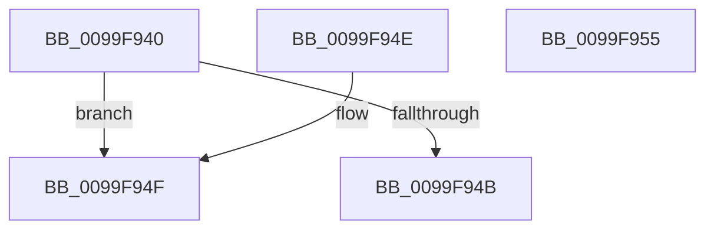

# PiDqCompareAddresses

- RVA: `0x0099F940`–`0x0099F956` (길이 `22` bytes)
- VA: `0x000000014099F940`
- 실행 섹션: `PAGE`
- PDB 이름 있음: `예`; PDB Function 태그: `아니요`
- unwind 정보 RVA: `0x000DB714`
- 디코드: `11`개 명령, `22/22` bytes 표시
- 미해석 바이트: `0` (있으면 어셈블리에 `.byte`로 보존)

> 이 문서는 커널 이미지의 기계어와 PDB 기호를 분석해 생성했습니다. 4번과 5번은 함수 원형과 자료형을 바이너리 사용 방식에서 추정한 C 해석이며 원본 소스 복구 결과는 아닙니다.

## 1. Dependencies

- 직접 호출 지점: **0**; 고유 호출 대상: **0**
- 직접 호출자로 확인된 함수: **0**
- RIP 상대 이미지 참조: **0**

### Outgoing calls
- 직접 디코드된 call 명령이 없습니다.

### Direct callers
- 이 함수 시작 RVA로 연결되는 직접 call은 확인되지 않았습니다. 간접 호출은 완전히 역산할 수 없습니다.

### Static image references
- 디코드된 RIP-relative 메모리 참조가 없습니다.

## 2. Other-region calls and transfers

- 다른 실행 섹션으로 향하는 call: **0**
- 별도 외부 분기/꼬리 이동을 확인하지 못했습니다.

## 3. Assembly (complete function range)

```asm
0099F940  48 8B 0A                        mov rcx, qword ptr [rdx]
0099F943  49 8B 00                        mov rax, qword ptr [r8]
0099F946  48 3B C1                        cmp rax, rcx
0099F949  76 04                           jbe 0x14099f94f
0099F94B  33 C0                           xor eax, eax
0099F94D  C3                              ret
0099F94E  CC                              int3
0099F94F  1B C0                           sbb eax, eax
0099F951  83 C0 02                        add eax, 2
0099F954  C3                              ret
0099F955  CC                              int3
```

## 4. C-style interpretation (structured pseudocode)

```c
__int64 __fastcall PiDqCompareAddresses(__int64 a1, __int64 a2, __int64 a3)
{
    __int64 result;

    if ((*(unsigned __int64 *)(a3)) <= (*(unsigned __int64 *)(a2))) goto loc_0099F94F;
    result = 0;
    return result;
loc_0099F94F:
    result = (unsigned int)((result) + (2));
    return result;
}
```

## 5. (Beta) C Style

```c
int64_t PiDqCompareAddresses(int64_t Arg1, void *Arg2, void *Arg3)
{
    uint8_t *arg2 = (uint8_t *)Arg2;
    uint8_t *arg3 = (uint8_t *)Arg3;

    int64_t result;

    if ((*(uint64_t *)(arg3)) <= (*(uint64_t *)(arg2))) goto loc_0099F94F;
    result = 0;
    return result;
loc_0099F94F:
    result = (uint32_t)((result) + (2));
    return result;
}
```

### 관측된 메모리 오프셋

구조체 형식이 확인되지 않은 접근은 인자 기준의 오프셋으로만 기록했습니다.

| 기준 인자 | 오프셋 표현 | 폭 (bit) | 접근 |
|---|---:|---:|---|
| `Arg2` | `+ 0x0` | `64` | `R` |
| `Arg3` | `+ 0x0` | `64` | `R` |

## 6. Execution-region graph

[열기: 2D/3D 그래프와 함수 탐색 컨트롤 패널](../../../control-panel.html?section=page&rva=0x0099F940&view=graph)

- 2D 그래프는 위에서 아래로 흐르고, 3D 그래프는 빈 공간을 드래그해 회전합니다. Shift+드래그는 이동, 휠은 확대·축소, 함수 노드 선택은 대상 보고서 이동입니다.

### Static fallback


