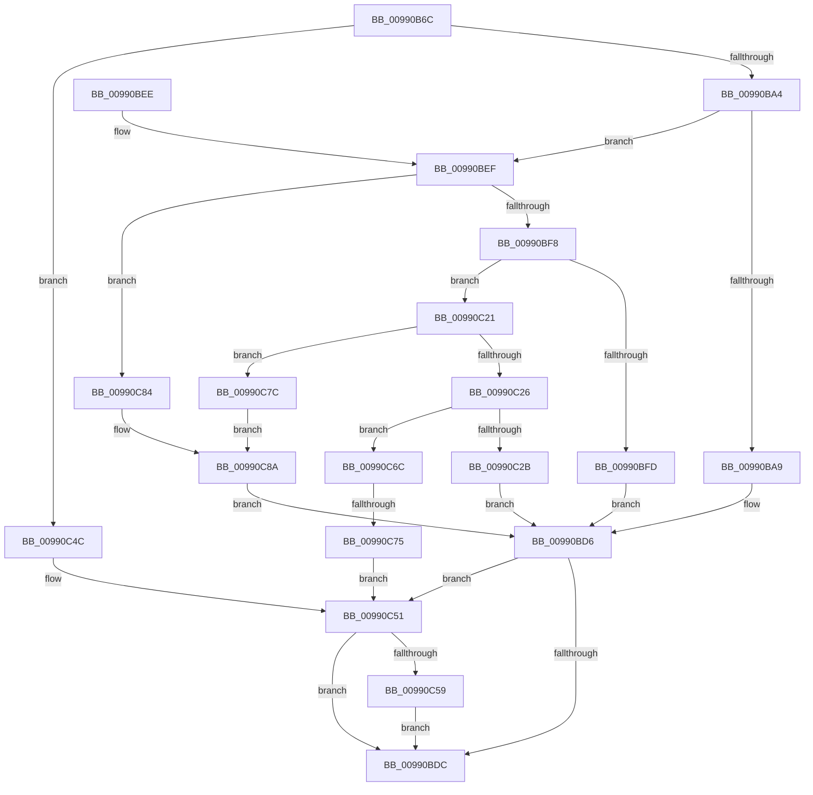

# PiDqGetRelativeObjectRegPath

- RVA: `0x00990B6C`–`0x00990CAD` (길이 `321` bytes)
- VA: `0x0000000140990B6C`
- 실행 섹션: `PAGE`
- PDB 이름 있음: `예`; PDB Function 태그: `예`
- unwind 정보 RVA: `0x00098C54`
- 디코드: `80`개 명령, `321/321` bytes 표시
- 미해석 바이트: `0` (있으면 어셈블리에 `.byte`로 보존)

> 이 문서는 커널 이미지의 기계어와 PDB 기호를 분석해 생성했습니다. 4번과 5번은 함수 원형과 자료형을 바이너리 사용 방식에서 추정한 C 해석이며 원본 소스 복구 결과는 아닙니다.

## 1. Dependencies

- 직접 호출 지점: **6**; 고유 호출 대상: **6**
- 직접 호출자로 확인된 함수: **2**
- RIP 상대 이미지 참조: **1**

### Outgoing calls
- `0x00990B93` → [ExAllocatePool2](../../poolcode/B8/ExAllocatePool2_function_00B820F0.md) (function, `0x00B820F0`)
- `0x00990BD1` → [CmGetDeviceRegKeyPath](CmGetDeviceRegKeyPath_function_00990CC0.md) (function, `0x00990CC0`)
- `0x00990C1A` → [_CmGetDeviceInterfaceRegKeyPath](../8F/_CmGetDeviceInterfaceRegKeyPath_function_008F2010.md) (function, `0x008F2010`)
- `0x00990C45` → [CmGetDeviceContainerRegKeyPath](../8F/CmGetDeviceContainerRegKeyPath_function_008F4804.md) (function, `0x008F4804`)
- `0x00990C5E` → [ExFreePoolWithTag](../../poolcode/B8/ExFreePoolWithTag_function_00B82870.md) (function, `0x00B82870`)
- `0x00990CA3` → [_CmGetCommonClassRegKeyPath](../8F/_CmGetCommonClassRegKeyPath_function_008F1CC0.md) (function, `0x008F1CC0`)

### Direct callers
- [PiDqDeleteUserObject](../96/PiDqDeleteUserObject_function_00965B24.md) at `0x00965B51`
- [PiDqOpenUserObjectRegKey](PiDqOpenUserObjectRegKey_function_00990444.md) at `0x009905F4`

### Static image references
- `0x00990BB3` → RVA `0x00E66398` (`.data`; read)

## 2. Other-region calls and transfers

- 다른 실행 섹션으로 향하는 call: **2**
  - `0x00990B93` → [ExAllocatePool2](../../poolcode/B8/ExAllocatePool2_function_00B820F0.md) (`PAGE` → `POOLCODE`)
  - `0x00990C5E` → [ExFreePoolWithTag](../../poolcode/B8/ExFreePoolWithTag_function_00B82870.md) (`PAGE` → `POOLCODE`)
- call이 아닌 외부 분기/꼬리 이동: **1**
  - `0x00990C6F` → [sub_00B2BA5A](../B2/Unknown_function_00B2BA5A.md) (`tail-transfer`)

## 3. Assembly (complete function range)

```asm
00990B6C  48 89 5C 24 08                  mov qword ptr [rsp + 8], rbx
00990B71  48 89 74 24 10                  mov qword ptr [rsp + 0x10], rsi
00990B76  57                              push rdi
00990B77  48 83 EC 40                     sub rsp, 0x40
00990B7B  49 8B F0                        mov rsi, r8
00990B7E  8B DA                           mov ebx, edx
00990B80  48 8B F9                        mov rdi, rcx
00990B83  BA 00 08 00 00                  mov edx, 0x800
00990B88  B9 00 01 00 00                  mov ecx, 0x100
00990B8D  41 B8 50 6E 70 58               mov r8d, 0x58706e50
00990B93  E8 58 15 1F 00                  call 0x140b820f0
00990B98  48 89 06                        mov qword ptr [rsi], rax
00990B9B  48 85 C0                        test rax, rax
00990B9E  0F 84 A8 00 00 00               je 0x140990c4c
00990BA4  83 EB 01                        sub ebx, 1
00990BA7  75 46                           jne 0x140990bef
00990BA9  48 83 64 24 38 00               and qword ptr [rsp + 0x38], 0
00990BAF  44 8D 43 10                     lea r8d, [rbx + 0x10]
00990BB3  48 8B 0D DE 57 4D 00            mov rcx, qword ptr [rip + 0x4d57de]
00990BBA  45 33 C9                        xor r9d, r9d
00990BBD  C7 44 24 30 00 04 00 00         mov dword ptr [rsp + 0x30], 0x400
00990BC5  48 8B D7                        mov rdx, rdi
00990BC8  48 89 44 24 28                  mov qword ptr [rsp + 0x28], rax
00990BCD  88 5C 24 20                     mov byte ptr [rsp + 0x20], bl
00990BD1  E8 EA 00 00 00                  call 0x140990cc0
00990BD6  8B D8                           mov ebx, eax
00990BD8  85 C0                           test eax, eax
00990BDA  78 75                           js 0x140990c51
00990BDC  48 8B 74 24 58                  mov rsi, qword ptr [rsp + 0x58]
00990BE1  8B C3                           mov eax, ebx
00990BE3  48 8B 5C 24 50                  mov rbx, qword ptr [rsp + 0x50]
00990BE8  48 83 C4 40                     add rsp, 0x40
00990BEC  5F                              pop rdi
00990BED  C3                              ret
00990BEE  CC                              int3
00990BEF  83 EB 01                        sub ebx, 1
00990BF2  0F 84 8C 00 00 00               je 0x140990c84
00990BF8  83 EB 01                        sub ebx, 1
00990BFB  75 24                           jne 0x140990c21
00990BFD  48 83 64 24 38 00               and qword ptr [rsp + 0x38], 0
00990C03  44 8D 43 30                     lea r8d, [rbx + 0x30]
00990C07  C7 44 24 30 00 04 00 00         mov dword ptr [rsp + 0x30], 0x400
00990C0F  45 33 C9                        xor r9d, r9d
00990C12  48 8B D7                        mov rdx, rdi
00990C15  48 89 44 24 28                  mov qword ptr [rsp + 0x28], rax
00990C1A  E8 F1 13 F6 FF                  call 0x1408f2010
00990C1F  EB B5                           jmp 0x140990bd6
00990C21  83 EB 01                        sub ebx, 1
00990C24  74 56                           je 0x140990c7c
00990C26  83 EB 01                        sub ebx, 1
00990C29  75 41                           jne 0x140990c6c
00990C2B  48 83 64 24 38 00               and qword ptr [rsp + 0x38], 0
00990C31  44 8D 43 50                     lea r8d, [rbx + 0x50]
00990C35  C7 44 24 30 00 04 00 00         mov dword ptr [rsp + 0x30], 0x400
00990C3D  48 8B D7                        mov rdx, rdi
00990C40  48 89 44 24 28                  mov qword ptr [rsp + 0x28], rax
00990C45  E8 BA 3B F6 FF                  call 0x1408f4804
00990C4A  EB 8A                           jmp 0x140990bd6
00990C4C  BB 9A 00 00 C0                  mov ebx, 0xc000009a
00990C51  48 8B 0E                        mov rcx, qword ptr [rsi]
00990C54  48 85 C9                        test rcx, rcx
00990C57  74 83                           je 0x140990bdc
00990C59  BA 50 6E 70 58                  mov edx, 0x58706e50
00990C5E  E8 0D 1C 1F 00                  call 0x140b82870
00990C63  48 83 26 00                     and qword ptr [rsi], 0
00990C67  E9 70 FF FF FF                  jmp 0x140990bdc
00990C6C  83 FB 01                        cmp ebx, 1
00990C6F  0F 84 E5 AD 19 00               je 0x140b2ba5a
00990C75  BB 0D 00 00 C0                  mov ebx, 0xc000000d
00990C7A  EB D5                           jmp 0x140990c51
00990C7C  41 B8 40 00 00 00               mov r8d, 0x40
00990C82  EB 06                           jmp 0x140990c8a
00990C84  41 B8 20 00 00 00               mov r8d, 0x20
00990C8A  48 83 64 24 38 00               and qword ptr [rsp + 0x38], 0
00990C90  45 33 C9                        xor r9d, r9d
00990C93  C7 44 24 30 00 04 00 00         mov dword ptr [rsp + 0x30], 0x400
00990C9B  48 8B D7                        mov rdx, rdi
00990C9E  48 89 44 24 28                  mov qword ptr [rsp + 0x28], rax
00990CA3  E8 18 10 F6 FF                  call 0x1408f1cc0
00990CA8  E9 29 FF FF FF                  jmp 0x140990bd6
```

## 4. C-style interpretation (structured pseudocode)

```c
__int64 __fastcall PiDqGetRelativeObjectRegPath(__int64 a1, int a2, __int64 a3, int a4)
{
    __int64 result;
    __int64 v_rbx;
    __int64 v_rsp;
    unsigned __int64 v_stack_m10;
    unsigned int v_stack_m18;
    unsigned __int64 v_stack_m20;
    unsigned __int8 v_stack_m28;
    unsigned __int64 v_stack_p10;
    unsigned __int64 v_stack_p28;
    unsigned int v_stack_p30;
    unsigned __int64 v_stack_p38;
    unsigned __int64 v_stack_p8;

    v_stack_p8 = v_rbx;
    v_stack_p10 = v_rsi;
    v_rsp = (v_rsp) - (64);
    result = ExAllocatePool2(256, (unsigned int)(0x800ULL), (unsigned int)(0x58706E50ULL), a4);
    *(unsigned __int64 *)(a3) = result;
    if (result == 0) goto loc_00990C4C;
    v_rbx = (unsigned int)(((unsigned int)(a2)) - (1));
    if (condition_is_not_equal) goto loc_00990BEF;
    a4 = 0;
    v_stack_m18 = 0x400ULL;
    v_stack_m20 = result;
    v_stack_m28 = (unsigned __int8)(v_rbx);
    result = CmGetDeviceRegKeyPath(*(unsigned __int64 *)(v_rip + 5068766), a1, v_rbx + 16, a4);
loc_00990BD6:
    if (sign_flag) goto loc_00990C51;
loc_00990BDC:
    v_rsp = (v_rsp) + (64);
    return (unsigned int)((unsigned int)((unsigned int)((unsigned int)(result))));
loc_00990BEF:
    v_rbx = (unsigned int)((v_stack_p8) - (1));
    if (condition_is_equal) goto loc_00990C84;
    v_rbx = (unsigned int)((v_rbx) - (1));
    if (condition_is_not_equal) goto loc_00990C21;
    v_stack_p30 = 0x400ULL;
    a4 = 0;
    v_stack_p28 = (unsigned int)((unsigned int)((unsigned int)((unsigned int)(result))));
    result = _CmGetDeviceInterfaceRegKeyPath(*(unsigned __int64 *)(v_rip + 5068766), a1, v_rbx + 48, a4);
    goto loc_00990BD6;
loc_00990C21:
    v_rbx = (unsigned int)((v_rbx) - (1));
    if (condition_is_equal) goto loc_00990C7C;
    v_rbx = (unsigned int)((v_rbx) - (1));
    if (condition_is_not_equal) goto loc_00990C6C;
    v_stack_p30 = 0x400ULL;
    v_stack_p28 = result;
    result = CmGetDeviceContainerRegKeyPath(*(unsigned __int64 *)(v_rip + 5068766), a1, v_rbx + 80, a4);
    goto loc_00990BD6;
loc_00990C4C:
loc_00990C51:
    if (*(unsigned __int64 *)(v_stack_p10) == 0) goto loc_00990BDC;
    result = ExFreePoolWithTag(*(unsigned __int64 *)(v_stack_p10), (unsigned int)(0x58706E50ULL), v_rbx + 80, a4);
    goto loc_00990BDC;
loc_00990C6C:
    goto loc_00990C51;
loc_00990C7C:
    goto loc_00990C8A;
loc_00990C84:
loc_00990C8A:
    a4 = 0;
    v_stack_p30 = 0x400ULL;
    v_stack_p28 = result;
    result = _CmGetCommonClassRegKeyPath(*(unsigned __int64 *)(v_stack_p10), a1, 32, a4);
    goto loc_00990BD6;
}
```

## 5. (Beta) C Style

```c
int64_t PiDqGetRelativeObjectRegPath(int64_t Arg1, void *Arg2, void *Arg3, int32_t Arg4)
{
    uint8_t *arg2 = (uint8_t *)Arg2;
    uint8_t *arg3 = (uint8_t *)Arg3;

    int64_t result;
    int64_t local_rbx;
    int64_t local_rsp;
    uint64_t v_stack_m10;
    uint32_t v_stack_m18;
    uint64_t v_stack_m20;
    uint8_t v_stack_m28;
    uint64_t v_stack_p10;
    uint64_t v_stack_p28;
    uint32_t v_stack_p30;
    uint64_t v_stack_p38;
    uint64_t v_stack_p8;

    v_stack_p8 = local_rbx;
    v_stack_p10 = local_rsi;
    local_rsp = (local_rsp) - (64);
    result = ExAllocatePool2(256, (uint32_t)(0x800ULL), (uint32_t)(0x58706E50ULL), Arg4);
    *(uint64_t *)(arg3) = result;
    if (result == 0) goto loc_00990C4C;
    local_rbx = (uint32_t)(((uint32_t)(Arg2)) - (1));
    if (condition_is_not_equal) goto loc_00990BEF;
    Arg4 = 0;
    v_stack_m18 = 0x400ULL;
    v_stack_m20 = result;
    v_stack_m28 = (uint8_t)(local_rbx);
    result = CmGetDeviceRegKeyPath(*(uint64_t *)(v_rip + 0x4D57DE), Arg1, local_rbx + 16, Arg4);
loc_00990BD6:
    if (sign_flag) goto loc_00990C51;
loc_00990BDC:
    local_rsp = (local_rsp) + (64);
    return (uint32_t)((uint32_t)((uint32_t)((uint32_t)(result))));
loc_00990BEF:
    local_rbx = (uint32_t)((v_stack_p8) - (1));
    if (condition_is_equal) goto loc_00990C84;
    local_rbx = (uint32_t)((local_rbx) - (1));
    if (condition_is_not_equal) goto loc_00990C21;
    v_stack_p30 = 0x400ULL;
    Arg4 = 0;
    v_stack_p28 = (uint32_t)((uint32_t)((uint32_t)((uint32_t)(result))));
    result = _CmGetDeviceInterfaceRegKeyPath(*(uint64_t *)(v_rip + 0x4D57DE), Arg1, local_rbx + 48, Arg4);
    goto loc_00990BD6;
loc_00990C21:
    local_rbx = (uint32_t)((local_rbx) - (1));
    if (condition_is_equal) goto loc_00990C7C;
    local_rbx = (uint32_t)((local_rbx) - (1));
    if (condition_is_not_equal) goto loc_00990C6C;
    v_stack_p30 = 0x400ULL;
    v_stack_p28 = result;
    result = CmGetDeviceContainerRegKeyPath(*(uint64_t *)(v_rip + 0x4D57DE), Arg1, local_rbx + 80, Arg4);
    goto loc_00990BD6;
loc_00990C4C:
loc_00990C51:
    if (*(uint64_t *)(v_stack_p10) == 0) goto loc_00990BDC;
    result = ExFreePoolWithTag(*(uint64_t *)(v_stack_p10), (uint32_t)(0x58706E50ULL), local_rbx + 80, Arg4);
    goto loc_00990BDC;
loc_00990C6C:
    goto loc_00990C51;
loc_00990C7C:
    goto loc_00990C8A;
loc_00990C84:
loc_00990C8A:
    Arg4 = 0;
    v_stack_p30 = 0x400ULL;
    v_stack_p28 = result;
    result = _CmGetCommonClassRegKeyPath(*(uint64_t *)(v_stack_p10), Arg1, 32, Arg4);
    goto loc_00990BD6;
}
```

### 관측된 메모리 오프셋

구조체 형식이 확인되지 않은 접근은 인자 기준의 오프셋으로만 기록했습니다.

| 기준 인자 | 오프셋 표현 | 폭 (bit) | 접근 |
|---|---:|---:|---|
| `Arg2` | `+ 0x10` | `32` | `R` |
| `Arg2` | `+ 0x30` | `32` | `R` |
| `Arg2` | `+ 0x50` | `32` | `R` |
| `Arg3` | `+ 0x0` | `64` | `R` |
| `Arg3` | `+ 0x0` | `64` | `R/W` |
| `Arg3` | `+ 0x0` | `64` | `W` |

## 6. Execution-region graph

[열기: 2D/3D 그래프와 함수 탐색 컨트롤 패널](../../../control-panel.html?section=page&rva=0x00990B6C&view=graph)

- 2D 그래프는 위에서 아래로 흐르고, 3D 그래프는 빈 공간을 드래그해 회전합니다. Shift+드래그는 이동, 휠은 확대·축소, 함수 노드 선택은 대상 보고서 이동입니다.

### Static fallback


