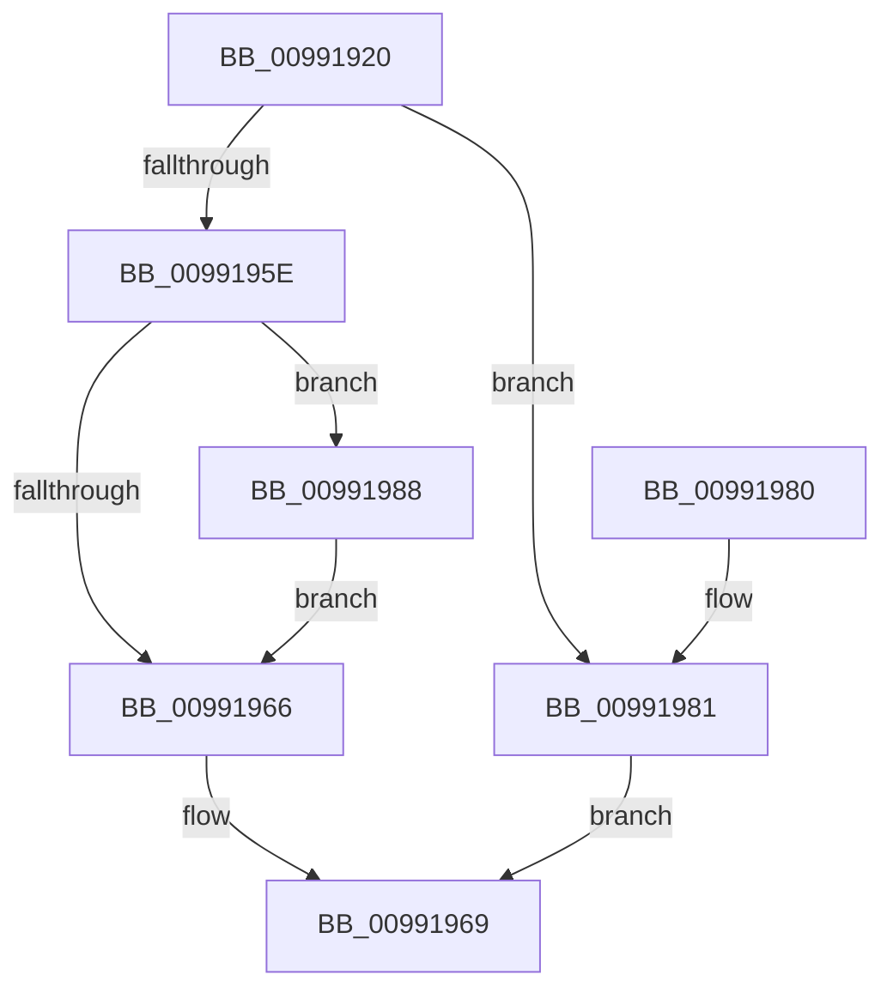

# PiDqGrowPropertyArray

- RVA: `0x00991920`–`0x009919AE` (길이 `142` bytes)
- VA: `0x0000000140991920`
- 실행 섹션: `PAGE`
- PDB 이름 있음: `예`; PDB Function 태그: `아니요`
- unwind 정보 RVA: `0x00098D4C`
- 디코드: `40`개 명령, `142/142` bytes 표시
- 미해석 바이트: `0` (있으면 어셈블리에 `.byte`로 보존)

> 이 문서는 커널 이미지의 기계어와 PDB 기호를 분석해 생성했습니다. 4번과 5번은 함수 원형과 자료형을 바이너리 사용 방식에서 추정한 C 해석이며 원본 소스 복구 결과는 아닙니다.

## 1. Dependencies

- 직접 호출 지점: **3**; 고유 호출 대상: **3**
- 직접 호출자로 확인된 함수: **3**
- RIP 상대 이미지 참조: **0**

### Outgoing calls
- `0x00991951` → [ExAllocatePool2](../../poolcode/B8/ExAllocatePool2_function_00B820F0.md) (function, `0x00B820F0`)
- `0x0099199A` → [memcpy](../../text/6C/memcpy_function_006C6840.md) (function, `0x006C6840`)
- `0x009919A7` → [ExFreePoolWithTag](../../poolcode/B8/ExFreePoolWithTag_function_00B82870.md) (function, `0x00B82870`)

### Direct callers
- [PiDqActionDataGetAllPropertiesInBestLanguage](../98/PiDqActionDataGetAllPropertiesInBestLanguage_function_0098FB7C.md) at `0x0098FC34`
- [PiDqActionDataGetAllPropertiesInAllLanguages](PiDqActionDataGetAllPropertiesInAllLanguages_function_0099569C.md) at `0x00995870`
- [PiDqActionDataGetAllPropertiesInAllLanguages](PiDqActionDataGetAllPropertiesInAllLanguages_function_0099569C.md) at `0x0099589C`
- [PiDqActionDataGetAllPropertiesInAllLanguages](PiDqActionDataGetAllPropertiesInAllLanguages_function_0099569C.md) at `0x009958BB`
- [PiDqActionDataGetChangedProperties](../A6/PiDqActionDataGetChangedProperties_function_00A61F10.md) at `0x00A61FFE`
- [PiDqActionDataGetChangedProperties](../A6/PiDqActionDataGetChangedProperties_function_00A61F10.md) at `0x00A620A3`

### Static image references
- 디코드된 RIP-relative 메모리 참조가 없습니다.

## 2. Other-region calls and transfers

- 다른 실행 섹션으로 향하는 call: **3**
  - `0x00991951` → [ExAllocatePool2](../../poolcode/B8/ExAllocatePool2_function_00B820F0.md) (`PAGE` → `POOLCODE`)
  - `0x0099199A` → [memcpy](../../text/6C/memcpy_function_006C6840.md) (`PAGE` → `.text`)
  - `0x009919A7` → [ExFreePoolWithTag](../../poolcode/B8/ExFreePoolWithTag_function_00B82870.md) (`PAGE` → `POOLCODE`)
- 별도 외부 분기/꼬리 이동을 확인하지 못했습니다.

## 3. Assembly (complete function range)

```asm
00991920  48 89 5C 24 08                  mov qword ptr [rsp + 8], rbx
00991925  48 89 6C 24 10                  mov qword ptr [rsp + 0x10], rbp
0099192A  48 89 74 24 18                  mov qword ptr [rsp + 0x18], rsi
0099192F  57                              push rdi
00991930  48 83 EC 20                     sub rsp, 0x20
00991934  41 8B C0                        mov eax, r8d
00991937  48 8B F9                        mov rdi, rcx
0099193A  8B EA                           mov ebp, edx
0099193C  B9 00 01 00 00                  mov ecx, 0x100
00991941  41 B8 50 6E 70 58               mov r8d, 0x58706e50
00991947  33 DB                           xor ebx, ebx
00991949  48 8D 14 40                     lea rdx, [rax + rax*2]
0099194D  48 C1 E2 04                     shl rdx, 4
00991951  E8 9A 07 1F 00                  call 0x140b820f0
00991956  48 8B F0                        mov rsi, rax
00991959  48 85 C0                        test rax, rax
0099195C  74 23                           je 0x140991981
0099195E  48 8B 17                        mov rdx, qword ptr [rdi]
00991961  48 85 D2                        test rdx, rdx
00991964  75 22                           jne 0x140991988
00991966  48 89 37                        mov qword ptr [rdi], rsi
00991969  48 8B 6C 24 38                  mov rbp, qword ptr [rsp + 0x38]
0099196E  8B C3                           mov eax, ebx
00991970  48 8B 5C 24 30                  mov rbx, qword ptr [rsp + 0x30]
00991975  48 8B 74 24 40                  mov rsi, qword ptr [rsp + 0x40]
0099197A  48 83 C4 20                     add rsp, 0x20
0099197E  5F                              pop rdi
0099197F  C3                              ret
00991980  CC                              int3
00991981  BB 9A 00 00 C0                  mov ebx, 0xc000009a
00991986  EB E1                           jmp 0x140991969
00991988  4C 8D 04 6D 00 00 00 00         lea r8, [rbp*2]
00991990  48 8B CE                        mov rcx, rsi
00991993  4C 03 C5                        add r8, rbp
00991996  49 C1 E0 04                     shl r8, 4
0099199A  E8 A1 4E D3 FF                  call 0x1406c6840
0099199F  48 8B 0F                        mov rcx, qword ptr [rdi]
009919A2  BA 50 6E 70 58                  mov edx, 0x58706e50
009919A7  E8 C4 0E 1F 00                  call 0x140b82870
009919AC  EB B8                           jmp 0x140991966
```

## 4. C-style interpretation (structured pseudocode)

```c
__int64 __fastcall PiDqGrowPropertyArray(__int64 a1, int a2, int a3)
{
    __int64 result;
    __int64 v_rbx;
    __int64 v_rsp;
    unsigned __int64 v_stack_p10;
    unsigned __int64 v_stack_p18;
    unsigned __int64 v_stack_p8;

    v_stack_p8 = v_rbx;
    v_stack_p10 = v_rbp;
    v_stack_p18 = v_rsi;
    v_rsp = (v_rsp) - (32);
    v_rbx = 0;
    a2 = ((unsigned int)(a3) + (unsigned int)(a3) * 2) << (4);
    result = ExAllocatePool2(256, a2, (unsigned int)(0x58706E50ULL), a4);
    if (result == 0) goto loc_00991981;
    if (*(unsigned __int64 *)(a1) != 0) goto loc_00991988;
loc_00991966:
    *(unsigned __int64 *)(a1) = result;
loc_00991969:
    v_rsp = (v_rsp) + (32);
    return 0;
loc_00991981:
    goto loc_00991969;
loc_00991988:
    a3 = (v_stack_p10 * 2) + (v_stack_p10);
    a3 = (a3) << (4);
    result = memcpy(v_stack_p18, *(unsigned __int64 *)(a1), a3, a4);
    result = ExFreePoolWithTag(*(unsigned __int64 *)(a1), (unsigned int)(0x58706E50ULL), a3, a4);
    goto loc_00991966;
}
```

## 5. (Beta) C Style

```c
int64_t PiDqGrowPropertyArray(void *Arg1, int32_t Arg2, void *Arg3)
{
    uint8_t *arg1 = (uint8_t *)Arg1;
    uint8_t *arg3 = (uint8_t *)Arg3;

    int64_t result;
    int64_t local_rbx;
    int64_t local_rsp;
    uint64_t v_stack_p10;
    uint64_t v_stack_p18;
    uint64_t v_stack_p8;

    v_stack_p8 = local_rbx;
    v_stack_p10 = local_rbp;
    v_stack_p18 = local_rsi;
    local_rsp = (local_rsp) - (32);
    local_rbx = 0;
    Arg2 = ((uint32_t)(Arg3) + (uint32_t)(Arg3) * 2) << (4);
    result = ExAllocatePool2(256, Arg2, (uint32_t)(0x58706E50ULL), a4);
    if (result == 0) goto loc_00991981;
    if (*(uint64_t *)(arg1) != 0) goto loc_00991988;
loc_00991966:
    *(uint64_t *)(arg1) = result;
loc_00991969:
    local_rsp = (local_rsp) + (32);
    return 0;
loc_00991981:
    goto loc_00991969;
loc_00991988:
    Arg3 = (v_stack_p10 * 2) + (v_stack_p10);
    Arg3 = (Arg3) << (4);
    result = memcpy(v_stack_p18, *(uint64_t *)(arg1), Arg3, a4);
    result = ExFreePoolWithTag(*(uint64_t *)(arg1), (uint32_t)(0x58706E50ULL), Arg3, a4);
    goto loc_00991966;
}
```

### 관측된 메모리 오프셋

구조체 형식이 확인되지 않은 접근은 인자 기준의 오프셋으로만 기록했습니다.

| 기준 인자 | 오프셋 표현 | 폭 (bit) | 접근 |
|---|---:|---:|---|
| `Arg1` | `+ 0x0` | `64` | `R` |
| `Arg1` | `+ 0x0` | `64` | `W` |
| `Arg3` | `+ 0x0 + rax*2` | `64` | `R` |

## 6. Execution-region graph

[열기: 2D/3D 그래프와 함수 탐색 컨트롤 패널](../../../control-panel.html?section=page&rva=0x00991920&view=graph)

- 2D 그래프는 위에서 아래로 흐르고, 3D 그래프는 빈 공간을 드래그해 회전합니다. Shift+드래그는 이동, 휠은 확대·축소, 함수 노드 선택은 대상 보고서 이동입니다.

### Static fallback


