# PiDqOpenUserObjectRegKey

- RVA: `0x00990444`–`0x00990790` (길이 `844` bytes)
- VA: `0x0000000140990444`
- 실행 섹션: `PAGE`
- PDB 이름 있음: `예`; PDB Function 태그: `아니요`
- unwind 정보 RVA: `0x00098BDC`
- 디코드: `210`개 명령, `844/844` bytes 표시
- 미해석 바이트: `0` (있으면 어셈블리에 `.byte`로 보존)

> 이 문서는 커널 이미지의 기계어와 PDB 기호를 분석해 생성했습니다. 4번과 5번은 함수 원형과 자료형을 바이너리 사용 방식에서 추정한 C 해석이며 원본 소스 복구 결과는 아닙니다.

## 1. Dependencies

- 직접 호출 지점: **18**; 고유 호출 대상: **16**
- 직접 호출자로 확인된 함수: **3**
- RIP 상대 이미지 참조: **3**

### Outgoing calls
- `0x009904CA` → [memset](../../text/6C/memset_function_006C6C40.md) (function, `0x006C6C40`)
- `0x009904DA` → [PnpValidateObjectName](PnpValidateObjectName_function_00990798.md) (function, `0x00990798`)
- `0x00990516` → [SeQueryInformationToken](../8B/SeQueryInformationToken_function_008B5090.md) (function, `0x008B5090`)
- `0x0099053E` → [SeQueryUserSidToken](SeQueryUserSidToken_function_00990950.md) (function, `0x00990950`)
- `0x0099054E` → [RtlConvertSidToUnicodeString](../92/RtlConvertSidToUnicodeString_function_00927B30.md) (function, `0x00927B30`)
- `0x00990587` → [PnpConcatPWSTR](PnpConcatPWSTR_function_00990A00.md) (function, `0x00990A00`)
- `0x009905DC` → [_RegRtlOpenKeyTransacted](../8E/_RegRtlOpenKeyTransacted_function_008EF810.md) (function, `0x008EF810`)
- `0x009905F4` → [PiDqGetRelativeObjectRegPath](PiDqGetRelativeObjectRegPath_function_00990B6C.md) (function, `0x00990B6C`)
- `0x00990637` → [PnpCtxRegOpenKey](../8E/PnpCtxRegOpenKey_function_008EF7B8.md) (function, `0x008EF7B8`)
- `0x0099065F` → [ExFreePoolWithTag](../../poolcode/B8/ExFreePoolWithTag_function_00B82870.md) (function, `0x00B82870`)
- `0x0099066E` → [ZwClose](../../text/6A/ZwClose_function_006AD2B0.md) (function, `0x006AD2B0`)
- `0x00990680` → [ExFreePoolWithTag](../../poolcode/B8/ExFreePoolWithTag_function_00B82870.md) (function, `0x00B82870`)
- `0x0099068D` → [ExFreePool](../../poolcode/B8/ExFreePool_function_00B82850.md) (function, `0x00B82850`)
- `0x009906B2` → [_security_check_cookie](../../text/6A/_security_check_cookie_function_006AC640.md) (function, `0x006AC640`)
- `0x00990749` → [RegRtlCreateTreeTransacted](../93/RegRtlCreateTreeTransacted_function_00931D1C.md) (function, `0x00931D1C`)
- `0x00990769` → [SeCaptureSubjectContext](../86/SeCaptureSubjectContext_function_0086B820.md) (function, `0x0086B820`)
- `0x0099077A` → [SeReleaseSubjectContext](../86/SeReleaseSubjectContext_function_0086B710.md) (function, `0x0086B710`)
- `0x00990786` → [ExFreePoolWithTag](../../poolcode/B8/ExFreePoolWithTag_function_00B82870.md) (function, `0x00B82870`)

### Direct callers
- [PiDqActionDataGetRequestedProperties](../8D/PiDqActionDataGetRequestedProperties_function_008DEBE4.md) at `0x008DEDCC`
- [PiDqActionDataGetAllPropertiesInBestLanguage](../98/PiDqActionDataGetAllPropertiesInBestLanguage_function_0098FB7C.md) at `0x0098FBDC`
- [PiDqOpenObjectRegKey](../98/PiDqOpenObjectRegKey_function_0098FF30.md) at `0x0098FF74`

### Static image references
- `0x00990460` → RVA `0x00E0A740` (`.data`; read)
- `0x00990561` → RVA `0x00AFE5A0` (` ?? ::NNGAKEGL::`string'`; read)
- `0x00990596` → RVA `0x00E66398` (`.data`; read)

## 2. Other-region calls and transfers

- 다른 실행 섹션으로 향하는 call: **7**
  - `0x009904CA` → [memset](../../text/6C/memset_function_006C6C40.md) (`PAGE` → `.text`)
  - `0x0099065F` → [ExFreePoolWithTag](../../poolcode/B8/ExFreePoolWithTag_function_00B82870.md) (`PAGE` → `POOLCODE`)
  - `0x0099066E` → [ZwClose](../../text/6A/ZwClose_function_006AD2B0.md) (`PAGE` → `.text`)
  - `0x00990680` → [ExFreePoolWithTag](../../poolcode/B8/ExFreePoolWithTag_function_00B82870.md) (`PAGE` → `POOLCODE`)
  - `0x0099068D` → [ExFreePool](../../poolcode/B8/ExFreePool_function_00B82850.md) (`PAGE` → `POOLCODE`)
  - `0x009906B2` → [_security_check_cookie](../../text/6A/_security_check_cookie_function_006AC640.md) (`PAGE` → `.text`)
  - `0x00990786` → [ExFreePoolWithTag](../../poolcode/B8/ExFreePoolWithTag_function_00B82870.md) (`PAGE` → `POOLCODE`)
- 별도 외부 분기/꼬리 이동을 확인하지 못했습니다.

## 3. Assembly (complete function range)

```asm
00990444  48 89 5C 24 20                  mov qword ptr [rsp + 0x20], rbx
00990449  55                              push rbp
0099044A  56                              push rsi
0099044B  57                              push rdi
0099044C  41 54                           push r12
0099044E  41 55                           push r13
00990450  41 56                           push r14
00990452  41 57                           push r15
00990454  48 8D 6C 24 E0                  lea rbp, [rsp - 0x20]
00990459  48 81 EC 20 01 00 00            sub rsp, 0x120
00990460  48 8B 05 D9 A2 47 00            mov rax, qword ptr [rip + 0x47a2d9]
00990467  48 33 C4                        xor rax, rsp
0099046A  48 89 45 10                     mov qword ptr [rbp + 0x10], rax
0099046E  48 8B B5 80 00 00 00            mov rsi, qword ptr [rbp + 0x80]
00990475  45 33 ED                        xor r13d, r13d
00990478  4C 8B BD 88 00 00 00            mov r15, qword ptr [rbp + 0x88]
0099047F  0F 57 C0                        xorps xmm0, xmm0
00990482  45 8B E0                        mov r12d, r8d
00990485  89 54 24 54                     mov dword ptr [rsp + 0x54], edx
00990489  48 8B D9                        mov rbx, rcx
0099048C  48 89 4D 90                     mov qword ptr [rbp - 0x70], rcx
00990490  45 8D 45 44                     lea r8d, [r13 + 0x44]
00990494  44 88 4C 24 50                  mov byte ptr [rsp + 0x50], r9b
00990499  33 D2                           xor edx, edx
0099049B  4C 89 6C 24 78                  mov qword ptr [rsp + 0x78], r13
009904A0  48 8D 4D C0                     lea rcx, [rbp - 0x40]
009904A4  4C 89 6C 24 70                  mov qword ptr [rsp + 0x70], r13
009904A9  0F 11 45 98                     movups xmmword ptr [rbp - 0x68], xmm0
009904AD  45 8B F5                        mov r14d, r13d
009904B0  4C 89 6C 24 68                  mov qword ptr [rsp + 0x68], r13
009904B5  0F 11 45 A8                     movups xmmword ptr [rbp - 0x58], xmm0
009904B9  41 8B FD                        mov edi, r13d
009904BC  4C 89 6C 24 60                  mov qword ptr [rsp + 0x60], r13
009904C1  0F 11 45 80                     movups xmmword ptr [rbp - 0x80], xmm0
009904C5  44 89 6C 24 58                  mov dword ptr [rsp + 0x58], r13d
009904CA  E8 71 67 D3 FF                  call 0x1406c6c40
009904CF  44 8B 44 24 54                  mov r8d, dword ptr [rsp + 0x54]
009904D4  48 8B D3                        mov rdx, rbx
009904D7  4D 21 2F                        and qword ptr [r15], r13
009904DA  E8 B9 02 00 00                  call 0x140990798
009904DF  8B D8                           mov ebx, eax
009904E1  85 C0                           test eax, eax
009904E3  0F 88 57 01 00 00               js 0x140990640
009904E9  48 85 F6                        test rsi, rsi
009904EC  0F 84 73 02 00 00               je 0x140990765
009904F2  48 85 F6                        test rsi, rsi
009904F5  48 8D 45 98                     lea rax, [rbp - 0x68]
009904F9  48 0F 45 C6                     cmovne rax, rsi
009904FD  48 8B 30                        mov rsi, qword ptr [rax]
00990500  48 85 F6                        test rsi, rsi
00990503  75 04                           jne 0x140990509
00990505  48 8B 70 10                     mov rsi, qword ptr [rax + 0x10]
00990509  4C 8D 44 24 78                  lea r8, [rsp + 0x78]
0099050E  BA 09 00 00 00                  mov edx, 9
00990513  48 8B CE                        mov rcx, rsi
00990516  E8 75 4B F2 FF                  call 0x1408b5090
0099051B  8B D8                           mov ebx, eax
0099051D  85 C0                           test eax, eax
0099051F  0F 89 C9 01 00 00               jns 0x1409906ee
00990525  3D 03 00 00 C0                  cmp eax, 0xc0000003
0099052A  0F 85 10 01 00 00               jne 0x140990640
00990530  45 33 C9                        xor r9d, r9d
00990533  48 8D 55 C0                     lea rdx, [rbp - 0x40]
00990537  48 8B CE                        mov rcx, rsi
0099053A  45 8D 41 44                     lea r8d, [r9 + 0x44]
0099053E  E8 0D 04 00 00                  call 0x140990950
00990543  41 B0 01                        mov r8b, 1
00990546  48 8D 55 C0                     lea rdx, [rbp - 0x40]
0099054A  48 8D 4D 80                     lea rcx, [rbp - 0x80]
0099054E  E8 DD 75 F9 FF                  call 0x140927b30
00990553  8B D8                           mov ebx, eax
00990555  85 C0                           test eax, eax
00990557  0F 88 E3 00 00 00               js 0x140990640
0099055D  48 8B 75 88                     mov rsi, qword ptr [rbp - 0x78]
00990561  48 8D 05 38 E0 16 00            lea rax, [rip + 0x16e038]
00990568  48 89 74 24 28                  mov qword ptr [rsp + 0x28], rsi
0099056D  4C 8D 44 24 70                  lea r8, [rsp + 0x70]
00990572  41 B9 02 00 00 00               mov r9d, 2
00990578  48 89 44 24 20                  mov qword ptr [rsp + 0x20], rax
0099057D  BA 50 6E 70 58                  mov edx, 0x58706e50
00990582  B9 FF FF FF 7F                  mov ecx, 0x7fffffff
00990587  E8 74 04 00 00                  call 0x140990a00
0099058C  8B D8                           mov ebx, eax
0099058E  85 C0                           test eax, eax
00990590  0F 88 3D 01 00 00               js 0x1409906d3
00990596  48 8B 05 FB 5D 4D 00            mov rax, qword ptr [rip + 0x4d5dfb]
0099059D  48 85 C0                        test rax, rax
009905A0  0F 84 41 01 00 00               je 0x1409906e7
009905A6  48 8B 88 E0 00 00 00            mov rcx, qword ptr [rax + 0xe0]
009905AD  48 85 C9                        test rcx, rcx
009905B0  0F 84 31 01 00 00               je 0x1409906e7
009905B6  48 8B 41 08                     mov rax, qword ptr [rcx + 8]
009905BA  4C 8B 74 24 70                  mov r14, qword ptr [rsp + 0x70]
009905BF  41 B9 04 00 00 00               mov r9d, 4
009905C5  48 89 44 24 28                  mov qword ptr [rsp + 0x28], rax
009905CA  49 8B D6                        mov rdx, r14
009905CD  48 8D 44 24 68                  lea rax, [rsp + 0x68]
009905D2  45 33 C0                        xor r8d, r8d
009905D5  33 C9                           xor ecx, ecx
009905D7  48 89 44 24 20                  mov qword ptr [rsp + 0x20], rax
009905DC  E8 2F F2 F5 FF                  call 0x1408ef810
009905E1  8B D8                           mov ebx, eax
009905E3  85 C0                           test eax, eax
009905E5  78 5D                           js 0x140990644
009905E7  8B 54 24 54                     mov edx, dword ptr [rsp + 0x54]
009905EB  4C 8D 44 24 60                  lea r8, [rsp + 0x60]
009905F0  48 8B 4D 90                     mov rcx, qword ptr [rbp - 0x70]
009905F4  E8 73 05 00 00                  call 0x140990b6c
009905F9  8B D8                           mov ebx, eax
009905FB  85 C0                           test eax, eax
009905FD  0F 88 DA 00 00 00               js 0x1409906dd
00990603  40 38 7C 24 50                  cmp byte ptr [rsp + 0x50], dil
00990608  0F 85 FC 00 00 00               jne 0x14099070a
0099060E  48 8B 7C 24 60                  mov rdi, qword ptr [rsp + 0x60]
00990613  45 33 C9                        xor r9d, r9d
00990616  48 8B 54 24 68                  mov rdx, qword ptr [rsp + 0x68]
0099061B  4C 8B C7                        mov r8, rdi
0099061E  48 8B 0D 73 5D 4D 00            mov rcx, qword ptr [rip + 0x4d5d73]
00990625  4C 89 7C 24 28                  mov qword ptr [rsp + 0x28], r15
0099062A  C7 44 24 58 02 00 00 00         mov dword ptr [rsp + 0x58], 2
00990632  44 89 64 24 20                  mov dword ptr [rsp + 0x20], r12d
00990637  E8 7C F1 F5 FF                  call 0x1408ef7b8
0099063C  8B D8                           mov ebx, eax
0099063E  EB 04                           jmp 0x140990644
00990640  48 8B 75 88                     mov rsi, qword ptr [rbp - 0x78]
00990644  81 FB 7C 01 00 C0               cmp ebx, 0xc000017c
0099064A  B8 34 00 00 C0                  mov eax, 0xc0000034
0099064F  0F 44 D8                        cmove ebx, eax
00990652  48 85 FF                        test rdi, rdi
00990655  74 0D                           je 0x140990664
00990657  BA 50 6E 70 58                  mov edx, 0x58706e50
0099065C  48 8B CF                        mov rcx, rdi
0099065F  E8 0C 22 1F 00                  call 0x140b82870
00990664  48 8B 4C 24 68                  mov rcx, qword ptr [rsp + 0x68]
00990669  48 85 C9                        test rcx, rcx
0099066C  74 05                           je 0x140990673
0099066E  E8 3D CC D1 FF                  call 0x1406ad2b0
00990673  4D 85 F6                        test r14, r14
00990676  74 0D                           je 0x140990685
00990678  BA 50 6E 70 58                  mov edx, 0x58706e50
0099067D  49 8B CE                        mov rcx, r14
00990680  E8 EB 21 1F 00                  call 0x140b82870
00990685  48 85 F6                        test rsi, rsi
00990688  74 08                           je 0x140990692
0099068A  48 8B CE                        mov rcx, rsi
0099068D  E8 BE 21 1F 00                  call 0x140b82850
00990692  45 84 ED                        test r13b, r13b
00990695  0F 85 DB 00 00 00               jne 0x140990776
0099069B  48 8B 4C 24 78                  mov rcx, qword ptr [rsp + 0x78]
009906A0  48 85 C9                        test rcx, rcx
009906A3  0F 85 DB 00 00 00               jne 0x140990784
009906A9  8B C3                           mov eax, ebx
009906AB  48 8B 4D 10                     mov rcx, qword ptr [rbp + 0x10]
009906AF  48 33 CC                        xor rcx, rsp
009906B2  E8 89 BF D1 FF                  call 0x1406ac640
009906B7  48 8B 9C 24 78 01 00 00         mov rbx, qword ptr [rsp + 0x178]
009906BF  48 81 C4 20 01 00 00            add rsp, 0x120
009906C6  41 5F                           pop r15
009906C8  41 5E                           pop r14
009906CA  41 5D                           pop r13
009906CC  41 5C                           pop r12
009906CE  5F                              pop rdi
009906CF  5E                              pop rsi
009906D0  5D                              pop rbp
009906D1  C3                              ret
009906D2  CC                              int3
009906D3  4C 8B 74 24 70                  mov r14, qword ptr [rsp + 0x70]
009906D8  E9 67 FF FF FF                  jmp 0x140990644
009906DD  48 8B 7C 24 60                  mov rdi, qword ptr [rsp + 0x60]
009906E2  E9 5D FF FF FF                  jmp 0x140990644
009906E7  33 C0                           xor eax, eax
009906E9  E9 CC FE FF FF                  jmp 0x1409905ba
009906EE  48 8B 44 24 78                  mov rax, qword ptr [rsp + 0x78]
009906F3  83 38 02                        cmp dword ptr [rax], 2
009906F6  0F 8D 34 FE FF FF               jge 0x140990530
009906FC  48 8B 75 88                     mov rsi, qword ptr [rbp - 0x78]
00990700  BB 22 00 00 C0                  mov ebx, 0xc0000022
00990705  E9 5A FF FF FF                  jmp 0x140990664
0099070A  48 8B 05 87 5C 4D 00            mov rax, qword ptr [rip + 0x4d5c87]
00990711  48 85 C0                        test rax, rax
00990714  75 3D                           jne 0x140990753
00990716  33 C0                           xor eax, eax
00990718  48 8B 4C 24 68                  mov rcx, qword ptr [rsp + 0x68]
0099071D  45 8B CC                        mov r9d, r12d
00990720  48 89 44 24 40                  mov qword ptr [rsp + 0x40], rax
00990725  45 33 C0                        xor r8d, r8d
00990728  48 8D 44 24 58                  lea rax, [rsp + 0x58]
0099072D  48 89 44 24 38                  mov qword ptr [rsp + 0x38], rax
00990732  4C 89 7C 24 30                  mov qword ptr [rsp + 0x30], r15
00990737  40 88 7C 24 28                  mov byte ptr [rsp + 0x28], dil
0099073C  48 21 7C 24 20                  and qword ptr [rsp + 0x20], rdi
00990741  48 8B 7C 24 60                  mov rdi, qword ptr [rsp + 0x60]
00990746  48 8B D7                        mov rdx, rdi
00990749  E8 CE 15 FA FF                  call 0x140931d1c
0099074E  E9 E9 FE FF FF                  jmp 0x14099063c
00990753  48 8B 88 E0 00 00 00            mov rcx, qword ptr [rax + 0xe0]
0099075A  48 85 C9                        test rcx, rcx
0099075D  74 B7                           je 0x140990716
0099075F  48 8B 41 08                     mov rax, qword ptr [rcx + 8]
00990763  EB B3                           jmp 0x140990718
00990765  48 8D 4D 98                     lea rcx, [rbp - 0x68]
00990769  E8 B2 B0 ED FF                  call 0x14086b820
0099076E  41 B5 01                        mov r13b, 1
00990771  E9 7C FD FF FF                  jmp 0x1409904f2
00990776  48 8D 4D 98                     lea rcx, [rbp - 0x68]
0099077A  E8 91 AF ED FF                  call 0x14086b710
0099077F  E9 17 FF FF FF                  jmp 0x14099069b
00990784  33 D2                           xor edx, edx
00990786  E8 E5 20 1F 00                  call 0x140b82870
0099078B  E9 19 FF FF FF                  jmp 0x1409906a9
```

## 4. C-style interpretation (structured pseudocode)

```c
__int64 __fastcall PiDqOpenUserObjectRegKey(__int64 a1, int a2, int a3, int a4, __int64 a5, __int64 a6)
{
    __int64 result;
    __int64 v_r13;
    __int64 v_rbx;
    __int64 v_rsi;
    __int64 v_rsp;
    unsigned int v_stack_m100;
    unsigned int v_stack_m104;
    unsigned __int8 v_stack_m108;
    unsigned __int64 v_stack_m130;
    unsigned __int64 v_stack_m138;
    unsigned __int64 v_stack_m48;
    unsigned __int64 v_stack_m58;
    unsigned __int64 v_stack_m98;
    unsigned __int64 v_stack_mB0;
    unsigned __int64 v_stack_mC0;
    unsigned __int64 v_stack_mC8;
    unsigned __int64 v_stack_mD0;
    unsigned __int64 v_stack_mD8;
    unsigned __int64 v_stack_mE0;
    unsigned __int64 v_stack_mE8;
    unsigned __int64 v_stack_mF0;
    unsigned __int64 v_stack_mF8;
    unsigned __int64 v_stack_p20;
    unsigned __int8 v_stack_p28;
    unsigned __int64 v_stack_p30;
    unsigned __int64 v_stack_p38;
    unsigned __int64 v_stack_p40;
    unsigned __int64 v_stack_p58;
    unsigned __int64 v_stack_p60;
    unsigned __int64 v_stack_p68;
    unsigned __int64 v_stack_p70;
    unsigned __int64 v_stack_p78;

    v_stack_p20 = v_rbx;
    v_rsp = (v_rsp) - (288);
    result = (*(unsigned __int64 *)(v_rip + 4694745)) ^ (v_rsp);
    v_stack_m48 = result;
    v_r13 = 0;
    v_stack_m104 = a2;
    v_stack_mC8 = a1;
    v_stack_m108 = (unsigned __int8)(a4);
    a2 = 0;
    v_stack_mE0 = 0;
    v_stack_mE8 = 0;
    v_stack_mC0 = v_xmm0;
    v_stack_mF0 = 0;
    v_stack_mB0 = v_xmm0;
    v_stack_mF8 = 0;
    v_stack_mD8 = v_xmm0;
    v_stack_m100 = 0;
    result = memset(v_stack_m98, a2, v_r13 + 68, a4);
    result = PnpValidateObjectName(v_stack_m98, a1, (unsigned int)(v_stack_m104), a4);
    if (sign_flag) goto loc_00990640;
    if (a5 == 0) goto loc_00990765;
loc_009904F2:
    result = v_stack_mC0;
    if (a5 != 0) { result = a5; }
    v_rsi = *(unsigned __int64 *)(result);
    if (*(unsigned __int64 *)(result) == 0) {
        v_rsi = *(unsigned __int64 *)(result + 16);
    }
    result = SeQueryInformationToken(v_rsi, 9, v_stack_mE0, a4);
    if (!sign_flag) goto loc_009906EE;
    if (((unsigned int)(result)) != 0xC0000003ULL) goto loc_00990640;
loc_00990530:
    a4 = 0;
    result = SeQueryUserSidToken(v_rsi, v_stack_m98, a4 + 68, a4);
    result = RtlConvertSidToUnicodeString(v_stack_mD8, v_stack_m98, 1, a4);
    if (sign_flag) goto loc_00990640;
    v_stack_m130 = v_stack_mD0;
    v_stack_m138 = v_rip + 1499192;
    result = PnpConcatPWSTR((unsigned int)(0x7FFFFFFFULL), (unsigned int)(0x58706E50ULL), v_stack_mE8, 2);
    if (sign_flag) goto loc_009906D3;
    if (*(unsigned __int64 *)(v_rip + 5070331) == 0) goto loc_009906E7;
    if (*(unsigned __int64 *)(*(unsigned __int64 *)(v_rip + 5070331) + 224) == 0) goto loc_009906E7;
loc_009905BA:
    v_stack_m130 = *(unsigned __int64 *)(*(unsigned __int64 *)(*(unsigned __int64 *)(v_rip + 5070331) + 224) + 8);
    a3 = 0;
    a1 = 0;
    v_stack_m138 = v_stack_mF0;
    result = _RegRtlOpenKeyTransacted(a1, v_stack_mE8, a3, 4);
    if (sign_flag) goto loc_00990644;
    result = PiDqGetRelativeObjectRegPath(v_stack_mC8, (unsigned int)(v_stack_m104), v_stack_mF8, 4);
    if (sign_flag) goto loc_009906DD;
    if (v_stack_m108 != 0) goto loc_0099070A;
    a4 = 0;
    v_stack_m130 = a6;
    v_stack_m100 = 2;
    v_stack_m138 = (unsigned int)((unsigned int)(a3));
    result = PnpCtxRegOpenKey(*(unsigned __int64 *)(v_rip + 5070195), v_stack_mF0, v_stack_mF8, a4);
loc_0099063C:
    goto loc_00990644;
loc_00990640:
loc_00990644:
    v_rbx = (unsigned int)((unsigned int)(result));
    if (((unsigned int)((unsigned int)((unsigned int)(result)))) == 0xC000017CULL) { v_rbx = (unsigned int)((unsigned int)(0xC0000034ULL)); }
    result = (unsigned int)(0xC0000034ULL);
    if (v_stack_mF8 != 0) {
        a2 = 0x58706E50ULL;
        a1 = v_stack_mF8;
        result = ExFreePoolWithTag(a1, a2, v_stack_mF8, a4);
    }
    if (v_stack_mF0 != 0) {
        result = ZwClose(v_stack_mF0, a2, v_stack_mF8, a4);
    }
    if (v_stack_mE8 != 0) {
        a2 = 0x58706E50ULL;
        a1 = v_stack_mE8;
        result = ExFreePoolWithTag(a1, a2, v_stack_mF8, a4);
    }
    if (v_stack_mD0 != 0) {
        a1 = v_stack_mD0;
        result = ExFreePool(a1, a2, v_stack_mF8, a4);
    }
    if (0 != 0) goto loc_00990776;
loc_0099069B:
    if (v_stack_mE0 != 0) goto loc_00990784;
loc_009906A9:
    a1 = (v_stack_m48) ^ (v_rsp);
    result = _security_check_cookie(a1, a2, v_stack_mF8, a4);
    v_rsp = (v_rsp) + (288);
    return result;
loc_009906D3:
    goto loc_00990644;
loc_009906DD:
    goto loc_00990644;
loc_009906E7:
    result = 0;
    goto loc_009905BA;
loc_009906EE:
    if ((*(unsigned int *)(v_stack_p78)) >= 2) goto loc_00990530;
    goto loc_00990664;
loc_0099070A:
    if (*(unsigned __int64 *)(v_rip + 5069959) != 0) goto loc_00990753;
loc_00990716:
    result = 0;
loc_00990718:
    v_stack_p40 = 0;
    a3 = 0;
    v_stack_p38 = v_stack_p58;
    v_stack_p30 = a6;
    v_stack_p28 = (unsigned __int8)(v_stack_p60);
    result = RegRtlCreateTreeTransacted(v_stack_p68, v_stack_p60, a3, (unsigned int)((unsigned int)((unsigned int)(a3))));
    goto loc_0099063C;
loc_00990753:
    if (*(unsigned __int64 *)(result + 224) == 0) goto loc_00990716;
    goto loc_00990718;
loc_00990765:
    result = SeCaptureSubjectContext(v_stack_mC0, v_stack_p60, a3, (unsigned int)((unsigned int)((unsigned int)(a3))));
    goto loc_009904F2;
loc_00990776:
    result = SeReleaseSubjectContext(v_stack_mC0, v_stack_p60, a3, (unsigned int)((unsigned int)((unsigned int)(a3))));
    goto loc_0099069B;
loc_00990784:
    a2 = 0;
    result = ExFreePoolWithTag(v_stack_mC0, a2, a3, (unsigned int)((unsigned int)((unsigned int)(a3))));
    goto loc_009906A9;
}
```

## 5. (Beta) C Style

```c
int64_t PiDqOpenUserObjectRegKey(int64_t Arg1, int32_t Arg2, int32_t Arg3, int32_t Arg4, int64_t Arg5, void *Arg6)
{
    uint8_t *arg6 = (uint8_t *)Arg6;

    int64_t result;
    int64_t local_r13;
    int64_t local_rbx;
    int64_t local_rsi;
    int64_t local_rsp;
    uint32_t v_stack_m100;
    uint32_t v_stack_m104;
    uint8_t v_stack_m108;
    uint64_t v_stack_m130;
    uint64_t v_stack_m138;
    uint64_t v_stack_m48;
    uint64_t v_stack_m58;
    uint64_t v_stack_m98;
    uint64_t v_stack_mB0;
    uint64_t v_stack_mC0;
    uint64_t v_stack_mC8;
    uint64_t v_stack_mD0;
    uint64_t v_stack_mD8;
    uint64_t v_stack_mE0;
    uint64_t v_stack_mE8;
    uint64_t v_stack_mF0;
    uint64_t v_stack_mF8;
    uint64_t v_stack_p20;
    uint8_t v_stack_p28;
    uint64_t v_stack_p30;
    uint64_t v_stack_p38;
    uint64_t v_stack_p40;
    uint64_t v_stack_p58;
    uint64_t v_stack_p60;
    uint64_t v_stack_p68;
    uint64_t v_stack_p70;
    uint64_t v_stack_p78;

    v_stack_p20 = local_rbx;
    local_rsp = (local_rsp) - (288);
    result = (*(uint64_t *)(v_rip + 0x47A2D9)) ^ (local_rsp);
    v_stack_m48 = result;
    local_r13 = 0;
    v_stack_m104 = Arg2;
    v_stack_mC8 = Arg1;
    v_stack_m108 = (uint8_t)(Arg4);
    Arg2 = 0;
    v_stack_mE0 = 0;
    v_stack_mE8 = 0;
    v_stack_mC0 = v_xmm0;
    v_stack_mF0 = 0;
    v_stack_mB0 = v_xmm0;
    v_stack_mF8 = 0;
    v_stack_mD8 = v_xmm0;
    v_stack_m100 = 0;
    result = memset(v_stack_m98, Arg2, local_r13 + 68, Arg4);
    result = PnpValidateObjectName(v_stack_m98, Arg1, (uint32_t)(v_stack_m104), Arg4);
    if (sign_flag) goto loc_00990640;
    if (Arg5 == 0) goto loc_00990765;
loc_009904F2:
    result = v_stack_mC0;
    if (Arg5 != 0) { result = Arg5; }
    local_rsi = *(uint64_t *)(result);
    if (*(uint64_t *)(result) == 0) {
        local_rsi = *(uint64_t *)(result + 0x10);
    }
    result = SeQueryInformationToken(local_rsi, 9, v_stack_mE0, Arg4);
    if (!sign_flag) goto loc_009906EE;
    if (((uint32_t)(result)) != 0xC0000003ULL) goto loc_00990640;
loc_00990530:
    Arg4 = 0;
    result = SeQueryUserSidToken(local_rsi, v_stack_m98, Arg4 + 68, Arg4);
    result = RtlConvertSidToUnicodeString(v_stack_mD8, v_stack_m98, 1, Arg4);
    if (sign_flag) goto loc_00990640;
    v_stack_m130 = v_stack_mD0;
    v_stack_m138 = v_rip + 1499192;
    result = PnpConcatPWSTR((uint32_t)(0x7FFFFFFFULL), (uint32_t)(0x58706E50ULL), v_stack_mE8, 2);
    if (sign_flag) goto loc_009906D3;
    if (*(uint64_t *)(v_rip + 0x4D5DFB) == 0) goto loc_009906E7;
    if (*(uint64_t *)(*(uint64_t *)(v_rip + 0x4D5DFB) + 0xE0) == 0) goto loc_009906E7;
loc_009905BA:
    v_stack_m130 = *(uint64_t *)(*(uint64_t *)(*(uint64_t *)(v_rip + 0x4D5DFB) + 0xE0) + 0x8);
    Arg3 = 0;
    Arg1 = 0;
    v_stack_m138 = v_stack_mF0;
    result = _RegRtlOpenKeyTransacted(Arg1, v_stack_mE8, Arg3, 4);
    if (sign_flag) goto loc_00990644;
    result = PiDqGetRelativeObjectRegPath(v_stack_mC8, (uint32_t)(v_stack_m104), v_stack_mF8, 4);
    if (sign_flag) goto loc_009906DD;
    if (v_stack_m108 != 0) goto loc_0099070A;
    Arg4 = 0;
    v_stack_m130 = Arg6;
    v_stack_m100 = 2;
    v_stack_m138 = (uint32_t)((uint32_t)(Arg3));
    result = PnpCtxRegOpenKey(*(uint64_t *)(v_rip + 0x4D5D73), v_stack_mF0, v_stack_mF8, Arg4);
loc_0099063C:
    goto loc_00990644;
loc_00990640:
loc_00990644:
    local_rbx = (uint32_t)((uint32_t)(result));
    if (((uint32_t)((uint32_t)((uint32_t)(result)))) == 0xC000017CULL) { local_rbx = (uint32_t)((uint32_t)(0xC0000034ULL)); }
    result = (uint32_t)(0xC0000034ULL);
    if (v_stack_mF8 != 0) {
        Arg2 = 0x58706E50ULL;
        Arg1 = v_stack_mF8;
        result = ExFreePoolWithTag(Arg1, Arg2, v_stack_mF8, Arg4);
    }
    if (v_stack_mF0 != 0) {
        result = ZwClose(v_stack_mF0, Arg2, v_stack_mF8, Arg4);
    }
    if (v_stack_mE8 != 0) {
        Arg2 = 0x58706E50ULL;
        Arg1 = v_stack_mE8;
        result = ExFreePoolWithTag(Arg1, Arg2, v_stack_mF8, Arg4);
    }
    if (v_stack_mD0 != 0) {
        Arg1 = v_stack_mD0;
        result = ExFreePool(Arg1, Arg2, v_stack_mF8, Arg4);
    }
    if (0 != 0) goto loc_00990776;
loc_0099069B:
    if (v_stack_mE0 != 0) goto loc_00990784;
loc_009906A9:
    Arg1 = (v_stack_m48) ^ (local_rsp);
    result = _security_check_cookie(Arg1, Arg2, v_stack_mF8, Arg4);
    local_rsp = (local_rsp) + (288);
    return result;
loc_009906D3:
    goto loc_00990644;
loc_009906DD:
    goto loc_00990644;
loc_009906E7:
    result = 0;
    goto loc_009905BA;
loc_009906EE:
    if ((*(uint32_t *)(v_stack_p78)) >= 2) goto loc_00990530;
    goto loc_00990664;
loc_0099070A:
    if (*(uint64_t *)(v_rip + 0x4D5C87) != 0) goto loc_00990753;
loc_00990716:
    result = 0;
loc_00990718:
    v_stack_p40 = 0;
    Arg3 = 0;
    v_stack_p38 = v_stack_p58;
    v_stack_p30 = Arg6;
    v_stack_p28 = (uint8_t)(v_stack_p60);
    result = RegRtlCreateTreeTransacted(v_stack_p68, v_stack_p60, Arg3, (uint32_t)((uint32_t)((uint32_t)(Arg3))));
    goto loc_0099063C;
loc_00990753:
    if (*(uint64_t *)(result + 0xE0) == 0) goto loc_00990716;
    goto loc_00990718;
loc_00990765:
    result = SeCaptureSubjectContext(v_stack_mC0, v_stack_p60, Arg3, (uint32_t)((uint32_t)((uint32_t)(Arg3))));
    goto loc_009904F2;
loc_00990776:
    result = SeReleaseSubjectContext(v_stack_mC0, v_stack_p60, Arg3, (uint32_t)((uint32_t)((uint32_t)(Arg3))));
    goto loc_0099069B;
loc_00990784:
    Arg2 = 0;
    result = ExFreePoolWithTag(v_stack_mC0, Arg2, Arg3, (uint32_t)((uint32_t)((uint32_t)(Arg3))));
    goto loc_009906A9;
}
```

### 관측된 메모리 오프셋

구조체 형식이 확인되지 않은 접근은 인자 기준의 오프셋으로만 기록했습니다.

| 기준 인자 | 오프셋 표현 | 폭 (bit) | 접근 |
|---|---:|---:|---|
| `Arg6` | `+ 0x0` | `64` | `R/W` |

## 6. Execution-region graph

[열기: 2D/3D 그래프와 함수 탐색 컨트롤 패널](../../../control-panel.html?section=page&rva=0x00990444&view=graph)

- 2D 그래프는 위에서 아래로 흐르고, 3D 그래프는 빈 공간을 드래그해 회전합니다. Shift+드래그는 이동, 휠은 확대·축소, 함수 노드 선택은 대상 보고서 이동입니다.

### Static fallback

```mermaid
flowchart TD
  bb_00990444[BB_00990444]
  bb_009904E9[BB_009904E9]
  bb_009904F2[BB_009904F2]
  bb_00990505[BB_00990505]
  bb_00990509[BB_00990509]
  bb_00990525[BB_00990525]
  bb_00990530[BB_00990530]
  bb_0099055D[BB_0099055D]
  bb_00990596[BB_00990596]
  bb_009905A6[BB_009905A6]
  bb_009905B6[BB_009905B6]
  bb_009905BA[BB_009905BA]
  bb_009905E7[BB_009905E7]
  bb_00990603[BB_00990603]
  bb_0099060E[BB_0099060E]
  bb_0099063C[BB_0099063C]
  bb_00990640[BB_00990640]
  bb_00990644[BB_00990644]
  bb_00990657[BB_00990657]
  bb_00990664[BB_00990664]
  bb_0099066E[BB_0099066E]
  bb_00990673[BB_00990673]
  bb_00990678[BB_00990678]
  bb_00990685[BB_00990685]
  bb_0099068A[BB_0099068A]
  bb_00990692[BB_00990692]
  bb_0099069B[BB_0099069B]
  bb_009906A9[BB_009906A9]
  bb_009906D2[BB_009906D2]
  bb_009906D3[BB_009906D3]
  bb_009906DD[BB_009906DD]
  bb_009906E7[BB_009906E7]
  bb_009906EE[BB_009906EE]
  bb_009906FC[BB_009906FC]
  bb_0099070A[BB_0099070A]
  bb_00990716[BB_00990716]
  bb_00990718[BB_00990718]
  bb_00990753[BB_00990753]
  bb_0099075F[BB_0099075F]
  bb_00990765[BB_00990765]
  bb_00990776[BB_00990776]
  bb_00990784[BB_00990784]
  bb_00990444 -->|branch| bb_00990640
  bb_00990444 -->|fallthrough| bb_009904E9
  bb_009904E9 -->|branch| bb_00990765
  bb_009904E9 -->|fallthrough| bb_009904F2
  bb_009904F2 -->|branch| bb_00990509
  bb_009904F2 -->|fallthrough| bb_00990505
  bb_00990505 -->|flow| bb_00990509
  bb_00990509 -->|branch| bb_009906EE
  bb_00990509 -->|fallthrough| bb_00990525
  bb_00990525 -->|branch| bb_00990640
  bb_00990525 -->|fallthrough| bb_00990530
  bb_00990530 -->|branch| bb_00990640
  bb_00990530 -->|fallthrough| bb_0099055D
  bb_0099055D -->|branch| bb_009906D3
  bb_0099055D -->|fallthrough| bb_00990596
  bb_00990596 -->|branch| bb_009906E7
  bb_00990596 -->|fallthrough| bb_009905A6
  bb_009905A6 -->|branch| bb_009906E7
  bb_009905A6 -->|fallthrough| bb_009905B6
  bb_009905B6 -->|flow| bb_009905BA
  bb_009905BA -->|branch| bb_00990644
  bb_009905BA -->|fallthrough| bb_009905E7
  bb_009905E7 -->|branch| bb_009906DD
  bb_009905E7 -->|fallthrough| bb_00990603
  bb_00990603 -->|branch| bb_0099070A
  bb_00990603 -->|fallthrough| bb_0099060E
  bb_0099060E -->|flow| bb_0099063C
  bb_0099063C -->|branch| bb_00990644
  bb_00990640 -->|flow| bb_00990644
  bb_00990644 -->|branch| bb_00990664
  bb_00990644 -->|fallthrough| bb_00990657
  bb_00990657 -->|flow| bb_00990664
  bb_00990664 -->|branch| bb_00990673
  bb_00990664 -->|fallthrough| bb_0099066E
  bb_0099066E -->|flow| bb_00990673
  bb_00990673 -->|branch| bb_00990685
  bb_00990673 -->|fallthrough| bb_00990678
  bb_00990678 -->|flow| bb_00990685
  bb_00990685 -->|branch| bb_00990692
  bb_00990685 -->|fallthrough| bb_0099068A
  bb_0099068A -->|flow| bb_00990692
  bb_00990692 -->|branch| bb_00990776
  bb_00990692 -->|fallthrough| bb_0099069B
  bb_0099069B -->|branch| bb_00990784
  bb_0099069B -->|fallthrough| bb_009906A9
  bb_009906D2 -->|flow| bb_009906D3
  bb_009906D3 -->|branch| bb_00990644
  bb_009906DD -->|branch| bb_00990644
  bb_009906E7 -->|branch| bb_009905BA
  bb_009906EE -->|branch| bb_00990530
  bb_009906EE -->|fallthrough| bb_009906FC
  bb_009906FC -->|branch| bb_00990664
  bb_0099070A -->|branch| bb_00990753
  bb_0099070A -->|fallthrough| bb_00990716
  bb_00990716 -->|flow| bb_00990718
  bb_00990718 -->|branch| bb_0099063C
  bb_00990753 -->|branch| bb_00990716
  bb_00990753 -->|fallthrough| bb_0099075F
  bb_0099075F -->|branch| bb_00990718
  bb_00990765 -->|branch| bb_009904F2
  bb_00990776 -->|branch| bb_0099069B
  bb_00990784 -->|branch| bb_009906A9
```


