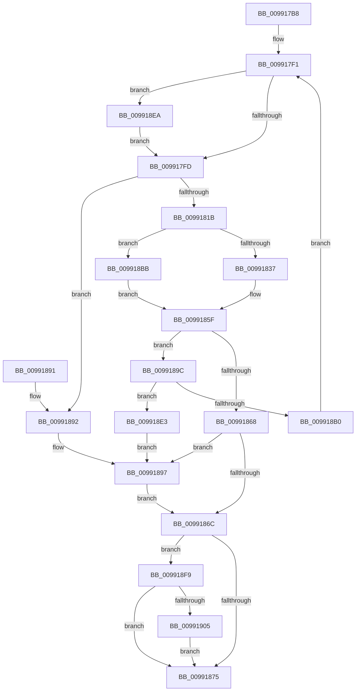

# PiDqPnPGetObjectPropertyKeys

- RVA: `0x009917B8`–`0x00991918` (길이 `352` bytes)
- VA: `0x00000001409917B8`
- 실행 섹션: `PAGE`
- PDB 이름 있음: `예`; PDB Function 태그: `아니요`
- unwind 정보 RVA: `0x00098D30`
- 디코드: `91`개 명령, `352/352` bytes 표시
- 미해석 바이트: `0` (있으면 어셈블리에 `.byte`로 보존)

> 이 문서는 커널 이미지의 기계어와 PDB 기호를 분석해 생성했습니다. 4번과 5번은 함수 원형과 자료형을 바이너리 사용 방식에서 추정한 C 해석이며 원본 소스 복구 결과는 아닙니다.

## 1. Dependencies

- 직접 호출 지점: **5**; 고유 호출 대상: **4**
- 직접 호출자로 확인된 함수: **2**
- RIP 상대 이미지 참조: **1**

### Outgoing calls
- `0x0099180B` → [ExAllocatePool2](../../poolcode/B8/ExAllocatePool2_function_00B820F0.md) (function, `0x00B820F0`)
- `0x0099185A` → [PnpGetObjectPropertyKeys](PnpGetObjectPropertyKeys_function_009919B4.md) (function, `0x009919B4`)
- `0x009918D9` → [PnpGetGenericStorePropertyKeys](PnpGetGenericStorePropertyKeys_function_00992378.md) (function, `0x00992378`)
- `0x009918EF` → [ExFreePoolWithTag](../../poolcode/B8/ExFreePoolWithTag_function_00B82870.md) (function, `0x00B82870`)
- `0x0099190A` → [ExFreePoolWithTag](../../poolcode/B8/ExFreePoolWithTag_function_00B82870.md) (function, `0x00B82870`)

### Direct callers
- [PiDqActionDataGetAllPropertiesInBestLanguage](../98/PiDqActionDataGetAllPropertiesInBestLanguage_function_0098FB7C.md) at `0x0098FC07`
- [PiDqActionDataGetAllPropertiesInAllLanguages](PiDqActionDataGetAllPropertiesInAllLanguages_function_0099569C.md) at `0x0099572E`

### Static image references
- `0x0099184E` → RVA `0x00E66398` (`.data`; read)

## 2. Other-region calls and transfers

- 다른 실행 섹션으로 향하는 call: **3**
  - `0x0099180B` → [ExAllocatePool2](../../poolcode/B8/ExAllocatePool2_function_00B820F0.md) (`PAGE` → `POOLCODE`)
  - `0x009918EF` → [ExFreePoolWithTag](../../poolcode/B8/ExFreePoolWithTag_function_00B82870.md) (`PAGE` → `POOLCODE`)
  - `0x0099190A` → [ExFreePoolWithTag](../../poolcode/B8/ExFreePoolWithTag_function_00B82870.md) (`PAGE` → `POOLCODE`)
- 별도 외부 분기/꼬리 이동을 확인하지 못했습니다.

## 3. Assembly (complete function range)

```asm
009917B8  48 89 5C 24 08                  mov qword ptr [rsp + 8], rbx
009917BD  48 89 6C 24 10                  mov qword ptr [rsp + 0x10], rbp
009917C2  48 89 74 24 18                  mov qword ptr [rsp + 0x18], rsi
009917C7  57                              push rdi
009917C8  41 56                           push r14
009917CA  41 57                           push r15
009917CC  48 83 EC 50                     sub rsp, 0x50
009917D0  48 8B B4 24 90 00 00 00         mov rsi, qword ptr [rsp + 0x90]
009917D8  4D 8B F0                        mov r14, r8
009917DB  48 8B BC 24 98 00 00 00         mov rdi, qword ptr [rsp + 0x98]
009917E3  8B EA                           mov ebp, edx
009917E5  4C 8B F9                        mov r15, rcx
009917E8  BB 70 17 00 00                  mov ebx, 0x1770
009917ED  48 83 26 00                     and qword ptr [rsi], 0
009917F1  48 8B 0E                        mov rcx, qword ptr [rsi]
009917F4  48 85 C9                        test rcx, rcx
009917F7  0F 85 ED 00 00 00               jne 0x1409918ea
009917FD  41 B8 50 6E 70 58               mov r8d, 0x58706e50
00991803  48 8B D3                        mov rdx, rbx
00991806  B9 00 01 00 00                  mov ecx, 0x100
0099180B  E8 E0 08 1F 00                  call 0x140b820f0
00991810  48 89 06                        mov qword ptr [rsi], rax
00991813  48 8B C8                        mov rcx, rax
00991816  48 85 C0                        test rax, rax
00991819  74 77                           je 0x140991892
0099181B  83 27 00                        and dword ptr [rdi], 0
0099181E  48 B8 CD CC CC CC CC CC CC CC   movabs rax, 0xcccccccccccccccd
00991828  48 F7 E3                        mul rbx
0099182B  48 C1 EA 04                     shr rdx, 4
0099182F  85 ED                           test ebp, ebp
00991831  0F 84 84 00 00 00               je 0x1409918bb
00991837  48 89 7C 24 40                  mov qword ptr [rsp + 0x40], rdi
0099183C  4D 8B CE                        mov r9, r14
0099183F  89 54 24 38                     mov dword ptr [rsp + 0x38], edx
00991843  44 8B C5                        mov r8d, ebp
00991846  48 89 4C 24 30                  mov qword ptr [rsp + 0x30], rcx
0099184B  49 8B D7                        mov rdx, r15
0099184E  48 8B 0D 43 4B 4D 00            mov rcx, qword ptr [rip + 0x4d4b43]
00991855  C6 44 24 28 01                  mov byte ptr [rsp + 0x28], 1
0099185A  E8 55 01 00 00                  call 0x1409919b4
0099185F  8B D8                           mov ebx, eax
00991861  3D 23 00 00 C0                  cmp eax, 0xc0000023
00991866  74 34                           je 0x14099189c
00991868  85 C0                           test eax, eax
0099186A  78 2B                           js 0x140991897
0099186C  83 3F 00                        cmp dword ptr [rdi], 0
0099186F  0F 84 84 00 00 00               je 0x1409918f9
00991875  4C 8D 5C 24 50                  lea r11, [rsp + 0x50]
0099187A  8B C3                           mov eax, ebx
0099187C  49 8B 5B 20                     mov rbx, qword ptr [r11 + 0x20]
00991880  49 8B 6B 28                     mov rbp, qword ptr [r11 + 0x28]
00991884  49 8B 73 30                     mov rsi, qword ptr [r11 + 0x30]
00991888  49 8B E3                        mov rsp, r11
0099188B  41 5F                           pop r15
0099188D  41 5E                           pop r14
0099188F  5F                              pop rdi
00991890  C3                              ret
00991891  CC                              int3
00991892  BB 9A 00 00 C0                  mov ebx, 0xc000009a
00991897  83 27 00                        and dword ptr [rdi], 0
0099189A  EB D0                           jmp 0x14099186c
0099189C  8B 0F                           mov ecx, dword ptr [rdi]
0099189E  BA FF FF FF FF                  mov edx, 0xffffffff
009918A3  48 8D 04 89                     lea rax, [rcx + rcx*4]
009918A7  48 C1 E0 02                     shl rax, 2
009918AB  48 3B C2                        cmp rax, rdx
009918AE  77 33                           ja 0x1409918e3
009918B0  8D 1C 89                        lea ebx, [rcx + rcx*4]
009918B3  C1 E3 02                        shl ebx, 2
009918B6  E9 36 FF FF FF                  jmp 0x1409917f1
009918BB  48 89 7C 24 30                  mov qword ptr [rsp + 0x30], rdi
009918C0  41 B1 01                        mov r9b, 1
009918C3  89 54 24 28                     mov dword ptr [rsp + 0x28], edx
009918C7  45 33 C0                        xor r8d, r8d
009918CA  48 89 4C 24 20                  mov qword ptr [rsp + 0x20], rcx
009918CF  49 8B D6                        mov rdx, r14
009918D2  48 8B 0D BF 4A 4D 00            mov rcx, qword ptr [rip + 0x4d4abf]
009918D9  E8 9A 0A 00 00                  call 0x140992378
009918DE  E9 7C FF FF FF                  jmp 0x14099185f
009918E3  BB 95 00 00 C0                  mov ebx, 0xc0000095
009918E8  EB AD                           jmp 0x140991897
009918EA  BA 50 6E 70 58                  mov edx, 0x58706e50
009918EF  E8 7C 0F 1F 00                  call 0x140b82870
009918F4  E9 04 FF FF FF                  jmp 0x1409917fd
009918F9  48 8B 0E                        mov rcx, qword ptr [rsi]
009918FC  48 85 C9                        test rcx, rcx
009918FF  0F 84 70 FF FF FF               je 0x140991875
00991905  BA 50 6E 70 58                  mov edx, 0x58706e50
0099190A  E8 61 0F 1F 00                  call 0x140b82870
0099190F  48 83 26 00                     and qword ptr [rsi], 0
00991913  E9 5D FF FF FF                  jmp 0x140991875
```

## 4. C-style interpretation (structured pseudocode)

```c
__int64 __fastcall PiDqPnPGetObjectPropertyKeys(__int64 a1, int a2, __int64 a3, __int64 a4, __int64 a5, __int64 a6)
{
    __int64 result;
    __int64 v_rbx;
    __int64 v_rsp;
    unsigned __int64 v_stack_m18;
    unsigned __int64 v_stack_m20;
    unsigned __int64 v_stack_m28;
    unsigned int v_stack_m30;
    unsigned __int64 v_stack_m38;
    unsigned __int8 v_stack_m40;
    unsigned __int64 v_stack_p10;
    unsigned __int64 v_stack_p18;
    unsigned __int64 v_stack_p8;

    v_stack_p8 = v_rbx;
    v_stack_p10 = v_rbp;
    v_stack_p18 = v_rsi;
    v_rsp = (v_rsp) - (80);
loc_009917F1:
    if (*(unsigned __int64 *)(a5) != 0) goto loc_009918EA;
loc_009917FD:
    result = ExAllocatePool2(256, (unsigned int)(0x1770ULL), (unsigned int)(0x58706E50ULL), a4);
    *(unsigned __int64 *)(a5) = result;
    if (result == 0) goto loc_00991892;
    a2 = ((unsigned int)(0x1770ULL)) >> (4);
    if ((unsigned int)((unsigned int)(a2)) == 0) goto loc_009918BB;
    v_stack_m28 = a6;
    v_stack_m30 = a2;
    v_stack_m38 = result;
    v_stack_m40 = 1;
    result = PnpGetObjectPropertyKeys(*(unsigned __int64 *)(v_rip + 5065539), a1, (unsigned int)((unsigned int)((unsigned int)(a2))), a3);
loc_0099185F:
    if (((unsigned int)(result)) == 0xC0000023ULL) goto loc_0099189C;
    if (sign_flag) goto loc_00991897;
loc_0099186C:
    if ((*(unsigned int *)(a6)) == 0) goto loc_009918F9;
loc_00991875:
    return (unsigned int)((unsigned int)((unsigned int)((unsigned int)(result))));
loc_00991892:
loc_00991897:
    goto loc_0099186C;
loc_0099189C:
    result = ((unsigned int)(*(unsigned int *)(a6)) + (unsigned int)(*(unsigned int *)(a6)) * 4) << (2);
    if (result > ((unsigned int)(0xFFFFFFFFULL))) goto loc_009918E3;
    v_rbx = (unsigned int)(((unsigned int)(*(unsigned int *)(a6)) + (unsigned int)(*(unsigned int *)(a6)) * 4) << (2));
    goto loc_009917F1;
loc_009918BB:
    v_stack_m20 = a6;
    v_stack_m28 = (unsigned int)((unsigned int)(0xFFFFFFFFULL));
    a3 = 0;
    v_stack_m30 = (unsigned int)(*(unsigned int *)(a6));
    result = PnpGetGenericStorePropertyKeys(*(unsigned __int64 *)(v_rip + 5065407), 0, a3, 1);
    goto loc_0099185F;
loc_009918E3:
    goto loc_00991897;
loc_009918EA:
    result = ExFreePoolWithTag(*(unsigned __int64 *)(v_rip + 5065407), (unsigned int)(0x58706E50ULL), a3, 1);
    goto loc_009917FD;
loc_009918F9:
    if (*(unsigned __int64 *)(*(unsigned __int64 *)(v_stack_m18 + 48)) == 0) goto loc_00991875;
    result = ExFreePoolWithTag(*(unsigned __int64 *)(*(unsigned __int64 *)(v_stack_m18 + 48)), (unsigned int)(0x58706E50ULL), a3, 1);
    goto loc_00991875;
}
```

## 5. (Beta) C Style

```c
int64_t PiDqPnPGetObjectPropertyKeys(int64_t Arg1, int32_t Arg2, int64_t Arg3, int64_t Arg4, void *Arg5, void *Arg6)
{
    uint8_t *arg5 = (uint8_t *)Arg5;
    uint8_t *arg6 = (uint8_t *)Arg6;

    int64_t result;
    int64_t local_rbx;
    int64_t local_rsp;
    uint64_t v_stack_m18;
    uint64_t v_stack_m20;
    uint64_t v_stack_m28;
    uint32_t v_stack_m30;
    uint64_t v_stack_m38;
    uint8_t v_stack_m40;
    uint64_t v_stack_p10;
    uint64_t v_stack_p18;
    uint64_t v_stack_p8;

    v_stack_p8 = local_rbx;
    v_stack_p10 = local_rbp;
    v_stack_p18 = local_rsi;
    local_rsp = (local_rsp) - (80);
loc_009917F1:
    if (*(uint64_t *)(arg5) != 0) goto loc_009918EA;
loc_009917FD:
    result = ExAllocatePool2(256, (uint32_t)(0x1770ULL), (uint32_t)(0x58706E50ULL), Arg4);
    *(uint64_t *)(arg5) = result;
    if (result == 0) goto loc_00991892;
    Arg2 = ((uint32_t)(0x1770ULL)) >> (4);
    if ((uint32_t)((uint32_t)(Arg2)) == 0) goto loc_009918BB;
    v_stack_m28 = Arg6;
    v_stack_m30 = Arg2;
    v_stack_m38 = result;
    v_stack_m40 = 1;
    result = PnpGetObjectPropertyKeys(*(uint64_t *)(v_rip + 0x4D4B43), Arg1, (uint32_t)((uint32_t)((uint32_t)(Arg2))), Arg3);
loc_0099185F:
    if (((uint32_t)(result)) == 0xC0000023ULL) goto loc_0099189C;
    if (sign_flag) goto loc_00991897;
loc_0099186C:
    if ((*(uint32_t *)(arg6)) == 0) goto loc_009918F9;
loc_00991875:
    return (uint32_t)((uint32_t)((uint32_t)((uint32_t)(result))));
loc_00991892:
loc_00991897:
    goto loc_0099186C;
loc_0099189C:
    result = ((uint32_t)(*(uint32_t *)(arg6)) + (uint32_t)(*(uint32_t *)(arg6)) * 4) << (2);
    if (result > ((uint32_t)(0xFFFFFFFFULL))) goto loc_009918E3;
    local_rbx = (uint32_t)(((uint32_t)(*(uint32_t *)(arg6)) + (uint32_t)(*(uint32_t *)(arg6)) * 4) << (2));
    goto loc_009917F1;
loc_009918BB:
    v_stack_m20 = Arg6;
    v_stack_m28 = (uint32_t)((uint32_t)(0xFFFFFFFFULL));
    Arg3 = 0;
    v_stack_m30 = (uint32_t)(*(uint32_t *)(arg6));
    result = PnpGetGenericStorePropertyKeys(*(uint64_t *)(v_rip + 0x4D4ABF), 0, Arg3, 1);
    goto loc_0099185F;
loc_009918E3:
    goto loc_00991897;
loc_009918EA:
    result = ExFreePoolWithTag(*(uint64_t *)(v_rip + 0x4D4ABF), (uint32_t)(0x58706E50ULL), Arg3, 1);
    goto loc_009917FD;
loc_009918F9:
    if (*(uint64_t *)(*(uint64_t *)(v_stack_m18 + 0x30)) == 0) goto loc_00991875;
    result = ExFreePoolWithTag(*(uint64_t *)(*(uint64_t *)(v_stack_m18 + 0x30)), (uint32_t)(0x58706E50ULL), Arg3, 1);
    goto loc_00991875;
}
```

### 관측된 메모리 오프셋

구조체 형식이 확인되지 않은 접근은 인자 기준의 오프셋으로만 기록했습니다.

| 기준 인자 | 오프셋 표현 | 폭 (bit) | 접근 |
|---|---:|---:|---|
| `Arg5` | `+ 0x0` | `64` | `R` |
| `Arg5` | `+ 0x0` | `64` | `R/W` |
| `Arg5` | `+ 0x0` | `64` | `W` |
| `Arg6` | `+ 0x0` | `32` | `R` |
| `Arg6` | `+ 0x0` | `32` | `R/W` |

## 6. Execution-region graph

[열기: 2D/3D 그래프와 함수 탐색 컨트롤 패널](../../../control-panel.html?section=page&rva=0x009917B8&view=graph)

- 2D 그래프는 위에서 아래로 흐르고, 3D 그래프는 빈 공간을 드래그해 회전합니다. Shift+드래그는 이동, 휠은 확대·축소, 함수 노드 선택은 대상 보고서 이동입니다.

### Static fallback


