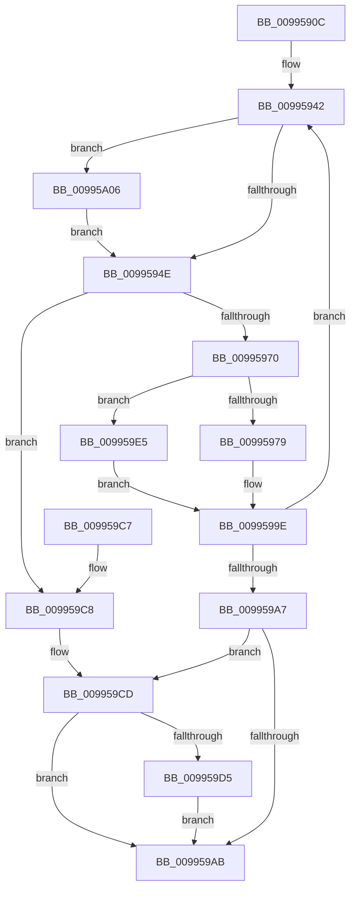

# PiDqPnPGetObjectPropertyLocales

- RVA: `0x0099590C`–`0x00995A15` (길이 `265` bytes)
- VA: `0x000000014099590C`
- 실행 섹션: `PAGE`
- PDB 이름 있음: `예`; PDB Function 태그: `아니요`
- unwind 정보 RVA: `0x0009917C`
- 디코드: `74`개 명령, `265/265` bytes 표시
- 미해석 바이트: `0` (있으면 어셈블리에 `.byte`로 보존)

> 이 문서는 커널 이미지의 기계어와 PDB 기호를 분석해 생성했습니다. 4번과 5번은 함수 원형과 자료형을 바이너리 사용 방식에서 추정한 C 해석이며 원본 소스 복구 결과는 아닙니다.

## 1. Dependencies

- 직접 호출 지점: **5**; 고유 호출 대상: **4**
- 직접 호출자로 확인된 함수: **1**
- RIP 상대 이미지 참조: **1**

### Outgoing calls
- `0x00995960` → [ExAllocatePool2](../../poolcode/B8/ExAllocatePool2_function_00B820F0.md) (function, `0x00B820F0`)
- `0x00995999` → [PnpGetObjectPropertyLocales](PnpGetObjectPropertyLocales_function_00995A1C.md) (function, `0x00995A1C`)
- `0x009959DA` → [ExFreePoolWithTag](../../poolcode/B8/ExFreePoolWithTag_function_00B82870.md) (function, `0x00B82870`)
- `0x009959FF` → [PnpGetGenericStorePropertyLocales](PnpGetGenericStorePropertyLocales_function_00994DBC.md) (function, `0x00994DBC`)
- `0x00995A0B` → [ExFreePoolWithTag](../../poolcode/B8/ExFreePoolWithTag_function_00B82870.md) (function, `0x00B82870`)

### Direct callers
- [PiDqActionDataGetAllPropertiesInAllLanguages](PiDqActionDataGetAllPropertiesInAllLanguages_function_0099569C.md) at `0x0099577A`

### Static image references
- `0x009959E5` → RVA `0x00E66398` (`.data`; read)

## 2. Other-region calls and transfers

- 다른 실행 섹션으로 향하는 call: **3**
  - `0x00995960` → [ExAllocatePool2](../../poolcode/B8/ExAllocatePool2_function_00B820F0.md) (`PAGE` → `POOLCODE`)
  - `0x009959DA` → [ExFreePoolWithTag](../../poolcode/B8/ExFreePoolWithTag_function_00B82870.md) (`PAGE` → `POOLCODE`)
  - `0x00995A0B` → [ExFreePoolWithTag](../../poolcode/B8/ExFreePoolWithTag_function_00B82870.md) (`PAGE` → `POOLCODE`)
- 별도 외부 분기/꼬리 이동을 확인하지 못했습니다.

## 3. Assembly (complete function range)

```asm
0099590C  48 8B C4                        mov rax, rsp
0099590F  48 89 58 08                     mov qword ptr [rax + 8], rbx
00995913  48 89 68 10                     mov qword ptr [rax + 0x10], rbp
00995917  48 89 70 18                     mov qword ptr [rax + 0x18], rsi
0099591B  57                              push rdi
0099591C  41 56                           push r14
0099591E  41 57                           push r15
00995920  48 83 EC 60                     sub rsp, 0x60
00995924  48 8B BC 24 A0 00 00 00         mov rdi, qword ptr [rsp + 0xa0]
0099592C  49 8B E9                        mov rbp, r9
0099592F  4D 8B F0                        mov r14, r8
00995932  C7 40 D8 28 00 00 00            mov dword ptr [rax - 0x28], 0x28
00995939  8B F2                           mov esi, edx
0099593B  4C 8B F9                        mov r15, rcx
0099593E  48 83 27 00                     and qword ptr [rdi], 0
00995942  48 8B 0F                        mov rcx, qword ptr [rdi]
00995945  48 85 C9                        test rcx, rcx
00995948  0F 85 B8 00 00 00               jne 0x140995a06
0099594E  8B 54 24 50                     mov edx, dword ptr [rsp + 0x50]
00995952  B9 00 01 00 00                  mov ecx, 0x100
00995957  48 03 D2                        add rdx, rdx
0099595A  41 B8 50 6E 70 58               mov r8d, 0x58706e50
00995960  E8 8B C7 1E 00                  call 0x140b820f0
00995965  48 89 07                        mov qword ptr [rdi], rax
00995968  4C 8B C8                        mov r9, rax
0099596B  48 85 C0                        test rax, rax
0099596E  74 58                           je 0x1409959c8
00995970  48 8D 44 24 50                  lea rax, [rsp + 0x50]
00995975  85 F6                           test esi, esi
00995977  74 6C                           je 0x1409959e5
00995979  8B 4C 24 50                     mov ecx, dword ptr [rsp + 0x50]
0099597D  44 8B C6                        mov r8d, esi
00995980  48 89 44 24 38                  mov qword ptr [rsp + 0x38], rax
00995985  49 8B D7                        mov rdx, r15
00995988  89 4C 24 30                     mov dword ptr [rsp + 0x30], ecx
0099598C  4C 89 4C 24 28                  mov qword ptr [rsp + 0x28], r9
00995991  4D 8B CE                        mov r9, r14
00995994  48 89 6C 24 20                  mov qword ptr [rsp + 0x20], rbp
00995999  E8 7E 00 00 00                  call 0x140995a1c
0099599E  8B D8                           mov ebx, eax
009959A0  3D 23 00 00 C0                  cmp eax, 0xc0000023
009959A5  74 9B                           je 0x140995942
009959A7  85 C0                           test eax, eax
009959A9  78 22                           js 0x1409959cd
009959AB  4C 8D 5C 24 60                  lea r11, [rsp + 0x60]
009959B0  8B C3                           mov eax, ebx
009959B2  49 8B 5B 20                     mov rbx, qword ptr [r11 + 0x20]
009959B6  49 8B 6B 28                     mov rbp, qword ptr [r11 + 0x28]
009959BA  49 8B 73 30                     mov rsi, qword ptr [r11 + 0x30]
009959BE  49 8B E3                        mov rsp, r11
009959C1  41 5F                           pop r15
009959C3  41 5E                           pop r14
009959C5  5F                              pop rdi
009959C6  C3                              ret
009959C7  CC                              int3
009959C8  BB 9A 00 00 C0                  mov ebx, 0xc000009a
009959CD  48 8B 0F                        mov rcx, qword ptr [rdi]
009959D0  48 85 C9                        test rcx, rcx
009959D3  74 D6                           je 0x1409959ab
009959D5  BA 50 6E 70 58                  mov edx, 0x58706e50
009959DA  E8 91 CE 1E 00                  call 0x140b82870
009959DF  48 83 27 00                     and qword ptr [rdi], 0
009959E3  EB C6                           jmp 0x1409959ab
009959E5  48 8B 0D AC 09 4D 00            mov rcx, qword ptr [rip + 0x4d09ac]
009959EC  4C 8B C5                        mov r8, rbp
009959EF  48 89 44 24 28                  mov qword ptr [rsp + 0x28], rax
009959F4  49 8B D6                        mov rdx, r14
009959F7  8B 44 24 50                     mov eax, dword ptr [rsp + 0x50]
009959FB  89 44 24 20                     mov dword ptr [rsp + 0x20], eax
009959FF  E8 B8 F3 FF FF                  call 0x140994dbc
00995A04  EB 98                           jmp 0x14099599e
00995A06  BA 50 6E 70 58                  mov edx, 0x58706e50
00995A0B  E8 60 CE 1E 00                  call 0x140b82870
00995A10  E9 39 FF FF FF                  jmp 0x14099594e
```

## 4. C-style interpretation (structured pseudocode)

```c
__int64 __fastcall PiDqPnPGetObjectPropertyLocales(__int64 a1, int a2, __int64 a3, __int64 a4, __int64 a5)
{
    __int64 result;
    __int64 v_rsp;
    unsigned int v_stack_m10;
    unsigned __int64 v_stack_m18;
    unsigned int v_stack_m28;
    unsigned __int64 v_stack_m38;
    unsigned __int64 v_stack_m40;
    unsigned int v_stack_m48;
    unsigned __int64 v_stack_m50;
    unsigned __int64 v_stack_m58;

    *(unsigned __int64 *)(v_rsp + 8) = v_rbx;
    *(unsigned __int64 *)(v_rsp + 16) = v_rbp;
    *(unsigned __int64 *)(v_rsp + 24) = v_rsi;
    v_rsp = (v_rsp) - (96);
    *(unsigned int *)(v_rsp - 40) = 40;
loc_00995942:
    if (*(unsigned __int64 *)(a5) != 0) goto loc_00995A06;
loc_0099594E:
    a2 = ((unsigned int)(v_stack_m28)) + ((unsigned int)(v_stack_m28));
    result = ExAllocatePool2(256, a2, (unsigned int)(0x58706E50ULL), a4);
    *(unsigned __int64 *)(a5) = result;
    if (result == 0) goto loc_009959C8;
    if ((unsigned int)((unsigned int)(a2)) == 0) goto loc_009959E5;
    v_stack_m40 = v_stack_m28;
    v_stack_m48 = (unsigned int)((unsigned int)(v_stack_m28));
    v_stack_m50 = result;
    v_stack_m58 = a4;
    result = PnpGetObjectPropertyLocales((unsigned int)(v_stack_m28), a1, (unsigned int)((unsigned int)((unsigned int)(a2))), a3);
loc_0099599E:
    if (((unsigned int)(result)) == 0xC0000023ULL) goto loc_00995942;
    if (sign_flag) goto loc_009959CD;
loc_009959AB:
    return (unsigned int)((unsigned int)((unsigned int)((unsigned int)(result))));
loc_009959C8:
loc_009959CD:
    if (*(unsigned __int64 *)(a5) == 0) goto loc_009959AB;
    result = ExFreePoolWithTag(*(unsigned __int64 *)(a5), (unsigned int)(0x58706E50ULL), (unsigned int)((unsigned int)((unsigned int)(a2))), a3);
    goto loc_009959AB;
loc_009959E5:
    v_stack_m38 = result;
    v_stack_m40 = (unsigned int)((unsigned int)(v_stack_m10));
    result = PnpGetGenericStorePropertyLocales(*(unsigned __int64 *)(v_rip + 5048748), a3, *(unsigned __int64 *)(v_stack_m18 + 40), a3);
    goto loc_0099599E;
loc_00995A06:
    result = ExFreePoolWithTag(*(unsigned __int64 *)(v_rip + 5048748), (unsigned int)(0x58706E50ULL), *(unsigned __int64 *)(v_stack_m18 + 40), a3);
    goto loc_0099594E;
}
```

## 5. (Beta) C Style

```c
int64_t PiDqPnPGetObjectPropertyLocales(int64_t Arg1, int32_t Arg2, int64_t Arg3, int64_t Arg4, void *Arg5)
{
    uint8_t *arg5 = (uint8_t *)Arg5;

    int64_t result;
    int64_t local_rsp;
    uint32_t v_stack_m10;
    uint64_t v_stack_m18;
    uint32_t v_stack_m28;
    uint64_t v_stack_m38;
    uint64_t v_stack_m40;
    uint32_t v_stack_m48;
    uint64_t v_stack_m50;
    uint64_t v_stack_m58;

    *(uint64_t *)(local_rsp + 0x8) = local_rbx;
    *(uint64_t *)(local_rsp + 0x10) = local_rbp;
    *(uint64_t *)(local_rsp + 0x18) = local_rsi;
    local_rsp = (local_rsp) - (96);
    *(uint32_t *)(local_rsp - 0x28) = 40;
loc_00995942:
    if (*(uint64_t *)(arg5) != 0) goto loc_00995A06;
loc_0099594E:
    Arg2 = ((uint32_t)(v_stack_m28)) + ((uint32_t)(v_stack_m28));
    result = ExAllocatePool2(256, Arg2, (uint32_t)(0x58706E50ULL), Arg4);
    *(uint64_t *)(arg5) = result;
    if (result == 0) goto loc_009959C8;
    if ((uint32_t)((uint32_t)(Arg2)) == 0) goto loc_009959E5;
    v_stack_m40 = v_stack_m28;
    v_stack_m48 = (uint32_t)((uint32_t)(v_stack_m28));
    v_stack_m50 = result;
    v_stack_m58 = Arg4;
    result = PnpGetObjectPropertyLocales((uint32_t)(v_stack_m28), Arg1, (uint32_t)((uint32_t)((uint32_t)(Arg2))), Arg3);
loc_0099599E:
    if (((uint32_t)(result)) == 0xC0000023ULL) goto loc_00995942;
    if (sign_flag) goto loc_009959CD;
loc_009959AB:
    return (uint32_t)((uint32_t)((uint32_t)((uint32_t)(result))));
loc_009959C8:
loc_009959CD:
    if (*(uint64_t *)(arg5) == 0) goto loc_009959AB;
    result = ExFreePoolWithTag(*(uint64_t *)(arg5), (uint32_t)(0x58706E50ULL), (uint32_t)((uint32_t)((uint32_t)(Arg2))), Arg3);
    goto loc_009959AB;
loc_009959E5:
    v_stack_m38 = result;
    v_stack_m40 = (uint32_t)((uint32_t)(v_stack_m10));
    result = PnpGetGenericStorePropertyLocales(*(uint64_t *)(v_rip + 0x4D09AC), Arg3, *(uint64_t *)(v_stack_m18 + 0x28), Arg3);
    goto loc_0099599E;
loc_00995A06:
    result = ExFreePoolWithTag(*(uint64_t *)(v_rip + 0x4D09AC), (uint32_t)(0x58706E50ULL), *(uint64_t *)(v_stack_m18 + 0x28), Arg3);
    goto loc_0099594E;
}
```

### 관측된 메모리 오프셋

구조체 형식이 확인되지 않은 접근은 인자 기준의 오프셋으로만 기록했습니다.

| 기준 인자 | 오프셋 표현 | 폭 (bit) | 접근 |
|---|---:|---:|---|
| `Arg5` | `+ 0x0` | `64` | `R` |
| `Arg5` | `+ 0x0` | `64` | `R/W` |
| `Arg5` | `+ 0x0` | `64` | `W` |

## 6. Execution-region graph

[열기: 2D/3D 그래프와 함수 탐색 컨트롤 패널](../../../control-panel.html?section=page&rva=0x0099590C&view=graph)

- 2D 그래프는 위에서 아래로 흐르고, 3D 그래프는 빈 공간을 드래그해 회전합니다. Shift+드래그는 이동, 휠은 확대·축소, 함수 노드 선택은 대상 보고서 이동입니다.

### Static fallback


