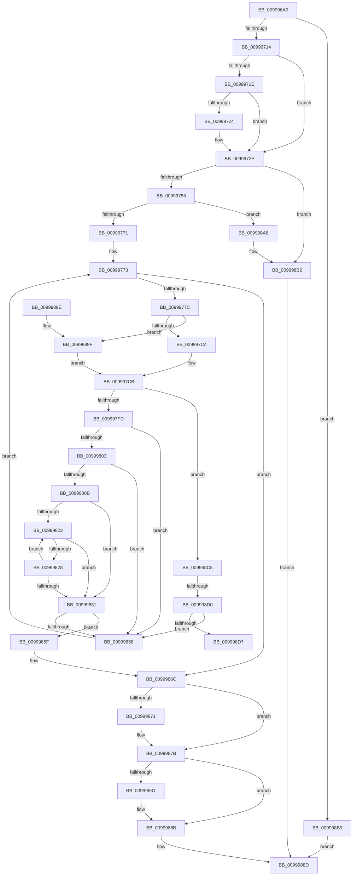

# PiFindDevInstMatch

- RVA: `0x009996A0`–`0x009998DC` (길이 `572` bytes)
- VA: `0x00000001409996A0`
- 실행 섹션: `PAGE`
- PDB 이름 있음: `예`; PDB Function 태그: `예`
- unwind 정보 RVA: `0x000994F0`
- 디코드: `166`개 명령, `572/572` bytes 표시
- 미해석 바이트: `0` (있으면 어셈블리에 `.byte`로 보존)

> 이 문서는 커널 이미지의 기계어와 PDB 기호를 분석해 생성했습니다. 4번과 5번은 함수 원형과 자료형을 바이너리 사용 방식에서 추정한 C 해석이며 원본 소스 복구 결과는 아닙니다.

## 1. Dependencies

- 직접 호출 지점: **10**; 고유 호출 대상: **6**
- 직접 호출자로 확인된 함수: **1**
- RIP 상대 이미지 참조: **2**

### Outgoing calls
- `0x00999707` → [IopGetRegistryValue](IopGetRegistryValue_function_009990EC.md) (function, `0x009990EC`)
- `0x00999730` → [ExFreePoolWithTag](../../poolcode/B8/ExFreePoolWithTag_function_00B82870.md) (function, `0x00B82870`)
- `0x00999744` → [ExAllocatePool2](../../poolcode/B8/ExAllocatePool2_function_00B820F0.md) (function, `0x00B820F0`)
- `0x00999760` → [ExAllocatePool2](../../poolcode/B8/ExAllocatePool2_function_00B820F0.md) (function, `0x00B820F0`)
- `0x009997A3` → [RtlStringCchPrintfExW](../../text/42/RtlStringCchPrintfExW_function_0042B390.md) (function, `0x0042B390`)
- `0x009997F0` → [ZwQueryValueKey](../../text/6A/ZwQueryValueKey_function_006AD3B0.md) (function, `0x006AD3B0`)
- `0x0099984F` → [RtlEqualUnicodeString](../93/RtlEqualUnicodeString_function_00932A20.md) (function, `0x00932A20`)
- `0x00999876` → [ExFreePoolWithTag](../../poolcode/B8/ExFreePoolWithTag_function_00B82870.md) (function, `0x00B82870`)
- `0x00999886` → [ExFreePoolWithTag](../../poolcode/B8/ExFreePoolWithTag_function_00B82870.md) (function, `0x00B82870`)
- `0x009998AD` → [ExFreePoolWithTag](../../poolcode/B8/ExFreePoolWithTag_function_00B82870.md) (function, `0x00B82870`)

### Direct callers
- [PiProcessDriverInstance](PiProcessDriverInstance_function_00998530.md) at `0x009985C1`

### Static image references
- `0x009996C1` → RVA `0x00AFDA90` (` ?? ::NNGAKEGL::`string'`; read)
- `0x00999783` → RVA `0x00AFDAA0` (` ?? ::NNGAKEGL::`string'`; read)

## 2. Other-region calls and transfers

- 다른 실행 섹션으로 향하는 call: **8**
  - `0x00999730` → [ExFreePoolWithTag](../../poolcode/B8/ExFreePoolWithTag_function_00B82870.md) (`PAGE` → `POOLCODE`)
  - `0x00999744` → [ExAllocatePool2](../../poolcode/B8/ExAllocatePool2_function_00B820F0.md) (`PAGE` → `POOLCODE`)
  - `0x00999760` → [ExAllocatePool2](../../poolcode/B8/ExAllocatePool2_function_00B820F0.md) (`PAGE` → `POOLCODE`)
  - `0x009997A3` → [RtlStringCchPrintfExW](../../text/42/RtlStringCchPrintfExW_function_0042B390.md) (`PAGE` → `.text`)
  - `0x009997F0` → [ZwQueryValueKey](../../text/6A/ZwQueryValueKey_function_006AD3B0.md) (`PAGE` → `.text`)
  - `0x00999876` → [ExFreePoolWithTag](../../poolcode/B8/ExFreePoolWithTag_function_00B82870.md) (`PAGE` → `POOLCODE`)
  - `0x00999886` → [ExFreePoolWithTag](../../poolcode/B8/ExFreePoolWithTag_function_00B82870.md) (`PAGE` → `POOLCODE`)
  - `0x009998AD` → [ExFreePoolWithTag](../../poolcode/B8/ExFreePoolWithTag_function_00B82870.md) (`PAGE` → `POOLCODE`)
- call이 아닌 외부 분기/꼬리 이동: **2**
  - `0x009998CA` → [sub_00B2CDF6](../B2/Unknown_function_00B2CDF6.md) (`tail-transfer`)
  - `0x009998D7` → [sub_00B2CDF6](../B2/Unknown_function_00B2CDF6.md) (`tail-transfer`)

## 3. Assembly (complete function range)

```asm
009996A0  48 89 54 24 10                  mov qword ptr [rsp + 0x10], rdx
009996A5  48 89 4C 24 08                  mov qword ptr [rsp + 8], rcx
009996AA  55                              push rbp
009996AB  53                              push rbx
009996AC  56                              push rsi
009996AD  57                              push rdi
009996AE  41 54                           push r12
009996B0  41 55                           push r13
009996B2  41 56                           push r14
009996B4  41 57                           push r15
009996B6  48 8B EC                        mov rbp, rsp
009996B9  48 83 EC 78                     sub rsp, 0x78
009996BD  4C 8B 6D 68                     mov r13, qword ptr [rbp + 0x68]
009996C1  48 8D 15 C8 43 16 00            lea rdx, [rip + 0x1643c8]
009996C8  33 DB                           xor ebx, ebx
009996CA  4D 8B F9                        mov r15, r9
009996CD  66 41 89 19                     mov word ptr [r9], bx
009996D1  49 8B F8                        mov rdi, r8
009996D4  49 89 59 08                     mov qword ptr [r9 + 8], rbx
009996D8  0F 57 C0                        xorps xmm0, xmm0
009996DB  41 83 4D 00 FF                  or dword ptr [r13], 0xffffffff
009996E0  4C 8D 4D C8                     lea r9, [rbp - 0x38]
009996E4  41 89 18                        mov dword ptr [r8], ebx
009996E7  0F 57 C9                        xorps xmm1, xmm1
009996EA  BE 00 01 00 00                  mov esi, 0x100
009996EF  89 5D 58                        mov dword ptr [rbp + 0x58], ebx
009996F2  45 33 C0                        xor r8d, r8d
009996F5  89 75 60                        mov dword ptr [rbp + 0x60], esi
009996F8  0F 11 45 D0                     movups xmmword ptr [rbp - 0x30], xmm0
009996FC  48 89 5D C8                     mov qword ptr [rbp - 0x38], rbx
00999700  44 8B E3                        mov r12d, ebx
00999703  0F 11 4D E0                     movups xmmword ptr [rbp - 0x20], xmm1
00999707  E8 E0 F9 FF FF                  call 0x1409990ec
0099970C  85 C0                           test eax, eax
0099970E  0F 88 A5 01 00 00               js 0x1409998b9
00999714  48 8B 4D C8                     mov rcx, qword ptr [rbp - 0x38]
00999718  83 79 04 04                     cmp dword ptr [rcx + 4], 4
0099971C  75 10                           jne 0x14099972e
0099971E  83 79 0C 04                     cmp dword ptr [rcx + 0xc], 4
00999722  72 0A                           jb 0x14099972e
00999724  8B 41 08                        mov eax, dword ptr [rcx + 8]
00999727  44 8B 24 08                     mov r12d, dword ptr [rax + rcx]
0099972B  44 89 27                        mov dword ptr [rdi], r12d
0099972E  33 D2                           xor edx, edx
00999730  E8 3B 91 1E 00                  call 0x140b82870
00999735  41 BE 50 70 20 20               mov r14d, 0x20207050
0099973B  48 8B D6                        mov rdx, rsi
0099973E  45 8B C6                        mov r8d, r14d
00999741  48 8B CE                        mov rcx, rsi
00999744  E8 A7 89 1E 00                  call 0x140b820f0
00999749  48 8B F8                        mov rdi, rax
0099974C  48 85 C0                        test rax, rax
0099974F  0F 84 5D 01 00 00               je 0x1409998b2
00999755  45 8B C6                        mov r8d, r14d
00999758  BA 14 00 00 00                  mov edx, 0x14
0099975D  48 8B CE                        mov rcx, rsi
00999760  E8 8B 89 1E 00                  call 0x140b820f0
00999765  4C 8B F0                        mov r14, rax
00999768  48 85 C0                        test rax, rax
0099976B  0F 84 37 01 00 00               je 0x1409998a8
00999771  8B F3                           mov esi, ebx
00999773  41 3B F4                        cmp esi, r12d
00999776  0F 83 F0 00 00 00               jae 0x14099986c
0099977C  45 33 C9                        xor r9d, r9d
0099977F  89 74 24 30                     mov dword ptr [rsp + 0x30], esi
00999783  48 8D 05 16 43 16 00            lea rax, [rip + 0x164316]
0099978A  4C 89 75 68                     mov qword ptr [rbp + 0x68], r14
0099978E  48 89 44 24 28                  mov qword ptr [rsp + 0x28], rax
00999793  4C 8D 45 68                     lea r8, [rbp + 0x68]
00999797  49 8B CE                        mov rcx, r14
0099979A  48 89 5C 24 20                  mov qword ptr [rsp + 0x20], rbx
0099979F  41 8D 51 0A                     lea edx, [r9 + 0xa]
009997A3  E8 E8 1B A9 FF                  call 0x14042b390
009997A8  48 8B 45 68                     mov rax, qword ptr [rbp + 0x68]
009997AC  B9 14 00 00 00                  mov ecx, 0x14
009997B1  49 2B C6                        sub rax, r14
009997B4  66 89 4D D2                     mov word ptr [rbp - 0x2e], cx
009997B8  48 D1 F8                        sar rax, 1
009997BB  83 F8 FF                        cmp eax, -1
009997BE  0F 84 DB 00 00 00               je 0x14099989f
009997C4  66 03 C0                        add ax, ax
009997C7  66 89 45 D0                     mov word ptr [rbp - 0x30], ax
009997CB  48 8B 4D 48                     mov rcx, qword ptr [rbp + 0x48]
009997CF  48 8D 45 58                     lea rax, [rbp + 0x58]
009997D3  48 89 44 24 28                  mov qword ptr [rsp + 0x28], rax
009997D8  48 8D 55 D0                     lea rdx, [rbp - 0x30]
009997DC  8B 45 60                        mov eax, dword ptr [rbp + 0x60]
009997DF  4C 8B CF                        mov r9, rdi
009997E2  41 B8 01 00 00 00               mov r8d, 1
009997E8  89 44 24 20                     mov dword ptr [rsp + 0x20], eax
009997EC  4C 89 75 D8                     mov qword ptr [rbp - 0x28], r14
009997F0  E8 BB 3B D1 FF                  call 0x1406ad3b0
009997F5  85 C0                           test eax, eax
009997F7  0F 88 C8 00 00 00               js 0x1409998c5
009997FD  83 7F 04 01                     cmp dword ptr [rdi + 4], 1
00999801  75 55                           jne 0x140999858
00999803  8B 57 0C                        mov edx, dword ptr [rdi + 0xc]
00999806  83 FA 02                        cmp edx, 2
00999809  76 4D                           jbe 0x140999858
0099980B  44 8B 47 08                     mov r8d, dword ptr [rdi + 8]
0099980F  8B C2                           mov eax, edx
00999811  4C 03 C7                        add r8, rdi
00999814  48 D1 E8                        shr rax, 1
00999817  49 8B C8                        mov rcx, r8
0099981A  49 8D 14 40                     lea rdx, [r8 + rax*2]
0099981E  4C 3B C2                        cmp r8, rdx
00999821  73 0E                           jae 0x140999831
00999823  66 39 19                        cmp word ptr [rcx], bx
00999826  74 09                           je 0x140999831
00999828  48 83 C1 02                     add rcx, 2
0099982C  48 3B CA                        cmp rcx, rdx
0099982F  72 F2                           jb 0x140999823
00999831  0F B7 47 0C                     movzx eax, word ptr [rdi + 0xc]
00999835  41 2B C8                        sub ecx, r8d
00999838  48 8B 55 50                     mov rdx, qword ptr [rbp + 0x50]
0099983C  66 89 4D E0                     mov word ptr [rbp - 0x20], cx
00999840  48 8D 4D E0                     lea rcx, [rbp - 0x20]
00999844  4C 89 45 E8                     mov qword ptr [rbp - 0x18], r8
00999848  41 B0 01                        mov r8b, 1
0099984B  66 89 45 E2                     mov word ptr [rbp - 0x1e], ax
0099984F  E8 CC 91 F9 FF                  call 0x140932a20
00999854  84 C0                           test al, al
00999856  75 07                           jne 0x14099985f
00999858  FF C6                           inc esi
0099985A  E9 14 FF FF FF                  jmp 0x140999773
0099985F  0F 10 45 D0                     movups xmm0, xmmword ptr [rbp - 0x30]
00999863  41 89 75 00                     mov dword ptr [r13], esi
00999867  F3 41 0F 7F 07                  movdqu xmmword ptr [r15], xmm0
0099986C  48 85 FF                        test rdi, rdi
0099986F  74 0A                           je 0x14099987b
00999871  33 D2                           xor edx, edx
00999873  48 8B CF                        mov rcx, rdi
00999876  E8 F5 8F 1E 00                  call 0x140b82870
0099987B  66 41 39 1F                     cmp word ptr [r15], bx
0099987F  75 0A                           jne 0x14099988b
00999881  33 D2                           xor edx, edx
00999883  49 8B CE                        mov rcx, r14
00999886  E8 E5 8F 1E 00                  call 0x140b82870
0099988B  33 C0                           xor eax, eax
0099988D  48 83 C4 78                     add rsp, 0x78
00999891  41 5F                           pop r15
00999893  41 5E                           pop r14
00999895  41 5D                           pop r13
00999897  41 5C                           pop r12
00999899  5F                              pop rdi
0099989A  5E                              pop rsi
0099989B  5B                              pop rbx
0099989C  5D                              pop rbp
0099989D  C3                              ret
0099989E  CC                              int3
0099989F  66 89 4D D0                     mov word ptr [rbp - 0x30], cx
009998A3  E9 23 FF FF FF                  jmp 0x1409997cb
009998A8  48 8B CF                        mov rcx, rdi
009998AB  33 D2                           xor edx, edx
009998AD  E8 BE 8F 1E 00                  call 0x140b82870
009998B2  B8 9A 00 00 C0                  mov eax, 0xc000009a
009998B7  EB D4                           jmp 0x14099988d
009998B9  3D 34 00 00 C0                  cmp eax, 0xc0000034
009998BE  0F 45 D8                        cmovne ebx, eax
009998C1  8B C3                           mov eax, ebx
009998C3  EB C8                           jmp 0x14099988d
009998C5  3D 05 00 00 80                  cmp eax, 0x80000005
009998CA  0F 84 26 35 19 00               je 0x140b2cdf6
009998D0  3D 23 00 00 C0                  cmp eax, 0xc0000023
009998D5  75 81                           jne 0x140999858
009998D7  E9 1A 35 19 00                  jmp 0x140b2cdf6
```

## 4. C-style interpretation (structured pseudocode)

```c
__int64 __fastcall PiFindDevInstMatch(__int64 a1, __int64 a2, __int64 a3, __int64 a4, __int64 a5)
{
    __int64 result;
    __int64 v_r12;
    __int64 v_rbx;
    __int64 v_rsi;
    __int64 v_rsp;
    unsigned __int64 v_stack_m58;
    unsigned __int16 v_stack_m5E;
    unsigned __int64 v_stack_m60;
    unsigned __int64 v_stack_m68;
    unsigned __int16 v_stack_m6E;
    unsigned __int64 v_stack_m70;
    unsigned __int64 v_stack_m78;
    unsigned int v_stack_m88;
    unsigned __int64 v_stack_m90;
    unsigned __int64 v_stack_m98;
    unsigned __int64 v_stack_p10;
    unsigned int v_stack_p18;
    unsigned int v_stack_p20;
    unsigned __int64 v_stack_p28;
    unsigned __int64 v_stack_p8;

    v_stack_p10 = a2;
    v_stack_p8 = a1;
    v_rsp = (v_rsp) - (120);
    v_rbx = 0;
    *(unsigned __int16 *)(a4) = 0;
    *(unsigned __int64 *)(a4 + 8) = 0;
    *(unsigned int *)(a3) = 0;
    v_stack_p18 = 0;
    a3 = 0;
    v_stack_p20 = 256;
    v_stack_m70 = v_xmm0;
    v_stack_m78 = 0;
    v_stack_m60 = v_xmm1;
    result = IopGetRegistryValue(a1, v_rip + 1459144, a3, v_stack_m78);
    if (sign_flag) goto loc_009998B9;
    if ((*(unsigned int *)(v_stack_m78 + 4)) != 4) goto loc_0099972E;
    v_r12 = 0;
    if ((*(unsigned int *)(v_stack_m78 + 12)) >= 4) {
        result = *(unsigned int *)(v_stack_m78 + 8);
        v_r12 = *(unsigned int *)(result + v_stack_m78 * 1);
        *(unsigned int *)(a3) = (unsigned int)(v_r12);
    }
    a2 = 0;
    result = ExFreePoolWithTag(v_stack_m78, a2, a3, v_stack_m78);
    result = ExAllocatePool2(256, 256, (unsigned int)((unsigned int)((unsigned int)(0x20207050ULL))), v_stack_m78);
    if (result == 0) goto loc_009998B2;
    result = ExAllocatePool2(256, 20, (unsigned int)((unsigned int)((unsigned int)(0x20207050ULL))), v_stack_m78);
    if (result == 0) goto loc_009998A8;
loc_00999773:
    if (0 >= ((unsigned int)(v_r12))) goto loc_0099986C;
    a4 = 0;
    v_stack_m88 = 0;
    v_stack_p28 = result;
    v_stack_m90 = v_rip + 1458966;
    v_stack_m98 = 0;
    result = RtlStringCchPrintfExW(result, a4 + 10, a5, a4);
    result = (a5) - (result);
    v_stack_m6E = 20;
    result = (result) >> (1);
    if (((unsigned int)(result)) == -1) goto loc_0099989F;
    result = (unsigned __int16)((result) + ((unsigned __int16)(result)));
    v_stack_m70 = (unsigned __int16)(result);
loc_009997CB:
    v_stack_m90 = v_stack_p18;
    v_stack_m98 = (unsigned int)((unsigned int)(v_stack_p20));
    v_stack_m68 = result;
    result = ZwQueryValueKey(v_stack_p8, v_stack_m70, 1, result);
    if (sign_flag) goto loc_009998C5;
    if ((*(unsigned int *)(result + 4)) != 1) goto loc_00999858;
    if (((unsigned int)((unsigned int)(*(unsigned int *)(result + 12)))) <= 2) goto loc_00999858;
    a3 = ((unsigned int)(*(unsigned int *)(result + 8))) + (result);
    result = ((unsigned int)((unsigned int)((unsigned int)(*(unsigned int *)(result + 12))))) >> (1);
    if (a3 >= (a3 + result * 2)) goto loc_00999831;
loc_00999823:
    if ((*(unsigned __int16 *)(a3)) == 0) goto loc_00999831;
    a1 = (a3) + (2);
    if (a1 < (a3 + result * 2)) goto loc_00999823;
loc_00999831:
    a1 = (unsigned int)((a1) - ((unsigned int)(a3)));
    v_stack_m60 = (unsigned __int16)(a1);
    v_stack_m58 = a3;
    v_stack_m5E = (unsigned __int16)(*(unsigned __int16 *)(result + 12));
    result = RtlEqualUnicodeString(v_stack_m60, v_stack_p10, 1, result);
    if ((unsigned __int8)(result) != 0) goto loc_0099985F;
loc_00999858:
    v_rsi = (unsigned int)((0) + 1);
    goto loc_00999773;
loc_0099985F:
    *(unsigned int *)(a5) = (unsigned int)(v_rsi);
    *(unsigned __int64 *)(a4) = v_xmm0;
loc_0099986C:
    if (result != 0) {
        a2 = 0;
        a1 = result;
        result = ExFreePoolWithTag(a1, a2, 1, result);
    }
    if ((*(unsigned __int16 *)(a4)) == 0) {
        a2 = 0;
        a1 = result;
        result = ExFreePoolWithTag(a1, a2, 1, result);
    }
    result = 0;
loc_0099988D:
    v_rsp = (v_rsp) + (120);
    return result;
loc_0099989F:
    v_stack_m70 = (unsigned __int16)(a1);
    goto loc_009997CB;
loc_009998A8:
    a2 = 0;
    result = ExFreePoolWithTag(0, a2, 1, result);
loc_009998B2:
    goto loc_0099988D;
loc_009998B9:
    if (((unsigned int)((unsigned int)(0xC000009AULL))) != 0xC0000034ULL) { v_rbx = (unsigned int)((unsigned int)(0xC000009AULL)); }
    goto loc_0099988D;
loc_009998C5:
    if (((unsigned int)((unsigned int)((unsigned int)(v_rbx)))) != 0xC0000023ULL) goto loc_00999858;
}
```

## 5. (Beta) C Style

```c
int64_t PiFindDevInstMatch(int64_t Arg1, int64_t Arg2, void *Arg3, void *Arg4, void *Arg5)
{
    uint8_t *arg3 = (uint8_t *)Arg3;
    uint8_t *arg4 = (uint8_t *)Arg4;
    uint8_t *arg5 = (uint8_t *)Arg5;

    int64_t result;
    int64_t local_r12;
    int64_t local_rbx;
    int64_t local_rsi;
    int64_t local_rsp;
    uint64_t v_stack_m58;
    uint16_t v_stack_m5E;
    uint64_t v_stack_m60;
    uint64_t v_stack_m68;
    uint16_t v_stack_m6E;
    uint64_t v_stack_m70;
    uint64_t v_stack_m78;
    uint32_t v_stack_m88;
    uint64_t v_stack_m90;
    uint64_t v_stack_m98;
    uint64_t v_stack_p10;
    uint32_t v_stack_p18;
    uint32_t v_stack_p20;
    uint64_t v_stack_p28;
    uint64_t v_stack_p8;

    v_stack_p10 = Arg2;
    v_stack_p8 = Arg1;
    local_rsp = (local_rsp) - (120);
    local_rbx = 0;
    *(uint16_t *)(arg4) = 0;
    *(uint64_t *)(arg4 + 0x8) = 0;
    *(uint32_t *)(arg3) = 0;
    v_stack_p18 = 0;
    Arg3 = 0;
    v_stack_p20 = 256;
    v_stack_m70 = v_xmm0;
    v_stack_m78 = 0;
    v_stack_m60 = v_xmm1;
    result = IopGetRegistryValue(Arg1, v_rip + 1459144, Arg3, v_stack_m78);
    if (sign_flag) goto loc_009998B9;
    if ((*(uint32_t *)(v_stack_m78 + 0x4)) != 4) goto loc_0099972E;
    local_r12 = 0;
    if ((*(uint32_t *)(v_stack_m78 + 0xC)) >= 4) {
        result = *(uint32_t *)(v_stack_m78 + 0x8);
        local_r12 = *(uint32_t *)(result + v_stack_m78 * 1);
        *(uint32_t *)(arg3) = (uint32_t)(local_r12);
    }
    Arg2 = 0;
    result = ExFreePoolWithTag(v_stack_m78, Arg2, Arg3, v_stack_m78);
    result = ExAllocatePool2(256, 256, (uint32_t)((uint32_t)((uint32_t)(0x20207050ULL))), v_stack_m78);
    if (result == 0) goto loc_009998B2;
    result = ExAllocatePool2(256, 20, (uint32_t)((uint32_t)((uint32_t)(0x20207050ULL))), v_stack_m78);
    if (result == 0) goto loc_009998A8;
loc_00999773:
    if (0 >= ((uint32_t)(local_r12))) goto loc_0099986C;
    Arg4 = 0;
    v_stack_m88 = 0;
    v_stack_p28 = result;
    v_stack_m90 = v_rip + 1458966;
    v_stack_m98 = 0;
    result = RtlStringCchPrintfExW(result, Arg4 + 10, Arg5, Arg4);
    result = (Arg5) - (result);
    v_stack_m6E = 20;
    result = (result) >> (1);
    if (((uint32_t)(result)) == -1) goto loc_0099989F;
    result = (uint16_t)((result) + ((uint16_t)(result)));
    v_stack_m70 = (uint16_t)(result);
loc_009997CB:
    v_stack_m90 = v_stack_p18;
    v_stack_m98 = (uint32_t)((uint32_t)(v_stack_p20));
    v_stack_m68 = result;
    result = ZwQueryValueKey(v_stack_p8, v_stack_m70, 1, result);
    if (sign_flag) goto loc_009998C5;
    if ((*(uint32_t *)(result + 0x4)) != 1) goto loc_00999858;
    if (((uint32_t)((uint32_t)(*(uint32_t *)(result + 0xC)))) <= 2) goto loc_00999858;
    Arg3 = ((uint32_t)(*(uint32_t *)(result + 0x8))) + (result);
    result = ((uint32_t)((uint32_t)((uint32_t)(*(uint32_t *)(result + 0xC))))) >> (1);
    if (Arg3 >= (Arg3 + result * 2)) goto loc_00999831;
loc_00999823:
    if ((*(uint16_t *)(arg3)) == 0) goto loc_00999831;
    Arg1 = (Arg3) + (2);
    if (Arg1 < (Arg3 + result * 2)) goto loc_00999823;
loc_00999831:
    Arg1 = (uint32_t)((Arg1) - ((uint32_t)(Arg3)));
    v_stack_m60 = (uint16_t)(Arg1);
    v_stack_m58 = Arg3;
    v_stack_m5E = (uint16_t)(*(uint16_t *)(result + 0xC));
    result = RtlEqualUnicodeString(v_stack_m60, v_stack_p10, 1, result);
    if ((uint8_t)(result) != 0) goto loc_0099985F;
loc_00999858:
    local_rsi = (uint32_t)((0) + 1);
    goto loc_00999773;
loc_0099985F:
    *(uint32_t *)(arg5) = (uint32_t)(local_rsi);
    *(uint64_t *)(arg4) = v_xmm0;
loc_0099986C:
    if (result != 0) {
        Arg2 = 0;
        Arg1 = result;
        result = ExFreePoolWithTag(Arg1, Arg2, 1, result);
    }
    if ((*(uint16_t *)(arg4)) == 0) {
        Arg2 = 0;
        Arg1 = result;
        result = ExFreePoolWithTag(Arg1, Arg2, 1, result);
    }
    result = 0;
loc_0099988D:
    local_rsp = (local_rsp) + (120);
    return result;
loc_0099989F:
    v_stack_m70 = (uint16_t)(Arg1);
    goto loc_009997CB;
loc_009998A8:
    Arg2 = 0;
    result = ExFreePoolWithTag(0, Arg2, 1, result);
loc_009998B2:
    goto loc_0099988D;
loc_009998B9:
    if (((uint32_t)((uint32_t)(0xC000009AULL))) != 0xC0000034ULL) { local_rbx = (uint32_t)((uint32_t)(0xC000009AULL)); }
    goto loc_0099988D;
loc_009998C5:
    if (((uint32_t)((uint32_t)((uint32_t)(local_rbx)))) != 0xC0000023ULL) goto loc_00999858;
}
```

### 관측된 메모리 오프셋

구조체 형식이 확인되지 않은 접근은 인자 기준의 오프셋으로만 기록했습니다.

| 기준 인자 | 오프셋 표현 | 폭 (bit) | 접근 |
|---|---:|---:|---|
| `Arg3` | `+ 0x0` | `32` | `W` |
| `Arg4` | `+ 0x0` | `16` | `R` |
| `Arg4` | `+ 0x0` | `16` | `W` |
| `Arg4` | `+ 0x0` | `128` | `W` |
| `Arg4` | `+ 0x8` | `64` | `W` |
| `Arg5` | `+ 0x0` | `32` | `R/W` |
| `Arg5` | `+ 0x0` | `32` | `W` |

## 6. Execution-region graph

[열기: 2D/3D 그래프와 함수 탐색 컨트롤 패널](../../../control-panel.html?section=page&rva=0x009996A0&view=graph)

- 2D 그래프는 위에서 아래로 흐르고, 3D 그래프는 빈 공간을 드래그해 회전합니다. Shift+드래그는 이동, 휠은 확대·축소, 함수 노드 선택은 대상 보고서 이동입니다.

### Static fallback


