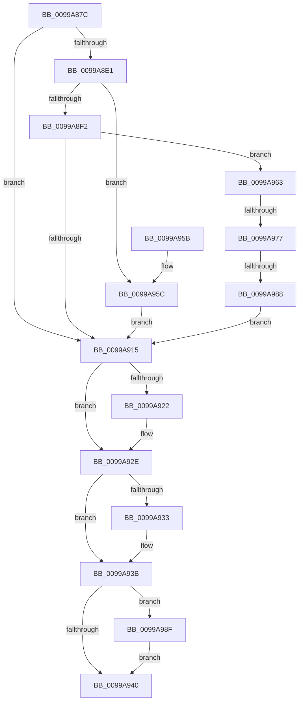

# PiGetDefaultMessageString

- RVA: `0x0099A87C`–`0x0099A999` (길이 `285` bytes)
- VA: `0x000000014099A87C`
- 실행 섹션: `PAGE`
- PDB 이름 있음: `예`; PDB Function 태그: `예`
- unwind 정보 RVA: `0x000995B0`
- 디코드: `88`개 명령, `285/285` bytes 표시
- 미해석 바이트: `0` (있으면 어셈블리에 `.byte`로 보존)

> 이 문서는 커널 이미지의 기계어와 PDB 기호를 분석해 생성했습니다. 4번과 5번은 함수 원형과 자료형을 바이너리 사용 방식에서 추정한 C 해석이며 원본 소스 복구 결과는 아닙니다.

## 1. Dependencies

- 직접 호출 지점: **9**; 고유 호출 대상: **7**
- 직접 호출자로 확인된 함수: **1**
- RIP 상대 이미지 참조: **0**

### Outgoing calls
- `0x0099A8BC` → [RtlInitUnicodeString](../../text/42/RtlInitUnicodeString_function_0042A780.md) (function, `0x0042A780`)
- `0x0099A8C7` → [RtlInitUnicodeString](../../text/42/RtlInitUnicodeString_function_0042A780.md) (function, `0x0042A780`)
- `0x0099A8D6` → [IopGetDriverNameFromKeyNode](IopGetDriverNameFromKeyNode_function_00998808.md) (function, `0x00998808`)
- `0x0099A8E5` → [IopReferenceDriverObjectByName](IopReferenceDriverObjectByName_function_0099C178.md) (function, `0x0099C178`)
- `0x0099A90A` → [RtlFindMessage](RtlFindMessage_function_0099B220.md) (function, `0x0099B220`)
- `0x0099A922` → [ExFreePool](../../poolcode/B8/ExFreePool_function_00B82850.md) (function, `0x00B82850`)
- `0x0099A936` → [ExFreePool](../../poolcode/B8/ExFreePool_function_00B82850.md) (function, `0x00B82850`)
- `0x0099A97B` → [RtlCreateUnicodeString](../9B/RtlCreateUnicodeString_function_009BD860.md) (function, `0x009BD860`)
- `0x0099A992` → [ObfDereferenceObject](../../text/2F/ObfDereferenceObject_function_002F9350.md) (function, `0x002F9350`)

### Direct callers
- [PiNormalizeDeviceText](PiNormalizeDeviceText_function_0099A43C.md) at `0x0099A6B1`

### Static image references
- 디코드된 RIP-relative 메모리 참조가 없습니다.

## 2. Other-region calls and transfers

- 다른 실행 섹션으로 향하는 call: **5**
  - `0x0099A8BC` → [RtlInitUnicodeString](../../text/42/RtlInitUnicodeString_function_0042A780.md) (`PAGE` → `.text`)
  - `0x0099A8C7` → [RtlInitUnicodeString](../../text/42/RtlInitUnicodeString_function_0042A780.md) (`PAGE` → `.text`)
  - `0x0099A922` → [ExFreePool](../../poolcode/B8/ExFreePool_function_00B82850.md) (`PAGE` → `POOLCODE`)
  - `0x0099A936` → [ExFreePool](../../poolcode/B8/ExFreePool_function_00B82850.md) (`PAGE` → `POOLCODE`)
  - `0x0099A992` → [ObfDereferenceObject](../../text/2F/ObfDereferenceObject_function_002F9350.md) (`PAGE` → `.text`)
- call이 아닌 외부 분기/꼬리 이동: **2**
  - `0x0099A971` → [sub_00B2CEFC](../B2/Unknown_function_00B2CEFC.md) (`tail-transfer`)
  - `0x0099A982` → [sub_00B2CEFC + 0x45](../B2/Unknown_function_00B2CEFC.md) (`tail-transfer`)

## 3. Assembly (complete function range)

```asm
0099A87C  48 89 5C 24 08                  mov qword ptr [rsp + 8], rbx
0099A881  48 89 74 24 10                  mov qword ptr [rsp + 0x10], rsi
0099A886  55                              push rbp
0099A887  57                              push rdi
0099A888  41 54                           push r12
0099A88A  41 56                           push r14
0099A88C  41 57                           push r15
0099A88E  48 8B EC                        mov rbp, rsp
0099A891  48 83 EC 60                     sub rsp, 0x60
0099A895  0F 57 C0                        xorps xmm0, xmm0
0099A898  8B FA                           mov edi, edx
0099A89A  48 8B D9                        mov rbx, rcx
0099A89D  0F 57 C9                        xorps xmm1, xmm1
0099A8A0  45 33 E4                        xor r12d, r12d
0099A8A3  48 8D 4D E0                     lea rcx, [rbp - 0x20]
0099A8A7  33 D2                           xor edx, edx
0099A8A9  4C 89 65 48                     mov qword ptr [rbp + 0x48], r12
0099A8AD  0F 11 45 F0                     movups xmmword ptr [rbp - 0x10], xmm0
0099A8B1  4D 8B F8                        mov r15, r8
0099A8B4  0F 11 4D E0                     movups xmmword ptr [rbp - 0x20], xmm1
0099A8B8  0F 11 45 D0                     movups xmmword ptr [rbp - 0x30], xmm0
0099A8BC  E8 BF FE A8 FF                  call 0x14042a780
0099A8C1  33 D2                           xor edx, edx
0099A8C3  48 8D 4D D0                     lea rcx, [rbp - 0x30]
0099A8C7  E8 B4 FE A8 FF                  call 0x14042a780
0099A8CC  48 8D 55 E0                     lea rdx, [rbp - 0x20]
0099A8D0  48 8B CB                        mov rcx, rbx
0099A8D3  41 8B F4                        mov esi, r12d
0099A8D6  E8 2D DF FF FF                  call 0x140998808
0099A8DB  8B D8                           mov ebx, eax
0099A8DD  85 C0                           test eax, eax
0099A8DF  78 34                           js 0x14099a915
0099A8E1  48 8D 4D E0                     lea rcx, [rbp - 0x20]
0099A8E5  E8 8E 18 00 00                  call 0x14099c178
0099A8EA  48 8B F0                        mov rsi, rax
0099A8ED  48 85 C0                        test rax, rax
0099A8F0  74 6A                           je 0x14099a95c
0099A8F2  48 8B 4E 18                     mov rcx, qword ptr [rsi + 0x18]
0099A8F6  48 8D 45 48                     lea rax, [rbp + 0x48]
0099A8FA  44 8B CF                        mov r9d, edi
0099A8FD  48 89 44 24 20                  mov qword ptr [rsp + 0x20], rax
0099A902  45 33 C0                        xor r8d, r8d
0099A905  41 8D 54 24 0B                  lea edx, [r12 + 0xb]
0099A90A  E8 11 09 00 00                  call 0x14099b220
0099A90F  8B D8                           mov ebx, eax
0099A911  85 C0                           test eax, eax
0099A913  79 4E                           jns 0x14099a963
0099A915  48 8B 7D D8                     mov rdi, qword ptr [rbp - 0x28]
0099A919  48 8B 4D E8                     mov rcx, qword ptr [rbp - 0x18]
0099A91D  48 85 C9                        test rcx, rcx
0099A920  74 0C                           je 0x14099a92e
0099A922  E8 29 7F 1E 00                  call 0x140b82850
0099A927  0F 57 C0                        xorps xmm0, xmm0
0099A92A  0F 11 45 E0                     movups xmmword ptr [rbp - 0x20], xmm0
0099A92E  48 85 FF                        test rdi, rdi
0099A931  74 08                           je 0x14099a93b
0099A933  48 8B CF                        mov rcx, rdi
0099A936  E8 15 7F 1E 00                  call 0x140b82850
0099A93B  48 85 F6                        test rsi, rsi
0099A93E  75 4F                           jne 0x14099a98f
0099A940  4C 8D 5C 24 60                  lea r11, [rsp + 0x60]
0099A945  8B C3                           mov eax, ebx
0099A947  49 8B 5B 30                     mov rbx, qword ptr [r11 + 0x30]
0099A94B  49 8B 73 38                     mov rsi, qword ptr [r11 + 0x38]
0099A94F  49 8B E3                        mov rsp, r11
0099A952  41 5F                           pop r15
0099A954  41 5E                           pop r14
0099A956  41 5C                           pop r12
0099A958  5F                              pop rdi
0099A959  5D                              pop rbp
0099A95A  C3                              ret
0099A95B  CC                              int3
0099A95C  BB 01 00 00 C0                  mov ebx, 0xc0000001
0099A961  EB B2                           jmp 0x14099a915
0099A963  48 8B 55 48                     mov rdx, qword ptr [rbp + 0x48]
0099A967  0F B7 42 02                     movzx eax, word ptr [rdx + 2]
0099A96B  48 83 C2 04                     add rdx, 4
0099A96F  A8 01                           test al, 1
0099A971  0F 84 85 25 19 00               je 0x140b2cefc
0099A977  48 8D 4D D0                     lea rcx, [rbp - 0x30]
0099A97B  E8 E0 2E 02 00                  call 0x1409bd860
0099A980  84 C0                           test al, al
0099A982  0F 85 B9 25 19 00               jne 0x140b2cf41
0099A988  BB 9A 00 00 C0                  mov ebx, 0xc000009a
0099A98D  EB 86                           jmp 0x14099a915
0099A98F  48 8B CE                        mov rcx, rsi
0099A992  E8 B9 E9 95 FF                  call 0x1402f9350
0099A997  EB A7                           jmp 0x14099a940
```

## 4. C-style interpretation (structured pseudocode)

```c
__int64 __fastcall PiGetDefaultMessageString(__int64 a1, int a2, __int64 a3)
{
    __int64 result;
    __int64 v_r12;
    __int64 v_rsp;
    unsigned __int64 v_stack_m28;
    unsigned __int64 v_stack_m38;
    unsigned __int64 v_stack_m40;
    unsigned __int64 v_stack_m48;
    unsigned __int64 v_stack_m50;
    unsigned __int64 v_stack_m58;
    unsigned __int64 v_stack_m68;
    unsigned __int64 v_stack_p10;
    unsigned __int64 v_stack_p20;
    unsigned __int64 v_stack_p8;

    v_stack_p8 = v_rbx;
    v_stack_p10 = v_rsi;
    v_rsp = (v_rsp) - (96);
    v_r12 = 0;
    a2 = 0;
    v_stack_p20 = 0;
    v_stack_m38 = v_xmm0;
    v_stack_m48 = v_xmm1;
    v_stack_m58 = v_xmm0;
    result = RtlInitUnicodeString(v_stack_m48, a2, a3, a4);
    a2 = 0;
    result = RtlInitUnicodeString(v_stack_m58, a2, a3, a4);
    result = IopGetDriverNameFromKeyNode(a1, v_stack_m48, a3, a4);
    if (sign_flag) goto loc_0099A915;
    result = IopReferenceDriverObjectByName(v_stack_m48, v_stack_m48, a3, a4);
    if (result == 0) goto loc_0099A95C;
    v_stack_m68 = v_stack_p20;
    a3 = 0;
    result = RtlFindMessage(*(unsigned __int64 *)(result + 24), v_r12 + 11, a3, (unsigned int)((unsigned int)((unsigned int)(a2))));
    if (!sign_flag) goto loc_0099A963;
loc_0099A915:
    if (v_stack_m40 != 0) {
        result = ExFreePool(v_stack_m40, v_r12 + 11, a3, (unsigned int)((unsigned int)((unsigned int)(a2))));
        v_stack_m48 = v_xmm0;
    }
    if (v_stack_m50 != 0) {
        a1 = v_stack_m50;
        result = ExFreePool(a1, v_r12 + 11, a3, (unsigned int)((unsigned int)((unsigned int)(a2))));
    }
    if (result != 0) goto loc_0099A98F;
loc_0099A940:
    return (unsigned int)((unsigned int)((unsigned int)((unsigned int)(result))));
loc_0099A95C:
    goto loc_0099A915;
loc_0099A963:
    a2 = (v_stack_p20) + (4);
    result = RtlCreateUnicodeString(v_stack_m58, a2, a3, (unsigned int)((unsigned int)((unsigned int)(a2))));
    goto loc_0099A915;
loc_0099A98F:
    result = ObfDereferenceObject(*(unsigned __int64 *)(v_stack_m28 + 56), a2, a3, (unsigned int)((unsigned int)((unsigned int)(a2))));
    goto loc_0099A940;
}
```

## 5. (Beta) C Style

```c
int64_t PiGetDefaultMessageString(int64_t Arg1, int32_t Arg2, int64_t Arg3)
{
    int64_t result;
    int64_t local_r12;
    int64_t local_rsp;
    uint64_t v_stack_m28;
    uint64_t v_stack_m38;
    uint64_t v_stack_m40;
    uint64_t v_stack_m48;
    uint64_t v_stack_m50;
    uint64_t v_stack_m58;
    uint64_t v_stack_m68;
    uint64_t v_stack_p10;
    uint64_t v_stack_p20;
    uint64_t v_stack_p8;

    v_stack_p8 = local_rbx;
    v_stack_p10 = local_rsi;
    local_rsp = (local_rsp) - (96);
    local_r12 = 0;
    Arg2 = 0;
    v_stack_p20 = 0;
    v_stack_m38 = v_xmm0;
    v_stack_m48 = v_xmm1;
    v_stack_m58 = v_xmm0;
    result = RtlInitUnicodeString(v_stack_m48, Arg2, Arg3, a4);
    Arg2 = 0;
    result = RtlInitUnicodeString(v_stack_m58, Arg2, Arg3, a4);
    result = IopGetDriverNameFromKeyNode(Arg1, v_stack_m48, Arg3, a4);
    if (sign_flag) goto loc_0099A915;
    result = IopReferenceDriverObjectByName(v_stack_m48, v_stack_m48, Arg3, a4);
    if (result == 0) goto loc_0099A95C;
    v_stack_m68 = v_stack_p20;
    Arg3 = 0;
    result = RtlFindMessage(*(uint64_t *)(result + 0x18), local_r12 + 11, Arg3, (uint32_t)((uint32_t)((uint32_t)(Arg2))));
    if (!sign_flag) goto loc_0099A963;
loc_0099A915:
    if (v_stack_m40 != 0) {
        result = ExFreePool(v_stack_m40, local_r12 + 11, Arg3, (uint32_t)((uint32_t)((uint32_t)(Arg2))));
        v_stack_m48 = v_xmm0;
    }
    if (v_stack_m50 != 0) {
        Arg1 = v_stack_m50;
        result = ExFreePool(Arg1, local_r12 + 11, Arg3, (uint32_t)((uint32_t)((uint32_t)(Arg2))));
    }
    if (result != 0) goto loc_0099A98F;
loc_0099A940:
    return (uint32_t)((uint32_t)((uint32_t)((uint32_t)(result))));
loc_0099A95C:
    goto loc_0099A915;
loc_0099A963:
    Arg2 = (v_stack_p20) + (4);
    result = RtlCreateUnicodeString(v_stack_m58, Arg2, Arg3, (uint32_t)((uint32_t)((uint32_t)(Arg2))));
    goto loc_0099A915;
loc_0099A98F:
    result = ObfDereferenceObject(*(uint64_t *)(v_stack_m28 + 0x38), Arg2, Arg3, (uint32_t)((uint32_t)((uint32_t)(Arg2))));
    goto loc_0099A940;
}
```

## 6. Execution-region graph

[열기: 2D/3D 그래프와 함수 탐색 컨트롤 패널](../../../control-panel.html?section=page&rva=0x0099A87C&view=graph)

- 2D 그래프는 위에서 아래로 흐르고, 3D 그래프는 빈 공간을 드래그해 회전합니다. Shift+드래그는 이동, 휠은 확대·축소, 함수 노드 선택은 대상 보고서 이동입니다.

### Static fallback


