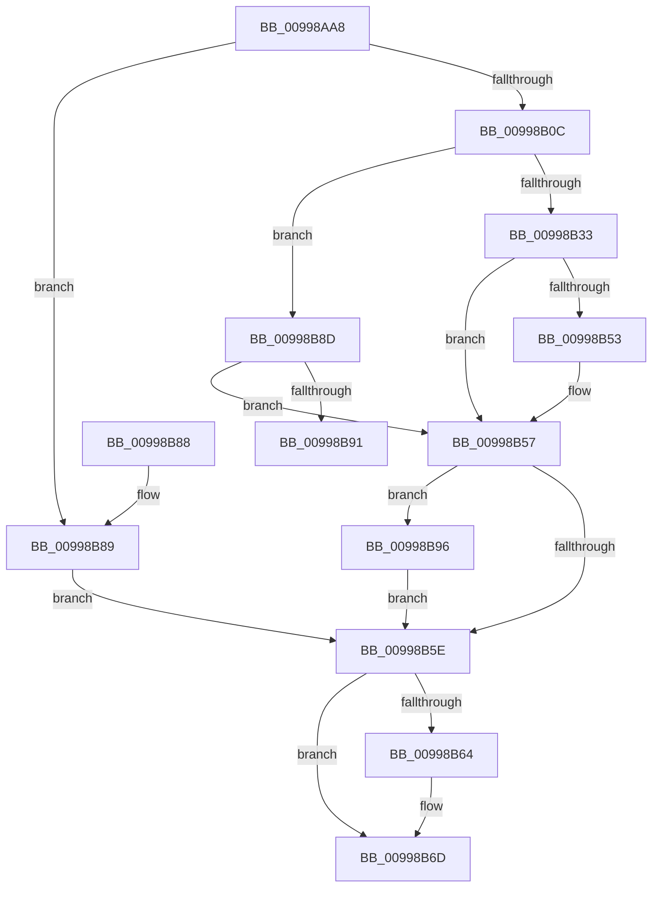

# PiGetServiceNameInfo

- RVA: `0x00998AA8`–`0x00998BA2` (길이 `250` bytes)
- VA: `0x0000000140998AA8`
- 실행 섹션: `PAGE`
- PDB 이름 있음: `예`; PDB Function 태그: `예`
- unwind 정보 RVA: `0x00099408`
- 디코드: `79`개 명령, `250/250` bytes 표시
- 미해석 바이트: `0` (있으면 어셈블리에 `.byte`로 보존)

> 이 문서는 커널 이미지의 기계어와 PDB 기호를 분석해 생성했습니다. 4번과 5번은 함수 원형과 자료형을 바이너리 사용 방식에서 추정한 C 해석이며 원본 소스 복구 결과는 아닙니다.

## 1. Dependencies

- 직접 호출 지점: **6**; 고유 호출 대상: **6**
- 직접 호출자로 확인된 함수: **2**
- RIP 상대 이미지 참조: **1**

### Outgoing calls
- `0x00998AE4` → [RtlInitUnicodeString](../../text/42/RtlInitUnicodeString_function_0042A780.md) (function, `0x0042A780`)
- `0x00998B01` → [PipOpenServiceEnumKeys](PipOpenServiceEnumKeys_function_00998E94.md) (function, `0x00998E94`)
- `0x00998B21` → [IopGetRegistryValue](IopGetRegistryValue_function_009990EC.md) (function, `0x009990EC`)
- `0x00998B48` → [RtlDuplicateUnicodeString](../93/RtlDuplicateUnicodeString_function_009321F0.md) (function, `0x009321F0`)
- `0x00998B68` → [ZwClose](../../text/6A/ZwClose_function_006AD2B0.md) (function, `0x006AD2B0`)
- `0x00998B9B` → [ExFreePoolWithTag](../../poolcode/B8/ExFreePoolWithTag_function_00B82870.md) (function, `0x00B82870`)

### Direct callers
- [IoOpenDriverRegistryKey](IoOpenDriverRegistryKey_function_00998BB0.md) at `0x00998DBA`
- [IoOpenDriverRegistryKey](IoOpenDriverRegistryKey_function_00998BB0.md) at `0x00998E33`
- [IoGetDriverDirectory](../A6/IoGetDriverDirectory_function_00A6F180.md) at `0x00A6F241`
- [IoGetDriverDirectory](../A6/IoGetDriverDirectory_function_00A6F180.md) at `0x00A6F293`

### Static image references
- `0x00998B1A` → RVA `0x00AFD550` (` ?? ::NNGAKEGL::`string'`; read)

## 2. Other-region calls and transfers

- 다른 실행 섹션으로 향하는 call: **3**
  - `0x00998AE4` → [RtlInitUnicodeString](../../text/42/RtlInitUnicodeString_function_0042A780.md) (`PAGE` → `.text`)
  - `0x00998B68` → [ZwClose](../../text/6A/ZwClose_function_006AD2B0.md) (`PAGE` → `.text`)
  - `0x00998B9B` → [ExFreePoolWithTag](../../poolcode/B8/ExFreePoolWithTag_function_00B82870.md) (`PAGE` → `POOLCODE`)
- call이 아닌 외부 분기/꼬리 이동: **1**
  - `0x00998B91` → [sub_00B2CCAC](../B2/Unknown_function_00B2CCAC.md) (`tail-transfer`)

## 3. Assembly (complete function range)

```asm
00998AA8  48 89 5C 24 10                  mov qword ptr [rsp + 0x10], rbx
00998AAD  48 89 74 24 18                  mov qword ptr [rsp + 0x18], rsi
00998AB2  55                              push rbp
00998AB3  57                              push rdi
00998AB4  41 54                           push r12
00998AB6  41 55                           push r13
00998AB8  41 57                           push r15
00998ABA  48 8B EC                        mov rbp, rsp
00998ABD  48 83 EC 40                     sub rsp, 0x40
00998AC1  4C 8B EA                        mov r13, rdx
00998AC4  4C 8B F9                        mov r15, rcx
00998AC7  0F 57 C0                        xorps xmm0, xmm0
00998ACA  48 8D 4D F0                     lea rcx, [rbp - 0x10]
00998ACE  33 DB                           xor ebx, ebx
00998AD0  33 D2                           xor edx, edx
00998AD2  0F 11 45 F0                     movups xmmword ptr [rbp - 0x10], xmm0
00998AD6  48 89 5D 48                     mov qword ptr [rbp + 0x48], rbx
00998ADA  4D 8B E0                        mov r12, r8
00998ADD  48 89 5D 30                     mov qword ptr [rbp + 0x30], rbx
00998AE1  40 B6 01                        mov sil, 1
00998AE4  E8 97 1C A9 FF                  call 0x14042a780
00998AE9  49 8B 4F 30                     mov rcx, qword ptr [r15 + 0x30]
00998AED  4C 8D 45 30                     lea r8, [rbp + 0x30]
00998AF1  48 83 C1 18                     add rcx, 0x18
00998AF5  88 5C 24 20                     mov byte ptr [rsp + 0x20], bl
00998AF9  45 33 C9                        xor r9d, r9d
00998AFC  BA 19 00 02 00                  mov edx, 0x20019
00998B01  E8 8E 03 00 00                  call 0x140998e94
00998B06  8B D8                           mov ebx, eax
00998B08  85 C0                           test eax, eax
00998B0A  78 7D                           js 0x140998b89
00998B0C  48 8B 4D 30                     mov rcx, qword ptr [rbp + 0x30]
00998B10  4C 8D 4D 48                     lea r9, [rbp + 0x48]
00998B14  41 B8 00 01 00 00               mov r8d, 0x100
00998B1A  48 8D 15 2F 4A 16 00            lea rdx, [rip + 0x164a2f]
00998B21  E8 C6 05 00 00                  call 0x1409990ec
00998B26  48 8B 7D 48                     mov rdi, qword ptr [rbp + 0x48]
00998B2A  8B D8                           mov ebx, eax
00998B2C  3D 34 00 00 C0                  cmp eax, 0xc0000034
00998B31  75 5A                           jne 0x140998b8d
00998B33  33 C9                           xor ecx, ecx
00998B35  49 8B 57 30                     mov rdx, qword ptr [r15 + 0x30]
00998B39  40 8A F1                        mov sil, cl
00998B3C  48 83 C2 18                     add rdx, 0x18
00998B40  4D 8B C5                        mov r8, r13
00998B43  B9 01 00 00 00                  mov ecx, 1
00998B48  E8 A3 96 F9 FF                  call 0x1409321f0
00998B4D  8B D8                           mov ebx, eax
00998B4F  85 C0                           test eax, eax
00998B51  78 04                           js 0x140998b57
00998B53  41 88 34 24                     mov byte ptr [r12], sil
00998B57  33 F6                           xor esi, esi
00998B59  48 85 FF                        test rdi, rdi
00998B5C  75 38                           jne 0x140998b96
00998B5E  48 39 75 30                     cmp qword ptr [rbp + 0x30], rsi
00998B62  74 09                           je 0x140998b6d
00998B64  48 8B 4D 30                     mov rcx, qword ptr [rbp + 0x30]
00998B68  E8 43 47 D1 FF                  call 0x1406ad2b0
00998B6D  4C 8D 5C 24 40                  lea r11, [rsp + 0x40]
00998B72  8B C3                           mov eax, ebx
00998B74  49 8B 5B 38                     mov rbx, qword ptr [r11 + 0x38]
00998B78  49 8B 73 40                     mov rsi, qword ptr [r11 + 0x40]
00998B7C  49 8B E3                        mov rsp, r11
00998B7F  41 5F                           pop r15
00998B81  41 5D                           pop r13
00998B83  41 5C                           pop r12
00998B85  5F                              pop rdi
00998B86  5D                              pop rbp
00998B87  C3                              ret
00998B88  CC                              int3
00998B89  33 F6                           xor esi, esi
00998B8B  EB D1                           jmp 0x140998b5e
00998B8D  85 DB                           test ebx, ebx
00998B8F  78 C6                           js 0x140998b57
00998B91  E9 16 41 19 00                  jmp 0x140b2ccac
00998B96  33 D2                           xor edx, edx
00998B98  48 8B CF                        mov rcx, rdi
00998B9B  E8 D0 9C 1E 00                  call 0x140b82870
00998BA0  EB BC                           jmp 0x140998b5e
```

## 4. C-style interpretation (structured pseudocode)

```c
__int64 __fastcall PiGetServiceNameInfo(__int64 a1, __int64 a2, __int64 a3, int a4)
{
    __int64 result;
    __int64 v_rbx;
    __int64 v_rsi;
    __int64 v_rsp;
    unsigned __int64 v_stack_m28;
    unsigned __int64 v_stack_m38;
    unsigned __int8 v_stack_m48;
    unsigned __int64 v_stack_p10;
    unsigned __int64 v_stack_p18;
    unsigned __int64 v_stack_p20;
    unsigned __int64 v_stack_p8;

    v_stack_p10 = v_rbx;
    v_stack_p18 = v_rsi;
    v_rsp = (v_rsp) - (64);
    v_rbx = 0;
    a2 = 0;
    v_stack_m38 = v_xmm0;
    v_stack_p20 = 0;
    v_stack_p8 = 0;
    result = RtlInitUnicodeString(v_stack_m38, a2, a3, a4);
    a1 = (*(unsigned __int64 *)(a1 + 48)) + (24);
    v_stack_m48 = 0;
    a4 = 0;
    result = PipOpenServiceEnumKeys(a1, (unsigned int)(0x20019ULL), v_stack_p8, a4);
    if (sign_flag) goto loc_00998B89;
    result = IopGetRegistryValue(v_stack_p8, v_rip + 1460783, 256, v_stack_p20);
    if (((unsigned int)(result)) != 0xC0000034ULL) goto loc_00998B8D;
    a1 = 0;
    a2 = (*(unsigned __int64 *)(a1 + 48)) + (24);
    result = RtlDuplicateUnicodeString(1, a2, a2, v_stack_p20);
    if (!(sign_flag)) {
        *(unsigned __int8 *)(a3) = 0;
    }
    v_rsi = 0;
    if (v_stack_p20 != 0) goto loc_00998B96;
loc_00998B5E:
    if (v_stack_p8 != 0) {
        a1 = v_stack_p8;
        result = ZwClose(a1, a2, a2, v_stack_p20);
    }
    return (unsigned int)((unsigned int)((unsigned int)((unsigned int)(result))));
loc_00998B89:
    v_rsi = 0;
    goto loc_00998B5E;
loc_00998B8D:
    if (sign_flag) goto loc_00998B57;
loc_00998B96:
    a2 = 0;
    result = ExFreePoolWithTag(v_stack_p20, a2, a2, v_stack_p20);
    goto loc_00998B5E;
}
```

## 5. (Beta) C Style

```c
int64_t PiGetServiceNameInfo(void *Arg1, int64_t Arg2, void *Arg3, int32_t Arg4)
{
    uint8_t *arg1 = (uint8_t *)Arg1;
    uint8_t *arg3 = (uint8_t *)Arg3;

    int64_t result;
    int64_t local_rbx;
    int64_t local_rsi;
    int64_t local_rsp;
    uint64_t v_stack_m28;
    uint64_t v_stack_m38;
    uint8_t v_stack_m48;
    uint64_t v_stack_p10;
    uint64_t v_stack_p18;
    uint64_t v_stack_p20;
    uint64_t v_stack_p8;

    v_stack_p10 = local_rbx;
    v_stack_p18 = local_rsi;
    local_rsp = (local_rsp) - (64);
    local_rbx = 0;
    Arg2 = 0;
    v_stack_m38 = v_xmm0;
    v_stack_p20 = 0;
    v_stack_p8 = 0;
    result = RtlInitUnicodeString(v_stack_m38, Arg2, Arg3, Arg4);
    Arg1 = (*(uint64_t *)(arg1 + 0x30)) + (24);
    v_stack_m48 = 0;
    Arg4 = 0;
    result = PipOpenServiceEnumKeys(Arg1, (uint32_t)(0x20019ULL), v_stack_p8, Arg4);
    if (sign_flag) goto loc_00998B89;
    result = IopGetRegistryValue(v_stack_p8, v_rip + 1460783, 256, v_stack_p20);
    if (((uint32_t)(result)) != 0xC0000034ULL) goto loc_00998B8D;
    Arg1 = 0;
    Arg2 = (*(uint64_t *)(arg1 + 0x30)) + (24);
    result = RtlDuplicateUnicodeString(1, Arg2, Arg2, v_stack_p20);
    if (!(sign_flag)) {
        *(uint8_t *)(arg3) = 0;
    }
    local_rsi = 0;
    if (v_stack_p20 != 0) goto loc_00998B96;
loc_00998B5E:
    if (v_stack_p8 != 0) {
        Arg1 = v_stack_p8;
        result = ZwClose(Arg1, Arg2, Arg2, v_stack_p20);
    }
    return (uint32_t)((uint32_t)((uint32_t)((uint32_t)(result))));
loc_00998B89:
    local_rsi = 0;
    goto loc_00998B5E;
loc_00998B8D:
    if (sign_flag) goto loc_00998B57;
loc_00998B96:
    Arg2 = 0;
    result = ExFreePoolWithTag(v_stack_p20, Arg2, Arg2, v_stack_p20);
    goto loc_00998B5E;
}
```

### 관측된 메모리 오프셋

구조체 형식이 확인되지 않은 접근은 인자 기준의 오프셋으로만 기록했습니다.

| 기준 인자 | 오프셋 표현 | 폭 (bit) | 접근 |
|---|---:|---:|---|
| `Arg1` | `+ 0x30` | `64` | `R` |
| `Arg3` | `+ 0x0` | `8` | `W` |

## 6. Execution-region graph

[열기: 2D/3D 그래프와 함수 탐색 컨트롤 패널](../../../control-panel.html?section=page&rva=0x00998AA8&view=graph)

- 2D 그래프는 위에서 아래로 흐르고, 3D 그래프는 빈 공간을 드래그해 회전합니다. Shift+드래그는 이동, 휠은 확대·축소, 함수 노드 선택은 대상 보고서 이동입니다.

### Static fallback


