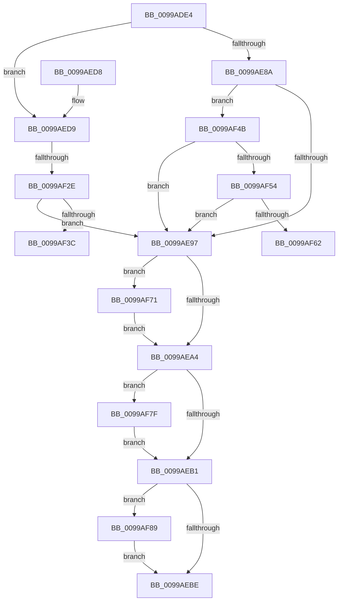

# PiInitializeDDB

- RVA: `0x0099ADE4`–`0x0099AF93` (길이 `431` bytes)
- VA: `0x000000014099ADE4`
- 실행 섹션: `PAGE`
- PDB 이름 있음: `예`; PDB Function 태그: `예`
- unwind 정보 RVA: `0x0009963C`
- 디코드: `102`개 명령, `431/431` bytes 표시
- 미해석 바이트: `0` (있으면 어셈블리에 `.byte`로 보존)

> 이 문서는 커널 이미지의 기계어와 PDB 기호를 분석해 생성했습니다. 4번과 5번은 함수 원형과 자료형을 바이너리 사용 방식에서 추정한 C 해석이며 원본 소스 복구 결과는 아닙니다.

## 1. Dependencies

- 직접 호출 지점: **6**; 고유 호출 대상: **5**
- 직접 호출자로 확인된 함수: **1**
- RIP 상대 이미지 참조: **4**

### Outgoing calls
- `0x0099AE3A` → [RtlInitUnicodeString](../../text/42/RtlInitUnicodeString_function_0042A780.md) (function, `0x0042A780`)
- `0x0099AE7F` → [ZwOpenFile](../../text/6A/ZwOpenFile_function_006AD730.md) (function, `0x006AD730`)
- `0x0099AF1F` → [ZwCreateSection](../../text/6A/ZwCreateSection_function_006ADA10.md) (function, `0x006ADA10`)
- `0x0099AF75` → [ZwUnmapViewOfSection](../../text/6A/ZwUnmapViewOfSection_function_006AD610.md) (function, `0x006AD610`)
- `0x0099AF7F` → [ZwClose](../../text/6A/ZwClose_function_006AD2B0.md) (function, `0x006AD2B0`)
- `0x0099AF89` → [ZwClose](../../text/6A/ZwClose_function_006AD2B0.md) (function, `0x006AD2B0`)

### Direct callers
- [PiLookupInDDB](PiLookupInDDB_function_0099ACBC.md) at `0x0099AD1D`
- [PiLookupInDDB](PiLookupInDDB_function_0099ACBC.md) at `0x0099ADB9`

### Static image references
- `0x0099AE8A` → RVA `0x00FC4148` (`.data`; read)
- `0x0099AF2E` → RVA `0x00FD9A8C` (`PAGEDATA`; read)
- `0x0099AF3F` → RVA `0x00AFE060` (` ?? ::NNGAKEGL::`string'`; read)
- `0x0099AF65` → RVA `0x00AFE030` (` ?? ::NNGAKEGL::`string'`; read)

## 2. Other-region calls and transfers

- 다른 실행 섹션으로 향하는 call: **6**
  - `0x0099AE3A` → [RtlInitUnicodeString](../../text/42/RtlInitUnicodeString_function_0042A780.md) (`PAGE` → `.text`)
  - `0x0099AE7F` → [ZwOpenFile](../../text/6A/ZwOpenFile_function_006AD730.md) (`PAGE` → `.text`)
  - `0x0099AF1F` → [ZwCreateSection](../../text/6A/ZwCreateSection_function_006ADA10.md) (`PAGE` → `.text`)
  - `0x0099AF75` → [ZwUnmapViewOfSection](../../text/6A/ZwUnmapViewOfSection_function_006AD610.md) (`PAGE` → `.text`)
  - `0x0099AF7F` → [ZwClose](../../text/6A/ZwClose_function_006AD2B0.md) (`PAGE` → `.text`)
  - `0x0099AF89` → [ZwClose](../../text/6A/ZwClose_function_006AD2B0.md) (`PAGE` → `.text`)
- call이 아닌 외부 분기/꼬리 이동: **3**
  - `0x0099AF28` → [sub_00B2CFB8 + 0x40](../B2/Unknown_function_00B2CFB8.md) (`tail-transfer`)
  - `0x0099AF46` → [sub_00B2CFB8 + 0xB](../B2/Unknown_function_00B2CFB8.md) (`tail-transfer`)
  - `0x0099AF6C` → [sub_00B2CFB8 + 0xB](../B2/Unknown_function_00B2CFB8.md) (`tail-transfer`)

## 3. Assembly (complete function range)

```asm
0099ADE4  48 89 5C 24 08                  mov qword ptr [rsp + 8], rbx
0099ADE9  48 89 74 24 10                  mov qword ptr [rsp + 0x10], rsi
0099ADEE  55                              push rbp
0099ADEF  57                              push rdi
0099ADF0  41 56                           push r14
0099ADF2  48 8D 6C 24 B9                  lea rbp, [rsp - 0x47]
0099ADF7  48 81 EC D0 00 00 00            sub rsp, 0xd0
0099ADFE  45 33 F6                        xor r14d, r14d
0099AE01  0F 57 C0                        xorps xmm0, xmm0
0099AE04  40 8A F2                        mov sil, dl
0099AE07  44 89 75 F3                     mov dword ptr [rbp - 0xd], r14d
0099AE0B  48 8B D1                        mov rdx, rcx
0099AE0E  44 89 75 0B                     mov dword ptr [rbp + 0xb], r14d
0099AE12  41 0F 11 00                     movups xmmword ptr [r8], xmm0
0099AE16  48 8D 4D 1F                     lea rcx, [rbp + 0x1f]
0099AE1A  4C 89 75 E7                     mov qword ptr [rbp - 0x19], r14
0099AE1E  41 0F 11 40 10                  movups xmmword ptr [r8 + 0x10], xmm0
0099AE23  49 8B F8                        mov rdi, r8
0099AE26  4C 89 75 CF                     mov qword ptr [rbp - 0x31], r14
0099AE2A  0F 11 45 1F                     movups xmmword ptr [rbp + 0x1f], xmm0
0099AE2E  4C 89 75 C7                     mov qword ptr [rbp - 0x39], r14
0099AE32  0F 11 45 2F                     movups xmmword ptr [rbp + 0x2f], xmm0
0099AE36  4C 89 75 7F                     mov qword ptr [rbp + 0x7f], r14
0099AE3A  E8 41 F9 A8 FF                  call 0x14042a780
0099AE3F  48 8D 45 1F                     lea rax, [rbp + 0x1f]
0099AE43  44 89 74 24 28                  mov dword ptr [rsp + 0x28], r14d
0099AE48  0F 57 C0                        xorps xmm0, xmm0
0099AE4B  48 89 45 FF                     mov qword ptr [rbp - 1], rax
0099AE4F  4C 8D 4D 2F                     lea r9, [rbp + 0x2f]
0099AE53  C7 45 EF 30 00 00 00            mov dword ptr [rbp - 0x11], 0x30
0099AE5A  4C 8D 45 EF                     lea r8, [rbp - 0x11]
0099AE5E  4C 89 75 F7                     mov qword ptr [rbp - 9], r14
0099AE62  BA 00 00 00 80                  mov edx, 0x80000000
0099AE67  C7 45 07 40 02 00 00            mov dword ptr [rbp + 7], 0x240
0099AE6E  48 8D 4D CF                     lea rcx, [rbp - 0x31]
0099AE72  C7 44 24 20 05 00 00 00         mov dword ptr [rsp + 0x20], 5
0099AE7A  F3 0F 7F 45 0F                  movdqu xmmword ptr [rbp + 0xf], xmm0
0099AE7F  E8 AC 28 D1 FF                  call 0x1406ad730
0099AE84  8B D8                           mov ebx, eax
0099AE86  85 C0                           test eax, eax
0099AE88  79 4F                           jns 0x14099aed9
0099AE8A  44 38 35 B7 92 62 00            cmp byte ptr [rip + 0x6292b7], r14b
0099AE91  0F 84 B4 00 00 00               je 0x14099af4b
0099AE97  48 8B 55 7F                     mov rdx, qword ptr [rbp + 0x7f]
0099AE9B  48 85 D2                        test rdx, rdx
0099AE9E  0F 85 CD 00 00 00               jne 0x14099af71
0099AEA4  48 8B 4D C7                     mov rcx, qword ptr [rbp - 0x39]
0099AEA8  48 85 C9                        test rcx, rcx
0099AEAB  0F 85 CE 00 00 00               jne 0x14099af7f
0099AEB1  48 8B 4D CF                     mov rcx, qword ptr [rbp - 0x31]
0099AEB5  48 85 C9                        test rcx, rcx
0099AEB8  0F 85 CB 00 00 00               jne 0x14099af89
0099AEBE  4C 8D 9C 24 D0 00 00 00         lea r11, [rsp + 0xd0]
0099AEC6  8B C3                           mov eax, ebx
0099AEC8  49 8B 5B 20                     mov rbx, qword ptr [r11 + 0x20]
0099AECC  49 8B 73 28                     mov rsi, qword ptr [r11 + 0x28]
0099AED0  49 8B E3                        mov rsp, r11
0099AED3  41 5E                           pop r14
0099AED5  5F                              pop rdi
0099AED6  5D                              pop rbp
0099AED7  C3                              ret
0099AED8  CC                              int3
0099AED9  48 8B 45 CF                     mov rax, qword ptr [rbp - 0x31]
0099AEDD  4C 8D 45 EF                     lea r8, [rbp - 0x11]
0099AEE1  48 89 44 24 30                  mov qword ptr [rsp + 0x30], rax
0099AEE6  48 8D 4D C7                     lea rcx, [rbp - 0x39]
0099AEEA  BE 02 00 00 00                  mov esi, 2
0099AEEF  C7 44 24 28 00 00 00 08         mov dword ptr [rsp + 0x28], 0x8000000
0099AEF7  0F 57 C0                        xorps xmm0, xmm0
0099AEFA  C7 45 EF 30 00 00 00            mov dword ptr [rbp - 0x11], 0x30
0099AF01  45 33 C9                        xor r9d, r9d
0099AF04  4C 89 75 F7                     mov qword ptr [rbp - 9], r14
0099AF08  C7 45 07 40 02 00 00            mov dword ptr [rbp + 7], 0x240
0099AF0F  8D 56 02                        lea edx, [rsi + 2]
0099AF12  4C 89 75 FF                     mov qword ptr [rbp - 1], r14
0099AF16  F3 0F 7F 45 0F                  movdqu xmmword ptr [rbp + 0xf], xmm0
0099AF1B  89 74 24 20                     mov dword ptr [rsp + 0x20], esi
0099AF1F  E8 EC 2A D1 FF                  call 0x1406ada10
0099AF24  8B D8                           mov ebx, eax
0099AF26  85 C0                           test eax, eax
0099AF28  0F 89 CA 20 19 00               jns 0x140b2cff8
0099AF2E  8B 05 58 EB 63 00               mov eax, dword ptr [rip + 0x63eb58]
0099AF34  A8 20                           test al, 0x20
0099AF36  0F 85 5B FF FF FF               jne 0x14099ae97
0099AF3C  83 C8 20                        or eax, 0x20
0099AF3F  48 8D 15 1A 31 16 00            lea rdx, [rip + 0x16311a]
0099AF46  E9 78 20 19 00                  jmp 0x140b2cfc3
0099AF4B  40 84 F6                        test sil, sil
0099AF4E  0F 85 43 FF FF FF               jne 0x14099ae97
0099AF54  8B 05 32 EB 63 00               mov eax, dword ptr [rip + 0x63eb32]
0099AF5A  A8 10                           test al, 0x10
0099AF5C  0F 85 35 FF FF FF               jne 0x14099ae97
0099AF62  83 C8 10                        or eax, 0x10
0099AF65  48 8D 15 C4 30 16 00            lea rdx, [rip + 0x1630c4]
0099AF6C  E9 52 20 19 00                  jmp 0x140b2cfc3
0099AF71  48 83 C9 FF                     or rcx, 0xffffffffffffffff
0099AF75  E8 96 26 D1 FF                  call 0x1406ad610
0099AF7A  E9 25 FF FF FF                  jmp 0x14099aea4
0099AF7F  E8 2C 23 D1 FF                  call 0x1406ad2b0
0099AF84  E9 28 FF FF FF                  jmp 0x14099aeb1
0099AF89  E8 22 23 D1 FF                  call 0x1406ad2b0
0099AF8E  E9 2B FF FF FF                  jmp 0x14099aebe
```

## 4. C-style interpretation (structured pseudocode)

```c
__int64 __fastcall PiInitializeDDB(__int64 a1, unsigned __int8 a2, __int64 a3)
{
    __int64 result;
    __int64 v_r14;
    __int64 v_rsp;
    unsigned __int64 v_stack_m18;
    unsigned __int64 v_stack_m30;
    unsigned __int64 v_stack_m40;
    unsigned __int64 v_stack_m50;
    unsigned int v_stack_m54;
    unsigned int v_stack_m58;
    unsigned __int64 v_stack_m5F;
    unsigned __int64 v_stack_m60;
    unsigned __int64 v_stack_m68;
    unsigned int v_stack_m6C;
    unsigned int v_stack_m70;
    unsigned __int64 v_stack_m78;
    unsigned __int64 v_stack_m90;
    unsigned __int64 v_stack_m98;
    unsigned __int64 v_stack_mA0;
    unsigned int v_stack_mA8;
    unsigned int v_stack_mB0;
    unsigned int v_stack_mC0;
    unsigned int v_stack_mC8;
    unsigned __int64 v_stack_p10;
    unsigned __int64 v_stack_p20;
    unsigned __int64 v_stack_p8;

    v_stack_p8 = v_rbx;
    v_stack_p10 = v_rsi;
    v_rsp = (v_rsp) - (208);
    v_r14 = 0;
    v_stack_m6C = 0;
    v_stack_m54 = 0;
    *(unsigned __int64 *)(a3) = v_xmm0;
    v_stack_m78 = 0;
    *(unsigned __int64 *)(a3 + 16) = v_xmm0;
    v_stack_m90 = 0;
    v_stack_m40 = v_xmm0;
    v_stack_m98 = 0;
    v_stack_m30 = v_xmm0;
    v_stack_p20 = 0;
    result = RtlInitUnicodeString(v_stack_m40, a1, a3, a4);
    v_stack_mC0 = 0;
    v_stack_m60 = v_stack_m40;
    v_stack_m70 = 48;
    v_stack_m68 = 0;
    v_stack_m58 = 576;
    v_stack_mC8 = 5;
    v_stack_m50 = v_xmm0;
    result = ZwOpenFile(v_stack_m90, (unsigned int)(0x80000000ULL), v_stack_m70, v_stack_m30);
    if (!sign_flag) goto loc_0099AED9;
    if ((*(unsigned __int8 *)(v_rip + 6460087)) == 0) goto loc_0099AF4B;
loc_0099AE97:
    if (v_stack_p20 != 0) goto loc_0099AF71;
loc_0099AEA4:
    if (v_stack_m98 != 0) goto loc_0099AF7F;
loc_0099AEB1:
    if (v_stack_m90 != 0) goto loc_0099AF89;
loc_0099AEBE:
    return (unsigned int)((unsigned int)((unsigned int)((unsigned int)(result))));
loc_0099AED9:
    v_stack_mA0 = v_stack_m90;
    v_stack_mA8 = 0x8000000ULL;
    v_stack_m70 = 48;
    a4 = 0;
    v_stack_m68 = 0;
    v_stack_m58 = 576;
    v_stack_m60 = 0;
    v_stack_m50 = v_xmm0;
    v_stack_mB0 = 2;
    result = ZwCreateSection(v_stack_m98, 2 + 2, v_stack_m70, a4);
    if ((((unsigned __int8)((unsigned int)(*(unsigned int *)(v_rip + 6548312)))) & (32)) != 0) goto loc_0099AE97;
    result = (unsigned int)(((unsigned int)(*(unsigned int *)(v_rip + 6548312))) | (32));
loc_0099AF4B:
    if (2 != 0) goto loc_0099AE97;
    if ((((unsigned __int8)((unsigned int)(*(unsigned int *)(v_rip + 6548274)))) & (16)) != 0) goto loc_0099AE97;
    result = (unsigned int)(((unsigned int)(*(unsigned int *)(v_rip + 6548274))) | (16));
loc_0099AF71:
    a1 = (v_stack_m98) | (-1);
    result = ZwUnmapViewOfSection(a1, v_rip + 1454276, v_stack_m70, a4);
    goto loc_0099AEA4;
loc_0099AF7F:
    result = ZwClose(a1, v_rip + 1454276, v_stack_m70, a4);
    goto loc_0099AEB1;
loc_0099AF89:
    result = ZwClose(a1, v_rip + 1454276, v_stack_m70, a4);
    goto loc_0099AEBE;
}
```

## 5. (Beta) C Style

```c
int64_t PiInitializeDDB(int64_t Arg1, uint8_t Arg2, void *Arg3)
{
    uint8_t *arg3 = (uint8_t *)Arg3;

    int64_t result;
    int64_t local_r14;
    int64_t local_rsp;
    uint64_t v_stack_m18;
    uint64_t v_stack_m30;
    uint64_t v_stack_m40;
    uint64_t v_stack_m50;
    uint32_t v_stack_m54;
    uint32_t v_stack_m58;
    uint64_t v_stack_m5F;
    uint64_t v_stack_m60;
    uint64_t v_stack_m68;
    uint32_t v_stack_m6C;
    uint32_t v_stack_m70;
    uint64_t v_stack_m78;
    uint64_t v_stack_m90;
    uint64_t v_stack_m98;
    uint64_t v_stack_mA0;
    uint32_t v_stack_mA8;
    uint32_t v_stack_mB0;
    uint32_t v_stack_mC0;
    uint32_t v_stack_mC8;
    uint64_t v_stack_p10;
    uint64_t v_stack_p20;
    uint64_t v_stack_p8;

    v_stack_p8 = local_rbx;
    v_stack_p10 = local_rsi;
    local_rsp = (local_rsp) - (208);
    local_r14 = 0;
    v_stack_m6C = 0;
    v_stack_m54 = 0;
    *(uint64_t *)(arg3) = v_xmm0;
    v_stack_m78 = 0;
    *(uint64_t *)(arg3 + 0x10) = v_xmm0;
    v_stack_m90 = 0;
    v_stack_m40 = v_xmm0;
    v_stack_m98 = 0;
    v_stack_m30 = v_xmm0;
    v_stack_p20 = 0;
    result = RtlInitUnicodeString(v_stack_m40, Arg1, Arg3, a4);
    v_stack_mC0 = 0;
    v_stack_m60 = v_stack_m40;
    v_stack_m70 = 48;
    v_stack_m68 = 0;
    v_stack_m58 = 576;
    v_stack_mC8 = 5;
    v_stack_m50 = v_xmm0;
    result = ZwOpenFile(v_stack_m90, (uint32_t)(0x80000000ULL), v_stack_m70, v_stack_m30);
    if (!sign_flag) goto loc_0099AED9;
    if ((*(uint8_t *)(v_rip + 0x6292B7)) == 0) goto loc_0099AF4B;
loc_0099AE97:
    if (v_stack_p20 != 0) goto loc_0099AF71;
loc_0099AEA4:
    if (v_stack_m98 != 0) goto loc_0099AF7F;
loc_0099AEB1:
    if (v_stack_m90 != 0) goto loc_0099AF89;
loc_0099AEBE:
    return (uint32_t)((uint32_t)((uint32_t)((uint32_t)(result))));
loc_0099AED9:
    v_stack_mA0 = v_stack_m90;
    v_stack_mA8 = 0x8000000ULL;
    v_stack_m70 = 48;
    a4 = 0;
    v_stack_m68 = 0;
    v_stack_m58 = 576;
    v_stack_m60 = 0;
    v_stack_m50 = v_xmm0;
    v_stack_mB0 = 2;
    result = ZwCreateSection(v_stack_m98, 2 + 2, v_stack_m70, a4);
    if ((((uint8_t)((uint32_t)(*(uint32_t *)(v_rip + 0x63EB58)))) & (32)) != 0) goto loc_0099AE97;
    result = (uint32_t)(((uint32_t)(*(uint32_t *)(v_rip + 0x63EB58))) | (32));
loc_0099AF4B:
    if (2 != 0) goto loc_0099AE97;
    if ((((uint8_t)((uint32_t)(*(uint32_t *)(v_rip + 0x63EB32)))) & (16)) != 0) goto loc_0099AE97;
    result = (uint32_t)(((uint32_t)(*(uint32_t *)(v_rip + 0x63EB32))) | (16));
loc_0099AF71:
    Arg1 = (v_stack_m98) | (-1);
    result = ZwUnmapViewOfSection(Arg1, v_rip + 1454276, v_stack_m70, a4);
    goto loc_0099AEA4;
loc_0099AF7F:
    result = ZwClose(Arg1, v_rip + 1454276, v_stack_m70, a4);
    goto loc_0099AEB1;
loc_0099AF89:
    result = ZwClose(Arg1, v_rip + 1454276, v_stack_m70, a4);
    goto loc_0099AEBE;
}
```

### 관측된 메모리 오프셋

구조체 형식이 확인되지 않은 접근은 인자 기준의 오프셋으로만 기록했습니다.

| 기준 인자 | 오프셋 표현 | 폭 (bit) | 접근 |
|---|---:|---:|---|
| `Arg3` | `+ 0x0` | `128` | `R` |
| `Arg3` | `+ 0x10` | `128` | `R` |

## 6. Execution-region graph

[열기: 2D/3D 그래프와 함수 탐색 컨트롤 패널](../../../control-panel.html?section=page&rva=0x0099ADE4&view=graph)

- 2D 그래프는 위에서 아래로 흐르고, 3D 그래프는 빈 공간을 드래그해 회전합니다. Shift+드래그는 이동, 휠은 확대·축소, 함수 노드 선택은 대상 보고서 이동입니다.

### Static fallback


