# PiIsDriverBlocked

- RVA: `0x0099C254`–`0x0099C4EC` (길이 `664` bytes)
- VA: `0x000000014099C254`
- 실행 섹션: `PAGE`
- PDB 이름 있음: `예`; PDB Function 태그: `아니요`
- unwind 정보 RVA: `0x00099754`
- 디코드: `199`개 명령, `664/664` bytes 표시
- 미해석 바이트: `0` (있으면 어셈블리에 `.byte`로 보존)

> 이 문서는 커널 이미지의 기계어와 PDB 기호를 분석해 생성했습니다. 4번과 5번은 함수 원형과 자료형을 바이너리 사용 방식에서 추정한 C 해석이며 원본 소스 복구 결과는 아닙니다.

## 1. Dependencies

- 직접 호출 지점: **16**; 고유 호출 대상: **14**
- 직접 호출자로 확인된 함수: **1**
- RIP 상대 이미지 참조: **8**

### Outgoing calls
- `0x0099C2AC` → [SdbGetDatabaseMatch](../95/SdbGetDatabaseMatch_function_00958240.md) (function, `0x00958240`)
- `0x0099C2E3` → [SdbQueryDataEx](../81/SdbQueryDataEx_function_0081363C.md) (function, `0x0081363C`)
- `0x0099C302` → [VslGetNestedPageProtectionFlags](../../text/2F/VslGetNestedPageProtectionFlags_function_002F2164.md) (function, `0x002F2164`)
- `0x0099C320` → [KeIsKernelCetEnabled](../../text/45/KeIsKernelCetEnabled_function_0045D610.md) (function, `0x0045D610`)
- `0x0099C339` → [PiIsHVCIEnabled](../72/PiIsHVCIEnabled_function_0072E0B4.md) (function, `0x0072E0B4`)
- `0x0099C362` → [ExIsProcessorFeaturePresent](../../text/4B/ExIsProcessorFeaturePresent_function_004B22A0.md) (function, `0x004B22A0`)
- `0x0099C3B1` → [SdbReadEntryInformation](../81/SdbReadEntryInformation_function_00813AEC.md) (function, `0x00813AEC`)
- `0x0099C3E3` → [RtlInitUnicodeString](../../text/42/RtlInitUnicodeString_function_0042A780.md) (function, `0x0042A780`)
- `0x0099C3FC` → [PnpLogEvent](../72/PnpLogEvent_function_0072C8FC.md) (function, `0x0072C8FC`)
- `0x0099C41B` → [wcsrchr](../../text/50/wcsrchr_function_00501E50.md) (function, `0x00501E50`)
- `0x0099C440` → [RtlInitUnicodeString](../../text/42/RtlInitUnicodeString_function_0042A780.md) (function, `0x0042A780`)
- `0x0099C45A` → [PnpLogEvent](../72/PnpLogEvent_function_0072C8FC.md) (function, `0x0072C8FC`)
- `0x0099C46D` → [PnpTraceDriverBlocked](../73/PnpTraceDriverBlocked_function_0073CB88.md) (function, `0x0073CB88`)
- `0x0099C498` → [PiUpdateDriverDBCache](../A8/PiUpdateDriverDBCache_function_00A895CC.md) (function, `0x00A895CC`)
- `0x0099C4C4` → [PiNotifyCiDriverBlocked](../72/PiNotifyCiDriverBlocked_function_0072E100.md) (function, `0x0072E100`)
- `0x0099C4D2` → [_security_check_cookie](../../text/6A/_security_check_cookie_function_006AC640.md) (function, `0x006AC640`)

### Direct callers
- [PiLookupInDDB](PiLookupInDDB_function_0099ACBC.md) at `0x0099AD6D`
- [PiLookupInDDB](PiLookupInDDB_function_0099ACBC.md) at `0x0099AD98`

### Static image references
- `0x0099C26D` → RVA `0x00E0A740` (`.data`; read)
- `0x0099C381` → RVA `0x00E66245` (`.data`; read)
- `0x0099C38A` → RVA `0x00E66279` (`.data`; read)
- `0x0099C393` → RVA `0x00E6627A` (`.data`; read)
- `0x0099C39C` → RVA `0x00E66278` (`.data`; read)
- `0x0099C3BA` → RVA `0x00FD9A8C` (`PAGEDATA`; read)
- `0x0099C3CB` → RVA `0x00AFE160` (` ?? ::NNGAKEGL::`string'`; read)
- `0x0099C3D5` → RVA `0x00FD9A8C` (`PAGEDATA`; write)

## 2. Other-region calls and transfers

- 다른 실행 섹션으로 향하는 call: **7**
  - `0x0099C302` → [VslGetNestedPageProtectionFlags](../../text/2F/VslGetNestedPageProtectionFlags_function_002F2164.md) (`PAGE` → `.text`)
  - `0x0099C320` → [KeIsKernelCetEnabled](../../text/45/KeIsKernelCetEnabled_function_0045D610.md) (`PAGE` → `.text`)
  - `0x0099C362` → [ExIsProcessorFeaturePresent](../../text/4B/ExIsProcessorFeaturePresent_function_004B22A0.md) (`PAGE` → `.text`)
  - `0x0099C3E3` → [RtlInitUnicodeString](../../text/42/RtlInitUnicodeString_function_0042A780.md) (`PAGE` → `.text`)
  - `0x0099C41B` → [wcsrchr](../../text/50/wcsrchr_function_00501E50.md) (`PAGE` → `.text`)
  - `0x0099C440` → [RtlInitUnicodeString](../../text/42/RtlInitUnicodeString_function_0042A780.md) (`PAGE` → `.text`)
  - `0x0099C4D2` → [_security_check_cookie](../../text/6A/_security_check_cookie_function_006AC640.md) (`PAGE` → `.text`)
- 별도 외부 분기/꼬리 이동을 확인하지 못했습니다.

## 3. Assembly (complete function range)

```asm
0099C254  40 55                           push rbp
0099C256  53                              push rbx
0099C257  56                              push rsi
0099C258  57                              push rdi
0099C259  41 54                           push r12
0099C25B  41 55                           push r13
0099C25D  41 56                           push r14
0099C25F  41 57                           push r15
0099C261  48 8D 6C 24 E9                  lea rbp, [rsp - 0x17]
0099C266  48 81 EC A8 00 00 00            sub rsp, 0xa8
0099C26D  48 8B 05 CC E4 46 00            mov rax, qword ptr [rip + 0x46e4cc]
0099C274  48 33 C4                        xor rax, rsp
0099C277  48 89 45 FF                     mov qword ptr [rbp - 1], rax
0099C27B  4C 8B 7D 7F                     mov r15, qword ptr [rbp + 0x7f]
0099C27F  33 C0                           xor eax, eax
0099C281  21 45 AF                        and dword ptr [rbp - 0x51], eax
0099C284  0F 57 C0                        xorps xmm0, xmm0
0099C287  48 89 45 F7                     mov qword ptr [rbp - 9], rax
0099C28B  4C 8B F2                        mov r14, rdx
0099C28E  48 8B 52 08                     mov rdx, qword ptr [rdx + 8]
0099C292  4C 8B E1                        mov r12, rcx
0099C295  41 8B C1                        mov eax, r9d
0099C298  4D 8B C8                        mov r9, r8
0099C29B  48 89 44 24 20                  mov qword ptr [rsp + 0x20], rax
0099C2A0  4C 89 45 CF                     mov qword ptr [rbp - 0x31], r8
0099C2A4  0F 11 45 D7                     movups xmmword ptr [rbp - 0x29], xmm0
0099C2A8  0F 11 45 E7                     movups xmmword ptr [rbp - 0x19], xmm0
0099C2AC  E8 8F BF FB FF                  call 0x140958240
0099C2B1  44 8B E8                        mov r13d, eax
0099C2B4  85 C0                           test eax, eax
0099C2B6  0F 84 C7 01 00 00               je 0x14099c483
0099C2BC  B8 04 00 00 00                  mov eax, 4
0099C2C1  4C 8D 4D B7                     lea r9, [rbp - 0x49]
0099C2C5  89 45 B3                        mov dword ptr [rbp - 0x4d], eax
0099C2C8  41 8B D5                        mov edx, r13d
0099C2CB  89 45 B7                        mov dword ptr [rbp - 0x49], eax
0099C2CE  49 8B CC                        mov rcx, r12
0099C2D1  48 8D 45 B3                     lea rax, [rbp - 0x4d]
0099C2D5  48 89 44 24 28                  mov qword ptr [rsp + 0x28], rax
0099C2DA  48 8D 45 AF                     lea rax, [rbp - 0x51]
0099C2DE  48 89 44 24 20                  mov qword ptr [rsp + 0x20], rax
0099C2E3  E8 54 73 E7 FF                  call 0x14081363c
0099C2E8  BE 6B 03 00 C0                  mov esi, 0xc000036b
0099C2ED  85 C0                           test eax, eax
0099C2EF  0F 85 B0 00 00 00               jne 0x14099c3a5
0099C2F5  8B 7D AF                        mov edi, dword ptr [rbp - 0x51]
0099C2F8  33 DB                           xor ebx, ebx
0099C2FA  40 F6 C7 40                     test dil, 0x40
0099C2FE  74 1A                           je 0x14099c31a
0099C300  33 C9                           xor ecx, ecx
0099C302  E8 5D 5E 95 FF                  call 0x1402f2164
0099C307  0F BA E0 0E                     bt eax, 0xe
0099C30B  73 0A                           jae 0x14099c317
0099C30D  8D 7B 40                        lea edi, [rbx + 0x40]
0099C310  8B DE                           mov ebx, esi
0099C312  89 7D AF                        mov dword ptr [rbp - 0x51], edi
0099C315  EB 03                           jmp 0x14099c31a
0099C317  8B 7D AF                        mov edi, dword ptr [rbp - 0x51]
0099C31A  40 F6 C7 20                     test dil, 0x20
0099C31E  74 13                           je 0x14099c333
0099C320  E8 EB 12 AC FF                  call 0x14045d610
0099C325  84 C0                           test al, al
0099C327  74 0A                           je 0x14099c333
0099C329  BF 20 00 00 00                  mov edi, 0x20
0099C32E  8B DE                           mov ebx, esi
0099C330  89 7D AF                        mov dword ptr [rbp - 0x51], edi
0099C333  40 F6 C7 10                     test dil, 0x10
0099C337  74 18                           je 0x14099c351
0099C339  E8 76 1D D9 FF                  call 0x14072e0b4
0099C33E  84 C0                           test al, al
0099C340  74 0C                           je 0x14099c34e
0099C342  BF 10 00 00 00                  mov edi, 0x10
0099C347  8B DE                           mov ebx, esi
0099C349  89 7D AF                        mov dword ptr [rbp - 0x51], edi
0099C34C  EB 03                           jmp 0x14099c351
0099C34E  8B 7D AF                        mov edi, dword ptr [rbp - 0x51]
0099C351  40 F6 C7 70                     test dil, 0x70
0099C355  75 24                           jne 0x14099c37b
0099C357  40 F6 C7 04                     test dil, 4
0099C35B  74 11                           je 0x14099c36e
0099C35D  B9 09 00 00 00                  mov ecx, 9
0099C362  E8 39 5F B1 FF                  call 0x1404b22a0
0099C367  8B 7D AF                        mov edi, dword ptr [rbp - 0x51]
0099C36A  84 C0                           test al, al
0099C36C  74 0D                           je 0x14099c37b
0099C36E  40 8A C7                        mov al, dil
0099C371  24 01                           and al, 1
0099C373  F6 D8                           neg al
0099C375  1B DB                           sbb ebx, ebx
0099C377  F7 DB                           neg ebx
0099C379  03 DE                           add ebx, esi
0099C37B  40 F6 C7 08                     test dil, 8
0099C37F  74 26                           je 0x14099c3a7
0099C381  80 3D BD 9E 4C 00 00            cmp byte ptr [rip + 0x4c9ebd], 0
0099C388  75 1B                           jne 0x14099c3a5
0099C38A  80 3D E8 9E 4C 00 00            cmp byte ptr [rip + 0x4c9ee8], 0
0099C391  75 12                           jne 0x14099c3a5
0099C393  80 3D E0 9E 4C 00 00            cmp byte ptr [rip + 0x4c9ee0], 0
0099C39A  75 09                           jne 0x14099c3a5
0099C39C  80 3D D5 9E 4C 00 00            cmp byte ptr [rip + 0x4c9ed5], 0
0099C3A3  74 02                           je 0x14099c3a7
0099C3A5  8B DE                           mov ebx, esi
0099C3A7  4C 8D 45 D7                     lea r8, [rbp - 0x29]
0099C3AB  41 8B D5                        mov edx, r13d
0099C3AE  49 8B CC                        mov rcx, r12
0099C3B1  E8 36 77 E7 FF                  call 0x140813aec
0099C3B6  85 C0                           test eax, eax
0099C3B8  75 47                           jne 0x14099c401
0099C3BA  8B 05 CC D6 63 00               mov eax, dword ptr [rip + 0x63d6cc]
0099C3C0  B9 00 01 00 00                  mov ecx, 0x100
0099C3C5  85 C1                           test ecx, eax
0099C3C7  75 38                           jne 0x14099c401
0099C3C9  0B C1                           or eax, ecx
0099C3CB  48 8D 15 8E 1D 16 00            lea rdx, [rip + 0x161d8e]
0099C3D2  0F 57 C0                        xorps xmm0, xmm0
0099C3D5  89 05 B1 D6 63 00               mov dword ptr [rip + 0x63d6b1], eax
0099C3DB  48 8D 4D BF                     lea rcx, [rbp - 0x41]
0099C3DF  0F 11 45 BF                     movups xmmword ptr [rbp - 0x41], xmm0
0099C3E3  E8 98 E3 A8 FF                  call 0x14042a780
0099C3E8  83 64 24 20 00                  and dword ptr [rsp + 0x20], 0
0099C3ED  48 8D 4D BF                     lea rcx, [rbp - 0x41]
0099C3F1  45 33 C9                        xor r9d, r9d
0099C3F4  33 D2                           xor edx, edx
0099C3F6  41 B8 6D 03 00 C0               mov r8d, 0xc000036d
0099C3FC  E8 FB 04 D9 FF                  call 0x14072c8fc
0099C401  8B C3                           mov eax, ebx
0099C403  41 BC 6C 03 00 C0               mov r12d, 0xc000036c
0099C409  3B DE                           cmp ebx, esi
0099C40B  74 05                           je 0x14099c412
0099C40D  41 3B C4                        cmp eax, r12d
0099C410  75 64                           jne 0x14099c476
0099C412  49 8B 4E 08                     mov rcx, qword ptr [r14 + 8]
0099C416  BA 5C 00 00 00                  mov edx, 0x5c
0099C41B  E8 30 5A B6 FF                  call 0x140501e50
0099C420  48 8B F8                        mov rdi, rax
0099C423  48 85 C0                        test rax, rax
0099C426  75 06                           jne 0x14099c42e
0099C428  49 8B 7E 08                     mov rdi, qword ptr [r14 + 8]
0099C42C  EB 04                           jmp 0x14099c432
0099C42E  48 83 C7 02                     add rdi, 2
0099C432  0F 57 C0                        xorps xmm0, xmm0
0099C435  48 8D 4D BF                     lea rcx, [rbp - 0x41]
0099C439  48 8B D7                        mov rdx, rdi
0099C43C  0F 11 45 BF                     movups xmmword ptr [rbp - 0x41], xmm0
0099C440  E8 3B E3 A8 FF                  call 0x14042a780
0099C445  4C 8D 4D D7                     lea r9, [rbp - 0x29]
0099C449  C7 44 24 20 10 00 00 00         mov dword ptr [rsp + 0x20], 0x10
0099C451  44 8B C3                        mov r8d, ebx
0099C454  48 8D 4D BF                     lea rcx, [rbp - 0x41]
0099C458  33 D2                           xor edx, edx
0099C45A  E8 9D 04 D9 FF                  call 0x14072c8fc
0099C45F  44 8B 45 AF                     mov r8d, dword ptr [rbp - 0x51]
0099C463  48 8D 55 D7                     lea rdx, [rbp - 0x29]
0099C467  44 8B CB                        mov r9d, ebx
0099C46A  48 8B CF                        mov rcx, rdi
0099C46D  E8 16 07 DA FF                  call 0x14073cb88
0099C472  3B DE                           cmp ebx, esi
0099C474  74 0F                           je 0x14099c485
0099C476  8B C3                           mov eax, ebx
0099C478  41 3B DC                        cmp ebx, r12d
0099C47B  74 08                           je 0x14099c485
0099C47D  85 C0                           test eax, eax
0099C47F  75 48                           jne 0x14099c4c9
0099C481  EB 02                           jmp 0x14099c485
0099C483  33 DB                           xor ebx, ebx
0099C485  48 8B 55 CF                     mov rdx, qword ptr [rbp - 0x31]
0099C489  48 8D 45 D7                     lea rax, [rbp - 0x29]
0099C48D  44 8B CB                        mov r9d, ebx
0099C490  48 89 44 24 20                  mov qword ptr [rsp + 0x20], rax
0099C495  49 8B CE                        mov rcx, r14
0099C498  E8 2F D1 0E 00                  call 0x140a895cc
0099C49D  8D 83 95 FC FF 3F               lea eax, [rbx + 0x3ffffc95]
0099C4A3  83 F8 01                        cmp eax, 1
0099C4A6  77 21                           ja 0x14099c4c9
0099C4A8  4D 85 FF                        test r15, r15
0099C4AB  74 1C                           je 0x14099c4c9
0099C4AD  0F 10 45 D7                     movups xmm0, xmmword ptr [rbp - 0x29]
0099C4B1  8B 55 AF                        mov edx, dword ptr [rbp - 0x51]
0099C4B4  F3 41 0F 7F 07                  movdqu xmmword ptr [r15], xmm0
0099C4B9  F6 C2 70                        test dl, 0x70
0099C4BC  74 0B                           je 0x14099c4c9
0099C4BE  4D 8B C6                        mov r8, r14
0099C4C1  49 8B CF                        mov rcx, r15
0099C4C4  E8 37 1C D9 FF                  call 0x14072e100
0099C4C9  8B C3                           mov eax, ebx
0099C4CB  48 8B 4D FF                     mov rcx, qword ptr [rbp - 1]
0099C4CF  48 33 CC                        xor rcx, rsp
0099C4D2  E8 69 01 D1 FF                  call 0x1406ac640
0099C4D7  48 81 C4 A8 00 00 00            add rsp, 0xa8
0099C4DE  41 5F                           pop r15
0099C4E0  41 5E                           pop r14
0099C4E2  41 5D                           pop r13
0099C4E4  41 5C                           pop r12
0099C4E6  5F                              pop rdi
0099C4E7  5E                              pop rsi
0099C4E8  5B                              pop rbx
0099C4E9  5D                              pop rbp
0099C4EA  C3                              ret
0099C4EB  CC                              int3
```

## 4. C-style interpretation (structured pseudocode)

```c
__int64 __fastcall PiIsDriverBlocked(__int64 a1, __int64 a2, __int64 a3, int a4, __int64 a5)
{
    __int64 result;
    __int64 v_rbx;
    __int64 v_rdi;
    __int64 v_rsp;
    unsigned __int64 v_stack_m57;
    unsigned __int64 v_stack_m58;
    unsigned __int64 v_stack_m60;
    unsigned __int64 v_stack_m70;
    unsigned __int64 v_stack_m80;
    unsigned __int64 v_stack_m88;
    unsigned __int64 v_stack_m98;
    unsigned __int64 v_stack_mA0;
    unsigned int v_stack_mA4;
    unsigned int v_stack_mA8;
    unsigned __int64 v_stack_mC0;
    unsigned __int64 v_stack_mC8;

    v_rsp = (v_rsp) - (168);
    result = (*(unsigned __int64 *)(v_rip + 4646092)) ^ (v_rsp);
    v_stack_m58 = result;
    result = 0;
    v_stack_m60 = 0;
    v_stack_mC8 = (unsigned int)(a4);
    v_stack_m88 = a3;
    v_stack_m80 = v_xmm0;
    v_stack_m70 = v_xmm0;
    result = SdbGetDatabaseMatch(a1, *(unsigned __int64 *)(a2 + 8), a3, a3);
    if ((unsigned int)(result) == 0) goto loc_0099C483;
    v_stack_mA4 = 4;
    v_stack_mA0 = 4;
    v_stack_mC0 = v_stack_mA4;
    v_stack_mC8 = v_stack_mA8;
    result = SdbQueryDataEx(a1, (unsigned int)((unsigned int)((unsigned int)((unsigned int)(result)))), a3, v_stack_mA0);
    if ((unsigned int)(result) != 0) goto loc_0099C3A5;
    v_rbx = 0;
    if ((((unsigned __int8)((unsigned int)(v_stack_mA8))) & (64)) == 0) goto loc_0099C31A;
    a1 = 0;
    result = VslGetNestedPageProtectionFlags(a1, (unsigned int)((unsigned int)((unsigned int)((unsigned int)(result)))), a3, v_stack_mA0);
    if (condition_is_above_or_equal) goto loc_0099C317;
    v_stack_mA8 = (unsigned int)(v_rbx + 64);
    goto loc_0099C31A;
loc_0099C317:
loc_0099C31A:
    if ((((unsigned __int8)((unsigned int)(v_stack_mA8))) & (32)) == 0) goto loc_0099C333;
    result = KeIsKernelCetEnabled(a1, (unsigned int)((unsigned int)((unsigned int)((unsigned int)(result)))), a3, v_stack_mA0);
    v_rbx = (unsigned int)((unsigned int)((unsigned int)(0xC000036BULL)));
    v_rdi = (unsigned int)(v_stack_mA8);
    if ((unsigned __int8)(result) != 0) {
        v_rdi = 32;
        v_rbx = (unsigned int)((unsigned int)(0xC000036BULL));
        v_stack_mA8 = (unsigned int)(v_rdi);
    }
    if ((((unsigned __int8)(v_rdi)) & (16)) == 0) goto loc_0099C351;
    result = PiIsHVCIEnabled(a1, (unsigned int)((unsigned int)((unsigned int)((unsigned int)(result)))), a3, v_stack_mA0);
    if ((unsigned __int8)(result) == 0) goto loc_0099C34E;
    v_stack_mA8 = 16;
    goto loc_0099C351;
loc_0099C34E:
loc_0099C351:
    if ((((unsigned __int8)((unsigned int)(v_stack_mA8))) & (112)) != 0) goto loc_0099C37B;
    if ((((unsigned __int8)((unsigned int)(v_stack_mA8))) & (4)) == 0) goto loc_0099C36E;
    result = ExIsProcessorFeaturePresent(9, (unsigned int)((unsigned int)((unsigned int)((unsigned int)(result)))), a3, v_stack_mA0);
    v_rbx = (unsigned int)((unsigned int)((unsigned int)(0xC000036BULL)));
    if ((unsigned __int8)(result) != 0) {
        result = (unsigned __int8)((unsigned int)(v_stack_mA8));
        result = (unsigned __int8)((result) & (1));
        result = (unsigned __int8)(-(result));
        v_rbx = (unsigned int)(-((unsigned int)((unsigned int)((unsigned int)(0xC000036BULL)))));
        v_rbx = (unsigned int)((v_rbx) + ((unsigned int)((unsigned int)(0xC000036BULL))));
    }
    if ((((unsigned __int8)((unsigned int)(v_stack_mA8))) & (8)) == 0) goto loc_0099C3A7;
    if ((*(unsigned __int8 *)(v_rip + 5021373)) != 0) goto loc_0099C3A5;
    if ((*(unsigned __int8 *)(v_rip + 5021416)) != 0) goto loc_0099C3A5;
    if ((*(unsigned __int8 *)(v_rip + 5021408)) != 0) goto loc_0099C3A5;
    if ((*(unsigned __int8 *)(v_rip + 5021397)) != 0) {
        v_rbx = (unsigned int)((unsigned int)(0xC000036BULL));
    }
    result = SdbReadEntryInformation(0, (unsigned int)((unsigned int)((unsigned int)((unsigned int)(result)))), v_stack_m80, v_stack_mA0);
    if ((unsigned int)(result) != 0) goto loc_0099C401;
    result = (unsigned int)(*(unsigned int *)(v_rip + 6543052));
    if (((256) & ((unsigned int)((unsigned int)(*(unsigned int *)(v_rip + 6543052))))) == 0) {
        result = (unsigned int)(((unsigned int)(*(unsigned int *)(v_rip + 6543052))) | (256));
        a2 = v_rip + 1449358;
        *(unsigned int *)(v_rip + 6543025) = (unsigned int)(result);
        a1 = v_stack_m98;
        v_stack_m98 = v_xmm0;
        result = RtlInitUnicodeString(a1, a2, v_stack_m80, v_stack_mA0);
        a1 = v_stack_m98;
        a4 = 0;
        a2 = 0;
        a3 = 0xC000036DULL;
        result = PnpLogEvent(a1, a2, a3, a4);
    }
    if (((unsigned int)(v_rbx)) == ((unsigned int)((unsigned int)(0xC000036BULL)))) goto loc_0099C412;
    if (((unsigned int)((unsigned int)((unsigned int)(v_rbx)))) != ((unsigned int)((unsigned int)(0xC000036CULL)))) goto loc_0099C476;
loc_0099C412:
    result = wcsrchr(*(unsigned __int64 *)(a2 + 8), 92, a3, a4);
    if (result != 0) goto loc_0099C42E;
    goto loc_0099C432;
loc_0099C42E:
    v_rdi = (*(unsigned __int64 *)(a2 + 8)) + (2);
loc_0099C432:
    v_stack_m98 = v_xmm0;
    result = RtlInitUnicodeString(v_stack_m98, v_rdi, a3, a4);
    v_stack_mC8 = 16;
    a2 = 0;
    result = PnpLogEvent(v_stack_m98, a2, (unsigned int)((unsigned int)(v_rbx)), v_stack_m80);
    result = PnpTraceDriverBlocked(v_rdi, v_stack_m80, (unsigned int)(v_stack_mA8), (unsigned int)((unsigned int)(v_rbx)));
    if (((unsigned int)(v_rbx)) == ((unsigned int)((unsigned int)(0xC000036BULL)))) goto loc_0099C485;
loc_0099C476:
    if (((unsigned int)(v_rbx)) == ((unsigned int)((unsigned int)(0xC000036CULL)))) goto loc_0099C485;
    if ((unsigned int)((unsigned int)((unsigned int)(v_rbx))) != 0) goto loc_0099C4C9;
    goto loc_0099C485;
loc_0099C483:
    v_rbx = 0;
loc_0099C485:
    v_stack_mC8 = v_stack_m80;
    result = PiUpdateDriverDBCache(0, v_stack_m88, (unsigned int)(v_stack_mA8), 0);
    if (((unsigned int)(v_rbx + 1073740949)) > 1) goto loc_0099C4C9;
    if (a5 == 0) goto loc_0099C4C9;
    *(unsigned __int64 *)(a5) = v_xmm0;
    result = v_rbx + 1073740949;
    if ((((unsigned __int8)((unsigned int)(v_stack_mA8))) & (112)) != 0) {
        a3 = 0;
        a1 = a5;
        result = PiNotifyCiDriverBlocked(a1, (unsigned int)(v_stack_mA8), a3, 0);
    }
    a1 = (v_stack_m58) ^ (v_rsp);
    result = _security_check_cookie(a1, (unsigned int)(v_stack_mA8), a3, 0);
    v_rsp = (v_rsp) + (168);
    return result;
}
```

## 5. (Beta) C Style

```c
int64_t PiIsDriverBlocked(int64_t Arg1, void *Arg2, int64_t Arg3, int32_t Arg4, int64_t Arg5)
{
    uint8_t *arg2 = (uint8_t *)Arg2;

    int64_t result;
    int64_t local_rbx;
    int64_t local_rdi;
    int64_t local_rsp;
    uint64_t v_stack_m57;
    uint64_t v_stack_m58;
    uint64_t v_stack_m60;
    uint64_t v_stack_m70;
    uint64_t v_stack_m80;
    uint64_t v_stack_m88;
    uint64_t v_stack_m98;
    uint64_t v_stack_mA0;
    uint32_t v_stack_mA4;
    uint32_t v_stack_mA8;
    uint64_t v_stack_mC0;
    uint64_t v_stack_mC8;

    local_rsp = (local_rsp) - (168);
    result = (*(uint64_t *)(v_rip + 0x46E4CC)) ^ (local_rsp);
    v_stack_m58 = result;
    result = 0;
    v_stack_m60 = 0;
    v_stack_mC8 = (uint32_t)(Arg4);
    v_stack_m88 = Arg3;
    v_stack_m80 = v_xmm0;
    v_stack_m70 = v_xmm0;
    result = SdbGetDatabaseMatch(Arg1, *(uint64_t *)(arg2 + 0x8), Arg3, Arg3);
    if ((uint32_t)(result) == 0) goto loc_0099C483;
    v_stack_mA4 = 4;
    v_stack_mA0 = 4;
    v_stack_mC0 = v_stack_mA4;
    v_stack_mC8 = v_stack_mA8;
    result = SdbQueryDataEx(Arg1, (uint32_t)((uint32_t)((uint32_t)((uint32_t)(result)))), Arg3, v_stack_mA0);
    if ((uint32_t)(result) != 0) goto loc_0099C3A5;
    local_rbx = 0;
    if ((((uint8_t)((uint32_t)(v_stack_mA8))) & (64)) == 0) goto loc_0099C31A;
    Arg1 = 0;
    result = VslGetNestedPageProtectionFlags(Arg1, (uint32_t)((uint32_t)((uint32_t)((uint32_t)(result)))), Arg3, v_stack_mA0);
    if (condition_is_above_or_equal) goto loc_0099C317;
    v_stack_mA8 = (uint32_t)(local_rbx + 64);
    goto loc_0099C31A;
loc_0099C317:
loc_0099C31A:
    if ((((uint8_t)((uint32_t)(v_stack_mA8))) & (32)) == 0) goto loc_0099C333;
    result = KeIsKernelCetEnabled(Arg1, (uint32_t)((uint32_t)((uint32_t)((uint32_t)(result)))), Arg3, v_stack_mA0);
    local_rbx = (uint32_t)((uint32_t)((uint32_t)(0xC000036BULL)));
    local_rdi = (uint32_t)(v_stack_mA8);
    if ((uint8_t)(result) != 0) {
        local_rdi = 32;
        local_rbx = (uint32_t)((uint32_t)(0xC000036BULL));
        v_stack_mA8 = (uint32_t)(local_rdi);
    }
    if ((((uint8_t)(local_rdi)) & (16)) == 0) goto loc_0099C351;
    result = PiIsHVCIEnabled(Arg1, (uint32_t)((uint32_t)((uint32_t)((uint32_t)(result)))), Arg3, v_stack_mA0);
    if ((uint8_t)(result) == 0) goto loc_0099C34E;
    v_stack_mA8 = 16;
    goto loc_0099C351;
loc_0099C34E:
loc_0099C351:
    if ((((uint8_t)((uint32_t)(v_stack_mA8))) & (112)) != 0) goto loc_0099C37B;
    if ((((uint8_t)((uint32_t)(v_stack_mA8))) & (4)) == 0) goto loc_0099C36E;
    result = ExIsProcessorFeaturePresent(9, (uint32_t)((uint32_t)((uint32_t)((uint32_t)(result)))), Arg3, v_stack_mA0);
    local_rbx = (uint32_t)((uint32_t)((uint32_t)(0xC000036BULL)));
    if ((uint8_t)(result) != 0) {
        result = (uint8_t)((uint32_t)(v_stack_mA8));
        result = (uint8_t)((result) & (1));
        result = (uint8_t)(-(result));
        local_rbx = (uint32_t)(-((uint32_t)((uint32_t)((uint32_t)(0xC000036BULL)))));
        local_rbx = (uint32_t)((local_rbx) + ((uint32_t)((uint32_t)(0xC000036BULL))));
    }
    if ((((uint8_t)((uint32_t)(v_stack_mA8))) & (8)) == 0) goto loc_0099C3A7;
    if ((*(uint8_t *)(v_rip + 0x4C9EBD)) != 0) goto loc_0099C3A5;
    if ((*(uint8_t *)(v_rip + 0x4C9EE8)) != 0) goto loc_0099C3A5;
    if ((*(uint8_t *)(v_rip + 0x4C9EE0)) != 0) goto loc_0099C3A5;
    if ((*(uint8_t *)(v_rip + 0x4C9ED5)) != 0) {
        local_rbx = (uint32_t)((uint32_t)(0xC000036BULL));
    }
    result = SdbReadEntryInformation(0, (uint32_t)((uint32_t)((uint32_t)((uint32_t)(result)))), v_stack_m80, v_stack_mA0);
    if ((uint32_t)(result) != 0) goto loc_0099C401;
    result = (uint32_t)(*(uint32_t *)(v_rip + 0x63D6CC));
    if (((256) & ((uint32_t)((uint32_t)(*(uint32_t *)(v_rip + 0x63D6CC))))) == 0) {
        result = (uint32_t)(((uint32_t)(*(uint32_t *)(v_rip + 0x63D6CC))) | (256));
        Arg2 = v_rip + 1449358;
        *(uint32_t *)(v_rip + 0x63D6B1) = (uint32_t)(result);
        Arg1 = v_stack_m98;
        v_stack_m98 = v_xmm0;
        result = RtlInitUnicodeString(Arg1, Arg2, v_stack_m80, v_stack_mA0);
        Arg1 = v_stack_m98;
        Arg4 = 0;
        Arg2 = 0;
        Arg3 = 0xC000036DULL;
        result = PnpLogEvent(Arg1, Arg2, Arg3, Arg4);
    }
    if (((uint32_t)(local_rbx)) == ((uint32_t)((uint32_t)(0xC000036BULL)))) goto loc_0099C412;
    if (((uint32_t)((uint32_t)((uint32_t)(local_rbx)))) != ((uint32_t)((uint32_t)(0xC000036CULL)))) goto loc_0099C476;
loc_0099C412:
    result = wcsrchr(*(uint64_t *)(arg2 + 0x8), 92, Arg3, Arg4);
    if (result != 0) goto loc_0099C42E;
    goto loc_0099C432;
loc_0099C42E:
    local_rdi = (*(uint64_t *)(arg2 + 0x8)) + (2);
loc_0099C432:
    v_stack_m98 = v_xmm0;
    result = RtlInitUnicodeString(v_stack_m98, local_rdi, Arg3, Arg4);
    v_stack_mC8 = 16;
    Arg2 = 0;
    result = PnpLogEvent(v_stack_m98, Arg2, (uint32_t)((uint32_t)(local_rbx)), v_stack_m80);
    result = PnpTraceDriverBlocked(local_rdi, v_stack_m80, (uint32_t)(v_stack_mA8), (uint32_t)((uint32_t)(local_rbx)));
    if (((uint32_t)(local_rbx)) == ((uint32_t)((uint32_t)(0xC000036BULL)))) goto loc_0099C485;
loc_0099C476:
    if (((uint32_t)(local_rbx)) == ((uint32_t)((uint32_t)(0xC000036CULL)))) goto loc_0099C485;
    if ((uint32_t)((uint32_t)((uint32_t)(local_rbx))) != 0) goto loc_0099C4C9;
    goto loc_0099C485;
loc_0099C483:
    local_rbx = 0;
loc_0099C485:
    v_stack_mC8 = v_stack_m80;
    result = PiUpdateDriverDBCache(0, v_stack_m88, (uint32_t)(v_stack_mA8), 0);
    if (((uint32_t)(local_rbx + 1073740949)) > 1) goto loc_0099C4C9;
    if (Arg5 == 0) goto loc_0099C4C9;
    *(uint64_t *)(Arg5) = v_xmm0;
    result = local_rbx + 1073740949;
    if ((((uint8_t)((uint32_t)(v_stack_mA8))) & (112)) != 0) {
        Arg3 = 0;
        Arg1 = Arg5;
        result = PiNotifyCiDriverBlocked(Arg1, (uint32_t)(v_stack_mA8), Arg3, 0);
    }
    Arg1 = (v_stack_m58) ^ (local_rsp);
    result = _security_check_cookie(Arg1, (uint32_t)(v_stack_mA8), Arg3, 0);
    local_rsp = (local_rsp) + (168);
    return result;
}
```

### 관측된 메모리 오프셋

구조체 형식이 확인되지 않은 접근은 인자 기준의 오프셋으로만 기록했습니다.

| 기준 인자 | 오프셋 표현 | 폭 (bit) | 접근 |
|---|---:|---:|---|
| `Arg2` | `+ 0x8` | `64` | `R` |

## 6. Execution-region graph

[열기: 2D/3D 그래프와 함수 탐색 컨트롤 패널](../../../control-panel.html?section=page&rva=0x0099C254&view=graph)

- 2D 그래프는 위에서 아래로 흐르고, 3D 그래프는 빈 공간을 드래그해 회전합니다. Shift+드래그는 이동, 휠은 확대·축소, 함수 노드 선택은 대상 보고서 이동입니다.

### Static fallback

```mermaid
flowchart TD
  bb_0099C254[BB_0099C254]
  bb_0099C2BC[BB_0099C2BC]
  bb_0099C2F5[BB_0099C2F5]
  bb_0099C300[BB_0099C300]
  bb_0099C30D[BB_0099C30D]
  bb_0099C317[BB_0099C317]
  bb_0099C31A[BB_0099C31A]
  bb_0099C320[BB_0099C320]
  bb_0099C329[BB_0099C329]
  bb_0099C333[BB_0099C333]
  bb_0099C339[BB_0099C339]
  bb_0099C342[BB_0099C342]
  bb_0099C34E[BB_0099C34E]
  bb_0099C351[BB_0099C351]
  bb_0099C357[BB_0099C357]
  bb_0099C35D[BB_0099C35D]
  bb_0099C36E[BB_0099C36E]
  bb_0099C37B[BB_0099C37B]
  bb_0099C381[BB_0099C381]
  bb_0099C38A[BB_0099C38A]
  bb_0099C393[BB_0099C393]
  bb_0099C39C[BB_0099C39C]
  bb_0099C3A5[BB_0099C3A5]
  bb_0099C3A7[BB_0099C3A7]
  bb_0099C3BA[BB_0099C3BA]
  bb_0099C3C9[BB_0099C3C9]
  bb_0099C401[BB_0099C401]
  bb_0099C40D[BB_0099C40D]
  bb_0099C412[BB_0099C412]
  bb_0099C428[BB_0099C428]
  bb_0099C42E[BB_0099C42E]
  bb_0099C432[BB_0099C432]
  bb_0099C476[BB_0099C476]
  bb_0099C47D[BB_0099C47D]
  bb_0099C481[BB_0099C481]
  bb_0099C483[BB_0099C483]
  bb_0099C485[BB_0099C485]
  bb_0099C4A8[BB_0099C4A8]
  bb_0099C4AD[BB_0099C4AD]
  bb_0099C4BE[BB_0099C4BE]
  bb_0099C4C9[BB_0099C4C9]
  bb_0099C4EB[BB_0099C4EB]
  bb_0099C254 -->|branch| bb_0099C483
  bb_0099C254 -->|fallthrough| bb_0099C2BC
  bb_0099C2BC -->|branch| bb_0099C3A5
  bb_0099C2BC -->|fallthrough| bb_0099C2F5
  bb_0099C2F5 -->|branch| bb_0099C31A
  bb_0099C2F5 -->|fallthrough| bb_0099C300
  bb_0099C300 -->|branch| bb_0099C317
  bb_0099C300 -->|fallthrough| bb_0099C30D
  bb_0099C30D -->|branch| bb_0099C31A
  bb_0099C317 -->|flow| bb_0099C31A
  bb_0099C31A -->|branch| bb_0099C333
  bb_0099C31A -->|fallthrough| bb_0099C320
  bb_0099C320 -->|branch| bb_0099C333
  bb_0099C320 -->|fallthrough| bb_0099C329
  bb_0099C329 -->|flow| bb_0099C333
  bb_0099C333 -->|branch| bb_0099C351
  bb_0099C333 -->|fallthrough| bb_0099C339
  bb_0099C339 -->|branch| bb_0099C34E
  bb_0099C339 -->|fallthrough| bb_0099C342
  bb_0099C342 -->|branch| bb_0099C351
  bb_0099C34E -->|flow| bb_0099C351
  bb_0099C351 -->|branch| bb_0099C37B
  bb_0099C351 -->|fallthrough| bb_0099C357
  bb_0099C357 -->|branch| bb_0099C36E
  bb_0099C357 -->|fallthrough| bb_0099C35D
  bb_0099C35D -->|branch| bb_0099C37B
  bb_0099C35D -->|fallthrough| bb_0099C36E
  bb_0099C36E -->|flow| bb_0099C37B
  bb_0099C37B -->|branch| bb_0099C3A7
  bb_0099C37B -->|fallthrough| bb_0099C381
  bb_0099C381 -->|branch| bb_0099C3A5
  bb_0099C381 -->|fallthrough| bb_0099C38A
  bb_0099C38A -->|branch| bb_0099C3A5
  bb_0099C38A -->|fallthrough| bb_0099C393
  bb_0099C393 -->|branch| bb_0099C3A5
  bb_0099C393 -->|fallthrough| bb_0099C39C
  bb_0099C39C -->|branch| bb_0099C3A7
  bb_0099C39C -->|fallthrough| bb_0099C3A5
  bb_0099C3A5 -->|flow| bb_0099C3A7
  bb_0099C3A7 -->|branch| bb_0099C401
  bb_0099C3A7 -->|fallthrough| bb_0099C3BA
  bb_0099C3BA -->|branch| bb_0099C401
  bb_0099C3BA -->|fallthrough| bb_0099C3C9
  bb_0099C3C9 -->|flow| bb_0099C401
  bb_0099C401 -->|branch| bb_0099C412
  bb_0099C401 -->|fallthrough| bb_0099C40D
  bb_0099C40D -->|branch| bb_0099C476
  bb_0099C40D -->|fallthrough| bb_0099C412
  bb_0099C412 -->|branch| bb_0099C42E
  bb_0099C412 -->|fallthrough| bb_0099C428
  bb_0099C428 -->|branch| bb_0099C432
  bb_0099C42E -->|flow| bb_0099C432
  bb_0099C432 -->|branch| bb_0099C485
  bb_0099C432 -->|fallthrough| bb_0099C476
  bb_0099C476 -->|branch| bb_0099C485
  bb_0099C476 -->|fallthrough| bb_0099C47D
  bb_0099C47D -->|branch| bb_0099C4C9
  bb_0099C47D -->|fallthrough| bb_0099C481
  bb_0099C481 -->|branch| bb_0099C485
  bb_0099C483 -->|flow| bb_0099C485
  bb_0099C485 -->|branch| bb_0099C4C9
  bb_0099C485 -->|fallthrough| bb_0099C4A8
  bb_0099C4A8 -->|branch| bb_0099C4C9
  bb_0099C4A8 -->|fallthrough| bb_0099C4AD
  bb_0099C4AD -->|branch| bb_0099C4C9
  bb_0099C4AD -->|fallthrough| bb_0099C4BE
  bb_0099C4BE -->|flow| bb_0099C4C9
```


