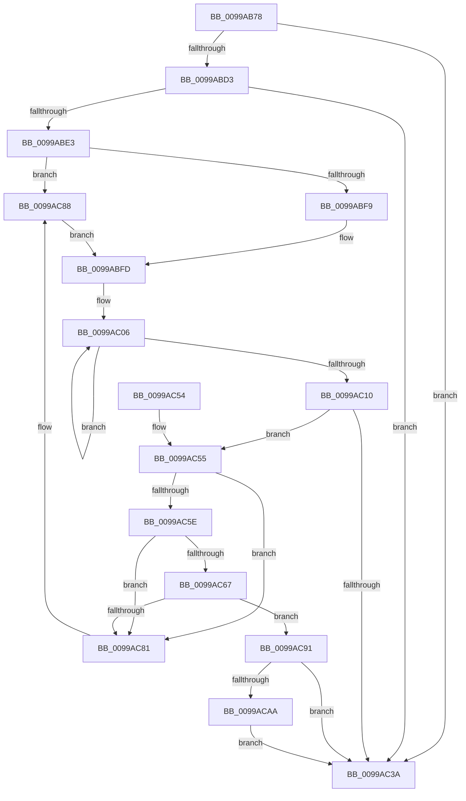

# PiLookupInDDBCache

- RVA: `0x0099AB78`–`0x0099ACB5` (길이 `317` bytes)
- VA: `0x000000014099AB78`
- 실행 섹션: `PAGE`
- PDB 이름 있음: `예`; PDB Function 태그: `아니요`
- unwind 정보 RVA: `0x000995F0`
- 디코드: `89`개 명령, `317/317` bytes 표시
- 미해석 바이트: `0` (있으면 어셈블리에 `.byte`로 보존)

> 이 문서는 커널 이미지의 기계어와 PDB 기호를 분석해 생성했습니다. 4번과 5번은 함수 원형과 자료형을 바이너리 사용 방식에서 추정한 C 해석이며 원본 소스 복구 결과는 아닙니다.

## 1. Dependencies

- 직접 호출 지점: **5**; 고유 호출 대상: **5**
- 직접 호출자로 확인된 함수: **1**
- RIP 상대 이미지 참조: **6**

### Outgoing calls
- `0x0099ABCA` → [RtlIsGenericTableEmptyAvl](../../text/45/RtlIsGenericTableEmptyAvl_function_00457B60.md) (function, `0x00457B60`)
- `0x0099ABD6` → [RtlImageNtHeader](../../text/44/RtlImageNtHeader_function_00443B60.md) (function, `0x00443B60`)
- `0x0099ABEB` → [wcsrchr](../../text/50/wcsrchr_function_00501E50.md) (function, `0x00501E50`)
- `0x0099AC30` → [RtlLookupElementGenericTableAvl](../../text/3F/RtlLookupElementGenericTableAvl_function_003FEFB0.md) (function, `0x003FEFB0`)
- `0x0099AC44` → [_security_check_cookie](../../text/6A/_security_check_cookie_function_006AC640.md) (function, `0x006AC640`)

### Direct callers
- [PpCheckInDriverDatabase](PpCheckInDriverDatabase_function_0099A9E4.md) at `0x0099AA5D`

### Static image references
- `0x0099AB83` → RVA `0x00E0A740` (`.data`; read)
- `0x0099AB9A` → RVA `0x00FDA490` (`PAGEDATA`; read)
- `0x0099ABAE` → RVA `0x00FDA4F0` (`PAGEDATA`; write)
- `0x0099AC6E` → RVA `0x00FDA088` (`PAGEDATA`; read)
- `0x0099AC75` → RVA `0x00FDA090` (`PAGEDATA`; read)
- `0x0099AC9B` → RVA `0x00FDA090` (`PAGEDATA`; write)

## 2. Other-region calls and transfers

- 다른 실행 섹션으로 향하는 call: **5**
  - `0x0099ABCA` → [RtlIsGenericTableEmptyAvl](../../text/45/RtlIsGenericTableEmptyAvl_function_00457B60.md) (`PAGE` → `.text`)
  - `0x0099ABD6` → [RtlImageNtHeader](../../text/44/RtlImageNtHeader_function_00443B60.md) (`PAGE` → `.text`)
  - `0x0099ABEB` → [wcsrchr](../../text/50/wcsrchr_function_00501E50.md) (`PAGE` → `.text`)
  - `0x0099AC30` → [RtlLookupElementGenericTableAvl](../../text/3F/RtlLookupElementGenericTableAvl_function_003FEFB0.md) (`PAGE` → `.text`)
  - `0x0099AC44` → [_security_check_cookie](../../text/6A/_security_check_cookie_function_006AC640.md) (`PAGE` → `.text`)
- 별도 외부 분기/꼬리 이동을 확인하지 못했습니다.

## 3. Assembly (complete function range)

```asm
0099AB78  40 53                           push rbx
0099AB7A  55                              push rbp
0099AB7B  56                              push rsi
0099AB7C  57                              push rdi
0099AB7D  41 56                           push r14
0099AB7F  48 83 EC 60                     sub rsp, 0x60
0099AB83  48 8B 05 B6 FB 46 00            mov rax, qword ptr [rip + 0x46fbb6]
0099AB8A  48 33 C4                        xor rax, rsp
0099AB8D  48 89 44 24 58                  mov qword ptr [rsp + 0x58], rax
0099AB92  0F 57 C0                        xorps xmm0, xmm0
0099AB95  48 8B F9                        mov rdi, rcx
0099AB98  33 C0                           xor eax, eax
0099AB9A  48 8D 0D EF F8 63 00            lea rcx, [rip + 0x63f8ef]
0099ABA1  45 33 F6                        xor r14d, r14d
0099ABA4  48 89 44 24 50                  mov qword ptr [rsp + 0x50], rax
0099ABA9  0F 11 44 24 20                  movups xmmword ptr [rsp + 0x20], xmm0
0099ABAE  4C 89 35 3B F9 63 00            mov qword ptr [rip + 0x63f93b], r14
0099ABB5  49 8B E9                        mov rbp, r9
0099ABB8  0F 11 44 24 30                  movups xmmword ptr [rsp + 0x30], xmm0
0099ABBD  48 8B F2                        mov rsi, rdx
0099ABC0  BB 01 00 00 C0                  mov ebx, 0xc0000001
0099ABC5  0F 11 44 24 40                  movups xmmword ptr [rsp + 0x40], xmm0
0099ABCA  E8 91 CF AB FF                  call 0x140457b60
0099ABCF  84 C0                           test al, al
0099ABD1  75 67                           jne 0x14099ac3a
0099ABD3  48 8B CE                        mov rcx, rsi
0099ABD6  E8 85 8F AA FF                  call 0x140443b60
0099ABDB  48 8B F0                        mov rsi, rax
0099ABDE  48 85 C0                        test rax, rax
0099ABE1  74 57                           je 0x14099ac3a
0099ABE3  48 8B 4F 08                     mov rcx, qword ptr [rdi + 8]
0099ABE7  41 8D 56 5C                     lea edx, [r14 + 0x5c]
0099ABEB  E8 60 72 B6 FF                  call 0x140501e50
0099ABF0  48 85 C0                        test rax, rax
0099ABF3  0F 84 8F 00 00 00               je 0x14099ac88
0099ABF9  48 8D 48 02                     lea rcx, [rax + 2]
0099ABFD  48 89 4C 24 38                  mov qword ptr [rsp + 0x38], rcx
0099AC02  48 83 C8 FF                     or rax, 0xffffffffffffffff
0099AC06  48 FF C0                        inc rax
0099AC09  66 44 39 34 41                  cmp word ptr [rcx + rax*2], r14w
0099AC0E  75 F6                           jne 0x14099ac06
0099AC10  66 03 C0                        add ax, ax
0099AC13  48 8D 54 24 20                  lea rdx, [rsp + 0x20]
0099AC18  66 89 44 24 30                  mov word ptr [rsp + 0x30], ax
0099AC1D  48 8D 0D 6C F8 63 00            lea rcx, [rip + 0x63f86c]
0099AC24  66 89 44 24 32                  mov word ptr [rsp + 0x32], ax
0099AC29  8B 46 08                        mov eax, dword ptr [rsi + 8]
0099AC2C  89 44 24 40                     mov dword ptr [rsp + 0x40], eax
0099AC30  E8 7B 43 A6 FF                  call 0x1403fefb0
0099AC35  48 85 C0                        test rax, rax
0099AC38  75 1B                           jne 0x14099ac55
0099AC3A  8B C3                           mov eax, ebx
0099AC3C  48 8B 4C 24 58                  mov rcx, qword ptr [rsp + 0x58]
0099AC41  48 33 CC                        xor rcx, rsp
0099AC44  E8 F7 19 D1 FF                  call 0x1406ac640
0099AC49  48 83 C4 60                     add rsp, 0x60
0099AC4D  41 5E                           pop r14
0099AC4F  5F                              pop rdi
0099AC50  5E                              pop rsi
0099AC51  5D                              pop rbp
0099AC52  5B                              pop rbx
0099AC53  C3                              ret
0099AC54  CC                              int3
0099AC55  48 8B 08                        mov rcx, qword ptr [rax]
0099AC58  48 39 41 08                     cmp qword ptr [rcx + 8], rax
0099AC5C  75 23                           jne 0x14099ac81
0099AC5E  48 8B 50 08                     mov rdx, qword ptr [rax + 8]
0099AC62  48 39 02                        cmp qword ptr [rdx], rax
0099AC65  75 1A                           jne 0x14099ac81
0099AC67  48 89 0A                        mov qword ptr [rdx], rcx
0099AC6A  48 89 51 08                     mov qword ptr [rcx + 8], rdx
0099AC6E  48 8D 15 13 F4 63 00            lea rdx, [rip + 0x63f413]
0099AC75  48 8B 0D 14 F4 63 00            mov rcx, qword ptr [rip + 0x63f414]
0099AC7C  48 39 11                        cmp qword ptr [rcx], rdx
0099AC7F  74 10                           je 0x14099ac91
0099AC81  B9 03 00 00 00                  mov ecx, 3
0099AC86  CD 29                           int 0x29
0099AC88  48 8B 4F 08                     mov rcx, qword ptr [rdi + 8]
0099AC8C  E9 6C FF FF FF                  jmp 0x14099abfd
0099AC91  48 89 10                        mov qword ptr [rax], rdx
0099AC94  48 89 48 08                     mov qword ptr [rax + 8], rcx
0099AC98  48 89 01                        mov qword ptr [rcx], rax
0099AC9B  48 89 05 EE F3 63 00            mov qword ptr [rip + 0x63f3ee], rax
0099ACA2  8B 58 24                        mov ebx, dword ptr [rax + 0x24]
0099ACA5  48 85 ED                        test rbp, rbp
0099ACA8  74 90                           je 0x14099ac3a
0099ACAA  0F 10 40 28                     movups xmm0, xmmword ptr [rax + 0x28]
0099ACAE  F3 0F 7F 45 00                  movdqu xmmword ptr [rbp], xmm0
0099ACB3  EB 85                           jmp 0x14099ac3a
```

## 4. C-style interpretation (structured pseudocode)

```c
__int64 __fastcall PiLookupInDDBCache(__int64 a1, __int64 a2, __int64 a3, __int64 a4)
{
    __int64 result;
    __int64 v_r14;
    __int64 v_rsp;
    unsigned __int64 v_stack_m30;
    unsigned __int64 v_stack_m38;
    unsigned __int64 v_stack_m48;
    unsigned __int64 v_stack_m50;
    unsigned __int16 v_stack_m56;
    unsigned __int64 v_stack_m58;
    unsigned __int64 v_stack_m68;

    v_rsp = (v_rsp) - (96);
    result = (*(unsigned __int64 *)(v_rip + 4651958)) ^ (v_rsp);
    v_stack_m30 = result;
    result = 0;
    v_r14 = 0;
    v_stack_m38 = 0;
    v_stack_m68 = v_xmm0;
    *(unsigned __int64 *)(v_rip + 6551867) = 0;
    v_stack_m58 = v_xmm0;
    v_stack_m48 = v_xmm0;
    result = RtlIsGenericTableEmptyAvl(v_rip + 6551791, a2, a3, a4);
    if ((unsigned __int8)(result) != 0) goto loc_0099AC3A;
    result = RtlImageNtHeader(a2, a2, a3, a4);
    if (result == 0) goto loc_0099AC3A;
    result = wcsrchr(*(unsigned __int64 *)(a1 + 8), v_r14 + 92, a3, a4);
    if (result == 0) goto loc_0099AC88;
loc_0099ABFD:
    v_stack_m50 = result + 2;
    result = (result) | (-1);
loc_0099AC06:
    result = (result) + 1;
    if ((*(unsigned __int16 *)(result + 2 + result * 2)) != 0) goto loc_0099AC06;
    result = (unsigned __int16)((result) + ((unsigned __int16)(result)));
    v_stack_m58 = (unsigned __int16)(result);
    v_stack_m56 = (unsigned __int16)(result);
    v_stack_m48 = (unsigned int)((unsigned int)(*(unsigned int *)(result + 8)));
    result = RtlLookupElementGenericTableAvl(v_rip + 6551660, v_stack_m68, a3, a4);
    if (result != 0) goto loc_0099AC55;
loc_0099AC3A:
    a1 = (v_stack_m30) ^ (v_rsp);
    result = _security_check_cookie(a1, v_stack_m68, a3, a4);
    v_rsp = (v_rsp) + (96);
    return result;
loc_0099AC55:
    if ((*(unsigned __int64 *)(*(unsigned __int64 *)(result) + 8)) != result) goto loc_0099AC81;
    if ((*(unsigned __int64 *)(*(unsigned __int64 *)(result + 8))) != result) goto loc_0099AC81;
    *(unsigned __int64 *)(*(unsigned __int64 *)(result + 8)) = *(unsigned __int64 *)(result);
    *(unsigned __int64 *)(*(unsigned __int64 *)(result) + 8) = *(unsigned __int64 *)(result + 8);
    if ((*(unsigned __int64 *)(*(unsigned __int64 *)(v_rip + 6550548))) == (v_rip + 6550547)) goto loc_0099AC91;
loc_0099AC81:
loc_0099AC88:
    goto loc_0099ABFD;
loc_0099AC91:
    *(unsigned __int64 *)(result) = v_rip + 6550547;
    *(unsigned __int64 *)(result + 8) = *(unsigned __int64 *)(a1 + 8);
    *(unsigned __int64 *)(*(unsigned __int64 *)(a1 + 8)) = result;
    *(unsigned __int64 *)(v_rip + 6550510) = result;
    if (a4 == 0) goto loc_0099AC3A;
    *(unsigned __int64 *)(a4) = v_xmm0;
    goto loc_0099AC3A;
}
```

## 5. (Beta) C Style

```c
int64_t PiLookupInDDBCache(void *Arg1, int64_t Arg2, int64_t Arg3, int64_t Arg4)
{
    uint8_t *arg1 = (uint8_t *)Arg1;

    int64_t result;
    int64_t local_r14;
    int64_t local_rsp;
    uint64_t v_stack_m30;
    uint64_t v_stack_m38;
    uint64_t v_stack_m48;
    uint64_t v_stack_m50;
    uint16_t v_stack_m56;
    uint64_t v_stack_m58;
    uint64_t v_stack_m68;

    local_rsp = (local_rsp) - (96);
    result = (*(uint64_t *)(v_rip + 0x46FBB6)) ^ (local_rsp);
    v_stack_m30 = result;
    result = 0;
    local_r14 = 0;
    v_stack_m38 = 0;
    v_stack_m68 = v_xmm0;
    *(uint64_t *)(v_rip + 0x63F93B) = 0;
    v_stack_m58 = v_xmm0;
    v_stack_m48 = v_xmm0;
    result = RtlIsGenericTableEmptyAvl(v_rip + 6551791, Arg2, Arg3, Arg4);
    if ((uint8_t)(result) != 0) goto loc_0099AC3A;
    result = RtlImageNtHeader(Arg2, Arg2, Arg3, Arg4);
    if (result == 0) goto loc_0099AC3A;
    result = wcsrchr(*(uint64_t *)(arg1 + 0x8), local_r14 + 92, Arg3, Arg4);
    if (result == 0) goto loc_0099AC88;
loc_0099ABFD:
    v_stack_m50 = result + 2;
    result = (result) | (-1);
loc_0099AC06:
    result = (result) + 1;
    if ((*(uint16_t *)(result + 0x2 + result * 2)) != 0) goto loc_0099AC06;
    result = (uint16_t)((result) + ((uint16_t)(result)));
    v_stack_m58 = (uint16_t)(result);
    v_stack_m56 = (uint16_t)(result);
    v_stack_m48 = (uint32_t)((uint32_t)(*(uint32_t *)(result + 0x8)));
    result = RtlLookupElementGenericTableAvl(v_rip + 6551660, v_stack_m68, Arg3, Arg4);
    if (result != 0) goto loc_0099AC55;
loc_0099AC3A:
    Arg1 = (v_stack_m30) ^ (local_rsp);
    result = _security_check_cookie(Arg1, v_stack_m68, Arg3, Arg4);
    local_rsp = (local_rsp) + (96);
    return result;
loc_0099AC55:
    if ((*(uint64_t *)(*(uint64_t *)(result) + 0x8)) != result) goto loc_0099AC81;
    if ((*(uint64_t *)(*(uint64_t *)(result + 0x8))) != result) goto loc_0099AC81;
    *(uint64_t *)(*(uint64_t *)(result + 0x8)) = *(uint64_t *)(result);
    *(uint64_t *)(*(uint64_t *)(result) + 0x8) = *(uint64_t *)(result + 0x8);
    if ((*(uint64_t *)(*(uint64_t *)(v_rip + 0x63F414))) == (v_rip + 6550547)) goto loc_0099AC91;
loc_0099AC81:
loc_0099AC88:
    goto loc_0099ABFD;
loc_0099AC91:
    *(uint64_t *)(result) = v_rip + 6550547;
    *(uint64_t *)(result + 0x8) = *(uint64_t *)(arg1 + 0x8);
    *(uint64_t *)(*(uint64_t *)(arg1 + 0x8)) = result;
    *(uint64_t *)(v_rip + 0x63F3EE) = result;
    if (Arg4 == 0) goto loc_0099AC3A;
    *(uint64_t *)(Arg4) = v_xmm0;
    goto loc_0099AC3A;
}
```

### 관측된 메모리 오프셋

구조체 형식이 확인되지 않은 접근은 인자 기준의 오프셋으로만 기록했습니다.

| 기준 인자 | 오프셋 표현 | 폭 (bit) | 접근 |
|---|---:|---:|---|
| `Arg1` | `+ 0x8` | `64` | `R` |

## 6. Execution-region graph

[열기: 2D/3D 그래프와 함수 탐색 컨트롤 패널](../../../control-panel.html?section=page&rva=0x0099AB78&view=graph)

- 2D 그래프는 위에서 아래로 흐르고, 3D 그래프는 빈 공간을 드래그해 회전합니다. Shift+드래그는 이동, 휠은 확대·축소, 함수 노드 선택은 대상 보고서 이동입니다.

### Static fallback


