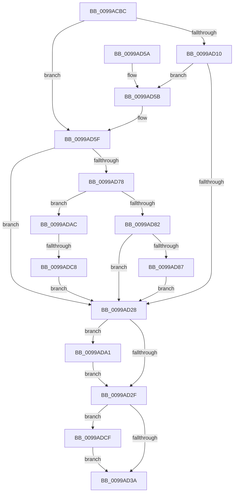

# PiLookupInDDB

- RVA: `0x0099ACBC`–`0x0099ADDD` (길이 `289` bytes)
- VA: `0x000000014099ACBC`
- 실행 섹션: `PAGE`
- PDB 이름 있음: `예`; PDB Function 태그: `예`
- unwind 정보 RVA: `0x0009960C`
- 디코드: `83`개 명령, `289/289` bytes 표시
- 미해석 바이트: `0` (있으면 어셈블리에 `.byte`로 보존)

> 이 문서는 커널 이미지의 기계어와 PDB 기호를 분석해 생성했습니다. 4번과 5번은 함수 원형과 자료형을 바이너리 사용 방식에서 추정한 C 해석이며 원본 소스 복구 결과는 아닙니다.

## 1. Dependencies

- 직접 호출 지점: **6**; 고유 호출 대상: **3**
- 직접 호출자로 확인된 함수: **1**
- RIP 상대 이미지 참조: **4**

### Outgoing calls
- `0x0099AD1D` → [PiInitializeDDB](PiInitializeDDB_function_0099ADE4.md) (function, `0x0099ADE4`)
- `0x0099AD6D` → [PiIsDriverBlocked](PiIsDriverBlocked_function_0099C254.md) (function, `0x0099C254`)
- `0x0099AD98` → [PiIsDriverBlocked](PiIsDriverBlocked_function_0099C254.md) (function, `0x0099C254`)
- `0x0099ADA5` → [PiReleaseDDB](PiReleaseDDB_function_0099C4F4.md) (function, `0x0099C4F4`)
- `0x0099ADB9` → [PiInitializeDDB](PiInitializeDDB_function_0099ADE4.md) (function, `0x0099ADE4`)
- `0x0099ADD3` → [PiReleaseDDB](PiReleaseDDB_function_0099C4F4.md) (function, `0x0099C4F4`)

### Direct callers
- [PpCheckInDriverDatabase](PpCheckInDriverDatabase_function_0099A9E4.md) at `0x0099AA7E`

### Static image references
- `0x0099ACDB` → RVA `0x00FD9D10` (`PAGEDATA`; read)
- `0x0099ACEB` → RVA `0x00FD9BF8` (`PAGEDATA`; read)
- `0x0099AD16` → RVA `0x00B53A70` (` ?? ::LBKOJDO::`string'`; read)
- `0x0099ADB2` → RVA `0x00B53A20` (` ?? ::LBKOJDO::`string'`; read)

## 2. Other-region calls and transfers

- 다른 실행 섹션으로 향하는 call: **0**
- call이 아닌 외부 분기/꼬리 이동: **1**
  - `0x0099ADC2` → [sub_00B2CFAE](../B2/Unknown_function_00B2CFAE.md) (`tail-transfer`)

## 3. Assembly (complete function range)

```asm
0099ACBC  48 8B C4                        mov rax, rsp
0099ACBF  48 89 58 08                     mov qword ptr [rax + 8], rbx
0099ACC3  48 89 70 10                     mov qword ptr [rax + 0x10], rsi
0099ACC7  48 89 78 18                     mov qword ptr [rax + 0x18], rdi
0099ACCB  4C 89 60 20                     mov qword ptr [rax + 0x20], r12
0099ACCF  55                              push rbp
0099ACD0  41 56                           push r14
0099ACD2  41 57                           push r15
0099ACD4  48 8B EC                        mov rbp, rsp
0099ACD7  48 83 EC 70                     sub rsp, 0x70
0099ACDB  48 8B 3D 2E F0 63 00            mov rdi, qword ptr [rip + 0x63f02e]
0099ACE2  0F 57 C0                        xorps xmm0, xmm0
0099ACE5  0F 57 C9                        xorps xmm1, xmm1
0099ACE8  4C 8B E1                        mov r12, rcx
0099ACEB  48 8B 0D 06 EF 63 00            mov rcx, qword ptr [rip + 0x63ef06]
0099ACF2  49 8B F1                        mov rsi, r9
0099ACF5  45 8B F0                        mov r14d, r8d
0099ACF8  4C 8B FA                        mov r15, rdx
0099ACFB  0F 11 45 C0                     movups xmmword ptr [rbp - 0x40], xmm0
0099ACFF  0F 11 45 D0                     movups xmmword ptr [rbp - 0x30], xmm0
0099AD03  0F 11 4D E0                     movups xmmword ptr [rbp - 0x20], xmm1
0099AD07  0F 11 4D F0                     movups xmmword ptr [rbp - 0x10], xmm1
0099AD0B  48 85 C9                        test rcx, rcx
0099AD0E  75 4F                           jne 0x14099ad5f
0099AD10  4C 8D 45 C0                     lea r8, [rbp - 0x40]
0099AD14  33 D2                           xor edx, edx
0099AD16  48 8D 0D 53 8D 1B 00            lea rcx, [rip + 0x1b8d53]
0099AD1D  E8 C2 00 00 00                  call 0x14099ade4
0099AD22  8B D8                           mov ebx, eax
0099AD24  85 C0                           test eax, eax
0099AD26  79 33                           jns 0x14099ad5b
0099AD28  48 83 7D C0 00                  cmp qword ptr [rbp - 0x40], 0
0099AD2D  75 72                           jne 0x14099ada1
0099AD2F  48 83 7D E0 00                  cmp qword ptr [rbp - 0x20], 0
0099AD34  0F 85 95 00 00 00               jne 0x14099adcf
0099AD3A  4C 8D 5C 24 70                  lea r11, [rsp + 0x70]
0099AD3F  8B C3                           mov eax, ebx
0099AD41  49 8B 5B 20                     mov rbx, qword ptr [r11 + 0x20]
0099AD45  49 8B 73 28                     mov rsi, qword ptr [r11 + 0x28]
0099AD49  49 8B 7B 30                     mov rdi, qword ptr [r11 + 0x30]
0099AD4D  4D 8B 63 38                     mov r12, qword ptr [r11 + 0x38]
0099AD51  49 8B E3                        mov rsp, r11
0099AD54  41 5F                           pop r15
0099AD56  41 5E                           pop r14
0099AD58  5D                              pop rbp
0099AD59  C3                              ret
0099AD5A  CC                              int3
0099AD5B  48 8B 4D C0                     mov rcx, qword ptr [rbp - 0x40]
0099AD5F  45 8B CE                        mov r9d, r14d
0099AD62  48 89 74 24 20                  mov qword ptr [rsp + 0x20], rsi
0099AD67  4D 8B C7                        mov r8, r15
0099AD6A  49 8B D4                        mov rdx, r12
0099AD6D  E8 E2 14 00 00                  call 0x14099c254
0099AD72  8B D8                           mov ebx, eax
0099AD74  85 C0                           test eax, eax
0099AD76  78 B0                           js 0x14099ad28
0099AD78  48 83 3D 78 EE 63 00 00         cmp qword ptr [rip + 0x63ee78], 0
0099AD80  74 2A                           je 0x14099adac
0099AD82  48 85 FF                        test rdi, rdi
0099AD85  74 A1                           je 0x14099ad28
0099AD87  45 8B CE                        mov r9d, r14d
0099AD8A  48 89 74 24 20                  mov qword ptr [rsp + 0x20], rsi
0099AD8F  4D 8B C7                        mov r8, r15
0099AD92  49 8B D4                        mov rdx, r12
0099AD95  48 8B CF                        mov rcx, rdi
0099AD98  E8 B7 14 00 00                  call 0x14099c254
0099AD9D  8B D8                           mov ebx, eax
0099AD9F  EB 87                           jmp 0x14099ad28
0099ADA1  48 8D 4D C0                     lea rcx, [rbp - 0x40]
0099ADA5  E8 4A 17 00 00                  call 0x14099c4f4
0099ADAA  EB 83                           jmp 0x14099ad2f
0099ADAC  4C 8D 45 E0                     lea r8, [rbp - 0x20]
0099ADB0  B2 01                           mov dl, 1
0099ADB2  48 8D 0D 67 8C 1B 00            lea rcx, [rip + 0x1b8c67]
0099ADB9  E8 26 00 00 00                  call 0x14099ade4
0099ADBE  8B D8                           mov ebx, eax
0099ADC0  85 C0                           test eax, eax
0099ADC2  0F 89 E6 21 19 00               jns 0x140b2cfae
0099ADC8  33 DB                           xor ebx, ebx
0099ADCA  E9 59 FF FF FF                  jmp 0x14099ad28
0099ADCF  48 8D 4D E0                     lea rcx, [rbp - 0x20]
0099ADD3  E8 1C 17 00 00                  call 0x14099c4f4
0099ADD8  E9 5D FF FF FF                  jmp 0x14099ad3a
```

## 4. C-style interpretation (structured pseudocode)

```c
__int64 __fastcall PiLookupInDDB(__int64 a1, __int64 a2, int a3, __int64 a4)
{
    __int64 result;
    __int64 v_rbx;
    __int64 v_rsp;
    unsigned __int64 v_stack_m18;
    unsigned __int64 v_stack_m28;
    unsigned __int64 v_stack_m38;
    unsigned __int64 v_stack_m48;
    unsigned __int64 v_stack_m50;
    unsigned __int64 v_stack_m58;

    *(unsigned __int64 *)(v_rsp + 8) = v_rbx;
    *(unsigned __int64 *)(v_rsp + 16) = v_rsi;
    *(unsigned __int64 *)(v_rsp + 24) = v_rdi;
    *(unsigned __int64 *)(v_rsp + 32) = v_r12;
    v_rsp = (v_rsp) - (112);
    v_stack_m58 = v_xmm0;
    v_stack_m48 = v_xmm0;
    v_stack_m38 = v_xmm1;
    v_stack_m28 = v_xmm1;
    if (*(unsigned __int64 *)(v_rip + 6549254) != 0) goto loc_0099AD5F;
    a2 = 0;
    result = PiInitializeDDB(v_rip + 1805651, a2, v_stack_m58, a4);
    if (!sign_flag) goto loc_0099AD5B;
loc_0099AD28:
    if (v_stack_m58 != 0) goto loc_0099ADA1;
loc_0099AD2F:
    if (v_stack_m38 != 0) goto loc_0099ADCF;
loc_0099AD3A:
    return (unsigned int)((unsigned int)((unsigned int)((unsigned int)(result))));
loc_0099AD5B:
loc_0099AD5F:
    v_stack_m50 = *(unsigned __int64 *)(v_stack_m18 + 40);
    result = PiIsDriverBlocked(v_stack_m58, *(unsigned __int64 *)(v_stack_m18 + 56), 0, (unsigned int)((unsigned int)((unsigned int)(a3))));
    if (sign_flag) goto loc_0099AD28;
    if ((*(unsigned __int64 *)(v_rip + 6549112)) == 0) goto loc_0099ADAC;
    if (*(unsigned __int64 *)(v_stack_m18 + 48) == 0) goto loc_0099AD28;
    v_stack_m50 = *(unsigned __int64 *)(v_stack_m18 + 40);
    result = PiIsDriverBlocked(*(unsigned __int64 *)(v_stack_m18 + 48), *(unsigned __int64 *)(v_stack_m18 + 56), 0, (unsigned int)((unsigned int)((unsigned int)(a3))));
    goto loc_0099AD28;
loc_0099ADA1:
    result = PiReleaseDDB(v_stack_m58, *(unsigned __int64 *)(v_stack_m18 + 56), 0, (unsigned int)((unsigned int)((unsigned int)(a3))));
    goto loc_0099AD2F;
loc_0099ADAC:
    result = PiInitializeDDB(v_rip + 1805415, 1, v_stack_m38, (unsigned int)((unsigned int)((unsigned int)(a3))));
    v_rbx = 0;
    goto loc_0099AD28;
loc_0099ADCF:
    result = PiReleaseDDB(v_stack_m38, 1, v_stack_m38, (unsigned int)((unsigned int)((unsigned int)(a3))));
    goto loc_0099AD3A;
}
```

## 5. (Beta) C Style

```c
int64_t PiLookupInDDB(int64_t Arg1, int64_t Arg2, int32_t Arg3, int64_t Arg4)
{
    int64_t result;
    int64_t local_rbx;
    int64_t local_rsp;
    uint64_t v_stack_m18;
    uint64_t v_stack_m28;
    uint64_t v_stack_m38;
    uint64_t v_stack_m48;
    uint64_t v_stack_m50;
    uint64_t v_stack_m58;

    *(uint64_t *)(local_rsp + 0x8) = local_rbx;
    *(uint64_t *)(local_rsp + 0x10) = local_rsi;
    *(uint64_t *)(local_rsp + 0x18) = local_rdi;
    *(uint64_t *)(local_rsp + 0x20) = local_r12;
    local_rsp = (local_rsp) - (112);
    v_stack_m58 = v_xmm0;
    v_stack_m48 = v_xmm0;
    v_stack_m38 = v_xmm1;
    v_stack_m28 = v_xmm1;
    if (*(uint64_t *)(v_rip + 0x63EF06) != 0) goto loc_0099AD5F;
    Arg2 = 0;
    result = PiInitializeDDB(v_rip + 1805651, Arg2, v_stack_m58, Arg4);
    if (!sign_flag) goto loc_0099AD5B;
loc_0099AD28:
    if (v_stack_m58 != 0) goto loc_0099ADA1;
loc_0099AD2F:
    if (v_stack_m38 != 0) goto loc_0099ADCF;
loc_0099AD3A:
    return (uint32_t)((uint32_t)((uint32_t)((uint32_t)(result))));
loc_0099AD5B:
loc_0099AD5F:
    v_stack_m50 = *(uint64_t *)(v_stack_m18 + 0x28);
    result = PiIsDriverBlocked(v_stack_m58, *(uint64_t *)(v_stack_m18 + 0x38), 0, (uint32_t)((uint32_t)((uint32_t)(Arg3))));
    if (sign_flag) goto loc_0099AD28;
    if ((*(uint64_t *)(v_rip + 0x63EE78)) == 0) goto loc_0099ADAC;
    if (*(uint64_t *)(v_stack_m18 + 0x30) == 0) goto loc_0099AD28;
    v_stack_m50 = *(uint64_t *)(v_stack_m18 + 0x28);
    result = PiIsDriverBlocked(*(uint64_t *)(v_stack_m18 + 0x30), *(uint64_t *)(v_stack_m18 + 0x38), 0, (uint32_t)((uint32_t)((uint32_t)(Arg3))));
    goto loc_0099AD28;
loc_0099ADA1:
    result = PiReleaseDDB(v_stack_m58, *(uint64_t *)(v_stack_m18 + 0x38), 0, (uint32_t)((uint32_t)((uint32_t)(Arg3))));
    goto loc_0099AD2F;
loc_0099ADAC:
    result = PiInitializeDDB(v_rip + 1805415, 1, v_stack_m38, (uint32_t)((uint32_t)((uint32_t)(Arg3))));
    local_rbx = 0;
    goto loc_0099AD28;
loc_0099ADCF:
    result = PiReleaseDDB(v_stack_m38, 1, v_stack_m38, (uint32_t)((uint32_t)((uint32_t)(Arg3))));
    goto loc_0099AD3A;
}
```

## 6. Execution-region graph

[열기: 2D/3D 그래프와 함수 탐색 컨트롤 패널](../../../control-panel.html?section=page&rva=0x0099ACBC&view=graph)

- 2D 그래프는 위에서 아래로 흐르고, 3D 그래프는 빈 공간을 드래그해 회전합니다. Shift+드래그는 이동, 휠은 확대·축소, 함수 노드 선택은 대상 보고서 이동입니다.

### Static fallback


