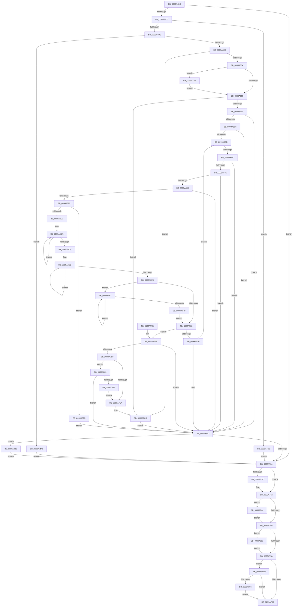

# PiNormalizeDeviceText

- RVA: `0x0099A43C`–`0x0099A875` (길이 `1,081` bytes)
- VA: `0x000000014099A43C`
- 실행 섹션: `PAGE`
- PDB 이름 있음: `예`; PDB Function 태그: `아니요`
- unwind 정보 RVA: `0x00099590`
- 디코드: `277`개 명령, `1,081/1,081` bytes 표시
- 미해석 바이트: `0` (있으면 어셈블리에 `.byte`로 보존)

> 이 문서는 커널 이미지의 기계어와 PDB 기호를 분석해 생성했습니다. 4번과 5번은 함수 원형과 자료형을 바이너리 사용 방식에서 추정한 C 해석이며 원본 소스 복구 결과는 아닙니다.

## 1. Dependencies

- 직접 호출 지점: **25**; 고유 호출 대상: **16**
- 직접 호출자로 확인된 함수: **1**
- RIP 상대 이미지 참조: **4**

### Outgoing calls
- `0x0099A4A5` → [RtlInitUnicodeString](../../text/42/RtlInitUnicodeString_function_0042A780.md) (function, `0x0042A780`)
- `0x0099A4B1` → [RtlInitUnicodeStringEx](../../text/46/RtlInitUnicodeStringEx_function_00463960.md) (function, `0x00463960`)
- `0x0099A4CE` → [RtlPrefixUnicodeString](../8F/RtlPrefixUnicodeString_function_008F4F70.md) (function, `0x008F4F70`)
- `0x0099A4EE` → [ExAllocatePool2](../../poolcode/B8/ExAllocatePool2_function_00B820F0.md) (function, `0x00B820F0`)
- `0x0099A50E` → [memcpy](../../text/6C/memcpy_function_006C6840.md) (function, `0x006C6840`)
- `0x0099A529` → [wcschr](../../text/50/wcschr_function_00501A60.md) (function, `0x00501A60`)
- `0x0099A547` → [wcschr](../../text/50/wcschr_function_00501A60.md) (function, `0x00501A60`)
- `0x0099A565` → [wcstoi64](../../text/50/wcstoi64_function_00502644.md) (function, `0x00502644`)
- `0x0099A583` → [RtlInitUnicodeString](../../text/42/RtlInitUnicodeString_function_0042A780.md) (function, `0x0042A780`)
- `0x0099A5B7` → [ZwOpenKey](../../text/6A/ZwOpenKey_function_006AD310.md) (function, `0x006AD310`)
- `0x0099A5DB` → [ZwQueryKey](../../text/6A/ZwQueryKey_function_006AD390.md) (function, `0x006AD390`)
- `0x0099A5FB` → [ExAllocatePool2](../../poolcode/B8/ExAllocatePool2_function_00B820F0.md) (function, `0x00B820F0`)
- `0x0099A622` → [ZwQueryKey](../../text/6A/ZwQueryKey_function_006AD390.md) (function, `0x006AD390`)
- `0x0099A657` → [IopBuildFullDriverPath](IopBuildFullDriverPath_function_009998E4.md) (function, `0x009998E4`)
- `0x0099A683` → [RtlPrefixUnicodeString](../8F/RtlPrefixUnicodeString_function_008F4F70.md) (function, `0x008F4F70`)
- `0x0099A6B1` → [PiGetDefaultMessageString](PiGetDefaultMessageString_function_0099A87C.md) (function, `0x0099A87C`)
- `0x0099A70E` → [ExAllocatePool2](../../poolcode/B8/ExAllocatePool2_function_00B820F0.md) (function, `0x00B820F0`)
- `0x0099A726` → [ExFreePoolWithTag](../../poolcode/B8/ExFreePoolWithTag_function_00B82870.md) (function, `0x00B82870`)
- `0x0099A73D` → [ExFreePool](../../poolcode/B8/ExFreePool_function_00B82850.md) (function, `0x00B82850`)
- `0x0099A7B0` → [RtlStringCbPrintfExW](../../text/46/RtlStringCbPrintfExW_function_00461AD4.md) (function, `0x00461AD4`)
- `0x0099A81B` → [RtlStringCbPrintfW](../../text/40/RtlStringCbPrintfW_function_0040FB40.md) (function, `0x0040FB40`)
- `0x0099A83A` → [ExFreePoolWithTag](../../poolcode/B8/ExFreePoolWithTag_function_00B82870.md) (function, `0x00B82870`)
- `0x0099A849` → [ExFreePoolWithTag](../../poolcode/B8/ExFreePoolWithTag_function_00B82870.md) (function, `0x00B82870`)
- `0x0099A853` → [ZwClose](../../text/6A/ZwClose_function_006AD2B0.md) (function, `0x006AD2B0`)
- `0x0099A86B` → [ExFreePoolWithTag](../../poolcode/B8/ExFreePoolWithTag_function_00B82870.md) (function, `0x00B82870`)

### Direct callers
- [PnpQueryDeviceText](PnpQueryDeviceText_function_0099B150.md) at `0x0099B1F5`

### Static image references
- `0x0099A4C7` → RVA `0x00FD9DD8` (`PAGEDATA`; read)
- `0x0099A666` → RVA `0x00AFC880` (` ?? ::NNGAKEGL::`string'`; read)
- `0x0099A79F` → RVA `0x00B000D0` (` ?? ::NNGAKEGL::`string'`; read)
- `0x0099A80D` → RVA `0x00B000F0` (` ?? ::NNGAKEGL::`string'`; read)

## 2. Other-region calls and transfers

- 다른 실행 섹션으로 향하는 call: **21**
  - `0x0099A4A5` → [RtlInitUnicodeString](../../text/42/RtlInitUnicodeString_function_0042A780.md) (`PAGE` → `.text`)
  - `0x0099A4B1` → [RtlInitUnicodeStringEx](../../text/46/RtlInitUnicodeStringEx_function_00463960.md) (`PAGE` → `.text`)
  - `0x0099A4EE` → [ExAllocatePool2](../../poolcode/B8/ExAllocatePool2_function_00B820F0.md) (`PAGE` → `POOLCODE`)
  - `0x0099A50E` → [memcpy](../../text/6C/memcpy_function_006C6840.md) (`PAGE` → `.text`)
  - `0x0099A529` → [wcschr](../../text/50/wcschr_function_00501A60.md) (`PAGE` → `.text`)
  - `0x0099A547` → [wcschr](../../text/50/wcschr_function_00501A60.md) (`PAGE` → `.text`)
  - `0x0099A565` → [wcstoi64](../../text/50/wcstoi64_function_00502644.md) (`PAGE` → `.text`)
  - `0x0099A583` → [RtlInitUnicodeString](../../text/42/RtlInitUnicodeString_function_0042A780.md) (`PAGE` → `.text`)
  - `0x0099A5B7` → [ZwOpenKey](../../text/6A/ZwOpenKey_function_006AD310.md) (`PAGE` → `.text`)
  - `0x0099A5DB` → [ZwQueryKey](../../text/6A/ZwQueryKey_function_006AD390.md) (`PAGE` → `.text`)
  - `0x0099A5FB` → [ExAllocatePool2](../../poolcode/B8/ExAllocatePool2_function_00B820F0.md) (`PAGE` → `POOLCODE`)
  - `0x0099A622` → [ZwQueryKey](../../text/6A/ZwQueryKey_function_006AD390.md) (`PAGE` → `.text`)
  - `0x0099A70E` → [ExAllocatePool2](../../poolcode/B8/ExAllocatePool2_function_00B820F0.md) (`PAGE` → `POOLCODE`)
  - `0x0099A726` → [ExFreePoolWithTag](../../poolcode/B8/ExFreePoolWithTag_function_00B82870.md) (`PAGE` → `POOLCODE`)
  - `0x0099A73D` → [ExFreePool](../../poolcode/B8/ExFreePool_function_00B82850.md) (`PAGE` → `POOLCODE`)
  - `0x0099A7B0` → [RtlStringCbPrintfExW](../../text/46/RtlStringCbPrintfExW_function_00461AD4.md) (`PAGE` → `.text`)
  - `0x0099A81B` → [RtlStringCbPrintfW](../../text/40/RtlStringCbPrintfW_function_0040FB40.md) (`PAGE` → `.text`)
  - `0x0099A83A` → [ExFreePoolWithTag](../../poolcode/B8/ExFreePoolWithTag_function_00B82870.md) (`PAGE` → `POOLCODE`)
  - `0x0099A849` → [ExFreePoolWithTag](../../poolcode/B8/ExFreePoolWithTag_function_00B82870.md) (`PAGE` → `POOLCODE`)
  - `0x0099A853` → [ZwClose](../../text/6A/ZwClose_function_006AD2B0.md) (`PAGE` → `.text`)
  - `0x0099A86B` → [ExFreePoolWithTag](../../poolcode/B8/ExFreePoolWithTag_function_00B82870.md) (`PAGE` → `POOLCODE`)
- 별도 외부 분기/꼬리 이동을 확인하지 못했습니다.

## 3. Assembly (complete function range)

```asm
0099A43C  48 89 5C 24 08                  mov qword ptr [rsp + 8], rbx
0099A441  48 89 54 24 10                  mov qword ptr [rsp + 0x10], rdx
0099A446  55                              push rbp
0099A447  56                              push rsi
0099A448  57                              push rdi
0099A449  41 54                           push r12
0099A44B  41 55                           push r13
0099A44D  41 56                           push r14
0099A44F  41 57                           push r15
0099A451  48 8D 6C 24 D9                  lea rbp, [rsp - 0x27]
0099A456  48 81 EC D0 00 00 00            sub rsp, 0xd0
0099A45D  45 33 E4                        xor r12d, r12d
0099A460  0F 57 C0                        xorps xmm0, xmm0
0099A463  48 8B F9                        mov rdi, rcx
0099A466  4C 89 22                        mov qword ptr [rdx], r12
0099A469  33 C9                           xor ecx, ecx
0099A46B  4C 89 65 B7                     mov qword ptr [rbp - 0x49], r12
0099A46F  48 89 4D 17                     mov qword ptr [rbp + 0x17], rcx
0099A473  33 D2                           xor edx, edx
0099A475  89 4D 1F                        mov dword ptr [rbp + 0x1f], ecx
0099A478  45 8B F4                        mov r14d, r12d
0099A47B  48 8D 4D C7                     lea rcx, [rbp - 0x39]
0099A47F  44 89 65 77                     mov dword ptr [rbp + 0x77], r12d
0099A483  0F 11 45 C7                     movups xmmword ptr [rbp - 0x39], xmm0
0099A487  4C 89 65 D7                     mov qword ptr [rbp - 0x29], r12
0099A48B  45 8B EC                        mov r13d, r12d
0099A48E  0F 11 45 F7                     movups xmmword ptr [rbp - 9], xmm0
0099A492  4C 89 65 BF                     mov qword ptr [rbp - 0x41], r12
0099A496  41 8B F4                        mov esi, r12d
0099A499  0F 11 45 07                     movups xmmword ptr [rbp + 7], xmm0
0099A49D  4C 89 65 7F                     mov qword ptr [rbp + 0x7f], r12
0099A4A1  0F 11 45 A7                     movups xmmword ptr [rbp - 0x59], xmm0
0099A4A5  E8 D6 02 A9 FF                  call 0x14042a780
0099A4AA  48 8B D7                        mov rdx, rdi
0099A4AD  48 8D 4D A7                     lea rcx, [rbp - 0x59]
0099A4B1  E8 AA 94 AC FF                  call 0x140463960
0099A4B6  8B D8                           mov ebx, eax
0099A4B8  85 C0                           test eax, eax
0099A4BA  0F 88 74 02 00 00               js 0x14099a734
0099A4C0  41 B0 01                        mov r8b, 1
0099A4C3  48 8D 55 A7                     lea rdx, [rbp - 0x59]
0099A4C7  48 8D 0D 0A F9 63 00            lea rcx, [rip + 0x63f90a]
0099A4CE  E8 9D AA F5 FF                  call 0x1408f4f70
0099A4D3  84 C0                           test al, al
0099A4D5  0F 84 F8 02 00 00               je 0x14099a7d3
0099A4DB  0F B7 55 A7                     movzx edx, word ptr [rbp - 0x59]
0099A4DF  B9 00 01 00 00                  mov ecx, 0x100
0099A4E4  48 83 C2 02                     add rdx, 2
0099A4E8  41 B8 50 70 20 20               mov r8d, 0x20207050
0099A4EE  E8 FD 7B 1E 00                  call 0x140b820f0
0099A4F3  48 89 45 EF                     mov qword ptr [rbp - 0x11], rax
0099A4F7  48 8B D8                        mov rbx, rax
0099A4FA  48 85 C0                        test rax, rax
0099A4FD  0F 84 D8 02 00 00               je 0x14099a7db
0099A503  44 0F B7 45 A7                  movzx r8d, word ptr [rbp - 0x59]
0099A508  48 8B D7                        mov rdx, rdi
0099A50B  48 8B C8                        mov rcx, rax
0099A50E  E8 2D C3 D2 FF                  call 0x1406c6840
0099A513  0F B7 45 A7                     movzx eax, word ptr [rbp - 0x59]
0099A517  41 8D 7C 24 2C                  lea edi, [r12 + 0x2c]
0099A51C  48 D1 E8                        shr rax, 1
0099A51F  8B D7                           mov edx, edi
0099A521  48 8B CB                        mov rcx, rbx
0099A524  66 44 89 24 43                  mov word ptr [rbx + rax*2], r12w
0099A529  E8 32 75 B6 FF                  call 0x140501a60
0099A52E  4C 8B F8                        mov r15, rax
0099A531  48 85 C0                        test rax, rax
0099A534  0F 84 91 02 00 00               je 0x14099a7cb
0099A53A  49 83 C7 02                     add r15, 2
0099A53E  66 44 89 20                     mov word ptr [rax], r12w
0099A542  49 8B CF                        mov rcx, r15
0099A545  8B D7                           mov edx, edi
0099A547  E8 14 75 B6 FF                  call 0x140501a60
0099A54C  48 8B F8                        mov rdi, rax
0099A54F  48 85 C0                        test rax, rax
0099A552  0F 85 8D 02 00 00               jne 0x14099a7e5
0099A558  41 B8 0A 00 00 00               mov r8d, 0xa
0099A55E  48 8D 55 B7                     lea rdx, [rbp - 0x49]
0099A562  49 8B CF                        mov rcx, r15
0099A565  E8 DA 80 B6 FF                  call 0x140502644
0099A56A  48 89 45 DF                     mov qword ptr [rbp - 0x21], rax
0099A56E  48 8B 45 B7                     mov rax, qword ptr [rbp - 0x49]
0099A572  66 44 39 20                     cmp word ptr [rax], r12w
0099A576  0F 85 4F 02 00 00               jne 0x14099a7cb
0099A57C  48 8B D3                        mov rdx, rbx
0099A57F  48 8D 4D A7                     lea rcx, [rbp - 0x59]
0099A583  E8 F8 01 A9 FF                  call 0x14042a780
0099A588  48 8D 45 A7                     lea rax, [rbp - 0x59]
0099A58C  C7 45 F7 30 00 00 00            mov dword ptr [rbp - 9], 0x30
0099A593  0F 57 C0                        xorps xmm0, xmm0
0099A596  48 89 45 07                     mov qword ptr [rbp + 7], rax
0099A59A  4C 8D 45 F7                     lea r8, [rbp - 9]
0099A59E  4C 89 65 FF                     mov qword ptr [rbp - 1], r12
0099A5A2  BA 19 00 02 00                  mov edx, 0x20019
0099A5A7  C7 45 0F 40 02 00 00            mov dword ptr [rbp + 0xf], 0x240
0099A5AE  48 8D 4D 7F                     lea rcx, [rbp + 0x7f]
0099A5B2  F3 0F 7F 45 17                  movdqu xmmword ptr [rbp + 0x17], xmm0
0099A5B7  E8 54 2D D1 FF                  call 0x1406ad310
0099A5BC  8B D8                           mov ebx, eax
0099A5BE  85 C0                           test eax, eax
0099A5C0  0F 88 5A 01 00 00               js 0x14099a720
0099A5C6  48 8B 4D 7F                     mov rcx, qword ptr [rbp + 0x7f]
0099A5CA  48 8D 45 77                     lea rax, [rbp + 0x77]
0099A5CE  45 33 C9                        xor r9d, r9d
0099A5D1  48 89 44 24 20                  mov qword ptr [rsp + 0x20], rax
0099A5D6  45 33 C0                        xor r8d, r8d
0099A5D9  33 D2                           xor edx, edx
0099A5DB  E8 B0 2D D1 FF                  call 0x1406ad390
0099A5E0  8B D8                           mov ebx, eax
0099A5E2  3D 23 00 00 C0                  cmp eax, 0xc0000023
0099A5E7  0F 85 33 01 00 00               jne 0x14099a720
0099A5ED  8B 55 77                        mov edx, dword ptr [rbp + 0x77]
0099A5F0  B9 00 01 00 00                  mov ecx, 0x100
0099A5F5  41 B8 50 70 20 20               mov r8d, 0x20207050
0099A5FB  E8 F0 7A 1E 00                  call 0x140b820f0
0099A600  4C 8B E8                        mov r13, rax
0099A603  48 85 C0                        test rax, rax
0099A606  0F 84 0F 01 00 00               je 0x14099a71b
0099A60C  44 8B 4D 77                     mov r9d, dword ptr [rbp + 0x77]
0099A610  48 8D 45 77                     lea rax, [rbp + 0x77]
0099A614  48 8B 4D 7F                     mov rcx, qword ptr [rbp + 0x7f]
0099A618  4D 8B C5                        mov r8, r13
0099A61B  33 D2                           xor edx, edx
0099A61D  48 89 44 24 20                  mov qword ptr [rsp + 0x20], rax
0099A622  E8 69 2D D1 FF                  call 0x1406ad390
0099A627  8B D8                           mov ebx, eax
0099A629  85 C0                           test eax, eax
0099A62B  0F 88 EF 00 00 00               js 0x14099a720
0099A631  41 0F B7 45 0C                  movzx eax, word ptr [r13 + 0xc]
0099A636  4C 8D 45 C7                     lea r8, [rbp - 0x39]
0099A63A  48 8B 55 7F                     mov rdx, qword ptr [rbp + 0x7f]
0099A63E  48 8D 4D A7                     lea rcx, [rbp - 0x59]
0099A642  66 89 45 A7                     mov word ptr [rbp - 0x59], ax
0099A646  41 0F B7 45 0C                  movzx eax, word ptr [r13 + 0xc]
0099A64B  66 89 45 A9                     mov word ptr [rbp - 0x57], ax
0099A64F  49 8D 45 10                     lea rax, [r13 + 0x10]
0099A653  48 89 45 AF                     mov qword ptr [rbp - 0x51], rax
0099A657  E8 88 F2 FF FF                  call 0x1409998e4
0099A65C  8B D8                           mov ebx, eax
0099A65E  85 C0                           test eax, eax
0099A660  0F 88 BA 00 00 00               js 0x14099a720
0099A666  48 8D 05 13 22 16 00            lea rax, [rip + 0x162213]
0099A66D  C7 45 A7 18 00 1A 00            mov dword ptr [rbp - 0x59], 0x1a0018
0099A674  41 B0 01                        mov r8b, 1
0099A677  48 89 45 AF                     mov qword ptr [rbp - 0x51], rax
0099A67B  48 8D 55 C7                     lea rdx, [rbp - 0x39]
0099A67F  48 8D 4D A7                     lea rcx, [rbp - 0x59]
0099A683  E8 E8 A8 F5 FF                  call 0x1408f4f70
0099A688  84 C0                           test al, al
0099A68A  0F 84 90 00 00 00               je 0x14099a720
0099A690  48 8B 45 CF                     mov rax, qword ptr [rbp - 0x31]
0099A694  4C 8D 45 BF                     lea r8, [rbp - 0x41]
0099A698  44 0F B7 65 C7                  movzx r12d, word ptr [rbp - 0x39]
0099A69D  48 83 C0 18                     add rax, 0x18
0099A6A1  8B 55 DF                        mov edx, dword ptr [rbp - 0x21]
0099A6A4  66 41 83 EC 18                  sub r12w, 0x18
0099A6A9  48 8B 4D 7F                     mov rcx, qword ptr [rbp + 0x7f]
0099A6AD  48 89 45 E7                     mov qword ptr [rbp - 0x19], rax
0099A6B1  E8 C6 01 00 00                  call 0x14099a87c
0099A6B6  45 33 C0                        xor r8d, r8d
0099A6B9  8B D8                           mov ebx, eax
0099A6BB  85 C0                           test eax, eax
0099A6BD  0F 88 69 01 00 00               js 0x14099a82c
0099A6C3  48 83 CA FF                     or rdx, 0xffffffffffffffff
0099A6C7  48 8B CA                        mov rcx, rdx
0099A6CA  48 FF C1                        inc rcx
0099A6CD  66 45 39 04 4F                  cmp word ptr [r15 + rcx*2], r8w
0099A6D2  75 F6                           jne 0x14099a6ca
0099A6D4  4C 8B 75 BF                     mov r14, qword ptr [rbp - 0x41]
0099A6D8  48 8B C2                        mov rax, rdx
0099A6DB  48 FF C0                        inc rax
0099A6DE  66 45 39 04 46                  cmp word ptr [r14 + rax*2], r8w
0099A6E3  75 F6                           jne 0x14099a6db
0099A6E5  48 8D 58 05                     lea rbx, [rax + 5]
0099A6E9  41 0F B7 C4                     movzx eax, r12w
0099A6ED  48 03 D9                        add rbx, rcx
0099A6F0  45 33 E4                        xor r12d, r12d
0099A6F3  48 8D 1C 58                     lea rbx, [rax + rbx*2]
0099A6F7  48 85 FF                        test rdi, rdi
0099A6FA  0F 85 F2 00 00 00               jne 0x14099a7f2
0099A700  41 B8 50 70 20 20               mov r8d, 0x20207050
0099A706  48 8B D3                        mov rdx, rbx
0099A709  B9 00 01 00 00                  mov ecx, 0x100
0099A70E  E8 DD 79 1E 00                  call 0x140b820f0
0099A713  48 8B F0                        mov rsi, rax
0099A716  48 85 C0                        test rax, rax
0099A719  75 63                           jne 0x14099a77e
0099A71B  BB 9A 00 00 C0                  mov ebx, 0xc000009a
0099A720  48 8B 4D EF                     mov rcx, qword ptr [rbp - 0x11]
0099A724  33 D2                           xor edx, edx
0099A726  E8 45 81 1E 00                  call 0x140b82870
0099A72B  4D 85 ED                        test r13, r13
0099A72E  0F 85 01 01 00 00               jne 0x14099a835
0099A734  48 8B 4D CF                     mov rcx, qword ptr [rbp - 0x31]
0099A738  48 85 C9                        test rcx, rcx
0099A73B  74 05                           je 0x14099a742
0099A73D  E8 0E 81 1E 00                  call 0x140b82850
0099A742  4D 85 F6                        test r14, r14
0099A745  0F 85 F9 00 00 00               jne 0x14099a844
0099A74B  48 8B 4D 7F                     mov rcx, qword ptr [rbp + 0x7f]
0099A74F  48 85 C9                        test rcx, rcx
0099A752  0F 85 FB 00 00 00               jne 0x14099a853
0099A758  85 DB                           test ebx, ebx
0099A75A  0F 88 FD 00 00 00               js 0x14099a85d
0099A760  8B C3                           mov eax, ebx
0099A762  48 8B 9C 24 10 01 00 00         mov rbx, qword ptr [rsp + 0x110]
0099A76A  48 81 C4 D0 00 00 00            add rsp, 0xd0
0099A771  41 5F                           pop r15
0099A773  41 5E                           pop r14
0099A775  41 5D                           pop r13
0099A777  41 5C                           pop r12
0099A779  5F                              pop rdi
0099A77A  5E                              pop rsi
0099A77B  5D                              pop rbp
0099A77C  C3                              ret
0099A77D  CC                              int3
0099A77E  48 8B 45 E7                     mov rax, qword ptr [rbp - 0x19]
0099A782  4C 8D 4D D7                     lea r9, [rbp - 0x29]
0099A786  4C 89 74 24 40                  mov qword ptr [rsp + 0x40], r14
0099A78B  4C 8D 45 B7                     lea r8, [rbp - 0x49]
0099A78F  4C 89 7C 24 38                  mov qword ptr [rsp + 0x38], r15
0099A794  48 8B D3                        mov rdx, rbx
0099A797  48 89 44 24 30                  mov qword ptr [rsp + 0x30], rax
0099A79C  48 8B CE                        mov rcx, rsi
0099A79F  48 8D 05 2A 59 16 00            lea rax, [rip + 0x16592a]
0099A7A6  48 89 44 24 28                  mov qword ptr [rsp + 0x28], rax
0099A7AB  4C 89 64 24 20                  mov qword ptr [rsp + 0x20], r12
0099A7B0  E8 1F 73 AC FF                  call 0x140461ad4
0099A7B5  8B D8                           mov ebx, eax
0099A7B7  85 C0                           test eax, eax
0099A7B9  0F 88 61 FF FF FF               js 0x14099a720
0099A7BF  48 85 FF                        test rdi, rdi
0099A7C2  75 45                           jne 0x14099a809
0099A7C4  48 8B 45 6F                     mov rax, qword ptr [rbp + 0x6f]
0099A7C8  48 89 30                        mov qword ptr [rax], rsi
0099A7CB  41 8B DC                        mov ebx, r12d
0099A7CE  E9 4D FF FF FF                  jmp 0x14099a720
0099A7D3  41 8B DC                        mov ebx, r12d
0099A7D6  E9 59 FF FF FF                  jmp 0x14099a734
0099A7DB  BB 9A 00 00 C0                  mov ebx, 0xc000009a
0099A7E0  E9 4F FF FF FF                  jmp 0x14099a734
0099A7E5  66 44 89 20                     mov word ptr [rax], r12w
0099A7E9  48 83 C7 02                     add rdi, 2
0099A7ED  E9 66 FD FF FF                  jmp 0x14099a558
0099A7F2  48 FF C2                        inc rdx
0099A7F5  66 44 39 24 57                  cmp word ptr [rdi + rdx*2], r12w
0099A7FA  75 F6                           jne 0x14099a7f2
0099A7FC  48 8D 1C 53                     lea rbx, [rbx + rdx*2]
0099A800  48 83 C3 06                     add rbx, 6
0099A804  E9 F7 FE FF FF                  jmp 0x14099a700
0099A809  48 8B 55 D7                     mov rdx, qword ptr [rbp - 0x29]
0099A80D  4C 8D 05 DC 58 16 00            lea r8, [rip + 0x1658dc]
0099A814  48 8B 4D B7                     mov rcx, qword ptr [rbp - 0x49]
0099A818  4C 8B CF                        mov r9, rdi
0099A81B  E8 20 53 A7 FF                  call 0x14040fb40
0099A820  8B D8                           mov ebx, eax
0099A822  85 C0                           test eax, eax
0099A824  0F 88 F6 FE FF FF               js 0x14099a720
0099A82A  EB 98                           jmp 0x14099a7c4
0099A82C  4C 8B 75 BF                     mov r14, qword ptr [rbp - 0x41]
0099A830  E9 EB FE FF FF                  jmp 0x14099a720
0099A835  33 D2                           xor edx, edx
0099A837  49 8B CD                        mov rcx, r13
0099A83A  E8 31 80 1E 00                  call 0x140b82870
0099A83F  E9 F0 FE FF FF                  jmp 0x14099a734
0099A844  33 D2                           xor edx, edx
0099A846  49 8B CE                        mov rcx, r14
0099A849  E8 22 80 1E 00                  call 0x140b82870
0099A84E  E9 F8 FE FF FF                  jmp 0x14099a74b
0099A853  E8 58 2A D1 FF                  call 0x1406ad2b0
0099A858  E9 FB FE FF FF                  jmp 0x14099a758
0099A85D  48 85 F6                        test rsi, rsi
0099A860  0F 84 FA FE FF FF               je 0x14099a760
0099A866  33 D2                           xor edx, edx
0099A868  48 8B CE                        mov rcx, rsi
0099A86B  E8 00 80 1E 00                  call 0x140b82870
0099A870  E9 EB FE FF FF                  jmp 0x14099a760
```

## 4. C-style interpretation (structured pseudocode)

```c
__int64 __fastcall PiNormalizeDeviceText(__int64 a1, __int64 a2, __int64 a3, int a4)
{
    __int64 result;
    __int64 v_r12;
    __int64 v_r15;
    __int64 v_rbx;
    __int64 v_rdi;
    __int64 v_rsp;
    unsigned int v_stack_m40;
    unsigned __int64 v_stack_m48;
    unsigned int v_stack_m50;
    unsigned __int64 v_stack_m58;
    unsigned __int64 v_stack_m5F;
    unsigned __int64 v_stack_m60;
    unsigned __int64 v_stack_m68;
    unsigned __int64 v_stack_m70;
    unsigned __int64 v_stack_m78;
    unsigned __int64 v_stack_m80;
    unsigned __int64 v_stack_m88;
    unsigned __int64 v_stack_m90;
    unsigned __int64 v_stack_m98;
    unsigned __int64 v_stack_mA0;
    unsigned __int64 v_stack_mA8;
    unsigned __int64 v_stack_mB0;
    unsigned __int16 v_stack_mB6;
    unsigned __int64 v_stack_mB8;
    unsigned __int64 v_stack_mE8;
    unsigned __int64 v_stack_p10;
    unsigned int v_stack_p18;
    unsigned __int64 v_stack_p20;
    unsigned __int64 v_stack_p28;
    unsigned __int64 v_stack_p30;
    unsigned __int64 v_stack_p38;
    unsigned __int64 v_stack_p40;
    unsigned __int64 v_stack_p8;

    v_stack_p8 = v_rbx;
    v_stack_p10 = a2;
    v_rsp = (v_rsp) - (208);
    v_r12 = 0;
    *(unsigned __int64 *)(a2) = 0;
    a1 = 0;
    v_stack_mA8 = 0;
    v_stack_m48 = 0;
    a2 = 0;
    v_stack_m40 = 0;
    v_stack_p18 = 0;
    v_stack_m98 = v_xmm0;
    v_stack_m88 = 0;
    v_stack_m68 = v_xmm0;
    v_stack_mA0 = 0;
    v_stack_m58 = v_xmm0;
    v_stack_p20 = 0;
    v_stack_mB8 = v_xmm0;
    result = RtlInitUnicodeString(v_stack_m98, a2, a3, a4);
    result = RtlInitUnicodeStringEx(v_stack_mB8, 0, a3, a4);
    if (sign_flag) goto loc_0099A734;
    result = RtlPrefixUnicodeString(v_rip + 6551818, v_stack_mB8, 1, a4);
    if ((unsigned __int8)(result) == 0) goto loc_0099A7D3;
    a2 = (v_stack_mB8) + (2);
    result = ExAllocatePool2(256, a2, (unsigned int)(0x20207050ULL), a4);
    v_stack_m70 = result;
    if (result == 0) goto loc_0099A7DB;
    result = memcpy(result, 0, v_stack_mB8, a4);
    result = (v_stack_mB8) >> (1);
    *(unsigned __int16 *)(result + result * 2) = 0;
    result = wcschr(result, (unsigned int)((unsigned int)(v_r12 + 44)), v_stack_mB8, a4);
    if (result == 0) goto loc_0099A7CB;
    v_r15 = (result) + (2);
    *(unsigned __int16 *)(result) = 0;
    result = wcschr(v_r15, (unsigned int)((unsigned int)(v_r12 + 44)), v_stack_mB8, a4);
    if (result != 0) goto loc_0099A7E5;
loc_0099A558:
    result = wcstoi64(v_r15, v_stack_mA8, 10, a4);
    v_stack_m80 = result;
    if ((*(unsigned __int16 *)(v_stack_mA8)) != 0) goto loc_0099A7CB;
    result = RtlInitUnicodeString(v_stack_mB8, result, 10, a4);
    v_stack_m68 = 48;
    v_stack_m58 = v_stack_mB8;
    v_stack_m60 = 0;
    v_stack_m50 = 576;
    v_stack_m48 = v_xmm0;
    result = ZwOpenKey(v_stack_p20, (unsigned int)(0x20019ULL), v_stack_m68, a4);
    if (sign_flag) goto loc_0099A720;
    a4 = 0;
    v_stack_mE8 = v_stack_p18;
    a3 = 0;
    a2 = 0;
    result = ZwQueryKey(v_stack_p20, a2, a3, a4);
    if (((unsigned int)(result)) != 0xC0000023ULL) goto loc_0099A720;
    result = ExAllocatePool2(256, (unsigned int)(v_stack_p18), (unsigned int)(0x20207050ULL), a4);
    if (result == 0) goto loc_0099A71B;
    a2 = 0;
    v_stack_mE8 = v_stack_p18;
    result = ZwQueryKey(v_stack_p20, a2, result, (unsigned int)(v_stack_p18));
    if (sign_flag) goto loc_0099A720;
    v_stack_mB8 = (unsigned __int16)(*(unsigned __int16 *)(result + 12));
    v_stack_mB6 = (unsigned __int16)(*(unsigned __int16 *)(result + 12));
    v_stack_mB0 = result + 16;
    result = IopBuildFullDriverPath(v_stack_mB8, v_stack_p20, v_stack_m98, (unsigned int)(v_stack_p18));
    if (sign_flag) goto loc_0099A720;
    v_stack_mB8 = 0x1A0018ULL;
    v_stack_mB0 = v_rip + 1450515;
    result = RtlPrefixUnicodeString(v_stack_mB8, v_stack_m98, 1, (unsigned int)(v_stack_p18));
    if ((unsigned __int8)(result) == 0) goto loc_0099A720;
    result = (v_stack_m90) + (24);
    v_r12 = (unsigned __int16)((v_stack_m98) - (24));
    v_stack_m78 = result;
    result = PiGetDefaultMessageString(v_stack_p20, (unsigned int)(v_stack_m80), v_stack_mA0, (unsigned int)(v_stack_p18));
    a3 = 0;
    if (sign_flag) goto loc_0099A82C;
    a2 = ((unsigned int)(v_stack_m80)) | (-1);
loc_0099A6CA:
    a1 = (a2) + 1;
    if ((*(unsigned __int16 *)(v_r15 + a1 * 2)) != 0) goto loc_0099A6CA;
loc_0099A6DB:
    result = (a2) + 1;
    if ((*(unsigned __int16 *)(v_stack_mA0 + result * 2)) != 0) goto loc_0099A6DB;
    v_rbx = (result + 5) + (a1);
    v_r12 = 0;
    if (result != 0) goto loc_0099A7F2;
loc_0099A700:
    result = ExAllocatePool2(256, (unsigned __int16)(v_r12) + v_rbx * 2, (unsigned int)(0x20207050ULL), (unsigned int)(v_stack_p18));
    if (result != 0) goto loc_0099A77E;
loc_0099A71B:
loc_0099A720:
    a2 = 0;
    result = ExFreePoolWithTag(v_stack_m70, a2, (unsigned int)(0x20207050ULL), (unsigned int)(v_stack_p18));
    if (result != 0) goto loc_0099A835;
loc_0099A734:
    if (v_stack_m90 != 0) {
        result = ExFreePool(v_stack_m90, a2, (unsigned int)(0x20207050ULL), (unsigned int)(v_stack_p18));
    }
    if (v_stack_mA0 != 0) goto loc_0099A844;
loc_0099A74B:
    if (v_stack_p20 != 0) goto loc_0099A853;
loc_0099A758:
    if (sign_flag) goto loc_0099A85D;
loc_0099A760:
    v_rsp = (v_rsp) + (208);
    return (unsigned int)((unsigned int)((unsigned int)(0xC000009AULL)));
loc_0099A77E:
    v_stack_p40 = v_stack_mA0;
    v_stack_p38 = v_r15;
    v_stack_p30 = v_stack_m78;
    v_stack_p28 = v_rip + 1464618;
    v_stack_p20 = 0;
    result = RtlStringCbPrintfExW(result, v_stack_p8, v_stack_mA8, v_stack_m88);
    if (sign_flag) goto loc_0099A720;
    if (result != 0) goto loc_0099A809;
loc_0099A7C4:
    *(unsigned __int64 *)(v_stack_p10) = result;
loc_0099A7CB:
    goto loc_0099A720;
loc_0099A7D3:
    goto loc_0099A734;
loc_0099A7DB:
    goto loc_0099A734;
loc_0099A7E5:
    *(unsigned __int16 *)(v_stack_p10) = 0;
    v_rdi = (result) + (2);
    goto loc_0099A558;
loc_0099A7F2:
    a2 = (v_stack_p8) + 1;
    if ((*(unsigned __int16 *)(v_rdi + a2 * 2)) != 0) goto loc_0099A7F2;
    v_rbx = ((unsigned int)(0xC000009AULL) + a2 * 2) + (6);
    goto loc_0099A700;
loc_0099A809:
    result = RtlStringCbPrintfW(v_stack_mA8, v_stack_m88, v_rip + 1464540, v_rdi);
    if (sign_flag) goto loc_0099A720;
    goto loc_0099A7C4;
loc_0099A82C:
    goto loc_0099A720;
loc_0099A835:
    a2 = 0;
    result = ExFreePoolWithTag(result, a2, v_rip + 1464540, v_rdi);
    goto loc_0099A734;
loc_0099A844:
    a2 = 0;
    result = ExFreePoolWithTag(v_stack_mA0, a2, v_rip + 1464540, v_rdi);
    goto loc_0099A74B;
loc_0099A853:
    result = ZwClose(v_stack_mA0, a2, v_rip + 1464540, v_rdi);
    goto loc_0099A758;
loc_0099A85D:
    if (result == 0) goto loc_0099A760;
    a2 = 0;
    result = ExFreePoolWithTag(result, a2, v_rip + 1464540, v_rdi);
    goto loc_0099A760;
}
```

## 5. (Beta) C Style

```c
int64_t PiNormalizeDeviceText(int64_t Arg1, void *Arg2, int64_t Arg3, int32_t Arg4)
{
    uint8_t *arg2 = (uint8_t *)Arg2;

    int64_t result;
    int64_t local_r12;
    int64_t local_r15;
    int64_t local_rbx;
    int64_t local_rdi;
    int64_t local_rsp;
    uint32_t v_stack_m40;
    uint64_t v_stack_m48;
    uint32_t v_stack_m50;
    uint64_t v_stack_m58;
    uint64_t v_stack_m5F;
    uint64_t v_stack_m60;
    uint64_t v_stack_m68;
    uint64_t v_stack_m70;
    uint64_t v_stack_m78;
    uint64_t v_stack_m80;
    uint64_t v_stack_m88;
    uint64_t v_stack_m90;
    uint64_t v_stack_m98;
    uint64_t v_stack_mA0;
    uint64_t v_stack_mA8;
    uint64_t v_stack_mB0;
    uint16_t v_stack_mB6;
    uint64_t v_stack_mB8;
    uint64_t v_stack_mE8;
    uint64_t v_stack_p10;
    uint32_t v_stack_p18;
    uint64_t v_stack_p20;
    uint64_t v_stack_p28;
    uint64_t v_stack_p30;
    uint64_t v_stack_p38;
    uint64_t v_stack_p40;
    uint64_t v_stack_p8;

    v_stack_p8 = local_rbx;
    v_stack_p10 = Arg2;
    local_rsp = (local_rsp) - (208);
    local_r12 = 0;
    *(uint64_t *)(arg2) = 0;
    Arg1 = 0;
    v_stack_mA8 = 0;
    v_stack_m48 = 0;
    Arg2 = 0;
    v_stack_m40 = 0;
    v_stack_p18 = 0;
    v_stack_m98 = v_xmm0;
    v_stack_m88 = 0;
    v_stack_m68 = v_xmm0;
    v_stack_mA0 = 0;
    v_stack_m58 = v_xmm0;
    v_stack_p20 = 0;
    v_stack_mB8 = v_xmm0;
    result = RtlInitUnicodeString(v_stack_m98, Arg2, Arg3, Arg4);
    result = RtlInitUnicodeStringEx(v_stack_mB8, 0, Arg3, Arg4);
    if (sign_flag) goto loc_0099A734;
    result = RtlPrefixUnicodeString(v_rip + 6551818, v_stack_mB8, 1, Arg4);
    if ((uint8_t)(result) == 0) goto loc_0099A7D3;
    Arg2 = (v_stack_mB8) + (2);
    result = ExAllocatePool2(256, Arg2, (uint32_t)(0x20207050ULL), Arg4);
    v_stack_m70 = result;
    if (result == 0) goto loc_0099A7DB;
    result = memcpy(result, 0, v_stack_mB8, Arg4);
    result = (v_stack_mB8) >> (1);
    *(uint16_t *)(result + result * 2) = 0;
    result = wcschr(result, (uint32_t)((uint32_t)(local_r12 + 44)), v_stack_mB8, Arg4);
    if (result == 0) goto loc_0099A7CB;
    local_r15 = (result) + (2);
    *(uint16_t *)(result) = 0;
    result = wcschr(local_r15, (uint32_t)((uint32_t)(local_r12 + 44)), v_stack_mB8, Arg4);
    if (result != 0) goto loc_0099A7E5;
loc_0099A558:
    result = wcstoi64(local_r15, v_stack_mA8, 10, Arg4);
    v_stack_m80 = result;
    if ((*(uint16_t *)(v_stack_mA8)) != 0) goto loc_0099A7CB;
    result = RtlInitUnicodeString(v_stack_mB8, result, 10, Arg4);
    v_stack_m68 = 48;
    v_stack_m58 = v_stack_mB8;
    v_stack_m60 = 0;
    v_stack_m50 = 576;
    v_stack_m48 = v_xmm0;
    result = ZwOpenKey(v_stack_p20, (uint32_t)(0x20019ULL), v_stack_m68, Arg4);
    if (sign_flag) goto loc_0099A720;
    Arg4 = 0;
    v_stack_mE8 = v_stack_p18;
    Arg3 = 0;
    Arg2 = 0;
    result = ZwQueryKey(v_stack_p20, Arg2, Arg3, Arg4);
    if (((uint32_t)(result)) != 0xC0000023ULL) goto loc_0099A720;
    result = ExAllocatePool2(256, (uint32_t)(v_stack_p18), (uint32_t)(0x20207050ULL), Arg4);
    if (result == 0) goto loc_0099A71B;
    Arg2 = 0;
    v_stack_mE8 = v_stack_p18;
    result = ZwQueryKey(v_stack_p20, Arg2, result, (uint32_t)(v_stack_p18));
    if (sign_flag) goto loc_0099A720;
    v_stack_mB8 = (uint16_t)(*(uint16_t *)(result + 0xC));
    v_stack_mB6 = (uint16_t)(*(uint16_t *)(result + 0xC));
    v_stack_mB0 = result + 16;
    result = IopBuildFullDriverPath(v_stack_mB8, v_stack_p20, v_stack_m98, (uint32_t)(v_stack_p18));
    if (sign_flag) goto loc_0099A720;
    v_stack_mB8 = 0x1A0018ULL;
    v_stack_mB0 = v_rip + 1450515;
    result = RtlPrefixUnicodeString(v_stack_mB8, v_stack_m98, 1, (uint32_t)(v_stack_p18));
    if ((uint8_t)(result) == 0) goto loc_0099A720;
    result = (v_stack_m90) + (24);
    local_r12 = (uint16_t)((v_stack_m98) - (24));
    v_stack_m78 = result;
    result = PiGetDefaultMessageString(v_stack_p20, (uint32_t)(v_stack_m80), v_stack_mA0, (uint32_t)(v_stack_p18));
    Arg3 = 0;
    if (sign_flag) goto loc_0099A82C;
    Arg2 = ((uint32_t)(v_stack_m80)) | (-1);
loc_0099A6CA:
    Arg1 = (Arg2) + 1;
    if ((*(uint16_t *)(local_r15 + Arg1 * 2)) != 0) goto loc_0099A6CA;
loc_0099A6DB:
    result = (Arg2) + 1;
    if ((*(uint16_t *)(v_stack_mA0 + result * 2)) != 0) goto loc_0099A6DB;
    local_rbx = (result + 5) + (Arg1);
    local_r12 = 0;
    if (result != 0) goto loc_0099A7F2;
loc_0099A700:
    result = ExAllocatePool2(256, (uint16_t)(local_r12) + local_rbx * 2, (uint32_t)(0x20207050ULL), (uint32_t)(v_stack_p18));
    if (result != 0) goto loc_0099A77E;
loc_0099A71B:
loc_0099A720:
    Arg2 = 0;
    result = ExFreePoolWithTag(v_stack_m70, Arg2, (uint32_t)(0x20207050ULL), (uint32_t)(v_stack_p18));
    if (result != 0) goto loc_0099A835;
loc_0099A734:
    if (v_stack_m90 != 0) {
        result = ExFreePool(v_stack_m90, Arg2, (uint32_t)(0x20207050ULL), (uint32_t)(v_stack_p18));
    }
    if (v_stack_mA0 != 0) goto loc_0099A844;
loc_0099A74B:
    if (v_stack_p20 != 0) goto loc_0099A853;
loc_0099A758:
    if (sign_flag) goto loc_0099A85D;
loc_0099A760:
    local_rsp = (local_rsp) + (208);
    return (uint32_t)((uint32_t)((uint32_t)(0xC000009AULL)));
loc_0099A77E:
    v_stack_p40 = v_stack_mA0;
    v_stack_p38 = local_r15;
    v_stack_p30 = v_stack_m78;
    v_stack_p28 = v_rip + 1464618;
    v_stack_p20 = 0;
    result = RtlStringCbPrintfExW(result, v_stack_p8, v_stack_mA8, v_stack_m88);
    if (sign_flag) goto loc_0099A720;
    if (result != 0) goto loc_0099A809;
loc_0099A7C4:
    *(uint64_t *)(v_stack_p10) = result;
loc_0099A7CB:
    goto loc_0099A720;
loc_0099A7D3:
    goto loc_0099A734;
loc_0099A7DB:
    goto loc_0099A734;
loc_0099A7E5:
    *(uint16_t *)(v_stack_p10) = 0;
    local_rdi = (result) + (2);
    goto loc_0099A558;
loc_0099A7F2:
    Arg2 = (v_stack_p8) + 1;
    if ((*(uint16_t *)(local_rdi + arg2 * 2)) != 0) goto loc_0099A7F2;
    local_rbx = ((uint32_t)(0xC000009AULL) + Arg2 * 2) + (6);
    goto loc_0099A700;
loc_0099A809:
    result = RtlStringCbPrintfW(v_stack_mA8, v_stack_m88, v_rip + 1464540, local_rdi);
    if (sign_flag) goto loc_0099A720;
    goto loc_0099A7C4;
loc_0099A82C:
    goto loc_0099A720;
loc_0099A835:
    Arg2 = 0;
    result = ExFreePoolWithTag(result, Arg2, v_rip + 1464540, local_rdi);
    goto loc_0099A734;
loc_0099A844:
    Arg2 = 0;
    result = ExFreePoolWithTag(v_stack_mA0, Arg2, v_rip + 1464540, local_rdi);
    goto loc_0099A74B;
loc_0099A853:
    result = ZwClose(v_stack_mA0, Arg2, v_rip + 1464540, local_rdi);
    goto loc_0099A758;
loc_0099A85D:
    if (result == 0) goto loc_0099A760;
    Arg2 = 0;
    result = ExFreePoolWithTag(result, Arg2, v_rip + 1464540, local_rdi);
    goto loc_0099A760;
}
```

### 관측된 메모리 오프셋

구조체 형식이 확인되지 않은 접근은 인자 기준의 오프셋으로만 기록했습니다.

| 기준 인자 | 오프셋 표현 | 폭 (bit) | 접근 |
|---|---:|---:|---|
| `Arg2` | `+ 0x0` | `64` | `W` |

## 6. Execution-region graph

[열기: 2D/3D 그래프와 함수 탐색 컨트롤 패널](../../../control-panel.html?section=page&rva=0x0099A43C&view=graph)

- 2D 그래프는 위에서 아래로 흐르고, 3D 그래프는 빈 공간을 드래그해 회전합니다. Shift+드래그는 이동, 휠은 확대·축소, 함수 노드 선택은 대상 보고서 이동입니다.

### Static fallback


