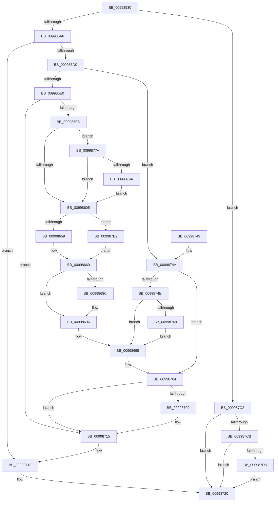

# PiProcessDriverInstance

- RVA: `0x00998530`–`0x009987FF` (길이 `719` bytes)
- VA: `0x0000000140998530`
- 실행 섹션: `PAGE`
- PDB 이름 있음: `예`; PDB Function 태그: `아니요`
- unwind 정보 RVA: `0x000993C4`
- 디코드: `184`개 명령, `719/719` bytes 표시
- 미해석 바이트: `0` (있으면 어셈블리에 `.byte`로 보존)

> 이 문서는 커널 이미지의 기계어와 PDB 기호를 분석해 생성했습니다. 4번과 5번은 함수 원형과 자료형을 바이너리 사용 방식에서 추정한 C 해석이며 원본 소스 복구 결과는 아닙니다.

## 1. Dependencies

- 직접 호출 지점: **15**; 고유 호출 대상: **13**
- 직접 호출자로 확인된 함수: **0**
- RIP 상대 이미지 참조: **6**

### Outgoing calls
- `0x00998597` → [PipOpenServiceEnumKeys](PipOpenServiceEnumKeys_function_00998E94.md) (function, `0x00998E94`)
- `0x009985C1` → [PiFindDevInstMatch](PiFindDevInstMatch_function_009996A0.md) (function, `0x009996A0`)
- `0x00998634` → [RtlStringCchPrintfExW](../../text/42/RtlStringCchPrintfExW_function_0042B390.md) (function, `0x0042B390`)
- `0x00998682` → [ZwSetValueKey](../../text/6A/ZwSetValueKey_function_006ADCD0.md) (function, `0x006ADCD0`)
- `0x00998691` → [ExFreePoolWithTag](../../poolcode/B8/ExFreePoolWithTag_function_00B82870.md) (function, `0x00B82870`)
- `0x009986CA` → [ZwSetValueKey](../../text/6A/ZwSetValueKey_function_006ADCD0.md) (function, `0x006ADCD0`)
- `0x009986FB` → [ZwSetValueKey](../../text/6A/ZwSetValueKey_function_006ADCD0.md) (function, `0x006ADCD0`)
- `0x00998709` → [ExFreePool](../../poolcode/B8/ExFreePool_function_00B82850.md) (function, `0x00B82850`)
- `0x0099871B` → [ZwClose](../../text/6A/ZwClose_function_006AD2B0.md) (function, `0x006AD2B0`)
- `0x00998729` → [_security_check_cookie](../../text/6A/_security_check_cookie_function_006AC640.md) (function, `0x006AC640`)
- `0x00998755` → [ZwDeleteValueKey](../../text/6A/ZwDeleteValueKey_function_006AECB0.md) (function, `0x006AECB0`)
- `0x00998770` → [PiRearrangeDeviceInstances](PiRearrangeDeviceInstances_function_0099AF9C.md) (function, `0x0099AF9C`)
- `0x00998789` → [ExAllocatePool2](../../poolcode/B8/ExAllocatePool2_function_00B820F0.md) (function, `0x00B820F0`)
- `0x009987A3` → [memcpy](../../text/6C/memcpy_function_006C6840.md) (function, `0x006C6840`)
- `0x009987F5` → [McTemplateK0zzzd_EtwWriteTransfer](../../text/5A/McTemplateK0zzzd_EtwWriteTransfer_function_005A97D4.md) (function, `0x005A97D4`)

### Direct callers
- 이 함수 시작 RVA로 연결되는 직접 call은 확인되지 않았습니다. 간접 호출은 완전히 역산할 수 없습니다.

### Static image references
- `0x0099854C` → RVA `0x00E0A740` (`.data`; read)
- `0x0099861F` → RVA `0x00AFDAA0` (` ?? ::NNGAKEGL::`string'`; read)
- `0x00998699` → RVA `0x00AFDA90` (` ?? ::NNGAKEGL::`string'`; read)
- `0x009986CF` → RVA `0x00AFDC20` (` ?? ::NNGAKEGL::`string'`; read)
- `0x009987CB` → RVA `0x00EF012B` (`.data`; read)
- `0x009987DC` → RVA `0x000273D0` (`.rdata`; read)

## 2. Other-region calls and transfers

- 다른 실행 섹션으로 향하는 call: **12**
  - `0x00998634` → [RtlStringCchPrintfExW](../../text/42/RtlStringCchPrintfExW_function_0042B390.md) (`PAGE` → `.text`)
  - `0x00998682` → [ZwSetValueKey](../../text/6A/ZwSetValueKey_function_006ADCD0.md) (`PAGE` → `.text`)
  - `0x00998691` → [ExFreePoolWithTag](../../poolcode/B8/ExFreePoolWithTag_function_00B82870.md) (`PAGE` → `POOLCODE`)
  - `0x009986CA` → [ZwSetValueKey](../../text/6A/ZwSetValueKey_function_006ADCD0.md) (`PAGE` → `.text`)
  - `0x009986FB` → [ZwSetValueKey](../../text/6A/ZwSetValueKey_function_006ADCD0.md) (`PAGE` → `.text`)
  - `0x00998709` → [ExFreePool](../../poolcode/B8/ExFreePool_function_00B82850.md) (`PAGE` → `POOLCODE`)
  - `0x0099871B` → [ZwClose](../../text/6A/ZwClose_function_006AD2B0.md) (`PAGE` → `.text`)
  - `0x00998729` → [_security_check_cookie](../../text/6A/_security_check_cookie_function_006AC640.md) (`PAGE` → `.text`)
  - `0x00998755` → [ZwDeleteValueKey](../../text/6A/ZwDeleteValueKey_function_006AECB0.md) (`PAGE` → `.text`)
  - `0x00998789` → [ExAllocatePool2](../../poolcode/B8/ExAllocatePool2_function_00B820F0.md) (`PAGE` → `POOLCODE`)
  - `0x009987A3` → [memcpy](../../text/6C/memcpy_function_006C6840.md) (`PAGE` → `.text`)
  - `0x009987F5` → [McTemplateK0zzzd_EtwWriteTransfer](../../text/5A/McTemplateK0zzzd_EtwWriteTransfer_function_005A97D4.md) (`PAGE` → `.text`)
- 별도 외부 분기/꼬리 이동을 확인하지 못했습니다.

## 3. Assembly (complete function range)

```asm
00998530  48 89 5C 24 20                  mov qword ptr [rsp + 0x20], rbx
00998535  55                              push rbp
00998536  56                              push rsi
00998537  57                              push rdi
00998538  41 54                           push r12
0099853A  41 55                           push r13
0099853C  41 56                           push r14
0099853E  41 57                           push r15
00998540  48 8D 6C 24 D9                  lea rbp, [rsp - 0x27]
00998545  48 81 EC A0 00 00 00            sub rsp, 0xa0
0099854C  48 8B 05 ED 21 47 00            mov rax, qword ptr [rip + 0x4721ed]
00998553  48 33 C4                        xor rax, rsp
00998556  48 89 45 17                     mov qword ptr [rbp + 0x17], rax
0099855A  48 8B FA                        mov rdi, rdx
0099855D  C6 44 24 20 01                  mov byte ptr [rsp + 0x20], 1
00998562  45 33 E4                        xor r12d, r12d
00998565  4D 8B F1                        mov r14, r9
00998568  4D 8B F8                        mov r15, r8
0099856B  44 89 65 C7                     mov dword ptr [rbp - 0x39], r12d
0099856F  48 8B F1                        mov rsi, rcx
00998572  44 89 65 DF                     mov dword ptr [rbp - 0x21], r12d
00998576  0F 57 C0                        xorps xmm0, xmm0
00998579  4C 89 65 E7                     mov qword ptr [rbp - 0x19], r12
0099857D  0F 57 C9                        xorps xmm1, xmm1
00998580  4C 8D 4D E7                     lea r9, [rbp - 0x19]
00998584  48 8B CF                        mov rcx, rdi
00998587  45 33 C0                        xor r8d, r8d
0099858A  BA 3F 00 0F 00                  mov edx, 0xf003f
0099858F  0F 11 45 EF                     movups xmmword ptr [rbp - 0x11], xmm0
00998593  0F 11 4D CF                     movups xmmword ptr [rbp - 0x31], xmm1
00998597  E8 F8 08 00 00                  call 0x140998e94
0099859C  8B D8                           mov ebx, eax
0099859E  85 C0                           test eax, eax
009985A0  0F 88 1C 02 00 00               js 0x1409987c2
009985A6  48 8B 7D E7                     mov rdi, qword ptr [rbp - 0x19]
009985AA  48 8D 45 DF                     lea rax, [rbp - 0x21]
009985AE  48 8B CF                        mov rcx, rdi
009985B1  48 89 44 24 20                  mov qword ptr [rsp + 0x20], rax
009985B6  4C 8D 4D EF                     lea r9, [rbp - 0x11]
009985BA  48 8B D6                        mov rdx, rsi
009985BD  4C 8D 45 C7                     lea r8, [rbp - 0x39]
009985C1  E8 DA 10 00 00                  call 0x1409996a0
009985C6  8B D8                           mov ebx, eax
009985C8  85 C0                           test eax, eax
009985CA  0F 88 48 01 00 00               js 0x140998718
009985D0  48 8B 4D F7                     mov rcx, qword ptr [rbp - 9]
009985D4  41 8A 06                        mov al, byte ptr [r14]
009985D7  48 85 C9                        test rcx, rcx
009985DA  0F 85 6A 01 00 00               jne 0x14099874a
009985E0  84 C0                           test al, al
009985E2  0F 84 2D 01 00 00               je 0x140998715
009985E8  4C 8B 7E 08                     mov r15, qword ptr [rsi + 8]
009985EC  41 8B DC                        mov ebx, r12d
009985EF  44 0F B7 36                     movzx r14d, word ptr [rsi]
009985F3  41 8B F6                        mov esi, r14d
009985F6  48 D1 EE                        shr rsi, 1
009985F9  66 45 39 64 77 FE               cmp word ptr [r15 + rsi*2 - 2], r12w
009985FF  0F 85 75 01 00 00               jne 0x14099877a
00998605  48 8D 45 FF                     lea rax, [rbp - 1]
00998609  45 33 C9                        xor r9d, r9d
0099860C  48 89 45 E7                     mov qword ptr [rbp - 0x19], rax
00998610  4C 8D 45 E7                     lea r8, [rbp - 0x19]
00998614  8B 45 C7                        mov eax, dword ptr [rbp - 0x39]
00998617  48 8D 4D FF                     lea rcx, [rbp - 1]
0099861B  89 44 24 30                     mov dword ptr [rsp + 0x30], eax
0099861F  48 8D 05 7A 54 16 00            lea rax, [rip + 0x16547a]
00998626  48 89 44 24 28                  mov qword ptr [rsp + 0x28], rax
0099862B  41 8D 51 0A                     lea edx, [r9 + 0xa]
0099862F  4C 89 64 24 20                  mov qword ptr [rsp + 0x20], r12
00998634  E8 57 2D A9 FF                  call 0x14042b390
00998639  48 8B 45 E7                     mov rax, qword ptr [rbp - 0x19]
0099863D  48 8D 4D FF                     lea rcx, [rbp - 1]
00998641  48 2B C1                        sub rax, rcx
00998644  B9 14 00 00 00                  mov ecx, 0x14
00998649  48 D1 F8                        sar rax, 1
0099864C  66 89 4D D1                     mov word ptr [rbp - 0x2f], cx
00998650  83 F8 FF                        cmp eax, -1
00998653  0F 84 60 01 00 00               je 0x1409987b9
00998659  66 03 C0                        add ax, ax
0099865C  66 89 45 CF                     mov word ptr [rbp - 0x31], ax
00998660  48 8D 45 FF                     lea rax, [rbp - 1]
00998664  44 89 74 24 28                  mov dword ptr [rsp + 0x28], r14d
00998669  41 B9 01 00 00 00               mov r9d, 1
0099866F  48 89 45 D7                     mov qword ptr [rbp - 0x29], rax
00998673  45 33 C0                        xor r8d, r8d
00998676  4C 89 7C 24 20                  mov qword ptr [rsp + 0x20], r15
0099867B  48 8D 55 CF                     lea rdx, [rbp - 0x31]
0099867F  48 8B CF                        mov rcx, rdi
00998682  E8 49 56 D1 FF                  call 0x1406adcd0
00998687  48 85 DB                        test rbx, rbx
0099868A  74 0A                           je 0x140998696
0099868C  33 D2                           xor edx, edx
0099868E  48 8B CB                        mov rcx, rbx
00998691  E8 DA A1 1E 00                  call 0x140b82870
00998696  FF 45 C7                        inc dword ptr [rbp - 0x39]
00998699  48 8D 05 F0 53 16 00            lea rax, [rip + 0x1653f0]
009986A0  C7 45 CF 0A 00 0C 00            mov dword ptr [rbp - 0x31], 0xc000a
009986A7  48 89 45 D7                     mov qword ptr [rbp - 0x29], rax
009986AB  48 8D 55 CF                     lea rdx, [rbp - 0x31]
009986AF  BB 04 00 00 00                  mov ebx, 4
009986B4  48 8D 45 C7                     lea rax, [rbp - 0x39]
009986B8  89 5C 24 28                     mov dword ptr [rsp + 0x28], ebx
009986BC  44 8B CB                        mov r9d, ebx
009986BF  45 33 C0                        xor r8d, r8d
009986C2  48 89 44 24 20                  mov qword ptr [rsp + 0x20], rax
009986C7  48 8B CF                        mov rcx, rdi
009986CA  E8 01 56 D1 FF                  call 0x1406adcd0
009986CF  48 8D 05 4A 55 16 00            lea rax, [rip + 0x16554a]
009986D6  89 5C 24 28                     mov dword ptr [rsp + 0x28], ebx
009986DA  48 89 45 D7                     mov qword ptr [rbp - 0x29], rax
009986DE  48 8D 55 CF                     lea rdx, [rbp - 0x31]
009986E2  48 8D 45 C7                     lea rax, [rbp - 0x39]
009986E6  C7 45 CF 18 00 1A 00            mov dword ptr [rbp - 0x31], 0x1a0018
009986ED  44 8B CB                        mov r9d, ebx
009986F0  48 89 44 24 20                  mov qword ptr [rsp + 0x20], rax
009986F5  45 33 C0                        xor r8d, r8d
009986F8  48 8B CF                        mov rcx, rdi
009986FB  E8 D0 55 D1 FF                  call 0x1406adcd0
00998700  48 8B 4D F7                     mov rcx, qword ptr [rbp - 9]
00998704  48 85 C9                        test rcx, rcx
00998707  74 0C                           je 0x140998715
00998709  E8 42 A1 1E 00                  call 0x140b82850
0099870E  0F 57 C0                        xorps xmm0, xmm0
00998711  0F 11 45 EF                     movups xmmword ptr [rbp - 0x11], xmm0
00998715  41 8B DC                        mov ebx, r12d
00998718  48 8B CF                        mov rcx, rdi
0099871B  E8 90 4B D1 FF                  call 0x1406ad2b0
00998720  8B C3                           mov eax, ebx
00998722  48 8B 4D 17                     mov rcx, qword ptr [rbp + 0x17]
00998726  48 33 CC                        xor rcx, rsp
00998729  E8 12 3F D1 FF                  call 0x1406ac640
0099872E  48 8B 9C 24 F8 00 00 00         mov rbx, qword ptr [rsp + 0xf8]
00998736  48 81 C4 A0 00 00 00            add rsp, 0xa0
0099873D  41 5F                           pop r15
0099873F  41 5E                           pop r14
00998741  41 5D                           pop r13
00998743  41 5C                           pop r12
00998745  5F                              pop rdi
00998746  5E                              pop rsi
00998747  5D                              pop rbp
00998748  C3                              ret
00998749  CC                              int3
0099874A  84 C0                           test al, al
0099874C  75 B6                           jne 0x140998704
0099874E  48 8D 55 EF                     lea rdx, [rbp - 0x11]
00998752  48 8B CF                        mov rcx, rdi
00998755  E8 56 65 D1 FF                  call 0x1406aecb0
0099875A  8B 55 C7                        mov edx, dword ptr [rbp - 0x39]
0099875D  83 C2 FF                        add edx, -1
00998760  89 55 C7                        mov dword ptr [rbp - 0x39], edx
00998763  0F 84 30 FF FF FF               je 0x140998699
00998769  44 8B 45 DF                     mov r8d, dword ptr [rbp - 0x21]
0099876D  48 8B CF                        mov rcx, rdi
00998770  E8 27 28 00 00                  call 0x14099af9c
00998775  E9 1F FF FF FF                  jmp 0x140998699
0099877A  49 8D 56 02                     lea rdx, [r14 + 2]
0099877E  B9 00 01 00 00                  mov ecx, 0x100
00998783  41 B8 50 70 20 20               mov r8d, 0x20207050
00998789  E8 62 99 1E 00                  call 0x140b820f0
0099878E  48 8B D8                        mov rbx, rax
00998791  48 85 C0                        test rax, rax
00998794  0F 84 6B FE FF FF               je 0x140998605
0099879A  4D 8B C6                        mov r8, r14
0099879D  49 8B D7                        mov rdx, r15
009987A0  48 8B C8                        mov rcx, rax
009987A3  E8 98 E0 D2 FF                  call 0x1406c6840
009987A8  41 83 C6 02                     add r14d, 2
009987AC  66 44 89 24 73                  mov word ptr [rbx + rsi*2], r12w
009987B1  4C 8B FB                        mov r15, rbx
009987B4  E9 4C FE FF FF                  jmp 0x140998605
009987B9  66 89 4D CF                     mov word ptr [rbp - 0x31], cx
009987BD  E9 9E FE FF FF                  jmp 0x140998660
009987C2  45 38 26                        cmp byte ptr [r14], r12b
009987C5  0F 84 55 FF FF FF               je 0x140998720
009987CB  F6 05 59 79 55 00 40            test byte ptr [rip + 0x557959], 0x40
009987D2  0F 84 48 FF FF FF               je 0x140998720
009987D8  48 8B 4F 08                     mov rcx, qword ptr [rdi + 8]
009987DC  48 8D 15 ED EB 68 FF            lea rdx, [rip - 0x971413]
009987E3  4C 8B 4E 08                     mov r9, qword ptr [rsi + 8]
009987E7  89 44 24 30                     mov dword ptr [rsp + 0x30], eax
009987EB  4C 89 7C 24 28                  mov qword ptr [rsp + 0x28], r15
009987F0  48 89 4C 24 20                  mov qword ptr [rsp + 0x20], rcx
009987F5  E8 DA 0F C1 FF                  call 0x1405a97d4
009987FA  E9 21 FF FF FF                  jmp 0x140998720
```

## 4. C-style interpretation (structured pseudocode)

```c
__int64 __fastcall PiProcessDriverInstance(__int64 a1, __int64 a2, __int64 a3, __int64 a4)
{
    __int64 result;
    __int64 v_r12;
    __int64 v_r14;
    __int64 v_rsi;
    __int64 v_rsp;
    unsigned __int64 v_stack_m48;
    unsigned __int64 v_stack_m5F;
    unsigned __int64 v_stack_m60;
    unsigned __int64 v_stack_m68;
    unsigned __int64 v_stack_m70;
    unsigned __int64 v_stack_m78;
    unsigned int v_stack_m80;
    unsigned __int64 v_stack_m88;
    unsigned __int16 v_stack_m8E;
    unsigned __int64 v_stack_m90;
    unsigned int v_stack_m98;
    unsigned int v_stack_mA8;
    unsigned __int64 v_stack_mB0;
    unsigned __int8 v_stack_mB8;
    unsigned __int64 v_stack_p20;
    unsigned __int64 v_stack_p28;
    unsigned int v_stack_p30;

    v_stack_p20 = v_rbx;
    v_rsp = (v_rsp) - (160);
    result = (*(unsigned __int64 *)(v_rip + 4661741)) ^ (v_rsp);
    v_stack_m48 = result;
    v_stack_mB8 = 1;
    v_r12 = 0;
    v_stack_m98 = 0;
    v_stack_m80 = 0;
    v_stack_m78 = 0;
    a3 = 0;
    v_stack_m70 = v_xmm0;
    v_stack_m90 = v_xmm1;
    result = PipOpenServiceEnumKeys(a2, (unsigned int)(0xF003FULL), a3, v_stack_m78);
    if (sign_flag) goto loc_009987C2;
    v_stack_mB8 = v_stack_m80;
    result = PiFindDevInstMatch(v_stack_m78, a1, v_stack_m98, v_stack_m70);
    if (sign_flag) goto loc_00998718;
    if (v_stack_m68 != 0) goto loc_0099874A;
    if ((unsigned __int8)(*(unsigned __int8 *)(a4)) == 0) goto loc_00998715;
    v_rsi = ((unsigned int)((unsigned int)(*(unsigned __int16 *)(a1)))) >> (1);
    if ((*(unsigned __int16 *)(*(unsigned __int64 *)(a1 + 8) + v_rsi * 2 - 2)) != 0) goto loc_0099877A;
loc_00998605:
    a4 = 0;
    v_stack_m78 = v_stack_m60;
    v_stack_mA8 = (unsigned int)((unsigned int)(v_stack_m98));
    v_stack_mB0 = v_rip + 1463418;
    v_stack_mB8 = 0;
    result = RtlStringCchPrintfExW(v_stack_m60, a4 + 10, v_stack_m78, a4);
    result = (v_stack_m78) - (v_stack_m60);
    result = (result) >> (1);
    v_stack_m8E = 20;
    if (((unsigned int)(result)) == -1) goto loc_009987B9;
    result = (unsigned __int16)((result) + ((unsigned __int16)(result)));
    v_stack_m90 = (unsigned __int16)(result);
loc_00998660:
    v_stack_mB0 = (unsigned int)(*(unsigned __int16 *)(a1));
    v_stack_m88 = v_stack_m60;
    a3 = 0;
    v_stack_mB8 = *(unsigned __int64 *)(a1 + 8);
    result = ZwSetValueKey(v_stack_m78, v_stack_m90, a3, 1);
    if (0 != 0) {
        a2 = 0;
        a1 = 0;
        result = ExFreePoolWithTag(a1, a2, a3, 1);
    }
loc_00998699:
    v_stack_m90 = 0xC000AULL;
    v_stack_m88 = v_rip + 1463280;
    v_stack_mB0 = 4;
    a3 = 0;
    v_stack_mB8 = v_stack_m98;
    result = ZwSetValueKey(v_stack_m78, v_stack_m90, a3, 4);
    v_stack_mB0 = 4;
    v_stack_m88 = v_rip + 1463626;
    v_stack_m90 = 0x1A0018ULL;
    v_stack_mB8 = v_stack_m98;
    a3 = 0;
    result = ZwSetValueKey(v_stack_m78, v_stack_m90, a3, 4);
loc_00998704:
    if (v_stack_m68 != 0) {
        result = ExFreePool(v_stack_m68, v_stack_m90, a3, 4);
        v_stack_m70 = v_xmm0;
    }
loc_00998718:
    result = ZwClose(v_stack_m78, v_stack_m90, a3, 4);
loc_00998720:
    a1 = (v_stack_m48) ^ (v_rsp);
    result = _security_check_cookie(a1, v_stack_m90, a3, 4);
    v_rsp = (v_rsp) + (160);
    return result;
loc_0099874A:
    if ((unsigned __int8)(result) != 0) goto loc_00998704;
    result = ZwDeleteValueKey(v_stack_m78, v_stack_m70, a3, 4);
    a2 = (unsigned int)(((unsigned int)(v_stack_m98)) + (-1));
    v_stack_m98 = (unsigned int)(a2);
    if (condition_is_equal) goto loc_00998699;
    result = PiRearrangeDeviceInstances(v_stack_m78, a2, (unsigned int)(v_stack_m80), 4);
    goto loc_00998699;
loc_0099877A:
    result = ExAllocatePool2(256, *(unsigned __int16 *)(a1) + 2, (unsigned int)(0x20207050ULL), 4);
    if (result == 0) goto loc_00998605;
    result = memcpy(result, *(unsigned __int64 *)(a1 + 8), *(unsigned __int16 *)(a1), 4);
    v_r14 = (unsigned int)((*(unsigned __int16 *)(a1)) + (2));
    *(unsigned __int16 *)(result + v_rsi * 2) = 0;
    goto loc_00998605;
loc_009987B9:
    v_stack_m90 = (unsigned __int16)(result);
    goto loc_00998660;
loc_009987C2:
    if ((*(unsigned __int8 *)(v_r14)) == 0) goto loc_00998720;
    if (((*(unsigned __int8 *)(v_rip + 5601625)) & (64)) == 0) goto loc_00998720;
    v_stack_p30 = (unsigned int)(result);
    v_stack_p28 = result;
    v_stack_p20 = *(unsigned __int64 *)(v_stack_m78 + 8);
    result = McTemplateK0zzzd_EtwWriteTransfer(*(unsigned __int64 *)(v_stack_m78 + 8), v_rip - 9901075, *(unsigned __int16 *)(a1), *(unsigned __int64 *)(v_rsi + 8));
    goto loc_00998720;
}
```

## 5. (Beta) C Style

```c
int64_t PiProcessDriverInstance(void *Arg1, void *Arg2, int64_t Arg3, void *Arg4)
{
    uint8_t *arg1 = (uint8_t *)Arg1;
    uint8_t *arg2 = (uint8_t *)Arg2;
    uint8_t *arg4 = (uint8_t *)Arg4;

    int64_t result;
    int64_t local_r12;
    int64_t local_r14;
    int64_t local_rsi;
    int64_t local_rsp;
    uint64_t v_stack_m48;
    uint64_t v_stack_m5F;
    uint64_t v_stack_m60;
    uint64_t v_stack_m68;
    uint64_t v_stack_m70;
    uint64_t v_stack_m78;
    uint32_t v_stack_m80;
    uint64_t v_stack_m88;
    uint16_t v_stack_m8E;
    uint64_t v_stack_m90;
    uint32_t v_stack_m98;
    uint32_t v_stack_mA8;
    uint64_t v_stack_mB0;
    uint8_t v_stack_mB8;
    uint64_t v_stack_p20;
    uint64_t v_stack_p28;
    uint32_t v_stack_p30;

    v_stack_p20 = local_rbx;
    local_rsp = (local_rsp) - (160);
    result = (*(uint64_t *)(v_rip + 0x4721ED)) ^ (local_rsp);
    v_stack_m48 = result;
    v_stack_mB8 = 1;
    local_r12 = 0;
    v_stack_m98 = 0;
    v_stack_m80 = 0;
    v_stack_m78 = 0;
    Arg3 = 0;
    v_stack_m70 = v_xmm0;
    v_stack_m90 = v_xmm1;
    result = PipOpenServiceEnumKeys(Arg2, (uint32_t)(0xF003FULL), Arg3, v_stack_m78);
    if (sign_flag) goto loc_009987C2;
    v_stack_mB8 = v_stack_m80;
    result = PiFindDevInstMatch(v_stack_m78, Arg1, v_stack_m98, v_stack_m70);
    if (sign_flag) goto loc_00998718;
    if (v_stack_m68 != 0) goto loc_0099874A;
    if ((uint8_t)(*(uint8_t *)(arg4)) == 0) goto loc_00998715;
    local_rsi = ((uint32_t)((uint32_t)(*(uint16_t *)(arg1)))) >> (1);
    if ((*(uint16_t *)(*(uint64_t *)(arg1 + 0x8) + local_rsi * 2 - 0x2)) != 0) goto loc_0099877A;
loc_00998605:
    Arg4 = 0;
    v_stack_m78 = v_stack_m60;
    v_stack_mA8 = (uint32_t)((uint32_t)(v_stack_m98));
    v_stack_mB0 = v_rip + 1463418;
    v_stack_mB8 = 0;
    result = RtlStringCchPrintfExW(v_stack_m60, Arg4 + 10, v_stack_m78, Arg4);
    result = (v_stack_m78) - (v_stack_m60);
    result = (result) >> (1);
    v_stack_m8E = 20;
    if (((uint32_t)(result)) == -1) goto loc_009987B9;
    result = (uint16_t)((result) + ((uint16_t)(result)));
    v_stack_m90 = (uint16_t)(result);
loc_00998660:
    v_stack_mB0 = (uint32_t)(*(uint16_t *)(arg1));
    v_stack_m88 = v_stack_m60;
    Arg3 = 0;
    v_stack_mB8 = *(uint64_t *)(arg1 + 0x8);
    result = ZwSetValueKey(v_stack_m78, v_stack_m90, Arg3, 1);
    if (0 != 0) {
        Arg2 = 0;
        Arg1 = 0;
        result = ExFreePoolWithTag(Arg1, Arg2, Arg3, 1);
    }
loc_00998699:
    v_stack_m90 = 0xC000AULL;
    v_stack_m88 = v_rip + 1463280;
    v_stack_mB0 = 4;
    Arg3 = 0;
    v_stack_mB8 = v_stack_m98;
    result = ZwSetValueKey(v_stack_m78, v_stack_m90, Arg3, 4);
    v_stack_mB0 = 4;
    v_stack_m88 = v_rip + 1463626;
    v_stack_m90 = 0x1A0018ULL;
    v_stack_mB8 = v_stack_m98;
    Arg3 = 0;
    result = ZwSetValueKey(v_stack_m78, v_stack_m90, Arg3, 4);
loc_00998704:
    if (v_stack_m68 != 0) {
        result = ExFreePool(v_stack_m68, v_stack_m90, Arg3, 4);
        v_stack_m70 = v_xmm0;
    }
loc_00998718:
    result = ZwClose(v_stack_m78, v_stack_m90, Arg3, 4);
loc_00998720:
    Arg1 = (v_stack_m48) ^ (local_rsp);
    result = _security_check_cookie(Arg1, v_stack_m90, Arg3, 4);
    local_rsp = (local_rsp) + (160);
    return result;
loc_0099874A:
    if ((uint8_t)(result) != 0) goto loc_00998704;
    result = ZwDeleteValueKey(v_stack_m78, v_stack_m70, Arg3, 4);
    Arg2 = (uint32_t)(((uint32_t)(v_stack_m98)) + (-1));
    v_stack_m98 = (uint32_t)(Arg2);
    if (condition_is_equal) goto loc_00998699;
    result = PiRearrangeDeviceInstances(v_stack_m78, Arg2, (uint32_t)(v_stack_m80), 4);
    goto loc_00998699;
loc_0099877A:
    result = ExAllocatePool2(256, *(uint16_t *)(arg1) + 2, (uint32_t)(0x20207050ULL), 4);
    if (result == 0) goto loc_00998605;
    result = memcpy(result, *(uint64_t *)(arg1 + 0x8), *(uint16_t *)(arg1), 4);
    local_r14 = (uint32_t)((*(uint16_t *)(arg1)) + (2));
    *(uint16_t *)(result + local_rsi * 2) = 0;
    goto loc_00998605;
loc_009987B9:
    v_stack_m90 = (uint16_t)(result);
    goto loc_00998660;
loc_009987C2:
    if ((*(uint8_t *)(local_r14)) == 0) goto loc_00998720;
    if (((*(uint8_t *)(v_rip + 0x557959)) & (64)) == 0) goto loc_00998720;
    v_stack_p30 = (uint32_t)(result);
    v_stack_p28 = result;
    v_stack_p20 = *(uint64_t *)(v_stack_m78 + 0x8);
    result = McTemplateK0zzzd_EtwWriteTransfer(*(uint64_t *)(v_stack_m78 + 0x8), v_rip - 9901075, *(uint16_t *)(arg1), *(uint64_t *)(local_rsi + 0x8));
    goto loc_00998720;
}
```

### 관측된 메모리 오프셋

구조체 형식이 확인되지 않은 접근은 인자 기준의 오프셋으로만 기록했습니다.

| 기준 인자 | 오프셋 표현 | 폭 (bit) | 접근 |
|---|---:|---:|---|
| `Arg1` | `+ 0x0` | `16` | `R` |
| `Arg1` | `+ 0x8` | `64` | `R` |
| `Arg2` | `+ 0x8` | `64` | `R` |
| `Arg4` | `+ 0x0` | `8` | `R` |

## 6. Execution-region graph

[열기: 2D/3D 그래프와 함수 탐색 컨트롤 패널](../../../control-panel.html?section=page&rva=0x00998530&view=graph)

- 2D 그래프는 위에서 아래로 흐르고, 3D 그래프는 빈 공간을 드래그해 회전합니다. Shift+드래그는 이동, 휠은 확대·축소, 함수 노드 선택은 대상 보고서 이동입니다.

### Static fallback


