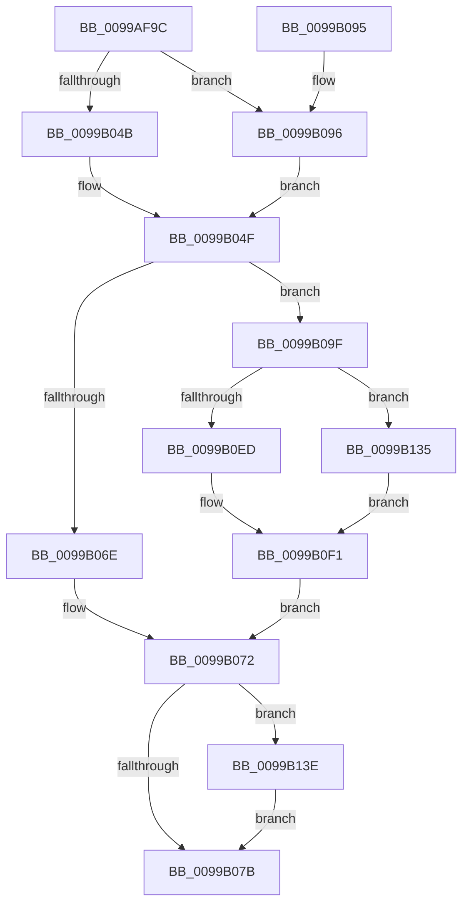

# PiRearrangeDeviceInstances

- RVA: `0x0099AF9C`–`0x0099B14A` (길이 `430` bytes)
- VA: `0x000000014099AF9C`
- 실행 섹션: `PAGE`
- PDB 이름 있음: `예`; PDB Function 태그: `아니요`
- unwind 정보 RVA: `0x00099668`
- 디코드: `117`개 명령, `430/430` bytes 표시
- 미해석 바이트: `0` (있으면 어셈블리에 `.byte`로 보존)

> 이 문서는 커널 이미지의 기계어와 PDB 기호를 분석해 생성했습니다. 4번과 5번은 함수 원형과 자료형을 바이너리 사용 방식에서 추정한 C 해석이며 원본 소스 복구 결과는 아닙니다.

## 1. Dependencies

- 직접 호출 지점: **9**; 고유 호출 대상: **7**
- 직접 호출자로 확인된 함수: **1**
- RIP 상대 이미지 참조: **2**

### Outgoing calls
- `0x0099AFF8` → [ZwQueryKey](../../text/6A/ZwQueryKey_function_006AD390.md) (function, `0x006AD390`)
- `0x0099B02A` → [RtlStringCchPrintfExW](../../text/42/RtlStringCchPrintfExW_function_0042B390.md) (function, `0x0042B390`)
- `0x0099B065` → [IopGetRegistryValue](IopGetRegistryValue_function_009990EC.md) (function, `0x009990EC`)
- `0x0099B082` → [_security_check_cookie](../../text/6A/_security_check_cookie_function_006AC640.md) (function, `0x006AC640`)
- `0x0099B0A6` → [ZwDeleteValueKey](../../text/6A/ZwDeleteValueKey_function_006AECB0.md) (function, `0x006AECB0`)
- `0x0099B0D1` → [RtlStringCchPrintfExW](../../text/42/RtlStringCchPrintfExW_function_0042B390.md) (function, `0x0042B390`)
- `0x0099B11F` → [ZwSetValueKey](../../text/6A/ZwSetValueKey_function_006ADCD0.md) (function, `0x006ADCD0`)
- `0x0099B129` → [ExFreePoolWithTag](../../poolcode/B8/ExFreePoolWithTag_function_00B82870.md) (function, `0x00B82870`)
- `0x0099B140` → [ExFreePoolWithTag](../../poolcode/B8/ExFreePoolWithTag_function_00B82870.md) (function, `0x00B82870`)

### Direct callers
- [PiProcessDriverInstance](PiProcessDriverInstance_function_00998530.md) at `0x00998770`

### Static image references
- `0x0099AFAF` → RVA `0x00E0A740` (`.data`; read)
- `0x0099B008` → RVA `0x00AFDAA0` (` ?? ::NNGAKEGL::`string'`; read)

## 2. Other-region calls and transfers

- 다른 실행 섹션으로 향하는 call: **8**
  - `0x0099AFF8` → [ZwQueryKey](../../text/6A/ZwQueryKey_function_006AD390.md) (`PAGE` → `.text`)
  - `0x0099B02A` → [RtlStringCchPrintfExW](../../text/42/RtlStringCchPrintfExW_function_0042B390.md) (`PAGE` → `.text`)
  - `0x0099B082` → [_security_check_cookie](../../text/6A/_security_check_cookie_function_006AC640.md) (`PAGE` → `.text`)
  - `0x0099B0A6` → [ZwDeleteValueKey](../../text/6A/ZwDeleteValueKey_function_006AECB0.md) (`PAGE` → `.text`)
  - `0x0099B0D1` → [RtlStringCchPrintfExW](../../text/42/RtlStringCchPrintfExW_function_0042B390.md) (`PAGE` → `.text`)
  - `0x0099B11F` → [ZwSetValueKey](../../text/6A/ZwSetValueKey_function_006ADCD0.md) (`PAGE` → `.text`)
  - `0x0099B129` → [ExFreePoolWithTag](../../poolcode/B8/ExFreePoolWithTag_function_00B82870.md) (`PAGE` → `POOLCODE`)
  - `0x0099B140` → [ExFreePoolWithTag](../../poolcode/B8/ExFreePoolWithTag_function_00B82870.md) (`PAGE` → `POOLCODE`)
- 별도 외부 분기/꼬리 이동을 확인하지 못했습니다.

## 3. Assembly (complete function range)

```asm
0099AF9C  40 55                           push rbp
0099AF9E  53                              push rbx
0099AF9F  56                              push rsi
0099AFA0  57                              push rdi
0099AFA1  41 54                           push r12
0099AFA3  48 8D 6C 24 C9                  lea rbp, [rsp - 0x37]
0099AFA8  48 81 EC C0 00 00 00            sub rsp, 0xc0
0099AFAF  48 8B 05 8A F7 46 00            mov rax, qword ptr [rip + 0x46f78a]
0099AFB6  48 33 C4                        xor rax, rsp
0099AFB9  48 89 45 27                     mov qword ptr [rbp + 0x27], rax
0099AFBD  83 65 C3 00                     and dword ptr [rbp - 0x3d], 0
0099AFC1  48 8D 45 CF                     lea rax, [rbp - 0x31]
0099AFC5  83 65 CF 00                     and dword ptr [rbp - 0x31], 0
0099AFC9  0F 57 C0                        xorps xmm0, xmm0
0099AFCC  48 83 65 D7 00                  and qword ptr [rbp - 0x29], 0
0099AFD1  41 B9 30 00 00 00               mov r9d, 0x30
0099AFD7  41 8B F0                        mov esi, r8d
0099AFDA  48 89 44 24 20                  mov qword ptr [rsp + 0x20], rax
0099AFDF  8B DA                           mov ebx, edx
0099AFE1  4C 8D 45 DF                     lea r8, [rbp - 0x21]
0099AFE5  48 8B F9                        mov rdi, rcx
0099AFE8  41 8D 51 D2                     lea edx, [r9 - 0x2e]
0099AFEC  0F 11 45 DF                     movups xmmword ptr [rbp - 0x21], xmm0
0099AFF0  0F 11 45 EF                     movups xmmword ptr [rbp - 0x11], xmm0
0099AFF4  0F 11 45 FF                     movups xmmword ptr [rbp - 1], xmm0
0099AFF8  E8 93 23 D1 FF                  call 0x1406ad390
0099AFFD  45 33 C9                        xor r9d, r9d
0099B000  89 5C 24 30                     mov dword ptr [rsp + 0x30], ebx
0099B004  48 8D 45 0F                     lea rax, [rbp + 0xf]
0099B008  4C 8D 25 91 2A 16 00            lea r12, [rip + 0x162a91]
0099B00F  48 89 45 B7                     mov qword ptr [rbp - 0x49], rax
0099B013  4C 89 64 24 28                  mov qword ptr [rsp + 0x28], r12
0099B018  4C 8D 45 B7                     lea r8, [rbp - 0x49]
0099B01C  48 83 64 24 20 00               and qword ptr [rsp + 0x20], 0
0099B022  41 8D 51 0A                     lea edx, [r9 + 0xa]
0099B026  48 8D 4D 0F                     lea rcx, [rbp + 0xf]
0099B02A  E8 61 03 A9 FF                  call 0x14042b390
0099B02F  48 8B 45 B7                     mov rax, qword ptr [rbp - 0x49]
0099B033  48 8D 4D 0F                     lea rcx, [rbp + 0xf]
0099B037  48 2B C1                        sub rax, rcx
0099B03A  BB 14 00 00 00                  mov ebx, 0x14
0099B03F  48 D1 F8                        sar rax, 1
0099B042  66 89 5D C1                     mov word ptr [rbp - 0x3f], bx
0099B046  83 F8 FF                        cmp eax, -1
0099B049  75 4B                           jne 0x14099b096
0099B04B  66 89 5D BF                     mov word ptr [rbp - 0x41], bx
0099B04F  48 8D 45 0F                     lea rax, [rbp + 0xf]
0099B053  45 33 C0                        xor r8d, r8d
0099B056  4C 8D 4D D7                     lea r9, [rbp - 0x29]
0099B05A  48 89 45 C7                     mov qword ptr [rbp - 0x39], rax
0099B05E  48 8D 55 0F                     lea rdx, [rbp + 0xf]
0099B062  48 8B CF                        mov rcx, rdi
0099B065  E8 82 E0 FF FF                  call 0x1409990ec
0099B06A  85 C0                           test eax, eax
0099B06C  79 31                           jns 0x14099b09f
0099B06E  48 8B 4D D7                     mov rcx, qword ptr [rbp - 0x29]
0099B072  48 85 C9                        test rcx, rcx
0099B075  0F 85 C3 00 00 00               jne 0x14099b13e
0099B07B  48 8B 4D 27                     mov rcx, qword ptr [rbp + 0x27]
0099B07F  48 33 CC                        xor rcx, rsp
0099B082  E8 B9 15 D1 FF                  call 0x1406ac640
0099B087  48 81 C4 C0 00 00 00            add rsp, 0xc0
0099B08E  41 5C                           pop r12
0099B090  5F                              pop rdi
0099B091  5E                              pop rsi
0099B092  5B                              pop rbx
0099B093  5D                              pop rbp
0099B094  C3                              ret
0099B095  CC                              int3
0099B096  66 03 C0                        add ax, ax
0099B099  66 89 45 BF                     mov word ptr [rbp - 0x41], ax
0099B09D  EB B0                           jmp 0x14099b04f
0099B09F  48 8D 55 BF                     lea rdx, [rbp - 0x41]
0099B0A3  48 8B CF                        mov rcx, rdi
0099B0A6  E8 05 3C D1 FF                  call 0x1406aecb0
0099B0AB  45 33 C9                        xor r9d, r9d
0099B0AE  89 74 24 30                     mov dword ptr [rsp + 0x30], esi
0099B0B2  48 8D 45 0F                     lea rax, [rbp + 0xf]
0099B0B6  4C 89 64 24 28                  mov qword ptr [rsp + 0x28], r12
0099B0BB  48 83 64 24 20 00               and qword ptr [rsp + 0x20], 0
0099B0C1  4C 8D 45 B7                     lea r8, [rbp - 0x49]
0099B0C5  48 8D 4D 0F                     lea rcx, [rbp + 0xf]
0099B0C9  48 89 45 B7                     mov qword ptr [rbp - 0x49], rax
0099B0CD  41 8D 51 0A                     lea edx, [r9 + 0xa]
0099B0D1  E8 BA 02 A9 FF                  call 0x14042b390
0099B0D6  48 8B 45 B7                     mov rax, qword ptr [rbp - 0x49]
0099B0DA  48 8D 4D 0F                     lea rcx, [rbp + 0xf]
0099B0DE  48 2B C1                        sub rax, rcx
0099B0E1  66 89 5D C1                     mov word ptr [rbp - 0x3f], bx
0099B0E5  48 D1 F8                        sar rax, 1
0099B0E8  83 F8 FF                        cmp eax, -1
0099B0EB  75 48                           jne 0x14099b135
0099B0ED  66 89 5D BF                     mov word ptr [rbp - 0x41], bx
0099B0F1  48 8B 5D D7                     mov rbx, qword ptr [rbp - 0x29]
0099B0F5  48 8D 45 0F                     lea rax, [rbp + 0xf]
0099B0F9  48 89 45 C7                     mov qword ptr [rbp - 0x39], rax
0099B0FD  41 B9 01 00 00 00               mov r9d, 1
0099B103  45 33 C0                        xor r8d, r8d
0099B106  48 8B CF                        mov rcx, rdi
0099B109  8B 53 08                        mov edx, dword ptr [rbx + 8]
0099B10C  8B 43 0C                        mov eax, dword ptr [rbx + 0xc]
0099B10F  48 03 D3                        add rdx, rbx
0099B112  89 44 24 28                     mov dword ptr [rsp + 0x28], eax
0099B116  48 89 54 24 20                  mov qword ptr [rsp + 0x20], rdx
0099B11B  48 8D 55 BF                     lea rdx, [rbp - 0x41]
0099B11F  E8 AC 2B D1 FF                  call 0x1406adcd0
0099B124  33 D2                           xor edx, edx
0099B126  48 8B CB                        mov rcx, rbx
0099B129  E8 42 77 1E 00                  call 0x140b82870
0099B12E  33 C9                           xor ecx, ecx
0099B130  E9 3D FF FF FF                  jmp 0x14099b072
0099B135  66 03 C0                        add ax, ax
0099B138  66 89 45 BF                     mov word ptr [rbp - 0x41], ax
0099B13C  EB B3                           jmp 0x14099b0f1
0099B13E  33 D2                           xor edx, edx
0099B140  E8 2B 77 1E 00                  call 0x140b82870
0099B145  E9 31 FF FF FF                  jmp 0x14099b07b
```

## 4. C-style interpretation (structured pseudocode)

```c
__int64 __fastcall PiRearrangeDeviceInstances(__int64 a1, int a2, int a3)
{
    __int64 result;
    __int64 v_rsp;
    unsigned __int64 v_stack_m38;
    unsigned __int64 v_stack_m50;
    unsigned __int64 v_stack_m5F;
    unsigned __int64 v_stack_m60;
    unsigned __int64 v_stack_m70;
    unsigned __int64 v_stack_m80;
    unsigned __int64 v_stack_m88;
    unsigned __int64 v_stack_m90;
    unsigned __int64 v_stack_m98;
    unsigned int v_stack_m9C;
    unsigned __int16 v_stack_m9E;
    unsigned __int16 v_stack_mA0;
    unsigned __int64 v_stack_mA8;
    unsigned int v_stack_mB8;
    unsigned __int64 v_stack_mC0;
    unsigned __int64 v_stack_mC8;
    unsigned __int64 v_stack_p20;
    unsigned __int64 v_stack_p28;
    unsigned int v_stack_p30;

    v_rsp = (v_rsp) - (192);
    result = (*(unsigned __int64 *)(v_rip + 4650890)) ^ (v_rsp);
    v_stack_m38 = result;
    v_stack_mC8 = v_stack_m90;
    v_stack_m80 = v_xmm0;
    v_stack_m70 = v_xmm0;
    v_stack_m60 = v_xmm0;
    result = ZwQueryKey(a1, 48 - 46, v_stack_m80, 48);
    a4 = 0;
    v_stack_mB8 = (unsigned int)((unsigned int)(a2));
    v_stack_mA8 = v_stack_m50;
    v_stack_mC0 = v_rip + 1452689;
    result = RtlStringCchPrintfExW(v_stack_m50, a4 + 10, v_stack_mA8, a4);
    result = (v_stack_mA8) - (v_stack_m50);
    result = (result) >> (1);
    v_stack_m9E = 20;
    if (((unsigned int)(result)) != -1) goto loc_0099B096;
    v_stack_mA0 = 20;
loc_0099B04F:
    a3 = 0;
    v_stack_m98 = v_stack_m50;
    result = IopGetRegistryValue(a1, v_stack_m50, a3, v_stack_m88);
    if (!sign_flag) goto loc_0099B09F;
loc_0099B072:
    if (v_stack_m88 != 0) goto loc_0099B13E;
loc_0099B07B:
    a1 = (v_stack_m38) ^ (v_rsp);
    result = _security_check_cookie(a1, v_stack_m50, a3, v_stack_m88);
    v_rsp = (v_rsp) + (192);
    return result;
loc_0099B096:
    result = (unsigned __int16)((result) + ((unsigned __int16)(result)));
    v_stack_mA0 = (unsigned __int16)(result);
    goto loc_0099B04F;
loc_0099B09F:
    result = ZwDeleteValueKey(a1, v_stack_mA0, a3, v_stack_m88);
    a4 = 0;
    v_stack_p30 = (unsigned int)((unsigned int)(a3));
    v_stack_p28 = v_rip + 1452689;
    v_stack_mA8 = v_stack_m50;
    result = RtlStringCchPrintfExW(v_stack_m50, a4 + 10, v_stack_mA8, a4);
    result = (v_stack_mA8) - (v_stack_m50);
    v_stack_m9E = 20;
    result = (result) >> (1);
    if (((unsigned int)(result)) != -1) goto loc_0099B135;
    v_stack_mA0 = 20;
loc_0099B0F1:
    v_stack_m98 = v_stack_m50;
    a3 = 0;
    a2 = ((unsigned int)(*(unsigned int *)(v_stack_m88 + 8))) + (v_stack_m88);
    v_stack_p28 = (unsigned int)((unsigned int)(*(unsigned int *)(v_stack_m88 + 12)));
    v_stack_p20 = a2;
    result = ZwSetValueKey(a1, v_stack_mA0, a3, 1);
    a2 = 0;
    result = ExFreePoolWithTag(v_stack_m88, a2, a3, 1);
    a1 = 0;
    goto loc_0099B072;
loc_0099B135:
    result = (unsigned __int16)((result) + ((unsigned __int16)(result)));
    v_stack_mA0 = (unsigned __int16)(result);
    goto loc_0099B0F1;
loc_0099B13E:
    a2 = 0;
    result = ExFreePoolWithTag(a1, a2, a3, 1);
    goto loc_0099B07B;
}
```

## 5. (Beta) C Style

```c
int64_t PiRearrangeDeviceInstances(int64_t Arg1, int32_t Arg2, int32_t Arg3)
{
    int64_t result;
    int64_t local_rsp;
    uint64_t v_stack_m38;
    uint64_t v_stack_m50;
    uint64_t v_stack_m5F;
    uint64_t v_stack_m60;
    uint64_t v_stack_m70;
    uint64_t v_stack_m80;
    uint64_t v_stack_m88;
    uint64_t v_stack_m90;
    uint64_t v_stack_m98;
    uint32_t v_stack_m9C;
    uint16_t v_stack_m9E;
    uint16_t v_stack_mA0;
    uint64_t v_stack_mA8;
    uint32_t v_stack_mB8;
    uint64_t v_stack_mC0;
    uint64_t v_stack_mC8;
    uint64_t v_stack_p20;
    uint64_t v_stack_p28;
    uint32_t v_stack_p30;

    local_rsp = (local_rsp) - (192);
    result = (*(uint64_t *)(v_rip + 0x46F78A)) ^ (local_rsp);
    v_stack_m38 = result;
    v_stack_mC8 = v_stack_m90;
    v_stack_m80 = v_xmm0;
    v_stack_m70 = v_xmm0;
    v_stack_m60 = v_xmm0;
    result = ZwQueryKey(Arg1, 48 - 46, v_stack_m80, 48);
    a4 = 0;
    v_stack_mB8 = (uint32_t)((uint32_t)(Arg2));
    v_stack_mA8 = v_stack_m50;
    v_stack_mC0 = v_rip + 1452689;
    result = RtlStringCchPrintfExW(v_stack_m50, a4 + 10, v_stack_mA8, a4);
    result = (v_stack_mA8) - (v_stack_m50);
    result = (result) >> (1);
    v_stack_m9E = 20;
    if (((uint32_t)(result)) != -1) goto loc_0099B096;
    v_stack_mA0 = 20;
loc_0099B04F:
    Arg3 = 0;
    v_stack_m98 = v_stack_m50;
    result = IopGetRegistryValue(Arg1, v_stack_m50, Arg3, v_stack_m88);
    if (!sign_flag) goto loc_0099B09F;
loc_0099B072:
    if (v_stack_m88 != 0) goto loc_0099B13E;
loc_0099B07B:
    Arg1 = (v_stack_m38) ^ (local_rsp);
    result = _security_check_cookie(Arg1, v_stack_m50, Arg3, v_stack_m88);
    local_rsp = (local_rsp) + (192);
    return result;
loc_0099B096:
    result = (uint16_t)((result) + ((uint16_t)(result)));
    v_stack_mA0 = (uint16_t)(result);
    goto loc_0099B04F;
loc_0099B09F:
    result = ZwDeleteValueKey(Arg1, v_stack_mA0, Arg3, v_stack_m88);
    a4 = 0;
    v_stack_p30 = (uint32_t)((uint32_t)(Arg3));
    v_stack_p28 = v_rip + 1452689;
    v_stack_mA8 = v_stack_m50;
    result = RtlStringCchPrintfExW(v_stack_m50, a4 + 10, v_stack_mA8, a4);
    result = (v_stack_mA8) - (v_stack_m50);
    v_stack_m9E = 20;
    result = (result) >> (1);
    if (((uint32_t)(result)) != -1) goto loc_0099B135;
    v_stack_mA0 = 20;
loc_0099B0F1:
    v_stack_m98 = v_stack_m50;
    Arg3 = 0;
    Arg2 = ((uint32_t)(*(uint32_t *)(v_stack_m88 + 0x8))) + (v_stack_m88);
    v_stack_p28 = (uint32_t)((uint32_t)(*(uint32_t *)(v_stack_m88 + 0xC)));
    v_stack_p20 = Arg2;
    result = ZwSetValueKey(Arg1, v_stack_mA0, Arg3, 1);
    Arg2 = 0;
    result = ExFreePoolWithTag(v_stack_m88, Arg2, Arg3, 1);
    Arg1 = 0;
    goto loc_0099B072;
loc_0099B135:
    result = (uint16_t)((result) + ((uint16_t)(result)));
    v_stack_mA0 = (uint16_t)(result);
    goto loc_0099B0F1;
loc_0099B13E:
    Arg2 = 0;
    result = ExFreePoolWithTag(Arg1, Arg2, Arg3, 1);
    goto loc_0099B07B;
}
```

## 6. Execution-region graph

[열기: 2D/3D 그래프와 함수 탐색 컨트롤 패널](../../../control-panel.html?section=page&rva=0x0099AF9C&view=graph)

- 2D 그래프는 위에서 아래로 흐르고, 3D 그래프는 빈 공간을 드래그해 회전합니다. Shift+드래그는 이동, 휠은 확대·축소, 함수 노드 선택은 대상 보고서 이동입니다.

### Static fallback


