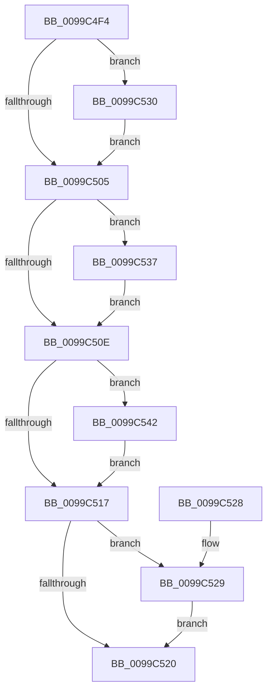

# PiReleaseDDB

- RVA: `0x0099C4F4`–`0x0099C549` (길이 `85` bytes)
- VA: `0x000000014099C4F4`
- 실행 섹션: `PAGE`
- PDB 이름 있음: `예`; PDB Function 태그: `아니요`
- unwind 정보 RVA: `0x00069370`
- 디코드: `29`개 명령, `85/85` bytes 표시
- 미해석 바이트: `0` (있으면 어셈블리에 `.byte`로 보존)

> 이 문서는 커널 이미지의 기계어와 PDB 기호를 분석해 생성했습니다. 4번과 5번은 함수 원형과 자료형을 바이너리 사용 방식에서 추정한 C 해석이며 원본 소스 복구 결과는 아닙니다.

## 1. Dependencies

- 직접 호출 지점: **4**; 고유 호출 대상: **3**
- 직접 호출자로 확인된 함수: **1**
- RIP 상대 이미지 참조: **0**

### Outgoing calls
- `0x0099C529` → [ZwClose](../../text/6A/ZwClose_function_006AD2B0.md) (function, `0x006AD2B0`)
- `0x0099C530` → [SdbReleaseDatabase](../95/SdbReleaseDatabase_function_0095B57C.md) (function, `0x0095B57C`)
- `0x0099C53B` → [ZwUnmapViewOfSection](../../text/6A/ZwUnmapViewOfSection_function_006AD610.md) (function, `0x006AD610`)
- `0x0099C542` → [ZwClose](../../text/6A/ZwClose_function_006AD2B0.md) (function, `0x006AD2B0`)

### Direct callers
- [PiLookupInDDB](PiLookupInDDB_function_0099ACBC.md) at `0x0099ADA5`
- [PiLookupInDDB](PiLookupInDDB_function_0099ACBC.md) at `0x0099ADD3`

### Static image references
- 디코드된 RIP-relative 메모리 참조가 없습니다.

## 2. Other-region calls and transfers

- 다른 실행 섹션으로 향하는 call: **3**
  - `0x0099C529` → [ZwClose](../../text/6A/ZwClose_function_006AD2B0.md) (`PAGE` → `.text`)
  - `0x0099C53B` → [ZwUnmapViewOfSection](../../text/6A/ZwUnmapViewOfSection_function_006AD610.md) (`PAGE` → `.text`)
  - `0x0099C542` → [ZwClose](../../text/6A/ZwClose_function_006AD2B0.md) (`PAGE` → `.text`)
- 별도 외부 분기/꼬리 이동을 확인하지 못했습니다.

## 3. Assembly (complete function range)

```asm
0099C4F4  40 53                           push rbx
0099C4F6  48 83 EC 20                     sub rsp, 0x20
0099C4FA  48 8B D9                        mov rbx, rcx
0099C4FD  48 8B 09                        mov rcx, qword ptr [rcx]
0099C500  48 85 C9                        test rcx, rcx
0099C503  75 2B                           jne 0x14099c530
0099C505  48 8B 53 08                     mov rdx, qword ptr [rbx + 8]
0099C509  48 85 D2                        test rdx, rdx
0099C50C  75 29                           jne 0x14099c537
0099C50E  48 8B 4B 10                     mov rcx, qword ptr [rbx + 0x10]
0099C512  48 85 C9                        test rcx, rcx
0099C515  75 2B                           jne 0x14099c542
0099C517  48 8B 4B 18                     mov rcx, qword ptr [rbx + 0x18]
0099C51B  48 85 C9                        test rcx, rcx
0099C51E  75 09                           jne 0x14099c529
0099C520  33 C0                           xor eax, eax
0099C522  48 83 C4 20                     add rsp, 0x20
0099C526  5B                              pop rbx
0099C527  C3                              ret
0099C528  CC                              int3
0099C529  E8 82 0D D1 FF                  call 0x1406ad2b0
0099C52E  EB F0                           jmp 0x14099c520
0099C530  E8 47 F0 FB FF                  call 0x14095b57c
0099C535  EB CE                           jmp 0x14099c505
0099C537  48 83 C9 FF                     or rcx, 0xffffffffffffffff
0099C53B  E8 D0 10 D1 FF                  call 0x1406ad610
0099C540  EB CC                           jmp 0x14099c50e
0099C542  E8 69 0D D1 FF                  call 0x1406ad2b0
0099C547  EB CE                           jmp 0x14099c517
```

## 4. C-style interpretation (structured pseudocode)

```c
__int64 __fastcall PiReleaseDDB(__int64 a1)
{
    __int64 result;
    __int64 v_rsp;

    v_rsp = (v_rsp) - (32);
    if (*(unsigned __int64 *)(a1) != 0) goto loc_0099C530;
loc_0099C505:
    if (*(unsigned __int64 *)(a1 + 8) != 0) goto loc_0099C537;
loc_0099C50E:
    if (*(unsigned __int64 *)(a1 + 16) != 0) goto loc_0099C542;
loc_0099C517:
    if (*(unsigned __int64 *)(a1 + 24) != 0) goto loc_0099C529;
loc_0099C520:
    result = 0;
    v_rsp = (v_rsp) + (32);
    return result;
loc_0099C529:
    result = ZwClose(*(unsigned __int64 *)(a1 + 24), *(unsigned __int64 *)(a1 + 8), a3, a4);
    goto loc_0099C520;
loc_0099C530:
    result = SdbReleaseDatabase(*(unsigned __int64 *)(a1 + 24), *(unsigned __int64 *)(a1 + 8), a3, a4);
    goto loc_0099C505;
loc_0099C537:
    a1 = (*(unsigned __int64 *)(a1 + 24)) | (-1);
    result = ZwUnmapViewOfSection(a1, *(unsigned __int64 *)(a1 + 8), a3, a4);
    goto loc_0099C50E;
loc_0099C542:
    result = ZwClose(a1, *(unsigned __int64 *)(a1 + 8), a3, a4);
    goto loc_0099C517;
}
```

## 5. (Beta) C Style

```c
int64_t PiReleaseDDB(void *Arg1)
{
    uint8_t *arg1 = (uint8_t *)Arg1;

    int64_t result;
    int64_t local_rsp;

    local_rsp = (local_rsp) - (32);
    if (*(uint64_t *)(arg1) != 0) goto loc_0099C530;
loc_0099C505:
    if (*(uint64_t *)(arg1 + 0x8) != 0) goto loc_0099C537;
loc_0099C50E:
    if (*(uint64_t *)(arg1 + 0x10) != 0) goto loc_0099C542;
loc_0099C517:
    if (*(uint64_t *)(arg1 + 0x18) != 0) goto loc_0099C529;
loc_0099C520:
    result = 0;
    local_rsp = (local_rsp) + (32);
    return result;
loc_0099C529:
    result = ZwClose(*(uint64_t *)(arg1 + 0x18), *(uint64_t *)(arg1 + 0x8), a3, a4);
    goto loc_0099C520;
loc_0099C530:
    result = SdbReleaseDatabase(*(uint64_t *)(arg1 + 0x18), *(uint64_t *)(arg1 + 0x8), a3, a4);
    goto loc_0099C505;
loc_0099C537:
    Arg1 = (*(uint64_t *)(arg1 + 0x18)) | (-1);
    result = ZwUnmapViewOfSection(Arg1, *(uint64_t *)(arg1 + 0x8), a3, a4);
    goto loc_0099C50E;
loc_0099C542:
    result = ZwClose(Arg1, *(uint64_t *)(arg1 + 0x8), a3, a4);
    goto loc_0099C517;
}
```

### 관측된 메모리 오프셋

구조체 형식이 확인되지 않은 접근은 인자 기준의 오프셋으로만 기록했습니다.

| 기준 인자 | 오프셋 표현 | 폭 (bit) | 접근 |
|---|---:|---:|---|
| `Arg1` | `+ 0x0` | `64` | `R` |
| `Arg1` | `+ 0x8` | `64` | `R` |
| `Arg1` | `+ 0x10` | `64` | `R` |
| `Arg1` | `+ 0x18` | `64` | `R` |

## 6. Execution-region graph

[열기: 2D/3D 그래프와 함수 탐색 컨트롤 패널](../../../control-panel.html?section=page&rva=0x0099C4F4&view=graph)

- 2D 그래프는 위에서 아래로 흐르고, 3D 그래프는 빈 공간을 드래그해 회전합니다. Shift+드래그는 이동, 휠은 확대·축소, 함수 노드 선택은 대상 보고서 이동입니다.

### Static fallback


