# PipChangeDeviceObjectFromRegistryProperties

- RVA: `0x00994FD0`–`0x00995347` (길이 `887` bytes)
- VA: `0x0000000140994FD0`
- 실행 섹션: `PAGE`
- PDB 이름 있음: `예`; PDB Function 태그: `예`
- unwind 정보 RVA: `0x000990D8`
- 디코드: `232`개 명령, `887/887` bytes 표시
- 미해석 바이트: `0` (있으면 어셈블리에 `.byte`로 보존)

> 이 문서는 커널 이미지의 기계어와 PDB 기호를 분석해 생성했습니다. 4번과 5번은 함수 원형과 자료형을 바이너리 사용 방식에서 추정한 C 해석이며 원본 소스 복구 결과는 아닙니다.

## 1. Dependencies

- 직접 호출 지점: **10**; 고유 호출 대상: **6**
- 직접 호출자로 확인된 함수: **1**
- RIP 상대 이미지 참조: **1**

### Outgoing calls
- `0x0099506A` → [PipGetRegistryDwordWithFallback](PipGetRegistryDwordWithFallback_function_00995350.md) (function, `0x00995350`)
- `0x0099508F` → [PipGetRegistryDwordWithFallback](PipGetRegistryDwordWithFallback_function_00995350.md) (function, `0x00995350`)
- `0x009950B4` → [PipGetRegistryDwordWithFallback](PipGetRegistryDwordWithFallback_function_00995350.md) (function, `0x00995350`)
- `0x0099510D` → [PipGetRegistrySecurityWithFallback](PipGetRegistrySecurityWithFallback_function_0099542C.md) (function, `0x0099542C`)
- `0x00995192` → [RtlGetDaclSecurityDescriptor](../../text/45/RtlGetDaclSecurityDescriptor_function_00459570.md) (function, `0x00459570`)
- `0x00995251` → [_security_check_cookie](../../text/6A/_security_check_cookie_function_006AC640.md) (function, `0x006AC640`)
- `0x0099527E` → [ExFreePoolWithTag](../../poolcode/B8/ExFreePoolWithTag_function_00B82870.md) (function, `0x00B82870`)
- `0x009952AA` → [ObSetSecurityObjectByPointer](../8B/ObSetSecurityObjectByPointer_function_008BAD20.md) (function, `0x008BAD20`)
- `0x0099532E` → [ExFreePoolWithTag](../../poolcode/B8/ExFreePoolWithTag_function_00B82870.md) (function, `0x00B82870`)
- `0x0099533D` → [ExFreePoolWithTag](../../poolcode/B8/ExFreePoolWithTag_function_00B82870.md) (function, `0x00B82870`)

### Direct callers
- [PipCallDriverAddDevice](../A2/PipCallDriverAddDevice_function_00A272E0.md) at `0x00A276CD`

### Static image references
- `0x00994FE9` → RVA `0x00E0A740` (`.data`; read)

## 2. Other-region calls and transfers

- 다른 실행 섹션으로 향하는 call: **5**
  - `0x00995192` → [RtlGetDaclSecurityDescriptor](../../text/45/RtlGetDaclSecurityDescriptor_function_00459570.md) (`PAGE` → `.text`)
  - `0x00995251` → [_security_check_cookie](../../text/6A/_security_check_cookie_function_006AC640.md) (`PAGE` → `.text`)
  - `0x0099527E` → [ExFreePoolWithTag](../../poolcode/B8/ExFreePoolWithTag_function_00B82870.md) (`PAGE` → `POOLCODE`)
  - `0x0099532E` → [ExFreePoolWithTag](../../poolcode/B8/ExFreePoolWithTag_function_00B82870.md) (`PAGE` → `POOLCODE`)
  - `0x0099533D` → [ExFreePoolWithTag](../../poolcode/B8/ExFreePoolWithTag_function_00B82870.md) (`PAGE` → `POOLCODE`)
- call이 아닌 외부 분기/꼬리 이동: **1**
  - `0x009951BE` → [sub_00B2C0F2](../B2/Unknown_function_00B2C0F2.md) (`tail-transfer`)

## 3. Assembly (complete function range)

```asm
00994FD0  40 55                           push rbp
00994FD2  53                              push rbx
00994FD3  56                              push rsi
00994FD4  57                              push rdi
00994FD5  41 54                           push r12
00994FD7  41 55                           push r13
00994FD9  41 56                           push r14
00994FDB  41 57                           push r15
00994FDD  48 8D 6C 24 E9                  lea rbp, [rsp - 0x17]
00994FE2  48 81 EC B8 00 00 00            sub rsp, 0xb8
00994FE9  48 8B 05 50 57 47 00            mov rax, qword ptr [rip + 0x475750]
00994FF0  48 33 C4                        xor rax, rsp
00994FF3  48 89 45 FF                     mov qword ptr [rbp - 1], rax
00994FF7  4D 8B F0                        mov r14, r8
00994FFA  4C 89 45 C7                     mov qword ptr [rbp - 0x39], r8
00994FFE  45 33 C0                        xor r8d, r8d
00995001  4C 89 4D CF                     mov qword ptr [rbp - 0x31], r9
00995005  4D 8B F9                        mov r15, r9
00995008  4C 8B E2                        mov r12, rdx
0099500B  48 8B D9                        mov rbx, rcx
0099500E  48 85 C9                        test rcx, rcx
00995011  0F 84 54 02 00 00               je 0x14099526b
00995017  48 8B 81 38 01 00 00            mov rax, qword ptr [rcx + 0x138]
0099501E  48 8B 78 28                     mov rdi, qword ptr [rax + 0x28]
00995022  48 8B 81 38 01 00 00            mov rax, qword ptr [rcx + 0x138]
00995029  4D 8B E8                        mov r13, r8
0099502C  48 8B 57 30                     mov rdx, qword ptr [rdi + 0x30]
00995030  4D 8B CE                        mov r9, r14
00995033  44 88 45 9F                     mov byte ptr [rbp - 0x61], r8b
00995037  B9 1A 00 00 00                  mov ecx, 0x1a
0099503C  4C 89 45 BF                     mov qword ptr [rbp - 0x41], r8
00995040  8B 70 20                        mov esi, dword ptr [rax + 0x20]
00995043  48 8D 45 AF                     lea rax, [rbp - 0x51]
00995047  4C 89 45 B7                     mov qword ptr [rbp - 0x49], r8
0099504B  81 E6 00 08 00 00               and esi, 0x800
00995051  44 89 45 AF                     mov dword ptr [rbp - 0x51], r8d
00995055  44 89 45 AB                     mov dword ptr [rbp - 0x55], r8d
00995059  44 89 45 A3                     mov dword ptr [rbp - 0x5d], r8d
0099505D  4D 8B C4                        mov r8, r12
00995060  48 89 44 24 28                  mov qword ptr [rsp + 0x28], rax
00995065  4C 89 7C 24 20                  mov qword ptr [rsp + 0x20], r15
0099506A  E8 E1 02 00 00                  call 0x140995350
0099506F  48 8B 57 30                     mov rdx, qword ptr [rdi + 0x30]
00995073  4D 8B CE                        mov r9, r14
00995076  88 45 A1                        mov byte ptr [rbp - 0x5f], al
00995079  4D 8B C4                        mov r8, r12
0099507C  48 8D 45 AB                     lea rax, [rbp - 0x55]
00995080  B9 1B 00 00 00                  mov ecx, 0x1b
00995085  48 89 44 24 28                  mov qword ptr [rsp + 0x28], rax
0099508A  4C 89 7C 24 20                  mov qword ptr [rsp + 0x20], r15
0099508F  E8 BC 02 00 00                  call 0x140995350
00995094  48 8B 57 30                     mov rdx, qword ptr [rdi + 0x30]
00995098  4D 8B CE                        mov r9, r14
0099509B  88 45 A2                        mov byte ptr [rbp - 0x5e], al
0099509E  4D 8B C4                        mov r8, r12
009950A1  48 8D 45 A3                     lea rax, [rbp - 0x5d]
009950A5  B9 1C 00 00 00                  mov ecx, 0x1c
009950AA  48 89 44 24 28                  mov qword ptr [rsp + 0x28], rax
009950AF  4C 89 7C 24 20                  mov qword ptr [rsp + 0x20], r15
009950B4  E8 97 02 00 00                  call 0x140995350
009950B9  44 38 6D 7F                     cmp byte ptr [rbp + 0x7f], r13b
009950BD  0F 84 C9 01 00 00               je 0x14099528c
009950C3  45 33 FF                        xor r15d, r15d
009950C6  48 8B CB                        mov rcx, rbx
009950C9  48 85 DB                        test rbx, rbx
009950CC  74 0D                           je 0x1409950db
009950CE  44 0B 79 34                     or r15d, dword ptr [rcx + 0x34]
009950D2  48 8B 49 18                     mov rcx, qword ptr [rcx + 0x18]
009950D6  48 85 C9                        test rcx, rcx
009950D9  75 F3                           jne 0x1409950ce
009950DB  44 0B 7D A3                     or r15d, dword ptr [rbp - 0x5d]
009950DF  45 33 F6                        xor r14d, r14d
009950E2  48 8B 57 30                     mov rdx, qword ptr [rdi + 0x30]
009950E6  8B C6                           mov eax, esi
009950E8  41 81 E7 0F 01 05 00            and r15d, 0x5010f
009950EF  44 89 75 A3                     mov dword ptr [rbp - 0x5d], r14d
009950F3  F7 D8                           neg eax
009950F5  4D 8B C4                        mov r8, r12
009950F8  48 1B C9                        sbb rcx, rcx
009950FB  48 23 4D CF                     and rcx, qword ptr [rbp - 0x31]
009950FF  F7 DE                           neg esi
00995101  48 89 4C 24 20                  mov qword ptr [rsp + 0x20], rcx
00995106  4D 1B C9                        sbb r9, r9
00995109  4C 23 4D C7                     and r9, qword ptr [rbp - 0x39]
0099510D  E8 1A 03 00 00                  call 0x14099542c
00995112  44 8B 65 AF                     mov r12d, dword ptr [rbp - 0x51]
00995116  45 33 C0                        xor r8d, r8d
00995119  48 8B F8                        mov rdi, rax
0099511C  48 85 C0                        test rax, rax
0099511F  0F 84 95 00 00 00               je 0x1409951ba
00995125  41 8D 56 01                     lea edx, [r14 + 1]
00995129  38 10                           cmp byte ptr [rax], dl
0099512B  0F 85 54 01 00 00               jne 0x140995285
00995131  0F B7 48 02                     movzx ecx, word ptr [rax + 2]
00995135  66 85 C9                        test cx, cx
00995138  0F 89 99 01 00 00               jns 0x1409952d7
0099513E  8B 40 04                        mov eax, dword ptr [rax + 4]
00995141  85 C0                           test eax, eax
00995143  0F 84 86 01 00 00               je 0x1409952cf
00995149  48 03 C7                        add rax, rdi
0099514C  48 85 C0                        test rax, rax
0099514F  44 0F 45 F2                     cmovne r14d, edx
00995153  66 85 C9                        test cx, cx
00995156  0F 89 84 01 00 00               jns 0x1409952e0
0099515C  8B 47 08                        mov eax, dword ptr [rdi + 8]
0099515F  85 C0                           test eax, eax
00995161  74 0C                           je 0x14099516f
00995163  48 03 C7                        add rax, rdi
00995166  48 85 C0                        test rax, rax
00995169  0F 85 7A 01 00 00               jne 0x1409952e9
0099516F  66 0F BA E1 04                  bt cx, 4
00995174  0F 92 45 A0                     setb byte ptr [rbp - 0x60]
00995178  66 0F BA E1 04                  bt cx, 4
0099517D  0F 82 6F 01 00 00               jb 0x1409952f2
00995183  4C 8D 4D A7                     lea r9, [rbp - 0x59]
00995187  48 8B CF                        mov rcx, rdi
0099518A  4C 8D 45 C7                     lea r8, [rbp - 0x39]
0099518E  48 8D 55 A0                     lea rdx, [rbp - 0x60]
00995192  E8 D9 43 AC FF                  call 0x140459570
00995197  45 33 C0                        xor r8d, r8d
0099519A  8B F0                           mov esi, eax
0099519C  85 C0                           test eax, eax
0099519E  0F 88 D5 00 00 00               js 0x140995279
009951A4  44 38 45 A0                     cmp byte ptr [rbp - 0x60], r8b
009951A8  74 04                           je 0x1409951ae
009951AA  41 83 CE 04                     or r14d, 4
009951AE  44 38 45 A1                     cmp byte ptr [rbp - 0x5f], r8b
009951B2  74 10                           je 0x1409951c4
009951B4  44 89 63 48                     mov dword ptr [rbx + 0x48], r12d
009951B8  EB 0A                           jmp 0x1409951c4
009951BA  44 38 45 A1                     cmp byte ptr [rbp - 0x5f], r8b
009951BE  0F 85 2E 6F 19 00               jne 0x140b2c0f2
009951C4  44 38 45 A2                     cmp byte ptr [rbp - 0x5e], r8b
009951C8  0F 85 2D 01 00 00               jne 0x1409952fb
009951CE  8B 43 34                        mov eax, dword ptr [rbx + 0x34]
009951D1  25 F0 FE FA FF                  and eax, 0xfffafef0
009951D6  41 0B C7                        or eax, r15d
009951D9  89 43 34                        mov dword ptr [rbx + 0x34], eax
009951DC  48 8B 43 18                     mov rax, qword ptr [rbx + 0x18]
009951E0  EB 08                           jmp 0x1409951ea
009951E2  44 09 78 34                     or dword ptr [rax + 0x34], r15d
009951E6  48 8B 40 18                     mov rax, qword ptr [rax + 0x18]
009951EA  48 85 C0                        test rax, rax
009951ED  75 F3                           jne 0x1409951e2
009951EF  41 8B F0                        mov esi, r8d
009951F2  48 85 FF                        test rdi, rdi
009951F5  0F 85 A6 00 00 00               jne 0x1409952a1
009951FB  44 8A 6D 9F                     mov r13b, byte ptr [rbp - 0x61]
009951FF  48 8D 93 38 01 00 00            lea rdx, [rbx + 0x138]
00995206  48 8B 43 08                     mov rax, qword ptr [rbx + 8]
0099520A  F7 40 10 00 01 00 00            test dword ptr [rax + 0x10], 0x100
00995211  0F 85 A2 00 00 00               jne 0x1409952b9
00995217  45 84 ED                        test r13b, r13b
0099521A  0F 85 EE 00 00 00               jne 0x14099530e
00995220  48 8B 5B 18                     mov rbx, qword ptr [rbx + 0x18]
00995224  48 85 DB                        test rbx, rbx
00995227  75 DD                           jne 0x140995206
00995229  4C 8B 6D B7                     mov r13, qword ptr [rbp - 0x49]
0099522D  48 85 FF                        test rdi, rdi
00995230  75 41                           jne 0x140995273
00995232  48 8B 4D BF                     mov rcx, qword ptr [rbp - 0x41]
00995236  48 85 C9                        test rcx, rcx
00995239  0F 85 ED 00 00 00               jne 0x14099532c
0099523F  4D 85 ED                        test r13, r13
00995242  0F 85 F0 00 00 00               jne 0x140995338
00995248  8B C6                           mov eax, esi
0099524A  48 8B 4D FF                     mov rcx, qword ptr [rbp - 1]
0099524E  48 33 CC                        xor rcx, rsp
00995251  E8 EA 73 D1 FF                  call 0x1406ac640
00995256  48 81 C4 B8 00 00 00            add rsp, 0xb8
0099525D  41 5F                           pop r15
0099525F  41 5E                           pop r14
00995261  41 5D                           pop r13
00995263  41 5C                           pop r12
00995265  5F                              pop rdi
00995266  5E                              pop rsi
00995267  5B                              pop rbx
00995268  5D                              pop rbp
00995269  C3                              ret
0099526A  CC                              int3
0099526B  49 8B F8                        mov rdi, r8
0099526E  E9 AF FD FF FF                  jmp 0x140995022
00995273  80 7D 9F 00                     cmp byte ptr [rbp - 0x61], 0
00995277  75 B9                           jne 0x140995232
00995279  33 D2                           xor edx, edx
0099527B  48 8B CF                        mov rcx, rdi
0099527E  E8 ED D5 1E 00                  call 0x140b82870
00995283  EB AD                           jmp 0x140995232
00995285  BE 58 00 00 C0                  mov esi, 0xc0000058
0099528A  EB ED                           jmp 0x140995279
0099528C  48 8B 4B 18                     mov rcx, qword ptr [rbx + 0x18]
00995290  48 85 C9                        test rcx, rcx
00995293  0F 84 2A FE FF FF               je 0x1409950c3
00995299  45 33 FF                        xor r15d, r15d
0099529C  E9 2D FE FF FF                  jmp 0x1409950ce
009952A1  4C 8B C7                        mov r8, rdi
009952A4  41 8B D6                        mov edx, r14d
009952A7  48 8B CB                        mov rcx, rbx
009952AA  E8 71 5A F2 FF                  call 0x1408bad20
009952AF  8B F0                           mov esi, eax
009952B1  45 33 C0                        xor r8d, r8d
009952B4  E9 42 FF FF FF                  jmp 0x1409951fb
009952B9  48 8B 02                        mov rax, qword ptr [rdx]
009952BC  48 8B 48 28                     mov rcx, qword ptr [rax + 0x28]
009952C0  81 89 8C 01 00 00 00 00 C0 00   or dword ptr [rcx + 0x18c], 0xc00000
009952CA  E9 48 FF FF FF                  jmp 0x140995217
009952CF  49 8B C0                        mov rax, r8
009952D2  E9 75 FE FF FF                  jmp 0x14099514c
009952D7  48 8B 40 08                     mov rax, qword ptr [rax + 8]
009952DB  E9 6C FE FF FF                  jmp 0x14099514c
009952E0  48 8B 47 10                     mov rax, qword ptr [rdi + 0x10]
009952E4  E9 7D FE FF FF                  jmp 0x140995166
009952E9  41 83 CE 02                     or r14d, 2
009952ED  E9 7D FE FF FF                  jmp 0x14099516f
009952F2  41 83 CE 08                     or r14d, 8
009952F6  E9 88 FE FF FF                  jmp 0x140995183
009952FB  44 39 45 AB                     cmp dword ptr [rbp - 0x55], r8d
009952FF  0F 84 C9 FE FF FF               je 0x1409951ce
00995305  83 4B 30 08                     or dword ptr [rbx + 0x30], 8
00995309  E9 C0 FE FF FF                  jmp 0x1409951ce
0099530E  4C 39 83 10 01 00 00            cmp qword ptr [rbx + 0x110], r8
00995315  0F 84 05 FF FF FF               je 0x140995220
0099531B  48 8B 83 38 01 00 00            mov rax, qword ptr [rbx + 0x138]
00995322  0F BA 68 20 0B                  bts dword ptr [rax + 0x20], 0xb
00995327  E9 F4 FE FF FF                  jmp 0x140995220
0099532C  33 D2                           xor edx, edx
0099532E  E8 3D D5 1E 00                  call 0x140b82870
00995333  E9 07 FF FF FF                  jmp 0x14099523f
00995338  33 D2                           xor edx, edx
0099533A  49 8B CD                        mov rcx, r13
0099533D  E8 2E D5 1E 00                  call 0x140b82870
00995342  E9 01 FF FF FF                  jmp 0x140995248
```

## 4. C-style interpretation (structured pseudocode)

```c
__int64 __fastcall PipChangeDeviceObjectFromRegistryProperties(__int64 a1, __int64 a2, __int64 a3, __int64 a4, unsigned __int8 a5)
{
    __int64 result;
    __int64 v_r14;
    __int64 v_r15;
    __int64 v_rsi;
    __int64 v_rsp;
    unsigned __int64 v_stack_m57;
    unsigned __int64 v_stack_m58;
    unsigned __int64 v_stack_m88;
    unsigned __int64 v_stack_m90;
    unsigned __int64 v_stack_m98;
    unsigned __int64 v_stack_mA0;
    unsigned __int64 v_stack_mA8;
    unsigned int v_stack_mAC;
    unsigned __int64 v_stack_mB0;
    unsigned int v_stack_mB4;
    unsigned __int8 v_stack_mB5;
    unsigned __int8 v_stack_mB6;
    unsigned __int8 v_stack_mB7;
    unsigned __int8 v_stack_mB8;
    unsigned __int64 v_stack_mD0;
    unsigned __int64 v_stack_mD8;

    v_rsp = (v_rsp) - (184);
    result = (*(unsigned __int64 *)(v_rip + 4675408)) ^ (v_rsp);
    v_stack_m58 = result;
    v_stack_m90 = a3;
    a3 = 0;
    v_stack_m88 = a4;
    if (a1 == 0) goto loc_0099526B;
loc_00995022:
    v_stack_mB8 = 0;
    v_stack_m98 = 0;
    v_stack_mA0 = 0;
    v_rsi = (unsigned int)(((unsigned int)(*(unsigned int *)(*(unsigned __int64 *)(a1 + 312) + 32))) & (0x800ULL));
    v_stack_mA8 = 0;
    v_stack_mAC = 0;
    v_stack_mB4 = 0;
    v_stack_mD0 = v_stack_mA8;
    v_stack_mD8 = a4;
    result = PipGetRegistryDwordWithFallback(26, *(unsigned __int64 *)(*(unsigned __int64 *)(*(unsigned __int64 *)(a1 + 312) + 40) + 48), a2, 0);
    v_stack_mB6 = (unsigned __int8)(result);
    v_stack_mD0 = v_stack_mAC;
    v_stack_mD8 = a4;
    result = PipGetRegistryDwordWithFallback(27, *(unsigned __int64 *)(*(unsigned __int64 *)(*(unsigned __int64 *)(a1 + 312) + 40) + 48), a2, 0);
    v_stack_mB5 = (unsigned __int8)(result);
    v_stack_mD0 = v_stack_mB4;
    v_stack_mD8 = a4;
    result = PipGetRegistryDwordWithFallback(28, *(unsigned __int64 *)(*(unsigned __int64 *)(*(unsigned __int64 *)(a1 + 312) + 40) + 48), a2, 0);
    if (a5 == 0) goto loc_0099528C;
loc_009950C3:
    v_r15 = 0;
    if (a1 == 0) goto loc_009950DB;
loc_009950CE:
    v_r15 = (unsigned int)((v_r15) | (*(unsigned int *)(a1 + 52)));
    if (*(unsigned __int64 *)(a1 + 24) != 0) goto loc_009950CE;
loc_009950DB:
    v_r15 = (unsigned int)((v_r15) | (v_stack_mB4));
    v_r14 = 0;
    v_r15 = (unsigned int)((v_r15) & (0x5010FULL));
    v_stack_mB4 = 0;
    result = (unsigned int)(-((unsigned int)((unsigned int)(v_rsi))));
    a1 = (*(unsigned __int64 *)(a1 + 24)) & (v_stack_m88);
    v_rsi = (unsigned int)(-(v_rsi));
    v_stack_mD8 = a1;
    a4 = (0) & (v_stack_m90);
    result = PipGetRegistrySecurityWithFallback(a1, *(unsigned __int64 *)(*(unsigned __int64 *)(*(unsigned __int64 *)(a1 + 312) + 40) + 48), a2, a4);
    a3 = 0;
    if (result == 0) goto loc_009951BA;
    if ((*(unsigned __int8 *)(result)) != ((unsigned __int8)(v_r14 + 1))) goto loc_00995285;
    if (!sign_flag) goto loc_009952D7;
    if ((unsigned int)((unsigned int)(*(unsigned int *)(result + 4))) == 0) goto loc_009952CF;
    result = ((unsigned int)(*(unsigned int *)(result + 4))) + (result);
loc_0099514C:
    if (result != 0) { v_r14 = (unsigned int)(v_r14 + 1); }
    if (!sign_flag) goto loc_009952E0;
    if ((unsigned int)((unsigned int)(*(unsigned int *)(result + 8))) == 0) goto loc_0099516F;
    result = ((unsigned int)(*(unsigned int *)(result + 8))) + (result);
loc_00995166:
    if (result != 0) goto loc_009952E9;
loc_0099516F:
    if (condition_is_below) goto loc_009952F2;
loc_00995183:
    result = RtlGetDaclSecurityDescriptor(result, v_stack_mB7, v_stack_m90, v_stack_mB0);
    a3 = 0;
    if (sign_flag) goto loc_00995279;
    if (v_stack_mB7 != 0) {
        v_r14 = (unsigned int)((v_r14) | (4));
    }
    if (v_stack_mB6 == 0) goto loc_009951C4;
    *(unsigned int *)(a1 + 72) = (unsigned int)((unsigned int)(v_stack_mA8));
    goto loc_009951C4;
loc_009951BA:
loc_009951C4:
    if (v_stack_mB5 != 0) goto loc_009952FB;
loc_009951CE:
    result = (unsigned int)(((unsigned int)(*(unsigned int *)(a1 + 52))) & (0xFFFAFEF0ULL));
    result = (unsigned int)((result) | ((unsigned int)(v_r15)));
    *(unsigned int *)(a1 + 52) = (unsigned int)(result);
    goto loc_009951EA;
loc_009951E2:
loc_009951EA:
    if (*(unsigned __int64 *)(*(unsigned __int64 *)(a1 + 24) + 24) != 0) goto loc_009951E2;
    if (result != 0) goto loc_009952A1;
loc_009951FB:
loc_00995206:
    if (((*(unsigned int *)(*(unsigned __int64 *)(a1 + 8) + 16)) & (256)) != 0) goto loc_009952B9;
loc_00995217:
    if ((unsigned __int8)(v_stack_mB8) != 0) goto loc_0099530E;
loc_00995220:
    if (*(unsigned __int64 *)(a1 + 24) != 0) goto loc_00995206;
    if (result != 0) goto loc_00995273;
loc_00995232:
    if (v_stack_m98 != 0) goto loc_0099532C;
loc_0099523F:
    if (v_stack_mA0 != 0) goto loc_00995338;
loc_00995248:
    a1 = (v_stack_m58) ^ (v_rsp);
    result = _security_check_cookie(a1, a1 + 312, a3, v_stack_mB0);
    v_rsp = (v_rsp) + (184);
    return result;
loc_0099526B:
    goto loc_00995022;
loc_00995273:
    if (v_stack_mB8 != 0) goto loc_00995232;
loc_00995279:
    a2 = 0;
    result = ExFreePoolWithTag(0, a2, a3, v_stack_mB0);
    goto loc_00995232;
loc_00995285:
    goto loc_00995279;
loc_0099528C:
    if (*(unsigned __int64 *)(*(unsigned __int64 *)(a1 + 24) + 24) == 0) goto loc_009950C3;
    v_r15 = 0;
    goto loc_009950CE;
loc_009952A1:
    result = ObSetSecurityObjectByPointer(*(unsigned __int64 *)(a1 + 24), (unsigned int)((unsigned int)(v_r14)), 0, v_stack_mB0);
    a3 = 0;
    goto loc_009951FB;
loc_009952B9:
    goto loc_00995217;
loc_009952CF:
    goto loc_0099514C;
loc_009952D7:
    goto loc_0099514C;
loc_009952E0:
    goto loc_00995166;
loc_009952E9:
    v_r14 = (unsigned int)((v_r14) | (2));
    goto loc_0099516F;
loc_009952F2:
    v_r14 = (unsigned int)((v_r14) | (8));
    goto loc_00995183;
loc_009952FB:
    if (v_stack_mAC == 0) goto loc_009951CE;
    goto loc_009951CE;
loc_0099530E:
    if ((*(unsigned __int64 *)(*(unsigned __int64 *)(a1 + 24) + 272)) == 0) goto loc_00995220;
    goto loc_00995220;
loc_0099532C:
    a2 = 0;
    result = ExFreePoolWithTag(*(unsigned __int64 *)(*(unsigned __int64 *)((unsigned int)((unsigned int)(v_r14))) + 40), a2, a3, v_stack_mB0);
    goto loc_0099523F;
loc_00995338:
    a2 = 0;
    result = ExFreePoolWithTag(v_stack_mA0, a2, a3, v_stack_mB0);
    goto loc_00995248;
}
```

## 5. (Beta) C Style

```c
int64_t PipChangeDeviceObjectFromRegistryProperties(void *Arg1, int64_t Arg2, int64_t Arg3, int64_t Arg4, uint8_t Arg5)
{
    uint8_t *arg1 = (uint8_t *)Arg1;

    int64_t result;
    int64_t local_r14;
    int64_t local_r15;
    int64_t local_rsi;
    int64_t local_rsp;
    uint64_t v_stack_m57;
    uint64_t v_stack_m58;
    uint64_t v_stack_m88;
    uint64_t v_stack_m90;
    uint64_t v_stack_m98;
    uint64_t v_stack_mA0;
    uint64_t v_stack_mA8;
    uint32_t v_stack_mAC;
    uint64_t v_stack_mB0;
    uint32_t v_stack_mB4;
    uint8_t v_stack_mB5;
    uint8_t v_stack_mB6;
    uint8_t v_stack_mB7;
    uint8_t v_stack_mB8;
    uint64_t v_stack_mD0;
    uint64_t v_stack_mD8;

    local_rsp = (local_rsp) - (184);
    result = (*(uint64_t *)(v_rip + 0x475750)) ^ (local_rsp);
    v_stack_m58 = result;
    v_stack_m90 = Arg3;
    Arg3 = 0;
    v_stack_m88 = Arg4;
    if (Arg1 == NULL) goto loc_0099526B;
loc_00995022:
    v_stack_mB8 = 0;
    v_stack_m98 = 0;
    v_stack_mA0 = 0;
    local_rsi = (uint32_t)(((uint32_t)(*(uint32_t *)(*(uint64_t *)(arg1 + 0x138) + 0x20))) & (0x800ULL));
    v_stack_mA8 = 0;
    v_stack_mAC = 0;
    v_stack_mB4 = 0;
    v_stack_mD0 = v_stack_mA8;
    v_stack_mD8 = Arg4;
    result = PipGetRegistryDwordWithFallback(26, *(uint64_t *)(*(uint64_t *)(*(uint64_t *)(arg1 + 0x138) + 0x28) + 0x30), Arg2, 0);
    v_stack_mB6 = (uint8_t)(result);
    v_stack_mD0 = v_stack_mAC;
    v_stack_mD8 = Arg4;
    result = PipGetRegistryDwordWithFallback(27, *(uint64_t *)(*(uint64_t *)(*(uint64_t *)(arg1 + 0x138) + 0x28) + 0x30), Arg2, 0);
    v_stack_mB5 = (uint8_t)(result);
    v_stack_mD0 = v_stack_mB4;
    v_stack_mD8 = Arg4;
    result = PipGetRegistryDwordWithFallback(28, *(uint64_t *)(*(uint64_t *)(*(uint64_t *)(arg1 + 0x138) + 0x28) + 0x30), Arg2, 0);
    if (Arg5 == 0) goto loc_0099528C;
loc_009950C3:
    local_r15 = 0;
    if (Arg1 == NULL) goto loc_009950DB;
loc_009950CE:
    local_r15 = (uint32_t)((local_r15) | (*(uint32_t *)(arg1 + 0x34)));
    if (*(uint64_t *)(arg1 + 0x18) != 0) goto loc_009950CE;
loc_009950DB:
    local_r15 = (uint32_t)((local_r15) | (v_stack_mB4));
    local_r14 = 0;
    local_r15 = (uint32_t)((local_r15) & (0x5010FULL));
    v_stack_mB4 = 0;
    result = (uint32_t)(-((uint32_t)((uint32_t)(local_rsi))));
    Arg1 = (*(uint64_t *)(arg1 + 0x18)) & (v_stack_m88);
    local_rsi = (uint32_t)(-(local_rsi));
    v_stack_mD8 = Arg1;
    Arg4 = (0) & (v_stack_m90);
    result = PipGetRegistrySecurityWithFallback(Arg1, *(uint64_t *)(*(uint64_t *)(*(uint64_t *)(arg1 + 0x138) + 0x28) + 0x30), Arg2, Arg4);
    Arg3 = 0;
    if (result == 0) goto loc_009951BA;
    if ((*(uint8_t *)(result)) != ((uint8_t)(local_r14 + 1))) goto loc_00995285;
    if (!sign_flag) goto loc_009952D7;
    if ((uint32_t)((uint32_t)(*(uint32_t *)(result + 0x4))) == 0) goto loc_009952CF;
    result = ((uint32_t)(*(uint32_t *)(result + 0x4))) + (result);
loc_0099514C:
    if (result != 0) { local_r14 = (uint32_t)(local_r14 + 1); }
    if (!sign_flag) goto loc_009952E0;
    if ((uint32_t)((uint32_t)(*(uint32_t *)(result + 0x8))) == 0) goto loc_0099516F;
    result = ((uint32_t)(*(uint32_t *)(result + 0x8))) + (result);
loc_00995166:
    if (result != 0) goto loc_009952E9;
loc_0099516F:
    if (condition_is_below) goto loc_009952F2;
loc_00995183:
    result = RtlGetDaclSecurityDescriptor(result, v_stack_mB7, v_stack_m90, v_stack_mB0);
    Arg3 = 0;
    if (sign_flag) goto loc_00995279;
    if (v_stack_mB7 != 0) {
        local_r14 = (uint32_t)((local_r14) | (4));
    }
    if (v_stack_mB6 == 0) goto loc_009951C4;
    *(uint32_t *)(arg1 + 0x48) = (uint32_t)((uint32_t)(v_stack_mA8));
    goto loc_009951C4;
loc_009951BA:
loc_009951C4:
    if (v_stack_mB5 != 0) goto loc_009952FB;
loc_009951CE:
    result = (uint32_t)(((uint32_t)(*(uint32_t *)(arg1 + 0x34))) & (0xFFFAFEF0ULL));
    result = (uint32_t)((result) | ((uint32_t)(local_r15)));
    *(uint32_t *)(arg1 + 0x34) = (uint32_t)(result);
    goto loc_009951EA;
loc_009951E2:
loc_009951EA:
    if (*(uint64_t *)(*(uint64_t *)(arg1 + 0x18) + 0x18) != 0) goto loc_009951E2;
    if (result != 0) goto loc_009952A1;
loc_009951FB:
loc_00995206:
    if (((*(uint32_t *)(*(uint64_t *)(arg1 + 0x8) + 0x10)) & (256)) != 0) goto loc_009952B9;
loc_00995217:
    if ((uint8_t)(v_stack_mB8) != 0) goto loc_0099530E;
loc_00995220:
    if (*(uint64_t *)(arg1 + 0x18) != 0) goto loc_00995206;
    if (result != 0) goto loc_00995273;
loc_00995232:
    if (v_stack_m98 != 0) goto loc_0099532C;
loc_0099523F:
    if (v_stack_mA0 != 0) goto loc_00995338;
loc_00995248:
    Arg1 = (v_stack_m58) ^ (local_rsp);
    result = _security_check_cookie(Arg1, Arg1 + 312, Arg3, v_stack_mB0);
    local_rsp = (local_rsp) + (184);
    return result;
loc_0099526B:
    goto loc_00995022;
loc_00995273:
    if (v_stack_mB8 != 0) goto loc_00995232;
loc_00995279:
    Arg2 = 0;
    result = ExFreePoolWithTag(0, Arg2, Arg3, v_stack_mB0);
    goto loc_00995232;
loc_00995285:
    goto loc_00995279;
loc_0099528C:
    if (*(uint64_t *)(*(uint64_t *)(arg1 + 0x18) + 0x18) == 0) goto loc_009950C3;
    local_r15 = 0;
    goto loc_009950CE;
loc_009952A1:
    result = ObSetSecurityObjectByPointer(*(uint64_t *)(arg1 + 0x18), (uint32_t)((uint32_t)(local_r14)), 0, v_stack_mB0);
    Arg3 = 0;
    goto loc_009951FB;
loc_009952B9:
    goto loc_00995217;
loc_009952CF:
    goto loc_0099514C;
loc_009952D7:
    goto loc_0099514C;
loc_009952E0:
    goto loc_00995166;
loc_009952E9:
    local_r14 = (uint32_t)((local_r14) | (2));
    goto loc_0099516F;
loc_009952F2:
    local_r14 = (uint32_t)((local_r14) | (8));
    goto loc_00995183;
loc_009952FB:
    if (v_stack_mAC == 0) goto loc_009951CE;
    goto loc_009951CE;
loc_0099530E:
    if ((*(uint64_t *)(*(uint64_t *)(arg1 + 0x18) + 0x110)) == 0) goto loc_00995220;
    goto loc_00995220;
loc_0099532C:
    Arg2 = 0;
    result = ExFreePoolWithTag(*(uint64_t *)(*(uint64_t *)((uint32_t)((uint32_t)(local_r14))) + 0x28), Arg2, Arg3, v_stack_mB0);
    goto loc_0099523F;
loc_00995338:
    Arg2 = 0;
    result = ExFreePoolWithTag(v_stack_mA0, Arg2, Arg3, v_stack_mB0);
    goto loc_00995248;
}
```

### 관측된 메모리 오프셋

구조체 형식이 확인되지 않은 접근은 인자 기준의 오프셋으로만 기록했습니다.

| 기준 인자 | 오프셋 표현 | 폭 (bit) | 접근 |
|---|---:|---:|---|
| `Arg1` | `+ 0x18` | `64` | `R` |

## 6. Execution-region graph

[열기: 2D/3D 그래프와 함수 탐색 컨트롤 패널](../../../control-panel.html?section=page&rva=0x00994FD0&view=graph)

- 2D 그래프는 위에서 아래로 흐르고, 3D 그래프는 빈 공간을 드래그해 회전합니다. Shift+드래그는 이동, 휠은 확대·축소, 함수 노드 선택은 대상 보고서 이동입니다.

### Static fallback

```mermaid
flowchart TD
  bb_00994FD0[BB_00994FD0]
  bb_00995017[BB_00995017]
  bb_00995022[BB_00995022]
  bb_009950C3[BB_009950C3]
  bb_009950CE[BB_009950CE]
  bb_009950DB[BB_009950DB]
  bb_00995125[BB_00995125]
  bb_00995131[BB_00995131]
  bb_0099513E[BB_0099513E]
  bb_00995149[BB_00995149]
  bb_0099514C[BB_0099514C]
  bb_0099515C[BB_0099515C]
  bb_00995163[BB_00995163]
  bb_00995166[BB_00995166]
  bb_0099516F[BB_0099516F]
  bb_00995183[BB_00995183]
  bb_009951A4[BB_009951A4]
  bb_009951AA[BB_009951AA]
  bb_009951AE[BB_009951AE]
  bb_009951B4[BB_009951B4]
  bb_009951BA[BB_009951BA]
  bb_009951C4[BB_009951C4]
  bb_009951CE[BB_009951CE]
  bb_009951E2[BB_009951E2]
  bb_009951EA[BB_009951EA]
  bb_009951EF[BB_009951EF]
  bb_009951FB[BB_009951FB]
  bb_00995206[BB_00995206]
  bb_00995217[BB_00995217]
  bb_00995220[BB_00995220]
  bb_00995229[BB_00995229]
  bb_00995232[BB_00995232]
  bb_0099523F[BB_0099523F]
  bb_00995248[BB_00995248]
  bb_0099526A[BB_0099526A]
  bb_0099526B[BB_0099526B]
  bb_00995273[BB_00995273]
  bb_00995279[BB_00995279]
  bb_00995285[BB_00995285]
  bb_0099528C[BB_0099528C]
  bb_00995299[BB_00995299]
  bb_009952A1[BB_009952A1]
  bb_009952B9[BB_009952B9]
  bb_009952CF[BB_009952CF]
  bb_009952D7[BB_009952D7]
  bb_009952E0[BB_009952E0]
  bb_009952E9[BB_009952E9]
  bb_009952F2[BB_009952F2]
  bb_009952FB[BB_009952FB]
  bb_00995305[BB_00995305]
  bb_0099530E[BB_0099530E]
  bb_0099531B[BB_0099531B]
  bb_0099532C[BB_0099532C]
  bb_00995338[BB_00995338]
  bb_00994FD0 -->|branch| bb_0099526B
  bb_00994FD0 -->|fallthrough| bb_00995017
  bb_00995017 -->|flow| bb_00995022
  bb_00995022 -->|branch| bb_0099528C
  bb_00995022 -->|fallthrough| bb_009950C3
  bb_009950C3 -->|branch| bb_009950DB
  bb_009950C3 -->|fallthrough| bb_009950CE
  bb_009950CE -->|branch| bb_009950CE
  bb_009950CE -->|fallthrough| bb_009950DB
  bb_009950DB -->|branch| bb_009951BA
  bb_009950DB -->|fallthrough| bb_00995125
  bb_00995125 -->|branch| bb_00995285
  bb_00995125 -->|fallthrough| bb_00995131
  bb_00995131 -->|branch| bb_009952D7
  bb_00995131 -->|fallthrough| bb_0099513E
  bb_0099513E -->|branch| bb_009952CF
  bb_0099513E -->|fallthrough| bb_00995149
  bb_00995149 -->|flow| bb_0099514C
  bb_0099514C -->|branch| bb_009952E0
  bb_0099514C -->|fallthrough| bb_0099515C
  bb_0099515C -->|branch| bb_0099516F
  bb_0099515C -->|fallthrough| bb_00995163
  bb_00995163 -->|flow| bb_00995166
  bb_00995166 -->|branch| bb_009952E9
  bb_00995166 -->|fallthrough| bb_0099516F
  bb_0099516F -->|branch| bb_009952F2
  bb_0099516F -->|fallthrough| bb_00995183
  bb_00995183 -->|branch| bb_00995279
  bb_00995183 -->|fallthrough| bb_009951A4
  bb_009951A4 -->|branch| bb_009951AE
  bb_009951A4 -->|fallthrough| bb_009951AA
  bb_009951AA -->|flow| bb_009951AE
  bb_009951AE -->|branch| bb_009951C4
  bb_009951AE -->|fallthrough| bb_009951B4
  bb_009951B4 -->|branch| bb_009951C4
  bb_009951BA -->|fallthrough| bb_009951C4
  bb_009951C4 -->|branch| bb_009952FB
  bb_009951C4 -->|fallthrough| bb_009951CE
  bb_009951CE -->|branch| bb_009951EA
  bb_009951E2 -->|flow| bb_009951EA
  bb_009951EA -->|branch| bb_009951E2
  bb_009951EA -->|fallthrough| bb_009951EF
  bb_009951EF -->|branch| bb_009952A1
  bb_009951EF -->|fallthrough| bb_009951FB
  bb_009951FB -->|flow| bb_00995206
  bb_00995206 -->|branch| bb_009952B9
  bb_00995206 -->|fallthrough| bb_00995217
  bb_00995217 -->|branch| bb_0099530E
  bb_00995217 -->|fallthrough| bb_00995220
  bb_00995220 -->|branch| bb_00995206
  bb_00995220 -->|fallthrough| bb_00995229
  bb_00995229 -->|branch| bb_00995273
  bb_00995229 -->|fallthrough| bb_00995232
  bb_00995232 -->|branch| bb_0099532C
  bb_00995232 -->|fallthrough| bb_0099523F
  bb_0099523F -->|branch| bb_00995338
  bb_0099523F -->|fallthrough| bb_00995248
  bb_0099526A -->|flow| bb_0099526B
  bb_0099526B -->|branch| bb_00995022
  bb_00995273 -->|branch| bb_00995232
  bb_00995273 -->|fallthrough| bb_00995279
  bb_00995279 -->|branch| bb_00995232
  bb_00995285 -->|branch| bb_00995279
  bb_0099528C -->|branch| bb_009950C3
  bb_0099528C -->|fallthrough| bb_00995299
  bb_00995299 -->|branch| bb_009950CE
  bb_009952A1 -->|branch| bb_009951FB
  bb_009952B9 -->|branch| bb_00995217
  bb_009952CF -->|branch| bb_0099514C
  bb_009952D7 -->|branch| bb_0099514C
  bb_009952E0 -->|branch| bb_00995166
  bb_009952E9 -->|branch| bb_0099516F
  bb_009952F2 -->|branch| bb_00995183
  bb_009952FB -->|branch| bb_009951CE
  bb_009952FB -->|fallthrough| bb_00995305
  bb_00995305 -->|branch| bb_009951CE
  bb_0099530E -->|branch| bb_00995220
  bb_0099530E -->|fallthrough| bb_0099531B
  bb_0099531B -->|branch| bb_00995220
  bb_0099532C -->|branch| bb_0099523F
  bb_00995338 -->|branch| bb_00995248
```


