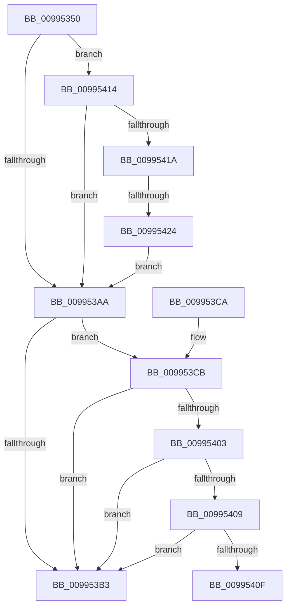

# PipGetRegistryDwordWithFallback

- RVA: `0x00995350`–`0x00995426` (길이 `214` bytes)
- VA: `0x0000000140995350`
- 실행 섹션: `PAGE`
- PDB 이름 있음: `예`; PDB Function 태그: `예`
- unwind 정보 RVA: `0x0009910C`
- 디코드: `59`개 명령, `214/214` bytes 표시
- 미해석 바이트: `0` (있으면 어셈블리에 `.byte`로 보존)

> 이 문서는 커널 이미지의 기계어와 PDB 기호를 분석해 생성했습니다. 4번과 5번은 함수 원형과 자료형을 바이너리 사용 방식에서 추정한 C 해석이며 원본 소스 복구 결과는 아닙니다.

## 1. Dependencies

- 직접 호출 지점: **2**; 고유 호출 대상: **2**
- 직접 호출자로 확인된 함수: **1**
- RIP 상대 이미지 참조: **1**

### Outgoing calls
- `0x009953A1` → [CmGetDeviceRegProp](../8E/CmGetDeviceRegProp_function_008ED870.md) (function, `0x008ED870`)
- `0x009953FA` → [CmGetInstallerClassRegProp](CmGetInstallerClassRegProp_function_00994940.md) (function, `0x00994940`)

### Direct callers
- [PipChangeDeviceObjectFromRegistryProperties](PipChangeDeviceObjectFromRegistryProperties_function_00994FD0.md) at `0x0099506A`
- [PipChangeDeviceObjectFromRegistryProperties](PipChangeDeviceObjectFromRegistryProperties_function_00994FD0.md) at `0x0099508F`
- [PipChangeDeviceObjectFromRegistryProperties](PipChangeDeviceObjectFromRegistryProperties_function_00994FD0.md) at `0x009950B4`

### Static image references
- `0x0099539A` → RVA `0x00E66398` (`.data`; read)

## 2. Other-region calls and transfers

- 다른 실행 섹션으로 향하는 call: **0**
- call이 아닌 외부 분기/꼬리 이동: **2**
  - `0x0099540F` → [sub_00B2C154](../B2/Unknown_function_00B2C154.md) (`tail-transfer`)
  - `0x0099541E` → [sub_00B2C154](../B2/Unknown_function_00B2C154.md) (`tail-transfer`)

## 3. Assembly (complete function range)

```asm
00995350  4C 8B DC                        mov r11, rsp
00995353  49 89 5B 08                     mov qword ptr [r11 + 8], rbx
00995357  49 89 73 10                     mov qword ptr [r11 + 0x10], rsi
0099535B  49 89 7B 18                     mov qword ptr [r11 + 0x18], rdi
0099535F  55                              push rbp
00995360  48 8B EC                        mov rbp, rsp
00995363  48 83 EC 50                     sub rsp, 0x50
00995367  33 DB                           xor ebx, ebx
00995369  C7 45 F0 04 00 00 00            mov dword ptr [rbp - 0x10], 4
00995370  89 5C 24 38                     mov dword ptr [rsp + 0x38], ebx
00995374  48 8D 45 F0                     lea rax, [rbp - 0x10]
00995378  49 89 43 D8                     mov qword ptr [r11 - 0x28], rax
0099537C  49 8B F1                        mov rsi, r9
0099537F  48 8D 45 F8                     lea rax, [rbp - 8]
00995383  89 5D F4                        mov dword ptr [rbp - 0xc], ebx
00995386  49 89 43 D0                     mov qword ptr [r11 - 0x30], rax
0099538A  8B F9                           mov edi, ecx
0099538C  48 8D 45 F4                     lea rax, [rbp - 0xc]
00995390  89 5D F8                        mov dword ptr [rbp - 8], ebx
00995393  44 8B C9                        mov r9d, ecx
00995396  49 89 43 C8                     mov qword ptr [r11 - 0x38], rax
0099539A  48 8B 0D F7 0F 4D 00            mov rcx, qword ptr [rip + 0x4d0ff7]
009953A1  E8 CA 84 F5 FF                  call 0x1408ed870
009953A6  85 C0                           test eax, eax
009953A8  79 6A                           jns 0x140995414
009953AA  4C 8B 45 30                     mov r8, qword ptr [rbp + 0x30]
009953AE  4D 85 C0                        test r8, r8
009953B1  75 18                           jne 0x1409953cb
009953B3  48 8B 74 24 68                  mov rsi, qword ptr [rsp + 0x68]
009953B8  8A C3                           mov al, bl
009953BA  48 8B 5C 24 60                  mov rbx, qword ptr [rsp + 0x60]
009953BF  48 8B 7C 24 70                  mov rdi, qword ptr [rsp + 0x70]
009953C4  48 83 C4 50                     add rsp, 0x50
009953C8  5D                              pop rbp
009953C9  C3                              ret
009953CA  CC                              int3
009953CB  48 8B 0D C6 0F 4D 00            mov rcx, qword ptr [rip + 0x4d0fc6]
009953D2  48 8D 45 F0                     lea rax, [rbp - 0x10]
009953D6  48 89 44 24 30                  mov qword ptr [rsp + 0x30], rax
009953DB  44 8B CF                        mov r9d, edi
009953DE  48 8D 45 F8                     lea rax, [rbp - 8]
009953E2  C7 45 F0 04 00 00 00            mov dword ptr [rbp - 0x10], 4
009953E9  48 89 44 24 28                  mov qword ptr [rsp + 0x28], rax
009953EE  48 8B D6                        mov rdx, rsi
009953F1  48 8D 45 F4                     lea rax, [rbp - 0xc]
009953F5  48 89 44 24 20                  mov qword ptr [rsp + 0x20], rax
009953FA  E8 41 F5 FF FF                  call 0x140994940
009953FF  85 C0                           test eax, eax
00995401  78 B0                           js 0x1409953b3
00995403  83 7D F4 04                     cmp dword ptr [rbp - 0xc], 4
00995407  75 AA                           jne 0x1409953b3
00995409  83 7D F0 04                     cmp dword ptr [rbp - 0x10], 4
0099540D  75 A4                           jne 0x1409953b3
0099540F  E9 40 6D 19 00                  jmp 0x140b2c154
00995414  83 7D F4 04                     cmp dword ptr [rbp - 0xc], 4
00995418  75 90                           jne 0x1409953aa
0099541A  83 7D F0 04                     cmp dword ptr [rbp - 0x10], 4
0099541E  0F 84 30 6D 19 00               je 0x140b2c154
00995424  EB 84                           jmp 0x1409953aa
```

## 4. C-style interpretation (structured pseudocode)

```c
__int64 __fastcall PipGetRegistryDwordWithFallback(int a1, __int64 a2, __int64 a3, __int64 a4, __int64 a5)
{
    __int64 result;
    __int64 v_rbx;
    __int64 v_rsp;
    unsigned __int64 v_stack_m10;
    unsigned int v_stack_m14;
    unsigned int v_stack_m18;
    unsigned int v_stack_m20;
    unsigned __int64 v_stack_p10;
    unsigned __int64 v_stack_p18;
    unsigned __int64 v_stack_p20;
    unsigned __int64 v_stack_p28;
    unsigned __int64 v_stack_p30;
    unsigned __int64 v_stack_p8;

    *(unsigned __int64 *)(v_rsp + 8) = v_rbx;
    *(unsigned __int64 *)(v_rsp + 16) = v_rsi;
    *(unsigned __int64 *)(v_rsp + 24) = v_rdi;
    v_rsp = (v_rsp) - (80);
    v_rbx = 0;
    v_stack_m18 = 4;
    v_stack_m20 = 0;
    *(unsigned __int64 *)(v_rsp - 40) = v_stack_m18;
    v_stack_m14 = 0;
    *(unsigned __int64 *)(v_rsp - 48) = v_stack_m10;
    v_stack_m10 = 0;
    *(unsigned __int64 *)(v_rsp - 56) = v_stack_m14;
    result = CmGetDeviceRegProp(*(unsigned __int64 *)(v_rip + 5050359), a2, a3, (unsigned int)(a1));
    if (!sign_flag) goto loc_00995414;
loc_009953AA:
    if (a5 != 0) goto loc_009953CB;
loc_009953B3:
    v_rsp = (v_rsp) + (80);
    return 0;
loc_009953CB:
    v_stack_p30 = v_stack_m18;
    v_stack_m18 = 4;
    v_stack_p28 = v_stack_m10;
    v_stack_p20 = v_stack_m14;
    result = CmGetInstallerClassRegProp(*(unsigned __int64 *)(v_rip + 5050310), v_stack_p10, a5, (unsigned int)((unsigned int)(v_stack_p18)));
    if (sign_flag) goto loc_009953B3;
    if (v_stack_m14 != 4) goto loc_009953B3;
    if (v_stack_m18 != 4) goto loc_009953B3;
loc_00995414:
    if (v_stack_m14 != 4) goto loc_009953AA;
    goto loc_009953AA;
}
```

## 5. (Beta) C Style

```c
int64_t PipGetRegistryDwordWithFallback(int32_t Arg1, int64_t Arg2, int64_t Arg3, int64_t Arg4, int64_t Arg5)
{
    int64_t result;
    int64_t local_rbx;
    int64_t local_rsp;
    uint64_t v_stack_m10;
    uint32_t v_stack_m14;
    uint32_t v_stack_m18;
    uint32_t v_stack_m20;
    uint64_t v_stack_p10;
    uint64_t v_stack_p18;
    uint64_t v_stack_p20;
    uint64_t v_stack_p28;
    uint64_t v_stack_p30;
    uint64_t v_stack_p8;

    *(uint64_t *)(local_rsp + 0x8) = local_rbx;
    *(uint64_t *)(local_rsp + 0x10) = local_rsi;
    *(uint64_t *)(local_rsp + 0x18) = local_rdi;
    local_rsp = (local_rsp) - (80);
    local_rbx = 0;
    v_stack_m18 = 4;
    v_stack_m20 = 0;
    *(uint64_t *)(local_rsp - 0x28) = v_stack_m18;
    v_stack_m14 = 0;
    *(uint64_t *)(local_rsp - 0x30) = v_stack_m10;
    v_stack_m10 = 0;
    *(uint64_t *)(local_rsp - 0x38) = v_stack_m14;
    result = CmGetDeviceRegProp(*(uint64_t *)(v_rip + 0x4D0FF7), Arg2, Arg3, (uint32_t)(Arg1));
    if (!sign_flag) goto loc_00995414;
loc_009953AA:
    if (Arg5 != 0) goto loc_009953CB;
loc_009953B3:
    local_rsp = (local_rsp) + (80);
    return 0;
loc_009953CB:
    v_stack_p30 = v_stack_m18;
    v_stack_m18 = 4;
    v_stack_p28 = v_stack_m10;
    v_stack_p20 = v_stack_m14;
    result = CmGetInstallerClassRegProp(*(uint64_t *)(v_rip + 0x4D0FC6), v_stack_p10, Arg5, (uint32_t)((uint32_t)(v_stack_p18)));
    if (sign_flag) goto loc_009953B3;
    if (v_stack_m14 != 4) goto loc_009953B3;
    if (v_stack_m18 != 4) goto loc_009953B3;
loc_00995414:
    if (v_stack_m14 != 4) goto loc_009953AA;
    goto loc_009953AA;
}
```

## 6. Execution-region graph

[열기: 2D/3D 그래프와 함수 탐색 컨트롤 패널](../../../control-panel.html?section=page&rva=0x00995350&view=graph)

- 2D 그래프는 위에서 아래로 흐르고, 3D 그래프는 빈 공간을 드래그해 회전합니다. Shift+드래그는 이동, 휠은 확대·축소, 함수 노드 선택은 대상 보고서 이동입니다.

### Static fallback


