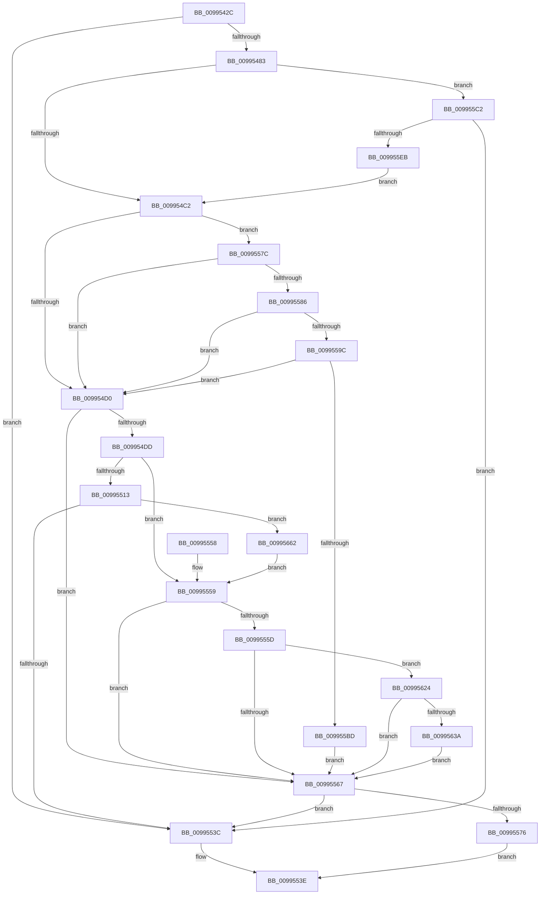

# PipGetRegistrySecurityWithFallback

- RVA: `0x0099542C`–`0x00995696` (길이 `618` bytes)
- VA: `0x000000014099542C`
- 실행 섹션: `PAGE`
- PDB 이름 있음: `예`; PDB Function 태그: `아니요`
- unwind 정보 RVA: `0x00099134`
- 디코드: `156`개 명령, `618/618` bytes 표시
- 미해석 바이트: `0` (있으면 어셈블리에 `.byte`로 보존)

> 이 문서는 커널 이미지의 기계어와 PDB 기호를 분석해 생성했습니다. 4번과 5번은 함수 원형과 자료형을 바이너리 사용 방식에서 추정한 C 해석이며 원본 소스 복구 결과는 아닙니다.

## 1. Dependencies

- 직접 호출 지점: **14**; 고유 호출 대상: **6**
- 직접 호출자로 확인된 함수: **1**
- RIP 상대 이미지 참조: **1**

### Outgoing calls
- `0x00995472` → [ExAllocatePool2](../../poolcode/B8/ExAllocatePool2_function_00B820F0.md) (function, `0x00B820F0`)
- `0x009954B2` → [CmGetDeviceRegProp](../8E/CmGetDeviceRegProp_function_008ED870.md) (function, `0x008ED870`)
- `0x00995507` → [CmGetInstallerClassRegProp](CmGetInstallerClassRegProp_function_00994940.md) (function, `0x00994940`)
- `0x00995518` → [ExFreePoolWithTag](../../poolcode/B8/ExFreePoolWithTag_function_00B82870.md) (function, `0x00B82870`)
- `0x0099552B` → [ExAllocatePool2](../../poolcode/B8/ExAllocatePool2_function_00B820F0.md) (function, `0x00B820F0`)
- `0x0099556C` → [ExFreePoolWithTag](../../poolcode/B8/ExFreePoolWithTag_function_00B82870.md) (function, `0x00B82870`)
- `0x0099558F` → [RtlValidRelativeSecurityDescriptor](../8B/RtlValidRelativeSecurityDescriptor_function_008BDC70.md) (function, `0x008BDC70`)
- `0x009955B0` → [SeCaptureSecurityDescriptor](../92/SeCaptureSecurityDescriptor_function_00929F40.md) (function, `0x00929F40`)
- `0x009955C7` → [ExFreePoolWithTag](../../poolcode/B8/ExFreePoolWithTag_function_00B82870.md) (function, `0x00B82870`)
- `0x009955DA` → [ExAllocatePool2](../../poolcode/B8/ExAllocatePool2_function_00B820F0.md) (function, `0x00B820F0`)
- `0x0099561A` → [CmGetDeviceRegProp](../8E/CmGetDeviceRegProp_function_008ED870.md) (function, `0x008ED870`)
- `0x0099562D` → [RtlValidRelativeSecurityDescriptor](../8B/RtlValidRelativeSecurityDescriptor_function_008BDC70.md) (function, `0x008BDC70`)
- `0x0099564E` → [SeCaptureSecurityDescriptor](../92/SeCaptureSecurityDescriptor_function_00929F40.md) (function, `0x00929F40`)
- `0x0099568C` → [CmGetInstallerClassRegProp](CmGetInstallerClassRegProp_function_00994940.md) (function, `0x00994940`)

### Direct callers
- [PipChangeDeviceObjectFromRegistryProperties](PipChangeDeviceObjectFromRegistryProperties_function_00994FD0.md) at `0x0099510D`

### Static image references
- `0x0099548C` → RVA `0x00E66398` (`.data`; read)

## 2. Other-region calls and transfers

- 다른 실행 섹션으로 향하는 call: **6**
  - `0x00995472` → [ExAllocatePool2](../../poolcode/B8/ExAllocatePool2_function_00B820F0.md) (`PAGE` → `POOLCODE`)
  - `0x00995518` → [ExFreePoolWithTag](../../poolcode/B8/ExFreePoolWithTag_function_00B82870.md) (`PAGE` → `POOLCODE`)
  - `0x0099552B` → [ExAllocatePool2](../../poolcode/B8/ExAllocatePool2_function_00B820F0.md) (`PAGE` → `POOLCODE`)
  - `0x0099556C` → [ExFreePoolWithTag](../../poolcode/B8/ExFreePoolWithTag_function_00B82870.md) (`PAGE` → `POOLCODE`)
  - `0x009955C7` → [ExFreePoolWithTag](../../poolcode/B8/ExFreePoolWithTag_function_00B82870.md) (`PAGE` → `POOLCODE`)
  - `0x009955DA` → [ExAllocatePool2](../../poolcode/B8/ExAllocatePool2_function_00B820F0.md) (`PAGE` → `POOLCODE`)
- 별도 외부 분기/꼬리 이동을 확인하지 못했습니다.

## 3. Assembly (complete function range)

```asm
0099542C  48 8B C4                        mov rax, rsp
0099542F  48 89 58 10                     mov qword ptr [rax + 0x10], rbx
00995433  48 89 70 18                     mov qword ptr [rax + 0x18], rsi
00995437  48 89 78 20                     mov qword ptr [rax + 0x20], rdi
0099543B  89 48 08                        mov dword ptr [rax + 8], ecx
0099543E  55                              push rbp
0099543F  41 56                           push r14
00995441  41 57                           push r15
00995443  48 8B EC                        mov rbp, rsp
00995446  48 83 EC 50                     sub rsp, 0x50
0099544A  83 65 F0 00                     and dword ptr [rbp - 0x10], 0
0099544E  4C 8B F2                        mov r14, rdx
00995451  48 83 65 F8 00                  and qword ptr [rbp - 8], 0
00995456  BA 80 00 00 00                  mov edx, 0x80
0099545B  49 8B F0                        mov rsi, r8
0099545E  89 55 20                        mov dword ptr [rbp + 0x20], edx
00995461  B9 00 01 00 00                  mov ecx, 0x100
00995466  41 B8 50 70 65 6E               mov r8d, 0x6e657050
0099546C  4D 8B F9                        mov r15, r9
0099546F  40 32 FF                        xor dil, dil
00995472  E8 79 CC 1E 00                  call 0x140b820f0
00995477  48 8B D8                        mov rbx, rax
0099547A  48 85 C0                        test rax, rax
0099547D  0F 84 B9 00 00 00               je 0x14099553c
00995483  83 64 24 38 00                  and dword ptr [rsp + 0x38], 0
00995488  48 8D 45 20                     lea rax, [rbp + 0x20]
0099548C  48 8B 0D 05 0F 4D 00            mov rcx, qword ptr [rip + 0x4d0f05]
00995493  41 B9 18 00 00 00               mov r9d, 0x18
00995499  48 89 44 24 30                  mov qword ptr [rsp + 0x30], rax
0099549E  4C 8B C6                        mov r8, rsi
009954A1  48 8D 45 F0                     lea rax, [rbp - 0x10]
009954A5  48 89 5C 24 28                  mov qword ptr [rsp + 0x28], rbx
009954AA  49 8B D6                        mov rdx, r14
009954AD  48 89 44 24 20                  mov qword ptr [rsp + 0x20], rax
009954B2  E8 B9 83 F5 FF                  call 0x1408ed870
009954B7  3D 23 00 00 C0                  cmp eax, 0xc0000023
009954BC  0F 84 00 01 00 00               je 0x1409955c2
009954C2  41 BE 01 00 00 00               mov r14d, 1
009954C8  85 C0                           test eax, eax
009954CA  0F 89 AC 00 00 00               jns 0x14099557c
009954D0  48 8B 75 40                     mov rsi, qword ptr [rbp + 0x40]
009954D4  48 85 F6                        test rsi, rsi
009954D7  0F 84 8A 00 00 00               je 0x140995567
009954DD  48 8B 0D B4 0E 4D 00            mov rcx, qword ptr [rip + 0x4d0eb4]
009954E4  48 8D 45 20                     lea rax, [rbp + 0x20]
009954E8  48 89 44 24 30                  mov qword ptr [rsp + 0x30], rax
009954ED  41 B9 18 00 00 00               mov r9d, 0x18
009954F3  48 8D 45 F0                     lea rax, [rbp - 0x10]
009954F7  48 89 5C 24 28                  mov qword ptr [rsp + 0x28], rbx
009954FC  4C 8B C6                        mov r8, rsi
009954FF  48 89 44 24 20                  mov qword ptr [rsp + 0x20], rax
00995504  49 8B D7                        mov rdx, r15
00995507  E8 34 F4 FF FF                  call 0x140994940
0099550C  3D 23 00 00 C0                  cmp eax, 0xc0000023
00995511  75 46                           jne 0x140995559
00995513  33 D2                           xor edx, edx
00995515  48 8B CB                        mov rcx, rbx
00995518  E8 53 D3 1E 00                  call 0x140b82870
0099551D  8B 55 20                        mov edx, dword ptr [rbp + 0x20]
00995520  B9 00 01 00 00                  mov ecx, 0x100
00995525  41 B8 50 70 65 6E               mov r8d, 0x6e657050
0099552B  E8 C0 CB 1E 00                  call 0x140b820f0
00995530  48 8B D8                        mov rbx, rax
00995533  48 85 C0                        test rax, rax
00995536  0F 85 26 01 00 00               jne 0x140995662
0099553C  33 C0                           xor eax, eax
0099553E  4C 8D 5C 24 50                  lea r11, [rsp + 0x50]
00995543  49 8B 5B 28                     mov rbx, qword ptr [r11 + 0x28]
00995547  49 8B 73 30                     mov rsi, qword ptr [r11 + 0x30]
0099554B  49 8B 7B 38                     mov rdi, qword ptr [r11 + 0x38]
0099554F  49 8B E3                        mov rsp, r11
00995552  41 5F                           pop r15
00995554  41 5E                           pop r14
00995556  5D                              pop rbp
00995557  C3                              ret
00995558  CC                              int3
00995559  85 C0                           test eax, eax
0099555B  78 0A                           js 0x140995567
0099555D  83 7D F0 03                     cmp dword ptr [rbp - 0x10], 3
00995561  0F 84 BD 00 00 00               je 0x140995624
00995567  33 D2                           xor edx, edx
00995569  48 8B CB                        mov rcx, rbx
0099556C  E8 FF D2 1E 00                  call 0x140b82870
00995571  40 84 FF                        test dil, dil
00995574  74 C6                           je 0x14099553c
00995576  48 8B 45 F8                     mov rax, qword ptr [rbp - 8]
0099557A  EB C2                           jmp 0x14099553e
0099557C  83 7D F0 03                     cmp dword ptr [rbp - 0x10], 3
00995580  0F 85 4A FF FF FF               jne 0x1409954d0
00995586  8B 55 20                        mov edx, dword ptr [rbp + 0x20]
00995589  45 33 C0                        xor r8d, r8d
0099558C  48 8B CB                        mov rcx, rbx
0099558F  E8 DC 86 F2 FF                  call 0x1408bdc70
00995594  84 C0                           test al, al
00995596  0F 84 34 FF FF FF               je 0x1409954d0
0099559C  48 8D 45 F8                     lea rax, [rbp - 8]
009955A0  45 8A CE                        mov r9b, r14b
009955A3  45 8B C6                        mov r8d, r14d
009955A6  48 89 44 24 20                  mov qword ptr [rsp + 0x20], rax
009955AB  33 D2                           xor edx, edx
009955AD  48 8B CB                        mov rcx, rbx
009955B0  E8 8B 49 F9 FF                  call 0x140929f40
009955B5  85 C0                           test eax, eax
009955B7  0F 88 13 FF FF FF               js 0x1409954d0
009955BD  41 8A FE                        mov dil, r14b
009955C0  EB A5                           jmp 0x140995567
009955C2  33 D2                           xor edx, edx
009955C4  48 8B CB                        mov rcx, rbx
009955C7  E8 A4 D2 1E 00                  call 0x140b82870
009955CC  8B 55 20                        mov edx, dword ptr [rbp + 0x20]
009955CF  B9 00 01 00 00                  mov ecx, 0x100
009955D4  41 B8 50 70 65 6E               mov r8d, 0x6e657050
009955DA  E8 11 CB 1E 00                  call 0x140b820f0
009955DF  48 8B D8                        mov rbx, rax
009955E2  48 85 C0                        test rax, rax
009955E5  0F 84 51 FF FF FF               je 0x14099553c
009955EB  83 64 24 38 00                  and dword ptr [rsp + 0x38], 0
009955F0  48 8D 45 20                     lea rax, [rbp + 0x20]
009955F4  48 8B 0D 9D 0D 4D 00            mov rcx, qword ptr [rip + 0x4d0d9d]
009955FB  41 B9 18 00 00 00               mov r9d, 0x18
00995601  48 89 44 24 30                  mov qword ptr [rsp + 0x30], rax
00995606  4C 8B C6                        mov r8, rsi
00995609  48 8D 45 F0                     lea rax, [rbp - 0x10]
0099560D  48 89 5C 24 28                  mov qword ptr [rsp + 0x28], rbx
00995612  49 8B D6                        mov rdx, r14
00995615  48 89 44 24 20                  mov qword ptr [rsp + 0x20], rax
0099561A  E8 51 82 F5 FF                  call 0x1408ed870
0099561F  E9 9E FE FF FF                  jmp 0x1409954c2
00995624  8B 55 20                        mov edx, dword ptr [rbp + 0x20]
00995627  45 33 C0                        xor r8d, r8d
0099562A  48 8B CB                        mov rcx, rbx
0099562D  E8 3E 86 F2 FF                  call 0x1408bdc70
00995632  84 C0                           test al, al
00995634  0F 84 2D FF FF FF               je 0x140995567
0099563A  48 8D 45 F8                     lea rax, [rbp - 8]
0099563E  45 8A CE                        mov r9b, r14b
00995641  45 8B C6                        mov r8d, r14d
00995644  48 89 44 24 20                  mov qword ptr [rsp + 0x20], rax
00995649  33 D2                           xor edx, edx
0099564B  48 8B CB                        mov rcx, rbx
0099564E  E8 ED 48 F9 FF                  call 0x140929f40
00995653  85 C0                           test eax, eax
00995655  40 0F B6 FF                     movzx edi, dil
00995659  41 0F 49 FE                     cmovns edi, r14d
0099565D  E9 05 FF FF FF                  jmp 0x140995567
00995662  48 8B 0D 2F 0D 4D 00            mov rcx, qword ptr [rip + 0x4d0d2f]
00995669  48 8D 45 20                     lea rax, [rbp + 0x20]
0099566D  48 89 44 24 30                  mov qword ptr [rsp + 0x30], rax
00995672  41 B9 18 00 00 00               mov r9d, 0x18
00995678  48 8D 45 F0                     lea rax, [rbp - 0x10]
0099567C  48 89 5C 24 28                  mov qword ptr [rsp + 0x28], rbx
00995681  4C 8B C6                        mov r8, rsi
00995684  48 89 44 24 20                  mov qword ptr [rsp + 0x20], rax
00995689  49 8B D7                        mov rdx, r15
0099568C  E8 AF F2 FF FF                  call 0x140994940
00995691  E9 C3 FE FF FF                  jmp 0x140995559
```

## 4. C-style interpretation (structured pseudocode)

```c
__int64 __fastcall PipGetRegistrySecurityWithFallback(int a1, __int64 a2, __int64 a3, __int64 a4, __int64 a5)
{
    __int64 result;
    __int64 v_rdi;
    __int64 v_rsp;
    unsigned __int64 v_stack_m18;
    unsigned __int64 v_stack_m20;
    unsigned int v_stack_m28;
    unsigned int v_stack_m30;
    unsigned __int64 v_stack_m38;
    unsigned __int64 v_stack_m40;
    unsigned __int64 v_stack_m48;
    unsigned int v_stack_p8;

    *(unsigned __int64 *)(v_rsp + 16) = v_rbx;
    *(unsigned __int64 *)(v_rsp + 24) = v_rsi;
    *(unsigned __int64 *)(v_rsp + 32) = v_rdi;
    *(unsigned int *)(v_rsp + 8) = a1;
    v_rsp = (v_rsp) - (80);
    v_stack_p8 = 128;
    v_rdi = 0;
    result = ExAllocatePool2(256, 128, (unsigned int)(0x6E657050ULL), a4);
    if (result == 0) goto loc_0099553C;
    v_stack_m38 = v_stack_p8;
    v_stack_m40 = result;
    v_stack_m48 = v_stack_m28;
    result = CmGetDeviceRegProp(*(unsigned __int64 *)(v_rip + 5050117), a2, a3, 24);
    if (((unsigned int)(result)) == 0xC0000023ULL) goto loc_009955C2;
loc_009954C2:
    if (!sign_flag) goto loc_0099557C;
loc_009954D0:
    if (a5 == 0) goto loc_00995567;
    v_stack_m38 = v_stack_p8;
    v_stack_m40 = result;
    v_stack_m48 = v_stack_m28;
    result = CmGetInstallerClassRegProp(*(unsigned __int64 *)(v_rip + 5050036), a4, a5, 24);
    if (((unsigned int)(result)) != 0xC0000023ULL) goto loc_00995559;
    a2 = 0;
    result = ExFreePoolWithTag(result, a2, a5, 24);
    result = ExAllocatePool2(256, (unsigned int)(v_stack_p8), (unsigned int)(0x6E657050ULL), 24);
    if (result != 0) goto loc_00995662;
loc_0099553C:
    result = 0;
loc_0099553E:
    return result;
loc_00995559:
    if (sign_flag) goto loc_00995567;
    if (v_stack_m28 == 3) goto loc_00995624;
loc_00995567:
    a2 = 0;
    result = ExFreePoolWithTag(*(unsigned __int64 *)(v_stack_m18 + 40), a2, (unsigned int)(0x6E657050ULL), 24);
    if ((unsigned __int8)(*(unsigned __int64 *)(v_stack_m18 + 56)) == 0) goto loc_0099553C;
    goto loc_0099553E;
loc_0099557C:
    if (v_stack_m28 != 3) goto loc_009954D0;
    a3 = 0;
    result = RtlValidRelativeSecurityDescriptor(*(unsigned __int64 *)(v_stack_m18 + 40), (unsigned int)(v_stack_p8), a3, 24);
    if ((unsigned __int8)(result) == 0) goto loc_009954D0;
    v_stack_m30 = v_stack_m20;
    a2 = 0;
    result = SeCaptureSecurityDescriptor(*(unsigned __int64 *)(v_stack_m18 + 40), a2, 1, 1);
    if (sign_flag) goto loc_009954D0;
    goto loc_00995567;
loc_009955C2:
    a2 = 0;
    result = ExFreePoolWithTag(*(unsigned __int64 *)(v_stack_m18 + 40), a2, 1, 1);
    result = ExAllocatePool2(256, (unsigned int)(v_stack_p8), (unsigned int)(0x6E657050ULL), 1);
    if (result == 0) goto loc_0099553C;
    v_stack_m20 = v_stack_p8;
    v_stack_m28 = result;
    v_stack_m30 = v_stack_m28;
    result = CmGetDeviceRegProp(*(unsigned __int64 *)(v_rip + 5049757), 1, *(unsigned __int64 *)(v_stack_m18 + 48), 24);
    goto loc_009954C2;
loc_00995624:
    a3 = 0;
    result = RtlValidRelativeSecurityDescriptor(result, (unsigned int)(v_stack_p8), a3, 24);
    if ((unsigned __int8)(result) == 0) goto loc_00995567;
    v_stack_m30 = v_stack_m20;
    a2 = 0;
    result = SeCaptureSecurityDescriptor(result, a2, 1, 1);
    v_rdi = 1;
    if (!sign_flag) { v_rdi = 1; }
    goto loc_00995567;
loc_00995662:
    v_stack_m20 = v_stack_p8;
    v_stack_m28 = result;
    v_stack_m30 = v_stack_m28;
    result = CmGetInstallerClassRegProp(*(unsigned __int64 *)(v_rip + 5049647), a4, *(unsigned __int64 *)(v_stack_m18 + 48), 24);
    goto loc_00995559;
}
```

## 5. (Beta) C Style

```c
int64_t PipGetRegistrySecurityWithFallback(int32_t Arg1, int64_t Arg2, int64_t Arg3, int64_t Arg4, int64_t Arg5)
{
    int64_t result;
    int64_t local_rdi;
    int64_t local_rsp;
    uint64_t v_stack_m18;
    uint64_t v_stack_m20;
    uint32_t v_stack_m28;
    uint32_t v_stack_m30;
    uint64_t v_stack_m38;
    uint64_t v_stack_m40;
    uint64_t v_stack_m48;
    uint32_t v_stack_p8;

    *(uint64_t *)(local_rsp + 0x10) = local_rbx;
    *(uint64_t *)(local_rsp + 0x18) = local_rsi;
    *(uint64_t *)(local_rsp + 0x20) = local_rdi;
    *(uint32_t *)(local_rsp + 0x8) = Arg1;
    local_rsp = (local_rsp) - (80);
    v_stack_p8 = 128;
    local_rdi = 0;
    result = ExAllocatePool2(256, 128, (uint32_t)(0x6E657050ULL), Arg4);
    if (result == 0) goto loc_0099553C;
    v_stack_m38 = v_stack_p8;
    v_stack_m40 = result;
    v_stack_m48 = v_stack_m28;
    result = CmGetDeviceRegProp(*(uint64_t *)(v_rip + 0x4D0F05), Arg2, Arg3, 24);
    if (((uint32_t)(result)) == 0xC0000023ULL) goto loc_009955C2;
loc_009954C2:
    if (!sign_flag) goto loc_0099557C;
loc_009954D0:
    if (Arg5 == 0) goto loc_00995567;
    v_stack_m38 = v_stack_p8;
    v_stack_m40 = result;
    v_stack_m48 = v_stack_m28;
    result = CmGetInstallerClassRegProp(*(uint64_t *)(v_rip + 0x4D0EB4), Arg4, Arg5, 24);
    if (((uint32_t)(result)) != 0xC0000023ULL) goto loc_00995559;
    Arg2 = 0;
    result = ExFreePoolWithTag(result, Arg2, Arg5, 24);
    result = ExAllocatePool2(256, (uint32_t)(v_stack_p8), (uint32_t)(0x6E657050ULL), 24);
    if (result != 0) goto loc_00995662;
loc_0099553C:
    result = 0;
loc_0099553E:
    return result;
loc_00995559:
    if (sign_flag) goto loc_00995567;
    if (v_stack_m28 == 3) goto loc_00995624;
loc_00995567:
    Arg2 = 0;
    result = ExFreePoolWithTag(*(uint64_t *)(v_stack_m18 + 0x28), Arg2, (uint32_t)(0x6E657050ULL), 24);
    if ((uint8_t)(*(uint64_t *)(v_stack_m18 + 0x38)) == 0) goto loc_0099553C;
    goto loc_0099553E;
loc_0099557C:
    if (v_stack_m28 != 3) goto loc_009954D0;
    Arg3 = 0;
    result = RtlValidRelativeSecurityDescriptor(*(uint64_t *)(v_stack_m18 + 0x28), (uint32_t)(v_stack_p8), Arg3, 24);
    if ((uint8_t)(result) == 0) goto loc_009954D0;
    v_stack_m30 = v_stack_m20;
    Arg2 = 0;
    result = SeCaptureSecurityDescriptor(*(uint64_t *)(v_stack_m18 + 0x28), Arg2, 1, 1);
    if (sign_flag) goto loc_009954D0;
    goto loc_00995567;
loc_009955C2:
    Arg2 = 0;
    result = ExFreePoolWithTag(*(uint64_t *)(v_stack_m18 + 0x28), Arg2, 1, 1);
    result = ExAllocatePool2(256, (uint32_t)(v_stack_p8), (uint32_t)(0x6E657050ULL), 1);
    if (result == 0) goto loc_0099553C;
    v_stack_m20 = v_stack_p8;
    v_stack_m28 = result;
    v_stack_m30 = v_stack_m28;
    result = CmGetDeviceRegProp(*(uint64_t *)(v_rip + 0x4D0D9D), 1, *(uint64_t *)(v_stack_m18 + 0x30), 24);
    goto loc_009954C2;
loc_00995624:
    Arg3 = 0;
    result = RtlValidRelativeSecurityDescriptor(result, (uint32_t)(v_stack_p8), Arg3, 24);
    if ((uint8_t)(result) == 0) goto loc_00995567;
    v_stack_m30 = v_stack_m20;
    Arg2 = 0;
    result = SeCaptureSecurityDescriptor(result, Arg2, 1, 1);
    local_rdi = 1;
    if (!sign_flag) { local_rdi = 1; }
    goto loc_00995567;
loc_00995662:
    v_stack_m20 = v_stack_p8;
    v_stack_m28 = result;
    v_stack_m30 = v_stack_m28;
    result = CmGetInstallerClassRegProp(*(uint64_t *)(v_rip + 0x4D0D2F), Arg4, *(uint64_t *)(v_stack_m18 + 0x30), 24);
    goto loc_00995559;
}
```

## 6. Execution-region graph

[열기: 2D/3D 그래프와 함수 탐색 컨트롤 패널](../../../control-panel.html?section=page&rva=0x0099542C&view=graph)

- 2D 그래프는 위에서 아래로 흐르고, 3D 그래프는 빈 공간을 드래그해 회전합니다. Shift+드래그는 이동, 휠은 확대·축소, 함수 노드 선택은 대상 보고서 이동입니다.

### Static fallback


