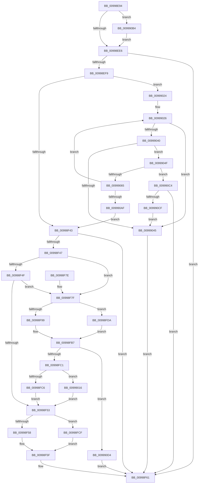

# PipOpenServiceEnumKeys

- RVA: `0x00998E94`–`0x009990E4` (길이 `592` bytes)
- VA: `0x0000000140998E94`
- 실행 섹션: `PAGE`
- PDB 이름 있음: `예`; PDB Function 태그: `아니요`
- unwind 정보 RVA: `0x00099458`
- 디코드: `149`개 명령, `592/592` bytes 표시
- 미해석 바이트: `0` (있으면 어셈블리에 `.byte`로 보존)

> 이 문서는 커널 이미지의 기계어와 PDB 기호를 분석해 생성했습니다. 4번과 5번은 함수 원형과 자료형을 바이너리 사용 방식에서 추정한 C 해석이며 원본 소스 복구 결과는 아닙니다.

## 1. Dependencies

- 직접 호출 지점: **9**; 고유 호출 대상: **4**
- 직접 호출자로 확인된 함수: **14**
- RIP 상대 이미지 참조: **2**

### Outgoing calls
- `0x00998EF0` → [_PnpCtxGetCachedNodeBaseKey](../8E/_PnpCtxGetCachedNodeBaseKey_function_008EF9C0.md) (function, `0x008EF9C0`)
- `0x00998F33` → [ZwOpenKey](../../text/6A/ZwOpenKey_function_006AD310.md) (function, `0x006AD310`)
- `0x00998FB2` → [IopCreateRegistryKeyEx](../A8/IopCreateRegistryKeyEx_function_00A89038.md) (function, `0x00A89038`)
- `0x00998FD3` → [ZwClose](../../text/6A/ZwClose_function_006AD2B0.md) (function, `0x006AD2B0`)
- `0x0099900F` → [ZwOpenKey](../../text/6A/ZwOpenKey_function_006AD310.md) (function, `0x006AD310`)
- `0x0099901A` → [ZwClose](../../text/6A/ZwClose_function_006AD2B0.md) (function, `0x006AD2B0`)
- `0x0099905C` → [_PnpCtxGetCachedNodeBaseKey](../8E/_PnpCtxGetCachedNodeBaseKey_function_008EF9C0.md) (function, `0x008EF9C0`)
- `0x0099909F` → [ZwOpenKey](../../text/6A/ZwOpenKey_function_006AD310.md) (function, `0x006AD310`)
- `0x009990D8` → [ZwClose](../../text/6A/ZwClose_function_006AD2B0.md) (function, `0x006AD2B0`)

### Direct callers
- [PipGetDriverKsrGuid](../72/PipGetDriverKsrGuid_function_00725100.md) at `0x0072513F`
- [IopGetOriginalServiceName](../72/IopGetOriginalServiceName_function_00726B48.md) at `0x00726B73`
- [PipApplyFunctionToServiceInstances](../72/PipApplyFunctionToServiceInstances_function_0072BF40.md) at `0x0072BF92`
- [PipServiceInstanceToDeviceInstance](../72/PipServiceInstanceToDeviceInstance_function_0072C150.md) at `0x0072C1CD`
- [PiDevCfgMakeServiceBootStart](../73/PiDevCfgMakeServiceBootStart_function_00733BC8.md) at `0x00733C23`
- [PipHardwareConfigActivateService](../96/PipHardwareConfigActivateService_function_00965BFC.md) at `0x00965C6F`
- [PiDevCfgVerifyService](../97/PiDevCfgVerifyService_function_00975EA0.md) at `0x00975F04`
- [PipCallDriverAddDeviceQueryRoutine](PipCallDriverAddDeviceQueryRoutine_function_00996604.md) at `0x009967B7`
- [PiProcessDriverInstance](PiProcessDriverInstance_function_00998530.md) at `0x00998597`
- [PiGetServiceNameInfo](PiGetServiceNameInfo_function_00998AA8.md) at `0x00998B01`
- [IoOpenDriverRegistryKey](IoOpenDriverRegistryKey_function_00998BB0.md) at `0x00998C6F`
- [PipDmgGetDriverDmarCompatLevel](../AA/PipDmgGetDriverDmarCompatLevel_function_00AA0A40.md) at `0x00AA0A84`
- [PnpDriverLoadingFailed](../AB/PnpDriverLoadingFailed_function_00AB8928.md) at `0x00AB8998`
- [PpDevCfgInit](../../init/C3/PpDevCfgInit_function_00C351A4.md) at `0x00C352F5`

### Static image references
- `0x00998EBB` → RVA `0x00E66398` (`.data`; read)
- `0x00998F86` → RVA `0x00AFDA80` (` ?? ::NNGAKEGL::`string'`; read)

## 2. Other-region calls and transfers

- 다른 실행 섹션으로 향하는 call: **6**
  - `0x00998F33` → [ZwOpenKey](../../text/6A/ZwOpenKey_function_006AD310.md) (`PAGE` → `.text`)
  - `0x00998FD3` → [ZwClose](../../text/6A/ZwClose_function_006AD2B0.md) (`PAGE` → `.text`)
  - `0x0099900F` → [ZwOpenKey](../../text/6A/ZwOpenKey_function_006AD310.md) (`PAGE` → `.text`)
  - `0x0099901A` → [ZwClose](../../text/6A/ZwClose_function_006AD2B0.md) (`PAGE` → `.text`)
  - `0x0099909F` → [ZwOpenKey](../../text/6A/ZwOpenKey_function_006AD310.md) (`PAGE` → `.text`)
  - `0x009990D8` → [ZwClose](../../text/6A/ZwClose_function_006AD2B0.md) (`PAGE` → `.text`)
- 별도 외부 분기/꼬리 이동을 확인하지 못했습니다.

## 3. Assembly (complete function range)

```asm
00998E94  48 8B C4                        mov rax, rsp
00998E97  48 89 58 08                     mov qword ptr [rax + 8], rbx
00998E9B  48 89 70 10                     mov qword ptr [rax + 0x10], rsi
00998E9F  48 89 78 18                     mov qword ptr [rax + 0x18], rdi
00998EA3  55                              push rbp
00998EA4  41 56                           push r14
00998EA6  41 57                           push r15
00998EA8  48 8D 68 A9                     lea rbp, [rax - 0x57]
00998EAC  48 81 EC 90 00 00 00            sub rsp, 0x90
00998EB3  48 83 65 EF 00                  and qword ptr [rbp - 0x11], 0
00998EB8  4C 8B F9                        mov r15, rcx
00998EBB  48 8B 0D D6 D4 4C 00            mov rcx, qword ptr [rip + 0x4cd4d6]
00998EC2  0F 57 C0                        xorps xmm0, xmm0
00998EC5  48 83 65 E7 00                  and qword ptr [rbp - 0x19], 0
00998ECA  8B F2                           mov esi, edx
00998ECC  0F 11 45 F7                     movups xmmword ptr [rbp - 9], xmm0
00998ED0  49 8B F9                        mov rdi, r9
00998ED3  4D 8B F0                        mov r14, r8
00998ED6  48 8B 91 90 00 00 00            mov rdx, qword ptr [rcx + 0x90]
00998EDD  48 85 D2                        test rdx, rdx
00998EE0  0F 84 CE 01 00 00               je 0x1409990b4
00998EE6  4C 8D 4D E7                     lea r9, [rbp - 0x19]
00998EEA  41 B8 06 00 00 00               mov r8d, 6
00998EF0  E8 CB 6A F5 FF                  call 0x1408ef9c0
00998EF5  85 C0                           test eax, eax
00998EF7  78 68                           js 0x140998f61
00998EF9  48 8B 45 E7                     mov rax, qword ptr [rbp - 0x19]
00998EFD  4C 8D 45 07                     lea r8, [rbp + 7]
00998F01  83 65 23 00                     and dword ptr [rbp + 0x23], 0
00998F05  48 8D 4D DF                     lea rcx, [rbp - 0x21]
00998F09  48 83 65 DF 00                  and qword ptr [rbp - 0x21], 0
00998F0E  0F 57 C0                        xorps xmm0, xmm0
00998F11  48 C7 45 07 30 00 00 00         mov qword ptr [rbp + 7], 0x30
00998F19  8B D6                           mov edx, esi
00998F1B  83 65 0B 00                     and dword ptr [rbp + 0xb], 0
00998F1F  48 89 45 0F                     mov qword ptr [rbp + 0xf], rax
00998F23  F3 0F 7F 45 27                  movdqu xmmword ptr [rbp + 0x27], xmm0
00998F28  C7 45 1F 40 02 00 00            mov dword ptr [rbp + 0x1f], 0x240
00998F2F  4C 89 7D 17                     mov qword ptr [rbp + 0x17], r15
00998F33  E8 D8 43 D1 FF                  call 0x1406ad310
00998F38  3D 34 00 00 C0                  cmp eax, 0xc0000034
00998F3D  0F 84 E1 00 00 00               je 0x140999024
00998F43  85 C0                           test eax, eax
00998F45  78 1A                           js 0x140998f61
00998F47  8A 45 7F                        mov al, byte ptr [rbp + 0x7f]
00998F4A  48 85 FF                        test rdi, rdi
00998F4D  75 30                           jne 0x140998f7f
00998F4F  84 C0                           test al, al
00998F51  75 2C                           jne 0x140998f7f
00998F53  4D 85 F6                        test r14, r14
00998F56  74 77                           je 0x140998fcf
00998F58  48 8B 45 DF                     mov rax, qword ptr [rbp - 0x21]
00998F5C  49 89 06                        mov qword ptr [r14], rax
00998F5F  33 C0                           xor eax, eax
00998F61  4C 8D 9C 24 90 00 00 00         lea r11, [rsp + 0x90]
00998F69  49 8B 5B 20                     mov rbx, qword ptr [r11 + 0x20]
00998F6D  49 8B 73 28                     mov rsi, qword ptr [r11 + 0x28]
00998F71  49 8B 7B 30                     mov rdi, qword ptr [r11 + 0x30]
00998F75  49 8B E3                        mov rsp, r11
00998F78  41 5F                           pop r15
00998F7A  41 5E                           pop r14
00998F7C  5D                              pop rbp
00998F7D  C3                              ret
00998F7E  CC                              int3
00998F7F  C7 45 F7 08 00 0A 00            mov dword ptr [rbp - 9], 0xa0008
00998F86  48 8D 0D F3 4A 16 00            lea rcx, [rip + 0x164af3]
00998F8D  48 89 4D FF                     mov qword ptr [rbp - 1], rcx
00998F91  48 8D 4D EF                     lea rcx, [rbp - 0x11]
00998F95  84 C0                           test al, al
00998F97  74 41                           je 0x140998fda
00998F99  48 83 64 24 28 00               and qword ptr [rsp + 0x28], 0
00998F9F  4C 8D 45 F7                     lea r8, [rbp - 9]
00998FA3  48 8B 55 DF                     mov rdx, qword ptr [rbp - 0x21]
00998FA7  44 8B CE                        mov r9d, esi
00998FAA  C7 44 24 20 01 00 00 00         mov dword ptr [rsp + 0x20], 1
00998FB2  E8 81 00 0F 00                  call 0x140a89038
00998FB7  8B D8                           mov ebx, eax
00998FB9  85 C0                           test eax, eax
00998FBB  0F 88 13 01 00 00               js 0x1409990d4
00998FC1  48 85 FF                        test rdi, rdi
00998FC4  74 50                           je 0x140999016
00998FC6  48 8B 45 EF                     mov rax, qword ptr [rbp - 0x11]
00998FCA  48 89 07                        mov qword ptr [rdi], rax
00998FCD  EB 84                           jmp 0x140998f53
00998FCF  48 8B 4D DF                     mov rcx, qword ptr [rbp - 0x21]
00998FD3  E8 D8 42 D1 FF                  call 0x1406ad2b0
00998FD8  EB 85                           jmp 0x140998f5f
00998FDA  48 8B 45 DF                     mov rax, qword ptr [rbp - 0x21]
00998FDE  4C 8D 45 07                     lea r8, [rbp + 7]
00998FE2  83 65 23 00                     and dword ptr [rbp + 0x23], 0
00998FE6  0F 57 C0                        xorps xmm0, xmm0
00998FE9  48 89 45 0F                     mov qword ptr [rbp + 0xf], rax
00998FED  8B D6                           mov edx, esi
00998FEF  48 8D 45 F7                     lea rax, [rbp - 9]
00998FF3  48 C7 45 07 30 00 00 00         mov qword ptr [rbp + 7], 0x30
00998FFB  83 65 0B 00                     and dword ptr [rbp + 0xb], 0
00998FFF  48 89 45 17                     mov qword ptr [rbp + 0x17], rax
00999003  C7 45 1F 40 02 00 00            mov dword ptr [rbp + 0x1f], 0x240
0099900A  F3 0F 7F 45 27                  movdqu xmmword ptr [rbp + 0x27], xmm0
0099900F  E8 FC 42 D1 FF                  call 0x1406ad310
00999014  EB A1                           jmp 0x140998fb7
00999016  48 8B 4D EF                     mov rcx, qword ptr [rbp - 0x11]
0099901A  E8 91 42 D1 FF                  call 0x1406ad2b0
0099901F  E9 2F FF FF FF                  jmp 0x140998f53
00999024  33 DB                           xor ebx, ebx
00999026  48 8B 0D 6B D3 4C 00            mov rcx, qword ptr [rip + 0x4cd36b]
0099902D  48 85 DB                        test rbx, rbx
00999030  48 8D 41 08                     lea rax, [rcx + 8]
00999034  48 0F 44 D8                     cmove rbx, rax
00999038  48 8B 1B                        mov rbx, qword ptr [rbx]
0099903B  48 3B D8                        cmp rbx, rax
0099903E  74 05                           je 0x140999045
00999040  48 85 DB                        test rbx, rbx
00999043  75 0A                           jne 0x14099904f
00999045  B8 34 00 00 C0                  mov eax, 0xc0000034
0099904A  E9 12 FF FF FF                  jmp 0x140998f61
0099904F  4C 8D 4D E7                     lea r9, [rbp - 0x19]
00999053  41 B8 06 00 00 00               mov r8d, 6
00999059  48 8B D3                        mov rdx, rbx
0099905C  E8 5F 69 F5 FF                  call 0x1408ef9c0
00999061  85 C0                           test eax, eax
00999063  78 5F                           js 0x1409990c4
00999065  48 8B 45 E7                     mov rax, qword ptr [rbp - 0x19]
00999069  4C 8D 45 07                     lea r8, [rbp + 7]
0099906D  83 65 23 00                     and dword ptr [rbp + 0x23], 0
00999071  48 8D 4D DF                     lea rcx, [rbp - 0x21]
00999075  48 83 65 DF 00                  and qword ptr [rbp - 0x21], 0
0099907A  0F 57 C0                        xorps xmm0, xmm0
0099907D  48 C7 45 07 30 00 00 00         mov qword ptr [rbp + 7], 0x30
00999085  8B D6                           mov edx, esi
00999087  83 65 0B 00                     and dword ptr [rbp + 0xb], 0
0099908B  48 89 45 0F                     mov qword ptr [rbp + 0xf], rax
0099908F  F3 0F 7F 45 27                  movdqu xmmword ptr [rbp + 0x27], xmm0
00999094  C7 45 1F 40 02 00 00            mov dword ptr [rbp + 0x1f], 0x240
0099909B  4C 89 7D 17                     mov qword ptr [rbp + 0x17], r15
0099909F  E8 6C 42 D1 FF                  call 0x1406ad310
009990A4  3D 34 00 00 C0                  cmp eax, 0xc0000034
009990A9  0F 84 77 FF FF FF               je 0x140999026
009990AF  E9 8F FE FF FF                  jmp 0x140998f43
009990B4  48 8B 51 58                     mov rdx, qword ptr [rcx + 0x58]
009990B8  48 89 91 90 00 00 00            mov qword ptr [rcx + 0x90], rdx
009990BF  E9 22 FE FF FF                  jmp 0x140998ee6
009990C4  3D 1A 00 00 80                  cmp eax, 0x8000001a
009990C9  0F 85 92 FE FF FF               jne 0x140998f61
009990CF  E9 71 FF FF FF                  jmp 0x140999045
009990D4  48 8B 4D DF                     mov rcx, qword ptr [rbp - 0x21]
009990D8  E8 D3 41 D1 FF                  call 0x1406ad2b0
009990DD  8B C3                           mov eax, ebx
009990DF  E9 7D FE FF FF                  jmp 0x140998f61
```

## 4. C-style interpretation (structured pseudocode)

```c
__int64 __fastcall PipOpenServiceEnumKeys(__int64 a1, int a2, __int64 a3, __int64 a4)
{
    __int64 result;
    __int64 v_rbx;
    __int64 v_rsp;
    unsigned __int64 v_stack_m18;
    unsigned __int64 v_stack_m68;
    unsigned int v_stack_m70;

    *(unsigned __int64 *)(v_rsp + 8) = v_rbx;
    *(unsigned __int64 *)(v_rsp + 16) = v_rsi;
    *(unsigned __int64 *)(v_rsp + 24) = v_rdi;
    v_rsp = (v_rsp) - (144);
    *(unsigned __int64 *)(v_rsp - 87 - 9) = v_xmm0;
    if (*(unsigned __int64 *)(*(unsigned __int64 *)(v_rip + 5035222) + 144) == 0) goto loc_009990B4;
loc_00998EE6:
    result = _PnpCtxGetCachedNodeBaseKey(*(unsigned __int64 *)(v_rip + 5035222), *(unsigned __int64 *)(*(unsigned __int64 *)(v_rip + 5035222) + 144), 6, v_rsp - 87 - 25);
    if (sign_flag) goto loc_00998F61;
    *(unsigned __int64 *)(v_rsp - 87 + 7) = 48;
    *(unsigned __int64 *)(v_rsp - 87 + 15) = *(unsigned __int64 *)(v_rsp - 87 - 25);
    *(unsigned __int64 *)(v_rsp - 87 + 39) = v_xmm0;
    *(unsigned int *)(v_rsp - 87 + 31) = 576;
    *(unsigned __int64 *)(v_rsp - 87 + 23) = a1;
    result = ZwOpenKey(v_rsp - 87 - 33, (unsigned int)((unsigned int)((unsigned int)(a2))), v_rsp - 87 + 7, v_rsp - 87 - 25);
    if (((unsigned int)(result)) == 0xC0000034ULL) goto loc_00999024;
loc_00998F43:
    if (sign_flag) goto loc_00998F61;
    if (a4 != 0) goto loc_00998F7F;
    if ((unsigned __int8)(*(unsigned __int8 *)(v_rsp - 87 + 127)) != 0) goto loc_00998F7F;
loc_00998F53:
    if (a3 == 0) goto loc_00998FCF;
    *(unsigned __int64 *)(a3) = *(unsigned __int64 *)(v_rsp - 87 - 33);
loc_00998F5F:
    result = 0;
loc_00998F61:
    return result;
loc_00998F7F:
    *(unsigned int *)(v_rsp - 87 - 9) = 0xA0008ULL;
    *(unsigned __int64 *)(v_rsp - 87 - 1) = v_rip + 1460979;
    if (0 == 0) goto loc_00998FDA;
    v_stack_m70 = 1;
    result = IopCreateRegistryKeyEx(v_rsp - 87 - 17, *(unsigned __int64 *)(v_rsp - 87 - 33), v_rsp - 87 - 9, (unsigned int)((unsigned int)(*(unsigned __int64 *)(v_stack_m18 + 40))));
loc_00998FB7:
    if (sign_flag) goto loc_009990D4;
    if (*(unsigned __int64 *)(v_stack_m18 + 48) == 0) goto loc_00999016;
    *(unsigned __int64 *)(*(unsigned __int64 *)(v_stack_m18 + 48)) = *(unsigned __int64 *)(v_rsp - 87 - 17);
    goto loc_00998F53;
loc_00998FCF:
    result = ZwClose(*(unsigned __int64 *)(v_rsp - 87 - 33), *(unsigned __int64 *)(v_rsp - 87 - 33), v_rsp - 87 - 9, (unsigned int)((unsigned int)(*(unsigned __int64 *)(v_stack_m18 + 40))));
    goto loc_00998F5F;
loc_00998FDA:
    *(unsigned __int64 *)(v_rsp - 87 + 15) = *(unsigned __int64 *)(v_rsp - 87 - 33);
    *(unsigned __int64 *)(v_rsp - 87 + 7) = 48;
    *(unsigned __int64 *)(v_rsp - 87 + 23) = v_rsp - 87 - 9;
    *(unsigned int *)(v_rsp - 87 + 31) = 576;
    *(unsigned __int64 *)(v_rsp - 87 + 39) = v_xmm0;
    result = ZwOpenKey(*(unsigned __int64 *)(v_rsp - 87 - 33), (unsigned int)((unsigned int)(*(unsigned __int64 *)(v_stack_m18 + 40))), v_rsp - 87 + 7, (unsigned int)((unsigned int)(*(unsigned __int64 *)(v_stack_m18 + 40))));
    goto loc_00998FB7;
loc_00999016:
    result = ZwClose(*(unsigned __int64 *)(v_rsp - 87 - 17), (unsigned int)((unsigned int)(*(unsigned __int64 *)(v_stack_m18 + 40))), v_rsp - 87 + 7, (unsigned int)((unsigned int)(*(unsigned __int64 *)(v_stack_m18 + 40))));
    goto loc_00998F53;
loc_00999024:
    v_rbx = 0;
loc_00999026:
    if (0 == 0) { v_rbx = *(unsigned __int64 *)(v_rip + 5034859) + 8; }
    if ((*(unsigned __int64 *)(v_rbx)) == (*(unsigned __int64 *)(v_rip + 5034859) + 8)) goto loc_00999045;
    if (*(unsigned __int64 *)(v_rbx) != 0) goto loc_0099904F;
loc_00999045:
    goto loc_00998F61;
loc_0099904F:
    result = _PnpCtxGetCachedNodeBaseKey(*(unsigned __int64 *)(v_rip + 5034859), *(unsigned __int64 *)(v_rbx), 6, v_rsp - 87 - 25);
    if (sign_flag) goto loc_009990C4;
    *(unsigned __int64 *)(v_rsp - 87 + 7) = 48;
    *(unsigned __int64 *)(v_rsp - 87 + 15) = *(unsigned __int64 *)(v_rsp - 87 - 25);
    *(unsigned __int64 *)(v_rsp - 87 + 39) = v_xmm0;
    *(unsigned int *)(v_rsp - 87 + 31) = 576;
    *(unsigned __int64 *)(v_rsp - 87 + 23) = a1;
    result = ZwOpenKey(v_rsp - 87 - 33, (unsigned int)((unsigned int)(*(unsigned __int64 *)(v_stack_m18 + 40))), v_rsp - 87 + 7, v_rsp - 87 - 25);
    if (((unsigned int)(result)) == 0xC0000034ULL) goto loc_00999026;
    goto loc_00998F43;
loc_009990B4:
    *(unsigned __int64 *)(v_rsp - 87 - 33 + 144) = *(unsigned __int64 *)(v_rsp - 87 - 33 + 88);
    goto loc_00998EE6;
loc_009990C4:
    if (((unsigned int)(result)) != 0x8000001AULL) goto loc_00998F61;
    goto loc_00999045;
loc_009990D4:
    result = ZwClose(*(unsigned __int64 *)(v_rsp - 87 - 33), *(unsigned __int64 *)(v_rsp - 87 - 33 + 88), v_rsp - 87 + 7, v_rsp - 87 - 25);
    goto loc_00998F61;
}
```

## 5. (Beta) C Style

```c
int64_t PipOpenServiceEnumKeys(int64_t Arg1, int32_t Arg2, int64_t Arg3, int64_t Arg4)
{
    int64_t result;
    int64_t local_rbx;
    int64_t local_rsp;
    uint64_t v_stack_m18;
    uint64_t v_stack_m68;
    uint32_t v_stack_m70;

    *(uint64_t *)(local_rsp + 0x8) = local_rbx;
    *(uint64_t *)(local_rsp + 0x10) = local_rsi;
    *(uint64_t *)(local_rsp + 0x18) = local_rdi;
    local_rsp = (local_rsp) - (144);
    *(uint64_t *)(local_rsp - 0x57 - 0x9) = v_xmm0;
    if (*(uint64_t *)(*(uint64_t *)(v_rip + 0x4CD4D6) + 0x90) == 0) goto loc_009990B4;
loc_00998EE6:
    result = _PnpCtxGetCachedNodeBaseKey(*(uint64_t *)(v_rip + 0x4CD4D6), *(uint64_t *)(*(uint64_t *)(v_rip + 0x4CD4D6) + 0x90), 6, local_rsp - 87 - 25);
    if (sign_flag) goto loc_00998F61;
    *(uint64_t *)(local_rsp - 0x57 + 0x7) = 48;
    *(uint64_t *)(local_rsp - 0x57 + 0xF) = *(uint64_t *)(local_rsp - 0x57 - 0x19);
    *(uint64_t *)(local_rsp - 0x57 + 0x27) = v_xmm0;
    *(uint32_t *)(local_rsp - 0x57 + 0x1F) = 576;
    *(uint64_t *)(local_rsp - 0x57 + 0x17) = Arg1;
    result = ZwOpenKey(local_rsp - 87 - 33, (uint32_t)((uint32_t)((uint32_t)(Arg2))), local_rsp - 87 + 7, local_rsp - 87 - 25);
    if (((uint32_t)(result)) == 0xC0000034ULL) goto loc_00999024;
loc_00998F43:
    if (sign_flag) goto loc_00998F61;
    if (Arg4 != 0) goto loc_00998F7F;
    if ((uint8_t)(*(uint8_t *)(local_rsp - 0x57 + 0x7F)) != 0) goto loc_00998F7F;
loc_00998F53:
    if (Arg3 == 0) goto loc_00998FCF;
    *(uint64_t *)(Arg3) = *(uint64_t *)(local_rsp - 0x57 - 0x21);
loc_00998F5F:
    result = 0;
loc_00998F61:
    return result;
loc_00998F7F:
    *(uint32_t *)(local_rsp - 0x57 - 0x9) = 0xA0008ULL;
    *(uint64_t *)(local_rsp - 0x57 - 0x1) = v_rip + 1460979;
    if (0 == 0) goto loc_00998FDA;
    v_stack_m70 = 1;
    result = IopCreateRegistryKeyEx(local_rsp - 87 - 17, *(uint64_t *)(local_rsp - 0x57 - 0x21), local_rsp - 87 - 9, (uint32_t)((uint32_t)(*(uint64_t *)(v_stack_m18 + 0x28))));
loc_00998FB7:
    if (sign_flag) goto loc_009990D4;
    if (*(uint64_t *)(v_stack_m18 + 0x30) == 0) goto loc_00999016;
    *(uint64_t *)(*(uint64_t *)(v_stack_m18 + 0x30)) = *(uint64_t *)(local_rsp - 0x57 - 0x11);
    goto loc_00998F53;
loc_00998FCF:
    result = ZwClose(*(uint64_t *)(local_rsp - 0x57 - 0x21), *(uint64_t *)(local_rsp - 0x57 - 0x21), local_rsp - 87 - 9, (uint32_t)((uint32_t)(*(uint64_t *)(v_stack_m18 + 0x28))));
    goto loc_00998F5F;
loc_00998FDA:
    *(uint64_t *)(local_rsp - 0x57 + 0xF) = *(uint64_t *)(local_rsp - 0x57 - 0x21);
    *(uint64_t *)(local_rsp - 0x57 + 0x7) = 48;
    *(uint64_t *)(local_rsp - 0x57 + 0x17) = local_rsp - 87 - 9;
    *(uint32_t *)(local_rsp - 0x57 + 0x1F) = 576;
    *(uint64_t *)(local_rsp - 0x57 + 0x27) = v_xmm0;
    result = ZwOpenKey(*(uint64_t *)(local_rsp - 0x57 - 0x21), (uint32_t)((uint32_t)(*(uint64_t *)(v_stack_m18 + 0x28))), local_rsp - 87 + 7, (uint32_t)((uint32_t)(*(uint64_t *)(v_stack_m18 + 0x28))));
    goto loc_00998FB7;
loc_00999016:
    result = ZwClose(*(uint64_t *)(local_rsp - 0x57 - 0x11), (uint32_t)((uint32_t)(*(uint64_t *)(v_stack_m18 + 0x28))), local_rsp - 87 + 7, (uint32_t)((uint32_t)(*(uint64_t *)(v_stack_m18 + 0x28))));
    goto loc_00998F53;
loc_00999024:
    local_rbx = 0;
loc_00999026:
    if (0 == 0) { local_rbx = *(uint64_t *)(v_rip + 0x4CD36B) + 8; }
    if ((*(uint64_t *)(local_rbx)) == (*(uint64_t *)(v_rip + 0x4CD36B) + 8)) goto loc_00999045;
    if (*(uint64_t *)(local_rbx) != 0) goto loc_0099904F;
loc_00999045:
    goto loc_00998F61;
loc_0099904F:
    result = _PnpCtxGetCachedNodeBaseKey(*(uint64_t *)(v_rip + 0x4CD36B), *(uint64_t *)(local_rbx), 6, local_rsp - 87 - 25);
    if (sign_flag) goto loc_009990C4;
    *(uint64_t *)(local_rsp - 0x57 + 0x7) = 48;
    *(uint64_t *)(local_rsp - 0x57 + 0xF) = *(uint64_t *)(local_rsp - 0x57 - 0x19);
    *(uint64_t *)(local_rsp - 0x57 + 0x27) = v_xmm0;
    *(uint32_t *)(local_rsp - 0x57 + 0x1F) = 576;
    *(uint64_t *)(local_rsp - 0x57 + 0x17) = Arg1;
    result = ZwOpenKey(local_rsp - 87 - 33, (uint32_t)((uint32_t)(*(uint64_t *)(v_stack_m18 + 0x28))), local_rsp - 87 + 7, local_rsp - 87 - 25);
    if (((uint32_t)(result)) == 0xC0000034ULL) goto loc_00999026;
    goto loc_00998F43;
loc_009990B4:
    *(uint64_t *)(local_rsp - 0x57 - 0x21 + 0x90) = *(uint64_t *)(local_rsp - 0x57 - 0x21 + 0x58);
    goto loc_00998EE6;
loc_009990C4:
    if (((uint32_t)(result)) != 0x8000001AULL) goto loc_00998F61;
    goto loc_00999045;
loc_009990D4:
    result = ZwClose(*(uint64_t *)(local_rsp - 0x57 - 0x21), *(uint64_t *)(local_rsp - 0x57 - 0x21 + 0x58), local_rsp - 87 + 7, local_rsp - 87 - 25);
    goto loc_00998F61;
}
```

## 6. Execution-region graph

[열기: 2D/3D 그래프와 함수 탐색 컨트롤 패널](../../../control-panel.html?section=page&rva=0x00998E94&view=graph)

- 2D 그래프는 위에서 아래로 흐르고, 3D 그래프는 빈 공간을 드래그해 회전합니다. Shift+드래그는 이동, 휠은 확대·축소, 함수 노드 선택은 대상 보고서 이동입니다.

### Static fallback


