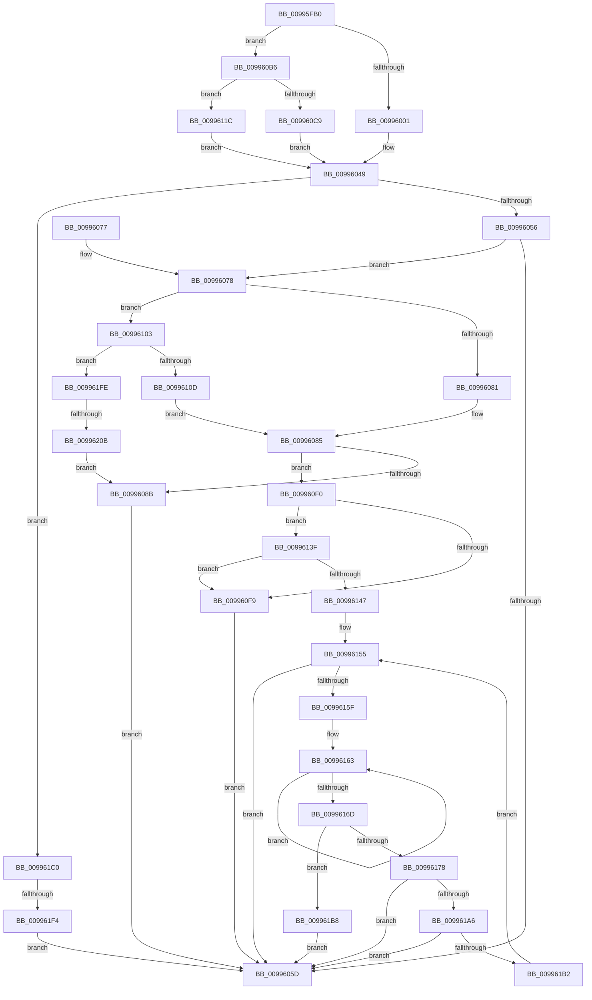

# PnpCallDriverQueryServiceHelper

- RVA: `0x00995FB0`–`0x00996217` (길이 `615` bytes)
- VA: `0x0000000140995FB0`
- 실행 섹션: `PAGE`
- PDB 이름 있음: `예`; PDB Function 태그: `예`
- unwind 정보 RVA: `0x00099208`
- 디코드: `168`개 명령, `615/615` bytes 표시
- 미해석 바이트: `0` (있으면 어셈블리에 `.byte`로 보존)

> 이 문서는 커널 이미지의 기계어와 PDB 기호를 분석해 생성했습니다. 4번과 5번은 함수 원형과 자료형을 바이너리 사용 방식에서 추정한 C 해석이며 원본 소스 복구 결과는 아닙니다.

## 1. Dependencies

- 직접 호출 지점: **7**; 고유 호출 대상: **6**
- 직접 호출자로 확인된 함수: **2**
- RIP 상대 이미지 참조: **1**

### Outgoing calls
- `0x00996044` → [PnpGetObjectProperty](../8E/PnpGetObjectProperty_function_008E2180.md) (function, `0x008E2180`)
- `0x009960AD` → [PipCallDriverAddDeviceQueryRoutine](PipCallDriverAddDeviceQueryRoutine_function_00996604.md) (function, `0x00996604`)
- `0x009960E6` → [CmGetDeviceRegProp](../8E/CmGetDeviceRegProp_function_008ED870.md) (function, `0x008ED870`)
- `0x00996135` → [CmGetInstallerClassRegProp](CmGetInstallerClassRegProp_function_00994940.md) (function, `0x00994940`)
- `0x00996197` → [PipCallDriverAddDeviceQueryRoutine](PipCallDriverAddDeviceQueryRoutine_function_00996604.md) (function, `0x00996604`)
- `0x009961C5` → [ExFreePoolWithTag](../../poolcode/B8/ExFreePoolWithTag_function_00B82870.md) (function, `0x00B82870`)
- `0x009961E0` → [ExAllocatePool2](../../poolcode/B8/ExAllocatePool2_function_00B820F0.md) (function, `0x00B820F0`)

### Direct callers
- [PipCallDriverAddDevice](../A2/PipCallDriverAddDevice_function_00A272E0.md) at `0x00A2789D`
- [sub_00B3807C](../B3/Unknown_function_00B3807C.md) at `0x00B38297`
- [sub_00B3807C](../B3/Unknown_function_00B3807C.md) at `0x00B38472`
- [sub_00B3807C](../B3/Unknown_function_00B3807C.md) at `0x00B38531`
- [sub_00B3807C](../B3/Unknown_function_00B3807C.md) at `0x00B385A0`
- [sub_00B3807C](../B3/Unknown_function_00B3807C.md) at `0x00B3861D`

### Static image references
- `0x00996020` → RVA `0x00E66398` (`.data`; read)

## 2. Other-region calls and transfers

- 다른 실행 섹션으로 향하는 call: **2**
  - `0x009961C5` → [ExFreePoolWithTag](../../poolcode/B8/ExFreePoolWithTag_function_00B82870.md) (`PAGE` → `POOLCODE`)
  - `0x009961E0` → [ExAllocatePool2](../../poolcode/B8/ExAllocatePool2_function_00B820F0.md) (`PAGE` → `POOLCODE`)
- call이 아닌 외부 분기/꼬리 이동: **2**
  - `0x009961EE` → [sub_00B2C332](../B2/Unknown_function_00B2C332.md) (`tail-transfer`)
  - `0x00996205` → [sub_00B2C332 + 0xA9](../B2/Unknown_function_00B2C332.md) (`tail-transfer`)

## 3. Assembly (complete function range)

```asm
00995FB0  4C 8B DC                        mov r11, rsp
00995FB3  49 89 5B 08                     mov qword ptr [r11 + 8], rbx
00995FB7  49 89 53 10                     mov qword ptr [r11 + 0x10], rdx
00995FBB  55                              push rbp
00995FBC  56                              push rsi
00995FBD  57                              push rdi
00995FBE  41 54                           push r12
00995FC0  41 55                           push r13
00995FC2  41 56                           push r14
00995FC4  41 57                           push r15
00995FC6  48 8B EC                        mov rbp, rsp
00995FC9  48 83 EC 70                     sub rsp, 0x70
00995FCD  44 8A 75 70                     mov r14b, byte ptr [rbp + 0x70]
00995FD1  48 8B C2                        mov rax, rdx
00995FD4  48 8B 7D 68                     mov rdi, qword ptr [rbp + 0x68]
00995FD8  33 D2                           xor edx, edx
00995FDA  48 8B 75 60                     mov rsi, qword ptr [rbp + 0x60]
00995FDE  4C 8B F9                        mov r15, rcx
00995FE1  89 55 F0                        mov dword ptr [rbp - 0x10], edx
00995FE4  45 8B E0                        mov r12d, r8d
00995FE7  8B 08                           mov ecx, dword ptr [rax]
00995FE9  49 8B D9                        mov rbx, r9
00995FEC  89 4D 58                        mov dword ptr [rbp + 0x58], ecx
00995FEF  44 8B EA                        mov r13d, edx
00995FF2  4D 8B 07                        mov r8, qword ptr [r15]
00995FF5  89 55 F4                        mov dword ptr [rbp - 0xc], edx
00995FF8  4D 85 C9                        test r9, r9
00995FFB  0F 84 B5 00 00 00               je 0x1409960b6
00996001  89 54 24 50                     mov dword ptr [rsp + 0x50], edx
00996005  41 8A C6                        mov al, r14b
00996008  F6 D8                           neg al
0099600A  4C 8B CF                        mov r9, rdi
0099600D  48 8D 45 58                     lea rax, [rbp + 0x58]
00996011  49 89 43 A0                     mov qword ptr [r11 - 0x60], rax
00996015  45 1B ED                        sbb r13d, r13d
00996018  89 4C 24 40                     mov dword ptr [rsp + 0x40], ecx
0099601C  48 8D 45 F4                     lea rax, [rbp - 0xc]
00996020  48 8B 0D 71 03 4D 00            mov rcx, qword ptr [rip + 0x4d0371]
00996027  41 F7 DD                        neg r13d
0099602A  4D 89 43 90                     mov qword ptr [r11 - 0x70], r8
0099602E  41 FF C5                        inc r13d
00996031  49 89 43 88                     mov qword ptr [r11 - 0x78], rax
00996035  45 8B C5                        mov r8d, r13d
00996038  49 89 5B 80                     mov qword ptr [r11 - 0x80], rbx
0099603C  48 89 54 24 20                  mov qword ptr [rsp + 0x20], rdx
00996041  48 8B D6                        mov rdx, rsi
00996044  E8 37 C1 F4 FF                  call 0x1408e2180
00996049  8B C8                           mov ecx, eax
0099604B  3D 23 00 00 C0                  cmp eax, 0xc0000023
00996050  0F 84 6A 01 00 00               je 0x1409961c0
00996056  45 33 ED                        xor r13d, r13d
00996059  85 C9                           test ecx, ecx
0099605B  79 1B                           jns 0x140996078
0099605D  48 8B 9C 24 B0 00 00 00         mov rbx, qword ptr [rsp + 0xb0]
00996065  8B C1                           mov eax, ecx
00996067  48 83 C4 70                     add rsp, 0x70
0099606B  41 5F                           pop r15
0099606D  41 5E                           pop r14
0099606F  41 5D                           pop r13
00996071  41 5C                           pop r12
00996073  5F                              pop rdi
00996074  5E                              pop rsi
00996075  5D                              pop rbp
00996076  C3                              ret
00996077  CC                              int3
00996078  48 85 DB                        test rbx, rbx
0099607B  0F 85 82 00 00 00               jne 0x140996103
00996081  44 8B 55 F0                     mov r10d, dword ptr [rbp - 0x10]
00996085  41 83 FA 07                     cmp r10d, 7
00996089  74 65                           je 0x1409960f0
0099608B  8A 85 80 00 00 00               mov al, byte ptr [rbp + 0x80]
00996091  41 8B CA                        mov ecx, r10d
00996094  4C 8B 8D 88 00 00 00            mov r9, qword ptr [rbp + 0x88]
0099609B  44 8B 45 58                     mov r8d, dword ptr [rbp + 0x58]
0099609F  49 8B 17                        mov rdx, qword ptr [r15]
009960A2  88 44 24 28                     mov byte ptr [rsp + 0x28], al
009960A6  8B 45 78                        mov eax, dword ptr [rbp + 0x78]
009960A9  89 44 24 20                     mov dword ptr [rsp + 0x20], eax
009960AD  E8 52 05 00 00                  call 0x140996604
009960B2  8B C8                           mov ecx, eax
009960B4  EB A7                           jmp 0x14099605d
009960B6  48 8B 0D DB 02 4D 00            mov rcx, qword ptr [rip + 0x4d02db]
009960BD  48 8D 45 58                     lea rax, [rbp + 0x58]
009960C1  45 8B CC                        mov r9d, r12d
009960C4  45 84 F6                        test r14b, r14b
009960C7  75 53                           jne 0x14099611c
009960C9  89 54 24 38                     mov dword ptr [rsp + 0x38], edx
009960CD  48 8B D6                        mov rdx, rsi
009960D0  48 89 44 24 30                  mov qword ptr [rsp + 0x30], rax
009960D5  48 8D 45 F0                     lea rax, [rbp - 0x10]
009960D9  4C 89 44 24 28                  mov qword ptr [rsp + 0x28], r8
009960DE  4C 8B C7                        mov r8, rdi
009960E1  48 89 44 24 20                  mov qword ptr [rsp + 0x20], rax
009960E6  E8 85 77 F5 FF                  call 0x1408ed870
009960EB  E9 59 FF FF FF                  jmp 0x140996049
009960F0  48 8B 45 48                     mov rax, qword ptr [rbp + 0x48]
009960F4  83 38 02                        cmp dword ptr [rax], 2
009960F7  73 46                           jae 0x14099613f
009960F9  B9 01 00 00 C0                  mov ecx, 0xc0000001
009960FE  E9 5A FF FF FF                  jmp 0x14099605d
00996103  83 7D F4 12                     cmp dword ptr [rbp - 0xc], 0x12
00996107  0F 85 F1 00 00 00               jne 0x1409961fe
0099610D  41 BA 01 00 00 00               mov r10d, 1
00996113  44 89 55 F0                     mov dword ptr [rbp - 0x10], r10d
00996117  E9 69 FF FF FF                  jmp 0x140996085
0099611C  48 89 44 24 30                  mov qword ptr [rsp + 0x30], rax
00996121  48 8B D6                        mov rdx, rsi
00996124  4C 89 44 24 28                  mov qword ptr [rsp + 0x28], r8
00996129  48 8D 45 F0                     lea rax, [rbp - 0x10]
0099612D  4C 8B C7                        mov r8, rdi
00996130  48 89 44 24 20                  mov qword ptr [rsp + 0x20], rax
00996135  E8 06 E8 FF FF                  call 0x140994940
0099613A  E9 0A FF FF FF                  jmp 0x140996049
0099613F  8B 55 58                        mov edx, dword ptr [rbp + 0x58]
00996142  83 FA 02                        cmp edx, 2
00996145  72 B2                           jb 0x1409960f9
00996147  49 8B 3F                        mov rdi, qword ptr [r15]
0099614A  40 8A B5 80 00 00 00            mov sil, byte ptr [rbp + 0x80]
00996151  44 8B 75 78                     mov r14d, dword ptr [rbp + 0x78]
00996155  66 44 39 2F                     cmp word ptr [rdi], r13w
00996159  0F 84 FE FE FF FF               je 0x14099605d
0099615F  48 83 CB FF                     or rbx, 0xffffffffffffffff
00996163  48 FF C3                        inc rbx
00996166  66 44 39 2C 5F                  cmp word ptr [rdi + rbx*2], r13w
0099616B  75 F6                           jne 0x140996163
0099616D  FF C3                           inc ebx
0099616F  44 8D 04 1B                     lea r8d, [rbx + rbx]
00996173  41 3B D0                        cmp edx, r8d
00996176  72 40                           jb 0x1409961b8
00996178  4C 8B 8D 88 00 00 00            mov r9, qword ptr [rbp + 0x88]
0099617F  41 2B D0                        sub edx, r8d
00996182  89 55 58                        mov dword ptr [rbp + 0x58], edx
00996185  B9 01 00 00 00                  mov ecx, 1
0099618A  48 8B D7                        mov rdx, rdi
0099618D  40 88 74 24 28                  mov byte ptr [rsp + 0x28], sil
00996192  44 89 74 24 20                  mov dword ptr [rsp + 0x20], r14d
00996197  E8 68 04 00 00                  call 0x140996604
0099619C  8B C8                           mov ecx, eax
0099619E  85 C0                           test eax, eax
009961A0  0F 88 B7 FE FF FF               js 0x14099605d
009961A6  8B 55 58                        mov edx, dword ptr [rbp + 0x58]
009961A9  83 FA 02                        cmp edx, 2
009961AC  0F 82 AB FE FF FF               jb 0x14099605d
009961B2  48 8D 3C 5F                     lea rdi, [rdi + rbx*2]
009961B6  EB 9D                           jmp 0x140996155
009961B8  41 8B CD                        mov ecx, r13d
009961BB  E9 9D FE FF FF                  jmp 0x14099605d
009961C0  49 8B 0F                        mov rcx, qword ptr [r15]
009961C3  33 D2                           xor edx, edx
009961C5  E8 A6 C6 1E 00                  call 0x140b82870
009961CA  8B 45 58                        mov eax, dword ptr [rbp + 0x58]
009961CD  41 B8 50 70 65 6E               mov r8d, 0x6e657050
009961D3  48 8B 4D 48                     mov rcx, qword ptr [rbp + 0x48]
009961D7  8B D0                           mov edx, eax
009961D9  89 01                           mov dword ptr [rcx], eax
009961DB  B9 00 01 00 00                  mov ecx, 0x100
009961E0  E8 0B BF 1E 00                  call 0x140b820f0
009961E5  49 89 07                        mov qword ptr [r15], rax
009961E8  48 8B C8                        mov rcx, rax
009961EB  48 85 C0                        test rax, rax
009961EE  0F 85 3E 61 19 00               jne 0x140b2c332
009961F4  B9 9A 00 00 C0                  mov ecx, 0xc000009a
009961F9  E9 5F FE FF FF                  jmp 0x14099605d
009961FE  81 7D F4 12 20 00 00            cmp dword ptr [rbp - 0xc], 0x2012
00996205  0F 84 D0 61 19 00               je 0x140b2c3db
0099620B  45 8B D5                        mov r10d, r13d
0099620E  44 89 6D F0                     mov dword ptr [rbp - 0x10], r13d
00996212  E9 74 FE FF FF                  jmp 0x14099608b
```

## 4. C-style interpretation (structured pseudocode)

```c
__int64 __fastcall PnpCallDriverQueryServiceHelper(__int64 a1, __int64 a2, int a3, __int64 a4, __int64 a5, __int64 a6, unsigned __int8 a7, unsigned int a8, unsigned __int8 a9, __int64 a10)
{
    __int64 result;
    __int64 v_r13;
    __int64 v_rbx;
    __int64 v_rsp;
    unsigned int v_stack_m44;
    unsigned int v_stack_m48;
    unsigned int v_stack_m58;
    unsigned int v_stack_m68;
    unsigned __int64 v_stack_m88;
    unsigned __int64 v_stack_p10;
    unsigned int v_stack_p20;
    unsigned __int8 v_stack_p28;
    unsigned __int64 v_stack_p30;
    unsigned int v_stack_p38;
    unsigned __int64 v_stack_p8;

    *(unsigned __int64 *)(v_rsp + 8) = v_rbx;
    *(unsigned __int64 *)(v_rsp + 16) = a2;
    v_rsp = (v_rsp) - (112);
    a2 = 0;
    v_stack_m48 = 0;
    v_stack_p20 = (unsigned int)((unsigned int)(*(unsigned int *)(a2)));
    v_stack_m44 = 0;
    if (a4 == 0) goto loc_009960B6;
    v_stack_m58 = 0;
    result = (unsigned __int8)(-(a7));
    *(unsigned __int64 *)(v_rsp - 96) = v_stack_p20;
    v_stack_m68 = (unsigned int)((unsigned int)(*(unsigned int *)(a2)));
    v_r13 = (unsigned int)(-(0));
    *(unsigned __int64 *)(v_rsp - 112) = *(unsigned __int64 *)(a1);
    v_r13 = (unsigned int)((v_r13) + 1);
    *(unsigned __int64 *)(v_rsp - 120) = v_stack_m44;
    *(unsigned __int64 *)(v_rsp - 128) = a4;
    v_stack_m88 = 0;
    result = PnpGetObjectProperty(*(unsigned __int64 *)(v_rip + 5047153), a5, (unsigned int)((unsigned int)(v_r13)), a6);
loc_00996049:
    if (((unsigned int)(result)) == 0xC0000023ULL) goto loc_009961C0;
    v_r13 = 0;
    if (!sign_flag) goto loc_00996078;
loc_0099605D:
    v_rsp = (v_rsp) + (112);
    return (unsigned int)((unsigned int)((unsigned int)((unsigned int)(result))));
loc_00996078:
    if (v_stack_p8 != 0) goto loc_00996103;
loc_00996085:
    if (((unsigned int)((unsigned int)(v_stack_m48))) == 7) goto loc_009960F0;
loc_0099608B:
    v_stack_p28 = a9;
    v_stack_p20 = (unsigned int)((unsigned int)(a8));
    result = PipCallDriverAddDeviceQueryRoutine((unsigned int)((unsigned int)((unsigned int)(v_stack_m48))), *(unsigned __int64 *)(a1), (unsigned int)(v_stack_p20), a10);
    goto loc_0099605D;
loc_009960B6:
    if (a7 != 0) goto loc_0099611C;
    v_stack_p38 = (unsigned int)(*(unsigned __int64 *)(a1));
    v_stack_p30 = v_stack_p20;
    v_stack_p28 = (unsigned int)(v_stack_p20);
    v_stack_p20 = v_stack_m48;
    result = CmGetDeviceRegProp(*(unsigned __int64 *)(v_rip + 5047003), a5, a6, (unsigned int)((unsigned int)((unsigned int)(a3))));
    goto loc_00996049;
loc_009960F0:
    if ((*(unsigned int *)(v_stack_p10)) >= 2) goto loc_0099613F;
loc_009960F9:
    goto loc_0099605D;
loc_00996103:
    if (v_stack_m44 != 18) goto loc_009961FE;
    v_stack_m48 = 1;
    goto loc_00996085;
loc_0099611C:
    v_stack_p30 = v_stack_p10;
    v_stack_p28 = a6;
    v_stack_p20 = v_stack_m48;
    result = CmGetInstallerClassRegProp((unsigned int)(0xC0000001ULL), a5, a6, (unsigned int)((unsigned int)((unsigned int)(a3))));
    goto loc_00996049;
loc_0099613F:
    if (((unsigned int)((unsigned int)(v_stack_p20))) < 2) goto loc_009960F9;
loc_00996155:
    if ((*(unsigned __int16 *)(*(unsigned __int64 *)(a1))) == 0) goto loc_0099605D;
    v_rbx = (v_stack_p8) | (-1);
loc_00996163:
    v_rbx = (v_rbx) + 1;
    if ((*(unsigned __int16 *)(*(unsigned __int64 *)(a1) + v_rbx * 2)) != 0) goto loc_00996163;
    v_rbx = (unsigned int)((v_rbx) + 1);
    if (((unsigned int)((unsigned int)(v_stack_p20))) < ((unsigned int)(v_rbx + v_rbx * 1))) goto loc_009961B8;
    a2 = (unsigned int)(((unsigned int)(v_stack_p20)) - ((unsigned int)(v_rbx + v_rbx * 1)));
    v_stack_p20 = (unsigned int)(a2);
    v_stack_p28 = a9;
    v_stack_p20 = (unsigned int)((unsigned int)(a8));
    result = PipCallDriverAddDeviceQueryRoutine(1, *(unsigned __int64 *)(a1), v_rbx + v_rbx * 1, a10);
    if (sign_flag) goto loc_0099605D;
    if (((unsigned int)((unsigned int)(v_stack_p20))) < 2) goto loc_0099605D;
    goto loc_00996155;
loc_009961B8:
    goto loc_0099605D;
loc_009961C0:
    a2 = 0;
    result = ExFreePoolWithTag(*(unsigned __int64 *)(a1), a2, v_rbx + v_rbx * 1, a10);
    *(unsigned int *)(v_stack_p10) = (unsigned int)((unsigned int)(v_stack_p20));
    result = ExAllocatePool2(256, (unsigned int)((unsigned int)((unsigned int)(v_stack_p20))), (unsigned int)(0x6E657050ULL), a10);
    *(unsigned __int64 *)(a1) = result;
    goto loc_0099605D;
loc_009961FE:
    v_stack_m48 = 0;
    goto loc_0099608B;
}
```

## 5. (Beta) C Style

```c
int64_t PnpCallDriverQueryServiceHelper(void *Arg1, void *Arg2, int32_t Arg3, int64_t Arg4, int64_t Arg5, int64_t Arg6, uint8_t Arg7, uint32_t Arg8, uint8_t Arg9, int64_t Arg10)
{
    uint8_t *arg1 = (uint8_t *)Arg1;
    uint8_t *arg2 = (uint8_t *)Arg2;

    int64_t result;
    int64_t local_r13;
    int64_t local_rbx;
    int64_t local_rsp;
    uint32_t v_stack_m44;
    uint32_t v_stack_m48;
    uint32_t v_stack_m58;
    uint32_t v_stack_m68;
    uint64_t v_stack_m88;
    uint64_t v_stack_p10;
    uint32_t v_stack_p20;
    uint8_t v_stack_p28;
    uint64_t v_stack_p30;
    uint32_t v_stack_p38;
    uint64_t v_stack_p8;

    *(uint64_t *)(local_rsp + 0x8) = local_rbx;
    *(void **)(local_rsp + 0x10) = Arg2;
    local_rsp = (local_rsp) - (112);
    Arg2 = 0;
    v_stack_m48 = 0;
    v_stack_p20 = (uint32_t)((uint32_t)(*(uint32_t *)(arg2)));
    v_stack_m44 = 0;
    if (Arg4 == 0) goto loc_009960B6;
    v_stack_m58 = 0;
    result = (uint8_t)(-(Arg7));
    *(uint64_t *)(local_rsp - 0x60) = v_stack_p20;
    v_stack_m68 = (uint32_t)((uint32_t)(*(uint32_t *)(arg2)));
    local_r13 = (uint32_t)(-(0));
    *(uint64_t *)(local_rsp - 0x70) = *(uint64_t *)(arg1);
    local_r13 = (uint32_t)((local_r13) + 1);
    *(uint64_t *)(local_rsp - 0x78) = v_stack_m44;
    *(uint64_t *)(local_rsp - 0x80) = Arg4;
    v_stack_m88 = 0;
    result = PnpGetObjectProperty(*(uint64_t *)(v_rip + 0x4D0371), Arg5, (uint32_t)((uint32_t)(local_r13)), Arg6);
loc_00996049:
    if (((uint32_t)(result)) == 0xC0000023ULL) goto loc_009961C0;
    local_r13 = 0;
    if (!sign_flag) goto loc_00996078;
loc_0099605D:
    local_rsp = (local_rsp) + (112);
    return (uint32_t)((uint32_t)((uint32_t)((uint32_t)(result))));
loc_00996078:
    if (v_stack_p8 != 0) goto loc_00996103;
loc_00996085:
    if (((uint32_t)((uint32_t)(v_stack_m48))) == 7) goto loc_009960F0;
loc_0099608B:
    v_stack_p28 = Arg9;
    v_stack_p20 = (uint32_t)((uint32_t)(Arg8));
    result = PipCallDriverAddDeviceQueryRoutine((uint32_t)((uint32_t)((uint32_t)(v_stack_m48))), *(uint64_t *)(arg1), (uint32_t)(v_stack_p20), Arg10);
    goto loc_0099605D;
loc_009960B6:
    if (Arg7 != 0) goto loc_0099611C;
    v_stack_p38 = (uint32_t)(*(uint64_t *)(arg1));
    v_stack_p30 = v_stack_p20;
    v_stack_p28 = (uint32_t)(v_stack_p20);
    v_stack_p20 = v_stack_m48;
    result = CmGetDeviceRegProp(*(uint64_t *)(v_rip + 0x4D02DB), Arg5, Arg6, (uint32_t)((uint32_t)((uint32_t)(Arg3))));
    goto loc_00996049;
loc_009960F0:
    if ((*(uint32_t *)(v_stack_p10)) >= 2) goto loc_0099613F;
loc_009960F9:
    goto loc_0099605D;
loc_00996103:
    if (v_stack_m44 != 18) goto loc_009961FE;
    v_stack_m48 = 1;
    goto loc_00996085;
loc_0099611C:
    v_stack_p30 = v_stack_p10;
    v_stack_p28 = Arg6;
    v_stack_p20 = v_stack_m48;
    result = CmGetInstallerClassRegProp((uint32_t)(0xC0000001ULL), Arg5, Arg6, (uint32_t)((uint32_t)((uint32_t)(Arg3))));
    goto loc_00996049;
loc_0099613F:
    if (((uint32_t)((uint32_t)(v_stack_p20))) < 2) goto loc_009960F9;
loc_00996155:
    if ((*(uint16_t *)(*(uint64_t *)(arg1))) == 0) goto loc_0099605D;
    local_rbx = (v_stack_p8) | (-1);
loc_00996163:
    local_rbx = (local_rbx) + 1;
    if ((*(uint16_t *)(*(uint64_t *)(arg1) + local_rbx * 2)) != 0) goto loc_00996163;
    local_rbx = (uint32_t)((local_rbx) + 1);
    if (((uint32_t)((uint32_t)(v_stack_p20))) < ((uint32_t)(local_rbx + local_rbx * 1))) goto loc_009961B8;
    Arg2 = (uint32_t)(((uint32_t)(v_stack_p20)) - ((uint32_t)(local_rbx + local_rbx * 1)));
    v_stack_p20 = (uint32_t)(Arg2);
    v_stack_p28 = Arg9;
    v_stack_p20 = (uint32_t)((uint32_t)(Arg8));
    result = PipCallDriverAddDeviceQueryRoutine(1, *(uint64_t *)(arg1), local_rbx + local_rbx * 1, Arg10);
    if (sign_flag) goto loc_0099605D;
    if (((uint32_t)((uint32_t)(v_stack_p20))) < 2) goto loc_0099605D;
    goto loc_00996155;
loc_009961B8:
    goto loc_0099605D;
loc_009961C0:
    Arg2 = 0;
    result = ExFreePoolWithTag(*(uint64_t *)(arg1), Arg2, local_rbx + local_rbx * 1, Arg10);
    *(uint32_t *)(v_stack_p10) = (uint32_t)((uint32_t)(v_stack_p20));
    result = ExAllocatePool2(256, (uint32_t)((uint32_t)((uint32_t)(v_stack_p20))), (uint32_t)(0x6E657050ULL), Arg10);
    *(uint64_t *)(arg1) = result;
    goto loc_0099605D;
loc_009961FE:
    v_stack_m48 = 0;
    goto loc_0099608B;
}
```

### 관측된 메모리 오프셋

구조체 형식이 확인되지 않은 접근은 인자 기준의 오프셋으로만 기록했습니다.

| 기준 인자 | 오프셋 표현 | 폭 (bit) | 접근 |
|---|---:|---:|---|
| `Arg1` | `+ 0x0` | `64` | `R` |
| `Arg1` | `+ 0x0` | `64` | `W` |
| `Arg2` | `+ 0x0` | `32` | `R` |

## 6. Execution-region graph

[열기: 2D/3D 그래프와 함수 탐색 컨트롤 패널](../../../control-panel.html?section=page&rva=0x00995FB0&view=graph)

- 2D 그래프는 위에서 아래로 흐르고, 3D 그래프는 빈 공간을 드래그해 회전합니다. Shift+드래그는 이동, 휠은 확대·축소, 함수 노드 선택은 대상 보고서 이동입니다.

### Static fallback


