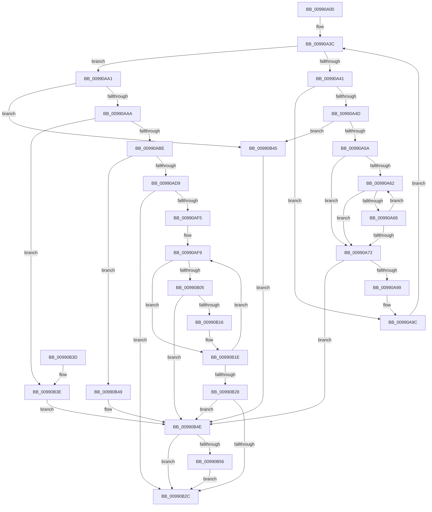

# PnpConcatPWSTR

- RVA: `0x00990A00`–`0x00990B63` (길이 `355` bytes)
- VA: `0x0000000140990A00`
- 실행 섹션: `PAGE`
- PDB 이름 있음: `예`; PDB Function 태그: `아니요`
- unwind 정보 RVA: `0x00098C3C`
- 디코드: `115`개 명령, `355/355` bytes 표시
- 미해석 바이트: `0` (있으면 어셈블리에 `.byte`로 보존)

> 이 문서는 커널 이미지의 기계어와 PDB 기호를 분석해 생성했습니다. 4번과 5번은 함수 원형과 자료형을 바이너리 사용 방식에서 추정한 C 해석이며 원본 소스 복구 결과는 아닙니다.

## 1. Dependencies

- 직접 호출 지점: **3**; 고유 호출 대상: **3**
- 직접 호출자로 확인된 함수: **5**
- RIP 상대 이미지 참조: **0**

### Outgoing calls
- `0x00990ACC` → [ExAllocatePool2](../../poolcode/B8/ExAllocatePool2_function_00B820F0.md) (function, `0x00B820F0`)
- `0x00990B0B` → [RtlStringCbCatW](../../text/45/RtlStringCbCatW_function_00453E24.md) (function, `0x00453E24`)
- `0x00990B59` → [ExFreePoolWithTag](../../poolcode/B8/ExFreePoolWithTag_function_00B82870.md) (function, `0x00B82870`)

### Direct callers
- [PiSwInstanceInfoInit](../8D/PiSwInstanceInfoInit_function_008DBC84.md) at `0x008DBCBF`
- [PiSwStopDestroy](../8F/PiSwStopDestroy_function_008FCA68.md) at `0x008FCB51`
- [PipCheckForDenyExecute](../94/PipCheckForDenyExecute_function_0094F880.md) at `0x0094F8F5`
- [PiDqOpenUserObjectRegKey](PiDqOpenUserObjectRegKey_function_00990444.md) at `0x00990587`
- [PiSwGetChildPdo](../AC/PiSwGetChildPdo_function_00AC3544.md) at `0x00AC3663`

### Static image references
- 디코드된 RIP-relative 메모리 참조가 없습니다.

## 2. Other-region calls and transfers

- 다른 실행 섹션으로 향하는 call: **3**
  - `0x00990ACC` → [ExAllocatePool2](../../poolcode/B8/ExAllocatePool2_function_00B820F0.md) (`PAGE` → `POOLCODE`)
  - `0x00990B0B` → [RtlStringCbCatW](../../text/45/RtlStringCbCatW_function_00453E24.md) (`PAGE` → `.text`)
  - `0x00990B59` → [ExFreePoolWithTag](../../poolcode/B8/ExFreePoolWithTag_function_00B82870.md) (`PAGE` → `POOLCODE`)
- 별도 외부 분기/꼬리 이동을 확인하지 못했습니다.

## 3. Assembly (complete function range)

```asm
00990A00  48 8B C4                        mov rax, rsp
00990A03  4C 89 48 20                     mov qword ptr [rax + 0x20], r9
00990A07  53                              push rbx
00990A08  55                              push rbp
00990A09  56                              push rsi
00990A0A  57                              push rdi
00990A0B  41 54                           push r12
00990A0D  41 56                           push r14
00990A0F  41 57                           push r15
00990A11  48 83 EC 30                     sub rsp, 0x30
00990A15  45 33 E4                        xor r12d, r12d
00990A18  48 8D 78 28                     lea rdi, [rax + 0x28]
00990A1C  4D 8B F0                        mov r14, r8
00990A1F  4D 89 20                        mov qword ptr [r8], r12
00990A22  49 8B F1                        mov rsi, r9
00990A25  44 8B FA                        mov r15d, edx
00990A28  4C 8B D1                        mov r10, rcx
00990A2B  45 8B C4                        mov r8d, r12d
00990A2E  45 8D 5C 24 01                  lea r11d, [r12 + 1]
00990A33  48 83 C7 F8                     add rdi, -8
00990A37  BD 0D 00 00 C0                  mov ebp, 0xc000000d
00990A3C  4C 3B C6                        cmp r8, rsi
00990A3F  73 60                           jae 0x140990aa1
00990A41  48 83 C7 08                     add rdi, 8
00990A45  48 8B 07                        mov rax, qword ptr [rdi]
00990A48  48 85 C0                        test rax, rax
00990A4B  74 4F                           je 0x140990a9c
00990A4D  49 81 FA FF FF FF 7F            cmp r10, 0x7fffffff
00990A54  0F 87 EB 00 00 00               ja 0x140990b45
00990A5A  49 8B D2                        mov rdx, r10
00990A5D  4D 85 D2                        test r10, r10
00990A60  74 10                           je 0x140990a72
00990A62  66 44 39 20                     cmp word ptr [rax], r12w
00990A66  74 0A                           je 0x140990a72
00990A68  48 83 C0 02                     add rax, 2
00990A6C  48 83 EA 01                     sub rdx, 1
00990A70  75 F0                           jne 0x140990a62
00990A72  48 8B C2                        mov rax, rdx
00990A75  49 8B CA                        mov rcx, r10
00990A78  48 F7 D8                        neg rax
00990A7B  48 8B C2                        mov rax, rdx
00990A7E  1B DB                           sbb ebx, ebx
00990A80  48 2B CA                        sub rcx, rdx
00990A83  F7 D3                           not ebx
00990A85  23 DD                           and ebx, ebp
00990A87  48 F7 D8                        neg rax
00990A8A  4D 1B C9                        sbb r9, r9
00990A8D  4C 23 C9                        and r9, rcx
00990A90  48 85 D2                        test rdx, rdx
00990A93  0F 84 B5 00 00 00               je 0x140990b4e
00990A99  4D 03 D9                        add r11, r9
00990A9C  49 FF C0                        inc r8
00990A9F  EB 9B                           jmp 0x140990a3c
00990AA1  4D 3B DA                        cmp r11, r10
00990AA4  0F 87 9B 00 00 00               ja 0x140990b45
00990AAA  B8 02 00 00 00                  mov eax, 2
00990AAF  49 F7 E3                        mul r11
00990AB2  48 8B E8                        mov rbp, rax
00990AB5  48 85 D2                        test rdx, rdx
00990AB8  0F 85 80 00 00 00               jne 0x140990b3e
00990ABE  45 8B C7                        mov r8d, r15d
00990AC1  48 8B D0                        mov rdx, rax
00990AC4  B9 00 01 00 00                  mov ecx, 0x100
00990AC9  41 8B DC                        mov ebx, r12d
00990ACC  E8 1F 16 1F 00                  call 0x140b820f0
00990AD1  49 89 06                        mov qword ptr [r14], rax
00990AD4  48 85 C0                        test rax, rax
00990AD7  74 70                           je 0x140990b49
00990AD9  66 44 89 20                     mov word ptr [rax], r12w
00990ADD  48 8D BC 24 90 00 00 00         lea rdi, [rsp + 0x90]
00990AE5  48 8B 8C 24 88 00 00 00         mov rcx, qword ptr [rsp + 0x88]
00990AED  49 8B F4                        mov rsi, r12
00990AF0  48 85 C9                        test rcx, rcx
00990AF3  74 37                           je 0x140990b2c
00990AF5  48 83 C7 F8                     add rdi, -8
00990AF9  48 8D 7F 08                     lea rdi, [rdi + 8]
00990AFD  4C 8B 07                        mov r8, qword ptr [rdi]
00990B00  4D 85 C0                        test r8, r8
00990B03  74 19                           je 0x140990b1e
00990B05  49 8B 0E                        mov rcx, qword ptr [r14]
00990B08  48 8B D5                        mov rdx, rbp
00990B0B  E8 14 33 AC FF                  call 0x140453e24
00990B10  8B D8                           mov ebx, eax
00990B12  85 C0                           test eax, eax
00990B14  78 38                           js 0x140990b4e
00990B16  48 8B 8C 24 88 00 00 00         mov rcx, qword ptr [rsp + 0x88]
00990B1E  48 FF C6                        inc rsi
00990B21  8B C3                           mov eax, ebx
00990B23  48 3B F1                        cmp rsi, rcx
00990B26  72 D1                           jb 0x140990af9
00990B28  85 C0                           test eax, eax
00990B2A  78 22                           js 0x140990b4e
00990B2C  8B C3                           mov eax, ebx
00990B2E  48 83 C4 30                     add rsp, 0x30
00990B32  41 5F                           pop r15
00990B34  41 5E                           pop r14
00990B36  41 5C                           pop r12
00990B38  5F                              pop rdi
00990B39  5E                              pop rsi
00990B3A  5D                              pop rbp
00990B3B  5B                              pop rbx
00990B3C  C3                              ret
00990B3D  CC                              int3
00990B3E  BB 95 00 00 C0                  mov ebx, 0xc0000095
00990B43  EB 09                           jmp 0x140990b4e
00990B45  8B DD                           mov ebx, ebp
00990B47  EB 05                           jmp 0x140990b4e
00990B49  BB 9A 00 00 C0                  mov ebx, 0xc000009a
00990B4E  49 8B 0E                        mov rcx, qword ptr [r14]
00990B51  48 85 C9                        test rcx, rcx
00990B54  74 D6                           je 0x140990b2c
00990B56  41 8B D7                        mov edx, r15d
00990B59  E8 12 1D 1F 00                  call 0x140b82870
00990B5E  4D 89 26                        mov qword ptr [r14], r12
00990B61  EB C9                           jmp 0x140990b2c
```

## 4. C-style interpretation (structured pseudocode)

```c
__int64 __fastcall PnpConcatPWSTR(__int64 a1, int a2, __int64 a3, __int64 a4, __int64 a5)
{
    __int64 result;
    __int64 v_r11;
    __int64 v_r12;
    __int64 v_rbx;
    __int64 v_rdi;
    __int64 v_rsi;
    __int64 v_rsp;
    unsigned __int64 v_stack_p20;

    *(unsigned __int64 *)(v_rsp + 32) = a4;
    v_rsp = (v_rsp) - (48);
    v_r12 = 0;
    *(unsigned __int64 *)(a3) = 0;
    v_rdi = (v_rsp + 40) + (-8);
loc_00990A3C:
    if (0 >= a4) goto loc_00990AA1;
    v_rdi = (v_rdi) + (8);
    if (*(unsigned __int64 *)(v_rdi) == 0) goto loc_00990A9C;
    if (a1 > 0x7FFFFFFFULL) goto loc_00990B45;
    if (a1 == 0) goto loc_00990A72;
loc_00990A62:
    if ((*(unsigned __int16 *)(*(unsigned __int64 *)(v_rdi))) == 0) goto loc_00990A72;
    result = (*(unsigned __int64 *)(v_rdi)) + (2);
    a2 = (a1) - (1);
    if (condition_is_not_equal) goto loc_00990A62;
loc_00990A72:
    result = -(a2);
    a1 = (a1) - (a2);
    v_rbx = (unsigned int)(~(v_rbx));
    v_rbx = (unsigned int)((v_rbx) & ((unsigned int)((unsigned int)(0xC000000DULL))));
    result = -(a2);
    a4 = (a4) & (a1);
    if (a2 == 0) goto loc_00990B4E;
    v_r11 = (v_r12 + 1) + (a4);
loc_00990A9C:
    a3 = (0) + 1;
    goto loc_00990A3C;
loc_00990AA1:
    if (v_r11 > a1) goto loc_00990B45;
    if (a2 != 0) goto loc_00990B3E;
    result = ExAllocatePool2(256, 2, (unsigned int)((unsigned int)((unsigned int)(a2))), a4);
    *(unsigned __int64 *)(a3) = result;
    if (result == 0) goto loc_00990B49;
    *(unsigned __int16 *)(result) = 0;
    if (v_stack_p20 == 0) goto loc_00990B2C;
    v_rdi = (a5) + (-8);
loc_00990AF9:
    if (*(unsigned __int64 *)(v_rdi + 8) == 0) goto loc_00990B1E;
    result = RtlStringCbCatW(*(unsigned __int64 *)(a3), 2, *(unsigned __int64 *)(v_rdi + 8), a4);
    if (sign_flag) goto loc_00990B4E;
loc_00990B1E:
    v_rsi = (0) + 1;
    if (v_rsi < v_stack_p20) goto loc_00990AF9;
    if (sign_flag) goto loc_00990B4E;
loc_00990B2C:
    v_rsp = (v_rsp) + (48);
    return (unsigned int)((unsigned int)((unsigned int)((unsigned int)(result))));
loc_00990B3E:
    goto loc_00990B4E;
loc_00990B45:
    goto loc_00990B4E;
loc_00990B49:
loc_00990B4E:
    if (*(unsigned __int64 *)(a3) == 0) goto loc_00990B2C;
    result = ExFreePoolWithTag(*(unsigned __int64 *)(a3), (unsigned int)((unsigned int)((unsigned int)(a2))), *(unsigned __int64 *)(v_rdi + 8), a4);
    *(unsigned __int64 *)(a3) = 0;
    goto loc_00990B2C;
}
```

## 5. (Beta) C Style

```c
int64_t PnpConcatPWSTR(int64_t Arg1, int32_t Arg2, void *Arg3, int64_t Arg4, int64_t Arg5)
{
    uint8_t *arg3 = (uint8_t *)Arg3;

    int64_t result;
    int64_t local_r11;
    int64_t local_r12;
    int64_t local_rbx;
    int64_t local_rdi;
    int64_t local_rsi;
    int64_t local_rsp;
    uint64_t v_stack_p20;

    *(uint64_t *)(local_rsp + 0x20) = Arg4;
    local_rsp = (local_rsp) - (48);
    local_r12 = 0;
    *(uint64_t *)(arg3) = 0;
    local_rdi = (local_rsp + 40) + (-8);
loc_00990A3C:
    if (0 >= Arg4) goto loc_00990AA1;
    local_rdi = (local_rdi) + (8);
    if (*(uint64_t *)(local_rdi) == 0) goto loc_00990A9C;
    if (Arg1 > 0x7FFFFFFFULL) goto loc_00990B45;
    if (Arg1 == 0) goto loc_00990A72;
loc_00990A62:
    if ((*(uint16_t *)(*(uint64_t *)(local_rdi))) == 0) goto loc_00990A72;
    result = (*(uint64_t *)(local_rdi)) + (2);
    Arg2 = (Arg1) - (1);
    if (condition_is_not_equal) goto loc_00990A62;
loc_00990A72:
    result = -(Arg2);
    Arg1 = (Arg1) - (Arg2);
    local_rbx = (uint32_t)(~(local_rbx));
    local_rbx = (uint32_t)((local_rbx) & ((uint32_t)((uint32_t)(0xC000000DULL))));
    result = -(Arg2);
    Arg4 = (Arg4) & (Arg1);
    if (Arg2 == 0) goto loc_00990B4E;
    local_r11 = (local_r12 + 1) + (Arg4);
loc_00990A9C:
    Arg3 = (0) + 1;
    goto loc_00990A3C;
loc_00990AA1:
    if (local_r11 > Arg1) goto loc_00990B45;
    if (Arg2 != 0) goto loc_00990B3E;
    result = ExAllocatePool2(256, 2, (uint32_t)((uint32_t)((uint32_t)(Arg2))), Arg4);
    *(uint64_t *)(arg3) = result;
    if (result == 0) goto loc_00990B49;
    *(uint16_t *)(result) = 0;
    if (v_stack_p20 == 0) goto loc_00990B2C;
    local_rdi = (Arg5) + (-8);
loc_00990AF9:
    if (*(uint64_t *)(local_rdi + 0x8) == 0) goto loc_00990B1E;
    result = RtlStringCbCatW(*(uint64_t *)(arg3), 2, *(uint64_t *)(local_rdi + 0x8), Arg4);
    if (sign_flag) goto loc_00990B4E;
loc_00990B1E:
    local_rsi = (0) + 1;
    if (local_rsi < v_stack_p20) goto loc_00990AF9;
    if (sign_flag) goto loc_00990B4E;
loc_00990B2C:
    local_rsp = (local_rsp) + (48);
    return (uint32_t)((uint32_t)((uint32_t)((uint32_t)(result))));
loc_00990B3E:
    goto loc_00990B4E;
loc_00990B45:
    goto loc_00990B4E;
loc_00990B49:
loc_00990B4E:
    if (*(uint64_t *)(arg3) == 0) goto loc_00990B2C;
    result = ExFreePoolWithTag(*(uint64_t *)(arg3), (uint32_t)((uint32_t)((uint32_t)(Arg2))), *(uint64_t *)(local_rdi + 0x8), Arg4);
    *(uint64_t *)(arg3) = 0;
    goto loc_00990B2C;
}
```

### 관측된 메모리 오프셋

구조체 형식이 확인되지 않은 접근은 인자 기준의 오프셋으로만 기록했습니다.

| 기준 인자 | 오프셋 표현 | 폭 (bit) | 접근 |
|---|---:|---:|---|
| `Arg3` | `+ 0x0` | `64` | `R` |
| `Arg3` | `+ 0x0` | `64` | `W` |

## 6. Execution-region graph

[열기: 2D/3D 그래프와 함수 탐색 컨트롤 패널](../../../control-panel.html?section=page&rva=0x00990A00&view=graph)

- 2D 그래프는 위에서 아래로 흐르고, 3D 그래프는 빈 공간을 드래그해 회전합니다. Shift+드래그는 이동, 휠은 확대·축소, 함수 노드 선택은 대상 보고서 이동입니다.

### Static fallback


