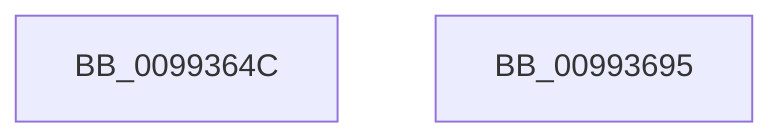

# PnpCtxRegEnumValue

- RVA: `0x0099364C`–`0x00993696` (길이 `74` bytes)
- VA: `0x000000014099364C`
- 실행 섹션: `PAGE`
- PDB 이름 있음: `예`; PDB Function 태그: `아니요`
- unwind 정보 RVA: `0x000697A4`
- 디코드: `19`개 명령, `74/74` bytes 표시
- 미해석 바이트: `0` (있으면 어셈블리에 `.byte`로 보존)

> 이 문서는 커널 이미지의 기계어와 PDB 기호를 분석해 생성했습니다. 4번과 5번은 함수 원형과 자료형을 바이너리 사용 방식에서 추정한 C 해석이며 원본 소스 복구 결과는 아닙니다.

## 1. Dependencies

- 직접 호출 지점: **1**; 고유 호출 대상: **1**
- 직접 호출자로 확인된 함수: **9**
- RIP 상대 이미지 참조: **0**

### Outgoing calls
- `0x0099368A` → [RegRtlEnumValue](RegRtlEnumValue_function_0099369C.md) (function, `0x0099369C`)

### Direct callers
- [PipUpdateDeviceProducts](../../text/5A/PipUpdateDeviceProducts_function_005A46C0.md) at `0x005A4B74`
- [PiDrvDbOverlayCopyKeys](../74/PiDrvDbOverlayCopyKeys_function_007413FC.md) at `0x0074181A`
- [PiDrvDbResolveFilePathKeyValues](../74/PiDrvDbResolveFilePathKeyValues_function_00742C00.md) at `0x00742E84`
- [CmEnumDevicesInContainerWithCallbackWorker](../82/CmEnumDevicesInContainerWithCallbackWorker_function_0082B688.md) at `0x0082B7FC`
- [CmGetDevicesInBaseContainerList](../82/CmGetDevicesInBaseContainerList_function_0082BA6C.md) at `0x0082BBED`
- [CmAppendDeclarativeFilterLevel](../82/CmAppendDeclarativeFilterLevel_function_0082F7A4.md) at `0x0082F89E`
- [DrvDbDeleteObjectSubKey](../83/DrvDbDeleteObjectSubKey_function_00832EEC.md) at `0x00833267`
- [sub_00B3E2D0](../B3/Unknown_function_00B3E2D0.md) at `0x00B3E330`
- [PipResetMatchingFilteredDevices](../../init/C3/PipResetMatchingFilteredDevices_function_00C32260.md) at `0x00C323A1`

### Static image references
- 디코드된 RIP-relative 메모리 참조가 없습니다.

## 2. Other-region calls and transfers

- 다른 실행 섹션으로 향하는 call: **0**
- 별도 외부 분기/꼬리 이동을 확인하지 못했습니다.

## 3. Assembly (complete function range)

```asm
0099364C  40 53                           push rbx
0099364E  48 83 EC 40                     sub rsp, 0x40
00993652  48 8B 84 24 88 00 00 00         mov rax, qword ptr [rsp + 0x88]
0099365A  4D 8B D1                        mov r10, r9
0099365D  4C 8B 4C 24 70                  mov r9, qword ptr [rsp + 0x70]
00993662  45 8B D8                        mov r11d, r8d
00993665  48 89 44 24 30                  mov qword ptr [rsp + 0x30], rax
0099366A  48 8B CA                        mov rcx, rdx
0099366D  48 8B 84 24 80 00 00 00         mov rax, qword ptr [rsp + 0x80]
00993675  4D 8B C2                        mov r8, r10
00993678  48 89 44 24 28                  mov qword ptr [rsp + 0x28], rax
0099367D  41 8B D3                        mov edx, r11d
00993680  48 8B 44 24 78                  mov rax, qword ptr [rsp + 0x78]
00993685  48 89 44 24 20                  mov qword ptr [rsp + 0x20], rax
0099368A  E8 0D 00 00 00                  call 0x14099369c
0099368F  48 83 C4 40                     add rsp, 0x40
00993693  5B                              pop rbx
00993694  C3                              ret
00993695  CC                              int3
```

## 4. C-style interpretation (structured pseudocode)

```c
__int64 __fastcall PnpCtxRegEnumValue(__int64 a1, __int64 a2, int a3, __int64 a4, __int64 a5, __int64 a6, __int64 a7, __int64 a8)
{
    __int64 result;
    __int64 v_rsp;
    unsigned __int64 v_stack_m18;
    unsigned __int64 v_stack_m20;
    unsigned __int64 v_stack_m28;

    v_rsp = (v_rsp) - (64);
    v_stack_m18 = a8;
    v_stack_m20 = a7;
    v_stack_m28 = a6;
    result = RegRtlEnumValue(a2, (unsigned int)((unsigned int)((unsigned int)(a3))), a4, a5);
    v_rsp = (v_rsp) + (64);
    return result;
}
```

## 5. (Beta) C Style

```c
int64_t PnpCtxRegEnumValue(int64_t Arg1, int64_t Arg2, int32_t Arg3, int64_t Arg4, int64_t Arg5, int64_t Arg6, int64_t Arg7, int64_t Arg8)
{
    int64_t result;
    int64_t local_rsp;
    uint64_t v_stack_m18;
    uint64_t v_stack_m20;
    uint64_t v_stack_m28;

    local_rsp = (local_rsp) - (64);
    v_stack_m18 = Arg8;
    v_stack_m20 = Arg7;
    v_stack_m28 = Arg6;
    result = RegRtlEnumValue(Arg2, (uint32_t)((uint32_t)((uint32_t)(Arg3))), Arg4, Arg5);
    local_rsp = (local_rsp) + (64);
    return result;
}
```

## 6. Execution-region graph

[열기: 2D/3D 그래프와 함수 탐색 컨트롤 패널](../../../control-panel.html?section=page&rva=0x0099364C&view=graph)

- 2D 그래프는 위에서 아래로 흐르고, 3D 그래프는 빈 공간을 드래그해 회전합니다. Shift+드래그는 이동, 휠은 확대·축소, 함수 노드 선택은 대상 보고서 이동입니다.

### Static fallback


