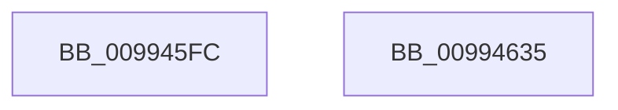

# PnpCtxRegQueryInfoKey

- RVA: `0x009945FC`–`0x00994636` (길이 `58` bytes)
- VA: `0x00000001409945FC`
- 실행 섹션: `PAGE`
- PDB 이름 있음: `예`; PDB Function 태그: `아니요`
- unwind 정보 RVA: `0x00064C80`
- 디코드: `17`개 명령, `58/58` bytes 표시
- 미해석 바이트: `0` (있으면 어셈블리에 `.byte`로 보존)

> 이 문서는 커널 이미지의 기계어와 PDB 기호를 분석해 생성했습니다. 4번과 5번은 함수 원형과 자료형을 바이너리 사용 방식에서 추정한 C 해석이며 원본 소스 복구 결과는 아닙니다.

## 1. Dependencies

- 직접 호출 지점: **1**; 고유 호출 대상: **1**
- 직접 호출자로 확인된 함수: **14**
- RIP 상대 이미지 참조: **0**

### Outgoing calls
- `0x0099462A` → [RegRtlQueryInfoKey](RegRtlQueryInfoKey_function_0099463C.md) (function, `0x0099463C`)

### Direct callers
- [PipUpdateDeviceProducts](../../text/5A/PipUpdateDeviceProducts_function_005A46C0.md) at `0x005A4875`
- [PipUpdateDeviceProducts](../../text/5A/PipUpdateDeviceProducts_function_005A46C0.md) at `0x005A4AE6`
- [PiDrvDbOverlayCopyKeys](../74/PiDrvDbOverlayCopyKeys_function_007413FC.md) at `0x0074154F`
- [PiDrvDbOverlayCopyKeys](../74/PiDrvDbOverlayCopyKeys_function_007413FC.md) at `0x0074174B`
- [PiDrvDbResolveFilePathKeyValues](../74/PiDrvDbResolveFilePathKeyValues_function_00742C00.md) at `0x00742DCD`
- [CmGetDevicesInBaseContainerList](../82/CmGetDevicesInBaseContainerList_function_0082BA6C.md) at `0x0082BB7B`
- [CmRemoveDeviceFromContainerWorker](../82/CmRemoveDeviceFromContainerWorker_function_0082C080.md) at `0x0082C194`
- [CmRemoveDeviceFromContainerWorker](../82/CmRemoveDeviceFromContainerWorker_function_0082C080.md) at `0x0082C1CE`
- [CmRemovePanelDeviceWorker](../82/CmRemovePanelDeviceWorker_function_0082F470.md) at `0x0082F567`
- [CmAppendDeclarativeFilterLevel](../82/CmAppendDeclarativeFilterLevel_function_0082F7A4.md) at `0x0082F830`
- [CmGetInstallerClassCompoundFiltersWorker](../83/CmGetInstallerClassCompoundFiltersWorker_function_00830130.md) at `0x00830194`
- [DrvDbDeleteObjectSubKey](../83/DrvDbDeleteObjectSubKey_function_00832EEC.md) at `0x0083311A`
- [DrvDbDeleteObjectSubKey](../83/DrvDbDeleteObjectSubKey_function_00832EEC.md) at `0x008331F9`
- [DrvDbGetDeviceIdMappedPropertyKeys](../83/DrvDbGetDeviceIdMappedPropertyKeys_function_00833360.md) at `0x008333D6`
- [PiCMEnumerateSubKeys](PiCMEnumerateSubKeys_function_009926E8.md) at `0x009928C5`
- [CmGetDeviceCompoundFiltersWorker](../AF/CmGetDeviceCompoundFiltersWorker_function_00AF9CE8.md) at `0x00AF9D4C`
- [PipMigrateCleanService](../../init/C3/PipMigrateCleanService_function_00C31674.md) at `0x00C3171A`
- [PipResetMatchingFilteredDevices](../../init/C3/PipResetMatchingFilteredDevices_function_00C32260.md) at `0x00C32328`

### Static image references
- 디코드된 RIP-relative 메모리 참조가 없습니다.

## 2. Other-region calls and transfers

- 다른 실행 섹션으로 향하는 call: **0**
- 별도 외부 분기/꼬리 이동을 확인하지 못했습니다.

## 3. Assembly (complete function range)

```asm
009945FC  40 53                           push rbx
009945FE  48 83 EC 30                     sub rsp, 0x30
00994602  48 8B 44 24 70                  mov rax, qword ptr [rsp + 0x70]
00994607  4D 8B D1                        mov r10, r9
0099460A  4C 8B 4C 24 60                  mov r9, qword ptr [rsp + 0x60]
0099460F  4D 8B D8                        mov r11, r8
00994612  48 89 44 24 28                  mov qword ptr [rsp + 0x28], rax
00994617  48 8B CA                        mov rcx, rdx
0099461A  48 8B 44 24 68                  mov rax, qword ptr [rsp + 0x68]
0099461F  4D 8B C2                        mov r8, r10
00994622  49 8B D3                        mov rdx, r11
00994625  48 89 44 24 20                  mov qword ptr [rsp + 0x20], rax
0099462A  E8 0D 00 00 00                  call 0x14099463c
0099462F  48 83 C4 30                     add rsp, 0x30
00994633  5B                              pop rbx
00994634  C3                              ret
00994635  CC                              int3
```

## 4. C-style interpretation (structured pseudocode)

```c
__int64 __fastcall PnpCtxRegQueryInfoKey(__int64 a1, __int64 a2, __int64 a3, __int64 a4, __int64 a5, __int64 a6, __int64 a7)
{
    __int64 result;
    __int64 v_rsp;
    unsigned __int64 v_stack_m10;
    unsigned __int64 v_stack_m18;

    v_rsp = (v_rsp) - (48);
    v_stack_m10 = a7;
    v_stack_m18 = a6;
    result = RegRtlQueryInfoKey(a2, a3, a4, a5);
    v_rsp = (v_rsp) + (48);
    return result;
}
```

## 5. (Beta) C Style

```c
int64_t PnpCtxRegQueryInfoKey(int64_t Arg1, int64_t Arg2, int64_t Arg3, int64_t Arg4, int64_t Arg5, int64_t Arg6, int64_t Arg7)
{
    int64_t result;
    int64_t local_rsp;
    uint64_t v_stack_m10;
    uint64_t v_stack_m18;

    local_rsp = (local_rsp) - (48);
    v_stack_m10 = Arg7;
    v_stack_m18 = Arg6;
    result = RegRtlQueryInfoKey(Arg2, Arg3, Arg4, Arg5);
    local_rsp = (local_rsp) + (48);
    return result;
}
```

## 6. Execution-region graph

[열기: 2D/3D 그래프와 함수 탐색 컨트롤 패널](../../../control-panel.html?section=page&rva=0x009945FC&view=graph)

- 2D 그래프는 위에서 아래로 흐르고, 3D 그래프는 빈 공간을 드래그해 회전합니다. Shift+드래그는 이동, 휠은 확대·축소, 함수 노드 선택은 대상 보고서 이동입니다.

### Static fallback


