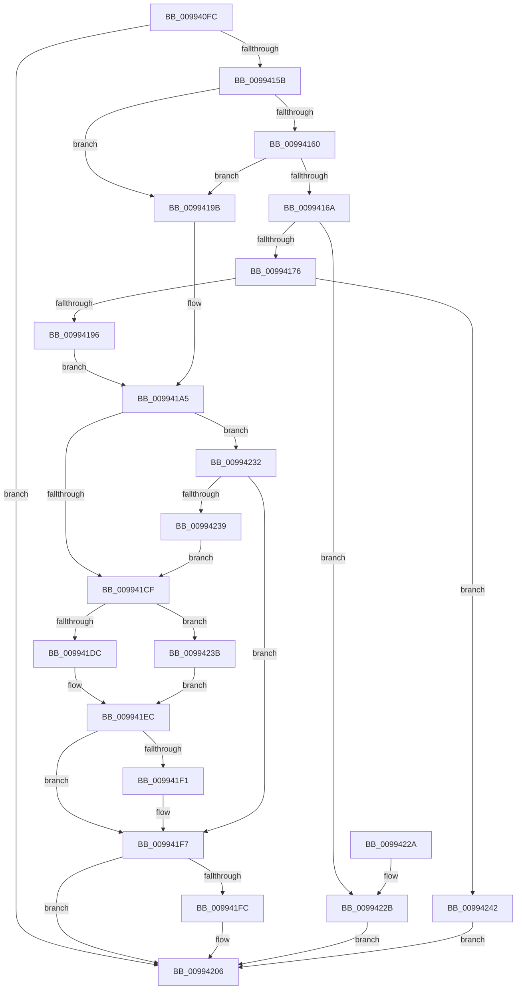

# PnpCtxRegQueryValue

- RVA: `0x009940FC`–`0x00994249` (길이 `333` bytes)
- VA: `0x00000001409940FC`
- 실행 섹션: `PAGE`
- PDB 이름 있음: `예`; PDB Function 태그: `아니요`
- unwind 정보 RVA: `0x00098FE8`
- 디코드: `97`개 명령, `333/333` bytes 표시
- 미해석 바이트: `0` (있으면 어셈블리에 `.byte`로 보존)

> 이 문서는 커널 이미지의 기계어와 PDB 기호를 분석해 생성했습니다. 4번과 5번은 함수 원형과 자료형을 바이너리 사용 방식에서 추정한 C 해석이며 원본 소스 복구 결과는 아닙니다.

## 1. Dependencies

- 직접 호출 지점: **6**; 고유 호출 대상: **6**
- 직접 호출자로 확인된 함수: **38**
- RIP 상대 이미지 참조: **1**

### Outgoing calls
- `0x0099414C` → [RtlInitUnicodeStringEx](../../text/46/RtlInitUnicodeStringEx_function_00463960.md) (function, `0x00463960`)
- `0x00994185` → [ExAllocatePool2](../../poolcode/B8/ExAllocatePool2_function_00B820F0.md) (function, `0x00B820F0`)
- `0x009941C4` → [ZwQueryValueKey](../../text/6A/ZwQueryValueKey_function_006AD3B0.md) (function, `0x006AD3B0`)
- `0x009941E7` → [memcpy](../../text/6C/memcpy_function_006C6840.md) (function, `0x006C6840`)
- `0x00994201` → [ExFreePoolWithTag](../../poolcode/B8/ExFreePoolWithTag_function_00B82870.md) (function, `0x00B82870`)
- `0x00994213` → [_security_check_cookie](../../text/6A/_security_check_cookie_function_006AC640.md) (function, `0x006AC640`)

### Direct callers
- [PipUpdateDeviceProducts](../../text/5A/PipUpdateDeviceProducts_function_005A46C0.md) at `0x005A4951`
- [PipUpdateDeviceProducts](../../text/5A/PipUpdateDeviceProducts_function_005A46C0.md) at `0x005A49A2`
- [PipUpdateDeviceProducts](../../text/5A/PipUpdateDeviceProducts_function_005A46C0.md) at `0x005A49E4`
- [PipUpdateDeviceProducts](../../text/5A/PipUpdateDeviceProducts_function_005A46C0.md) at `0x005A4A2A`
- [PipUpdateDeviceProducts](../../text/5A/PipUpdateDeviceProducts_function_005A46C0.md) at `0x005A4C08`
- [DrvDbGetConfigurationSubKeyCallback](../../text/6A/DrvDbGetConfigurationSubKeyCallback_function_006A2E40.md) at `0x006A2ED5`
- [DrvDbGetConfigurationSubKeyCallback](../../text/6A/DrvDbGetConfigurationSubKeyCallback_function_006A2E40.md) at `0x006A2F14`
- [PipHardwareConfigGetIndex](../72/PipHardwareConfigGetIndex_function_007235B8.md) at `0x0072361D`
- [PnpHardwareConfigCreateBootDriverFlags](../72/PnpHardwareConfigCreateBootDriverFlags_function_00723B88.md) at `0x00723C48`
- [PnpHardwareConfigCreateBootDriverFlags](../72/PnpHardwareConfigCreateBootDriverFlags_function_00723B88.md) at `0x00723E0B`
- [IopGetOriginalServiceName](../72/IopGetOriginalServiceName_function_00726B48.md) at `0x00726B97`
- [PnpCheckDriverDependencies](../72/PnpCheckDriverDependencies_function_0072C3C4.md) at `0x0072C527`
- [PnpCheckDriverDependencies](../72/PnpCheckDriverDependencies_function_0072C3C4.md) at `0x0072C56A`
- [PiUEventBroadcastPortsChangedEvent](../72/PiUEventBroadcastPortsChangedEvent_function_0072DDA8.md) at `0x0072DE4A`
- [PiDrvDbOverlayCopyKeys](../74/PiDrvDbOverlayCopyKeys_function_007413FC.md) at `0x007418D2`
- [PiDrvDbOverlayNodeHive](../74/PiDrvDbOverlayNodeHive_function_00741990.md) at `0x00741C2F`
- [PiDrvDbOverlayNodeHive](../74/PiDrvDbOverlayNodeHive_function_00741990.md) at `0x00741C66`
- [PiDrvDbQueryHiveFileName](../74/PiDrvDbQueryHiveFileName_function_00741DDC.md) at `0x00741E72`
- [PiDrvDbQuerySyncNodesUpdated](../74/PiDrvDbQuerySyncNodesUpdated_function_00741F70.md) at `0x00742126`
- [CmDeviceClassesSubkeyCallback](../82/CmDeviceClassesSubkeyCallback_function_0082C940.md) at `0x0082CAAD`
- [CmAddPanelDeviceWorker](../82/CmAddPanelDeviceWorker_function_0082DF30.md) at `0x0082DFED`
- [DrvDbGetDriverPackageMappedPropertyKeys](../83/DrvDbGetDriverPackageMappedPropertyKeys_function_00833B34.md) at `0x00833D04`
- [DrvDbGetRegValueMappedPropertyKeys](../83/DrvDbGetRegValueMappedPropertyKeys_function_00833EEC.md) at `0x00833F50`
- [DrvDbSetDriverPackageMappedProperty](../83/DrvDbSetDriverPackageMappedProperty_function_00834848.md) at `0x008349E6`
- [PiCMValidateDeviceInstance](../8E/PiCMValidateDeviceInstance_function_008E799C.md) at `0x008E7D8A`
- [PnpRegQueryValueIndirect](../8E/PnpRegQueryValueIndirect_function_008EE210.md) at `0x008EE492`
- [CmGetDeviceInterfaceMappedPropertyFromRegValue](../8F/CmGetDeviceInterfaceMappedPropertyFromRegValue_function_008F40BC.md) at `0x008F445C`
- [CmIsDeviceInContainer](../8F/CmIsDeviceInContainer_function_008FDC44.md) at `0x008FDDEE`
- [_CmAddDeviceToContainerWorker](../8F/_CmAddDeviceToContainerWorker_function_008FF2EC.md) at `0x008FF67F`
- [DrvDbGetDriverPackageMappedProperty](../93/DrvDbGetDriverPackageMappedProperty_function_009305BC.md) at `0x00930832`
- [PnpGetGenericStorePropertyKeys](PnpGetGenericStorePropertyKeys_function_00992378.md) at `0x0099269B`
- [_CmGetInterfaceClassMappedPropertyFromRegValue](_CmGetInterfaceClassMappedPropertyFromRegValue_function_00993EB8.md) at `0x00994048`
- [PnpGetServiceStartType](PnpGetServiceStartType_function_00995D78.md) at `0x00995DD5`
- [_CmGetDeviceMappedPropertyFromInstanceKeyRegValue](../9D/_CmGetDeviceMappedPropertyFromInstanceKeyRegValue_function_009D2F44.md) at `0x009D302E`
- [_CmGetDeviceMappedPropertyFromInstanceKeyRegValue](../9D/_CmGetDeviceMappedPropertyFromInstanceKeyRegValue_function_009D2F44.md) at `0x009D308E`
- [_CmGetInstallerClassMappedPropertyFromRegValue](../9D/_CmGetInstallerClassMappedPropertyFromRegValue_function_009D4058.md) at `0x009D4287`
- [CmGetInstallerClassMappedPropertyFromCoInstallers](../9D/CmGetInstallerClassMappedPropertyFromCoInstallers_function_009D44BC.md) at `0x009D456F`
- [PipHardwareConfigGetLastUseTime](../A2/PipHardwareConfigGetLastUseTime_function_00A28238.md) at `0x00A2829D`
- [PiCMCreateDevice](../AC/PiCMCreateDevice_function_00ACB824.md) at `0x00ACBD25`
- [sub_00B2C1C4](../B2/Unknown_function_00B2C1C4.md) at `0x00B2C276`
- [sub_00B2C1C4](../B2/Unknown_function_00B2C1C4.md) at `0x00B2C314`
- [sub_00B2F7FC](../B2/Unknown_function_00B2F7FC.md) at `0x00B2F979`
- [PipHardwareConfigExists](../../init/C3/PipHardwareConfigExists_function_00C30BE4.md) at `0x00C30CB3`
- [PipMigrateCleanService](../../init/C3/PipMigrateCleanService_function_00C31674.md) at `0x00C316C8`
- [PipMigratePnpState](../../init/C3/PipMigratePnpState_function_00C317D4.md) at `0x00C318A7`
- [PipMigratePnpState](../../init/C3/PipMigratePnpState_function_00C317D4.md) at `0x00C31969`
- [PipMigratePnpState](../../init/C3/PipMigratePnpState_function_00C317D4.md) at `0x00C31A1D`
- [PipMigratePnpState](../../init/C3/PipMigratePnpState_function_00C317D4.md) at `0x00C31AE9`
- [PipResetDevices](../../init/C3/PipResetDevices_function_00C32190.md) at `0x00C3220A`
- [PpDevCfgInit](../../init/C3/PpDevCfgInit_function_00C351A4.md) at `0x00C35377`
- [PpDevCfgInit](../../init/C3/PpDevCfgInit_function_00C351A4.md) at `0x00C353BE`
- [PipProcessPendingObjects](../../init/C3/PipProcessPendingObjects_function_00C35F00.md) at `0x00C3602C`
- [PipProcessPendingObjects](../../init/C3/PipProcessPendingObjects_function_00C35F00.md) at `0x00C36093`

### Static image references
- `0x0099410E` → RVA `0x00E0A740` (`.data`; read)

## 2. Other-region calls and transfers

- 다른 실행 섹션으로 향하는 call: **6**
  - `0x0099414C` → [RtlInitUnicodeStringEx](../../text/46/RtlInitUnicodeStringEx_function_00463960.md) (`PAGE` → `.text`)
  - `0x00994185` → [ExAllocatePool2](../../poolcode/B8/ExAllocatePool2_function_00B820F0.md) (`PAGE` → `POOLCODE`)
  - `0x009941C4` → [ZwQueryValueKey](../../text/6A/ZwQueryValueKey_function_006AD3B0.md) (`PAGE` → `.text`)
  - `0x009941E7` → [memcpy](../../text/6C/memcpy_function_006C6840.md) (`PAGE` → `.text`)
  - `0x00994201` → [ExFreePoolWithTag](../../poolcode/B8/ExFreePoolWithTag_function_00B82870.md) (`PAGE` → `POOLCODE`)
  - `0x00994213` → [_security_check_cookie](../../text/6A/_security_check_cookie_function_006AC640.md) (`PAGE` → `.text`)
- 별도 외부 분기/꼬리 이동을 확인하지 못했습니다.

## 3. Assembly (complete function range)

```asm
009940FC  40 53                           push rbx
009940FE  55                              push rbp
009940FF  56                              push rsi
00994100  57                              push rdi
00994101  41 54                           push r12
00994103  41 56                           push r14
00994105  41 57                           push r15
00994107  48 81 EC E0 00 00 00            sub rsp, 0xe0
0099410E  48 8B 05 2B 66 47 00            mov rax, qword ptr [rip + 0x47662b]
00994115  48 33 C4                        xor rax, rsp
00994118  48 89 84 24 D8 00 00 00         mov qword ptr [rsp + 0xd8], rax
00994120  48 8B AC 24 40 01 00 00         mov rbp, qword ptr [rsp + 0x140]
00994128  48 8D 4C 24 38                  lea rcx, [rsp + 0x38]
0099412D  4C 8B B4 24 48 01 00 00         mov r14, qword ptr [rsp + 0x148]
00994135  4C 8B E2                        mov r12, rdx
00994138  0F 57 C0                        xorps xmm0, xmm0
0099413B  33 F6                           xor esi, esi
0099413D  21 74 24 30                     and dword ptr [rsp + 0x30], esi
00994141  49 8B D0                        mov rdx, r8
00994144  0F 11 44 24 38                  movups xmmword ptr [rsp + 0x38], xmm0
00994149  4D 8B F9                        mov r15, r9
0099414C  E8 0F F8 AC FF                  call 0x140463960
00994151  8B D8                           mov ebx, eax
00994153  85 C0                           test eax, eax
00994155  0F 88 AB 00 00 00               js 0x140994206
0099415B  48 85 ED                        test rbp, rbp
0099415E  74 3B                           je 0x14099419b
00994160  41 8B 06                        mov eax, dword ptr [r14]
00994163  3D 80 00 00 00                  cmp eax, 0x80
00994168  76 31                           jbe 0x14099419b
0099416A  83 C0 0C                        add eax, 0xc
0099416D  83 F8 0C                        cmp eax, 0xc
00994170  0F 82 B5 00 00 00               jb 0x14099422b
00994176  8B D0                           mov edx, eax
00994178  B9 00 01 00 00                  mov ecx, 0x100
0099417D  41 B8 52 45 47 4C               mov r8d, 0x4c474552
00994183  8B D8                           mov ebx, eax
00994185  E8 66 DF 1E 00                  call 0x140b820f0
0099418A  48 8B F0                        mov rsi, rax
0099418D  48 85 C0                        test rax, rax
00994190  0F 84 AC 00 00 00               je 0x140994242
00994196  48 8B F8                        mov rdi, rax
00994199  EB 0A                           jmp 0x1409941a5
0099419B  48 8D 7C 24 48                  lea rdi, [rsp + 0x48]
009941A0  BB 8C 00 00 00                  mov ebx, 0x8c
009941A5  48 8D 44 24 30                  lea rax, [rsp + 0x30]
009941AA  4C 8B CF                        mov r9, rdi
009941AD  48 89 44 24 28                  mov qword ptr [rsp + 0x28], rax
009941B2  48 8D 54 24 38                  lea rdx, [rsp + 0x38]
009941B7  41 B8 02 00 00 00               mov r8d, 2
009941BD  89 5C 24 20                     mov dword ptr [rsp + 0x20], ebx
009941C1  49 8B CC                        mov rcx, r12
009941C4  E8 E7 91 D1 FF                  call 0x1406ad3b0
009941C9  8B D8                           mov ebx, eax
009941CB  85 C0                           test eax, eax
009941CD  75 63                           jne 0x140994232
009941CF  41 8B 16                        mov edx, dword ptr [r14]
009941D2  8B 47 08                        mov eax, dword ptr [rdi + 8]
009941D5  41 89 06                        mov dword ptr [r14], eax
009941D8  3B D0                           cmp edx, eax
009941DA  72 5F                           jb 0x14099423b
009941DC  44 8B 47 08                     mov r8d, dword ptr [rdi + 8]
009941E0  48 8D 57 0C                     lea rdx, [rdi + 0xc]
009941E4  48 8B CD                        mov rcx, rbp
009941E7  E8 54 26 D3 FF                  call 0x1406c6840
009941EC  4D 85 FF                        test r15, r15
009941EF  74 06                           je 0x1409941f7
009941F1  8B 47 04                        mov eax, dword ptr [rdi + 4]
009941F4  41 89 07                        mov dword ptr [r15], eax
009941F7  48 85 F6                        test rsi, rsi
009941FA  74 0A                           je 0x140994206
009941FC  33 D2                           xor edx, edx
009941FE  48 8B CE                        mov rcx, rsi
00994201  E8 6A E6 1E 00                  call 0x140b82870
00994206  8B C3                           mov eax, ebx
00994208  48 8B 8C 24 D8 00 00 00         mov rcx, qword ptr [rsp + 0xd8]
00994210  48 33 CC                        xor rcx, rsp
00994213  E8 28 84 D1 FF                  call 0x1406ac640
00994218  48 81 C4 E0 00 00 00            add rsp, 0xe0
0099421F  41 5F                           pop r15
00994221  41 5E                           pop r14
00994223  41 5C                           pop r12
00994225  5F                              pop rdi
00994226  5E                              pop rsi
00994227  5D                              pop rbp
00994228  5B                              pop rbx
00994229  C3                              ret
0099422A  CC                              int3
0099422B  BB 95 00 00 C0                  mov ebx, 0xc0000095
00994230  EB D4                           jmp 0x140994206
00994232  3D 05 00 00 80                  cmp eax, 0x80000005
00994237  75 BE                           jne 0x1409941f7
00994239  EB 94                           jmp 0x1409941cf
0099423B  BB 23 00 00 C0                  mov ebx, 0xc0000023
00994240  EB AA                           jmp 0x1409941ec
00994242  BB 17 00 00 C0                  mov ebx, 0xc0000017
00994247  EB BD                           jmp 0x140994206
```

## 4. C-style interpretation (structured pseudocode)

```c
__int64 __fastcall PnpCtxRegQueryValue(__int64 a1, __int64 a2, __int64 a3, __int64 a4, __int64 a5, __int64 a6)
{
    __int64 result;
    __int64 v_rsi;
    __int64 v_rsp;
    unsigned __int64 v_stack_m40;
    unsigned __int64 v_stack_mD0;
    unsigned __int64 v_stack_mE0;
    unsigned int v_stack_mE8;
    unsigned __int64 v_stack_mF0;
    unsigned int v_stack_mF8;

    v_rsp = (v_rsp) - (224);
    result = (*(unsigned __int64 *)(v_rip + 4679211)) ^ (v_rsp);
    v_stack_m40 = result;
    v_rsi = 0;
    v_stack_mE0 = v_xmm0;
    result = RtlInitUnicodeStringEx(v_stack_mE0, a3, a3, a4);
    if (sign_flag) goto loc_00994206;
    if (a5 == 0) goto loc_0099419B;
    if (((unsigned int)((unsigned int)(*(unsigned int *)(a6)))) <= 128) goto loc_0099419B;
    result = (unsigned int)(((unsigned int)(*(unsigned int *)(a6))) + (12));
    if (((unsigned int)(result)) < 12) goto loc_0099422B;
    result = ExAllocatePool2(256, (unsigned int)((unsigned int)(result)), (unsigned int)(0x4C474552ULL), a4);
    if (result == 0) goto loc_00994242;
    goto loc_009941A5;
loc_0099419B:
loc_009941A5:
    v_stack_mF0 = v_stack_mE8;
    v_stack_mF8 = 140;
    result = ZwQueryValueKey(a2, v_stack_mE0, 2, v_stack_mD0);
    if ((unsigned int)(result) != 0) goto loc_00994232;
loc_009941CF:
    *(unsigned int *)(a6) = (unsigned int)((unsigned int)(*(unsigned int *)(v_stack_mD0 + 8)));
    if (((unsigned int)((unsigned int)(*(unsigned int *)(a6)))) < ((unsigned int)((unsigned int)(*(unsigned int *)(v_stack_mD0 + 8))))) goto loc_0099423B;
    result = memcpy(a5, v_stack_mD0 + 12, (unsigned int)(*(unsigned int *)(v_stack_mD0 + 8)), v_stack_mD0);
loc_009941EC:
    if (a4 != 0) {
        result = *(unsigned int *)(v_stack_mD0 + 4);
        *(unsigned int *)(a4) = (unsigned int)(result);
    }
    if (result != 0) {
        a2 = 0;
        a1 = result;
        result = ExFreePoolWithTag(a1, a2, (unsigned int)(*(unsigned int *)(v_stack_mD0 + 8)), v_stack_mD0);
    }
    a1 = (v_stack_m40) ^ (v_rsp);
    result = _security_check_cookie(a1, a2, (unsigned int)(*(unsigned int *)(v_stack_mD0 + 8)), v_stack_mD0);
    v_rsp = (v_rsp) + (224);
    return result;
loc_0099422B:
    goto loc_00994206;
loc_00994232:
    if (((unsigned int)(result)) != 0x80000005ULL) goto loc_009941F7;
    goto loc_009941CF;
loc_0099423B:
    goto loc_009941EC;
loc_00994242:
    goto loc_00994206;
}
```

## 5. (Beta) C Style

```c
int64_t PnpCtxRegQueryValue(int64_t Arg1, int64_t Arg2, int64_t Arg3, int64_t Arg4, int64_t Arg5, void *Arg6)
{
    uint8_t *arg6 = (uint8_t *)Arg6;

    int64_t result;
    int64_t local_rsi;
    int64_t local_rsp;
    uint64_t v_stack_m40;
    uint64_t v_stack_mD0;
    uint64_t v_stack_mE0;
    uint32_t v_stack_mE8;
    uint64_t v_stack_mF0;
    uint32_t v_stack_mF8;

    local_rsp = (local_rsp) - (224);
    result = (*(uint64_t *)(v_rip + 0x47662B)) ^ (local_rsp);
    v_stack_m40 = result;
    local_rsi = 0;
    v_stack_mE0 = v_xmm0;
    result = RtlInitUnicodeStringEx(v_stack_mE0, Arg3, Arg3, Arg4);
    if (sign_flag) goto loc_00994206;
    if (Arg5 == 0) goto loc_0099419B;
    if (((uint32_t)((uint32_t)(*(uint32_t *)(arg6)))) <= 128) goto loc_0099419B;
    result = (uint32_t)(((uint32_t)(*(uint32_t *)(arg6))) + (12));
    if (((uint32_t)(result)) < 12) goto loc_0099422B;
    result = ExAllocatePool2(256, (uint32_t)((uint32_t)(result)), (uint32_t)(0x4C474552ULL), Arg4);
    if (result == 0) goto loc_00994242;
    goto loc_009941A5;
loc_0099419B:
loc_009941A5:
    v_stack_mF0 = v_stack_mE8;
    v_stack_mF8 = 140;
    result = ZwQueryValueKey(Arg2, v_stack_mE0, 2, v_stack_mD0);
    if ((uint32_t)(result) != 0) goto loc_00994232;
loc_009941CF:
    *(uint32_t *)(arg6) = (uint32_t)((uint32_t)(*(uint32_t *)(v_stack_mD0 + 0x8)));
    if (((uint32_t)((uint32_t)(*(uint32_t *)(arg6)))) < ((uint32_t)((uint32_t)(*(uint32_t *)(v_stack_mD0 + 0x8))))) goto loc_0099423B;
    result = memcpy(Arg5, v_stack_mD0 + 12, (uint32_t)(*(uint32_t *)(v_stack_mD0 + 0x8)), v_stack_mD0);
loc_009941EC:
    if (Arg4 != 0) {
        result = *(uint32_t *)(v_stack_mD0 + 0x4);
        *(uint32_t *)(Arg4) = (uint32_t)(result);
    }
    if (result != 0) {
        Arg2 = 0;
        Arg1 = result;
        result = ExFreePoolWithTag(Arg1, Arg2, (uint32_t)(*(uint32_t *)(v_stack_mD0 + 0x8)), v_stack_mD0);
    }
    Arg1 = (v_stack_m40) ^ (local_rsp);
    result = _security_check_cookie(Arg1, Arg2, (uint32_t)(*(uint32_t *)(v_stack_mD0 + 0x8)), v_stack_mD0);
    local_rsp = (local_rsp) + (224);
    return result;
loc_0099422B:
    goto loc_00994206;
loc_00994232:
    if (((uint32_t)(result)) != 0x80000005ULL) goto loc_009941F7;
    goto loc_009941CF;
loc_0099423B:
    goto loc_009941EC;
loc_00994242:
    goto loc_00994206;
}
```

### 관측된 메모리 오프셋

구조체 형식이 확인되지 않은 접근은 인자 기준의 오프셋으로만 기록했습니다.

| 기준 인자 | 오프셋 표현 | 폭 (bit) | 접근 |
|---|---:|---:|---|
| `Arg6` | `+ 0x0` | `32` | `R` |
| `Arg6` | `+ 0x0` | `32` | `W` |

## 6. Execution-region graph

[열기: 2D/3D 그래프와 함수 탐색 컨트롤 패널](../../../control-panel.html?section=page&rva=0x009940FC&view=graph)

- 2D 그래프는 위에서 아래로 흐르고, 3D 그래프는 빈 공간을 드래그해 회전합니다. Shift+드래그는 이동, 휠은 확대·축소, 함수 노드 선택은 대상 보고서 이동입니다.

### Static fallback


