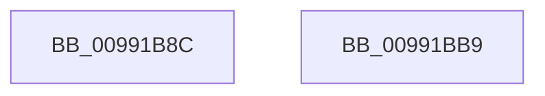

# PnpCtxRegSetValue

- RVA: `0x00991B8C`–`0x00991BBA` (길이 `46` bytes)
- VA: `0x0000000140991B8C`
- 실행 섹션: `PAGE`
- PDB 이름 있음: `예`; PDB Function 태그: `아니요`
- unwind 정보 RVA: `0x00064C80`
- 디코드: `15`개 명령, `46/46` bytes 표시
- 미해석 바이트: `0` (있으면 어셈블리에 `.byte`로 보존)

> 이 문서는 커널 이미지의 기계어와 PDB 기호를 분석해 생성했습니다. 4번과 5번은 함수 원형과 자료형을 바이너리 사용 방식에서 추정한 C 해석이며 원본 소스 복구 결과는 아닙니다.

## 1. Dependencies

- 직접 호출 지점: **1**; 고유 호출 대상: **1**
- 직접 호출자로 확인된 함수: **22**
- RIP 상대 이미지 참조: **0**

### Outgoing calls
- `0x00991BAE` → [RegRtlSetValue](RegRtlSetValue_function_00991B28.md) (function, `0x00991B28`)

### Direct callers
- [PipUpdateDeviceProducts](../../text/5A/PipUpdateDeviceProducts_function_005A46C0.md) at `0x005A4A7B`
- [PipUpdateDeviceProducts](../../text/5A/PipUpdateDeviceProducts_function_005A46C0.md) at `0x005A4A9F`
- [PipUpdateDeviceProducts](../../text/5A/PipUpdateDeviceProducts_function_005A46C0.md) at `0x005A4BE2`
- [PipUpdateDeviceProducts](../../text/5A/PipUpdateDeviceProducts_function_005A46C0.md) at `0x005A4C39`
- [PipUpdateDeviceProducts](../../text/5A/PipUpdateDeviceProducts_function_005A46C0.md) at `0x005A4C64`
- [PipUpdateDeviceProducts](../../text/5A/PipUpdateDeviceProducts_function_005A46C0.md) at `0x005A4C87`
- [PnpHardwareConfigCreateBootDriverFlags](../72/PnpHardwareConfigCreateBootDriverFlags_function_00723B88.md) at `0x00723EB0`
- [PiCMGenerateDeviceInstance](../73/PiCMGenerateDeviceInstance_function_0073B69C.md) at `0x0073B968`
- [PiDrvDbOverlayCopyKeys](../74/PiDrvDbOverlayCopyKeys_function_007413FC.md) at `0x007418F5`
- [PiDrvDbQuerySyncNodesUpdated](../74/PiDrvDbQuerySyncNodesUpdated_function_00741F70.md) at `0x0074217C`
- [PiDrvDbResolveFilePathKeyValues](../74/PiDrvDbResolveFilePathKeyValues_function_00742C00.md) at `0x0074313C`
- [CmSetInstallerClassRegPropWorker](../82/CmSetInstallerClassRegPropWorker_function_0082ABF4.md) at `0x0082AE1F`
- [CmAddPanelDeviceWorker](../82/CmAddPanelDeviceWorker_function_0082DF30.md) at `0x0082E08E`
- [CmSetDeviceMappedPropertyFromInstanceKeyRegValue](../83/CmSetDeviceMappedPropertyFromInstanceKeyRegValue_function_00830F40.md) at `0x0083106B`
- [CmSetDeviceMappedPropertyFromInstanceKeyRegValue](../83/CmSetDeviceMappedPropertyFromInstanceKeyRegValue_function_00830F40.md) at `0x008310A5`
- [CmSetInstallerClassMappedProperty](../83/CmSetInstallerClassMappedProperty_function_008310E8.md) at `0x008312AA`
- [CmSetInterfaceClassMappedPropertyFromRegValue](../83/CmSetInterfaceClassMappedPropertyFromRegValue_function_0083164C.md) at `0x00831797`
- [DrvDbSetDriverPackageMappedProperty](../83/DrvDbSetDriverPackageMappedProperty_function_00834848.md) at `0x00834A6C`
- [DrvDbSetRegValueMappedProperty](../83/DrvDbSetRegValueMappedProperty_function_00834DC8.md) at `0x00834E37`
- [_CmSetDeviceRegPropWorker](../8F/_CmSetDeviceRegPropWorker_function_008FD804.md) at `0x008FD997`
- [PnpSetPropertyWorker](PnpSetPropertyWorker_function_00991C08.md) at `0x00991E6B`
- [_CmSetDeviceMappedPropertyFromDriverKeyRegValue](../A0/_CmSetDeviceMappedPropertyFromDriverKeyRegValue_function_00A0B488.md) at `0x00A0B55D`
- [DrvDbSetDeviceIdDriverInfMatches](../A6/DrvDbSetDeviceIdDriverInfMatches_function_00A6251C.md) at `0x00A627E1`
- [CmSetInstallerClassMappedPropertyFromRegValue](../AA/CmSetInstallerClassMappedPropertyFromRegValue_function_00AAEF20.md) at `0x00AAF107`
- [CmSetInstallerClassMappedPropertyFromRegValue](../AA/CmSetInstallerClassMappedPropertyFromRegValue_function_00AAEF20.md) at `0x00AAF202`
- [PiCMCreateDevice](../AC/PiCMCreateDevice_function_00ACB824.md) at `0x00ACBB1C`
- [sub_00B3665A](../B3/Unknown_function_00B3665A.md) at `0x00B366F4`
- [IopInitializeBootDrivers](../../init/C2/IopInitializeBootDrivers_function_00C2E6F4.md) at `0x00C2F1B8`
- [PipMigratePnpState](../../init/C3/PipMigratePnpState_function_00C317D4.md) at `0x00C31A87`
- [PipMigratePnpState](../../init/C3/PipMigratePnpState_function_00C317D4.md) at `0x00C31AB5`
- [PipMigratePnpState](../../init/C3/PipMigratePnpState_function_00C317D4.md) at `0x00C31CA4`

### Static image references
- 디코드된 RIP-relative 메모리 참조가 없습니다.

## 2. Other-region calls and transfers

- 다른 실행 섹션으로 향하는 call: **0**
- 별도 외부 분기/꼬리 이동을 확인하지 못했습니다.

## 3. Assembly (complete function range)

```asm
00991B8C  40 53                           push rbx
00991B8E  48 83 EC 30                     sub rsp, 0x30
00991B92  8B 44 24 68                     mov eax, dword ptr [rsp + 0x68]
00991B96  45 8B D1                        mov r10d, r9d
00991B99  4C 8B 4C 24 60                  mov r9, qword ptr [rsp + 0x60]
00991B9E  4D 8B D8                        mov r11, r8
00991BA1  48 8B CA                        mov rcx, rdx
00991BA4  89 44 24 20                     mov dword ptr [rsp + 0x20], eax
00991BA8  45 8B C2                        mov r8d, r10d
00991BAB  49 8B D3                        mov rdx, r11
00991BAE  E8 75 FF FF FF                  call 0x140991b28
00991BB3  48 83 C4 30                     add rsp, 0x30
00991BB7  5B                              pop rbx
00991BB8  C3                              ret
00991BB9  CC                              int3
```

## 4. C-style interpretation (structured pseudocode)

```c
__int64 __fastcall PnpCtxRegSetValue(__int64 a1, __int64 a2, __int64 a3, int a4, __int64 a5, unsigned int a6)
{
    __int64 result;
    __int64 v_rsp;
    unsigned int v_stack_m18;

    v_rsp = (v_rsp) - (48);
    v_stack_m18 = (unsigned int)((unsigned int)(a6));
    result = RegRtlSetValue(a2, a3, (unsigned int)((unsigned int)((unsigned int)(a4))), a5);
    v_rsp = (v_rsp) + (48);
    return result;
}
```

## 5. (Beta) C Style

```c
int64_t PnpCtxRegSetValue(int64_t Arg1, int64_t Arg2, int64_t Arg3, int32_t Arg4, int64_t Arg5, uint32_t Arg6)
{
    int64_t result;
    int64_t local_rsp;
    uint32_t v_stack_m18;

    local_rsp = (local_rsp) - (48);
    v_stack_m18 = (uint32_t)((uint32_t)(Arg6));
    result = RegRtlSetValue(Arg2, Arg3, (uint32_t)((uint32_t)((uint32_t)(Arg4))), Arg5);
    local_rsp = (local_rsp) + (48);
    return result;
}
```

## 6. Execution-region graph

[열기: 2D/3D 그래프와 함수 탐색 컨트롤 패널](../../../control-panel.html?section=page&rva=0x00991B8C&view=graph)

- 2D 그래프는 위에서 아래로 흐르고, 3D 그래프는 빈 공간을 드래그해 회전합니다. Shift+드래그는 이동, 휠은 확대·축소, 함수 노드 선택은 대상 보고서 이동입니다.

### Static fallback


