# PnpGetGenericStorePropertyKeys

- RVA: `0x00992378`–`0x009926DF` (길이 `871` bytes)
- VA: `0x0000000140992378`
- 실행 섹션: `PAGE`
- PDB 이름 있음: `예`; PDB Function 태그: `아니요`
- unwind 정보 RVA: `0x00098DC8`
- 디코드: `218`개 명령, `871/871` bytes 표시
- 미해석 바이트: `0` (있으면 어셈블리에 `.byte`로 보존)

> 이 문서는 커널 이미지의 기계어와 PDB 기호를 분석해 생성했습니다. 4번과 5번은 함수 원형과 자료형을 바이너리 사용 방식에서 추정한 C 해석이며 원본 소스 복구 결과는 아닙니다.

## 1. Dependencies

- 직접 호출 지점: **15**; 고유 호출 대상: **10**
- 직접 호출자로 확인된 함수: **5**
- RIP 상대 이미지 참조: **1**

### Outgoing calls
- `0x0099240E` → [_PnpOpenPropertiesKey](_PnpOpenPropertiesKey_function_009938A0.md) (function, `0x009938A0`)
- `0x00992426` → [_security_check_cookie](../../text/6A/_security_check_cookie_function_006AC640.md) (function, `0x006AC640`)
- `0x0099249B` → [RegRtlEnumKey](RegRtlEnumKey_function_00992C00.md) (function, `0x00992C00`)
- `0x009924C0` → [RtlInitUnicodeStringEx](../../text/46/RtlInitUnicodeStringEx_function_00463960.md) (function, `0x00463960`)
- `0x009924D2` → [RtlGUIDFromString](../8F/RtlGUIDFromString_function_008F1EF0.md) (function, `0x008F1EF0`)
- `0x00992519` → [_RegRtlOpenKeyTransacted](../8E/_RegRtlOpenKeyTransacted_function_008EF810.md) (function, `0x008EF810`)
- `0x00992547` → [RegRtlEnumKey](RegRtlEnumKey_function_00992C00.md) (function, `0x00992C00`)
- `0x00992567` → [RtlInitUnicodeStringEx](../../text/46/RtlInitUnicodeStringEx_function_00463960.md) (function, `0x00463960`)
- `0x0099257F` → [RtlUnicodeStringToInteger](RtlUnicodeStringToInteger_function_00993480.md) (function, `0x00993480`)
- `0x009925C6` → [_RegRtlOpenKeyTransacted](../8E/_RegRtlOpenKeyTransacted_function_008EF810.md) (function, `0x008EF810`)
- `0x0099260C` → [RegRtlEnumValue](RegRtlEnumValue_function_0099369C.md) (function, `0x0099369C`)
- `0x00992624` → [ZwClose](../../text/6A/ZwClose_function_006AD2B0.md) (function, `0x006AD2B0`)
- `0x0099266A` → [ZwClose](../../text/6A/ZwClose_function_006AD2B0.md) (function, `0x006AD2B0`)
- `0x0099269B` → [PnpCtxRegQueryValue](PnpCtxRegQueryValue_function_009940FC.md) (function, `0x009940FC`)
- `0x009926BB` → [ZwClose](../../text/6A/ZwClose_function_006AD2B0.md) (function, `0x006AD2B0`)

### Direct callers
- [DrvDbDeleteObjectSubKey](../83/DrvDbDeleteObjectSubKey_function_00832EEC.md) at `0x00832F8C`
- [PiDevCfgCopyObjectProperties](../96/PiDevCfgCopyObjectProperties_function_009645D8.md) at `0x0096466B`
- [PiDevCfgCopyObjectProperties](../96/PiDevCfgCopyObjectProperties_function_009645D8.md) at `0x0096471B`
- [PiDqPnPGetObjectPropertyKeys](PiDqPnPGetObjectPropertyKeys_function_009917B8.md) at `0x009918D9`
- [PnpGetObjectPropertyKeysWorker](PnpGetObjectPropertyKeysWorker_function_0099211C.md) at `0x009921FB`
- [PiCreateDriverSwDeviceCallback](../AB/PiCreateDriverSwDeviceCallback_function_00ABB420.md) at `0x00ABBC35`

### Static image references
- `0x00992397` → RVA `0x00E0A740` (`.data`; read)

## 2. Other-region calls and transfers

- 다른 실행 섹션으로 향하는 call: **6**
  - `0x00992426` → [_security_check_cookie](../../text/6A/_security_check_cookie_function_006AC640.md) (`PAGE` → `.text`)
  - `0x009924C0` → [RtlInitUnicodeStringEx](../../text/46/RtlInitUnicodeStringEx_function_00463960.md) (`PAGE` → `.text`)
  - `0x00992567` → [RtlInitUnicodeStringEx](../../text/46/RtlInitUnicodeStringEx_function_00463960.md) (`PAGE` → `.text`)
  - `0x00992624` → [ZwClose](../../text/6A/ZwClose_function_006AD2B0.md) (`PAGE` → `.text`)
  - `0x0099266A` → [ZwClose](../../text/6A/ZwClose_function_006AD2B0.md) (`PAGE` → `.text`)
  - `0x009926BB` → [ZwClose](../../text/6A/ZwClose_function_006AD2B0.md) (`PAGE` → `.text`)
- 별도 외부 분기/꼬리 이동을 확인하지 못했습니다.

## 3. Assembly (complete function range)

```asm
00992378  48 89 5C 24 20                  mov qword ptr [rsp + 0x20], rbx
0099237D  55                              push rbp
0099237E  56                              push rsi
0099237F  57                              push rdi
00992380  41 54                           push r12
00992382  41 55                           push r13
00992384  41 56                           push r14
00992386  41 57                           push r15
00992388  48 8D AC 24 40 FF FF FF         lea rbp, [rsp - 0xc0]
00992390  48 81 EC C0 01 00 00            sub rsp, 0x1c0
00992397  48 8B 05 A2 83 47 00            mov rax, qword ptr [rip + 0x4783a2]
0099239E  48 33 C4                        xor rax, rsp
009923A1  48 89 85 B0 00 00 00            mov qword ptr [rbp + 0xb0], rax
009923A8  48 8B BD 30 01 00 00            mov rdi, qword ptr [rbp + 0x130]
009923AF  33 DB                           xor ebx, ebx
009923B1  48 8B 85 20 01 00 00            mov rax, qword ptr [rbp + 0x120]
009923B8  0F 57 C0                        xorps xmm0, xmm0
009923BB  44 88 4C 24 40                  mov byte ptr [rsp + 0x40], r9b
009923C0  0F 57 C9                        xorps xmm1, xmm1
009923C3  48 89 45 80                     mov qword ptr [rbp - 0x80], rax
009923C7  4D 8B E8                        mov r13, r8
009923CA  89 1F                           mov dword ptr [rdi], ebx
009923CC  48 8B F1                        mov rsi, rcx
009923CF  48 89 5C 24 60                  mov qword ptr [rsp + 0x60], rbx
009923D4  48 89 5C 24 58                  mov qword ptr [rsp + 0x58], rbx
009923D9  48 89 5C 24 50                  mov qword ptr [rsp + 0x50], rbx
009923DE  89 5C 24 48                     mov dword ptr [rsp + 0x48], ebx
009923E2  89 5C 24 4C                     mov dword ptr [rsp + 0x4c], ebx
009923E6  0F 11 45 88                     movups xmmword ptr [rbp - 0x78], xmm0
009923EA  0F 11 4C 24 70                  movups xmmword ptr [rsp + 0x70], xmm1
009923EF  4D 85 C0                        test r8, r8
009923F2  75 53                           jne 0x140992447
009923F4  48 8D 44 24 60                  lea rax, [rsp + 0x60]
009923F9  41 B9 09 00 00 00               mov r9d, 9
009923FF  48 89 44 24 30                  mov qword ptr [rsp + 0x30], rax
00992404  45 33 C0                        xor r8d, r8d
00992407  48 8B CE                        mov rcx, rsi
0099240A  88 5C 24 20                     mov byte ptr [rsp + 0x20], bl
0099240E  E8 8D 14 00 00                  call 0x1409938a0
00992413  3D 34 00 00 C0                  cmp eax, 0xc0000034
00992418  75 5A                           jne 0x140992474
0099241A  8B C3                           mov eax, ebx
0099241C  48 8B 8D B0 00 00 00            mov rcx, qword ptr [rbp + 0xb0]
00992423  48 33 CC                        xor rcx, rsp
00992426  E8 15 A2 D1 FF                  call 0x1406ac640
0099242B  48 8B 9C 24 18 02 00 00         mov rbx, qword ptr [rsp + 0x218]
00992433  48 81 C4 C0 01 00 00            add rsp, 0x1c0
0099243A  41 5F                           pop r15
0099243C  41 5E                           pop r14
0099243E  41 5D                           pop r13
00992440  41 5C                           pop r12
00992442  5F                              pop rdi
00992443  5E                              pop rsi
00992444  5D                              pop rbp
00992445  C3                              ret
00992446  CC                              int3
00992447  B9 55 00 00 00                  mov ecx, 0x55
0099244C  49 8B C5                        mov rax, r13
0099244F  66 39 18                        cmp word ptr [rax], bx
00992452  74 0A                           je 0x14099245e
00992454  48 83 C0 02                     add rax, 2
00992458  48 83 E9 01                     sub rcx, 1
0099245C  75 F1                           jne 0x14099244f
0099245E  48 8B C1                        mov rax, rcx
00992461  48 F7 D8                        neg rax
00992464  1B C0                           sbb eax, eax
00992466  F7 D0                           not eax
00992468  25 0D 00 00 C0                  and eax, 0xc000000d
0099246D  48 85 C9                        test rcx, rcx
00992470  74 AA                           je 0x14099241c
00992472  EB 80                           jmp 0x1409923f4
00992474  85 C0                           test eax, eax
00992476  78 A4                           js 0x14099241c
00992478  44 8B BD 28 01 00 00            mov r15d, dword ptr [rbp + 0x128]
0099247F  44 8B E3                        mov r12d, ebx
00992482  48 8B 4C 24 60                  mov rcx, qword ptr [rsp + 0x60]
00992487  4C 8D 4C 24 44                  lea r9, [rsp + 0x44]
0099248C  4C 8D 45 B0                     lea r8, [rbp - 0x50]
00992490  C7 44 24 44 27 00 00 00         mov dword ptr [rsp + 0x44], 0x27
00992498  41 8B D4                        mov edx, r12d
0099249B  E8 60 07 00 00                  call 0x140992c00
009924A0  41 FF C4                        inc r12d
009924A3  44 89 64 24 68                  mov dword ptr [rsp + 0x68], r12d
009924A8  3D 23 00 00 C0                  cmp eax, 0xc0000023
009924AD  74 D3                           je 0x140992482
009924AF  85 C0                           test eax, eax
009924B1  0F 85 FF 01 00 00               jne 0x1409926b6
009924B7  48 8D 55 B0                     lea rdx, [rbp - 0x50]
009924BB  48 8D 4C 24 70                  lea rcx, [rsp + 0x70]
009924C0  E8 9B 14 AD FF                  call 0x140463960
009924C5  85 C0                           test eax, eax
009924C7  78 B9                           js 0x140992482
009924C9  48 8D 55 88                     lea rdx, [rbp - 0x78]
009924CD  48 8D 4C 24 70                  lea rcx, [rsp + 0x70]
009924D2  E8 19 FA F5 FF                  call 0x1408f1ef0
009924D7  85 C0                           test eax, eax
009924D9  78 A7                           js 0x140992482
009924DB  48 85 F6                        test rsi, rsi
009924DE  0F 84 F3 01 00 00               je 0x1409926d7
009924E4  48 8B 86 E0 00 00 00            mov rax, qword ptr [rsi + 0xe0]
009924EB  48 85 C0                        test rax, rax
009924EE  0F 84 E3 01 00 00               je 0x1409926d7
009924F4  48 8B 48 08                     mov rcx, qword ptr [rax + 8]
009924F8  48 89 4C 24 28                  mov qword ptr [rsp + 0x28], rcx
009924FD  48 8D 44 24 58                  lea rax, [rsp + 0x58]
00992502  48 8B 4C 24 60                  mov rcx, qword ptr [rsp + 0x60]
00992507  48 8D 55 B0                     lea rdx, [rbp - 0x50]
0099250B  41 B9 09 00 00 00               mov r9d, 9
00992511  48 89 44 24 20                  mov qword ptr [rsp + 0x20], rax
00992516  45 33 C0                        xor r8d, r8d
00992519  E8 F2 D2 F5 FF                  call 0x1408ef810
0099251E  85 C0                           test eax, eax
00992520  0F 88 5C FF FF FF               js 0x140992482
00992526  44 8A 64 24 40                  mov r12b, byte ptr [rsp + 0x40]
0099252B  44 8B F3                        mov r14d, ebx
0099252E  48 8B 4C 24 58                  mov rcx, qword ptr [rsp + 0x58]
00992533  4C 8D 4C 24 44                  lea r9, [rsp + 0x44]
00992538  4C 8D 45 98                     lea r8, [rbp - 0x68]
0099253C  C7 44 24 44 09 00 00 00         mov dword ptr [rsp + 0x44], 9
00992544  41 8B D6                        mov edx, r14d
00992547  E8 B4 06 00 00                  call 0x140992c00
0099254C  41 FF C6                        inc r14d
0099254F  3D 23 00 00 C0                  cmp eax, 0xc0000023
00992554  74 D8                           je 0x14099252e
00992556  85 C0                           test eax, eax
00992558  0F 85 07 01 00 00               jne 0x140992665
0099255E  48 8D 55 98                     lea rdx, [rbp - 0x68]
00992562  48 8D 4C 24 70                  lea rcx, [rsp + 0x70]
00992567  E8 F4 13 AD FF                  call 0x140463960
0099256C  85 C0                           test eax, eax
0099256E  78 BE                           js 0x14099252e
00992570  4C 8D 44 24 4C                  lea r8, [rsp + 0x4c]
00992575  BA 10 00 00 00                  mov edx, 0x10
0099257A  48 8D 4C 24 70                  lea rcx, [rsp + 0x70]
0099257F  E8 FC 0E 00 00                  call 0x140993480
00992584  85 C0                           test eax, eax
00992586  78 A6                           js 0x14099252e
00992588  48 85 F6                        test rsi, rsi
0099258B  0F 84 3E 01 00 00               je 0x1409926cf
00992591  48 8B 86 E0 00 00 00            mov rax, qword ptr [rsi + 0xe0]
00992598  48 85 C0                        test rax, rax
0099259B  0F 84 2E 01 00 00               je 0x1409926cf
009925A1  48 8B 48 08                     mov rcx, qword ptr [rax + 8]
009925A5  48 89 4C 24 28                  mov qword ptr [rsp + 0x28], rcx
009925AA  48 8D 44 24 50                  lea rax, [rsp + 0x50]
009925AF  48 8B 4C 24 58                  mov rcx, qword ptr [rsp + 0x58]
009925B4  48 8D 55 98                     lea rdx, [rbp - 0x68]
009925B8  41 B9 01 00 00 00               mov r9d, 1
009925BE  48 89 44 24 20                  mov qword ptr [rsp + 0x20], rax
009925C3  45 33 C0                        xor r8d, r8d
009925C6  E8 45 D2 F5 FF                  call 0x1408ef810
009925CB  85 C0                           test eax, eax
009925CD  0F 88 5B FF FF FF               js 0x14099252e
009925D3  45 84 E4                        test r12b, r12b
009925D6  0F 84 9D 00 00 00               je 0x140992679
009925DC  33 DB                           xor ebx, ebx
009925DE  48 83 64 24 30 00               and qword ptr [rsp + 0x30], 0
009925E4  48 8D 44 24 48                  lea rax, [rsp + 0x48]
009925E9  48 83 64 24 28 00               and qword ptr [rsp + 0x28], 0
009925EF  4C 8D 4C 24 44                  lea r9, [rsp + 0x44]
009925F4  48 8B 4C 24 50                  mov rcx, qword ptr [rsp + 0x50]
009925F9  4C 8D 45 00                     lea r8, [rbp]
009925FD  8B D3                           mov edx, ebx
009925FF  48 89 44 24 20                  mov qword ptr [rsp + 0x20], rax
00992604  C7 44 24 44 55 00 00 00         mov dword ptr [rsp + 0x44], 0x55
0099260C  E8 8B 10 00 00                  call 0x14099369c
00992611  FF C3                           inc ebx
00992613  3D 23 00 00 C0                  cmp eax, 0xc0000023
00992618  74 C4                           je 0x1409925de
0099261A  85 C0                           test eax, eax
0099261C  0F 94 C3                        sete bl
0099261F  48 8B 4C 24 50                  mov rcx, qword ptr [rsp + 0x50]
00992624  E8 87 AC D1 FF                  call 0x1406ad2b0
00992629  84 DB                           test bl, bl
0099262B  BB 00 00 00 00                  mov ebx, 0
00992630  0F 84 F8 FE FF FF               je 0x14099252e
00992636  8B 07                           mov eax, dword ptr [rdi]
00992638  41 3B C7                        cmp eax, r15d
0099263B  73 1F                           jae 0x14099265c
0099263D  48 8B 5D 80                     mov rbx, qword ptr [rbp - 0x80]
00992641  48 8D 0C 80                     lea rcx, [rax + rax*4]
00992645  0F 10 45 88                     movups xmm0, xmmword ptr [rbp - 0x78]
00992649  F3 0F 7F 04 8B                  movdqu xmmword ptr [rbx + rcx*4], xmm0
0099264E  8B 07                           mov eax, dword ptr [rdi]
00992650  48 8D 0C 80                     lea rcx, [rax + rax*4]
00992654  8B 44 24 4C                     mov eax, dword ptr [rsp + 0x4c]
00992658  89 44 8B 10                     mov dword ptr [rbx + rcx*4 + 0x10], eax
0099265C  FF 07                           inc dword ptr [rdi]
0099265E  33 DB                           xor ebx, ebx
00992660  E9 C9 FE FF FF                  jmp 0x14099252e
00992665  48 8B 4C 24 58                  mov rcx, qword ptr [rsp + 0x58]
0099266A  E8 41 AC D1 FF                  call 0x1406ad2b0
0099266F  44 8B 64 24 68                  mov r12d, dword ptr [rsp + 0x68]
00992674  E9 09 FE FF FF                  jmp 0x140992482
00992679  48 8B 54 24 50                  mov rdx, qword ptr [rsp + 0x50]
0099267E  48 8D 44 24 44                  lea rax, [rsp + 0x44]
00992683  83 64 24 44 00                  and dword ptr [rsp + 0x44], 0
00992688  4C 8D 4C 24 48                  lea r9, [rsp + 0x48]
0099268D  48 89 44 24 28                  mov qword ptr [rsp + 0x28], rax
00992692  4D 8B C5                        mov r8, r13
00992695  48 83 64 24 20 00               and qword ptr [rsp + 0x20], 0
0099269B  E8 5C 1A 00 00                  call 0x1409940fc
009926A0  85 C0                           test eax, eax
009926A2  74 0B                           je 0x1409926af
009926A4  3D 23 00 00 C0                  cmp eax, 0xc0000023
009926A9  0F 85 70 FF FF FF               jne 0x14099261f
009926AF  B3 01                           mov bl, 1
009926B1  E9 69 FF FF FF                  jmp 0x14099261f
009926B6  48 8B 4C 24 60                  mov rcx, qword ptr [rsp + 0x60]
009926BB  E8 F0 AB D1 FF                  call 0x1406ad2b0
009926C0  44 3B 3F                        cmp r15d, dword ptr [rdi]
009926C3  1B C0                           sbb eax, eax
009926C5  25 23 00 00 C0                  and eax, 0xc0000023
009926CA  E9 4D FD FF FF                  jmp 0x14099241c
009926CF  48 8B CB                        mov rcx, rbx
009926D2  E9 CE FE FF FF                  jmp 0x1409925a5
009926D7  48 8B CB                        mov rcx, rbx
009926DA  E9 19 FE FF FF                  jmp 0x1409924f8
```

## 4. C-style interpretation (structured pseudocode)

```c
__int64 __fastcall PnpGetGenericStorePropertyKeys(__int64 a1, __int64 a2, __int64 a3, unsigned __int8 a4, __int64 a5, unsigned int a6, __int64 a7)
{
    __int64 result;
    __int64 v_r12;
    __int64 v_r14;
    __int64 v_rbx;
    __int64 v_rsp;
    unsigned __int64 v_stack_m148;
    unsigned __int64 v_stack_m160;
    unsigned __int64 v_stack_m170;
    unsigned __int64 v_stack_m178;
    unsigned __int64 v_stack_m188;
    unsigned __int64 v_stack_m198;
    unsigned __int64 v_stack_m1A0;
    unsigned __int64 v_stack_m1A8;
    unsigned int v_stack_m1AC;
    unsigned int v_stack_m1B0;
    unsigned __int8 v_stack_m1B8;
    unsigned __int64 v_stack_m1C8;
    unsigned __int8 v_stack_m1D8;
    unsigned __int64 v_stack_m48;
    unsigned __int64 v_stack_mF8;
    unsigned __int64 v_stack_p20;
    unsigned __int64 v_stack_p28;
    unsigned __int64 v_stack_p30;
    unsigned __int8 v_stack_p40;
    unsigned __int64 v_stack_p44;
    unsigned __int64 v_stack_p48;
    unsigned __int64 v_stack_p4C;
    unsigned __int64 v_stack_p50;
    unsigned __int64 v_stack_p58;
    unsigned __int64 v_stack_p60;
    unsigned int v_stack_p68;
    unsigned __int64 v_stack_p70;

    v_stack_p20 = v_rbx;
    v_rsp = (v_rsp) - (448);
    result = (*(unsigned __int64 *)(v_rip + 4686754)) ^ (v_rsp);
    v_stack_m48 = result;
    v_rbx = 0;
    v_stack_m1B8 = a4;
    v_stack_m178 = a5;
    *(unsigned int *)(a7) = 0;
    v_stack_m198 = 0;
    v_stack_m1A0 = 0;
    v_stack_m1A8 = 0;
    v_stack_m1B0 = 0;
    v_stack_m1AC = 0;
    v_stack_m170 = v_xmm0;
    v_stack_m188 = v_xmm1;
    if (a3 != 0) goto loc_00992447;
loc_009923F4:
    v_stack_m1C8 = v_stack_m198;
    a3 = 0;
    v_stack_m1D8 = 0;
    result = _PnpOpenPropertiesKey(a1, a2, a3, 9);
    if (((unsigned int)(result)) != 0xC0000034ULL) goto loc_00992474;
loc_0099241C:
    a1 = (v_stack_m48) ^ (v_rsp);
    result = _security_check_cookie(a1, a2, a3, 9);
    v_rsp = (v_rsp) + (448);
    return result;
loc_00992447:
loc_0099244F:
    if ((*(unsigned __int16 *)(0)) == ((unsigned __int16)(v_stack_p20))) goto loc_0099245E;
    result = (0) + (2);
    a1 = (85) - (1);
    if (condition_is_not_equal) goto loc_0099244F;
loc_0099245E:
    result = -(a1);
    result = (unsigned int)(~(result));
    result = (unsigned int)((result) & (0xC000000DULL));
    if (a1 == 0) goto loc_0099241C;
    goto loc_009923F4;
loc_00992474:
    if (sign_flag) goto loc_0099241C;
loc_00992482:
    v_stack_p44 = 39;
    result = RegRtlEnumKey(v_stack_p60, (unsigned int)((unsigned int)((unsigned int)((unsigned int)(v_stack_p20)))), v_stack_m148, v_stack_p44);
    v_r12 = (unsigned int)(((unsigned int)((unsigned int)(v_stack_p20))) + 1);
    v_stack_p68 = (unsigned int)(v_r12);
    if (((unsigned int)(result)) == 0xC0000023ULL) goto loc_00992482;
    if ((unsigned int)(result) != 0) goto loc_009926B6;
    result = RtlInitUnicodeStringEx(v_stack_p70, v_stack_m148, v_stack_m148, v_stack_p44);
    if (sign_flag) goto loc_00992482;
    result = RtlGUIDFromString(v_stack_p70, v_stack_m170, v_stack_m148, v_stack_p44);
    if (sign_flag) goto loc_00992482;
    if (a1 == 0) goto loc_009926D7;
    if (*(unsigned __int64 *)(a1 + 224) == 0) goto loc_009926D7;
loc_009924F8:
    v_stack_p28 = *(unsigned __int64 *)(*(unsigned __int64 *)(a1 + 224) + 8);
    v_stack_p20 = v_stack_p58;
    a3 = 0;
    result = _RegRtlOpenKeyTransacted(v_stack_p60, v_stack_m148, a3, 9);
    if (sign_flag) goto loc_00992482;
loc_0099252E:
    v_stack_p44 = 9;
    result = RegRtlEnumKey(v_stack_p58, (unsigned int)((unsigned int)((unsigned int)((unsigned int)(v_stack_p20)))), v_stack_m160, v_stack_p44);
    v_r14 = (unsigned int)(((unsigned int)((unsigned int)(v_stack_p20))) + 1);
    if (((unsigned int)(result)) == 0xC0000023ULL) goto loc_0099252E;
    if ((unsigned int)(result) != 0) goto loc_00992665;
    result = RtlInitUnicodeStringEx(v_stack_p70, v_stack_m160, v_stack_m160, v_stack_p44);
    if (sign_flag) goto loc_0099252E;
    result = RtlUnicodeStringToInteger(v_stack_p70, 16, v_stack_p4C, v_stack_p44);
    if (sign_flag) goto loc_0099252E;
    if (a1 == 0) goto loc_009926CF;
    if (*(unsigned __int64 *)(a1 + 224) == 0) goto loc_009926CF;
loc_009925A5:
    v_stack_p28 = *(unsigned __int64 *)(*(unsigned __int64 *)(a1 + 224) + 8);
    v_stack_p20 = v_stack_p50;
    a3 = 0;
    result = _RegRtlOpenKeyTransacted(v_stack_p58, v_stack_m160, a3, 1);
    if (sign_flag) goto loc_0099252E;
    if ((unsigned __int8)(v_stack_p40) == 0) goto loc_00992679;
    v_rbx = 0;
loc_009925DE:
    v_stack_p20 = v_stack_p48;
    v_stack_p44 = 85;
    result = RegRtlEnumValue(v_stack_p50, 0, v_stack_mF8, v_stack_p44);
    v_rbx = (unsigned int)((v_rbx) + 1);
    if (((unsigned int)(result)) == 0xC0000023ULL) goto loc_009925DE;
    v_rbx = ((unsigned int)(result) == 0) ? 1 : 0;
loc_0099261F:
    result = ZwClose(v_stack_p50, 0, v_stack_mF8, v_stack_p44);
    if ((unsigned __int8)(v_rbx) == 0) goto loc_0099252E;
    result = (unsigned int)(*(unsigned int *)(a7));
    v_rbx = 0;
    if (((unsigned int)((unsigned int)(*(unsigned int *)(a7)))) < ((unsigned int)((unsigned int)(a6)))) {
        v_rbx = v_stack_m178;
        a1 = (unsigned int)(*(unsigned int *)(a7)) + (unsigned int)(*(unsigned int *)(a7)) * 4;
        *(unsigned __int64 *)(v_rbx + a1 * 4) = v_xmm0;
        result = *(unsigned int *)(a7);
        a1 = result + result * 4;
        result = v_stack_p4C;
        *(unsigned int *)(v_rbx + a1 * 4 + 16) = (unsigned int)(result);
    }
    v_rbx = 0;
    goto loc_0099252E;
loc_00992665:
    result = ZwClose(v_stack_p58, 0, v_stack_mF8, v_stack_p44);
    goto loc_00992482;
loc_00992679:
    v_stack_p28 = v_stack_p44;
    result = PnpCtxRegQueryValue(v_stack_p58, v_stack_p50, 0, v_stack_p48);
    if ((unsigned int)(result) == 0) goto loc_009926AF;
    if (((unsigned int)(result)) != 0xC0000023ULL) goto loc_0099261F;
loc_009926AF:
    goto loc_0099261F;
loc_009926B6:
    result = ZwClose(v_stack_p60, v_stack_p50, 0, v_stack_p48);
    result = (unsigned int)((result) & (0xC0000023ULL));
    goto loc_0099241C;
loc_009926CF:
    goto loc_009925A5;
loc_009926D7:
    goto loc_009924F8;
}
```

## 5. (Beta) C Style

```c
int64_t PnpGetGenericStorePropertyKeys(int64_t Arg1, int64_t Arg2, void *Arg3, uint8_t Arg4, int64_t Arg5, uint32_t Arg6, void *Arg7)
{
    uint8_t *arg3 = (uint8_t *)Arg3;
    uint8_t *arg7 = (uint8_t *)Arg7;

    int64_t result;
    int64_t local_r12;
    int64_t local_r14;
    int64_t local_rbx;
    int64_t local_rsp;
    uint64_t v_stack_m148;
    uint64_t v_stack_m160;
    uint64_t v_stack_m170;
    uint64_t v_stack_m178;
    uint64_t v_stack_m188;
    uint64_t v_stack_m198;
    uint64_t v_stack_m1A0;
    uint64_t v_stack_m1A8;
    uint32_t v_stack_m1AC;
    uint32_t v_stack_m1B0;
    uint8_t v_stack_m1B8;
    uint64_t v_stack_m1C8;
    uint8_t v_stack_m1D8;
    uint64_t v_stack_m48;
    uint64_t v_stack_mF8;
    uint64_t v_stack_p20;
    uint64_t v_stack_p28;
    uint64_t v_stack_p30;
    uint8_t v_stack_p40;
    uint64_t v_stack_p44;
    uint64_t v_stack_p48;
    uint64_t v_stack_p4C;
    uint64_t v_stack_p50;
    uint64_t v_stack_p58;
    uint64_t v_stack_p60;
    uint32_t v_stack_p68;
    uint64_t v_stack_p70;

    v_stack_p20 = local_rbx;
    local_rsp = (local_rsp) - (448);
    result = (*(uint64_t *)(v_rip + 0x4783A2)) ^ (local_rsp);
    v_stack_m48 = result;
    local_rbx = 0;
    v_stack_m1B8 = Arg4;
    v_stack_m178 = Arg5;
    *(uint32_t *)(arg7) = 0;
    v_stack_m198 = 0;
    v_stack_m1A0 = 0;
    v_stack_m1A8 = 0;
    v_stack_m1B0 = 0;
    v_stack_m1AC = 0;
    v_stack_m170 = v_xmm0;
    v_stack_m188 = v_xmm1;
    if (Arg3 != NULL) goto loc_00992447;
loc_009923F4:
    v_stack_m1C8 = v_stack_m198;
    Arg3 = 0;
    v_stack_m1D8 = 0;
    result = _PnpOpenPropertiesKey(Arg1, Arg2, Arg3, 9);
    if (((uint32_t)(result)) != 0xC0000034ULL) goto loc_00992474;
loc_0099241C:
    Arg1 = (v_stack_m48) ^ (local_rsp);
    result = _security_check_cookie(Arg1, Arg2, Arg3, 9);
    local_rsp = (local_rsp) + (448);
    return result;
loc_00992447:
loc_0099244F:
    if ((*(uint16_t *)(0)) == ((uint16_t)(v_stack_p20))) goto loc_0099245E;
    result = (0) + (2);
    Arg1 = (85) - (1);
    if (condition_is_not_equal) goto loc_0099244F;
loc_0099245E:
    result = -(Arg1);
    result = (uint32_t)(~(result));
    result = (uint32_t)((result) & (0xC000000DULL));
    if (Arg1 == 0) goto loc_0099241C;
    goto loc_009923F4;
loc_00992474:
    if (sign_flag) goto loc_0099241C;
loc_00992482:
    v_stack_p44 = 39;
    result = RegRtlEnumKey(v_stack_p60, (uint32_t)((uint32_t)((uint32_t)((uint32_t)(v_stack_p20)))), v_stack_m148, v_stack_p44);
    local_r12 = (uint32_t)(((uint32_t)((uint32_t)(v_stack_p20))) + 1);
    v_stack_p68 = (uint32_t)(local_r12);
    if (((uint32_t)(result)) == 0xC0000023ULL) goto loc_00992482;
    if ((uint32_t)(result) != 0) goto loc_009926B6;
    result = RtlInitUnicodeStringEx(v_stack_p70, v_stack_m148, v_stack_m148, v_stack_p44);
    if (sign_flag) goto loc_00992482;
    result = RtlGUIDFromString(v_stack_p70, v_stack_m170, v_stack_m148, v_stack_p44);
    if (sign_flag) goto loc_00992482;
    if (Arg1 == 0) goto loc_009926D7;
    if (*(uint64_t *)(Arg1 + 0xE0) == 0) goto loc_009926D7;
loc_009924F8:
    v_stack_p28 = *(uint64_t *)(*(uint64_t *)(Arg1 + 0xE0) + 0x8);
    v_stack_p20 = v_stack_p58;
    Arg3 = 0;
    result = _RegRtlOpenKeyTransacted(v_stack_p60, v_stack_m148, Arg3, 9);
    if (sign_flag) goto loc_00992482;
loc_0099252E:
    v_stack_p44 = 9;
    result = RegRtlEnumKey(v_stack_p58, (uint32_t)((uint32_t)((uint32_t)((uint32_t)(v_stack_p20)))), v_stack_m160, v_stack_p44);
    local_r14 = (uint32_t)(((uint32_t)((uint32_t)(v_stack_p20))) + 1);
    if (((uint32_t)(result)) == 0xC0000023ULL) goto loc_0099252E;
    if ((uint32_t)(result) != 0) goto loc_00992665;
    result = RtlInitUnicodeStringEx(v_stack_p70, v_stack_m160, v_stack_m160, v_stack_p44);
    if (sign_flag) goto loc_0099252E;
    result = RtlUnicodeStringToInteger(v_stack_p70, 16, v_stack_p4C, v_stack_p44);
    if (sign_flag) goto loc_0099252E;
    if (Arg1 == 0) goto loc_009926CF;
    if (*(uint64_t *)(Arg1 + 0xE0) == 0) goto loc_009926CF;
loc_009925A5:
    v_stack_p28 = *(uint64_t *)(*(uint64_t *)(Arg1 + 0xE0) + 0x8);
    v_stack_p20 = v_stack_p50;
    Arg3 = 0;
    result = _RegRtlOpenKeyTransacted(v_stack_p58, v_stack_m160, Arg3, 1);
    if (sign_flag) goto loc_0099252E;
    if ((uint8_t)(v_stack_p40) == 0) goto loc_00992679;
    local_rbx = 0;
loc_009925DE:
    v_stack_p20 = v_stack_p48;
    v_stack_p44 = 85;
    result = RegRtlEnumValue(v_stack_p50, 0, v_stack_mF8, v_stack_p44);
    local_rbx = (uint32_t)((local_rbx) + 1);
    if (((uint32_t)(result)) == 0xC0000023ULL) goto loc_009925DE;
    local_rbx = ((uint32_t)(result) == 0) ? 1 : 0;
loc_0099261F:
    result = ZwClose(v_stack_p50, 0, v_stack_mF8, v_stack_p44);
    if ((uint8_t)(local_rbx) == 0) goto loc_0099252E;
    result = (uint32_t)(*(uint32_t *)(arg7));
    local_rbx = 0;
    if (((uint32_t)((uint32_t)(*(uint32_t *)(arg7)))) < ((uint32_t)((uint32_t)(Arg6)))) {
        local_rbx = v_stack_m178;
        Arg1 = (uint32_t)(*(uint32_t *)(arg7)) + (uint32_t)(*(uint32_t *)(arg7)) * 4;
        *(uint64_t *)(local_rbx + Arg1 * 4) = v_xmm0;
        result = *(uint32_t *)(arg7);
        Arg1 = result + result * 4;
        result = v_stack_p4C;
        *(uint32_t *)(local_rbx + Arg1 * 4 + 0x10) = (uint32_t)(result);
    }
    local_rbx = 0;
    goto loc_0099252E;
loc_00992665:
    result = ZwClose(v_stack_p58, 0, v_stack_mF8, v_stack_p44);
    goto loc_00992482;
loc_00992679:
    v_stack_p28 = v_stack_p44;
    result = PnpCtxRegQueryValue(v_stack_p58, v_stack_p50, 0, v_stack_p48);
    if ((uint32_t)(result) == 0) goto loc_009926AF;
    if (((uint32_t)(result)) != 0xC0000023ULL) goto loc_0099261F;
loc_009926AF:
    goto loc_0099261F;
loc_009926B6:
    result = ZwClose(v_stack_p60, v_stack_p50, 0, v_stack_p48);
    result = (uint32_t)((result) & (0xC0000023ULL));
    goto loc_0099241C;
loc_009926CF:
    goto loc_009925A5;
loc_009926D7:
    goto loc_009924F8;
}
```

### 관측된 메모리 오프셋

구조체 형식이 확인되지 않은 접근은 인자 기준의 오프셋으로만 기록했습니다.

| 기준 인자 | 오프셋 표현 | 폭 (bit) | 접근 |
|---|---:|---:|---|
| `Arg3` | `+ 0x0` | `16` | `R` |
| `Arg7` | `+ 0x0` | `32` | `R` |
| `Arg7` | `+ 0x0` | `32` | `R/W` |
| `Arg7` | `+ 0x0` | `32` | `W` |

## 6. Execution-region graph

[열기: 2D/3D 그래프와 함수 탐색 컨트롤 패널](../../../control-panel.html?section=page&rva=0x00992378&view=graph)

- 2D 그래프는 위에서 아래로 흐르고, 3D 그래프는 빈 공간을 드래그해 회전합니다. Shift+드래그는 이동, 휠은 확대·축소, 함수 노드 선택은 대상 보고서 이동입니다.

### Static fallback

```mermaid
flowchart TD
  bb_00992378[BB_00992378]
  bb_009923F4[BB_009923F4]
  bb_0099241A[BB_0099241A]
  bb_0099241C[BB_0099241C]
  bb_00992446[BB_00992446]
  bb_00992447[BB_00992447]
  bb_0099244F[BB_0099244F]
  bb_00992454[BB_00992454]
  bb_0099245E[BB_0099245E]
  bb_00992472[BB_00992472]
  bb_00992474[BB_00992474]
  bb_00992478[BB_00992478]
  bb_00992482[BB_00992482]
  bb_009924AF[BB_009924AF]
  bb_009924B7[BB_009924B7]
  bb_009924C9[BB_009924C9]
  bb_009924DB[BB_009924DB]
  bb_009924E4[BB_009924E4]
  bb_009924F4[BB_009924F4]
  bb_009924F8[BB_009924F8]
  bb_00992526[BB_00992526]
  bb_0099252E[BB_0099252E]
  bb_00992556[BB_00992556]
  bb_0099255E[BB_0099255E]
  bb_00992570[BB_00992570]
  bb_00992588[BB_00992588]
  bb_00992591[BB_00992591]
  bb_009925A1[BB_009925A1]
  bb_009925A5[BB_009925A5]
  bb_009925D3[BB_009925D3]
  bb_009925DC[BB_009925DC]
  bb_009925DE[BB_009925DE]
  bb_0099261A[BB_0099261A]
  bb_0099261F[BB_0099261F]
  bb_00992636[BB_00992636]
  bb_0099263D[BB_0099263D]
  bb_0099265C[BB_0099265C]
  bb_00992665[BB_00992665]
  bb_00992679[BB_00992679]
  bb_009926A4[BB_009926A4]
  bb_009926AF[BB_009926AF]
  bb_009926B6[BB_009926B6]
  bb_009926CF[BB_009926CF]
  bb_009926D7[BB_009926D7]
  bb_00992378 -->|branch| bb_00992447
  bb_00992378 -->|fallthrough| bb_009923F4
  bb_009923F4 -->|branch| bb_00992474
  bb_009923F4 -->|fallthrough| bb_0099241A
  bb_0099241A -->|flow| bb_0099241C
  bb_00992446 -->|flow| bb_00992447
  bb_00992447 -->|flow| bb_0099244F
  bb_0099244F -->|branch| bb_0099245E
  bb_0099244F -->|fallthrough| bb_00992454
  bb_00992454 -->|branch| bb_0099244F
  bb_00992454 -->|fallthrough| bb_0099245E
  bb_0099245E -->|branch| bb_0099241C
  bb_0099245E -->|fallthrough| bb_00992472
  bb_00992472 -->|branch| bb_009923F4
  bb_00992474 -->|branch| bb_0099241C
  bb_00992474 -->|fallthrough| bb_00992478
  bb_00992478 -->|flow| bb_00992482
  bb_00992482 -->|branch| bb_00992482
  bb_00992482 -->|fallthrough| bb_009924AF
  bb_009924AF -->|branch| bb_009926B6
  bb_009924AF -->|fallthrough| bb_009924B7
  bb_009924B7 -->|branch| bb_00992482
  bb_009924B7 -->|fallthrough| bb_009924C9
  bb_009924C9 -->|branch| bb_00992482
  bb_009924C9 -->|fallthrough| bb_009924DB
  bb_009924DB -->|branch| bb_009926D7
  bb_009924DB -->|fallthrough| bb_009924E4
  bb_009924E4 -->|branch| bb_009926D7
  bb_009924E4 -->|fallthrough| bb_009924F4
  bb_009924F4 -->|flow| bb_009924F8
  bb_009924F8 -->|branch| bb_00992482
  bb_009924F8 -->|fallthrough| bb_00992526
  bb_00992526 -->|flow| bb_0099252E
  bb_0099252E -->|branch| bb_0099252E
  bb_0099252E -->|fallthrough| bb_00992556
  bb_00992556 -->|branch| bb_00992665
  bb_00992556 -->|fallthrough| bb_0099255E
  bb_0099255E -->|branch| bb_0099252E
  bb_0099255E -->|fallthrough| bb_00992570
  bb_00992570 -->|branch| bb_0099252E
  bb_00992570 -->|fallthrough| bb_00992588
  bb_00992588 -->|branch| bb_009926CF
  bb_00992588 -->|fallthrough| bb_00992591
  bb_00992591 -->|branch| bb_009926CF
  bb_00992591 -->|fallthrough| bb_009925A1
  bb_009925A1 -->|flow| bb_009925A5
  bb_009925A5 -->|branch| bb_0099252E
  bb_009925A5 -->|fallthrough| bb_009925D3
  bb_009925D3 -->|branch| bb_00992679
  bb_009925D3 -->|fallthrough| bb_009925DC
  bb_009925DC -->|flow| bb_009925DE
  bb_009925DE -->|branch| bb_009925DE
  bb_009925DE -->|fallthrough| bb_0099261A
  bb_0099261A -->|flow| bb_0099261F
  bb_0099261F -->|branch| bb_0099252E
  bb_0099261F -->|fallthrough| bb_00992636
  bb_00992636 -->|branch| bb_0099265C
  bb_00992636 -->|fallthrough| bb_0099263D
  bb_0099263D -->|flow| bb_0099265C
  bb_0099265C -->|branch| bb_0099252E
  bb_00992665 -->|branch| bb_00992482
  bb_00992679 -->|branch| bb_009926AF
  bb_00992679 -->|fallthrough| bb_009926A4
  bb_009926A4 -->|branch| bb_0099261F
  bb_009926A4 -->|fallthrough| bb_009926AF
  bb_009926AF -->|branch| bb_0099261F
  bb_009926B6 -->|branch| bb_0099241C
  bb_009926CF -->|branch| bb_009925A5
  bb_009926D7 -->|branch| bb_009924F8
```


