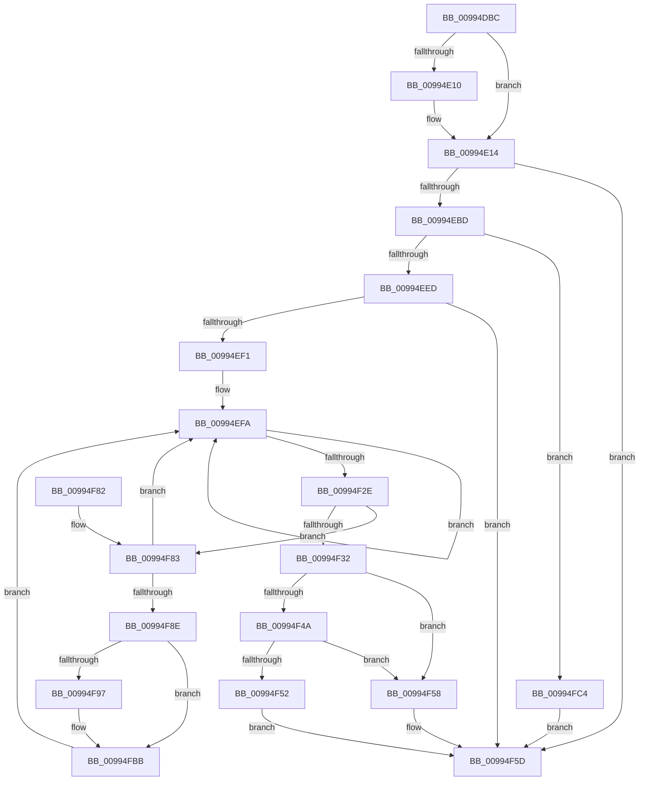

# PnpGetGenericStorePropertyLocales

- RVA: `0x00994DBC`–`0x00994FC9` (길이 `525` bytes)
- VA: `0x0000000140994DBC`
- 실행 섹션: `PAGE`
- PDB 이름 있음: `예`; PDB Function 태그: `아니요`
- unwind 정보 RVA: `0x000990B4`
- 디코드: `135`개 명령, `525/525` bytes 표시
- 미해석 바이트: `0` (있으면 어셈블리에 `.byte`로 보존)

> 이 문서는 커널 이미지의 기계어와 PDB 기호를 분석해 생성했습니다. 4번과 5번은 함수 원형과 자료형을 바이너리 사용 방식에서 추정한 C 해석이며 원본 소스 복구 결과는 아닙니다.

## 1. Dependencies

- 직접 호출 지점: **6**; 고유 호출 대상: **6**
- 직접 호출자로 확인된 함수: **2**
- RIP 상대 이미지 참조: **2**

### Outgoing calls
- `0x00994EAB` → [RtlStringCchPrintfExW](../../text/42/RtlStringCchPrintfExW_function_0042B390.md) (function, `0x0042B390`)
- `0x00994EDB` → [_PnpOpenPropertiesKey](_PnpOpenPropertiesKey_function_009938A0.md) (function, `0x009938A0`)
- `0x00994F1F` → [RegRtlEnumValue](RegRtlEnumValue_function_0099369C.md) (function, `0x0099369C`)
- `0x00994F36` → [ZwClose](../../text/6A/ZwClose_function_006AD2B0.md) (function, `0x006AD2B0`)
- `0x00994F69` → [_security_check_cookie](../../text/6A/_security_check_cookie_function_006AC640.md) (function, `0x006AC640`)
- `0x00994FB0` → [RtlStringCchCopyExW](../../text/41/RtlStringCchCopyExW_function_0041E1C0.md) (function, `0x0041E1C0`)

### Direct callers
- [PiDqPnPGetObjectPropertyLocales](PiDqPnPGetObjectPropertyLocales_function_0099590C.md) at `0x009959FF`
- [PnpGetObjectPropertyLocalesWorker](PnpGetObjectPropertyLocalesWorker_function_00995B8C.md) at `0x00995C4C`

### Static image references
- `0x00994DD8` → RVA `0x00E0A740` (`.data`; read)
- `0x00994E97` → RVA `0x00B0D8D0` (` ?? ::NNGAKEGL::`string'`; read)

## 2. Other-region calls and transfers

- 다른 실행 섹션으로 향하는 call: **4**
  - `0x00994EAB` → [RtlStringCchPrintfExW](../../text/42/RtlStringCchPrintfExW_function_0042B390.md) (`PAGE` → `.text`)
  - `0x00994F36` → [ZwClose](../../text/6A/ZwClose_function_006AD2B0.md) (`PAGE` → `.text`)
  - `0x00994F69` → [_security_check_cookie](../../text/6A/_security_check_cookie_function_006AC640.md) (`PAGE` → `.text`)
  - `0x00994FB0` → [RtlStringCchCopyExW](../../text/41/RtlStringCchCopyExW_function_0041E1C0.md) (`PAGE` → `.text`)
- 별도 외부 분기/꼬리 이동을 확인하지 못했습니다.

## 3. Assembly (complete function range)

```asm
00994DBC  40 55                           push rbp
00994DBE  53                              push rbx
00994DBF  56                              push rsi
00994DC0  57                              push rdi
00994DC1  41 54                           push r12
00994DC3  41 55                           push r13
00994DC5  41 56                           push r14
00994DC7  41 57                           push r15
00994DC9  48 8D AC 24 38 FF FF FF         lea rbp, [rsp - 0xc8]
00994DD1  48 81 EC D8 01 00 00            sub rsp, 0x1d8
00994DD8  48 8B 05 61 59 47 00            mov rax, qword ptr [rip + 0x475961]
00994DDF  48 33 C4                        xor rax, rsp
00994DE2  48 89 85 B0 00 00 00            mov qword ptr [rbp + 0xb0], rax
00994DE9  4C 8B A5 38 01 00 00            mov r12, qword ptr [rbp + 0x138]
00994DF0  33 C0                           xor eax, eax
00994DF2  4D 8B F9                        mov r15, r9
00994DF5  4D 8B E8                        mov r13, r8
00994DF8  48 89 55 80                     mov qword ptr [rbp - 0x80], rdx
00994DFC  48 89 4D 90                     mov qword ptr [rbp - 0x70], rcx
00994E00  41 89 04 24                     mov dword ptr [r12], eax
00994E04  48 89 45 88                     mov qword ptr [rbp - 0x78], rax
00994E08  39 85 30 01 00 00               cmp dword ptr [rbp + 0x130], eax
00994E0E  76 04                           jbe 0x140994e14
00994E10  66 41 89 01                     mov word ptr [r9], ax
00994E14  41 0F B6 48 0F                  movzx ecx, byte ptr [r8 + 0xf]
00994E19  41 0F B6 50 0E                  movzx edx, byte ptr [r8 + 0xe]
00994E1E  41 8B 45 10                     mov eax, dword ptr [r13 + 0x10]
00994E22  45 0F B6 40 0D                  movzx r8d, byte ptr [r8 + 0xd]
00994E27  45 0F B6 4D 0C                  movzx r9d, byte ptr [r13 + 0xc]
00994E2C  45 0F B6 55 0B                  movzx r10d, byte ptr [r13 + 0xb]
00994E31  45 0F B6 5D 0A                  movzx r11d, byte ptr [r13 + 0xa]
00994E36  41 0F B6 5D 09                  movzx ebx, byte ptr [r13 + 9]
00994E3B  41 0F B6 7D 08                  movzx edi, byte ptr [r13 + 8]
00994E40  41 0F B7 75 06                  movzx esi, word ptr [r13 + 6]
00994E45  45 0F B7 75 04                  movzx r14d, word ptr [r13 + 4]
00994E4A  89 84 24 88 00 00 00            mov dword ptr [rsp + 0x88], eax
00994E51  41 8B 45 00                     mov eax, dword ptr [r13]
00994E55  89 8C 24 80 00 00 00            mov dword ptr [rsp + 0x80], ecx
00994E5C  48 8D 4D A0                     lea rcx, [rbp - 0x60]
00994E60  89 54 24 78                     mov dword ptr [rsp + 0x78], edx
00994E64  44 89 44 24 70                  mov dword ptr [rsp + 0x70], r8d
00994E69  45 33 C0                        xor r8d, r8d
00994E6C  44 89 4C 24 68                  mov dword ptr [rsp + 0x68], r9d
00994E71  45 33 C9                        xor r9d, r9d
00994E74  44 89 54 24 60                  mov dword ptr [rsp + 0x60], r10d
00994E79  44 89 5C 24 58                  mov dword ptr [rsp + 0x58], r11d
00994E7E  89 5C 24 50                     mov dword ptr [rsp + 0x50], ebx
00994E82  89 7C 24 48                     mov dword ptr [rsp + 0x48], edi
00994E86  41 8D 51 30                     lea edx, [r9 + 0x30]
00994E8A  89 74 24 40                     mov dword ptr [rsp + 0x40], esi
00994E8E  44 89 74 24 38                  mov dword ptr [rsp + 0x38], r14d
00994E93  89 44 24 30                     mov dword ptr [rsp + 0x30], eax
00994E97  48 8D 05 32 8A 17 00            lea rax, [rip + 0x178a32]
00994E9E  48 89 44 24 28                  mov qword ptr [rsp + 0x28], rax
00994EA3  C7 44 24 20 00 08 00 00         mov dword ptr [rsp + 0x20], 0x800
00994EAB  E8 E0 64 A9 FF                  call 0x14042b390
00994EB0  45 33 ED                        xor r13d, r13d
00994EB3  8B D8                           mov ebx, eax
00994EB5  85 C0                           test eax, eax
00994EB7  0F 88 A0 00 00 00               js 0x140994f5d
00994EBD  48 8B 55 80                     mov rdx, qword ptr [rbp - 0x80]
00994EC1  48 8D 45 88                     lea rax, [rbp - 0x78]
00994EC5  48 8B 4D 90                     mov rcx, qword ptr [rbp - 0x70]
00994EC9  45 8D 4D 01                     lea r9d, [r13 + 1]
00994ECD  48 89 44 24 30                  mov qword ptr [rsp + 0x30], rax
00994ED2  4C 8D 45 A0                     lea r8, [rbp - 0x60]
00994ED6  44 88 6C 24 20                  mov byte ptr [rsp + 0x20], r13b
00994EDB  E8 C0 E9 FF FF                  call 0x1409938a0
00994EE0  8B D8                           mov ebx, eax
00994EE2  3D 34 00 00 C0                  cmp eax, 0xc0000034
00994EE7  0F 84 D7 00 00 00               je 0x140994fc4
00994EED  85 C0                           test eax, eax
00994EEF  78 6C                           js 0x140994f5d
00994EF1  8B B5 30 01 00 00               mov esi, dword ptr [rbp + 0x130]
00994EF7  45 8B F5                        mov r14d, r13d
00994EFA  48 8B 4D 88                     mov rcx, qword ptr [rbp - 0x78]
00994EFE  4C 8D 4D 80                     lea r9, [rbp - 0x80]
00994F02  4C 89 6C 24 30                  mov qword ptr [rsp + 0x30], r13
00994F07  4C 8D 45 00                     lea r8, [rbp]
00994F0B  4C 89 6C 24 28                  mov qword ptr [rsp + 0x28], r13
00994F10  41 8B D6                        mov edx, r14d
00994F13  4C 89 6C 24 20                  mov qword ptr [rsp + 0x20], r13
00994F18  C7 45 80 55 00 00 00            mov dword ptr [rbp - 0x80], 0x55
00994F1F  E8 78 E7 FF FF                  call 0x14099369c
00994F24  41 FF C6                        inc r14d
00994F27  3D 23 00 00 C0                  cmp eax, 0xc0000023
00994F2C  74 CC                           je 0x140994efa
00994F2E  85 C0                           test eax, eax
00994F30  74 51                           je 0x140994f83
00994F32  48 8B 4D 88                     mov rcx, qword ptr [rbp - 0x78]
00994F36  E8 75 83 D1 FF                  call 0x1406ad2b0
00994F3B  41 8B 04 24                     mov eax, dword ptr [r12]
00994F3F  FF C0                           inc eax
00994F41  41 89 04 24                     mov dword ptr [r12], eax
00994F45  4D 85 FF                        test r15, r15
00994F48  74 0E                           je 0x140994f58
00994F4A  39 85 30 01 00 00               cmp dword ptr [rbp + 0x130], eax
00994F50  72 06                           jb 0x140994f58
00994F52  66 45 89 2F                     mov word ptr [r15], r13w
00994F56  EB 05                           jmp 0x140994f5d
00994F58  BB 23 00 00 C0                  mov ebx, 0xc0000023
00994F5D  8B C3                           mov eax, ebx
00994F5F  48 8B 8D B0 00 00 00            mov rcx, qword ptr [rbp + 0xb0]
00994F66  48 33 CC                        xor rcx, rsp
00994F69  E8 D2 76 D1 FF                  call 0x1406ac640
00994F6E  48 81 C4 D8 01 00 00            add rsp, 0x1d8
00994F75  41 5F                           pop r15
00994F77  41 5E                           pop r14
00994F79  41 5D                           pop r13
00994F7B  41 5C                           pop r12
00994F7D  5F                              pop rdi
00994F7E  5E                              pop rsi
00994F7F  5B                              pop rbx
00994F80  5D                              pop rbp
00994F81  C3                              ret
00994F82  CC                              int3
00994F83  66 44 39 6D 00                  cmp word ptr [rbp], r13w
00994F88  0F 84 6C FF FF FF               je 0x140994efa
00994F8E  8B 7D 80                        mov edi, dword ptr [rbp - 0x80]
00994F91  FF C7                           inc edi
00994F93  3B FE                           cmp edi, esi
00994F95  73 24                           jae 0x140994fbb
00994F97  8B D6                           mov edx, esi
00994F99  4C 8D 45 00                     lea r8, [rbp]
00994F9D  C7 44 24 28 00 09 00 00         mov dword ptr [rsp + 0x28], 0x900
00994FA5  45 33 C9                        xor r9d, r9d
00994FA8  49 8B CF                        mov rcx, r15
00994FAB  4C 89 6C 24 20                  mov qword ptr [rsp + 0x20], r13
00994FB0  E8 0B 92 A8 FF                  call 0x14041e1c0
00994FB5  2B F7                           sub esi, edi
00994FB7  4D 8D 3C 7F                     lea r15, [r15 + rdi*2]
00994FBB  41 01 3C 24                     add dword ptr [r12], edi
00994FBF  E9 36 FF FF FF                  jmp 0x140994efa
00994FC4  41 8B DD                        mov ebx, r13d
00994FC7  EB 94                           jmp 0x140994f5d
```

## 4. C-style interpretation (structured pseudocode)

```c
__int64 __fastcall PnpGetGenericStorePropertyLocales(__int64 a1, __int64 a2, __int64 a3, __int64 a4, unsigned int a5, __int64 a6)
{
    __int64 result;
    __int64 v_r13;
    __int64 v_r14;
    __int64 v_r15;
    __int64 v_rdi;
    __int64 v_rsi;
    __int64 v_rsp;
    unsigned __int64 v_stack_m108;
    unsigned __int64 v_stack_m168;
    unsigned __int64 v_stack_m178;
    unsigned __int64 v_stack_m180;
    unsigned __int64 v_stack_m188;
    unsigned int v_stack_m190;
    unsigned int v_stack_m198;
    unsigned int v_stack_m1A0;
    unsigned int v_stack_m1A8;
    unsigned int v_stack_m1B0;
    unsigned int v_stack_m1B8;
    unsigned int v_stack_m1C0;
    unsigned int v_stack_m1C8;
    unsigned int v_stack_m1D0;
    unsigned int v_stack_m1D8;
    unsigned int v_stack_m1E0;
    unsigned int v_stack_m1E8;
    unsigned __int64 v_stack_m1F0;
    unsigned int v_stack_m1F8;
    unsigned __int64 v_stack_m58;
    unsigned __int64 v_stack_p20;
    unsigned int v_stack_p28;

    v_rsp = (v_rsp) - (472);
    result = (*(unsigned __int64 *)(v_rip + 4675937)) ^ (v_rsp);
    v_stack_m58 = result;
    result = 0;
    v_stack_m188 = a2;
    v_stack_m178 = a1;
    *(unsigned int *)(a6) = 0;
    v_stack_m180 = 0;
    if (a5 >= = 0) {
        *(unsigned __int16 *)(a4) = 0;
    }
    v_stack_m190 = (unsigned int)((unsigned int)(*(unsigned int *)(a3 + 16)));
    v_stack_m198 = (unsigned int)(*(unsigned __int8 *)(a3 + 15));
    v_stack_m1A0 = (unsigned int)(*(unsigned __int8 *)(a3 + 14));
    v_stack_m1A8 = (unsigned int)(*(unsigned __int8 *)(a3 + 13));
    a3 = 0;
    v_stack_m1B0 = (unsigned int)(*(unsigned __int8 *)(a3 + 12));
    a4 = 0;
    v_stack_m1B8 = (unsigned int)(*(unsigned __int8 *)(a3 + 11));
    v_stack_m1C0 = (unsigned int)(*(unsigned __int8 *)(a3 + 10));
    v_stack_m1C8 = (unsigned int)(*(unsigned __int8 *)(a3 + 9));
    v_stack_m1D0 = (unsigned int)(*(unsigned __int8 *)(a3 + 8));
    v_stack_m1D8 = (unsigned int)(*(unsigned __int16 *)(a3 + 6));
    v_stack_m1E0 = (unsigned int)(*(unsigned __int16 *)(a3 + 4));
    v_stack_m1E8 = (unsigned int)((unsigned int)(*(unsigned int *)(a3)));
    v_stack_m1F0 = v_rip + 1542706;
    v_stack_m1F8 = 0x800ULL;
    result = RtlStringCchPrintfExW(v_stack_m168, a4 + 48, a3, a4);
    v_r13 = 0;
    if (sign_flag) goto loc_00994F5D;
    v_stack_m1E8 = v_stack_m180;
    v_stack_m1F8 = 0;
    result = _PnpOpenPropertiesKey(v_stack_m178, v_stack_m188, v_stack_m168, v_r13 + 1);
    if (((unsigned int)(result)) == 0xC0000034ULL) goto loc_00994FC4;
    if (sign_flag) goto loc_00994F5D;
loc_00994EFA:
    v_stack_m1E8 = 0;
    v_stack_m1F0 = 0;
    v_stack_m1F8 = 0;
    v_stack_m188 = 85;
    result = RegRtlEnumValue(v_stack_m180, 0, v_stack_m108, v_stack_m188);
    v_r14 = (unsigned int)((0) + 1);
    if (((unsigned int)(result)) == 0xC0000023ULL) goto loc_00994EFA;
    if ((unsigned int)(result) == 0) goto loc_00994F83;
    result = ZwClose(v_stack_m180, 0, v_stack_m108, v_stack_m188);
    result = (unsigned int)(((unsigned int)(*(unsigned int *)(a6))) + 1);
    *(unsigned int *)(a6) = (unsigned int)(result);
    if (0 == 0) goto loc_00994F58;
    if (a5 < ((unsigned int)(result))) goto loc_00994F58;
    *(unsigned __int16 *)(a4) = 0;
    goto loc_00994F5D;
loc_00994F58:
loc_00994F5D:
    a1 = (v_stack_m58) ^ (v_rsp);
    result = _security_check_cookie(a1, 0, v_stack_m108, v_stack_m188);
    v_rsp = (v_rsp) + (472);
    return result;
loc_00994F83:
    if (v_stack_m108 == 0) goto loc_00994EFA;
    v_rdi = (unsigned int)(((unsigned int)(v_stack_m188)) + 1);
    v_rsi = (unsigned int)(a5);
    v_r15 = a4;
    if (((unsigned int)(v_rdi)) < ((unsigned int)((unsigned int)(a5)))) {
        a2 = (unsigned int)((unsigned int)(a5));
        a3 = v_stack_m108;
        v_stack_p28 = 0x900ULL;
        a4 = 0;
        a1 = 0;
        v_stack_p20 = 0;
        result = RtlStringCchCopyExW(a1, a2, a3, a4);
        v_rsi = (unsigned int)(((unsigned int)(a5)) - ((unsigned int)(v_rdi)));
        v_r15 = a4 + v_rdi * 2;
    }
    goto loc_00994EFA;
loc_00994FC4:
    goto loc_00994F5D;
}
```

## 5. (Beta) C Style

```c
int64_t PnpGetGenericStorePropertyLocales(int64_t Arg1, int64_t Arg2, void *Arg3, void *Arg4, uint32_t Arg5, void *Arg6)
{
    uint8_t *arg3 = (uint8_t *)Arg3;
    uint8_t *arg4 = (uint8_t *)Arg4;
    uint8_t *arg6 = (uint8_t *)Arg6;

    int64_t result;
    int64_t local_r13;
    int64_t local_r14;
    int64_t local_r15;
    int64_t local_rdi;
    int64_t local_rsi;
    int64_t local_rsp;
    uint64_t v_stack_m108;
    uint64_t v_stack_m168;
    uint64_t v_stack_m178;
    uint64_t v_stack_m180;
    uint64_t v_stack_m188;
    uint32_t v_stack_m190;
    uint32_t v_stack_m198;
    uint32_t v_stack_m1A0;
    uint32_t v_stack_m1A8;
    uint32_t v_stack_m1B0;
    uint32_t v_stack_m1B8;
    uint32_t v_stack_m1C0;
    uint32_t v_stack_m1C8;
    uint32_t v_stack_m1D0;
    uint32_t v_stack_m1D8;
    uint32_t v_stack_m1E0;
    uint32_t v_stack_m1E8;
    uint64_t v_stack_m1F0;
    uint32_t v_stack_m1F8;
    uint64_t v_stack_m58;
    uint64_t v_stack_p20;
    uint32_t v_stack_p28;

    local_rsp = (local_rsp) - (472);
    result = (*(uint64_t *)(v_rip + 0x475961)) ^ (local_rsp);
    v_stack_m58 = result;
    result = 0;
    v_stack_m188 = Arg2;
    v_stack_m178 = Arg1;
    *(uint32_t *)(arg6) = 0;
    v_stack_m180 = 0;
    if (Arg5 >= = 0) {
        *(uint16_t *)(arg4) = 0;
    }
    v_stack_m190 = (uint32_t)((uint32_t)(*(uint32_t *)(arg3 + 0x10)));
    v_stack_m198 = (uint32_t)(*(uint8_t *)(arg3 + 0xF));
    v_stack_m1A0 = (uint32_t)(*(uint8_t *)(arg3 + 0xE));
    v_stack_m1A8 = (uint32_t)(*(uint8_t *)(arg3 + 0xD));
    Arg3 = 0;
    v_stack_m1B0 = (uint32_t)(*(uint8_t *)(arg3 + 0xC));
    Arg4 = 0;
    v_stack_m1B8 = (uint32_t)(*(uint8_t *)(arg3 + 0xB));
    v_stack_m1C0 = (uint32_t)(*(uint8_t *)(arg3 + 0xA));
    v_stack_m1C8 = (uint32_t)(*(uint8_t *)(arg3 + 0x9));
    v_stack_m1D0 = (uint32_t)(*(uint8_t *)(arg3 + 0x8));
    v_stack_m1D8 = (uint32_t)(*(uint16_t *)(arg3 + 0x6));
    v_stack_m1E0 = (uint32_t)(*(uint16_t *)(arg3 + 0x4));
    v_stack_m1E8 = (uint32_t)((uint32_t)(*(uint32_t *)(arg3)));
    v_stack_m1F0 = v_rip + 1542706;
    v_stack_m1F8 = 0x800ULL;
    result = RtlStringCchPrintfExW(v_stack_m168, Arg4 + 48, Arg3, Arg4);
    local_r13 = 0;
    if (sign_flag) goto loc_00994F5D;
    v_stack_m1E8 = v_stack_m180;
    v_stack_m1F8 = 0;
    result = _PnpOpenPropertiesKey(v_stack_m178, v_stack_m188, v_stack_m168, local_r13 + 1);
    if (((uint32_t)(result)) == 0xC0000034ULL) goto loc_00994FC4;
    if (sign_flag) goto loc_00994F5D;
loc_00994EFA:
    v_stack_m1E8 = 0;
    v_stack_m1F0 = 0;
    v_stack_m1F8 = 0;
    v_stack_m188 = 85;
    result = RegRtlEnumValue(v_stack_m180, 0, v_stack_m108, v_stack_m188);
    local_r14 = (uint32_t)((0) + 1);
    if (((uint32_t)(result)) == 0xC0000023ULL) goto loc_00994EFA;
    if ((uint32_t)(result) == 0) goto loc_00994F83;
    result = ZwClose(v_stack_m180, 0, v_stack_m108, v_stack_m188);
    result = (uint32_t)(((uint32_t)(*(uint32_t *)(arg6))) + 1);
    *(uint32_t *)(arg6) = (uint32_t)(result);
    if (0 == 0) goto loc_00994F58;
    if (Arg5 < ((uint32_t)(result))) goto loc_00994F58;
    *(uint16_t *)(arg4) = 0;
    goto loc_00994F5D;
loc_00994F58:
loc_00994F5D:
    Arg1 = (v_stack_m58) ^ (local_rsp);
    result = _security_check_cookie(Arg1, 0, v_stack_m108, v_stack_m188);
    local_rsp = (local_rsp) + (472);
    return result;
loc_00994F83:
    if (v_stack_m108 == 0) goto loc_00994EFA;
    local_rdi = (uint32_t)(((uint32_t)(v_stack_m188)) + 1);
    local_rsi = (uint32_t)(Arg5);
    local_r15 = Arg4;
    if (((uint32_t)(local_rdi)) < ((uint32_t)((uint32_t)(Arg5)))) {
        Arg2 = (uint32_t)((uint32_t)(Arg5));
        Arg3 = v_stack_m108;
        v_stack_p28 = 0x900ULL;
        Arg4 = 0;
        Arg1 = 0;
        v_stack_p20 = 0;
        result = RtlStringCchCopyExW(Arg1, Arg2, Arg3, Arg4);
        local_rsi = (uint32_t)(((uint32_t)(Arg5)) - ((uint32_t)(local_rdi)));
        local_r15 = Arg4 + local_rdi * 2;
    }
    goto loc_00994EFA;
loc_00994FC4:
    goto loc_00994F5D;
}
```

### 관측된 메모리 오프셋

구조체 형식이 확인되지 않은 접근은 인자 기준의 오프셋으로만 기록했습니다.

| 기준 인자 | 오프셋 표현 | 폭 (bit) | 접근 |
|---|---:|---:|---|
| `Arg3` | `+ 0x0` | `32` | `R` |
| `Arg3` | `+ 0x4` | `16` | `R` |
| `Arg3` | `+ 0x6` | `16` | `R` |
| `Arg3` | `+ 0x8` | `8` | `R` |
| `Arg3` | `+ 0x9` | `8` | `R` |
| `Arg3` | `+ 0xA` | `8` | `R` |
| `Arg3` | `+ 0xB` | `8` | `R` |
| `Arg3` | `+ 0xC` | `8` | `R` |
| `Arg3` | `+ 0xD` | `8` | `R` |
| `Arg3` | `+ 0xE` | `8` | `R` |
| `Arg3` | `+ 0xF` | `8` | `R` |
| `Arg3` | `+ 0x10` | `32` | `R` |
| `Arg4` | `+ 0x0` | `16` | `W` |
| `Arg4` | `+ 0x0 + rdi*2` | `64` | `R` |
| `Arg6` | `+ 0x0` | `32` | `R` |
| `Arg6` | `+ 0x0` | `32` | `R/W` |
| `Arg6` | `+ 0x0` | `32` | `W` |

## 6. Execution-region graph

[열기: 2D/3D 그래프와 함수 탐색 컨트롤 패널](../../../control-panel.html?section=page&rva=0x00994DBC&view=graph)

- 2D 그래프는 위에서 아래로 흐르고, 3D 그래프는 빈 공간을 드래그해 회전합니다. Shift+드래그는 이동, 휠은 확대·축소, 함수 노드 선택은 대상 보고서 이동입니다.

### Static fallback


