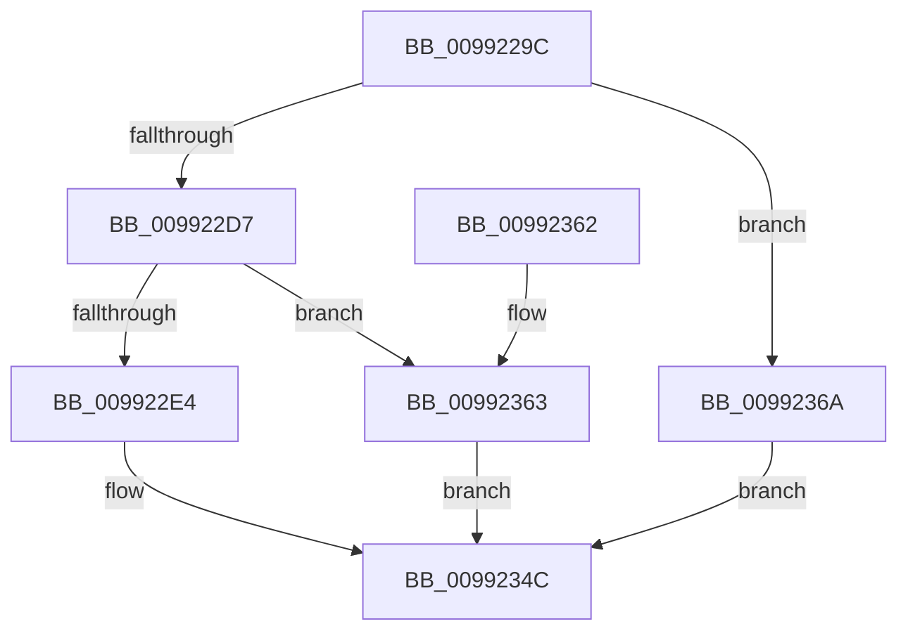

# PnpGetMappedPropertyKeysDispatch

- RVA: `0x0099229C`–`0x00992371` (길이 `213` bytes)
- VA: `0x000000014099229C`
- 실행 섹션: `PAGE`
- PDB 이름 있음: `예`; PDB Function 태그: `아니요`
- unwind 정보 RVA: `0x00098C24`
- 디코드: `52`개 명령, `213/213` bytes 표시
- 미해석 바이트: `0` (있으면 어셈블리에 `.byte`로 보존)

> 이 문서는 커널 이미지의 기계어와 PDB 기호를 분석해 생성했습니다. 4번과 5번은 함수 원형과 자료형을 바이너리 사용 방식에서 추정한 C 해석이며 원본 소스 복구 결과는 아닙니다.

## 1. Dependencies

- 직접 호출 지점: **2**; 고유 호출 대상: **2**
- 직접 호출자로 확인된 함수: **1**
- RIP 상대 이미지 참조: **0**

### Outgoing calls
- `0x009922C6` → [memset](../../text/6C/memset_function_006C6C40.md) (function, `0x006C6C40`)
- `0x00992347` → [guard_dispatch_icall](../../text/6B/guard_dispatch_icall_function_006BAAD0.md) (function, `0x006BAAD0`)

### Direct callers
- [PnpGetObjectPropertyKeysWorker](PnpGetObjectPropertyKeysWorker_function_0099211C.md) at `0x009921A3`

### Static image references
- 디코드된 RIP-relative 메모리 참조가 없습니다.

## 2. Other-region calls and transfers

- 다른 실행 섹션으로 향하는 call: **2**
  - `0x009922C6` → [memset](../../text/6C/memset_function_006C6C40.md) (`PAGE` → `.text`)
  - `0x00992347` → [guard_dispatch_icall](../../text/6B/guard_dispatch_icall_function_006BAAD0.md) (`PAGE` → `.text`)
- 별도 외부 분기/꼬리 이동을 확인하지 못했습니다.

## 3. Assembly (complete function range)

```asm
0099229C  48 8B C4                        mov rax, rsp
0099229F  48 89 58 08                     mov qword ptr [rax + 8], rbx
009922A3  48 89 68 10                     mov qword ptr [rax + 0x10], rbp
009922A7  48 89 70 18                     mov qword ptr [rax + 0x18], rsi
009922AB  57                              push rdi
009922AC  48 83 EC 70                     sub rsp, 0x70
009922B0  48 8B EA                        mov rbp, rdx
009922B3  49 63 D8                        movsxd rbx, r8d
009922B6  33 D2                           xor edx, edx
009922B8  48 8B F9                        mov rdi, rcx
009922BB  48 8D 48 B8                     lea rcx, [rax - 0x48]
009922BF  49 8B F1                        mov rsi, r9
009922C2  44 8D 42 40                     lea r8d, [rdx + 0x40]
009922C6  E8 75 49 D3 FF                  call 0x1406c6c40
009922CB  8D 43 FF                        lea eax, [rbx - 1]
009922CE  83 F8 0A                        cmp eax, 0xa
009922D1  0F 87 93 00 00 00               ja 0x14099236a
009922D7  4C 8B 94 DF 28 01 00 00         mov r10, qword ptr [rdi + rbx*8 + 0x128]
009922DF  4D 85 D2                        test r10, r10
009922E2  74 7F                           je 0x140992363
009922E4  48 8B 84 24 A0 00 00 00         mov rax, qword ptr [rsp + 0xa0]
009922EC  41 B9 06 00 00 00               mov r9d, 6
009922F2  48 8B 8C 24 B0 00 00 00         mov rcx, qword ptr [rsp + 0xb0]
009922FA  44 8B C3                        mov r8d, ebx
009922FD  83 64 24 60 00                  and dword ptr [rsp + 0x60], 0
00992302  48 8B D5                        mov rdx, rbp
00992305  48 89 44 24 38                  mov qword ptr [rsp + 0x38], rax
0099230A  8A 84 24 A8 00 00 00            mov al, byte ptr [rsp + 0xa8]
00992311  48 89 4C 24 48                  mov qword ptr [rsp + 0x48], rcx
00992316  8B 8C 24 B8 00 00 00            mov ecx, dword ptr [rsp + 0xb8]
0099231D  88 44 24 40                     mov byte ptr [rsp + 0x40], al
00992321  48 8D 44 24 30                  lea rax, [rsp + 0x30]
00992326  89 4C 24 50                     mov dword ptr [rsp + 0x50], ecx
0099232A  48 8B 8C 24 C0 00 00 00         mov rcx, qword ptr [rsp + 0xc0]
00992332  48 89 44 24 20                  mov qword ptr [rsp + 0x20], rax
00992337  49 8B C2                        mov rax, r10
0099233A  48 89 4C 24 58                  mov qword ptr [rsp + 0x58], rcx
0099233F  48 8B CF                        mov rcx, rdi
00992342  48 89 74 24 30                  mov qword ptr [rsp + 0x30], rsi
00992347  E8 84 87 D2 FF                  call 0x1406baad0
0099234C  4C 8D 5C 24 70                  lea r11, [rsp + 0x70]
00992351  49 8B 5B 10                     mov rbx, qword ptr [r11 + 0x10]
00992355  49 8B 6B 18                     mov rbp, qword ptr [r11 + 0x18]
00992359  49 8B 73 20                     mov rsi, qword ptr [r11 + 0x20]
0099235D  49 8B E3                        mov rsp, r11
00992360  5F                              pop rdi
00992361  C3                              ret
00992362  CC                              int3
00992363  B8 02 00 00 C0                  mov eax, 0xc0000002
00992368  EB E2                           jmp 0x14099234c
0099236A  B8 0D 00 00 C0                  mov eax, 0xc000000d
0099236F  EB DB                           jmp 0x14099234c
```

## 4. C-style interpretation (structured pseudocode)

```c
__int64 __fastcall PnpGetMappedPropertyKeysDispatch(__int64 a1, __int64 a2, int a3, __int64 a4, __int64 a5, unsigned __int8 a6, __int64 a7, unsigned int a8, __int64 a9)
{
    __int64 result;
    __int64 v_rsp;
    unsigned int v_stack_m18;
    unsigned __int64 v_stack_m20;
    unsigned int v_stack_m28;
    unsigned __int64 v_stack_m30;
    unsigned __int8 v_stack_m38;
    unsigned __int64 v_stack_m40;
    unsigned __int64 v_stack_m48;
    unsigned __int64 v_stack_m58;
    unsigned __int64 v_stack_m8;

    *(unsigned __int64 *)(v_rsp + 8) = v_rbx;
    *(unsigned __int64 *)(v_rsp + 16) = v_rbp;
    *(unsigned __int64 *)(v_rsp + 24) = v_rsi;
    v_rsp = (v_rsp) - (112);
    a2 = 0;
    result = memset(v_rsp - 72, a2, a2 + 64, a4);
    if (((unsigned int)((int)(a3) - 1)) > 10) goto loc_0099236A;
    if (*(unsigned __int64 *)(a1 + (int)(a3) * 8 + 296) == 0) goto loc_00992363;
    v_stack_m40 = a5;
    v_stack_m30 = a7;
    v_stack_m38 = a6;
    v_stack_m28 = (unsigned int)((unsigned int)(a8));
    v_stack_m58 = v_stack_m48;
    v_stack_m20 = a9;
    v_stack_m48 = a4;
    result = guard_dispatch_icall(a1, 0, (unsigned int)((unsigned int)((int)(a3))), 6);
loc_0099234C:
    return result;
loc_00992363:
    goto loc_0099234C;
loc_0099236A:
    goto loc_0099234C;
}
```

## 5. (Beta) C Style

```c
int64_t PnpGetMappedPropertyKeysDispatch(void *Arg1, int64_t Arg2, void *Arg3, int64_t Arg4, int64_t Arg5, uint8_t Arg6, int64_t Arg7, uint32_t Arg8, int64_t Arg9)
{
    uint8_t *arg1 = (uint8_t *)Arg1;
    uint8_t *arg3 = (uint8_t *)Arg3;

    int64_t result;
    int64_t local_rsp;
    uint32_t v_stack_m18;
    uint64_t v_stack_m20;
    uint32_t v_stack_m28;
    uint64_t v_stack_m30;
    uint8_t v_stack_m38;
    uint64_t v_stack_m40;
    uint64_t v_stack_m48;
    uint64_t v_stack_m58;
    uint64_t v_stack_m8;

    *(uint64_t *)(local_rsp + 0x8) = local_rbx;
    *(uint64_t *)(local_rsp + 0x10) = local_rbp;
    *(uint64_t *)(local_rsp + 0x18) = local_rsi;
    local_rsp = (local_rsp) - (112);
    Arg2 = 0;
    result = memset(local_rsp - 72, Arg2, Arg2 + 64, Arg4);
    if (((uint32_t)((int32_t)(Arg3) - 1)) > 10) goto loc_0099236A;
    if (*(uint64_t *)(arg1 + (int32_t)(arg3) * 8 + 0x128) == 0) goto loc_00992363;
    v_stack_m40 = Arg5;
    v_stack_m30 = Arg7;
    v_stack_m38 = Arg6;
    v_stack_m28 = (uint32_t)((uint32_t)(Arg8));
    v_stack_m58 = v_stack_m48;
    v_stack_m20 = Arg9;
    v_stack_m48 = Arg4;
    result = guard_dispatch_icall(Arg1, 0, (uint32_t)((uint32_t)((int32_t)(Arg3))), 6);
loc_0099234C:
    return result;
loc_00992363:
    goto loc_0099234C;
loc_0099236A:
    goto loc_0099234C;
}
```

### 관측된 메모리 오프셋

구조체 형식이 확인되지 않은 접근은 인자 기준의 오프셋으로만 기록했습니다.

| 기준 인자 | 오프셋 표현 | 폭 (bit) | 접근 |
|---|---:|---:|---|
| `Arg1` | `+ 0x128 + rbx*8` | `64` | `R` |
| `Arg3` | `- 0x1` | `32` | `R` |

## 6. Execution-region graph

[열기: 2D/3D 그래프와 함수 탐색 컨트롤 패널](../../../control-panel.html?section=page&rva=0x0099229C&view=graph)

- 2D 그래프는 위에서 아래로 흐르고, 3D 그래프는 빈 공간을 드래그해 회전합니다. Shift+드래그는 이동, 휠은 확대·축소, 함수 노드 선택은 대상 보고서 이동입니다.

### Static fallback


